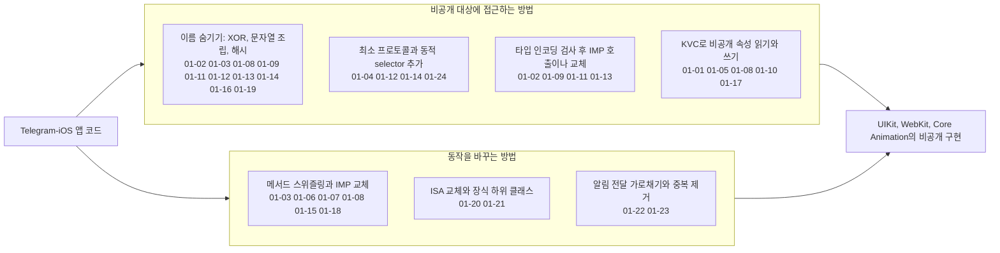
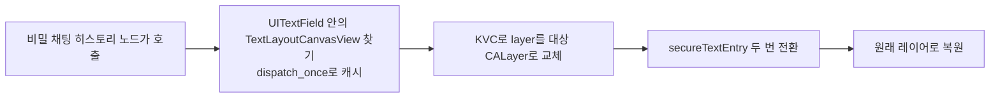
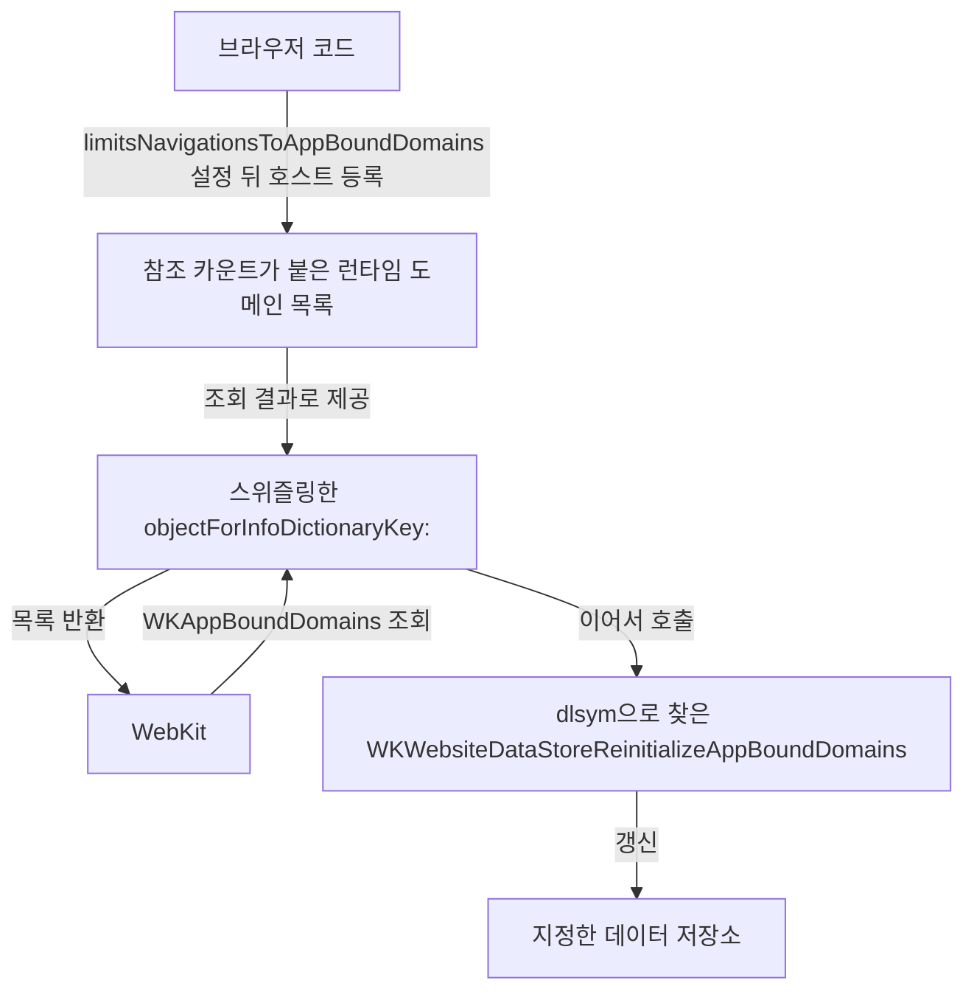
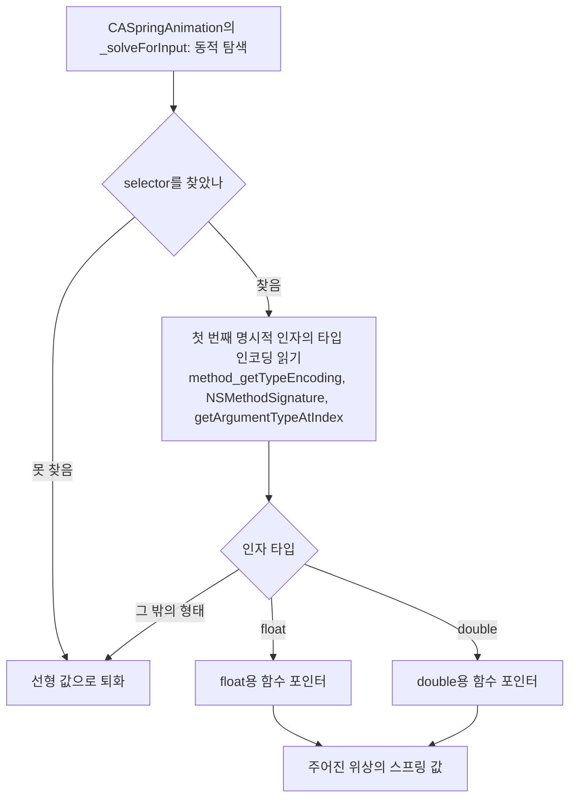
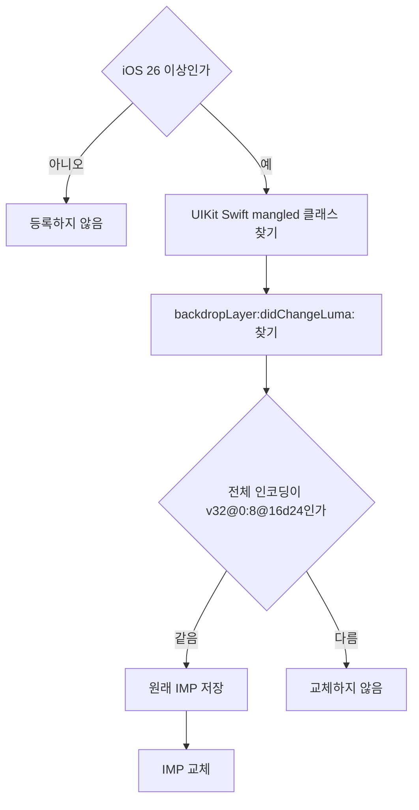

# 런타임과 비공개 API

웹: /docs/ios/01-runtime-private-api/ · Markdown: /docs/ios/01-runtime-private-api.md

> 메서드 스위즐링, 비공개 클래스명 난독화, XOR 바이트열과 정확한 ABI 호출.

| 기법 항목 | 리포트 선정 | 관련 비공개 API | REA 연관 |
| --- | --- | --- | --- |
| 24 | 6 | 24 | 0 |

소스: [TelegramMessenger/Telegram-iOS@f1dd7a2d](https://github.com/TelegramMessenger/Telegram-iOS/tree/f1dd7a2dbd02cbbf513e75d5695d8d36d1cf5838)(2026-10-07) · 플랫폼: iOS · UIKit

이 장의 선정 항목:
- 01-1 [#01-01 보안 텍스트 입력 레이어를 빌려 아무 레이어나 스크린샷에서 빼기](/docs/ios/01-runtime-private-api/#t01-01)
- 01-2 [#01-02 XOR 바이트열로 비공개 맞춤법 검사 컨트롤러를 숨기고 정확한 ABI로 호출하기](/docs/ios/01-runtime-private-api/#t01-02)
- 01-3 [#01-03 `Info.plist` 결과를 위조해 App-Bound 도메인을 동적으로 추가·삭제하기](/docs/ios/01-runtime-private-api/#t01-03)
- 01-4 [#01-05 비공개 `cornerRadii`로 애니메이션 가능한 네 모서리 반경을 얻고 오프스크린 마스크 피하기](/docs/ios/01-runtime-private-api/#t01-05)
- 01-5 [#01-09 비공개 메서드 시그니처를 먼저 읽고 `float`/`double` IMP 호출 규약 고르기](/docs/ios/01-runtime-private-api/#t01-09)
- 01-6 [#01-13 비공개 메서드의 전체 타입 인코딩을 검사한 뒤에야 IMP 교체하기](/docs/ios/01-runtime-private-api/#t01-13)

범위: Telegram-iOS(`f1dd7a2dbd02cbbf513e75d5695d8d36d1cf5838`)의 UIKit 런타임 해킹, 메서드 스위즐링, 비공개 API 난독화.

아래 도표는 이 장의 기법들이 비공개 대상에 접근하고 동작을 바꾸는 방식을 묶어서 보여 줘요.



## 1. 보안 텍스트 입력 레이어를 빌려 아무 레이어나 스크린샷에서 빼기 [#t01-01]

> #01-01 · Telegram-iOS · UIKit · 리포트 선정 01-1 · 검증 방식: 소스 분석 · 태그: 비공개 API, Core Animation, 텍스트와 입력
>
> 소스: [Telegram-iOS:submodules/UIKitRuntimeUtils/Source/UIKitRuntimeUtils/UIKitUtils.m L299–L328](https://github.com/TelegramMessenger/Telegram-iOS/blob/f1dd7a2dbd02cbbf513e75d5695d8d36d1cf5838/submodules/UIKitRuntimeUtils/Source/UIKitRuntimeUtils/UIKitUtils.m#L299-L328)

**무엇을 했나요**: 보안 텍스트 입력이 쓰는 스크린샷 보호를 다른 레이어에 빌려 줘요. 순서는 이래요.

1. `UITextField` 안에 있는 `TextLayoutCanvasView`를 찾아요.
2. KVC(문자열 키로 객체의 속성을 읽고 쓰는 방식)로 이 뷰의 `layer`를 대상 `CALayer`로 잠깐 바꿔 끼워요.
3. `secureTextEntry` 값을 두 번 바꾼 뒤(보호를 켤 때는 껐다 켜고, 끌 때는 켰다 꺼요) 원래 레이어로 되돌려요.

비밀 채팅의 히스토리 노드가 이 함수를 불러요.

**왜 이렇게 했나요**: 공개 UIKit에는 “지정한 레이어를 스크린샷에서 제외”하는 API가 없어요. 보안 텍스트 입력은 시스템이 스크린샷 보호를 처리해요. 이 기법은 그 시스템의 표시를 아무 표시 레이어로 옮겨요.

아래 도표는 아무 레이어에나 스크린샷 제외 표시를 붙이는 순서를 보여 줘요.



**핵심 코드 발췌**

```objc title="UIKitUtils.m · L299–L328"
    dispatch_once(&onceToken, ^{
        textField = [[UITextField alloc] init];
        for (UIView *subview in textField.subviews) {
            if ([NSStringFromClass([subview class]) containsString:@"TextLayoutCanvasView"]) {
                secureView = subview;
                break;
            }
        }
    });
    if (secureView == nil) {
        return;
    }
    CALayer *previousLayer = secureView.layer;
    [secureView setValue:layer forKey:@"layer"];
    if (disableScreenshots) {
        textField.secureTextEntry = false;
        textField.secureTextEntry = true;
    } else {
        textField.secureTextEntry = true;
        textField.secureTextEntry = false;
    }
    [secureView setValue:previousLayer forKey:@"layer"];
    [layer setAssociatedObject:@(disableScreenshots) forKey:layerDisableScreenshotsKey
             associationPolicy:NSObjectAssociationPolicyRetain];
}
```

**대가와 위험**: 내부 서브뷰의 클래스 이름과, KVC로 바꿀 수 있는 `layer`에 기대고 있어요. 시스템의 뷰 계층이나 구현이 바뀌면 더 이상 동작하지 않아요. 공개되지 않은 동작을 쓰기 때문에 앱 심사와 호환성 위험이 있어요.

**증거 체인 #01-01**(iOS 바이너리 미검증)

- 소스 분석: Telegram-iOS 고정 커밋에서 한 줄씩 확인했어요. 소스 위치는 총 1곳이에요.
- 리포트 요약(구현 방법): `dispatch_once`로 내부 서브뷰를 캐시하고, KVC로 `layer`를 바꾸고, `secureTextEntry` 값을 두 번 바꾼 뒤 원래 레이어를 되돌려요.
- 바이너리 검증: 하지 않았어요. App Store 버전 IPA는 FairPlay로 암호화되어 있어서, 복호화된 실행 파일을 합법적으로 얻을 수 없어요.

## 2. XOR 바이트열로 비공개 맞춤법 검사 컨트롤러를 숨기고 정확한 ABI로 호출하기 [#t01-02]

> #01-02 · Telegram-iOS · UIKit · 리포트 선정 01-2 · 검증 방식: 소스 분석 · 태그: 비공개 API, 런타임 해킹
>
> 소스: [Telegram-iOS:submodules/TelegramUI/Components/RichTextEditor/Sources/RichTextEditorUIKit/Canvas/NativeTextChecking.swift L4–L88](https://github.com/TelegramMessenger/Telegram-iOS/blob/f1dd7a2dbd02cbbf513e75d5695d8d36d1cf5838/submodules/TelegramUI/Components/RichTextEditor/Sources/RichTextEditorUIKit/Canvas/NativeTextChecking.swift#L4-L88)

**무엇을 했나요**: 비공개 클래스와 selector(메서드 이름을 나타내는 값)를 이렇게 다뤄요.

- 이름의 UTF-8 바이트를 하나씩 `0x5A`로 XOR해요.
- 런타임에만 디코딩해서 조회해요.
- `BOOL`이 달린 문법 검사 호출은 정확한 C 함수 타입으로 변환해요.

난독화 복원: `byte ^ 0x5A`로 소스 배열을 디코딩했어요. 결과는 이래요.

- 클래스와 selector: `UITextCheckingController`, `initWithClient:`, `preheatTextChecker`, `invalidate`, `checkSpellingForWordInRange:`, `checkGrammarForSentenceInRannge:onPause:`
- 속성 키: `NSTextAlternativesDisplayStyle`, `NSTextAlternatives`, `alternativeStrings`, `primaryString`

마지막 selector `checkGrammarForSentenceInRannge:onPause:`의 실제 문자열에는 `Rannge`처럼 `n`이 두 개 들어 있어요.

**왜 이렇게 했나요**: `perform`은 끝에 오는 스칼라 `BOOL`을 안전하게 넘길 수 없어요. 비공개 심볼을 평문으로 두면 산출물에 들어가기도 쉬워요. 런타임에 쓸 수 있는지 검사해서, 클래스가 없으면 검사를 바로 꺼요.

**핵심 코드 발췌**

```swift title="NativeTextChecking.swift · L4–L88"
/// Runtime-assembled private symbol strings (XOR 0x5A) so no plaintext private
/// class/selector appears in the binary.
enum ObfuscatedStrings {
    static let key: UInt8 = 0x5A
    static func decode(_ bytes: [UInt8]) -> String {
        String(decoding: bytes.map { $0 ^ key }, as: UTF8.self)
    }
    static let classNameBytes: [UInt8] = [15, 19, 14, 63, 34, 46, 25, 50, 63, 57, 49, 51, 52, 61, 25, 53, 52, 46, 40, 53, 54, 54, 63, 40]
    static let selInitWithClient: [UInt8] = [51, 52, 51, 46, 13, 51, 46, 50, 25, 54, 51, 63, 52, 46, 96]
    static let selCheckGrammar: [UInt8] = [57, 50, 63, 57, 49, 29, 40, 59, 55, 55, 59, 40, 28, 53, 40, 9, 63, 52, 46, 63, 52, 57, 63, 19, 52, 8, 59, 52, 52, 61, 63, 96, 53, 52, 10, 59, 47, 41, 63, 96]
}
// ...
let sel = NSSelectorFromString(ObfuscatedStrings.decode(ObfuscatedStrings.selCheckGrammar))
guard controller.responds(to: sel) else { return }
typealias GrammarFn = @convention(c) (AnyObject, Selector, AnyObject, Bool) -> Void
let fn = unsafeBitCast(controller.method(for: sel), to: GrammarFn.self)
fn(controller, sel, textRange, true)
```

**대가와 위험**: 비공개 `UITextCheckingController`는 앱 심사 위험이 있어요. selector, 콜백 프로토콜, ABI(바이너리 수준의 함수 호출 규약)가 바뀌면 기능이 꺼지거나 크래시가 나요. 소스에는 공개 API로 대신하는 폴백이 따로 없어요.

**증거 체인 #01-02**(iOS 바이너리 미검증)

- 소스 분석: Telegram-iOS 고정 커밋에서 한 줄씩 확인했어요. 소스 위치는 총 1곳이에요.
- 리포트 요약(구현 방법): `NSSelectorFromString`과 `method(for:)`로 IMP(메서드 구현을 가리키는 함수 포인터)를 꺼내고, `unsafeBitCast`로 정확한 시그니처로 바꿔 호출해요.
- 바이너리 검증: 하지 않았어요. App Store 버전 IPA는 FairPlay로 암호화되어 있어서, 복호화된 실행 파일을 합법적으로 얻을 수 없어요.

## 3. `Info.plist` 결과를 위조해 App-Bound 도메인을 동적으로 추가·삭제하기 [#t01-03]

> #01-03 · Telegram-iOS · UIKit · 리포트 선정 01-3 · 검증 방식: 소스 분석 · 태그: 비공개 API, 런타임 해킹
>
> 소스: [Telegram-iOS:submodules/UIKitRuntimeUtils/Source/UIKitRuntimeUtils/UIViewController+Navigation.m L518–L543](https://github.com/TelegramMessenger/Telegram-iOS/blob/f1dd7a2dbd02cbbf513e75d5695d8d36d1cf5838/submodules/UIKitRuntimeUtils/Source/UIKitRuntimeUtils/UIViewController%2BNavigation.m#L518-L543)

**무엇을 했나요**: `NSBundle.objectForInfoDictionaryKey:`를 스위즐링해요(런타임에 메서드 구현을 바꿔 끼워요). 그러면 WebKit이 `WKAppBoundDomains`를 조회할 때 참조 카운트가 붙은 런타임 도메인 목록을 돌려줘요. 이어서 `dlsym`(이름으로 심볼의 주소를 찾는 함수)으로 비공개 재로드 함수를 불러 지정한 데이터 저장소를 갱신해요.

난독화 복원: `@"WK" + @"WebsiteDataStoreReinitializeAppBoundDomains"`는 `WKWebsiteDataStoreReinitializeAppBoundDomains`로 복원돼요. 소스가 이 심볼명을 조립해서 `dlsym`에 넘겨요.

**왜 이렇게 했나요**: 일반 설정으로는 웹 페이지 수명 주기에 맞춰 `WKAppBoundDomains` 목록을 동적으로 바꿀 수 없어요. 이 목록은 보통 빌드할 때 `Info.plist`에 기록해요. 브라우저 코드는 `limitsNavigationsToAppBoundDomains`를 설정한 뒤에야 현재 호스트를 등록해요.

아래 도표는 WebKit의 App-Bound 도메인 조회와 재로드가 이어지는 흐름을 보여 줘요.



**핵심 코드 발췌**

```objc title="UIViewController+Navigation.m · L518–L543"
+ (void)forceRefreshTrustedDomains:(WKWebsiteDataStore * _Nonnull)websiteDataStore {
    static void (*reinitializeFunction)(CFTypeRef dataStoreRef) = nil;
    static dispatch_once_t onceToken;
    dispatch_once(&onceToken, ^{
        NSString *nameString = [NSString stringWithFormat:@"WK%@", @"WebsiteDataStoreReinitializeAppBoundDomains"];
        reinitializeFunction = dlsym(RTLD_DEFAULT, [nameString UTF8String]);
    });
    if (reinitializeFunction) {
        reinitializeFunction((__bridge CFTypeRef)(websiteDataStore));
    }
}
// ...
- (id)_65087dc8_objectForInfoDictionaryKey:(NSString *)key {
    if ([key isEqualToString:@"WKAppBoundDomains"]) {
        NSArray *result = [WebHelpers threadSafeTrustedDomains];
        if (result.count != 0) {
            return result;
        }
    }
    return [self _65087dc8_objectForInfoDictionaryKey:key];
}
```

**대가와 위험**: 전역 bundle 조회를 변조하고 비공개 C 심볼을 호출해요. WebKit이 이름이나 인자를 바꾸거나 심볼을 없애면 동작하지 않아요. 앱 심사 위험이 있어요.

**증거 체인 #01-03**(iOS 바이너리 미검증)

- 소스 분석: Telegram-iOS 고정 커밋에서 한 줄씩 확인했어요. 소스 위치는 총 1곳이에요.
- 리포트 요약(구현 방법): `dlsym`으로 `WKWebsiteDataStoreReinitializeAppBoundDomains`를 찾아내고 원래 메서드를 감싸요.
- 바이너리 검증: 하지 않았어요. App Store 버전 IPA는 FairPlay로 암호화되어 있어서, 복호화된 실행 파일을 합법적으로 얻을 수 없어요.

## 4. 비공개 키보드 씬 델리게이트에서 키보드 윈도우를 얻고 신버전의 함정 피하기 [#t01-04]

> #01-04 · Telegram-iOS · UIKit · 검증 방식: 소스 분석 · 태그: 비공개 API, 텍스트와 입력
>
> 소스: [Telegram-iOS:submodules/UIKitRuntimeUtils/Source/UIKitRuntimeUtils/UIViewController+Navigation.m L333–L350](https://github.com/TelegramMessenger/Telegram-iOS/blob/f1dd7a2dbd02cbbf513e75d5695d8d36d1cf5838/submodules/UIKitRuntimeUtils/Source/UIKitRuntimeUtils/UIViewController%2BNavigation.m#L333-L350)
>
> 소스: [Telegram-iOS:submodules/UIKitRuntimeUtils/Source/UIKitRuntimeUtils/UIViewController+Navigation.m L761–L782](https://github.com/TelegramMessenger/Telegram-iOS/blob/f1dd7a2dbd02cbbf513e75d5695d8d36d1cf5838/submodules/UIKitRuntimeUtils/Source/UIKitRuntimeUtils/UIViewController%2BNavigation.m#L761-L782)

**무엇을 했나요**: 선언되지 않은 인터페이스를 위해 최소한의 프로토콜을 선언해요. `UIWindowScene.keyboardSceneDelegate.keyboardWindow`로 내부 키보드 윈도우를 얻어요. 각 단계마다 먼저 selector와 결과 타입을 검사해요.

**왜 이렇게 했나요**: 코드 주석이 이유를 두 가지 설명해요.

- iOS 16 이후 내부 키보드 윈도우는 공개된 `UIWindowScene.windows`와 `UIApplication.windows`에 들어 있지 않아요.
- 예전 `UIRemoteKeyboardWindow remoteKeyboardWindowForScreen:create:`는 iOS 27 SDK에 링크하면 `brk #0`을 일으켜요.

이 경로는 `remoteKeyboardWindowForScreen:create:` 진입점을 일부러 피해요.

**핵심 코드 발췌**

```objc title="UIViewController+Navigation.m · L333–L350 등 2곳"
@protocol UIKeyboardSceneDelegateProtocol
- (UIWindow * _Nullable)keyboardWindow;
@end

@protocol UIWindowSceneKeyboardProtocol
- (id _Nullable)keyboardSceneDelegate;
@end
// ...
- (UIWindow * _Nullable)internalGetKeyboardForScene:(UIWindowScene * _Nullable)scene {
    if (scene == nil) {
        return nil;
    }
    if (![scene respondsToSelector:@selector(keyboardSceneDelegate)]) {
        return nil;
    }
    id keyboardSceneDelegate = [(id<UIWindowSceneKeyboardProtocol>)scene keyboardSceneDelegate];
    if (![keyboardSceneDelegate respondsToSelector:@selector(keyboardWindow)]) {
        return nil;
    }
    UIWindow *result = [(id<UIKeyboardSceneDelegateProtocol>)keyboardSceneDelegate keyboardWindow];
    if (![result isKindOfClass:[UIWindow class]]) {
        return nil;
    }
    return result;
}
```

**대가와 위험**: `keyboardSceneDelegate`와 `keyboardWindow`는 둘 다 비공개 인터페이스예요. 프로세스 밖 키보드일 때는 `nil`을 돌려줘요. 시스템 내부 씬 모델이 바뀌면 동작하지 않고, 앱 심사 위험도 있어요.

**증거 체인 #01-04**(iOS 바이너리 미검증)

- 소스 분석: Telegram-iOS 고정 커밋에서 한 줄씩 확인했어요. 소스 위치는 총 2곳이에요.
- 바이너리 검증: 하지 않았어요. App Store 버전 IPA는 FairPlay로 암호화되어 있어서, 복호화된 실행 파일을 합법적으로 얻을 수 없어요.

## 5. 비공개 `cornerRadii`로 애니메이션 가능한 네 모서리 반경을 얻고 오프스크린 마스크 피하기 [#t01-05]

> #01-05 · Telegram-iOS · UIKit · 리포트 선정 01-4 · 검증 방식: 소스 분석 · 태그: 비공개 API
>
> 소스: [Telegram-iOS:submodules/Display/Source/CALayerCornerRadii.swift L37–L124](https://github.com/TelegramMessenger/Telegram-iOS/blob/f1dd7a2dbd02cbbf513e75d5695d8d36d1cf5838/submodules/Display/Source/CALayerCornerRadii.swift#L37-L124)

**무엇을 했나요**: 비공개 `cornerRadii`를 이렇게 써요.

1. 비공개 setter `setCornerRadii:`가 있는지 탐지해요.
2. QuartzCore 타입 인코딩에 맞춰 `CGSize` 네 개를 `NSValue`에 담아요.
3. KVC로 비공개 `cornerRadii` 속성을 읽고 써요.

**왜 이렇게 했나요**: `cornerRadius` 하나로는 서로 다른 네 반경을 표현할 수 없어요. 코드 주석은 마스크가 오프스크린 렌더링(화면에 바로 그리지 않고 따로 그린 뒤 합성하는 렌더링)을 일으키고, 레이어와 함께 자연스럽게 애니메이션되지도 않는다고 지적해요. 비공개 속성은 애니메이션이 되는 레이어 속성이에요.

**핵심 코드 발췌**

```swift title="CALayerCornerRadii.swift · L37–L124"
public extension CALayer {
    static let cornerRadiiSupported: Bool = {
        return CALayer.instancesRespond(to: NSSelectorFromString("setCornerRadii:"))
    }()

    var cornerRadii: CornerRadii? {
        guard CALayer.cornerRadiiSupported,
              let value = self.value(forKey: cornerRadiiKey) as? NSValue else {
            return nil
        }
        return CornerRadii(boxedValue: value)
    }

    func setCornerRadii(_ radii: CornerRadii) {
        guard CALayer.cornerRadiiSupported else {
            return
        }
        self.setValue(radii.boxedValue, forKey: cornerRadiiKey)
    }
}
```

**대가와 위험**: `CACornerRadii`의 타입 레이아웃과 비공개 KVC 키에 기대고 있어요. selector를 먼저 탐지해도 시스템이 값 레이아웃을 바꿀 수 있어요. 이 인터페이스는 앱 심사 위험이 있어요.

**증거 체인 #01-05**(iOS 바이너리 미검증)

- 소스 분석: Telegram-iOS 고정 커밋에서 한 줄씩 확인했어요. 소스 위치는 총 1곳이에요.
- 리포트 요약(구현 방법): `NSValue`를 만들어 `CACornerRadii`를 박싱하고, `instancesRespond`로 탐지한 뒤 호출해요.
- 바이너리 검증: 하지 않았어요. App Store 버전 IPA는 FairPlay로 암호화되어 있어서, 복호화된 실행 파일을 합법적으로 얻을 수 없어요.

## 6. 상속된 메서드를 스위즐링하기 전에 대상 클래스에 먼저 안착시켜 부모 클래스 오염 막기 [#t01-06]

> #01-06 · Telegram-iOS · UIKit · 검증 방식: 소스 분석 · 태그: 비공개 API, 런타임 해킹
>
> 소스: [Telegram-iOS:submodules/ObjCRuntimeUtils/Source/ObjCRuntimeUtils/RuntimeUtils.m L21–L32](https://github.com/TelegramMessenger/Telegram-iOS/blob/f1dd7a2dbd02cbbf513e75d5695d8d36d1cf5838/submodules/ObjCRuntimeUtils/Source/ObjCRuntimeUtils/RuntimeUtils.m#L21-L32)

**무엇을 했나요**: 먼저 대상 클래스에 원래 selector를 추가해 봐요. 결과에 따라 달라져요.

- 추가에 성공하면: 원래 구현이 부모 클래스에서 상속된 거예요. 이때는 대상 클래스에만 교체된 진입점을 설치하고, 부모 클래스의 IMP를 대체 selector에 둬요.
- 원래 메서드가 처음부터 대상 클래스에 있으면: 바로 교환해요.

**왜 이렇게 했나요**: 상속된 `Method`에 `method_exchangeImplementations`를 바로 쓰면 부모 클래스 구현이 바뀌어요. 이 점은 흔히 놓치는 세부 사항이에요. 그래서 하위 클래스 하나에 건 hook이 다른 하위 클래스로 의도치 않게 번져요.

**핵심 코드 발췌**

```objc title="RuntimeUtils.m · L21–L32"
+ (void)swizzleInstanceMethodOfClass:(Class)targetClass
                     currentSelector:(SEL)currentSelector
                         newSelector:(SEL)newSelector {
    Method origMethod = class_getInstanceMethod(targetClass, currentSelector);
    Method newMethod = class_getInstanceMethod(targetClass, newSelector);
    if ((origMethod != nil) && (newMethod != nil)) {
        if (class_addMethod(targetClass, currentSelector,
                method_getImplementation(newMethod), method_getTypeEncoding(newMethod))) {
            class_replaceMethod(targetClass, newSelector,
                method_getImplementation(origMethod), method_getTypeEncoding(origMethod));
        } else {
            method_exchangeImplementations(origMethod, newMethod);
        }
    }
}
```

**대가와 위험**: 스위즐링하려면 메서드 시그니처가 서로 호환되어야 해요. 여러 모듈이 같은 selector를 hook하면 로드 순서에 따른 결합이 여전히 생겨요. 눈에 띄는 비공개 API 위험은 없어요.

**증거 체인 #01-06**(iOS 바이너리 미검증)

- 소스 분석: Telegram-iOS 고정 커밋에서 한 줄씩 확인했어요. 소스 위치는 총 1곳이에요.
- 바이너리 검증: 하지 않았어요. App Store 버전 IPA는 FairPlay로 암호화되어 있어서, 복호화된 실행 파일을 합법적으로 얻을 수 없어요.

## 7. `UIMenuItem`의 문자 렌더링을 아이콘 렌더링으로 바꿔치기 [#t01-07]

> #01-07 · Telegram-iOS · UIKit · 검증 방식: 소스 분석 · 태그: 비공개 API, 런타임 해킹, 텍스트와 입력
>
> 소스: [Telegram-iOS:submodules/UIKitRuntimeUtils/Source/UIKitRuntimeUtils/UIMenuItem+Icons.m L30–L164](https://github.com/TelegramMessenger/Telegram-iOS/blob/f1dd7a2dbd02cbbf513e75d5695d8d36d1cf5838/submodules/UIKitRuntimeUtils/Source/UIKitRuntimeUtils/UIMenuItem%2BIcons.m#L30-L164)

**무엇을 했나요**: `UIMenuItem`의 글자 렌더링을 아이콘 렌더링으로 바꿔요. 순서는 이래요.

1. 아이콘이 있는 메뉴 제목 뒤에 `U+FEFF U+200B` 보이지 않는 접미사를 덧붙여요.
2. `NSString.sizeWithAttributes:`와 `UILabel`의 그리기, 레이아웃, frame setter를 스위즐링해요.
3. 제목으로 메뉴 항목을 거꾸로 찾아서 글자를 숨기고, 가운데 정렬된 `UIImageView`를 끼워 넣어요.

**왜 이렇게 했나요**: 구형 `UIMenuController`의 `UIMenuItem`에는 아이콘 API가 없어요. 시스템이 만든 레이블 뷰의 레이아웃을 빌려 쓰기 때문에, 메뉴, 히트 테스트, 액션 디스패치를 직접 다시 만들 필요가 없어요.

**핵심 코드 발췌**

```objc title="UIMenuItem+Icons.m · L30–L164"
- (void)_78724db9_layoutSubviews {
    UIMenuItem *item = [[UIMenuController sharedMenuController] findImageItemByTitle:self.text];
    UIImage *image = item._tg_image;
    if (image == nil) {
        [self _78724db9_layoutSubviews];
        return;
    }
    CGPoint point = CGPointMake(ceil((self.bounds.size.width - image.size.width) / 2.0),
                                ceil((self.bounds.size.height - image.size.height) / 2.0));
    UIImageView *imageView = [self associatedObjectForKey:imageViewKey];
    if (imageView == nil) {
        imageView = [[UIImageView alloc] init];
        [self addSubview:imageView];
        [self setAssociatedObject:imageView forKey:imageViewKey associationPolicy:NSObjectAssociationPolicyRetain];
    }
    imageView.image = image;
    imageView.frame = CGRectMake(point.x, point.y, image.size.width, image.size.height);
}
```

**대가와 위험**:

- 모든 `NSString`과 `UILabel` 인스턴스에 걸리는 전역 hook이에요.
- 구형 메뉴 내부가 레이블을 쓴다는 점에 기대고 있어요.
- 다른 swizzle과 충돌하면 위험이 커요.
- 비공개 selector는 없지만 유지 보수 비용이 높아요.

**증거 체인 #01-07**(iOS 바이너리 미검증)

- 소스 분석: Telegram-iOS 고정 커밋에서 한 줄씩 확인했어요. 소스 위치는 총 1곳이에요.
- 바이너리 검증: 하지 않았어요. App Store 버전 IPA는 FairPlay로 암호화되어 있어서, 복호화된 실행 파일을 합법적으로 얻을 수 없어요.

## 8. 비공개 `_scrollHeartbeat`에서 디스플레이 링크를 잡아 구형 시스템 스크롤에 최대 프레임률 강제하기 [#t01-08]

> #01-08 · Telegram-iOS · UIKit · 검증 방식: 소스 분석 · 태그: 비공개 API, 런타임 해킹, 제스처와 스크롤, 성능과 메모리
>
> 소스: [Telegram-iOS:submodules/UIKitRuntimeUtils/Source/UIKitRuntimeUtils/UIViewController+Navigation.m L291–L317](https://github.com/TelegramMessenger/Telegram-iOS/blob/f1dd7a2dbd02cbbf513e75d5695d8d36d1cf5838/submodules/UIKitRuntimeUtils/Source/UIKitRuntimeUtils/UIViewController%2BNavigation.m#L291-L317)

**무엇을 했나요**: iOS 15에서 하는 일은 이래요.

1. KVC로 `UIScrollView`의 비공개 `_scrollHeartbeat`(스크롤이 쓰는 내부 `CADisplayLink`)를 읽어요.
2. 이 `CADisplayLink`에 표시를 달고 화면의 최대 프레임률을 요청해요.
3. 다른 `CADisplayLink` swizzle이 표시가 달린 `CADisplayLink`의 범위를 다시 최대값으로 고정해요.

난독화 복원: `@"_" + @"scrollHeartbeat"`는 `_scrollHeartbeat`로 복원돼요. 소스는 이 문자열을 `valueForKey:`에 넘겨요.

**왜 이렇게 했나요**: 공개 스크롤 API는 내부 하트비트 디스플레이 링크를 밖으로 드러내지 않아요. 앱이 직접 만든 디스플레이 링크에만 높은 프레임률을 설정해서는 UIKit 스크롤이 바뀌지 않아요. 이 코드는 iOS 15만 대상으로 하고, iOS 16에서는 바로 건너뛰어요.

**핵심 코드 발췌**

```objc title="UIViewController+Navigation.m · L291–L317"
- (void)fixScrollDisplayLink {
    if (@available(iOS 16.0, *)) {
        return;
    }
    static NSString *scrollHeartbeatKey = nil;
    static dispatch_once_t onceToken;
    dispatch_once(&onceToken, ^{
        scrollHeartbeatKey = [NSString stringWithFormat:@"_%@", @"scrollHeartbeat"];
    });
    id value = [self valueForKey:scrollHeartbeatKey];
    if ([value isKindOfClass:[CADisplayLink class]]) {
        CADisplayLink *displayLink = (CADisplayLink *)value;
        if ([displayLink associatedObjectForKey:forceFullRefreshRateKey] == nil) {
            [displayLink setAssociatedObject:@true forKey:forceFullRefreshRateKey];
            if (@available(iOS 15.0, *)) {
                float maxFps = [UIScreen mainScreen].maximumFramesPerSecond;
                if (maxFps > 61.0f) {
                    [displayLink setPreferredFrameRateRange:CAFrameRateRangeMake(maxFps, maxFps, maxFps)];
                }
            }
        }
    }
}
```

**대가와 위험**: 비공개 ivar/KVC 이름이 바뀔 수 있어요. 시스템 스크롤의 전력 소모와 스케줄링 정책을 바꿔요. 앱 심사와 버전 호환성 위험이 있어요.

**증거 체인 #01-08**(iOS 바이너리 미검증)

- 소스 분석: Telegram-iOS 고정 커밋에서 한 줄씩 확인했어요. 소스 위치는 총 1곳이에요.
- 바이너리 검증: 하지 않았어요. App Store 버전 IPA는 FairPlay로 암호화되어 있어서, 복호화된 실행 파일을 합법적으로 얻을 수 없어요.

## 9. 비공개 메서드 시그니처를 먼저 읽고 `float`/`double` IMP 호출 규약 고르기 [#t01-09]

> #01-09 · Telegram-iOS · UIKit · 리포트 선정 01-5 · 검증 방식: 소스 분석 · 태그: 비공개 API, 런타임 해킹
>
> 소스: [Telegram-iOS:submodules/UIKitRuntimeUtils/Source/UIKitRuntimeUtils/UIKitUtils.m L22–L49](https://github.com/TelegramMessenger/Telegram-iOS/blob/f1dd7a2dbd02cbbf513e75d5695d8d36d1cf5838/submodules/UIKitRuntimeUtils/Source/UIKitRuntimeUtils/UIKitUtils.m#L22-L49)

**무엇을 했나요**: 이렇게 호출 방식을 골라요.

1. `CASpringAnimation`의 비공개 평가 selector를 동적으로 찾아요.
2. 첫 번째 명시적 인자의 Objective-C 타입 인코딩을 읽어요.
3. 그 인자가 `float`인지 `double`인지에 따라 서로 다른 함수 포인터를 골라요.
4. selector를 찾지 못하면 선형 값으로 퇴화해요.

난독화 복원: `@"_" + @"solveForInput:"`는 `_solveForInput:`로 복원돼요. 소스는 이 selector의 IMP만 사용해서 주어진 위상에서의 스프링 값을 구해요.

**왜 이렇게 했나요**: 시스템 버전마다 비공개 ABI가 바뀌었어요. 함수 포인터 하나를 하드코딩하면 호출 규약을 어겨요. 공개 Core Animation에는 위상별로 값을 평가하는 동등한 비공개 평가기가 없어요.

아래 도표는 `_solveForInput:`의 타입 인코딩을 읽고 호출 방식을 고르는 분기를 보여 줘요.



**핵심 코드 발췌**

```objc title="UIKitUtils.m · L22–L49"
- (CGFloat)valueAt:(CGFloat)t {
    static float (*impl)(id, float) = NULL;
    static double (*dimpl)(id, double) = NULL;
    dispatch_once(&onceToken, ^{
        Method method = class_getInstanceMethod([CASpringAnimation class],
            NSSelectorFromString([@"_" stringByAppendingString:@"solveForInput:"]));
        if (method) {
            const char *encoding = method_getTypeEncoding(method);
            NSMethodSignature *signature = [NSMethodSignature signatureWithObjCTypes:encoding];
            const char *argType = [signature getArgumentTypeAtIndex:2];
            if (strncmp(argType, "f", 1) == 0) {
                impl = (float (*)(id, float))method_getImplementation(method);
            } else if (strncmp(argType, "d", 1) == 0) {
                dimpl = (double (*)(id, double))method_getImplementation(method);
            }
        }
    });
    if (impl) return (CGFloat)impl(self, (float)t);
    if (dimpl) return (CGFloat)dimpl(self, (double)t);
    return t;
}
```

**대가와 위험**: 비공개 selector나 반환 의미가 바뀌면, 선형으로 퇴화하기 때문에 곡선이 맞지 않을 수 있어요. 타입 인코딩에 세 번째 형태가 나타나면 함수는 조용히 퇴화해요. 앱 심사 위험이 있어요.

**증거 체인 #01-09**(iOS 바이너리 미검증)

- 소스 분석: Telegram-iOS 고정 커밋에서 한 줄씩 확인했어요. 소스 위치는 총 1곳이에요.
- 리포트 요약(구현 방법): `method_getTypeEncoding`→`NSMethodSignature`→`getArgumentTypeAtIndex` 순서로 분기를 골라요.
- 바이너리 검증: 하지 않았어요. App Store 버전 IPA는 FairPlay로 암호화되어 있어서, 복호화된 실행 파일을 합법적으로 얻을 수 없어요.

## 10. 스프링 애니메이션에 비공개 고프레임률 사유 코드 기록하기 [#t01-10]

> #01-10 · Telegram-iOS · UIKit · 검증 방식: 소스 분석 · 태그: 비공개 API, 성능과 메모리
>
> 소스: [Telegram-iOS:submodules/UIKitRuntimeUtils/Source/UIKitRuntimeUtils/UIKitUtils.m L68–L83](https://github.com/TelegramMessenger/Telegram-iOS/blob/f1dd7a2dbd02cbbf513e75d5695d8d36d1cf5838/submodules/UIKitRuntimeUtils/Source/UIKitRuntimeUtils/UIKitUtils.m#L68-L83)

**무엇을 했나요**: 공개 `preferredFrameRateRange`와 비공개 KVC 키 `highFrameRateReason`(고프레임률의 사유를 나타내는 값)을 함께 써요. iOS 15 이상에서만 이 두 항목을 설정해요.

**왜 이렇게 했나요**: 선호 프레임률 범위만 설정해서는 시스템이 애니메이션을 고프레임률 작업으로 분류하기에 부족할 수 있어요. 비공개 사유 코드가 시스템의 이 분류 판단에 관여하는 것으로 보여요. 사유 코드가 시스템에서 구체적으로 무슨 뜻인지는 미검증이에요.

**핵심 코드 발췌**

```objc title="UIKitUtils.m · L68–L83"
CABasicAnimation * _Nonnull make26SpringAnimationImpl(NSString * _Nonnull keyPath,
                                                        double duration) {
    CASpringAnimation *springAnimation = [CASpringAnimation animationWithKeyPath:keyPath];
    springAnimation.mass = 1.0f;
    springAnimation.stiffness = 555.027;
    springAnimation.damping = 47.118;
    springAnimation.duration = duration;
    springAnimation.timingFunction = [CAMediaTimingFunction functionWithName:kCAMediaTimingFunctionLinear];
    if (@available(iOS 17.0, *)) {
        springAnimation.allowsOverdamping = false;
    }
    if (@available(iOS 15.0, *)) {
        [springAnimation setValue:@(1048619) forKey:@"highFrameRateReason"];
        springAnimation.preferredFrameRateRange = CAFrameRateRangeMake(80.0, 120.0, 120.0);
    }
    return springAnimation;
}
```

**대가와 위험**: `highFrameRateReason`은 비공개 KVC 키예요. 정수 `1048619`는 소스 안에 설명이 없어요. 이 코드는 전력 소모를 늘릴 수 있고, 앱 심사 위험도 있어요.

**증거 체인 #01-10**(iOS 바이너리 미검증)

- 소스 분석: Telegram-iOS 고정 커밋에서 한 줄씩 확인했어요. 소스 위치는 총 1곳이에요.
- 바이너리 검증: 하지 않았어요. App Store 버전 IPA는 FairPlay로 암호화되어 있어서, 복호화된 실행 파일을 합법적으로 얻을 수 없어요.

## 11. `NSInvocation`으로 비공개 블러 효과를 안전하게 탐지하고 구성하기 [#t01-11]

> #01-11 · Telegram-iOS · UIKit · 검증 방식: 소스 분석 · 태그: 비공개 API
>
> 소스: [Telegram-iOS:submodules/UIKitRuntimeUtils/Source/UIKitRuntimeUtils/UIKitUtils.m L110–L200](https://github.com/TelegramMessenger/Telegram-iOS/blob/f1dd7a2dbd02cbbf513e75d5695d8d36d1cf5838/submodules/UIKitRuntimeUtils/Source/UIKitRuntimeUtils/UIKitUtils.m#L110-L200)

**무엇을 했나요**: iOS 11~iOS 12에서 비공개 클래스를 찾아내고, 있는 setter만 `NSInvocation`(호출을 객체로 만들어 인자를 직접 채워 보내는 방식)으로 호출해요. 보조 함수는 먼저 `NSMethodSignature`를 얻어요. 없는 setter는 아무 동작도 하지 않아요.

난독화 복원: 모두 배열을 이어 붙여서 얻어요.

- 클래스명: `_UICustomBlurEffect`
- setter(차례로): `setBlurRadius:`, `setColorTint:`, `setColorTintAlpha:`, `setDarkeningTintAlpha:`, `setGrayscaleTintAlpha:`, `setSaturationDeltaFactor:`

**왜 이렇게 했나요**: 구형 시스템에는 이 블러 파라미터 조합을 만족하는 공개 블러 설정이 없었어요. `NSInvocation`은 서로 다른 스칼라 타입을 단일 `performSelector:`로 억지로 변환하는 것보다 안전해요. iOS 13 이상에서는 공개 머티리얼 스타일로 대체해요.

**핵심 코드 발췌**

```objc title="UIKitUtils.m · L110–L200"
NSString *string = [@[@"_", @"UI", @"Custom", @"BlurEffect"] componentsJoinedByString:@""];
CustomBlurEffect *result = (CustomBlurEffect *)[NSClassFromString(string) effectWithStyle:0];

setField(result, [@[@"set", @"BlurRadius", @":"] componentsJoinedByString:@""], 10.0);
setNilField(result, [@[@"set", @"Color", @"Tint", @":"] componentsJoinedByString:@""]);
setField(result, [@[@"set", @"Color", @"Tint", @"Alpha", @":"] componentsJoinedByString:@""], 0.0);
setField(result, [@[@"set", @"Darkening", @"Tint", @"Alpha", @":"] componentsJoinedByString:@""], 0.0);
setField(result, [@[@"set", @"Grayscale", @"Tint", @"Alpha", @":"] componentsJoinedByString:@""], 0.0);
setField(result, [@[@"set", @"Saturation", @"Delta", @"Factor", @":"] componentsJoinedByString:@""], 1.0);

if ([UIScreen mainScreen].scale > 2.5f) {
    setField(result, @"setScale:", 0.3);
} else {
    setField(result, @"setScale:", 0.5);
}
return result;
```

**대가와 위험**: 비공개 클래스와 setter는 앱 심사 위험이 있어요. 반환 객체가 비어 있으면, 이후 보조 함수는 Objective-C에서 `nil`에 메시지를 보내도 괜찮다는 점에 기대요. 렌더링 효과의 세부는 이 노트에서 다루지 않아요.

**증거 체인 #01-11**(iOS 바이너리 미검증)

- 소스 분석: Telegram-iOS 고정 커밋에서 한 줄씩 확인했어요. 소스 위치는 총 1곳이에요.
- 바이너리 검증: 하지 않았어요. App Store 버전 IPA는 FairPlay로 암호화되어 있어서, 복호화된 실행 파일을 합법적으로 얻을 수 없어요.

## 12. 비공개 `_UIPortalView`를 최소 프로토콜로 감싸고 히트 테스트 전달 끄기 [#t01-12]

> #01-12 · Telegram-iOS · UIKit · 검증 방식: 소스 분석 · 태그: 비공개 API
>
> 소스: [Telegram-iOS:submodules/UIKitRuntimeUtils/Source/UIKitRuntimeUtils/UIKitUtils.m L211–L257](https://github.com/TelegramMessenger/Telegram-iOS/blob/f1dd7a2dbd02cbbf513e75d5695d8d36d1cf5838/submodules/UIKitRuntimeUtils/Source/UIKitRuntimeUtils/UIKitUtils.m#L211-L257)

**무엇을 했나요**: 비공개 포털 뷰를 이렇게 다뤄요.

1. 비공개 포털 뷰 클래스명을 이어 붙여서 클래스를 찾아요.
2. 로컬 `UIKitPortalViewProtocol`로 알려진 속성에 접근해요.
3. 포털이 터치를 받지 않도록 설정해요.
4. 필요하면 소스 뷰의 위치와 변환을 동기화해요.

난독화 복원: 배열을 이어 붙인 결과는 `_UIPortalView`예요. 같은 이어 붙이기로 어떤 뷰가 이 클래스인지 확인하고, 그 `sourceView`를 읽기도 해요.

**왜 이렇게 했나요**: 공개 UIKit에는 소스 뷰에 대응하는 포털 뷰가 없어요. 최소 프로토콜을 쓰면 비공개 헤더 파일을 컴파일 시점에 직접 들이지 않아도 돼요. 클래스가 없으면 호출한 쪽은 `nil`을 받아요.

**핵심 코드 발췌**

```objc title="UIKitUtils.m · L211–L257"
static Class portalViewClass = nil;
static dispatch_once_t onceToken;
dispatch_once(&onceToken, ^{
    portalViewClass = NSClassFromString([@[@"_", @"UI", @"Portal", @"View"] componentsJoinedByString:@""]);
});
if (!portalViewClass) {
    return nil;
}
UIView<UIKitPortalViewProtocol> *view = [[portalViewClass alloc] init];
if (!view) {
    return nil;
}
if (@available(iOS 14.0, *)) {
    view.forwardsClientHitTestingToSourceView = false;
}
view.matchesPosition = matchPosition;
view.matchesTransform = matchPosition;
view.matchesAlpha = false;
if (@available(iOS 14.0, *)) {
    view.allowsHitTesting = false;
}
return view;
```

**대가와 위험**: 속성과 클래스 모두 공개되지 않았어요. 클래스가 있다고 해서 모든 속성이 여전히 호환되는 건 아니에요. 앱 심사와 버전 호환성 위험이 있어요.

**증거 체인 #01-12**(iOS 바이너리 미검증)

- 소스 분석: Telegram-iOS 고정 커밋에서 한 줄씩 확인했어요. 소스 위치는 총 1곳이에요.
- 바이너리 검증: 하지 않았어요. App Store 버전 IPA는 FairPlay로 암호화되어 있어서, 복호화된 실행 파일을 합법적으로 얻을 수 없어요.

## 13. 비공개 메서드의 전체 타입 인코딩을 검사한 뒤에야 IMP 교체하기 [#t01-13]

> #01-13 · Telegram-iOS · UIKit · 리포트 선정 01-6 · 검증 방식: 소스 분석 · 태그: 비공개 API, 런타임 해킹, Core Animation
>
> 소스: [Telegram-iOS:submodules/UIKitRuntimeUtils/Source/UIKitRuntimeUtils/UIViewController+Navigation.m L378–L420](https://github.com/TelegramMessenger/Telegram-iOS/blob/f1dd7a2dbd02cbbf513e75d5695d8d36d1cf5838/submodules/UIKitRuntimeUtils/Source/UIKitRuntimeUtils/UIViewController%2BNavigation.m#L378-L420)

**무엇을 했나요**: 조건을 차례로 확인한 뒤에만 IMP를 교체해요.

1. iOS 26 이상에서만 등록해요.
2. UIKit Swift mangled 클래스명(Swift가 심볼에 붙이는 변형 이름)을 찾은 뒤 `backdropLayer:didChangeLuma:`를 찾아요.
3. 전체 인코딩이 정확히 `v32@0:8@16d24`일 때만 원래 IMP를 저장하고 교체해요.

난독화 복원: `TGEncodeText`의 키는 `0`이라서 문자열이 바뀌지 않아요. 실제 클래스명은 `_TtC5UIKitP33_ACD4A08F4BE9D00246F2A9C24A80CA8817UISDFBackdropView`예요. 이어 붙인 selector는 `backdropLayer:didChangeLuma:`예요.

**왜 이렇게 했나요**: 비공개 Swift 클래스명과 시그니처는 모두 바뀔 수 있어요. selector가 있다는 이유만으로 `IMP`를 강제 변환하면 레지스터 인자 전달이 깨질 수 있어요. 전체 인코딩을 검사하면 ABI가 맞지 않을 위험이 줄어요.

아래 도표는 전체 타입 인코딩이 맞을 때만 IMP를 교체하는 조건을 보여 줘요.



**핵심 코드 발췌**

```objc title="UIViewController+Navigation.m · L378–L420"
static void registerEffectViewOverrides(void) {
    NSMutableArray<NSString *> *nameList = [[NSMutableArray alloc] init];
    [nameList addObject:TGEncodeText(@"_TtC5UIKitP33_ACD4A08F4BE9D00246F2A9C24A80CA8817UISDFBackdropView", 0)];
    NSString *selectorString = [@"backdropLayer" stringByAppendingString:@":didChangeLuma:"];
    for (NSString *name in nameList) {
        Class classValue = NSClassFromString(name);
        if (classValue == nil) {
            continue;
        }
        Method method = (Method)[RuntimeUtils getMethodOfClass:classValue
                                      selector:NSSelectorFromString(selectorString)];
        if (method) {
            const char *typeEncoding = method_getTypeEncoding(method);
            if (strcmp(typeEncoding, "v32@0:8@16d24") == 0) {
                original_backdropLayerDidChangeLuma =
                    (id (*)(id, SEL, CALayer *, double))method_getImplementation(method);
                [RuntimeUtils replaceMethodImplementationOfClass:classValue
                    selector:NSSelectorFromString(selectorString)
                    replacement:(IMP)&replacement_backdropLayerDidChangeLuma];
            }
        }
        break;
    }
}
```

**대가와 위험**: 비공개 UIKit 구현이고, 원래 IMP를 영구히 덮어써요. 타입 인코딩이 그대로여도 메서드 구현의 의미는 바뀔 수 있어요. 리퀴드 글래스의 시각적 세부는 이 노트에서 다루지 않아요.

**증거 체인 #01-13**(iOS 바이너리 미검증)

- 소스 분석: Telegram-iOS 고정 커밋에서 한 줄씩 확인했어요. 소스 위치는 총 1곳이에요.
- 리포트 요약(구현 방법): `method_getTypeEncoding`을 `v32@0:8@16d24`와 비교한 뒤에야 원래 IMP를 저장하고 교체해요.
- 바이너리 검증: 하지 않았어요. App Store 버전 IPA는 FairPlay로 암호화되어 있어서, 복호화된 실행 파일을 합법적으로 얻을 수 없어요.

## 14. 비공개 selector로 플로팅 윈도우가 상태 표시줄을 바꾸지도, 키보드 포커스를 빼앗지도 않게 하기 [#t01-14]

> #01-14 · Telegram-iOS · UIKit · 검증 방식: 소스 분석 · 태그: 비공개 API, 텍스트와 입력
>
> 소스: [Telegram-iOS:submodules/UIKitRuntimeUtils/Source/UIKitRuntimeUtils/UIViewController+Navigation.m L890–L941](https://github.com/TelegramMessenger/Telegram-iOS/blob/f1dd7a2dbd02cbbf513e75d5695d8d36d1cf5838/submodules/UIKitRuntimeUtils/Source/UIKitRuntimeUtils/UIViewController%2BNavigation.m#L890-L941)

**무엇을 했나요**: `AboveStatusBarWindow`는 상태 표시줄 위에 놓여요. 클래스를 초기화할 때 `AboveStatusBarWindow`에 비공개 selector 두 개를 동적으로 추가해요. 두 selector 모두 `false`를 돌려주는, 공개 이름의 구현을 다시 써요.

난독화 복원: 첫 번째 selector는 `_canAffectStatusBarAppearance`예요. 두 번째 selector는 `_canBecomeKeyWindow`예요. 소스는 각각 배열 이어 붙이기와 접두사 이어 붙이기로 이 이름을 만들어요.

**왜 이렇게 했나요**: 공개 `canBecomeKeyWindow`만 재정의해서는 UIKit이 그 비공개 변형을 조회하지 않는다는 보장이 없어요. 비공개 selector를 동적으로 보충하면 오버레이 윈도우는 이렇게 동작해요.

- 클릭할 수 있으면서 다른 클릭은 통과시켜요.
- 전역 상태 표시줄에 영향을 주지 않아요.
- key window(키 입력을 받는 윈도우)가 되지 않아요.

**핵심 코드 발췌**

```objc title="UIViewController+Navigation.m · L890–L941"
- (BOOL)shouldAffectStatusBarAppearance {
    return false;
}

- (BOOL)canBecomeKeyWindow {
    return false;
}

+ (void)initialize {
    NSString *canAffectSelectorString = [@[@"_can", @"Affect", @"Status", @"Bar", @"Appearance"] componentsJoinedByString:@""];
    SEL canAffectSelector = NSSelectorFromString(canAffectSelectorString);
    Method shouldAffectMethod = class_getInstanceMethod(self, @selector(shouldAffectStatusBarAppearance));
    IMP canAffectImplementation = method_getImplementation(shouldAffectMethod);
    class_addMethod(self, canAffectSelector, canAffectImplementation,
                    method_getTypeEncoding(shouldAffectMethod));
    NSString *canBecomeKeySelectorString = [NSString stringWithFormat:@"_%@", NSStringFromSelector(@selector(canBecomeKeyWindow))];
    SEL canBecomeKeySelector = NSSelectorFromString(canBecomeKeySelectorString);
    Method canBecomeKeyMethod = class_getInstanceMethod(self, @selector(canBecomeKeyWindow));
    IMP canBecomeKeyImplementation = method_getImplementation(canBecomeKeyMethod);
    class_addMethod(self, canBecomeKeySelector, canBecomeKeyImplementation,
                    method_getTypeEncoding(canBecomeKeyMethod));
}
```

**대가와 위험**: 비공개 selector는 앱 심사 위험이 있어요. 시스템이 다른 판정 인터페이스로 바꾸면 윈도우 동작이 달라져요.

**증거 체인 #01-14**(iOS 바이너리 미검증)

- 소스 분석: Telegram-iOS 고정 커밋에서 한 줄씩 확인했어요. 소스 위치는 총 1곳이에요.
- 바이너리 검증: 하지 않았어요. App Store 버전 IPA는 FairPlay로 암호화되어 있어서, 복호화된 실행 파일을 합법적으로 얻을 수 없어요.

## 15. Debug 레코더가 UIKit 기반 클래스의 IMP를 직접 교체해 원시 스크롤 물리 데이터 수집하기 [#t01-15]

> #01-15 · Telegram-iOS · UIKit · 검증 방식: 소스 분석 · 태그: 비공개 API, 런타임 해킹, 제스처와 스크롤
>
> 소스: [Telegram-iOS:submodules/TelegramUI/Components/CoreList/CoreListDemo/ScrollPhysics/Recording/UIScrollViewPhysicsSwizzler.swift L75–L133](https://github.com/TelegramMessenger/Telegram-iOS/blob/f1dd7a2dbd02cbbf513e75d5695d8d36d1cf5838/submodules/TelegramUI/Components/CoreList/CoreListDemo/ScrollPhysics/Recording/UIScrollViewPhysicsSwizzler.swift#L75-L133)

**무엇을 했나요**: 디버그 전용 레코더가 hook하는 대상은 이래요.

- `UIPanGestureRecognizer`의 터치 진입점 네 개를 block IMP로 교체해요. 먼저 원래 구현을 실행한 뒤, 이미 갱신된 속도와 상태를 기록해요.
- `setContentOffset:`과, 있으면 비공개 러버밴드(스크롤이 끝에서 고무줄처럼 늘어나는 효과) 계산기도 hook해요.

**왜 이렇게 했나요**: 샘플링 타이머로는 UIKit이 실제로 쓴 offset을 전부 잡아내지 못해요. 원래 구현을 먼저 실행하는 순서 덕분에 터치 데이터가 UIKit이 방금 계산한 인식기 상태와 짝지어져요. 인스턴스 신원 필터 덕분에 전역 hook이 붙은 스크롤 뷰 하나만 기록해요.

**핵심 코드 발췌**

```swift title="UIScrollViewPhysicsSwizzler.swift · L75–L133"
for (name, phase) in phases {
    let sel = NSSelectorFromString(name)
    guard let method = class_getInstanceMethod(UIPanGestureRecognizer.self, sel) else { continue }
    typealias Fn = @convention(c) (AnyObject, Selector, AnyObject, AnyObject) -> Void
    let original = unsafeBitCast(method_getImplementation(method), to: Fn.self)
    let block: @convention(block) (AnyObject, AnyObject, AnyObject) -> Void = { obj, touches, event in
        original(obj, sel, touches, event)
        let t = (event as? UIEvent)?.timestamp ?? CACurrentMediaTime()
        CaptureSink.current?.recordTouch(phase: phase, from: obj, eventTime: t)
    }
    method_setImplementation(method, imp_implementationWithBlock(block))
}
// ...
let sel = NSSelectorFromString("_rubberBandOffsetForOffset:maxOffset:minOffset:range:outside:")
guard let method = class_getInstanceMethod(UIScrollView.self, sel) else { return }
typealias Fn = @convention(c) (AnyObject, Selector, CGFloat, CGFloat, CGFloat, CGFloat,
                              UnsafeMutablePointer<ObjCBool>?) -> CGFloat
let original = unsafeBitCast(method_getImplementation(method), to: Fn.self)
// 원래 결과를 기록한 뒤 block이 out을 반환한다.
method_setImplementation(method, imp_implementationWithBlock(block))
```

**대가와 위험**: 소스에 debug-only이고 출시하면 안 된다고 적혀 있어요. `method_setImplementation`은 되돌릴 수 없어요. 비공개 `_rubberBandOffsetForOffset:maxOffset:minOffset:range:outside:`는 앱 심사 위험이 있어요.

**증거 체인 #01-15**(iOS 바이너리 미검증)

- 소스 분석: Telegram-iOS 고정 커밋에서 한 줄씩 확인했어요. 소스 위치는 총 1곳이에요.
- 바이너리 검증: 하지 않았어요. App Store 버전 IPA는 FairPlay로 암호화되어 있어서, 복호화된 실행 파일을 합법적으로 얻을 수 없어요.

## 16. `UITextView` 타일 렌더링을 끄고 iOS 16 비공개 자동 수정 프롬프트 식별하기 [#t01-16]

> #01-16 · Telegram-iOS · UIKit · 검증 방식: 소스 분석 · 태그: 비공개 API, 텍스트와 입력, 제스처와 스크롤, 성능과 메모리
>
> 소스: [Telegram-iOS:submodules/TelegramUI/Components/Chat/ChatInputTextNode/ChatInputTextViewImpl/Sources/ChatInputTextViewImpl.m L23–L70](https://github.com/TelegramMessenger/Telegram-iOS/blob/f1dd7a2dbd02cbbf513e75d5695d8d36d1cf5838/submodules/TelegramUI/Components/Chat/ChatInputTextNode/ChatInputTextViewImpl/Sources/ChatInputTextViewImpl.m#L23-L70)

**무엇을 했나요**: 입력창을 구성할 때 두 가지를 해요.

- 있을 때만 실행되는 비공개 `_disableTiledViews`를 호출해요.
- iOS 17 이전에는 터치를 지연시키지도 취소하지도 않는 tap recognizer를 추가해요. 이 recognizer는 `@"UI" + @"AutocorrectInlinePrompt"`를 `UIAutocorrectInlinePrompt`로 해석하고, 일치하면 정리 콜백을 실행해요.

**왜 이렇게 했나요**: 타일 단위 텍스트 렌더링은 전체 내용이 필요한 특정 입력 상황을 방해해요. 비공개 자동 수정 오버레이는 비즈니스 코드가 직접 제어할 수 있는 대상이 아니에요. 투명한 tap recognizer는 원래 UITextView의 터치 흐름을 가로채지 않아요.

**핵심 코드 발췌**

```objc title="ChatInputTextViewImpl.m · L23–L70"
if (disableTiling) {
    SEL selector = NSSelectorFromString(@"_disableTiledViews");
    if (selector && [self respondsToSelector:selector]) {
#pragma clang diagnostic push
#pragma clang diagnostic ignored "-Warc-performSelector-leaks"
        [self performSelector:selector];
#pragma clang diagnostic pop
    }
}
if (@available(iOS 17.0, *)) {
} else {
    _tapRecognizer = [[UITapGestureRecognizer alloc] initWithTarget:self
        action:@selector(workaroundTapGesture:)];
    _tapRecognizer.cancelsTouchesInView = false;
    _tapRecognizer.delaysTouchesBegan = false;
    _tapRecognizer.delaysTouchesEnded = false;
    _tapRecognizer.delegate = self;
    [self addGestureRecognizer:_tapRecognizer];
}
```

**대가와 위험**: `_disableTiledViews`와 `UIAutocorrectInlinePrompt`는 둘 다 비공개 구현이에요. 타일 렌더링을 끄면 긴 텍스트의 메모리와 그리기 비용이 커질 수 있어요. 제스처 경합은 iOS 버전에 따라 여전히 달라질 수 있어요.

**증거 체인 #01-16**(iOS 바이너리 미검증)

- 소스 분석: Telegram-iOS 고정 커밋에서 한 줄씩 확인했어요. 소스 위치는 총 1곳이에요.
- 바이너리 검증: 하지 않았어요. App Store 버전 IPA는 FairPlay로 암호화되어 있어서, 복호화된 실행 파일을 합법적으로 얻을 수 없어요.

## 17. 구형 시스템은 KVC로 기기 방향을 강제하고, 신형 시스템은 씬 지오메트리 갱신 쓰기 [#t01-17]

> #01-17 · Telegram-iOS · UIKit · 검증 방식: 소스 분석 · 태그: 비공개 API
>
> 소스: [Telegram-iOS:submodules/Display/Source/NativeWindowHostView.swift L103–L123](https://github.com/TelegramMessenger/Telegram-iOS/blob/f1dd7a2dbd02cbbf513e75d5695d8d36d1cf5838/submodules/Display/Source/NativeWindowHostView.swift#L103-L123)

**무엇을 했나요**: 방향 정책이 세로 전용으로 바뀌면 시스템 버전에 따라 달라요.

- iOS 16 이상: 공개된 `UIWindowScene.GeometryPreferences`를 요청해요.
- 구형 시스템: `UIDevice`의 KVC 키 `orientation`에 세로 raw value를 써요.

**왜 이렇게 했나요**: 구형 UIKit에는 씬 지오메트리 갱신 API가 없어요. `attemptRotationToDeviceOrientation`만 호출해서는 물리적 방향을 세로로 강제로 바꿀 수 없어요. 신형 경로는 예전 KVC 해킹을 피해요.

**핵심 코드 발췌**

```swift title="NativeWindowHostView.swift · L103–L123"
var orientations: UIInterfaceOrientationMask = defaultOrientations {
    didSet {
        if oldValue != self.orientations {
            if self.orientations == .portrait {
                if #available(iOSApplicationExtension 16.0, iOS 16.0, *) {
                    let windowScene = UIApplication.shared.connectedScenes.first as? UIWindowScene
                    windowScene?.requestGeometryUpdate(.iOS(interfaceOrientations: .portrait))
                    self.setNeedsUpdateOfSupportedInterfaceOrientations()
                } else if UIDevice.current.orientation != .portrait {
                    let value = UIInterfaceOrientation.portrait.rawValue
                    UIDevice.current.setValue(value, forKey: "orientation")
                }
            } else {
                if #available(iOSApplicationExtension 16.0, iOS 16.0, *) {
                    self.setNeedsUpdateOfSupportedInterfaceOrientations()
                } else {
                    UIViewController.attemptRotationToDeviceOrientation()
                }
            }
        }
    }
}
```

**대가와 위험**:

- `UIDevice.orientation`에 KVC로 쓰는 건 공개되지 않은 방식이라 앱 심사 위험이 있어요.
- `connectedScenes.first`를 고르는데, 멀티 윈도우에서는 원하는 씬이 아닐 수 있어요.
- 구형 경로의 시스템 동작은 미검증이에요.

**증거 체인 #01-17**(iOS 바이너리 미검증)

- 소스 분석: Telegram-iOS 고정 커밋에서 한 줄씩 확인했어요. 소스 위치는 총 1곳이에요.
- 바이너리 검증: 하지 않았어요. App Store 버전 IPA는 FairPlay로 암호화되어 있어서, 복호화된 실행 파일을 합법적으로 얻을 수 없어요.

## 18. 비공개 `UIWindow` 방향 콜백을 재정의해 레이아웃 중 회전 상태를 정확히 감싸기 [#t01-18]

> #01-18 · Telegram-iOS · UIKit · 검증 방식: 소스 분석 · 태그: 비공개 API, 런타임 해킹
>
> 소스: [Telegram-iOS:submodules/Display/Source/NativeWindowHostView.swift L318–L339](https://github.com/TelegramMessenger/Telegram-iOS/blob/f1dd7a2dbd02cbbf513e75d5695d8d36d1cf5838/submodules/Display/Source/NativeWindowHostView.swift#L318-L339)

**무엇을 했나요**: `NativeWindow`가 방향 콜백을 이렇게 감싸요.

1. 비공개 `_update(toInterfaceOrientation:duration:force:)`를 오버라이드해요.
2. `super`를 호출하기 전후로 레이아웃 중 플래그를 켜고 꺼요.
3. 끝나면 변환된 방향을 커스텀 윈도우 호스트에 전달해요.

**왜 이렇게 했나요**: 일반 `layoutSubviews`에는 “지금 레이아웃이 방향 전환 때문에 시작됐다”는 경계가 없어요. UIKit 비공개 콜백을 플래그로 감싸면, 상위 계층이 전환 중에 자체 레이아웃 로직을 잘못 시작하는 일을 피할 수 있어요.

**핵심 코드 발췌**

```swift title="NativeWindowHostView.swift · L318–L339"
override func layoutSubviews() {
    super.layoutSubviews()
    self.layoutSubviewsEvent?()
}

override func motionEnded(_ motion: UIEvent.EventSubtype, with event: UIEvent?) {
    super.motionEnded(motion, with: event)
    if motion == .motionShake {
        self.motionShakeImpl?()
    }
}

override func _update(toInterfaceOrientation arg1: Int32,
                      duration arg2: Double, force arg3: Bool) {
    self.updateIsUpdatingOrientationLayout?(true)
    super._update(toInterfaceOrientation: arg1, duration: arg2, force: arg3)
    self.updateIsUpdatingOrientationLayout?(false)
    let orientation = UIInterfaceOrientation(rawValue: Int(arg1)) ?? .unknown
    self.updateToInterfaceOrientation?(orientation)
}
```

**대가와 위험**: 비공개 오버라이드는 SDK와 런타임 시그니처에 매우 민감해요. 메서드 시그니처나 호출 시점이 바뀌면 크래시가 날 수 있어요. 앱 심사 위험이 있어요.

**증거 체인 #01-18**(iOS 바이너리 미검증)

- 소스 분석: Telegram-iOS 고정 커밋에서 한 줄씩 확인했어요. 소스 위치는 총 1곳이에요.
- 바이너리 검증: 하지 않았어요. App Store 버전 IPA는 FairPlay로 암호화되어 있어서, 복호화된 실행 파일을 합법적으로 얻을 수 없어요.

## 19. 런타임 클래스 테이블을 해시로 색인해 비공개 클래스명이 바이너리에 들어가지 않게 하기 [#t01-19]

> #01-19 · Telegram-iOS · UIKit · 검증 방식: 소스 분석 · 태그: 비공개 API, 런타임 해킹
>
> 소스: [Telegram-iOS:submodules/LegacyComponents/Sources/Freedom.mm L124–L155](https://github.com/TelegramMessenger/Telegram-iOS/blob/f1dd7a2dbd02cbbf513e75d5695d8d36d1cf5838/submodules/LegacyComponents/Sources/Freedom.mm#L124-L155)

**무엇을 했나요**: `Freedom`이 비공개 클래스를 해시로 찾아요.

1. 모든 Objective-C 클래스를 나열해요.
2. 고정 seed가 달린 MurmurHash3(빠른 비암호화 해시 함수)로 클래스명을 `uint32_t`에 매핑해요.
3. 호출 지점에는 해시 상수만 남기고, 매핑에서 런타임 클래스를 얻어요.

**왜 이렇게 했나요**: `NSClassFromString(@"비공개 클래스명")`보다 심볼 평문을 바이너리에 남기기 어려워요. 조회 테이블은 한 번만 만들고, 이후 질의는 맵 조회예요.

**핵심 코드 발췌**

```objc title="Freedom.mm · L124–L155"
Class freedomClass(uint32_t name)
{
    static std::map<uint32_t, __unsafe_unretained Class> classMap;
    static dispatch_once_t onceToken;
    dispatch_once(&onceToken, ^
    {
        int classCount = freedom_getClassList(NULL, 0);
        if (classCount > 0)
        {
            __unsafe_unretained Class *classList = (Class *)malloc(classCount * sizeof(Class));
            objc_getClassList(classList, classCount);
            for (int i = 0; i < classCount; i++) {
                const char *className = freedom_class_getName(classList[i]);
                uint32_t hashName = (uint32_t)murMurHashBytes32((void *)className,
                                                                (int)strlen(className));
                classMap[hashName] = classList[i];
            }
            free(classList);
        }
        freedom_initialized = true;
    });
    auto it = classMap.find(name);
    if (it != classMap.end()) return it->second;
    return nil;
}
```

**대가와 위험**:

- 해시가 충돌하면 엉뚱한 클래스를 골라요.
- 시스템 클래스명이 바뀌면 조회가 실패해요.
- `FreedomUIKit.m`의 일부 해시가 실제로 어떤 비공개 클래스명에 대응하는지는 이번 소스만으로는 확인할 수 없어서 미검증이에요.
- 이 난독화로는 비공개 API의 심사 위험을 없앨 수 없어요.

**증거 체인 #01-19**(iOS 바이너리 미검증)

- 소스 분석: Telegram-iOS 고정 커밋에서 한 줄씩 확인했어요. 소스 위치는 총 1곳이에요.
- 바이너리 검증: 하지 않았어요. App Store 버전 IPA는 FairPlay로 암호화되어 있어서, 복호화된 실행 파일을 합법적으로 얻을 수 없어요.

## 20. 장식 하위 클래스를 자동 생성하고 `alloc` 시점에 인스턴스마다 ISA 교체하기 [#t01-20]

> #01-20 · Telegram-iOS · UIKit · 검증 방식: 소스 분석 · 태그: 비공개 API, 런타임 해킹
>
> 소스: [Telegram-iOS:submodules/LegacyComponents/Sources/Freedom.mm L469–L524](https://github.com/TelegramMessenger/Telegram-iOS/blob/f1dd7a2dbd02cbbf513e75d5695d8d36d1cf5838/submodules/LegacyComponents/Sources/Freedom.mm#L469-L524)
>
> 소스: [Telegram-iOS:submodules/LegacyComponents/Sources/Freedom.mm L562–L621](https://github.com/TelegramMessenger/Telegram-iOS/blob/f1dd7a2dbd02cbbf513e75d5695d8d36d1cf5838/submodules/LegacyComponents/Sources/Freedom.mm#L562-L621)

**무엇을 했나요**: 인스턴스마다 ISA(객체가 자기 클래스를 가리키는 포인터)를 장식 클래스로 바꿔요.

1. `Decorated<hash>` 하위 클래스를 동적으로 만들어요.
2. 다른 클래스의 지정된 메서드를 장식 클래스로 복사해요.
3. 원래 클래스의 메타클래스 `alloc`을 `freedomAllocImpl`로 교체해요. 그래서 새 인스턴스는 모두 할당 직후 `object_setClass`로 장식 클래스가 돼요.

**왜 이렇게 했나요**: 대상 클래스를 고쳐 쓰거나 같은 이름의 메서드를 전역으로 교환할 필요가 없어요. `adjustDecoratedClass`는 상속 계층에 맞는 장식 클래스도 만들어요. 이렇게 하면 알려지지 않은 비공개 클래스의 인스턴스에 소량의 오버라이드를 붙일 수 있어요.

**핵심 코드 발췌**

```objc title="Freedom.mm · L469–L524 등 2곳"
id freedomAllocImpl(id self, SEL _cmd)
{
    static id (*nativeImp)(id, SEL) = NULL;
    dispatch_once(&onceToken, ^
    {
        nativeImp = (id (*)(id, SEL))class_getMethodImplementation(
            object_getClass([NSObject class]), @selector(alloc));
    });
    id result = nativeImp(self, _cmd);
    Class decoratedClass = adjustDecoratedClass(self);
    if (decoratedClass != Nil)
        object_setClass(result, decoratedClass);
    return result;
}
// ...
Class decoratedClass = objc_allocateClassPair(className,
    [[NSString alloc] initWithFormat:@"Decorated%" PRIx32 "", name].UTF8String, 0);
Method *methodList = class_copyMethodList(className, &methodCount);
```

**대가와 위험**: 위험이 큰 ISA-swizzling이에요. `alloc`의 소유권과 클래스 클러스터 가정이 모두 깨질 수 있어요. 동적 클래스명, 해시 selector, 비공개 객체 레이아웃은 모두 유지 보수 비용을 높여요.

**증거 체인 #01-20**(iOS 바이너리 미검증)

- 소스 분석: Telegram-iOS 고정 커밋에서 한 줄씩 확인했어요. 소스 위치는 총 2곳이에요.
- 바이너리 검증: 하지 않았어요. App Store 버전 IPA는 FairPlay로 암호화되어 있어서, 복호화된 실행 파일을 합법적으로 얻을 수 없어요.

## 21. 시스템 뒤로 가기 제스처 인식기의 ISA를 직접 고쳐 전체 화면 내비게이션 제스처 추가하기 [#t01-21]

> #01-21 · Telegram-iOS · UIKit · 검증 방식: 소스 분석 · 태그: 비공개 API, 런타임 해킹, 제스처와 스크롤
>
> 소스: [Telegram-iOS:submodules/LegacyComponents/Sources/TGNavigationController.m L129–L182](https://github.com/TelegramMessenger/Telegram-iOS/blob/f1dd7a2dbd02cbbf513e75d5695d8d36d1cf5838/submodules/LegacyComponents/Sources/TGNavigationController.m#L129-L182)

**무엇을 했나요**: 시스템 뒤로 가기 제스처 인식기를 이렇게 바꿔요.

- UIKit이 만든 `interactivePopGestureRecognizer`를 커스텀 `TGNavigationPanGestureRecognizer`로 바꿔요.
- 시스템의 원래 delegate는 보존하고, 프록시로 커스텀 시작 판정과 동시 인식 판정을 끼워 넣어요.
- `QLPreviewController`를 만나면 잠깐 `UIScreenEdgePanGestureRecognizer`로 되돌려요.

**왜 이렇게 했나요**: 시스템 뒤로 가기 제스처의 클래스와 가장자리 제한은 보통 교체할 수 없어요. ISA를 고쳐 쓰면, 기존 제스처 객체가 UIKit이 이미 구성한 target과 상태를 그대로 유지하면서 커스텀 pan 동작도 갖게 돼요.

**핵심 코드 발췌**

```objc title="TGNavigationController.m · L129–L182"
if (iosMajorVersion() >= 8 && !TGIsRTL())
{
    object_setClass(self.interactivePopGestureRecognizer,
                    [TGNavigationPanGestureRecognizer class]);
    self.interactivePopGestureRecognizer.delaysTouchesBegan = false;
    self.interactivePopGestureRecognizer.delaysTouchesEnded = true;
    self.interactivePopGestureRecognizer.cancelsTouchesInView = true;

    _gestureDelegate = [[TGNavigationGestureDelegateProxy alloc] init];
    _gestureDelegate.delegate = self.interactivePopGestureRecognizer.delegate;

    __weak TGNavigationController *weakSelf = self;
    _gestureDelegate.shouldBegin = ^bool(TGNavigationPanGestureRecognizer *gestureRecognizer)
    {
        __strong TGNavigationController *strongSelf = weakSelf;
        if (strongSelf != nil)
        {
            bool shouldBegin = [strongSelf _gestureRecognizerShouldBegin:gestureRecognizer];
```

**대가와 위험**:

- 객체의 실제 레이아웃이 교체 클래스와 호환되어야 해요.
- 시스템의 비공개 제스처 하위 클래스가 바뀌면 크래시가 나요.
- 이 legacy 경로에는 RTL(오른쪽에서 왼쪽으로 쓰는 언어 방향)과 iOS 버전 조건도 있어서 유지 보수 비용이 높아요.

**증거 체인 #01-21**(iOS 바이너리 미검증)

- 소스 분석: Telegram-iOS 고정 커밋에서 한 줄씩 확인했어요. 소스 위치는 총 1곳이에요.
- 바이너리 검증: 하지 않았어요. App Store 버전 IPA는 FairPlay로 암호화되어 있어서, 복호화된 실행 파일을 합법적으로 얻을 수 없어요.

## 22. `NSNotificationCenter`의 동기 전달을 가로챌 수 있는 미들웨어로 개조하기 [#t01-22]

> #01-22 · Telegram-iOS · UIKit · 검증 방식: 소스 분석 · 태그: 비공개 API, 런타임 해킹, 성능과 메모리
>
> 소스: [Telegram-iOS:submodules/UIKitRuntimeUtils/Source/UIKitRuntimeUtils/NotificationCenterUtils.m L19–L68](https://github.com/TelegramMessenger/Telegram-iOS/blob/f1dd7a2dbd02cbbf513e75d5695d8d36d1cf5838/submodules/UIKitRuntimeUtils/Source/UIKitRuntimeUtils/NotificationCenterUtils.m#L19-L68)

**무엇을 했나요**: 알림 센터의 동기 전달 메서드를 전역으로 교환해요. 그러면 메인 스레드 핸들러가 먼저 실행되고, 다음 중 하나를 할 수 있어요.

- 먼저 작업을 해요.
- `passNotification`을 호출해 전달 시점을 정해요.
- `true`를 돌려줘서 전달을 아예 삼켜요.

방향 처리 모듈은 이 기능으로 회전 알림 전후의 상태를 유지해요.

**왜 이렇게 했나요**: 일반 observer는 알림이 이미 전달된 뒤에야 호출돼요. 이 미들웨어(중간에서 알림 전달을 가로채는 계층)는 원래 알림과 커스텀 동작의 선후 순서를 바꿀 수 있어요. 메인이 아닌 스레드의 전달은 바꾸지 않아도 돼요.

**핵심 코드 발췌**

```objc title="NotificationCenterUtils.m · L19–L68"
- (void)_a65afc19_postNotificationName:(NSString *)aName
                                object:(id)anObject
                              userInfo:(NSDictionary *)aUserInfo
{
    if ([NSThread isMainThread]) {
        for (NotificationHandlerBlock handler in notificationHandlers())
        {
            if (handler(aName, anObject, aUserInfo, ^{
                [self _a65afc19_postNotificationName:aName object:anObject userInfo:aUserInfo];
            })) {
                return;
            }
        }
    }
    [self _a65afc19_postNotificationName:aName object:anObject userInfo:aUserInfo];
}
// ...
[RuntimeUtils swizzleInstanceMethodOfClass:[NSNotificationCenter class]
    currentSelector:@selector(postNotificationName:object:userInfo:)
    newSelector:@selector(_a65afc19_postNotificationName:object:userInfo:)];
```

**대가와 위험**:

- 프로세스 안의 모든 메인 스레드 동기 알림에 영향을 줘요.
- 재진입, 핸들러 순서, 예외가 모두 전역 동작에 영향을 줘요.
- swizzle 이름 `_a65afc19_`는 프로젝트가 붙인 이름이지, 비공개 API 난독화가 아니에요.

**증거 체인 #01-22**(iOS 바이너리 미검증)

- 소스 분석: Telegram-iOS 고정 커밋에서 한 줄씩 확인했어요. 소스 위치는 총 1곳이에요.
- 바이너리 검증: 하지 않았어요. App Store 버전 IPA는 FairPlay로 암호화되어 있어서, 복호화된 실행 파일을 합법적으로 얻을 수 없어요.

## 23. 스크린샷 중복 알림의 중복 제거 상태를 observer마다 두어 오버레이의 누락 보고 피하기 [#t01-23]

> #01-23 · Telegram-iOS · UIKit · 검증 방식: 소스 분석 · 태그: 비공개 API
>
> 소스: [Telegram-iOS:submodules/ScreenCaptureDetection/Sources/ScreenCaptureDetection.swift L53–L88](https://github.com/TelegramMessenger/Telegram-iOS/blob/f1dd7a2dbd02cbbf513e75d5695d8d36d1cf5838/submodules/ScreenCaptureDetection/Sources/ScreenCaptureDetection.swift#L53-L88)

**무엇을 했나요**: `ScreenshotNotificationObserver`마다 마지막 타임스탬프를 두고 중복을 걸러내요. 간격이 `0.5`초 미만인 같은 스크린샷 알림은 버려요.

**왜 이렇게 했나요**: observer마다 중복 제거 상태를 따로 두면 두 문제를 함께 해결해요.

- 중복 알림: 소스 주석에는 UIKit이 같은 스크린샷에 대해 알림을 연달아 두 번 전달한 적이 있다고 적혀 있어요.
- 다중 observer: 전역 타임스탬프를 공유하면 채팅과 그 위를 덮은 미디어 갤러리가 서로 정상 알림을 삼켜 버려요.

**핵심 코드 발췌**

```swift title="ScreenCaptureDetection.swift · L53–L88"
private let screenshotRepeatInterval: CFAbsoluteTime = 0.5
private final class ScreenshotNotificationObserver {
    private var observer: NSObjectProtocol?
    private var lastTimestamp: CFAbsoluteTime?

    init(_ f: @escaping () -> Void) {
        self.observer = NotificationCenter.default.addObserver(
            forName: UIApplication.userDidTakeScreenshotNotification,
            object: nil, queue: .main, using: { [weak self] _ in
                guard let self else { return }
                let timestamp = CFAbsoluteTimeGetCurrent()
                if let lastTimestamp = self.lastTimestamp,
                   timestamp - lastTimestamp < screenshotRepeatInterval {
                    return
                }
                self.lastTimestamp = timestamp
                f()
            })
    }
}
```

**대가와 위험**: `0.5`초 안에 실제로 스크린샷을 두 번 찍으면 하나로 합쳐져요. 이 경로는 이벤트 보고에만 영향을 주고, 스크린샷을 막지는 않아요. 눈에 띄는 비공개 API 위험은 없어요.

**증거 체인 #01-23**(iOS 바이너리 미검증)

- 소스 분석: Telegram-iOS 고정 커밋에서 한 줄씩 확인했어요. 소스 위치는 총 1곳이에요.
- 바이너리 검증: 하지 않았어요. App Store 버전 IPA는 FairPlay로 암호화되어 있어서, 복호화된 실행 파일을 합법적으로 얻을 수 없어요.

## 24. `CAFilter`를 런타임 팩토리로만 쓰고 비공개 헤더 파일은 들이지 않기 [#t01-24]

> #01-24 · Telegram-iOS · UIKit · 검증 방식: 소스 분석 · 태그: 비공개 API, 런타임 해킹, Core Animation
>
> 소스: [Telegram-iOS:submodules/UIKitRuntimeUtils/Source/UIKitRuntimeUtils/UIKitUtils.m L259–L295](https://github.com/TelegramMessenger/Telegram-iOS/blob/f1dd7a2dbd02cbbf513e75d5695d8d36d1cf5838/submodules/UIKitRuntimeUtils/Source/UIKitRuntimeUtils/UIKitUtils.m#L259-L295)

**무엇을 했나요**: `CAFilter`를 이렇게 불러요.

1. 로컬 `GraphicsFilterProtocol`에 꼭 필요한 클래스 메서드 하나만 적어 둬요.
2. `NSClassFromString(@"CAFilter")`로 비공개 Core Animation 클래스를 찾아요.
3. 각 팩토리는 필터 이름으로 `filterWithName:`을 직접 호출해요.

**왜 이렇게 했나요**: 최소 프로토콜 덕분에 컴파일러에 비공개 SDK 헤더 파일이 필요 없어요. 클래스를 찾지 못하면 Objective-C가 `nil`에 메시지를 보내고, 팩토리는 빈 값을 돌려줘요. 호출한 쪽은 필터를 설치하지 않기로 할 수 있어요.

**핵심 코드 발췌**

```objc title="UIKitUtils.m · L259–L295"
@protocol GraphicsFilterProtocol <NSObject>
- (NSObject * _Nullable)filterWithName:(NSString * _Nonnull)name;
@end

NSObject * _Nullable makeBlurFilter() {
    return [(id<GraphicsFilterProtocol>)NSClassFromString(@"CAFilter")
        filterWithName:@"gaussianBlur"];
}

NSObject * _Nullable makeVariableBlurFilter() {
    return [(id<GraphicsFilterProtocol>)NSClassFromString(@"CAFilter")
        filterWithName:@"variableBlur"];
}

NSObject * _Nullable makeLuminanceToAlphaFilter() {
    return [(id<GraphicsFilterProtocol>)NSClassFromString(@"CAFilter")
        filterWithName:@"luminanceToAlpha"];
}
```

**대가와 위험**: `CAFilter`와 필터 이름은 모두 비공개 인터페이스예요. 앱 심사와 시스템 호환성 위험이 있어요. 이 항목은 비공개 API를 얻는 방식만 기록하고, 시각 효과의 세부는 분석하지 않아요.

**증거 체인 #01-24**(iOS 바이너리 미검증)

- 소스 분석: Telegram-iOS 고정 커밋에서 한 줄씩 확인했어요. 소스 위치는 총 1곳이에요.
- 바이너리 검증: 하지 않았어요. App Store 버전 IPA는 FairPlay로 암호화되어 있어서, 복호화된 실행 파일을 합법적으로 얻을 수 없어요.
