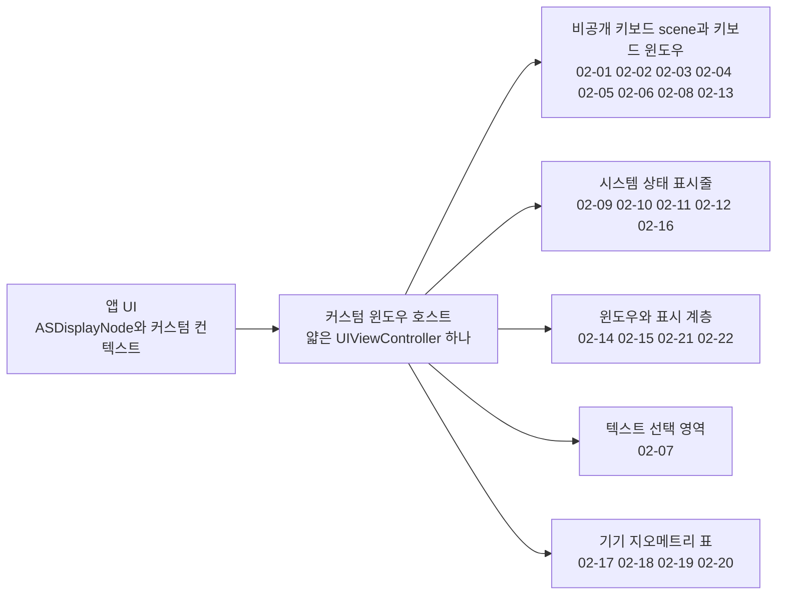
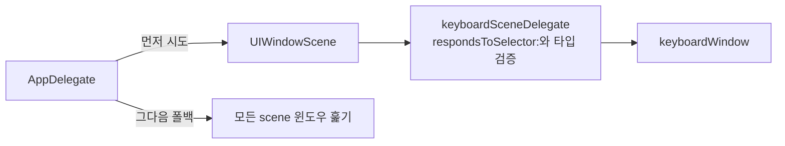
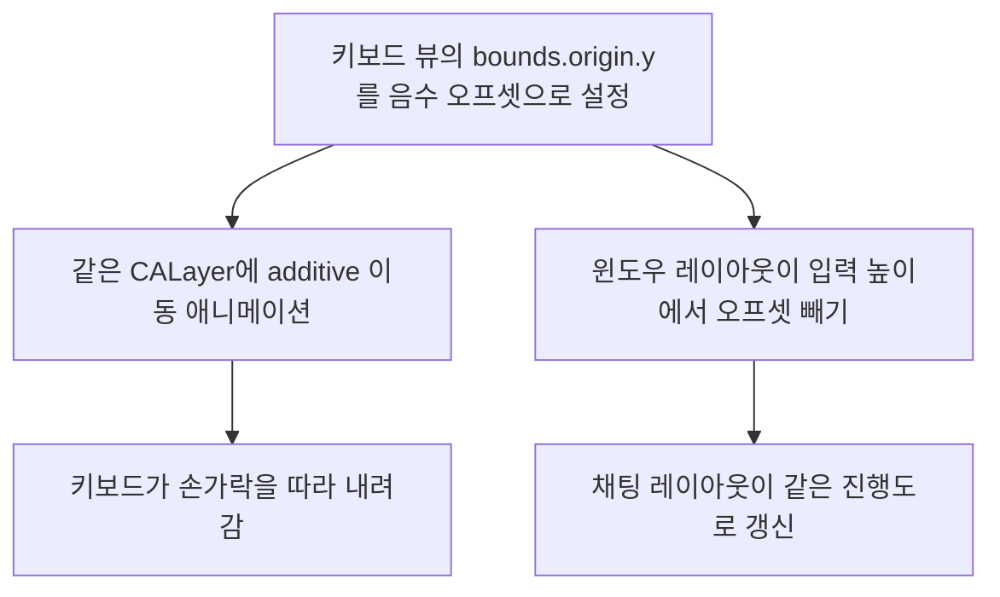
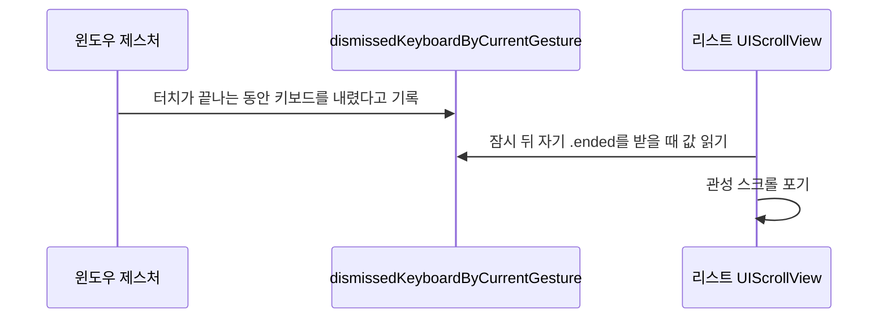
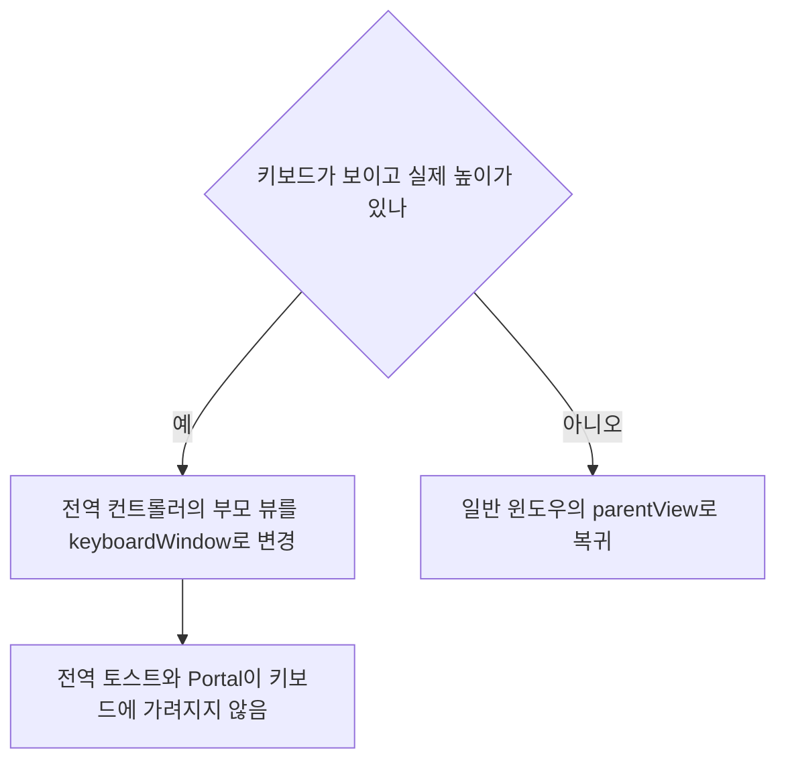

# 윈도우, 키보드, 상태 표시줄

웹: /docs/ios/02-window-keyboard-statusbar/ · Markdown: /docs/ios/02-window-keyboard-statusbar.md

> 키보드 윈도우 장악, 키보드 높이 보정, 상태 표시줄과 윈도우 계층 위조.

| 기법 항목 | 리포트 선정 | 관련 비공개 API | REA 연관 |
| --- | --- | --- | --- |
| 22 | 6 | 9 | 0 |

소스: [TelegramMessenger/Telegram-iOS@f1dd7a2d](https://github.com/TelegramMessenger/Telegram-iOS/tree/f1dd7a2dbd02cbbf513e75d5695d8d36d1cf5838)(2026-10-07) · 플랫폼: iOS · UIKit

이 장의 선정 항목:
- 02-1 [#02-01 비공개 키보드 scene delegate로 키보드 윈도우 얻기](/docs/ios/02-window-keyboard-statusbar/#t02-01)
- 02-2 [#02-03 앱 콘텐츠 대신 시스템 키보드 레이어를 직접 옮기기](/docs/ios/02-window-keyboard-statusbar/#t02-03)
- 02-3 [#02-04 여러 좌표로 키보드 알림의 잘못된 높이 보정하기](/docs/ios/02-window-keyboard-statusbar/#t02-04)
- 02-4 [#02-06 키보드 내림 제스처로 같은 손가락의 리스트 관성 명시적으로 취소하기](/docs/ios/02-window-keyboard-statusbar/#t02-06)
- 02-5 [#02-08 시스템 키보드 윈도우를 first responder가 있는 표면으로 가로 평행 이동하기](/docs/ios/02-window-keyboard-statusbar/#t02-08)
- 02-6 [#02-13 키보드가 보이면 키보드 윈도우로 옮겨 붙는 전역 오버레이](/docs/ios/02-window-keyboard-statusbar/#t02-13)

범위: Telegram-iOS의 커스텀 윈도우 호스트, 키보드, 상태 표시줄, 모달 표시 계층.

결론:

- 이 계층은 아주 얇은 `UIViewController` 하나로 UIKit의 결정을 받아들여요.
- 앱은 실제 레이아웃, 표시, 터치, 상태 표시줄 정책을 `ASDisplayNode`와 커스텀 컨텍스트에 넣어요.
- 가장 과감한 방법은 비공개 키보드 scene을 읽어서 시스템 키보드 뷰의 `CALayer.bounds`를 직접 고치는 거예요.

아래 도표는 이 장의 기법들이 윈도우 호스트 아래 어떤 구성요소에 손을 대는지 묶어서 보여 줘요.



## 1. 비공개 키보드 scene delegate로 키보드 윈도우 얻기 [#t02-01]

> #02-01 · Telegram-iOS · UIKit · 리포트 선정 02-1 · 검증 방식: 소스 분석 · 태그: 비공개 API, 텍스트와 입력
>
> 소스: [Telegram-iOS:submodules/UIKitRuntimeUtils/Source/UIKitRuntimeUtils/UIViewController+Navigation.m L761–L782](https://github.com/TelegramMessenger/Telegram-iOS/blob/f1dd7a2dbd02cbbf513e75d5695d8d36d1cf5838/submodules/UIKitRuntimeUtils/Source/UIKitRuntimeUtils/UIViewController%2BNavigation.m#L761-L782)
>
> 소스: [Telegram-iOS:submodules/TelegramUI/Sources/AppDelegate.swift L141–L172](https://github.com/TelegramMessenger/Telegram-iOS/blob/f1dd7a2dbd02cbbf513e75d5695d8d36d1cf5838/submodules/TelegramUI/Sources/AppDelegate.swift#L141-L172)

**무엇을 했나요**: `UIWindowScene`의 `keyboardSceneDelegate`에서 `keyboardWindow`(시스템 키보드가 올라가는 윈도우)를 가져와요. `AppDelegate`는 이 경로를 먼저 타고, 그다음 모든 scene 윈도우를 훑는 폴백(앞 경로가 안 될 때 쓰는 대체 경로)으로 넘어가요.

**왜 이렇게 했나요**: iOS 16부터 키보드는 내부 scene에 속해요. 공개 API인 `UIWindowScene.windows`에는 키보드 윈도우가 더 이상 안정적으로 들어 있지 않아요. `keyboardSceneDelegate`라는 진입점 덕분에 앱은 키보드의 실제 뷰를 읽고, 키보드 애니메이션과 맞출 수 있어요.

아래 도표는 키보드 윈도우를 얻는 경로와 폴백 순서를 보여 줘요.



**핵심 코드 발췌**

```objc title="UIViewController+Navigation.m · L761–L782 등 2곳"
- (UIWindow * _Nullable)internalGetKeyboardForScene:(UIWindowScene * _Nullable)scene {
    if (scene == nil) {
        return nil;
    }
    if (![scene respondsToSelector:@selector(keyboardSceneDelegate)]) {
        return nil;
    }

    id keyboardSceneDelegate = [(id<UIWindowSceneKeyboardProtocol>)scene keyboardSceneDelegate];
    if (![keyboardSceneDelegate respondsToSelector:@selector(keyboardWindow)]) {
        return nil;
    }

    // nil until the keyboard has been created for this scene, and also whenever the keyboard UI is
    // hosted out of process — in that configuration there is no in-process keyboard window at all.
    UIWindow *result = [(id<UIKeyboardSceneDelegateProtocol>)keyboardSceneDelegate keyboardWindow];
    if (![result isKindOfClass:[UIWindow class]]) {
        return nil;
    }

    return result;
}
```

**대가와 위험**: `keyboardSceneDelegate`와 `keyboardWindow`는 비공개 인터페이스예요. 아래 경우에는 이 방식이 막힐 수 있어요.

- 시스템이 이름을 바꿔요.
- 키보드가 프로세스 밖에서 호스팅돼요.
- App Review를 통과하지 못해요.

**증거 체인 #02-01**(iOS 바이너리 미검증)

- 소스 분석: Telegram-iOS 고정 커밋에서 한 줄씩 확인했어요. 소스 위치는 모두 2곳이에요.
- 리포트 요약(구현 방법): 최소한의 프로토콜을 선언하고, `respondsToSelector:`와 타입 검증을 단계별로 거쳐요.
- 바이너리 검증: 하지 않았어요. App Store에 배포된 IPA는 FairPlay로 암호화되어 있어서, 복호화된 실행 파일을 합법적으로 얻을 수 없어요.

## 2. 클래스 이름 패턴으로 여러 세대의 시스템 키보드 뷰 맞추기 [#t02-02]

> #02-02 · Telegram-iOS · UIKit · 검증 방식: 소스 분석 · 태그: 비공개 API, 텍스트와 입력
>
> 소스: [Telegram-iOS:submodules/TelegramUI/Sources/AppDelegate.swift L73–L106](https://github.com/TelegramMessenger/Telegram-iOS/blob/f1dd7a2dbd02cbbf513e75d5695d8d36d1cf5838/submodules/TelegramUI/Sources/AppDelegate.swift#L73-L106)

**무엇을 했나요**: 접두사와 접미사로 아래 클래스를 찾아요.

- `UIRemoteKeyboardWindow`
- `UITextEffectsWindow`
- `UIInputSetHostView`
- `UIKeyboardItemContainerView`
- 컨테이너인 `UIInputSetContainerView`와 `UITrackingWindowView`도 같은 방식으로 찾아요.

**왜 이렇게 했나요**: 비공개 클래스 이름은 시스템 버전에 따라 바뀌어요. 접두사와 접미사로 찾으면 전체 클래스 이름에 완전히 기대지 않아도 돼요. 구형 시스템에서 윈도우를 하나씩 돌아보는 폴백 경로에서도 이 패턴이 판단 근거가 돼요.

**핵심 코드 발췌**

```swift title="AppDelegate.swift · L73–L106"
private func isKeyboardWindow(window: NSObject) -> Bool {
    let typeName = NSStringFromClass(type(of: window))
    if #available(iOS 9.0, *) {
        if typeName.hasPrefix("UI") && typeName.hasSuffix("RemoteKeyboardWindow") {
            return true
        }
    } else {
        if typeName.hasPrefix("UI") && typeName.hasSuffix("TextEffectsWindow") {
            return true
        }
    }
    return false
}

private func isKeyboardView(view: NSObject) -> Bool {
    let typeName = NSStringFromClass(type(of: view))
    if typeName.hasPrefix("UI") && typeName.hasSuffix("InputSetHostView") {
        return true
    }
    if typeName.hasPrefix("UI") && typeName.hasSuffix("KeyboardItemContainerView") {
        return true
    }
    return false
}
```

**대가와 위험**: 비공개 구현 세부 사항이에요. 엉뚱한 뷰가 걸리거나 새 시스템에서 구조가 바뀌면 키보드 높이가 0이 되거나 아예 동작하지 않아요.

**증거 체인 #02-02**(iOS 바이너리 미검증)

- 소스 분석: Telegram-iOS 고정 커밋에서 한 줄씩 확인했어요. 소스 위치는 모두 1곳이에요.
- 바이너리 검증: 하지 않았어요. App Store에 배포된 IPA는 FairPlay로 암호화되어 있어서, 복호화된 실행 파일을 합법적으로 얻을 수 없어요.

## 3. 앱 콘텐츠 대신 시스템 키보드 레이어를 직접 옮기기 [#t02-03]

> #02-03 · Telegram-iOS · UIKit · 리포트 선정 02-2 · 검증 방식: 소스 분석 · 태그: 비공개 API, Core Animation, 텍스트와 입력
>
> 소스: [Telegram-iOS:submodules/Display/Source/KeyboardManager.swift L65–L79](https://github.com/TelegramMessenger/Telegram-iOS/blob/f1dd7a2dbd02cbbf513e75d5695d8d36d1cf5838/submodules/Display/Source/KeyboardManager.swift#L65-L79)
>
> 소스: [Telegram-iOS:submodules/Display/Source/WindowContent.swift L1407–L1420](https://github.com/TelegramMessenger/Telegram-iOS/blob/f1dd7a2dbd02cbbf513e75d5695d8d36d1cf5838/submodules/Display/Source/WindowContent.swift#L1407-L1420)

**무엇을 했나요**: 세 가지가 함께 일어나요.

1. 키보드 뷰의 `bounds.origin.y`를 음수 오프셋으로 설정해요.
2. 같은 `CALayer`에 additive 이동 애니메이션(현재 값에 더해서 적용하는 애니메이션)을 걸어요.
3. 같은 때에 윈도우 레이아웃은 입력 높이에서 이 오프셋을 빼요.

**왜 이렇게 했나요**: 일반적인 `resignFirstResponder()`는 시스템이 키보드를 통째로 접게 할 뿐이에요. 키보드 레이어를 직접 옮기는 이 방식에서는 키보드가 손가락을 따라 내려가고, 채팅 레이아웃도 같은 진행도로 갱신돼요.

아래 도표는 키보드 레이어를 직접 옮길 때 함께 일어나는 일을 보여 줘요.



**핵심 코드 발췌**

```swift title="KeyboardManager.swift · L65–L79 등 2곳"
func updateInteractiveInputOffset(_ offset: CGFloat, transition: ContainedViewLayoutTransition, completion: @escaping () -> Void) {
    guard let keyboardView = self.host.keyboardView else {
        return
    }

    self.interactiveInputOffset = offset

    let previousBounds = keyboardView.bounds
    let updatedBounds = CGRect(origin: CGPoint(x: 0.0, y: -offset), size: previousBounds.size)
    keyboardView.layer.bounds = updatedBounds
    if transition.isAnimated {
        transition.animateOffsetAdditive(layer: keyboardView.layer, offset: previousBounds.minY - updatedBounds.minY, completion: completion)
    } else {
        completion()
    }
}
```

**대가와 위험**: 시스템 비공개 뷰의 레이어를 수정해요. 시스템 키보드의 계층이나 애니메이션 모델이 바뀌면 키보드가 튀거나, 남아 있거나, 접히지 않을 수 있어요.

**증거 체인 #02-03**(iOS 바이너리 미검증)

- 소스 분석: Telegram-iOS 고정 커밋에서 한 줄씩 확인했어요. 소스 위치는 모두 2곳이에요.
- 리포트 요약(구현 방법): 전후의 `bounds`를 기록하고, `transition`에 따라 애니메이션 여부를 정하고, 콜백으로 완료를 알려요.
- 바이너리 검증: 하지 않았어요. App Store에 배포된 IPA는 FairPlay로 암호화되어 있어서, 복호화된 실행 파일을 합법적으로 얻을 수 없어요.

## 4. 여러 좌표로 키보드 알림의 잘못된 높이 보정하기 [#t02-04]

> #02-04 · Telegram-iOS · UIKit · 리포트 선정 02-3 · 검증 방식: 소스 분석 · 태그: 텍스트와 입력
>
> 소스: [Telegram-iOS:submodules/Display/Source/WindowContent.swift L650–L761](https://github.com/TelegramMessenger/Telegram-iOS/blob/f1dd7a2dbd02cbbf513e75d5695d8d36d1cf5838/submodules/Display/Source/WindowContent.swift#L650-L761)

**무엇을 했나요**: 키보드 높이를 구할 때 아래처럼 처리해요.

- 실시간 키보드 뷰의 `frame.minY`를 가장 먼저 믿어요.
- iOS 16.1 이상에서는 알림에 담긴 화면 좌표를 이벤트 윈도우 좌표로 변환해요.
- 다음 오차도 보정해요.
  - 가운데 정렬된 윈도우의 반 높이 차이
  - iPad의 경계 근처 오차
  - 하위 윈도우의 `27pt` 편차

**왜 이렇게 했나요**: `keyboardWillChangeFrame`의 좌표가 늘 앱 윈도우 좌표와 같지는 않아요. 분할 화면, 윈도우 모드, 다중 scene에서는 흔히 쓰는 “화면 높이 − 키보드 Y” 공식이 잘못된 높이를 내요.

**핵심 코드 발췌**

```swift title="WindowContent.swift · L650–L761"
if #available(iOSApplicationExtension 14.2, iOS 14.2, *), UIAccessibility.prefersCrossFadeTransitions {
} else if let keyboardView = strongSelf.statusBarHost?.keyboardView {
    if keyboardFrame.width.isEqual(to: keyboardView.bounds.width) && keyboardFrame.height.isEqual(to: keyboardView.bounds.height) && keyboardFrame.minX.isEqual(to: keyboardView.frame.minX) {
        keyboardFrame.origin.y = keyboardView.frame.minY
    }
}

var minKeyboardY: CGFloat?
if #available(iOSApplicationExtension 16.1, iOS 16.1, *), let screen = notification.object as? UIScreen, let keyboardFrameEnd = notification.userInfo?[UIResponder.keyboardFrameEndUserInfoKey] as? CGRect {
    let fromCoordinateSpace = screen.coordinateSpace
    let toCoordinateSpace: UICoordinateSpace = strongSelf.hostView.eventView
    let convertedKeyboardFrameEnd = fromCoordinateSpace.convert(keyboardFrameEnd, to: toCoordinateSpace)
    minKeyboardY = convertedKeyboardFrameEnd.minY
}

// ...
if keyboardFrame.isEmpty || keyboardFrame.maxY < screenHeight {
    if isWindowed || (isTablet && screenHeight - keyboardFrame.maxY < 5.0) {
        if let minKeyboardY {
            keyboardFrame.origin.y = minKeyboardY
        }
        keyboardHeight = max(0.0, screenHeight - keyboardFrame.minY)
```

**대가와 위험**: 보정값에 `24pt`, `27pt`, `5pt` 같은 경험적 상수가 들어 있어요. 새 크기, 플로팅 키보드, 시스템의 알림 의미 변경이 생기면 다시 실측해야 해요.

**증거 체인 #02-04**(iOS 바이너리 미검증)

- 소스 분석: Telegram-iOS 고정 커밋에서 한 줄씩 확인했어요. 소스 위치는 모두 1곳이에요.
- 리포트 요약(구현 방법): `UICoordinateSpace.convert`와 경험적 임계값으로 경계를 보정해요.
- 바이너리 검증: 하지 않았어요. App Store에 배포된 IPA는 FairPlay로 암호화되어 있어서, 복호화된 실행 파일을 합법적으로 얻을 수 없어요.

## 5. first responder와 액세서리 높이로 정하는 전체 윈도우 제스처의 드래그 영역 [#t02-05]

> #02-05 · Telegram-iOS · UIKit · 검증 방식: 소스 분석 · 태그: 텍스트와 입력, 제스처와 스크롤
>
> 소스: [Telegram-iOS:submodules/Display/Source/WindowContent.swift L1489–L1513](https://github.com/TelegramMessenger/Telegram-iOS/blob/f1dd7a2dbd02cbbf513e75d5695d8d36d1cf5838/submodules/Display/Source/WindowContent.swift#L1489-L1513)

**무엇을 했나요**: 윈도우 수준의 드래그가 일어나는 영역을 이렇게 좁혀요.

- 드래그를 키보드 위쪽으로 한정해요.
- 히트된 뷰에서 위로 올라가며 비활성화 표시를 읽어요.
- 입력 액세서리 높이를 키보드 상한에 포함해요.
- `3pt` 임계값에서 레이아웃 갱신을 시작해요.

**왜 이렇게 했나요**: 제스처는 호스트 전체에 설치되어 있어요. 위 조건이 없으면 스크롤, 하단 버튼, 커스텀 액세서리가 의도치 않게 키보드를 끌어당길 수 있어요.

**핵심 코드 발췌**

```swift title="WindowContent.swift · L1489–L1513"
let keyboardGestureBeginLocation = location
let view = self.hostView.containerView
let (firstResponder, accessoryHeight) = getFirstResponderAndAccessoryHeight(view)
if let inputHeight = self.windowLayout.inputHeight, !inputHeight.isZero, keyboardGestureBeginLocation.y < self.windowLayout.size.height - inputHeight - (accessoryHeight ?? 0.0) {
    var enableGesture = true
    if let view = self.hostView.containerView.hitTest(location, with: nil) {
        if doesViewTreeDisableInteractiveTransitionGestureRecognizer(view, keyboardOnly: true) {
            enableGesture = false
        }
    }
    if enableGesture, let _ = firstResponder {
        self.keyboardGestureBeginLocation = keyboardGestureBeginLocation
        self.keyboardGestureAccessoryHeight = accessoryHeight
    }
}
    if let keyboardGestureBeginLocation = self.keyboardGestureBeginLocation {
        let currentLocation = location
        let deltaY = keyboardGestureBeginLocation.y - location.y
        if deltaY * deltaY >= 3.0 * 3.0 || self.windowLayout.upperKeyboardInputPositionBound != nil {
            self.updateLayout {
                $0.update(upperKeyboardInputPositionBound: currentLocation.y + (self.keyboardGestureAccessoryHeight ?? 0.0), transition: .immediate, overrideTransition: false)
            }
        }
    }
}
```

**대가와 위험**: `UIView`에 붙은 연관 객체 표시에 기대어 동작해요. 복잡하게 중첩된 뷰는 이 표시를 올바르게 설정해야 해요.

**증거 체인 #02-05**(iOS 바이너리 미검증)

- 소스 분석: Telegram-iOS 고정 커밋에서 한 줄씩 확인했어요. 소스 위치는 모두 1곳이에요.
- 바이너리 검증: 하지 않았어요. App Store에 배포된 IPA는 FairPlay로 암호화되어 있어서, 복호화된 실행 파일을 합법적으로 얻을 수 없어요.

## 6. 키보드 내림 제스처로 같은 손가락의 리스트 관성 명시적으로 취소하기 [#t02-06]

> #02-06 · Telegram-iOS · UIKit · 리포트 선정 02-4 · 검증 방식: 소스 분석 · 태그: 텍스트와 입력, 제스처와 스크롤
>
> 소스: [Telegram-iOS:submodules/Display/Source/WindowContent.swift L1547–L1573](https://github.com/TelegramMessenger/Telegram-iOS/blob/f1dd7a2dbd02cbbf513e75d5695d8d36d1cf5838/submodules/Display/Source/WindowContent.swift#L1547-L1573)

**무엇을 했나요**: 터치가 끝나는 동안 “이 제스처가 키보드를 내렸다”는 사실을 기록해요. 리스트는 잠시 뒤 자신의 `.ended`를 받을 때 그 기록을 읽고 관성 스크롤을 포기할 수 있어요.

**왜 이렇게 했나요**: 윈도우 제스처와 `UIScrollView`는 동시에 인식될 수 있어요. 제스처끼리 주고받는 신호가 없으면, 한 번 아래로 끄는 동작이 키보드를 내리면서 리스트도 휙 던져 버려요.

아래 도표는 키보드를 내린 제스처의 기록을 리스트가 읽어 관성을 포기하는 순서를 보여 줘요.



**핵심 코드 발췌**

```swift title="WindowContent.swift · L1547–L1573"
var canDismiss = false
if let upperKeyboardInputPositionBound = self.windowLayout.upperKeyboardInputPositionBound, upperKeyboardInputPositionBound >= self.windowLayout.size.height - accessoryHeight {
    canDismiss = true
} else if let velocity = velocity, velocity.y > 100.0 {
    canDismiss = true
}

if canDismiss, let inputHeight = self.windowLayout.inputHeight, currentLocation.y + (self.keyboardGestureAccessoryHeight ?? 0.0) > self.windowLayout.size.height - inputHeight {
    // This release spent the finger's downward motion on the keyboard. Published for the
    // duration of the touch sequence so a scroll view released by the SAME finger — its pan
    // reports `.ended` later, in action dispatch — can decline to also fling its content.
    self.dismissedKeyboardByCurrentGestureValue = true

    let springDuration: CGFloat
    if #available(iOS 26.0, *) {
        springDuration = 0.3832
    } else {
        springDuration = 0.25
    }
    self.updateLayout {
        $0.update(upperKeyboardInputPositionBound: self.windowLayout.size.height, transition: .animated(duration: springDuration, curve: .spring), overrideTransition: false)
    }
}
```

**대가와 위험**: UIKit의 터치 디스패치 순서에 기대는 타이밍 계약이에요. 커스텀 스크롤 컴포넌트는 `dismissedKeyboardByCurrentGesture`를 직접 읽어야 해요.

**증거 체인 #02-06**(iOS 바이너리 미검증)

- 소스 분석: Telegram-iOS 고정 커밋에서 한 줄씩 확인했어요. 소스 위치는 모두 1곳이에요.
- 리포트 요약(구현 방법): `dismissedKeyboardByCurrentGestureValue`를 설정하고, 완전히 접힐 때까지 애니메이션해요.
- 바이너리 검증: 하지 않았어요. App Store에 배포된 IPA는 FairPlay로 암호화되어 있어서, 복호화된 실행 파일을 합법적으로 얻을 수 없어요.

## 7. 선택 영역 변화를 위조해 텍스트 자동 수정 일으키기 [#t02-07]

> #02-07 · Telegram-iOS · UIKit · 검증 방식: 소스 분석 · 태그: 텍스트와 입력
>
> 소스: [Telegram-iOS:submodules/UIKitRuntimeUtils/Source/UIKitRuntimeUtils/UIViewController+Navigation.m L850–L859](https://github.com/TelegramMessenger/Telegram-iOS/blob/f1dd7a2dbd02cbbf513e75d5695d8d36d1cf5838/submodules/UIKitRuntimeUtils/Source/UIKitRuntimeUtils/UIViewController%2BNavigation.m#L850-L859)

**무엇을 했나요**: 세 단계로 해요.

1. 먼저 marked text(입력기가 조합 중인 글자)를 취소해요.
2. 선택 영역을 한 글자 왼쪽으로 옮겨요.
3. 곧바로 원래 선택 영역으로 되돌려요.

**왜 이렇게 했나요**: 이렇게 하면 UIKit이 표시된 텍스트와 선택 영역을 다시 처리해요. 호출한 쪽은 최종 커서 위치를 바꾸지 않고도 자동 수정을 요청할 수 있어요. UIKit 내부에서 구체적으로 어떻게 판정하는지는 검증하지 않았어요.

**핵심 코드 발췌**

```objc title="UIViewController+Navigation.m · L850–L859"
void applyKeyboardAutocorrection(UITextView * _Nonnull textView) {
    NSRange rangeCopy = textView.selectedRange;
    NSRange fakeRange = rangeCopy;
    if (fakeRange.location != 0) {
        fakeRange.location--;
    }
    [textView unmarkText];
    [textView setSelectedRange:fakeRange];
    [textView setSelectedRange:rangeCopy];
}
```

**대가와 위험**: 입력기의 조합 상태가 가짜 선택 영역에 민감할 수 있어요. 첫 글자에서는 선택 영역을 옮기지 않아요. 이 로직은 다국어 입력기 테스트로 검증해야 해요.

**증거 체인 #02-07**(iOS 바이너리 미검증)

- 소스 분석: Telegram-iOS 고정 커밋에서 한 줄씩 확인했어요. 소스 위치는 모두 1곳이에요.
- 바이너리 검증: 하지 않았어요. App Store에 배포된 IPA는 FairPlay로 암호화되어 있어서, 복호화된 실행 파일을 합법적으로 얻을 수 없어요.

## 8. 시스템 키보드 윈도우를 first responder가 있는 표면으로 가로 평행 이동하기 [#t02-08]

> #02-08 · Telegram-iOS · UIKit · 리포트 선정 02-5 · 검증 방식: 소스 분석 · 태그: 비공개 API, Core Animation, 텍스트와 입력
>
> 소스: [Telegram-iOS:submodules/Display/Source/KeyboardManager.swift L99–L123](https://github.com/TelegramMessenger/Telegram-iOS/blob/f1dd7a2dbd02cbbf513e75d5695d8d36d1cf5838/submodules/Display/Source/KeyboardManager.swift#L99-L123)

**무엇을 했나요**:

- first responder(지금 입력을 받는 뷰) 호스트의 화면 X 좌표에 따라 `keyboardWindow.layer.sublayerTransform`을 바꿔요.
- 앞쪽이나 뒤쪽, 한 방향으로만 평행 이동하도록 제한할 수도 있어요.
- responder가 사라지면 윈도우를 잠깐 숨기고 `position`과 `bounds` 애니메이션을 재귀적으로 취소해요.

**왜 이렇게 했나요**: 커스텀 표면은 가로로 움직일 수 있지만, 키보드는 여전히 독립된 윈도우가 호스팅해요. 콘텐츠만 옮기면 키보드와 입력 영역이 어긋나요. 남은 애니메이션을 취소하면, 이미 제거된 responder가 전환 프레임을 남기는 일을 피할 수 있어요.

**핵심 코드 발췌**

```swift title="KeyboardManager.swift · L99–L123"
if let firstResponderView = firstResponderView {
    let containerOrigin = firstResponderView.convert(CGPoint(), to: nil)
    var filteredTranslation = containerOrigin.x
    if firstResponderDisableAutomaticKeyboardHandling.contains(.forward) {
        filteredTranslation = max(0.0, filteredTranslation)
    }
    if firstResponderDisableAutomaticKeyboardHandling.contains(.backward) {
        filteredTranslation = min(0.0, filteredTranslation)
    }
    let horizontalTranslation = CATransform3DMakeTranslation(filteredTranslation, 0.0, 0.0)
    let currentTransform = keyboardWindow.layer.sublayerTransform
    if !CATransform3DEqualToTransform(horizontalTranslation, currentTransform) {
        keyboardWindow.layer.sublayerTransform = horizontalTranslation
    }
} else {
    keyboardWindow.layer.sublayerTransform = CATransform3DIdentity
    if let previousFirstResponderView = previousFirstResponderView {
        if previousFirstResponderView.window == nil {
            keyboardWindow.isHidden = true
            keyboardWindow.layer.cancelAnimationsRecursive(key: "position")
            keyboardWindow.layer.cancelAnimationsRecursive(key: "bounds")
            keyboardWindow.isHidden = false
        }
    }
}
```

**대가와 위험**: 비공개 키보드 윈도우 레이어를 직접 고쳐요. 애니메이션 키 이름과 키보드의 렌더링 구조 모두 공개된 보장이 없어요.

**증거 체인 #02-08**(iOS 바이너리 미검증)

- 소스 분석: Telegram-iOS 고정 커밋에서 한 줄씩 확인했어요. 소스 위치는 모두 1곳이에요.
- 리포트 요약(구현 방법): first responder에서 화면 X를 가져와 `CATransform3DMakeTranslation`을 만들고, 비교한 뒤 기록해요.
- 바이너리 검증: 하지 않았어요. App Store에 배포된 IPA는 FairPlay로 암호화되어 있어서, 복호화된 실행 파일을 합법적으로 얻을 수 없어요.

## 9. 시스템 상태 표시줄을 캡처해 픽셀 단위로 다시 칠하기 [#t02-09]

> #02-09 · Telegram-iOS · UIKit · 검증 방식: 소스 분석 · 태그: 비공개 API
>
> 소스: [Telegram-iOS:submodules/Display/Source/StatusBarProxyNode.swift L153–L194](https://github.com/TelegramMessenger/Telegram-iOS/blob/f1dd7a2dbd02cbbf513e75d5695d8d36d1cf5838/submodules/Display/Source/StatusBarProxyNode.swift#L153-L194)
>
> 소스: [Telegram-iOS:submodules/Display/Source/StatusBarProxyNode.swift L330–L356](https://github.com/TelegramMessenger/Telegram-iOS/blob/f1dd7a2dbd02cbbf513e75d5695d8d36d1cf5838/submodules/Display/Source/StatusBarProxyNode.swift#L330-L356)

**무엇을 했나요**: 세 단계로 해요.

1. 시스템 상태 표시줄의 각 하위 뷰를 `DrawingContext`에 렌더링해요.
2. alpha 값에 따라 픽셀을 검정이나 흰색으로 바꿔요.
3. `ASDisplayNode.contents`를 써서 같은 좌표에 이미지를 복제해요.

**왜 이렇게 했나요**: 평범한 `preferredStatusBarStyle`은 시스템의 전체 스타일만 제어할 수 있어요. 이 방식의 프록시는 복잡한 오버레이 속에서도 시스템 아이콘만 따로 덮어쓸 수 있고, 배터리·신호·시간의 실제 모양은 그대로 유지해요.

**핵심 코드 발췌**

```swift title="StatusBarProxyNode.swift · L153–L194 등 2곳"
context.withContext { c in
    c.translateBy(x: containingBounds.minX, y: -containingBounds.minY)
    UIGraphicsPushContext(c)
    self.targetView.layer.render(in: c)
    UIGraphicsPopContext()
}

// ...
tintStatusBarItem(context, type: type, style: self.statusBarStyle)
let image = context.generateImage()?.cgImage
self.contentNode.contents = image

let mappedFrame = self.targetView.convert(self.targetView.bounds, to: self.rootView)
self.frame = mappedFrame
self.contentNode.frame = containingBounds
```

**대가와 위험**: 비공개 상태 표시줄 뷰에 기대고, 오프스크린 드로잉과 CPU의 픽셀 순회도 필요해요. 동적 아이콘의 변화는 최대 5초마다 한 번 갱신돼요.

**증거 체인 #02-09**(iOS 바이너리 미검증)

- 소스 분석: Telegram-iOS 고정 커밋에서 한 줄씩 확인했어요. 소스 위치는 모두 2곳이에요.
- 바이너리 검증: 하지 않았어요. App Store에 배포된 IPA는 FairPlay로 암호화되어 있어서, 복호화된 실행 파일을 합법적으로 얻을 수 없어요.

## 10. 런타임에 비공개 상태 표시줄 클래스 이름 이어 붙이기 [#t02-10]

> #02-10 · Telegram-iOS · UIKit · 검증 방식: 소스 분석 · 태그: 비공개 API, 런타임 해킹, 텍스트와 입력
>
> 소스: [Telegram-iOS:submodules/Display/Source/StatusBarProxyNode.swift L360–L414](https://github.com/TelegramMessenger/Telegram-iOS/blob/f1dd7a2dbd02cbbf513e75d5695d8d36d1cf5838/submodules/Display/Source/StatusBarProxyNode.swift#L360-L414)

**무엇을 했나요**: 비공개 클래스의 전체 이름을 하나의 리터럴에 넣지 않아요. `CFAbsoluteTimeGetCurrent() > 0`은 정상 실행 중에는 참이에요. 그래서 코드는 전체 이름을 조립한 뒤 `NSClassFromString`에 넘겨요.

**왜 이렇게 했나요**: 이렇게 하면 상태 표시줄 프록시가 비공개 하위 클래스로 배터리, 시간, 전경 컨테이너를 알아볼 수 있어요. 코드는 분명히 전체 이름이 정적 분석에 드러나는 정도도 낮추려고 해요.

**핵심 코드 발췌**

```swift title="StatusBarProxyNode.swift · L360–L414"
private let foregroundClass: AnyClass? = {
    var nameString = "StatusBar"
    if CFAbsoluteTimeGetCurrent() > 0 {
        nameString += "ForegroundView"
    }
    return NSClassFromString("_UI" + nameString)
}()

private let foregroundClass2: AnyClass? = {
    var nameString = "StatusBar"
    if CFAbsoluteTimeGetCurrent() > 0 {
        nameString += "ForegroundView"
    }
    return NSClassFromString("UI" + nameString)
}()

private let batteryItemClass: AnyClass? = {
    var nameString = "StatusBarBattery"
    if CFAbsoluteTimeGetCurrent() > 0 {
        nameString += "ItemView"
    }
    return NSClassFromString("UI" + nameString)
}()
```

**난독화 복원 확인**: 접두사, 초기 문자열, 참 분기의 접미사를 항목별로 이어 붙이면 실제 이름을 확인할 수 있어요. 이름은 아래와 같아요.

- `_UIStatusBarForegroundView`
- `UIStatusBarForegroundView`
- `UIStatusBarBatteryItemView`
- `_UIBatteryView`
- `_UIStatusBarBackgroundActivityView`
- `_UIStatusBarStringView`
- `UIStatusBarTimeItemView`

확인 근거는 이 파일 `#L360-L414`의 각 `NSClassFromString` 인자 구성이에요.

**대가와 위험**: 비공개 UIKit 클래스 이름을 겨냥한 난독화예요. 심사 위험이 매우 높아요. 시스템이 클래스 이름을 바꾸면 조용히 `nil`이나 잘못된 분류를 반환해요.

**증거 체인 #02-10**(iOS 바이너리 미검증)

- 소스 분석: Telegram-iOS 고정 커밋에서 한 줄씩 확인했어요. 소스 위치는 모두 1곳이에요.
- 바이너리 검증: 하지 않았어요. App Store에 배포된 IPA는 FairPlay로 암호화되어 있어서, 복호화된 실행 파일을 합법적으로 얻을 수 없어요.

## 11. 공용 RunLoop로 상태 표시줄의 활성 요소 주기적으로 다시 캡처하기 [#t02-11]

> #02-11 · Telegram-iOS · UIKit · 검증 방식: 소스 분석 · 태그: 비공개 API
>
> 소스: [Telegram-iOS:submodules/Display/Source/StatusBarProxyNode.swift L482–L499](https://github.com/TelegramMessenger/Telegram-iOS/blob/f1dd7a2dbd02cbbf513e75d5695d8d36d1cf5838/submodules/Display/Source/StatusBarProxyNode.swift#L482-L499)
>
> 소스: [Telegram-iOS:submodules/Display/Source/StatusBarProxyNode.swift L529–L568](https://github.com/TelegramMessenger/Telegram-iOS/blob/f1dd7a2dbd02cbbf513e75d5695d8d36d1cf5838/submodules/Display/Source/StatusBarProxyNode.swift#L529-L568)

**무엇을 했나요**: 프록시는 상태 표시줄 항목을 이렇게 다시 캡처해요.

- 표시되는 즉시 한 번 캡처해요.
- 이후에는 5초마다 `.common` RunLoop 모드에서 다시 캡처해요.
- 숨겨지면 타이머를 없애요.

**왜 이렇게 했나요**: 스크린샷 방식의 프록시는 살아 있는 시스템 상태 표시줄이 아니에요. 5초 주기면 시간을 갱신하기에 충분하고, 사용자가 스크롤 뷰를 끌어도 멈추지 않아요.

**핵심 코드 발췌**

```swift title="StatusBarProxyNode.swift · L482–L499 등 2곳"
override var isHidden: Bool {
    get {
        return super.isHidden
    } set(value) {
        if super.isHidden != value {
            super.isHidden = value

            if !value {
                self.updateItems()
                self.timer = Timer(timeInterval: 5.0, target: StatusBarProxyNodeTimerTarget { [weak self] in
                    self?.updateItems()
                }, selector: #selector(StatusBarProxyNodeTimerTarget.tick), userInfo: nil, repeats: true)
                RunLoop.main.add(self.timer!, forMode: .common)
            } else {
                self.timer?.invalidate()
                self.timer = nil
            }
        }
    }
}
```

**대가와 위험**: 상태 표시줄의 변화가 최대 5초 늦어질 수 있어요. 갱신할 때마다 비공개 하위 뷰를 순회하고 이미지를 만들어요.

**증거 체인 #02-11**(iOS 바이너리 미검증)

- 소스 분석: Telegram-iOS 고정 커밋에서 한 줄씩 확인했어요. 소스 위치는 모두 2곳이에요.
- 바이너리 검증: 하지 않았어요. App Store에 배포된 IPA는 FairPlay로 암호화되어 있어서, 복호화된 실행 파일을 합법적으로 얻을 수 없어요.

## 12. 여러 노드 트리의 상태 표시줄 결정을 하나의 루트 컨트롤러로 모으기 [#t02-12]

> #02-12 · Telegram-iOS · UIKit · 검증 방식: 소스 분석
>
> 소스: [Telegram-iOS:submodules/Display/Source/WindowContent.swift L1188–L1208](https://github.com/TelegramMessenger/Telegram-iOS/blob/f1dd7a2dbd02cbbf513e75d5695d8d36d1cf5838/submodules/Display/Source/WindowContent.swift#L1188-L1208)
>
> 소스: [Telegram-iOS:submodules/Display/Source/NativeWindowHostView.swift L147–L173](https://github.com/TelegramMessenger/Telegram-iOS/blob/f1dd7a2dbd02cbbf513e75d5695d8d36d1cf5838/submodules/Display/Source/NativeWindowHostView.swift#L147-L173)

**무엇을 했나요**: `Window1`은 아래 순서로 상태 표시줄 값을 덮어쓰게 해요.

1. 루트 내비게이션
2. 일반 표시 계층
3. 최상위 표시 계층

`WindowRootViewController`가 최종 값을 보관하고 `setNeedsStatusBarAppearanceUpdate()`를 호출해요.

**왜 이렇게 했나요**: UIKit은 윈도우의 루트 컨트롤러에만 상태 표시줄을 물어봐요. Telegram의 실제 트리는 UIKit의 controller containment 트리가 아니에요. 한곳에 모아 두면 어떤 `ASDisplayNode` 표시 계층이든 시스템 상태 표시줄을 제어할 수 있어요.

**핵심 코드 발췌**

```swift title="WindowContent.swift · L1188–L1208 등 2곳"
private func updateStatusBar(transition: ContainedViewLayoutTransition) {
    var style: UIStatusBarStyle = .default
    var isHidden = false

    if let rootController = self._rootController as? NavigationController {
        let statusBar = rootController.statusBar
        style = statusBar.style
        isHidden = statusBar.isHidden
    }

    if let statusBar = self.presentationContext.statusBar {
        style = statusBar.style
        isHidden = statusBar.isHidden
    }

    if let statusBar = self.topPresentationContext.statusBar {
        style = statusBar.style
        isHidden = statusBar.isHidden
    }

    self.hostView.updateStatusBar(style, isHidden, transition)
}
```

**대가와 위험**: 덮어쓰기 우선순위가 세 컨텍스트의 순서로 고정되어 있어요. 표시 계층을 새로 추가할 때는 집계 로직도 보완해야 해요. 그러지 않으면 스타일이 틀어져요.

**증거 체인 #02-12**(iOS 바이너리 미검증)

- 소스 분석: Telegram-iOS 고정 커밋에서 한 줄씩 확인했어요. 소스 위치는 모두 2곳이에요.
- 바이너리 검증: 하지 않았어요. App Store에 배포된 IPA는 FairPlay로 암호화되어 있어서, 복호화된 실행 파일을 합법적으로 얻을 수 없어요.

## 13. 키보드가 보이면 키보드 윈도우로 옮겨 붙는 전역 오버레이 [#t02-13]

> #02-13 · Telegram-iOS · UIKit · 리포트 선정 02-6 · 검증 방식: 소스 분석 · 태그: 비공개 API, 텍스트와 입력
>
> 소스: [Telegram-iOS:submodules/Display/Source/GlobalOverlayPresentationContext.swift L72–L105](https://github.com/TelegramMessenger/Telegram-iOS/blob/f1dd7a2dbd02cbbf513e75d5695d8d36d1cf5838/submodules/Display/Source/GlobalOverlayPresentationContext.swift#L72-L105)

**무엇을 했나요**: 키보드가 보이고 실제 높이가 있으면 전역 컨트롤러의 부모 뷰를 `keyboardWindow`로 바꿔요. 키보드가 없으면 일반 윈도우의 `parentView`로 되돌려요.

**왜 이렇게 했나요**: 키보드 윈도우는 앱 윈도우보다 위에 있어요. 전역 토스트나 Portal이 앱 윈도우에 그대로 붙어 있으면 키보드에 가려져요. 이렇게 다시 마운트하면 이들이 같은 시각 계층에 머물러요.

아래 도표는 키보드 상태에 따라 전역 오버레이의 부모 뷰가 바뀌는 분기를 보여 줘요.



**핵심 코드 발췌**

```swift title="GlobalOverlayPresentationContext.swift · L72–L105"
private func currentPresentationView(underStatusBar: Bool) -> UIView? {
    if let statusBarHost = self.statusBarHost {
        if let keyboardWindow = statusBarHost.keyboardWindow, let keyboardView = statusBarHost.keyboardView, !keyboardView.frame.height.isZero, isViewVisibleInHierarchy(keyboardView) {
            var updateTrackingNode = false
            if let trackingNode = self.currentTrackingNode {
                if trackingNode.layer.superlayer !== keyboardView.layer {
                    updateTrackingNode = true
                }
            } else {
                updateTrackingNode = true
            }

            // ...
            return keyboardWindow
        } else {
            if let view = self.parentView {
                return view
            }
        }
    }
    return nil
}
```

**대가와 위험**: 비공개 키보드 윈도우에 기대요. 코드의 `HierarchyTrackingNode` 재배치 블록은 주석 처리되어 있어서, 키보드 윈도우가 다시 만들어지는 동안의 동작은 검증하지 않았어요.

**증거 체인 #02-13**(iOS 바이너리 미검증)

- 소스 분석: Telegram-iOS 고정 커밋에서 한 줄씩 확인했어요. 소스 위치는 모두 1곳이에요.
- 리포트 요약(구현 방법): `keyboardView`의 높이와 가시성을 감지해 부모 레이어를 바꾸고 tracking을 유지해요.
- 바이너리 검증: 하지 않았어요. App Store에 배포된 IPA는 FairPlay로 암호화되어 있어서, 복호화된 실행 파일을 합법적으로 얻을 수 없어요.

## 14. UIKit containment 대신 수동 생명주기를 쓰는 표시 컨텍스트 [#t02-14]

> #02-14 · Telegram-iOS · UIKit · 검증 방식: 소스 분석
>
> 소스: [Telegram-iOS:submodules/Display/Source/PresentationContext.swift L157–L244](https://github.com/TelegramMessenger/Telegram-iOS/blob/f1dd7a2dbd02cbbf513e75d5695d8d36d1cf5838/submodules/Display/Source/PresentationContext.swift#L157-L244)

**무엇을 했나요**:

1. `ContainableController.ready`를 최대 2초 기다려요.
2. view와 노드 레이아웃을 직접 구성해요.
3. 하위 뷰를 직접 넣고 `viewWillAppear`와 `viewDidAppear`를 수동으로 호출해요.

**왜 이렇게 했나요**: 표시 스택에는 아래 네 가지가 필요해요.

- 독립된 계층
- 입력 차단
- 방향 교집합
- 노드 준비 관문

일반 `present`는 UIKit의 controller 트리만 표현할 수 있어서, 이런 병렬 표시면을 감당하기 어려워요.

**핵심 코드 발췌**

```swift title="PresentationContext.swift · L157–L244"
public func present(_ controller: ContainableController, on level: PresentationSurfaceLevel, blockInteraction: Bool = false, completion: @escaping () -> Void) {
    let controllerReady = controller.ready.get()
    |> filter({ $0 })
    |> take(1)
    |> deliverOnMainQueue
    |> timeout(2.0, queue: Queue.mainQueue(), alternate: .single(true))

    if let _ = self.view, let initialLayout = self.layout {
        if let controller = controller as? ViewController {
            if controller.lockOrientation {
                let orientations: UIInterfaceOrientationMask
                if initialLayout.size.width < initialLayout.size.height {
                    orientations = .portrait
                } else {
                    orientations = .landscape
                }

                controller.supportedOrientations = ViewControllerSupportedOrientations(regularSize: orientations, compactSize: orientations)
            }
        }
        let (controllerLayout, controllerFrame) = self.layoutForController(containerLayout: initialLayout, controller: controller)
        controller.view.frame = controllerFrame
        controller.containerLayoutUpdated(controllerLayout, transition: .immediate)
```

**대가와 위험**: 수동 생명주기는 UIKit의 appearance 상태와 충돌하기 쉬워요. 2초 타임아웃에 걸리면 아직 실제로 준비되지 않은 컨트롤러를 표시해 버릴 수 있어요.

**증거 체인 #02-14**(iOS 바이너리 미검증)

- 소스 분석: Telegram-iOS 고정 커밋에서 한 줄씩 확인했어요. 소스 위치는 모두 1곳이에요.
- 바이너리 검증: 하지 않았어요. App Store에 배포된 IPA는 FairPlay로 암호화되어 있어서, 복호화된 실행 파일을 합법적으로 얻을 수 없어요.

## 15. 시스템 편집 메뉴를 따로 처리하는 커스텀 `UIWindow.hitTest` [#t02-15]

> #02-15 · Telegram-iOS · UIKit · 검증 방식: 소스 분석
>
> 소스: [Telegram-iOS:submodules/Display/Source/WindowContent.swift L957–L999](https://github.com/TelegramMessenger/Telegram-iOS/blob/f1dd7a2dbd02cbbf513e75d5695d8d36d1cf5838/submodules/Display/Source/WindowContent.swift#L957-L999)

**무엇을 했나요**: 커스텀 윈도우는 UIKit이 윈도우 최상단에 추가한 편집 메뉴를 먼저 역순으로 테스트해요. 히트되지 않았을 때만 Telegram의 오버레이와 루트 콘텐츠에 디스패치해요.

**왜 이렇게 했나요**: `NativeWindow`가 `hitTest`(터치가 어느 뷰에 닿았는지 찾는 메서드)를 재정의했어요. 커스텀 노드에만 디스패치하면 시스템 `UIEditMenuInteraction`의 탭이 채팅 콘텐츠로 관통해요.

**핵심 코드 발췌**

```swift title="WindowContent.swift · L957–L999"
for view in self.hostView.eventView.subviews.reversed() {
    let classString = NSStringFromClass(type(of: view))

    // The system edit menu is inserted as a top-level subview of the window (== eventView) and must
    // be hit-tested here, otherwise its touches fall through to the content below. Pre-iOS-16 this is
    // a `UICalloutBar`/`...ContextMenuContainerView`; on iOS 16+ `UIEditMenuInteraction` hosts it in a
    // `_UIEditMenuContainerView` (matched via "EditMenu"). Without the iOS-16 case, tapping any item
    // in a UIEditMenuInteraction menu does nothing and the tap passes through to the content.
    if classString == "UITransitionView" || classString.contains("ContextMenuContainerView") || classString.contains("EditMenu") {
        if let result = view.hitTest(point, with: event) {
            return result
        }
    }
}

if let result = self.overlayPresentationContext.hitTest(point, with: event) {
    return result
}
```

**대가와 위험**: `UITransitionView`와 편집 메뉴 클래스 이름의 일부에 기대요. UIKit이 계층이나 이름을 바꾸면 복사·붙여넣기 메뉴가 동작하지 않게 돼요.

**증거 체인 #02-15**(iOS 바이너리 미검증)

- 소스 분석: Telegram-iOS 고정 커밋에서 한 줄씩 확인했어요. 소스 위치는 모두 1곳이에요.
- 바이너리 검증: 하지 않았어요. App Store에 배포된 IPA는 FairPlay로 암호화되어 있어서, 복호화된 실행 파일을 합법적으로 얻을 수 없어요.

## 16. 상태 표시줄의 “맨 위로” 제스처를 가로채는 투명한 가짜 스크롤 뷰 [#t02-16]

> #02-16 · Telegram-iOS · UIKit · 검증 방식: 소스 분석 · 태그: 제스처와 스크롤
>
> 소스: [Telegram-iOS:submodules/Display/Source/ScrollToTopProxyView.swift L4–L37](https://github.com/TelegramMessenger/Telegram-iOS/blob/f1dd7a2dbd02cbbf513e75d5695d8d36d1cf5838/submodules/Display/Source/ScrollToTopProxyView.swift#L4-L37)
>
> 소스: [Telegram-iOS:submodules/Display/Source/ScrollToTopProxyView.swift L85–L129](https://github.com/TelegramMessenger/Telegram-iOS/blob/f1dd7a2dbd02cbbf513e75d5695d8d36d1cf5838/submodules/Display/Source/ScrollToTopProxyView.swift#L85-L129)

**무엇을 했나요**:

- 윈도우 위에 투명한 `UIScrollView`를 덮어요.
- `1000pt`의 스크롤 가능 거리를 위조해요.
- 상태 표시줄을 탭하면 프록시 콜백이 호출되지만 delegate가 `false`를 반환하므로 프록시 자체는 스크롤하지 않아요.

**왜 이렇게 했나요**: UIKit의 상태 표시줄 탭 메커니즘은 `scrollsToTop` 스크롤 뷰만 알아봐요. 이 프록시는 실제 리스트를 노출하지 않고도 시스템 제스처를 단일 패널, 2단 구성의 master나 detail로 보낼 수 있어요.

**핵심 코드 발췌**

```swift title="ScrollToTopProxyView.swift · L4–L37 등 2곳"
self.isOpaque = false
self.delegate = self
self.scrollsToTop = true
self.contentInsetAdjustmentBehavior = .never
if #available(iOS 17.0, *) {
    self.allowsKeyboardScrolling = false
}

// ...
override var frame: CGRect {
    didSet {
        let frame = self.frame
        self.contentSize = CGSize(width: frame.width, height: frame.height + 1000.0)
        self.contentOffset = CGPoint(x: 0.0, y: 1000.0)
    }
}

@objc func scrollViewShouldScrollToTop(_ scrollView: UIScrollView) -> Bool {
    if let action = self.action {
        action()
    }

    return false
}
```

**대가와 위험**: 덮어쓰는 frame은 상호작용 컨트롤을 피해야 해요. `scrollsToTop` 뷰가 여러 개 동시에 켜져 있으면 UIKit의 동작이 충돌할 수 있어요.

**증거 체인 #02-16**(iOS 바이너리 미검증)

- 소스 분석: Telegram-iOS 고정 커밋에서 한 줄씩 확인했어요. 소스 위치는 모두 2곳이에요.
- 바이너리 검증: 하지 않았어요. App Store에 배포된 IPA는 FairPlay로 암호화되어 있어서, 복호화된 실행 파일을 합법적으로 얻을 수 없어요.

## 17. 전체 화면 윈도우에만 기기 표로 측정한 세이프 에어리어 적용하기 [#t02-17]

> #02-17 · Telegram-iOS · UIKit · 검증 방식: 소스 분석
>
> 소스: [Telegram-iOS:submodules/Display/Source/WindowContent.swift L104–L140](https://github.com/TelegramMessenger/Telegram-iOS/blob/f1dd7a2dbd02cbbf513e75d5695d8d36d1cf5838/submodules/Display/Source/WindowContent.swift#L104-L140)

**무엇을 했나요**:

- 윈도우와 화면의 세로 크기를 항목별로 비교해요.
- 차이가 `1pt`를 넘으면 기기의 노치 표를 완전히 버려요.
- 다중 디스플레이 기기는 윈도우의 시스템 세이프 에어리어(노치와 시스템 바를 피한 안전 영역)를 곧바로 읽어요.

**왜 이렇게 했나요**: 분할 화면, Stage Manager, iOS 26의 자유 크기 조절 윈도우는 물리 화면 가장자리에 닿지 않아요. 전체 화면 기기의 가로 노치 `59pt`를 좁은 칼럼에 적용하면 콘텐츠가 눈에 띄게 눌려요.

**핵심 코드 발췌**

```swift title="WindowContent.swift · L104–L140"
private func deviceSafeInsets(deviceMetrics: DeviceMetrics, windowSize: CGSize) -> UIEdgeInsets {
    let screenSize = UIScreen.main.bounds.size
    let portraitWindowSize = CGSize(width: min(windowSize.width, windowSize.height), height: max(windowSize.width, windowSize.height))
    let portraitScreenSize = CGSize(width: min(screenSize.width, screenSize.height), height: max(screenSize.width, screenSize.height))
    if abs(portraitWindowSize.width - portraitScreenSize.width) > 1.0 || abs(portraitWindowSize.height - portraitScreenSize.height) > 1.0 {
        return UIEdgeInsets()
    }
    return deviceMetrics.safeInsets(inLandscape: windowSize.width > windowSize.height)
}

private func windowSafeInsets(hostView: WindowHostView, deviceMetrics: DeviceMetrics, windowSize: CGSize) -> UIEdgeInsets {
    if DeviceMetrics.hasMultipleDisplays {
        let systemInsets = hostView.systemSafeAreaInsets
        return UIEdgeInsets(top: systemInsets.top, left: systemInsets.left, bottom: 0.0, right: systemInsets.right)
    }
    return deviceSafeInsets(deviceMetrics: deviceMetrics, windowSize: windowSize)
}
```

**대가와 위험**: `1pt`는 경험적 임계값이에요. 전체 화면이 아닌 윈도우의 시스템 세이프 에어리어에 추가 보호가 필요하더라도, 이 경로는 기기 표의 보정을 제공하지 않아요.

**증거 체인 #02-17**(iOS 바이너리 미검증)

- 소스 분석: Telegram-iOS 고정 커밋에서 한 줄씩 확인했어요. 소스 위치는 모두 1곳이에요.
- 바이너리 검증: 하지 않았어요. App Store에 배포된 IPA는 FairPlay로 암호화되어 있어서, 복호화된 실행 파일을 합법적으로 얻을 수 없어요.

## 18. 모델, 스케일 비율, 화면 크기로 경험적 기기 프로필 고르기 [#t02-18]

> #02-18 · Telegram-iOS · UIKit · 검증 방식: 소스 분석
>
> 소스: [Telegram-iOS:submodules/Display/Source/DeviceMetrics.swift L57–L76](https://github.com/TelegramMessenger/Telegram-iOS/blob/f1dd7a2dbd02cbbf513e75d5695d8d36d1cf5838/submodules/Display/Source/DeviceMetrics.swift#L57-L76)
>
> 소스: [Telegram-iOS:submodules/Display/Source/DeviceMetrics.swift L119–L171](https://github.com/TelegramMessenger/Telegram-iOS/blob/f1dd7a2dbd02cbbf513e75d5695d8d36d1cf5838/submodules/Display/Source/DeviceMetrics.swift#L119-L171)
>
> 소스: [Telegram-iOS:submodules/Display/Source/DeviceMetrics.swift L319–L341](https://github.com/TelegramMessenger/Telegram-iOS/blob/f1dd7a2dbd02cbbf513e75d5695d8d36d1cf5838/submodules/Display/Source/DeviceMetrics.swift#L319-L341)

**무엇을 했나요**:

1. `utsname.machine`에서 모델을 읽어요.
2. 먼저 모델로 프로필을 거른 뒤 scale과 화면 크기로 확인해요.
3. 높이에 `20pt`를 더해 한 번 더 비교해서, 상태 표시줄 크기 차이를 맞춰요.

**왜 이렇게 했나요**: 세이프 에어리어, 모서리 반경, 키보드 높이, 컷아웃 도형은 공개된 추상 기기 분류보다 세밀한 값이 필요해요. 모델을 먼저 쓰면 화면 크기는 같지만 화면 특성이 다른 기기를 구분할 수 있어요.

**핵심 코드 발췌**

```swift title="DeviceMetrics.swift · L57–L76 등 3곳"
init(screenSize: CGSize, scale: CGFloat, statusBarHeight: CGFloat, onScreenNavigationHeight: CGFloat?, modelIdentifier: String?) {
    var screenSize = screenSize
    if screenSize.width > screenSize.height {
        screenSize = CGSize(width: screenSize.height, height: screenSize.width)
    }

    let additionalSize = CGSize(width: screenSize.width, height: screenSize.height + 20.0)
    if let modelIdentifier = modelIdentifier {
        for device in DeviceMetrics.profiles(for: modelIdentifier) {
            let deviceScale: CGFloat = device == .iPhoneXr ? 2.0 : 3.0
            if scale == deviceScale && (device.profileScreenSize == screenSize || device.profileScreenSize == additionalSize) {
                self = device
                return
            }
        }
    }
```

**대가와 위험**: 새 모델은 추측으로 정한 `unknown`에 떨어져요. 프로필과 디스플레이 확대 설정의 조합도 계속 관리해야 해요.

**증거 체인 #02-18**(iOS 바이너리 미검증)

- 소스 분석: Telegram-iOS 고정 커밋에서 한 줄씩 확인했어요. 소스 위치는 모두 3곳이에요.
- 바이너리 검증: 하지 않았어요. App Store에 배포된 IPA는 FairPlay로 암호화되어 있어서, 복호화된 실행 파일을 합법적으로 얻을 수 없어요.

## 19. 다이내믹 아일랜드와 노치를 기종별로 잰 지오메트리 표로 그리기 [#t02-19]

> #02-19 · Telegram-iOS · UIKit · 검증 방식: 소스 분석
>
> 소스: [Telegram-iOS:submodules/Display/Source/DeviceMetrics.swift L487–L533](https://github.com/TelegramMessenger/Telegram-iOS/blob/f1dd7a2dbd02cbbf513e75d5695d8d36d1cf5838/submodules/Display/Source/DeviceMetrics.swift#L487-L533)

**무엇을 했나요**: 세대별 기기마다 컷아웃의 너비, 높이, 상단 오프셋을 지정해요. 디스플레이 확대 모드는 표를 따로 두지 않고, 표준 기종의 지오메트리를 너비 비율로 스케일해요.

**왜 이렇게 했나요**: UIKit은 “다이내믹 아일랜드 사각형”을 직접 공개하지 않아요. 이 표 덕분에 렌더링 계층은 센서 영역을 피할 수 있고, 확대 모드는 표준 측정값을 다시 쓸 수 있어요.

**핵심 코드 발췌**

```swift title="DeviceMetrics.swift · L487–L533"
case .iPhone14Pro, .iPhone14ProMax:
    size = CGSize(width: 126.0, height: 112.0 / 3.0)
    top = 11.0
case .iPhone16Pro, .iPhone16ProMax:
    size = CGSize(width: 126.0, height: 112.0 / 3.0)
    top = 41.0 / 3.0
case .iPhone18Pro, .iPhone18ProMax:
    // Temporarily use the iPhone 16 Pro / Pro Max cutout geometry.
    size = CGSize(width: 126.0, height: 112.0 / 3.0)
    top = 41.0 / 3.0
case .iPhoneAir:
    size = CGSize(width: 126.0, height: 112.0 / 3.0)
    top = 59.0 / 3.0
case .iPhone14ProZoomed, .iPhone14ProMaxZoomed:
    let standardDevice: DeviceMetrics = self == .iPhone14ProZoomed ? .iPhone14Pro : .iPhone14ProMax
    guard let standardFrame = standardDevice.cutoutFrame else {
        return nil
    }
    let factor = self.profileScreenSize.width / standardDevice.profileScreenSize.width
    size = CGSize(width: standardFrame.width * factor, height: standardFrame.height * factor)
    top = standardFrame.minY * factor
```

**대가와 위험**: 코드에는 `iPhone18Pro`가 임시로 iPhone 16 지오메트리를 쓴다고 적혀 있어요. 이 부분이 실제 하드웨어에서 정확한지는 검증하지 않았어요.

**증거 체인 #02-19**(iOS 바이너리 미검증)

- 소스 분석: Telegram-iOS 고정 커밋에서 한 줄씩 확인했어요. 소스 위치는 모두 1곳이에요.
- 바이너리 검증: 하지 않았어요. App Store에 배포된 IPA는 FairPlay로 암호화되어 있어서, 복호화된 실행 파일을 합법적으로 얻을 수 없어요.

## 20. 기기 지표 표 전체를 건너뛰는 듀얼 디스플레이 모델 [#t02-20]

> #02-20 · Telegram-iOS · UIKit · 검증 방식: 소스 분석 · 태그: 성능과 메모리
>
> 소스: [Telegram-iOS:submodules/Display/Source/DeviceMetrics.swift L71–L76](https://github.com/TelegramMessenger/Telegram-iOS/blob/f1dd7a2dbd02cbbf513e75d5695d8d36d1cf5838/submodules/Display/Source/DeviceMetrics.swift#L71-L76)
>
> 소스: [Telegram-iOS:submodules/Display/Source/WindowContent.swift L1014–L1045](https://github.com/TelegramMessenger/Telegram-iOS/blob/f1dd7a2dbd02cbbf513e75d5695d8d36d1cf5838/submodules/Display/Source/WindowContent.swift#L1014-L1045)

**무엇을 했나요**: 모델 `iPhone19,4`에서는 이렇게 해요.

- 시작할 때 매칭된 기기 프로필을 믿지 않아요.
- 대신 현재 윈도우의 시스템 세이프 에어리어와 상태 표시줄을 읽어요.
- 상태 표시줄이 일시적으로 사라지면 화면 크기별로 마지막으로 보인 높이를 캐시해요.

**왜 이렇게 했나요**: 같은 기기라도 안쪽 화면과 바깥쪽 화면의 센서 영역과 시스템 바가 다를 수 있어요. 모델별로 고정된 노치 표로는 두 화면을 한꺼번에 설명할 수 없어요.

**핵심 코드 발췌**

```swift title="DeviceMetrics.swift · L71–L76 등 2곳"
/// The app's window moves between displays whose sensor housings and system bars differ (iPhone
/// Duo: the outer and the inner display), so no per-model table can describe its insets and they
/// are taken from the system instead. Keyed on the model identifier rather than on the resolved
/// profile, because the profile is matched by screen size and depends on which display was
/// active at launch.
static let hasMultipleDisplays: Bool = DeviceMetrics.currentModelIdentifier == "iPhone19,4"

// ...
private func systemStatusBarHeight() -> CGFloat? {
    let frameHeight = self.statusBarHost?.statusBarFrame.height ?? 0.0
    let screenSize = self.hostView.currentScreenSize
    if frameHeight > 0.0 {
        if let screenSize {
            self.visibleStatusBarHeights[ScreenBoundsKey(screenSize)] = frameHeight
        }
        return frameHeight
    }
    if let screenSize, let height = self.visibleStatusBarHeights[ScreenBoundsKey(screenSize)] {
        return height
    }
    let topInset = self.hostView.systemSafeAreaInsets.top
    return topInset > 0.0 ? topInset : nil
}
```

**대가와 위험**: 모델과 “iPhone Duo”의 대응 관계는 소스 주석에만 나와요. 실제 기기에서의 동작은 검증하지 않았어요. 캐시 키가 너비와 높이뿐이라서, 크기는 같지만 상태 표시줄 구성이 다른 경우를 표현하지 못해요.

**증거 체인 #02-20**(iOS 바이너리 미검증)

- 소스 분석: Telegram-iOS 고정 커밋에서 한 줄씩 확인했어요. 소스 위치는 모두 2곳이에요.
- 바이너리 검증: 하지 않았어요. App Store에 배포된 IPA는 FairPlay로 암호화되어 있어서, 복호화된 실행 파일을 합법적으로 얻을 수 없어요.

## 21. 최신 Scene API와 구형 KVC를 모두 맞추는 방향 잠금 [#t02-21]

> #02-21 · Telegram-iOS · UIKit · 검증 방식: 소스 분석 · 태그: 비공개 API
>
> 소스: [Telegram-iOS:submodules/Display/Source/NativeWindowHostView.swift L103–L123](https://github.com/TelegramMessenger/Telegram-iOS/blob/f1dd7a2dbd02cbbf513e75d5695d8d36d1cf5838/submodules/Display/Source/NativeWindowHostView.swift#L103-L123)

**무엇을 했나요**:

- iOS 16 이상에서는 `requestGeometryUpdate`로 세로를 잠가요.
- 구형 시스템에서는 KVC로 `UIDevice.orientation`을 써요.
- 그 밖의 방향 변경은 UIKit에 기기 방향을 다시 시도하도록 요청해요.

**왜 이렇게 했나요**: 표시 계층이 루트 컨트롤러 트리를 바꾸지 않고도 지원 방향을 동적으로 좁힐 수 있어요. 구형 시스템에는 Scene geometry 갱신 인터페이스가 없어요.

**핵심 코드 발췌**

```swift title="NativeWindowHostView.swift · L103–L123"
var orientations: UIInterfaceOrientationMask = defaultOrientations {
    didSet {
        if oldValue != self.orientations {
            if self.orientations == .portrait {
                if #available(iOSApplicationExtension 16.0, iOS 16.0, *) {
                    let windowScene = UIApplication.shared.connectedScenes.first as? UIWindowScene
                    windowScene?.requestGeometryUpdate(.iOS(interfaceOrientations: .portrait))
                    self.setNeedsUpdateOfSupportedInterfaceOrientations()
                } else if UIDevice.current.orientation != .portrait {
                    let value = UIInterfaceOrientation.portrait.rawValue
                    UIDevice.current.setValue(value, forKey: "orientation")
                }
            } else {
                if #available(iOSApplicationExtension 16.0, iOS 16.0, *) {
                    self.setNeedsUpdateOfSupportedInterfaceOrientations()
                } else {
                    UIViewController.attemptRotationToDeviceOrientation()
                }
            }
        }
    }
}
```

**대가와 위험**: `setValue(_:forKey: "orientation")`은 공개되지 않은 방향 변경 수법이에요. 심사에서 거부될 수 있고, 새 시스템에서 동작하지 않을 수도 있어요.

**증거 체인 #02-21**(iOS 바이너리 미검증)

- 소스 분석: Telegram-iOS 고정 커밋에서 한 줄씩 확인했어요. 소스 위치는 모두 1곳이에요.
- 바이너리 검증: 하지 않았어요. App Store에 배포된 IPA는 FairPlay로 암호화되어 있어서, 복호화된 실행 파일을 합법적으로 얻을 수 없어요.

## 22. UIKit 상속 애니메이션 중 윈도우 레이어 프레임 애니메이션을 수동으로 하나 더하기 [#t02-22]

> #02-22 · Telegram-iOS · UIKit · 검증 방식: 소스 분석
>
> 소스: [Telegram-iOS:submodules/Display/Source/NativeWindowHostView.swift L263–L287](https://github.com/TelegramMessenger/Telegram-iOS/blob/f1dd7a2dbd02cbbf513e75d5695d8d36d1cf5838/submodules/Display/Source/NativeWindowHostView.swift#L263-L287)

**무엇을 했나요**: 커스텀 `UIWindow` setter가 아래처럼 움직여요.

- `UIView.inheritedAnimationDuration`을 읽어요.
- 상속된 애니메이션이 있으면 윈도우 레이어에 같은 지속 시간의 `animateFrame`을 추가해요.
- 크기 변화가 없으면 레이아웃 알림을 피해요.

**왜 이렇게 했나요**: UIKit 밖에서 애니메이션 트랜잭션 안에 윈도우 frame을 바꿀 수 있어요. 이 코드는 커스텀 윈도우 레이어가 그 트랜잭션을 명시적으로 따르게 하고, 크기 변화를 노드 레이아웃으로 밀어 넣어요. 정확히 어떤 시스템의 시각적 결함을 피하려는 것인지는 코드에 설명되어 있지 않아요.

**핵심 코드 발췌**

```swift title="NativeWindowHostView.swift · L263–L287"
override var frame: CGRect {
    get {
        return super.frame
    } set(value) {
        let sizeUpdated = super.frame.size != value.size
        var frameTransition: ContainedViewLayoutTransition = .immediate
        if #available(iOSApplicationExtension 9.0, iOS 9.0, *) {
            let duration = UIView.inheritedAnimationDuration
            if !duration.isZero {
                frameTransition = .animated(duration: duration, curve: .easeInOut)
            }
        }
        if sizeUpdated, case let .animated(duration, curve) = frameTransition {
            let previousFrame = super.frame
            super.frame = value
            self.layer.animateFrame(from: previousFrame, to: value, duration: duration, timingFunction: curve.timingFunction)
        } else {
            super.frame = value
        }

        if sizeUpdated {
            self.updateSize?(value.size)
        }
    }
}
```

**대가와 위험**: 수동 CA 애니메이션이 UIKit의 암시적 애니메이션과 겹칠 수 있어요. `animateFrame`의 구현은 이 주제의 범위 밖이라서 최종 합성 결과는 검증하지 않았어요.

**증거 체인 #02-22**(iOS 바이너리 미검증)

- 소스 분석: Telegram-iOS 고정 커밋에서 한 줄씩 확인했어요. 소스 위치는 모두 1곳이에요.
- 바이너리 검증: 하지 않았어요. App Store에 배포된 IPA는 FairPlay로 암호화되어 있어서, 복호화된 실행 파일을 합법적으로 얻을 수 없어요.
