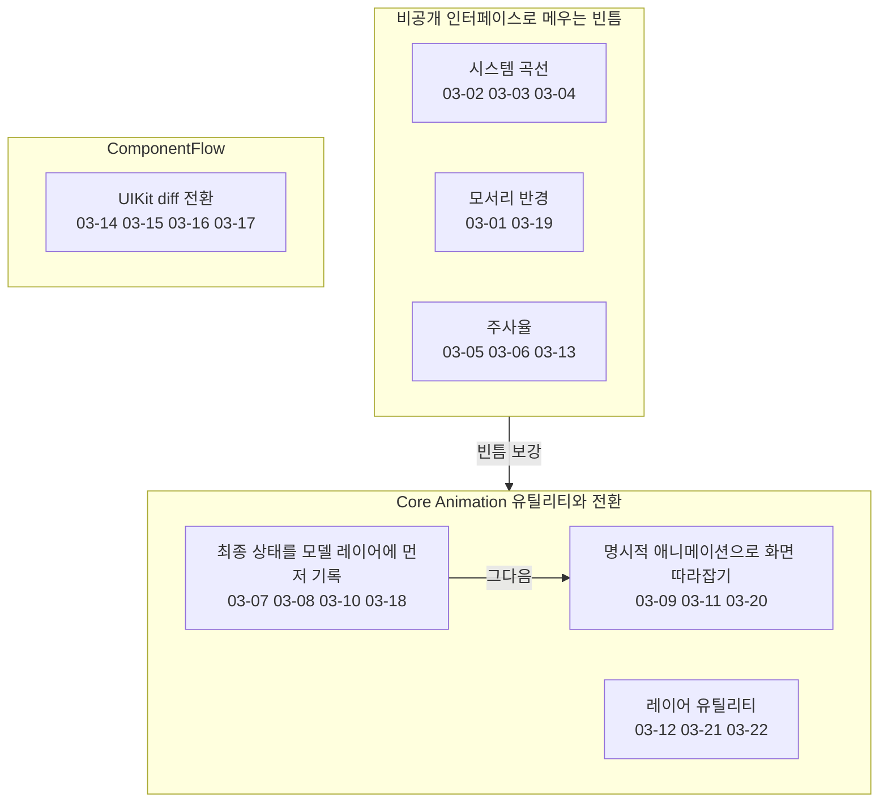
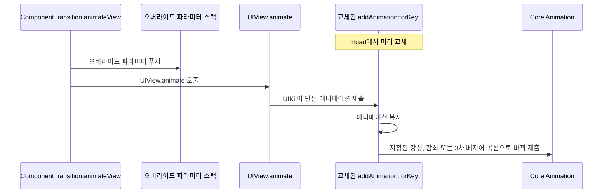
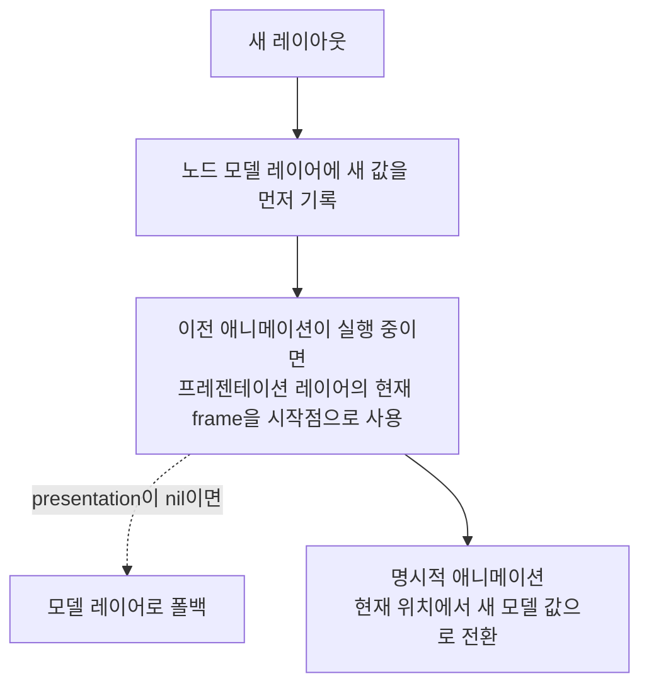
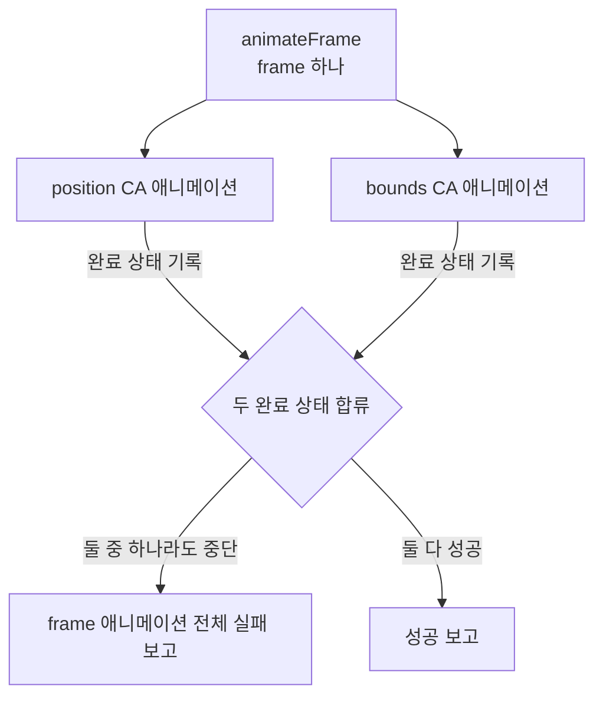
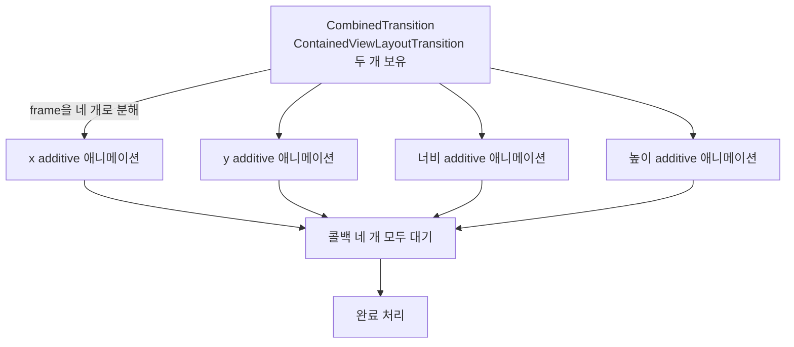

# 레이아웃과 애니메이션

웹: /docs/ios/03-layout-animation/ · Markdown: /docs/ios/03-layout-animation.md

> 비공개 모서리 반경, 시스템 스프링 탈취, additive 애니메이션과 모델 선반영.

| 기법 항목 | 리포트 선정 | 관련 비공개 API | REA 연관 |
| --- | --- | --- | --- |
| 22 | 6 | 12 | 0 |

소스: [TelegramMessenger/Telegram-iOS@f1dd7a2d](https://github.com/TelegramMessenger/Telegram-iOS/tree/f1dd7a2dbd02cbbf513e75d5695d8d36d1cf5838)(2026-10-07) · 플랫폼: iOS · UIKit

이 장의 선정 항목:
- 03-1 [#03-02 UIKit 트랜잭션 안의 스프링 애니메이션 탈취](/docs/ios/03-layout-animation/#t03-02)
- 03-2 [#03-04 공개되지 않은 UIKit 곡선 값 `7 << 16` 차용](/docs/ios/03-layout-animation/#t03-04)
- 03-3 [#03-05 비공개 `_scrollHeartbeat`로 구형 시스템 스크롤을 고주사율로 강제](/docs/ios/03-layout-animation/#t03-05)
- 03-4 [#03-08 프레젠테이션 레이어에서 중단된 레이아웃 애니메이션 이어받기](/docs/ios/03-layout-animation/#t03-08)
- 03-5 [#03-09 frame을 두 개의 애니메이션으로 쪼개고 완료 신호를 합류시키기](/docs/ios/03-layout-animation/#t03-09)
- 03-6 [#03-11 수평·수직 기하량을 서로 다른 곡선으로 전환](/docs/ios/03-layout-animation/#t03-11)

범위: Telegram-iOS의 Display 레이아웃 전환, Core Animation 유틸리티, 주사율 제어, ComponentFlow의 UIKit 전환 구현.

결론:

- 이 체계는 최종 상태를 먼저 모델 레이어(최종 값을 담는 레이어)에 기록해요. 그다음 명시적 애니메이션으로 화면 상태를 따라잡아요.
- 시스템 곡선, 모서리 반경, 주사율 기능에 빈틈이 있으면 비공개 인터페이스로 메워요.
- ComponentFlow(UIKit으로 만든 선언형 UI 프레임워크)는 안정적인 정체성, 뷰 부착 상태, 지연 파기로 SwiftUI에 가까운 UIKit diff 전환을 구현해요.

아래 도표는 이 장의 기법들이 레이아웃 전환과 비공개 보강, ComponentFlow 중 어디에 속하는지 보여 줘요.



## 1. 비공개 `cornerRadii`로 마스크 없이 네 모서리를 각각 둥글게 [#t03-01]

> #03-01 · Telegram-iOS · UIKit · 검증 방식: 소스 분석 · 태그: 비공개 API
>
> 소스: [Telegram-iOS:submodules/Display/Source/CALayerCornerRadii.swift L95–L119](https://github.com/TelegramMessenger/Telegram-iOS/blob/f1dd7a2dbd02cbbf513e75d5695d8d36d1cf5838/submodules/Display/Source/CALayerCornerRadii.swift#L95-L119)

**무엇을 했나요**:

- 비공개 setter `setCornerRadii:`가 있는지 확인해요.
- KVC(문자열 키로 속성을 읽고 쓰는 방식)로 비공개 `cornerRadii`를 읽고 써요.
- `CornerRadii.boxedValue`는 `CACornerRadii`의 `CGSize` 4개 배치에 맞춰 박싱해요.
- 호출하는 쪽은 애니메이션이 중단된 시점의 실제 모서리 반경도 프레젠테이션 레이어(지금 화면에 보이는 값을 가진 레이어)에서 읽을 수 있어요.

**왜 이렇게 했나요**: `cornerRadius`는 서로 독립적인 네 모서리를 표현하지 못해요. `CAShapeLayer` 마스크는 오프스크린 렌더링(화면에 그리기 전에 별도 버퍼에 먼저 그리는 렌더링)을 늘려요. 이 속성을 쓰면 모서리 반경이 레이어의 애니메이션 가능 속성으로서 합성(여러 레이어를 합쳐 화면에 그리는 일)에 참여해요.

**핵심 코드 발췌**

```swift title="CALayerCornerRadii.swift · L95–L119"
    static let cornerRadiiSupported: Bool = {
        return CALayer.instancesRespond(to: NSSelectorFromString("setCornerRadii:"))
    }()

    /// The layer's current four radii, read back through KVC — so an in-flight animation can be
    /// resumed from `presentation()?.cornerRadii` exactly like any ordinary layer property, rather
    /// than from a shadow copy the caller has to keep in sync.
    ///
    /// Not named to shadow anything: Swift cannot see the private ObjC property (it is in no header),
    /// so this is the only `cornerRadii` in scope and `value(forKey:)` reaches the real one.
    var cornerRadii: CornerRadii? {
        guard CALayer.cornerRadiiSupported, let value = self.value(forKey: cornerRadiiKey) as? NSValue else {
            return nil
        }
        return CornerRadii(boxedValue: value)
    }

    /// Applies four radii without animation. No-op when unsupported — callers that need a guaranteed
    /// clip must check `CALayer.cornerRadiiSupported` and fall back to a mask.
    func setCornerRadii(_ radii: CornerRadii) {
        guard CALayer.cornerRadiiSupported else {
            return
        }
        self.setValue(radii.boxedValue, forKey: cornerRadiiKey)
    }
```

**대가와 위험**: 비공개 API예요. 심사와 시스템 호환성 위험이 있어요. selector가 없으면 소스는 no-op(아무 일도 하지 않는 처리)으로 낮춰서 처리해요. 마스크를 대신할 방법은 호출하는 쪽이 마련해야 해요.

**증거 체인 #03-01**(iOS 바이너리 미검증)

- 소스 분석: Telegram-iOS 고정 커밋에서 행 단위로 확인했어요. 소스 위치는 모두 1곳이에요.
- 바이너리 검증: 하지 않음. App Store 배포 IPA는 FairPlay로 암호화되어 있어서 복호화된 실행 파일을 합법적으로 확보할 수 없어요.

## 2. UIKit 트랜잭션 안의 스프링 애니메이션 탈취 [#t03-02]

> #03-02 · Telegram-iOS · UIKit · 리포트 선정 03-1 · 검증 방식: 소스 분석 · 태그: 비공개 API, 런타임 해킹, Core Animation, 성능과 메모리
>
> 소스: [Telegram-iOS:submodules/UIKitRuntimeUtils/Source/UIKitRuntimeUtils/UIViewController+Navigation.m L191–L215](https://github.com/TelegramMessenger/Telegram-iOS/blob/f1dd7a2dbd02cbbf513e75d5695d8d36d1cf5838/submodules/UIKitRuntimeUtils/Source/UIKitRuntimeUtils/UIViewController%2BNavigation.m#L191-L215)
>
> 소스: [Telegram-iOS:submodules/UIKitRuntimeUtils/Source/UIKitRuntimeUtils/UIViewController+Navigation.m L549–L570](https://github.com/TelegramMessenger/Telegram-iOS/blob/f1dd7a2dbd02cbbf513e75d5695d8d36d1cf5838/submodules/UIKitRuntimeUtils/Source/UIKitRuntimeUtils/UIViewController%2BNavigation.m#L549-L570)

**무엇을 했나요**:

- `ComponentTransition.animateView`: 먼저 오버라이드 파라미터를 스택에 푸시하고, 그다음 `UIView.animate`를 호출해요.
- `+load`(클래스가 로드될 때 한 번 호출되는 메서드): `-[CALayer addAnimation:forKey:]`를 미리 교체해 둬요.
- 교체된 구현: UIKit이 만든 애니메이션을 복사한 뒤, 지정된 강성(스프링이 뻣뻣한 정도), 감쇠(진동이 줄어드는 정도) 또는 3차 베지어 곡선으로 바꿔 넣어요.

**왜 이렇게 했나요**: UIKit block 애니메이션은 Auto Layout과 속성 일괄 갱신을 처리할 수 있어요. 하지만 UIKit은 속성별 정확한 spring 파라미터와 아무 곡선은 공개하지 않아요. 이 방식은 UIKit 트랜잭션을 그대로 유지하면서 Core Animation에 제출되는 애니메이션을 고쳐 써요.

아래 도표는 UIKit 애니메이션이 Core Animation에 제출되기 전에 고쳐지는 순서를 보여 줘요.



**핵심 코드 발췌**

```objc title="UIViewController+Navigation.m · L191–L215 등 2곳"
- (void)_65087dc8_addAnimation:(CAAnimation *)anim forKey:(NSString *)key {
    CAAnimation *updatedAnimation = anim;
    if (currentSpringParametersOverrideStack().count != 0 && [anim isKindOfClass:[CASpringAnimation class]]) {
        CALayerSpringParametersOverride *overrideData = [currentSpringParametersOverrideStack() lastObject];
        if (overrideData) {
            if ([overrideData.parameters isKindOfClass:[CALayerSpringParametersOverrideParametersSpring class]]) {
                CALayerSpringParametersOverrideParametersSpring *parameters = (CALayerSpringParametersOverrideParametersSpring *)overrideData.parameters;
                CABasicAnimation *sourceAnimation = (CABasicAnimation *)anim;

                CASpringAnimation *animation = makeSpringBounceAnimationImpl(sourceAnimation.keyPath, 0.0, parameters.damping);

                animation.stiffness = parameters.stiffness;
                animation.fromValue = sourceAnimation.fromValue;
                animation.toValue = sourceAnimation.toValue;
                animation.byValue = sourceAnimation.byValue;
                animation.additive = sourceAnimation.additive;
                animation.removedOnCompletion = sourceAnimation.isRemovedOnCompletion;
                animation.fillMode = sourceAnimation.fillMode;
                animation.beginTime = sourceAnimation.beginTime;
                animation.timeOffset = sourceAnimation.timeOffset;
                animation.repeatCount = sourceAnimation.repeatCount;
                animation.autoreverses = sourceAnimation.autoreverses;

                float k = animationDurationFactorImpl();
                __unused float speed = 1.0f;
```

**대가와 위험**:

- 전역 method swizzling(런타임에 메서드 구현을 바꿔치는 기법)이에요.
- 스택은 프로세스 전역 `NSMutableArray`예요. 메인 스레드가 아닌 곳에서 동시에 제출하면 상태가 뒤섞일 위험이 있어요.
- `_65087dc8_addAnimation:forKey:`는 숨겨진 비공개 이름이 아니에요. 교체용 별칭이에요. 소스는 L570에서 이 별칭을 공개 `addAnimation:forKey:`와 교체한다고 밝혀요.

**증거 체인 #03-02**(iOS 바이너리 미검증)

- 소스 분석: Telegram-iOS 고정 커밋에서 행 단위로 확인했어요. 소스 위치는 모두 2곳이에요.
- 리포트 요약(구현 방법): 파라미터 푸시→`method_exchangeImplementations`→애니메이션 복사 후 교체.
- 바이너리 검증: 하지 않음. App Store 배포 IPA는 FairPlay로 암호화되어 있어서 복호화된 실행 파일을 합법적으로 확보할 수 없어요.

## 3. 비공개 `_solveForInput:`을 호출해 수동 보간과 시스템 스프링을 통일 [#t03-03]

> #03-03 · Telegram-iOS · UIKit · 검증 방식: 소스 분석 · 태그: 비공개 API, 런타임 해킹
>
> 소스: [Telegram-iOS:submodules/Display/Source/ListViewAnimation.swift L91–L110](https://github.com/TelegramMessenger/Telegram-iOS/blob/f1dd7a2dbd02cbbf513e75d5695d8d36d1cf5838/submodules/Display/Source/ListViewAnimation.swift#L91-L110)
>
> 소스: [Telegram-iOS:submodules/UIKitRuntimeUtils/Source/UIKitRuntimeUtils/UIKitUtils.m L24–L48](https://github.com/TelegramMessenger/Telegram-iOS/blob/f1dd7a2dbd02cbbf513e75d5695d8d36d1cf5838/submodules/UIKitRuntimeUtils/Source/UIKitRuntimeUtils/UIKitUtils.m#L24-L48)

**무엇을 했나요**:

- `ListViewAnimation`은 시스템 스프링을 직접 근사하지 않아요.
- 런타임 유틸리티가 문자열 `"_" + "solveForInput:"`을 `_solveForInput:`으로 복원해요.
- 메서드 시그니처를 읽고 `float` 또는 `double`에 맞춰 IMP(메서드 구현 함수 포인터)를 호출해요.
- `_solveForInput:`을 찾지 못하면 선형 `t`로 폴백해요.

**왜 이렇게 했나요**: 리스트의 수동 프레임별 보간은 Core Animation 스프링과 일치해야 해요. 감쇠 방정식을 직접 손으로 쓰면 시스템 구현과 어긋나기 쉬워요. 이 방법은 시스템이 실제로 쓰는 솔버(스프링 값을 계산하는 함수)를 재사용할 수 있어요.

**핵심 코드 발췌**

```swift title="ListViewAnimation.swift · L91–L110 등 2곳"
private let springAnimationIn: CABasicAnimation = {
    let animation = makeSpringAnimation("", duration: 0.5)
    return animation
}()

let springAnimationSolver: (CGFloat) -> CGFloat = { () -> (CGFloat) -> CGFloat in
    if #available(iOS 9.0, *) {
        return { t in
            return springAnimationValueAt(springAnimationIn, t)
        }
    } else {
        return { t in
            return bezierPoint(0.23, 1.0, 0.32, 1.0, t)
        }
    }
}()

public let listViewAnimationCurveSystem: (CGFloat) -> CGFloat = { t in
    return springAnimationSolver(t)
}
```

**대가와 위험**: `_solveForInput:`은 비공개 selector예요. 심사 위험과 앞으로 시그니처가 바뀔 위험이 있어요. 소스는 런타임 조회와 인자 인코딩 검사로 크래시 위험을 낮춰요. 폴백 곡선이 구형 시스템의 체감과 맞는지는 미검증이에요.

**증거 체인 #03-03**(iOS 바이너리 미검증)

- 소스 분석: Telegram-iOS 고정 커밋에서 행 단위로 확인했어요. 소스 위치는 모두 2곳이에요.
- 바이너리 검증: 하지 않음. App Store 배포 IPA는 FairPlay로 암호화되어 있어서 복호화된 실행 파일을 합법적으로 확보할 수 없어요.

## 4. 공개되지 않은 UIKit 곡선 값 `7 << 16` 차용 [#t03-04]

> #03-04 · Telegram-iOS · UIKit · 리포트 선정 03-2 · 검증 방식: 소스 분석 · 태그: 비공개 API, 텍스트와 입력
>
> 소스: [Telegram-iOS:submodules/ComponentFlow/Source/Base/Transition.swift L81–L99](https://github.com/TelegramMessenger/Telegram-iOS/blob/f1dd7a2dbd02cbbf513e75d5695d8d36d1cf5838/submodules/ComponentFlow/Source/Base/Transition.swift#L81-L99)
>
> 소스: [Telegram-iOS:submodules/Display/Source/ContainedViewLayoutTransition.swift L111–L125](https://github.com/TelegramMessenger/Telegram-iOS/blob/f1dd7a2dbd02cbbf513e75d5695d8d36d1cf5838/submodules/Display/Source/ContainedViewLayoutTransition.swift#L111-L125)

**무엇을 했나요**: 코드는 `UIView.AnimationOptions`의 곡선 필드를 `7`로 설정하고, 이 값에 `.spring`이라는 이름을 붙여요. `ContainedViewLayoutTransition`은 `.spring`과 `.customSpring`에 같은 raw value(열거형이 내부적으로 가진 값)를 써요.

**왜 이렇게 했나요**: 공개된 곡선은 선형과 ease 계열뿐이에요. `7`을 쓰면 UIKit block 애니메이션이 시스템 내부의 spring 경로를 타요. 그래서 명시적 Core Animation spring과 비교적 일관된 체감을 유지할 수 있어요.

**핵심 코드 발췌**

```swift title="Transition.swift · L81–L99 등 2곳"
    var viewAnimationOptions: UIView.AnimationOptions {
        switch self {
        case .linear:
            return [.curveLinear]
        case .easeInOut:
            return [.curveEaseInOut]
        case .easeIn:
            return [.curveEaseIn]
        case .spring:
            return UIView.AnimationOptions(rawValue: 7 << 16)
        case .custom:
            return []
        case .bounce:
            return []
        }
    }
}

public extension ComponentTransition.Animation {
```

**대가와 위험**: `7`은 공개 곡선 열거형에 없어요. 구현 세부 사항에 기대는 기법이에요. `7`이 지금도 키보드 곡선인지는 코드에 설명이 없어요. 이 대응 관계는 미검증이에요.

**증거 체인 #03-04**(iOS 바이너리 미검증)

- 소스 분석: Telegram-iOS 고정 커밋에서 행 단위로 확인했어요. 소스 위치는 모두 2곳이에요.
- 리포트 요약(구현 방법): 커스텀 열거형 분기를 이 raw value로 매핑해서 전환 구현을 통일해요.
- 바이너리 검증: 하지 않음. App Store 배포 IPA는 FairPlay로 암호화되어 있어서 복호화된 실행 파일을 합법적으로 확보할 수 없어요.

## 5. 비공개 `_scrollHeartbeat`로 구형 시스템 스크롤을 고주사율로 강제 [#t03-05]

> #03-05 · Telegram-iOS · UIKit · 리포트 선정 03-3 · 검증 방식: 소스 분석 · 태그: 비공개 API, 제스처와 스크롤
>
> 소스: [Telegram-iOS:submodules/UIKitRuntimeUtils/Source/UIKitRuntimeUtils/UIViewController+Navigation.m L293–L317](https://github.com/TelegramMessenger/Telegram-iOS/blob/f1dd7a2dbd02cbbf513e75d5695d8d36d1cf5838/submodules/UIKitRuntimeUtils/Source/UIKitRuntimeUtils/UIViewController%2BNavigation.m#L293-L317)

**무엇을 했나요**:

- 문자열을 이어 붙여 `_scrollHeartbeat`를 만들어요.
- KVC로 `UIScrollView` 내부의 `CADisplayLink`(화면 주사율에 맞춰 콜백을 부르는 타이머)를 꺼내요.
- iOS 15의 고주사율 기기에서는 이 link의 최소·최대·선호 FPS(초당 프레임 수)를 모두 화면 최댓값으로 설정해요.

**왜 이렇게 했나요**: 자체 display link를 고주사율로 돌리는 것만으로는 시스템 스크롤의 샘플링 빈도가 올라가지 않아요. 이 방식은 스크롤 내부 heartbeat를 직접 제어해요. 이 수정을 iOS 16 이상에서 꺼 둔 것은, 작성자가 시스템 쪽 문제가 달라졌거나 고쳐졌다고 봤다는 뜻이에요.

**핵심 코드 발췌**

```objc title="UIViewController+Navigation.m · L293–L317"
- (void)fixScrollDisplayLink {
    if (@available(iOS 16.0, *)) {
        return;
    }
    static NSString *scrollHeartbeatKey = nil;
    static dispatch_once_t onceToken;
    dispatch_once(&onceToken, ^{
        scrollHeartbeatKey = [NSString stringWithFormat:@"_%@", @"scrollHeartbeat"];
    });

    id value = [self valueForKey:scrollHeartbeatKey];
    if ([value isKindOfClass:[CADisplayLink class]]) {
        CADisplayLink *displayLink = (CADisplayLink *)value;
        if ([displayLink associatedObjectForKey:forceFullRefreshRateKey] == nil) {
            [displayLink setAssociatedObject:@true forKey:forceFullRefreshRateKey];

            if (@available(iOS 15.0, *)) {
                float maxFps = [UIScreen mainScreen].maximumFramesPerSecond;
                if (maxFps > 61.0f) {
                    [displayLink setPreferredFrameRateRange:CAFrameRateRangeMake(maxFps, maxFps, maxFps)];
                }
            }
        }
    }
}
```

**대가와 위험**: `_scrollHeartbeat`는 비공개 KVC key예요. 실제 이름은 `@"_%@", @"scrollHeartbeat"`로 직접 확인돼요. 심사 위험, KVC 예외 위험, 전력 소모 위험이 있어요.

**증거 체인 #03-05**(iOS 바이너리 미검증)

- 소스 분석: Telegram-iOS 고정 커밋에서 행 단위로 확인했어요. 소스 위치는 모두 1곳이에요.
- 리포트 요약(구현 방법): `valueForKey:@"_scrollHeartbeat"`로 가져와 표시한 뒤 `preferredFrameRateRange`를 설정.
- 바이너리 검증: 하지 않음. App Store 배포 IPA는 FairPlay로 암호화되어 있어서 복호화된 실행 파일을 합법적으로 확보할 수 없어요.

## 6. iOS 26 스프링에 비공개 고주사율 사유 코드 기록 [#t03-06]

> #03-06 · Telegram-iOS · UIKit · 검증 방식: 소스 분석 · 태그: 비공개 API
>
> 소스: [Telegram-iOS:submodules/UIKitRuntimeUtils/Source/UIKitRuntimeUtils/UIKitUtils.m L68–L84](https://github.com/TelegramMessenger/Telegram-iOS/blob/f1dd7a2dbd02cbbf513e75d5695d8d36d1cf5838/submodules/UIKitRuntimeUtils/Source/UIKitRuntimeUtils/UIKitUtils.m#L68-L84)

**무엇을 했나요**: iOS 26 분기에서 하는 일은 다음과 같아요.

- 다른 스프링 파라미터 세트로 바꿔요.
- overdamping(감쇠가 지나쳐 진동 없이 느리게 수렴하는 상태)은 금지해요.
- KVC로 `highFrameRateReason = 1048619`를 기록해요.
- 이어서 80–120 FPS를 요청하고 120 FPS를 선호값으로 둬요.

**왜 이렇게 했나요**: 코드는 iOS 26을 시스템 애니메이션 파라미터가 바뀐 분기점으로 봐요. 요청한 고프레임 레이트 범위는 요청을 나타낼 뿐이에요. 비공개 사유 코드는 시스템이 고주사율 사유를 받아들이게 하는 용도로 보여요. 사유 코드의 구체적인 의미는 미검증이에요.

**핵심 코드 발췌**

```objc title="UIKitUtils.m · L68–L84"
CABasicAnimation * _Nonnull make26SpringAnimationImpl(NSString * _Nonnull keyPath, double duration) {
    CASpringAnimation *springAnimation = [CASpringAnimation animationWithKeyPath:keyPath];
    springAnimation.mass = 1.0f;
    springAnimation.stiffness = 555.027;
    springAnimation.damping = 47.118;
    springAnimation.duration = duration;
    springAnimation.timingFunction = [CAMediaTimingFunction functionWithName:kCAMediaTimingFunctionLinear];
    if (@available(iOS 17.0, *)) {
        springAnimation.allowsOverdamping = false;
    }
    if (@available(iOS 15.0, *)) {
        [springAnimation setValue:@(1048619) forKey:@"highFrameRateReason"];
        springAnimation.preferredFrameRateRange = CAFrameRateRangeMake(80.0, 120.0, 120.0);
    }

    return springAnimation;
}
```

**대가와 위험**: `highFrameRateReason`은 공개되지 않은 KVC 속성이에요. `1048619`라는 매직 넘버(의미를 알 수 없는 상수)에 대한 소스 설명은 없어요. 심사와 시스템 호환성 위험이 있어요. 실제로 120 FPS가 적용되는지는 미검증이에요.

**증거 체인 #03-06**(iOS 바이너리 미검증)

- 소스 분석: Telegram-iOS 고정 커밋에서 행 단위로 확인했어요. 소스 위치는 모두 1곳이에요.
- 바이너리 검증: 하지 않음. App Store 배포 IPA는 FairPlay로 암호화되어 있어서 복호화된 실행 파일을 합법적으로 확보할 수 없어요.

## 7. 저장된 기하량으로 `CALayer.frame`의 부동소수점 재시작 애니메이션 피하기 [#t03-07]

> #03-07 · Telegram-iOS · UIKit · 검증 방식: 소스 분석 · 태그: Core Animation
>
> 소스: [Telegram-iOS:submodules/Display/Source/ContainedViewLayoutTransition.swift L30–L42](https://github.com/TelegramMessenger/Telegram-iOS/blob/f1dd7a2dbd02cbbf513e75d5695d8d36d1cf5838/submodules/Display/Source/ContainedViewLayoutTransition.swift#L30-L42)

**무엇을 했나요**: 파생값인 `frame`을 직접 비교하지 않아요.

- 변환이 없을 때: 목표 frame에서 `position`을 역산하고, 레이어에 저장된 `position`과 `bounds`를 비교해요.
- 변환이 있을 때만: `frame` 비교로 되돌아가요.

**왜 이렇게 했나요**: `frame`은 `position`, `bounds`, `anchorPoint`에서 유도돼요. 소수 픽셀을 왕복하면 반올림 오차가 생겨요. 실제로는 없는 변화(반올림 오차)가 레이아웃 애니메이션을 계속 일으켜서 말풍선이 떨려요.

**핵심 코드 발췌**

```swift title="ContainedViewLayoutTransition.swift · L30–L42"
func layerIsAlreadyAtFrame(_ layer: CALayer, _ frame: CGRect) -> Bool {
    guard CATransform3DIsIdentity(layer.transform) else {
        return layer.frame.equalTo(frame)
    }
    let anchorPoint = layer.anchorPoint
    let expectedPosition = CGPoint(
        x: frame.minX + frame.width * anchorPoint.x,
        y: frame.minY + frame.height * anchorPoint.y
    )
    // The setter keeps the existing bounds origin and replaces only the size.
    let expectedBounds = CGRect(origin: layer.bounds.origin, size: frame.size)
    return layer.position == expectedPosition && layer.bounds == expectedBounds
}
```

**대가와 위험**: 이 로직은 `frame` setter의 저장 동작에 기대고 있어요. identity가 아닌 transform(변환이 걸려 있는 상태)에는 이 유도를 쓸 수 없어요. 소스는 그 경우를 위해 폴백을 둬요. 뚜렷한 심사 위험은 없어요.

**증거 체인 #03-07**(iOS 바이너리 미검증)

- 소스 분석: Telegram-iOS 고정 커밋에서 행 단위로 확인했어요. 소스 위치는 모두 1곳이에요.
- 바이너리 검증: 하지 않음. App Store 배포 IPA는 FairPlay로 암호화되어 있어서 복호화된 실행 파일을 합법적으로 확보할 수 없어요.

## 8. 프레젠테이션 레이어에서 중단된 레이아웃 애니메이션 이어받기 [#t03-08]

> #03-08 · Telegram-iOS · UIKit · 리포트 선정 03-4 · 검증 방식: 소스 분석
>
> 소스: [Telegram-iOS:submodules/Display/Source/ContainedViewLayoutTransition.swift L234–L248](https://github.com/TelegramMessenger/Telegram-iOS/blob/f1dd7a2dbd02cbbf513e75d5695d8d36d1cf5838/submodules/Display/Source/ContainedViewLayoutTransition.swift#L234-L248)

**무엇을 했나요**:

1. 새 레이아웃을 먼저 노드 모델 레이어에 기록해요.
2. 이전 애니메이션이 아직 실행 중이면 프레젠테이션 레이어의 현재 frame에서 시작점을 가져와요.
3. 이어서 명시적 애니메이션이 화면의 현재 위치에서 새 모델 값으로 전환해요.

**왜 이렇게 했나요**: 이전 모델 값에서 곧바로 애니메이션을 시작하면 화면이 튀어요. 프레젠테이션 레이어만 고치면 레이아웃 상태가 왜곡돼요. 모델 레이어를 먼저 갱신하면 이후 레이아웃이 바로 최종 값을 볼 수 있어요.

아래 도표는 중단된 레이아웃 애니메이션을 이어받는 순서를 보여 줘요.



**핵심 코드 발췌**

```swift title="ContainedViewLayoutTransition.swift · L234–L248"
            case let .animated(duration, curve):
                let previousFrame: CGRect
                if beginWithCurrentState, (node.layer.animation(forKey: "position") != nil || node.layer.animation(forKey: "bounds") != nil), let presentation = node.layer.presentation() {
                    previousFrame = presentation.frame
                } else {
                    previousFrame = node.frame
                }
                node.frame = frame
                node.layer.animateFrame(from: previousFrame, to: frame, duration: duration, delay: delay, timingFunction: curve.timingFunction, mediaTimingFunction: curve.mediaTimingFunction, force: force, completion: { result in
                    if let completion = completion {
                        completion(result)
                    }
                })
            }
        }
```

**대가와 위험**: `presentation()`이 nil일 수 있어요. 코드는 모델 레이어로 폴백해요. 모든 속성에 일관된 애니메이션 key를 써야 해요. 그렇지 않으면 이어받아야 하는지 판단할 수 없어요.

**증거 체인 #03-08**(iOS 바이너리 미검증)

- 소스 분석: Telegram-iOS 고정 커밋에서 행 단위로 확인했어요. 소스 위치는 모두 1곳이에요.
- 리포트 요약(구현 방법): `position/bounds` 애니메이션 존재 감지→프레젠테이션 레이어 읽기→`animateFrame`.
- 바이너리 검증: 하지 않음. App Store 배포 IPA는 FairPlay로 암호화되어 있어서 복호화된 실행 파일을 합법적으로 확보할 수 없어요.

## 9. frame을 두 개의 애니메이션으로 쪼개고 완료 신호를 합류시키기 [#t03-09]

> #03-09 · Telegram-iOS · UIKit · 리포트 선정 03-5 · 검증 방식: 소스 분석 · 태그: 비공개 API
>
> 소스: [Telegram-iOS:submodules/Display/Source/CAAnimationUtils.swift L510–L535](https://github.com/TelegramMessenger/Telegram-iOS/blob/f1dd7a2dbd02cbbf513e75d5695d8d36d1cf5838/submodules/Display/Source/CAAnimationUtils.swift#L510-L535)

**무엇을 했나요**:

- `animateFrame`은 `position`과 `bounds`라는 CA(Core Animation) 애니메이션 두 개로 frame 하나를 표현해요.
- 각각의 완료 상태를 따로 기록해요.
- 둘 중 하나라도 중단되면 frame 애니메이션 전체를 실패로 보고해요.
- 둘 다 성공한 뒤에야 성공을 보고해요.

**왜 이렇게 했나요**: `frame`은 Core Animation에서 독립적으로 애니메이션할 수 있는 저장 속성이 아니에요. `position`과 `bounds`의 완료 콜백 두 개를 그대로 전달하면 상위 계층이 뷰를 너무 일찍 삭제하거나 마무리를 중복 실행하게 돼요.

아래 도표는 frame 애니메이션을 둘로 쪼개고 완료 신호를 합치는 흐름을 보여 줘요.



**핵심 코드 발췌**

```swift title="CAAnimationUtils.swift · L510–L535"
        var interrupted = false
        var completedPosition = false
        var completedBounds = false
        let partialCompletion: () -> Void = {
            if interrupted || (completedPosition && completedBounds) {
                if let completion = completion {
                    completion(!interrupted)
                }
            }
        }

        var fromPosition = CGPoint(x: from.midX, y: from.midY)
        var toPosition = CGPoint(x: to.midX, y: to.midY)
        var fromBounds = CGRect(origin: self.bounds.origin, size: from.size)
        var toBounds = CGRect(origin: self.bounds.origin, size: to.size)

        if additive {
            fromPosition.x = -(toPosition.x - fromPosition.x)
            fromPosition.y = -(toPosition.y - fromPosition.y)
            toPosition = CGPoint()

            fromBounds.size.width = -(toBounds.width - fromBounds.width)
            fromBounds.size.height = -(toBounds.height - fromBounds.height)
            toBounds = CGRect()
        }
```

**대가와 위험**: 이 조율은 두 애니메이션이 모두 delegate를 호출한다는 가정에 기대고 있어요. 복잡한 외부 애니메이션이 덮어쓰면 결과를 추론하기 어려워질 수 있어요. 뚜렷한 비공개 API 위험은 없어요.

**증거 체인 #03-09**(iOS 바이너리 미검증)

- 소스 분석: Telegram-iOS 고정 커밋에서 행 단위로 확인했어요. 소스 위치는 모두 1곳이에요.
- 리포트 요약(구현 방법): 완료 플래그 두 개와 중단 상태를 추적해 전체 콜백을 조율.
- 바이너리 검증: 하지 않음. App Store 배포 IPA는 FairPlay로 암호화되어 있어서 복호화된 실행 파일을 합법적으로 확보할 수 없어요.

## 10. additive 변위로 이미 갱신된 모델 frame 따라잡기 [#t03-10]

> #03-10 · Telegram-iOS · UIKit · 검증 방식: 소스 분석 · 태그: Core Animation
>
> 소스: [Telegram-iOS:submodules/Display/Source/ContainedViewLayoutTransition.swift L320–L336](https://github.com/TelegramMessenger/Telegram-iOS/blob/f1dd7a2dbd02cbbf513e75d5695d8d36d1cf5838/submodules/Display/Source/ContainedViewLayoutTransition.swift#L320-L336)

**무엇을 했나요**: 목표 `frame`을 먼저 설정해요. 그다음 additive `position` 애니메이션(현재 값에 더해 적용되는 애니메이션)으로 offset에서 0까지 움직여요. offset은 `이전 좌표 − 새 좌표`예요. 화면에서는 레이어가 이전 위치에서 새 위치로 이동하는 것처럼 보여요.

**왜 이렇게 했나요**: 모델 레이어는 언제나 최종 레이아웃을 유지해요. additive 변위는 최종 위치를 바꾸지 않아요. 여러 변위 애니메이션을 겹쳐 쓸 수도 있어서, 같은 model `position`을 반복해서 고쳐 쓸 필요가 없어요.

**핵심 코드 발췌**

```swift title="ContainedViewLayoutTransition.swift · L320–L336"
    func updateFrameAdditive(layer: CALayer, frame: CGRect, force: Bool = false, completion: ((Bool) -> Void)? = nil) {
        if layer.frame.equalTo(frame) && !force {
            completion?(true)
        } else {
            switch self {
            case .immediate:
                layer.frame = frame
                if let completion = completion {
                    completion(true)
                }
            case .animated:
                let previousFrame = layer.frame
                layer.frame = frame
                self.animatePositionAdditive(layer: layer, offset: CGPoint(x: previousFrame.minX - frame.minX, y: previousFrame.minY - frame.minY))
            }
        }
    }
```

**대가와 위험**: 이 분기는 `completion`을 `animatePositionAdditive`에 넘기지 않아요. 호출하는 쪽은 애니메이션 분기의 콜백에 기댈 수 없어요. 이 동작이 의도된 설계인지는 미검증이에요.

**증거 체인 #03-10**(iOS 바이너리 미검증)

- 소스 분석: Telegram-iOS 고정 커밋에서 행 단위로 확인했어요. 소스 위치는 모두 1곳이에요.
- 바이너리 검증: 하지 않음. App Store 배포 IPA는 FairPlay로 암호화되어 있어서 복호화된 실행 파일을 합법적으로 확보할 수 없어요.

## 11. 수평·수직 기하량을 서로 다른 곡선으로 전환 [#t03-11]

> #03-11 · Telegram-iOS · UIKit · 리포트 선정 03-6 · 검증 방식: 소스 분석 · 태그: 비공개 API
>
> 소스: [Telegram-iOS:submodules/Display/Source/ContainedViewLayoutTransition.swift L1975–L1999](https://github.com/TelegramMessenger/Telegram-iOS/blob/f1dd7a2dbd02cbbf513e75d5695d8d36d1cf5838/submodules/Display/Source/ContainedViewLayoutTransition.swift#L1975-L1999)

**무엇을 했나요**:

- `CombinedTransition`은 독립적인 `ContainedViewLayoutTransition` 두 개를 가지고 있어요.
- frame을 x, y, 너비, 높이 네 개의 additive 애니메이션으로 쪼개요.
- 콜백 네 개를 기다린 뒤 완료 처리해요.

**왜 이렇게 했나요**: 키보드 회피나 사이드 스와이프에서는 수평과 수직에 서로 다른 지속 시간이나 곡선이 필요한 경우가 많아요. frame 하나를 통째로 애니메이션하는 방식으로는 이런 조합을 표현할 수 없어요.

아래 도표는 frame을 네 개의 additive 애니메이션으로 쪼개 완료를 합치는 구조를 보여 줘요.



**핵심 코드 발췌**

```swift title="ContainedViewLayoutTransition.swift · L1975–L1999"
        var remainingKeys = Keys.allCases
        var completedValue = true
        let completeKey: (Keys, Bool) -> Void = { key, completed in
            remainingKeys.removeAll(where: { $0 == key })
            if !completed {
                completedValue = false
            }
            if remainingKeys.isEmpty {
                completion?(completedValue)
            }
        }

        self.horizontal.animatePositionAdditive(layer: layer, offset: CGPoint(x: fromFrame.midX - toFrame.midX, y: 0.0), completion: { result in
            completeKey(.positionX, result)
        })
        self.vertical.animatePositionAdditive(layer: layer, offset: CGPoint(x: 0.0, y: fromFrame.midY - toFrame.midY), completion: { result in
            completeKey(.positionY, result)
        })

        self.horizontal.animateWidthAdditive(layer: layer, value: fromFrame.width - toFrame.width, completion: { result in
            completeKey(.sizeWidth, result)
        })
        self.vertical.animateHeightAdditive(layer: layer, value: fromFrame.height - toFrame.height, completion: { result in
            completeKey(.sizeHeight, result)
        })
```

**대가와 위험**: key path 네 개가 동시에 돌면 애니메이션 수가 늘어나요. 완료 콜백은 가장 느린 축에 묶여요. 뚜렷한 비공개 API 위험은 없어요.

**증거 체인 #03-11**(iOS 바이너리 미검증)

- 소스 분석: Telegram-iOS 고정 커밋에서 행 단위로 확인했어요. 소스 위치는 모두 1곳이에요.
- 리포트 요약(구현 방법): `ContainedViewLayoutTransition` 두 개를 병렬로 돌리고 완료 네 개를 합류.
- 바이너리 검증: 하지 않음. App Store 배포 IPA는 FairPlay로 암호화되어 있어서 복호화된 실행 파일을 합법적으로 확보할 수 없어요.

## 12. `action(forKey:)`에서 암묵적 애니메이션 끄기와 마운트 추적을 동시에 [#t03-12]

> #03-12 · Telegram-iOS · UIKit · 검증 방식: 소스 분석 · 태그: Core Animation
>
> 소스: [Telegram-iOS:submodules/Display/Source/SimpleLayer.swift L10–L24](https://github.com/TelegramMessenger/Telegram-iOS/blob/f1dd7a2dbd02cbbf513e75d5695d8d36d1cf5838/submodules/Display/Source/SimpleLayer.swift#L10-L24)

**무엇을 했나요**:

- 커스텀 `CAAction`(레이어가 속성 변경 같은 이벤트에 대응할 때 쓰는 객체)의 `run`은 비어 있어요.
- 레이어는 어떤 action key가 와도 이 객체를 반환해요.
- action key가 `kCAOnOrderIn`과 `kCAOnOrderOut`일 때는 계층 상태를 관리하고 콜백을 일으켜요.

**왜 이렇게 했나요**: 빈 action을 반환하는 편이 매번 `CATransaction.setDisableActions`에 기대는 것보다 한곳에 모여요. Core Animation의 계층 진입·이탈 이벤트를 생명주기 훅으로 바꾸는 효과도 있어요. `HierarchyTrackingLayer`는 독립 모듈에서 같은 메커니즘을 복제했어요.

**핵심 코드 발췌**

```swift title="SimpleLayer.swift · L10–L24"
open class SimpleLayer: CALayer {
    public var didEnterHierarchy: (() -> Void)?
    public var didExitHierarchy: (() -> Void)?
    public private(set) var isInHierarchy: Bool = false

    override open func action(forKey event: String) -> CAAction? {
        if event == kCAOnOrderIn {
            self.isInHierarchy = true
            self.didEnterHierarchy?()
        } else if event == kCAOnOrderOut {
            self.isInHierarchy = false
            self.didExitHierarchy?()
        }
        return nullAction
    }
```

**대가와 위험**: 이 레이어의 모든 암묵적 애니메이션을 막아요. 서브클래스는 애니메이션을 명시적으로 추가해야 해요. `kCAOnOrderIn`의 복잡한 컨테이너 타이밍은 실제 화면에서 검증해야 해요.

**증거 체인 #03-12**(iOS 바이너리 미검증)

- 소스 분석: Telegram-iOS 고정 커밋에서 행 단위로 확인했어요. 소스 위치는 모두 1곳이에요.
- 바이너리 검증: 하지 않음. App Store 배포 IPA는 FairPlay로 암호화되어 있어서 복호화된 실행 파일을 합법적으로 확보할 수 없어요.

## 13. 공유 DisplayLink 하나로 여러 프레임 레이트 요구를 처리 [#t03-13]

> #03-13 · Telegram-iOS · UIKit · 검증 방식: 소스 분석 · 태그: 비공개 API, 텍스트와 입력, 성능과 메모리
>
> 소스: [Telegram-iOS:submodules/Display/Source/DisplayLinkAnimator.swift L89–L94](https://github.com/TelegramMessenger/Telegram-iOS/blob/f1dd7a2dbd02cbbf513e75d5695d8d36d1cf5838/submodules/Display/Source/DisplayLinkAnimator.swift#L89-L94)
>
> 소스: [Telegram-iOS:submodules/Display/Source/DisplayLinkAnimator.swift L162–L186](https://github.com/TelegramMessenger/Telegram-iOS/blob/f1dd7a2dbd02cbbf513e75d5695d8d36d1cf5838/submodules/Display/Source/DisplayLinkAnimator.swift#L162-L186)

**무엇을 했나요**:

- 싱글턴(하나만 만드는 객체)이 `CADisplayLink` 하나만 가지고 있어요.
- 활성 request 중 가장 높은 FPS를 가져와요.
- 고주사율 기기는 요구가 60 FPS를 넘을 때만 120 FPS를 요청해요.
- iPad는 조건 없이 120 FPS 범위를 요청해요.
- FPS가 낮은 request는 `targetTimestamp - timestamp`를 누적해 스로틀링(호출 빈도 제한)해요.

**왜 이렇게 했나요**: 애니메이션마다 display link를 만들면 콜백이 중복돼요. 전역 link 하나로 30, 60, 120 FPS 클라이언트가 v-sync를 공유할 수 있어요. 포그라운드와 백그라운드가 전환될 때 link를 무효화해서 백그라운드 전력 소모를 막아요.

**핵심 코드 발췌**

```swift title="DisplayLinkAnimator.swift · L89–L94 등 2곳"
            if #available(iOS 15.0, *) {
                let maxFps = Float(UIScreen.main.maximumFramesPerSecond)
                if maxFps > 61.0 {
                    var frameRateRange: CAFrameRateRange
                    switch maxFramesPerSecond {
                    case let .fps(fps):
                        if fps > 60 {
                            frameRateRange = CAFrameRateRange(minimum: 30.0, maximum: 120.0, preferred: 120.0)
                        } else {
                            frameRateRange = .default
                        }
                    case .max:
                        frameRateRange = CAFrameRateRange(minimum: 30.0, maximum: 120.0, preferred: 120.0)
                    }

                    if isIpad {
                        frameRateRange = CAFrameRateRange(minimum: 30.0, maximum: 120.0, preferred: 120.0)
                    }

                    if displayLink.preferredFrameRateRange != frameRateRange {
                        displayLink.preferredFrameRateRange = frameRateRange
                        print("SharedDisplayLinkDriver: switch to \(frameRateRange)")
                    }
                }
            }
```

**대가와 위험**: iPad에서 120 FPS를 강제하면 전력 소모가 늘 수 있어요. `0.95` 스로틀 임계값은 미세한 시간 오차를 만들어요. 뚜렷한 비공개 API 위험은 없어요.

**증거 체인 #03-13**(iOS 바이너리 미검증)

- 소스 분석: Telegram-iOS 고정 커밋에서 행 단위로 확인했어요. 소스 위치는 모두 2곳이에요.
- 바이너리 검증: 하지 않음. App Store 배포 IPA는 FairPlay로 암호화되어 있어서 복호화된 실행 파일을 합법적으로 확보할 수 없어요.

## 14. 안정적인 정체성으로 UIKit 서브뷰를 재생성하지 않고 이동 [#t03-14]

> #03-14 · Telegram-iOS · UIKit · 검증 방식: 소스 분석
>
> 소스: [Telegram-iOS:submodules/ComponentFlow/Source/Base/CombinedComponent.swift L686–L710](https://github.com/TelegramMessenger/Telegram-iOS/blob/f1dd7a2dbd02cbbf513e75d5695d8d36d1cf5838/submodules/ComponentFlow/Source/Base/CombinedComponent.swift#L686-L710)

**무엇을 했나요**:

- `ChildMap`은 map 객체 주소와 비즈니스 key를 조합해 child ID를 만들어요.
- 갱신할 때 ID로 기존 view를 찾아요.
- 순서가 바뀌면 인덱스를 조정하고 `insertSubview(_:at:)`로 재배치해요. view는 다시 만들지 않아요.

**왜 이렇게 했나요**: 컴포넌트 값은 매번 다시 만들 수 있어요. 하지만 UIKit view와 제스처 상태는 보존해야 해요. 안정적인 정체성은 상태를 보존하는 동시에 리스트 재배치 전환도 가능하게 해요.

**핵심 코드 발췌**

```swift title="CombinedComponent.swift · L686–L710"
                    if let previousView = context.childViews[updatedChild.id] {
                        precondition(updatedChild.view === previousView.view)

                        if index != previousView.index {
                            assert(index < previousView.index)
                            for i in index ..< previousView.index {
                                if let moveView = context.childViews[context.childViewIndices[i]] {
                                    moveView.index += 1
                                }
                            }
                            context.childViewIndices.remove(at: previousView.index)
                            context.childViewIndices.insert(updatedChild.id, at: index)
                            previousView.index = index
                            if let optionalContainer {
                                optionalContainer.addSubview(previousView.view)
                            } else {
                                view.insertSubview(previousView.view, at: index)
                            }
                        }

                        previousView.updateGestures(updatedChild.gestures)
                        previousView.transition = updatedChild.transitionDisappear
                        previousView.transitionWithGuide = updatedChild.transitionDisappearWithGuide

                        (updatedChild.transitionUpdate ?? ComponentTransition.Update.default)(component: updatedChild, view: updatedChild.view, transition: transition)
```

**대가와 위험**: 코드는 이동 대상이 앞쪽으로만 향한다고 가정해요. `assert(index < previousView.index)`로 이 불변식(항상 성립해야 하는 조건)을 제한해요. 잘못됐거나 중복된 key는 `preconditionFailure`를 일으켜요.

**증거 체인 #03-14**(iOS 바이너리 미검증)

- 소스 분석: Telegram-iOS 고정 커밋에서 행 단위로 확인했어요. 소스 위치는 모두 1곳이에요.
- 바이너리 검증: 하지 않음. App Store 배포 IPA는 FairPlay로 암호화되어 있어서 복호화된 실행 파일을 합법적으로 확보할 수 없어요.

## 15. 제거 중인 서브뷰가 움직이는 guide를 계속 추적하게 하기 [#t03-15]

> #03-15 · Telegram-iOS · UIKit · 검증 방식: 소스 분석
>
> 소스: [Telegram-iOS:submodules/ComponentFlow/Source/Base/CombinedComponent.swift L818–L836](https://github.com/TelegramMessenger/Telegram-iOS/blob/f1dd7a2dbd02cbbf513e75d5695d8d36d1cf5838/submodules/ComponentFlow/Source/Base/CombinedComponent.swift#L818-L836)

**무엇을 했나요**:

- 자식 컴포넌트가 제거되어도 프레임워크는 곧바로 `removeFromSuperview()`를 호출하지 않아요.
- view를 `disappearingChildViews`에 넣어 둬요.
- guide를 쓰는 소멸 애니메이션은 이후 body 갱신에서 새 guide 위치를 받을 수 있어요.
- 이때 사용자 상호작용은 꺼 둬요.

**왜 이렇게 했나요**: 일반적인 diff는 삭제된 요소를 바로 파기해요. 여기서는 요소가 계속 움직이는 목표를 향해 날아가는 연출이 가능해요. 애니메이션이 끝난 뒤에야 클로저가 view를 제거하고 기록을 정리해요.

**핵심 코드 발췌**

```swift title="CombinedComponent.swift · L818–L836"
                    if let transitionWithGuide = childView.transitionWithGuide {
                        guard let guide = context.updateContext.configuredGuides[transitionWithGuide.1] else {
                            preconditionFailure("Guide should be configured before using")
                        }
                        context.disappearingChildViews.append(_AnyCombinedComponentContext.DisappearingChildView(
                            view: view,
                            guideId: transitionWithGuide.1,
                            transition: nil,
                            transitionWithGuide: transitionWithGuide.0,
                            completion: completion
                        ))
                        view.isUserInteractionEnabled = false
                        transitionWithGuide.0(
                            stage: .begin,
                            view: view,
                            guide: guide.position,
                            transition: transition,
                            completion: completion
                        )
                    }
```

**대가와 위험**:

- guide를 먼저 설정해야 해요. 그렇지 않으면 프레임워크가 곧바로 실패해요.
- 애니메이션이 끝나지 않으면 view가 잠시 남아요.
- 소멸 transition마다 completion을 호출하도록 보장해야 해요.

**증거 체인 #03-15**(iOS 바이너리 미검증)

- 소스 분석: Telegram-iOS 고정 커밋에서 행 단위로 확인했어요. 소스 위치는 모두 1곳이에요.
- 바이너리 검증: 하지 않음. App Store 배포 IPA는 FairPlay로 암호화되어 있어서 복호화된 실행 파일을 합법적으로 확보할 수 없어요.

## 16. 동등성, 환경, 크기로 렌더링 건너뛰기 조건 구성 [#t03-16]

> #03-16 · Telegram-iOS · UIKit · 검증 방식: 소스 분석 · 태그: 성능과 메모리
>
> 소스: [Telegram-iOS:submodules/ComponentFlow/Source/Host/ComponentHostView.swift L76–L97](https://github.com/TelegramMessenger/Telegram-iOS/blob/f1dd7a2dbd02cbbf513e75d5695d8d36d1cf5838/submodules/ComponentFlow/Source/Host/ComponentHostView.swift#L76-L97)

**무엇을 했나요**:

- 호스트가 컴포넌트 값, 컨테이너 크기, 결과 크기를 캐시해요.
- 환경이 바뀌지 않았고 값이 같으면 캐시된 size를 바로 반환해요.
- 지역 상태를 갱신하면 동등성 검사를 건너뛰고 update를 강제로 다시 실행해요.

**왜 이렇게 했나요**: UIKit 버전 선언형 UI의 invalidation gate(다시 계산할지 가르는 관문)에 해당해요. 변화가 없을 때 레이아웃과 애니메이션이 중복 실행되는 것을 막아요. 값이 같다는 이유로 상태 콜백이 잘못 삼켜지는 일도 없어요.

**핵심 코드 발췌**

```swift title="ComponentHostView.swift · L76–L97"
        if !forceUpdate, !isEnvironmentUpdated, let currentComponent = self.currentComponent, let currentContainerSize = self.currentContainerSize, let currentSize = self.currentSize {
            if currentContainerSize == containerSize && currentComponent == component {
                self.isUpdating = false
                return currentSize
            }
        }
        self.currentComponent = component
        self.currentContainerSize = containerSize

        componentState._updated = { [weak self] transition, _ in
            guard let strongSelf = self else {
                return
            }
            let _ = strongSelf._update(transition: transition, component: component, maybeEnvironment: {
                preconditionFailure()
            } as () -> Environment<EnvironmentType>, updateEnvironment: false, forceUpdate: true, containerSize: containerSize)
        }

        let updatedSize = component._update(view: componentView, availableSize: containerSize, environment: context.erasedEnvironment, transition: transition)
        if transition.userData(ComponentHostViewSkipSettingFrame.self) == nil {
            transition.setFrame(view: componentView, frame: CGRect(origin: CGPoint(), size: updatedSize))
        }
```

**대가와 위험**: `Component`의 `Equatable`은 뷰 입력을 빠짐없이 기술해야 해요. 필드가 빠지면 UI가 낡은 상태로 남아요. 재귀 갱신은 `precondition(!isUpdating)`으로 막아요.

**증거 체인 #03-16**(iOS 바이너리 미검증)

- 소스 분석: Telegram-iOS 고정 커밋에서 행 단위로 확인했어요. 소스 위치는 모두 1곳이에요.
- 바이너리 검증: 하지 않음. App Store 배포 IPA는 FairPlay로 암호화되어 있어서 복호화된 실행 파일을 합법적으로 확보할 수 없어요.

## 17. 컴포넌트 컨텍스트를 UIView에 붙여 타입이 있는 상태 보존 [#t03-17]

> #03-17 · Telegram-iOS · UIKit · 검증 방식: 소스 분석
>
> 소스: [Telegram-iOS:submodules/ComponentFlow/Source/Base/Component.swift L80–L101](https://github.com/TelegramMessenger/Telegram-iOS/blob/f1dd7a2dbd02cbbf513e75d5695d8d36d1cf5838/submodules/ComponentFlow/Source/Base/Component.swift#L80-L101)

**무엇을 했나요**:

- 타입 소거(구체 타입을 감춤) 컴포넌트가 `ComponentContext`를 연관 객체(런타임에 기존 객체에 붙이는 값)로 자신의 `UIView`에 붙여요.
- 컨텍스트는 컴포넌트, 환경, 레이아웃 결과, `ComponentState`를 저장해요.
- 상태 객체는 `_updated`로 transition을 되돌려 보내요.

**왜 이렇게 했나요**: 컴포넌트 자체는 일시적인 값이에요. view의 정체성은 안정적이에요. 상태를 view에 두면 전역 store 없이도 컴포넌트 값이 갱신되는 동안 타입이 있는 state를 보존할 수 있어요.

**핵심 코드 발췌**

```swift title="Component.swift · L80–L101"
    func context(typeErasedComponent component: _TypeErasedComponent) -> _TypeErasedComponentContext{
        if let context = objc_getAssociatedObject(self, &UIView_TypeErasedComponentContextKey) as? _TypeErasedComponentContext {
            return context
        } else {
            let context = component._makeContext()
            objc_setAssociatedObject(self, &UIView_TypeErasedComponentContextKey, context, .OBJC_ASSOCIATION_RETAIN_NONATOMIC)
            return context
        }
    }
}

open class ComponentState {
    open var _updated: ((ComponentTransition, Bool) -> Void)?
    var isUpdated: Bool = false

    public init() {
    }

    public final func updated(transition: ComponentTransition = .immediate, isLocal: Bool = false) {
        self.isUpdated = true
        self._updated?(transition, isLocal)
    }
}
```

**대가와 위험**: 강제 타입 변환은 같은 view가 항상 컴포넌트 타입과 맞는다는 가정에 기대고 있어요. view 타입을 잘못 바꾸면 크래시가 나요. 연관 객체는 암묵적인 생명주기 결합을 늘려요.

**증거 체인 #03-17**(iOS 바이너리 미검증)

- 소스 분석: Telegram-iOS 고정 커밋에서 행 단위로 확인했어요. 소스 위치는 모두 1곳이에요.
- 바이너리 검증: 하지 않음. App Store 배포 IPA는 FairPlay로 암호화되어 있어서 복호화된 실행 파일을 합법적으로 확보할 수 없어요.

## 18. 아무 연속 변환이나 기기 프레임 레이트로 샘플링한 키프레임으로 이산화 [#t03-18]

> #03-18 · Telegram-iOS · UIKit · 검증 방식: 소스 분석 · 태그: 성능과 메모리
>
> 소스: [Telegram-iOS:submodules/ComponentFlow/Source/Base/Transition.swift L752–L774](https://github.com/TelegramMessenger/Telegram-iOS/blob/f1dd7a2dbd02cbbf513e75d5695d8d36d1cf5838/submodules/ComponentFlow/Source/Base/Transition.swift#L752-L774)

**무엇을 했나요**:

1. `setTransformAsKeyframes`는 아무 `CATransform3D`나 만들어 주는 클로저를 받아요.
2. 곡선에 따라 진행도를 구하고 transform 배열을 미리 만들어 둬요.
3. 최종 transform을 모델 레이어에 기록한 뒤 키프레임 애니메이션을 제출해요.

**왜 이렇게 했나요**: `CABasicAnimation`은 transform 두 개 사이만 보간할 수 있어요. 비선형, 구간별, 커스텀 행렬 변환은 명시적으로 샘플링해야 해요. 키프레임을 쓰면 통일된 `ComponentTransition` 곡선도 재사용할 수 있어요.

**핵심 코드 발췌**

```swift title="Transition.swift · L752–L774"
        case let .curve(duration, curve):
            let framesPerSecond: CGFloat
            if #available(iOS 15.0, *) {
                framesPerSecond = duration * CGFloat(UIScreen.main.maximumFramesPerSecond)
            } else {
                framesPerSecond = 60.0
            }

            let numValues = Int(framesPerSecond * duration)
            if numValues == 0 {
                layer.transform = transform(1.0, true)
                completion?(true)
                return
            }

            var values: [AnyObject] = []

            for i in 0 ... numValues {
                let t = curve.solve(at: CGFloat(i) / CGFloat(numValues))
                values.append(NSValue(caTransform3D: transform(t, false)))
            }

            layer.transform = transform(1.0, true)
```

**대가와 위험**: 샘플링 값은 메모리와 제출 시간을 차지해요. `framesPerSecond`에 이미 duration이 한 번 곱해졌는데, 그 뒤 `numValues`에서 duration이 또 곱해져요. 이 샘플링 밀도가 의도된 것인지는 미검증이에요.

**증거 체인 #03-18**(iOS 바이너리 미검증)

- 소스 분석: Telegram-iOS 고정 커밋에서 행 단위로 확인했어요. 소스 위치는 모두 1곳이에요.
- 바이너리 검증: 하지 않음. App Store 배포 IPA는 FairPlay로 암호화되어 있어서 복호화된 실행 파일을 합법적으로 확보할 수 없어요.

## 19. 모서리 비트맵을 미리 렌더링해 원자적으로 캐시하고 blit으로 합성 [#t03-19]

> #03-19 · Telegram-iOS · UIKit · 검증 방식: 소스 분석 · 태그: 비공개 API, 성능과 메모리
>
> 소스: [Telegram-iOS:submodules/Display/Source/ImageCorners.swift L40–L64](https://github.com/TelegramMessenger/Telegram-iOS/blob/f1dd7a2dbd02cbbf513e75d5695d8d36d1cf5838/submodules/Display/Source/ImageCorners.swift#L40-L64)

**무엇을 했나요**:

- 모서리 방향과 정수 반경을 캐시 key로 써요.
- 처음 그릴 때 검은색 타원 사분면 하나를 `DrawingContext`에 그려요.
- 이후 호출에서는 `context.blt`(비트맵을 복사해 붙이는 연산)로 그 비트맵을 붙여 넣어요.
- 캐시 딕셔너리는 `Atomic`으로 갱신해요.

**왜 이렇게 했나요**: 채팅 말풍선과 미디어 썸네일은 소수의 모서리 반경을 대량으로 재사용해요. 이미지마다 path를 새로 만들고 fill하면 CPU가 낭비돼요. 미리 만들어 둔 alpha 비트맵으로 픽셀 단위 합성을 빠르게 할 수 있어요.

**핵심 코드 발췌**

```swift title="ImageCorners.swift · L40–L64"
    let cached: DrawingContext? = cachedCorners.with {
        return $0[corner]
    }

    if let cached = cached {
        return cached
    } else {
        let context = DrawingContext(size: CGSize(width: CGFloat(corner.radius), height: CGFloat(corner.radius)), clear: true)!

        context.withContext { c in
            c.clear(CGRect(origin: CGPoint(), size: CGSize(width: CGFloat(corner.radius), height: CGFloat(corner.radius))))
            c.setFillColor(UIColor.black.cgColor)
            switch corner {
            case let .TopLeft(radius):
                let rect = CGRect(origin: CGPoint(), size: CGSize(width: CGFloat(radius * 2), height: CGFloat(radius * 2)))
                c.fillEllipse(in: rect)
            case let .TopRight(radius):
                let rect = CGRect(origin: CGPoint(x: -CGFloat(radius), y: 0.0), size: CGSize(width: CGFloat(radius * 2), height: CGFloat(radius * 2)))
                c.fillEllipse(in: rect)
            case let .BottomLeft(radius):
                let rect = CGRect(origin: CGPoint(x: 0.0, y: -CGFloat(radius)), size: CGSize(width: CGFloat(radius * 2), height: CGFloat(radius * 2)))
                c.fillEllipse(in: rect)
            case let .BottomRight(radius):
                let rect = CGRect(origin: CGPoint(x: -CGFloat(radius), y: -CGFloat(radius)), size: CGSize(width: CGFloat(radius * 2), height: CGFloat(radius * 2)))
                c.fillEllipse(in: rect)
```

**대가와 위험**: 반경이 정수로 잘려요. 캐시는 반경 종류가 다양해질수록 커져요. 처음에 동시에 miss(캐시에 없는 경우)가 나면 컨텍스트를 중복으로 만들 수 있어요. 뚜렷한 비공개 API 위험은 없어요.

**증거 체인 #03-19**(iOS 바이너리 미검증)

- 소스 분석: Telegram-iOS 고정 커밋에서 행 단위로 확인했어요. 소스 위치는 모두 1곳이에요.
- 바이너리 검증: 하지 않음. App Store 배포 IPA는 FairPlay로 암호화되어 있어서 복호화된 실행 파일을 합법적으로 확보할 수 없어요.

## 20. 무작위 위상의 additive 미세 변위로 재정렬 항목의 동일 주기 흔들림 방지 [#t03-20]

> #03-20 · Telegram-iOS · UIKit · 검증 방식: 소스 분석 · 태그: 비공개 API, 텍스트와 입력
>
> 소스: [Telegram-iOS:submodules/Display/Source/ShakeAnimation.swift L67–L86](https://github.com/TelegramMessenger/Telegram-iOS/blob/f1dd7a2dbd02cbbf513e75d5695d8d36d1cf5838/submodules/Display/Source/ShakeAnimation.swift#L67-L86)

**무엇을 했나요**:

- 위치와 Z축 회전에 대해 각각 무한 반복 키프레임을 만들어요.
- 각 애니메이션의 `beginTime`은 0–0.24초 사이에서 무작위로 정해져요.
- 두 애니메이션 모두 additive라서 기본 레이아웃이나 변환을 덮어쓰지 않아요.

**왜 이렇게 했나요**: 재정렬 모드에서 여러 item이 같은 위상(흔들림이 시작되는 시점)으로 흔들리면 기계적으로 보여요. 무작위 위상을 주면 정적인 레이아웃이 더 생동감 있게 보여요. additive라서 다른 곳에서 설정한 `position`과 transform을 방해하지 않아요.

**핵심 코드 발췌**

```swift title="ShakeAnimation.swift · L67–L86"
        position.beginTime = CFTimeInterval(Float(arc4random()).truncatingRemainder(dividingBy: Float(25)) / Float(100))
        position.isAdditive = true

        let transform = CAKeyframeAnimation.init(keyPath: "transform")
        transform.beginTime = 2.6
        transform.duration = 0.3
        transform.valueFunction = CAValueFunction(name: CAValueFunctionName.rotateZ)
        transform.values = [
            degreesToRadians(-1.0 * degreesRotation),
            degreesToRadians(degreesRotation),
            degreesToRadians(-1.0 * degreesRotation)
        ]
        transform.calculationMode = .linear
        transform.isRemovedOnCompletion = false
        transform.repeatCount = Float.greatestFiniteMagnitude
        transform.isAdditive = true
        transform.beginTime = CFTimeInterval(Float(arc4random()).truncatingRemainder(dividingBy: Float(25)) / Float(100))

        self.add(position, forKey: "shaking_position")
        self.add(transform, forKey: "shaking_rotation")
```

**대가와 위험**: 무한 애니메이션은 재정렬 모드를 빠져나갈 때 명시적으로 제거해야 해요. 난수가 시각적 분포의 완전한 균일성을 보장하지는 않아요. 뚜렷한 비공개 API 위험은 없어요.

**증거 체인 #03-20**(iOS 바이너리 미검증)

- 소스 분석: Telegram-iOS 고정 커밋에서 행 단위로 확인했어요. 소스 위치는 모두 1곳이에요.
- 바이너리 검증: 하지 않음. App Store 배포 IPA는 FairPlay로 암호화되어 있어서 복호화된 실행 파일을 합법적으로 확보할 수 없어요.

## 21. 레이아웃 없는 `CATransformLayer`로 AsyncDisplayKit 적응 [#t03-21]

> #03-21 · Telegram-iOS · UIKit · 검증 방식: 소스 분석 · 태그: 비공개 API, Core Animation
>
> 소스: [Telegram-iOS:submodules/Display/Source/ASTransformLayerNode.swift L5–L27](https://github.com/TelegramMessenger/Telegram-iOS/blob/f1dd7a2dbd02cbbf513e75d5695d8d36d1cf5838/submodules/Display/Source/ASTransformLayerNode.swift#L5-L27)

**무엇을 했나요**: `ASTransformLayer`는 `CATransformLayer`(하위 레이어의 3D 합성만 맡는 레이어)를 상속하고 콘텐츠, 배경색, 레이아웃 콜백을 막아요. `ASTransformLayerNode`는 이 레이어를 AsyncDisplayKit의 layer block으로 반환해요.

**왜 이렇게 했나요**: `CATransformLayer`는 하위 레이어의 3D 합성만 맡아요. `CATransformLayer`가 일반적인 그리기나 자동 레이아웃을 맡으면 안 돼요. 빈 구현은 노드 프레임워크가 이 레이어를 일반 layer라고 여기고 쓸데없는 작업을 일으키는 것을 막아요.

**핵심 코드 발췌**

```swift title="ASTransformLayerNode.swift · L5–L27"
class ASTransformLayer: CATransformLayer {
    override var contents: Any? {
        get {
            return nil
        } set(value) {

        }
    }

    override var backgroundColor: CGColor? {
        get {
            return nil
        } set(value) {

        }
    }

    override func setNeedsLayout() {
    }

    override func layoutSublayers() {
    }
}
```

**대가와 위험**: 이 노드는 콘텐츠를 직접 그리거나 배경을 설정할 수 없어요. 하위 레이어의 레이아웃은 외부 코드가 유지해야 해요. 뚜렷한 비공개 API 위험은 없어요.

**증거 체인 #03-21**(iOS 바이너리 미검증)

- 소스 분석: Telegram-iOS 고정 커밋에서 행 단위로 확인했어요. 소스 위치는 모두 1곳이에요.
- 바이너리 검증: 하지 않음. App Store 배포 IPA는 FairPlay로 암호화되어 있어서 복호화된 실행 파일을 합법적으로 확보할 수 없어요.

## 22. 시뮬레이터 슬로 애니메이션을 UIKit과 명시적 CA 애니메이션에 함께 적용하기 [#t03-22]

> #03-22 · Telegram-iOS · UIKit · 검증 방식: 소스 분석 · 태그: 런타임 해킹
>
> 소스: [Telegram-iOS:submodules/ComponentFlow/Source/Base/Transition.swift L5–L18](https://github.com/TelegramMessenger/Telegram-iOS/blob/f1dd7a2dbd02cbbf513e75d5695d8d36d1cf5838/submodules/ComponentFlow/Source/Base/Transition.swift#L5-L18)
>
> 소스: [Telegram-iOS:submodules/Display/Source/CAAnimationUtils.swift L105–L114](https://github.com/TelegramMessenger/Telegram-iOS/blob/f1dd7a2dbd02cbbf513e75d5695d8d36d1cf5838/submodules/Display/Source/CAAnimationUtils.swift#L105-L114)

**무엇을 했나요**:

- 시뮬레이터 빌드에서는 `UIAnimationDragCoefficient`를 직접 링크해요.
- 명시적 애니메이션 유틸리티가 이 계수를 읽어 CA `speed`를 그 역수(`1 / 계수`)로 설정해요.
- 실기기에서는 항상 `1.0`을 반환해요.

**왜 이렇게 했나요**: UIKit의 슬로 애니메이션 디버그 계수는 block 애니메이션을 바꿔요. 수작업 `CAAnimation`은 기본적으로 동기화되지 않아요. 이 브리지(UIKit의 계수를 CA 애니메이션에도 적용하는 코드) 덕분에 시뮬레이터에서 디버깅할 때 두 종류의 애니메이션이 상대적 타이밍을 유지해요.

**핵심 코드 발췌**

```swift title="Transition.swift · L5–L18 등 2곳"
#if targetEnvironment(simulator)
@_silgen_name("UIAnimationDragCoefficient") func UIAnimationDragCoefficient() -> Float
#endif

public extension UIView {
    static var animationDurationFactor: Double {
        #if targetEnvironment(simulator)
        return Double(UIAnimationDragCoefficient())
        #else
        return 1.0
        #endif
    }
}
```

**대가와 위험**: `UIAnimationDragCoefficient`는 공개 iOS API가 아니에요. 코드는 simulator에서만 쓰여요. 그래도 SDK나 시뮬레이터 런타임이 바뀌면 링크에 실패할 수 있어요.

**증거 체인 #03-22**(iOS 바이너리 미검증)

- 소스 분석: Telegram-iOS 고정 커밋에서 행 단위로 확인했어요. 소스 위치는 모두 2곳이에요.
- 바이너리 검증: 하지 않음. App Store 배포 IPA는 FairPlay로 암호화되어 있어서 복호화된 실행 파일을 합법적으로 확보할 수 없어요.
