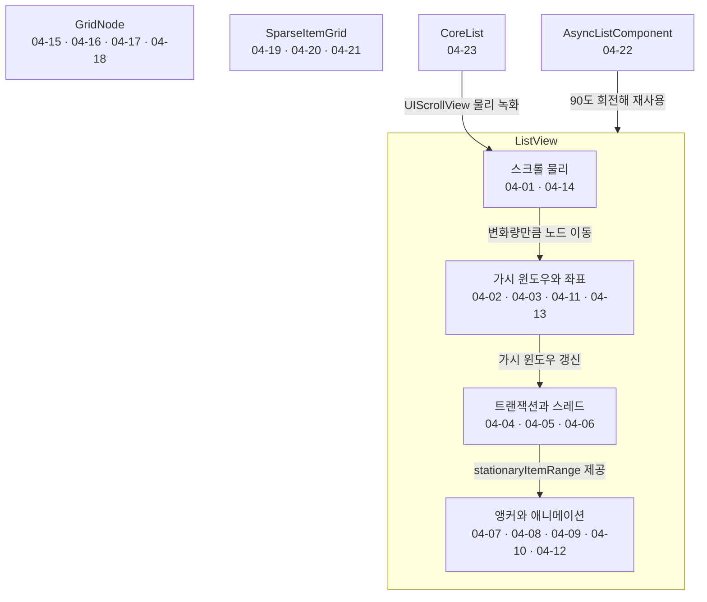
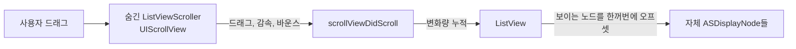
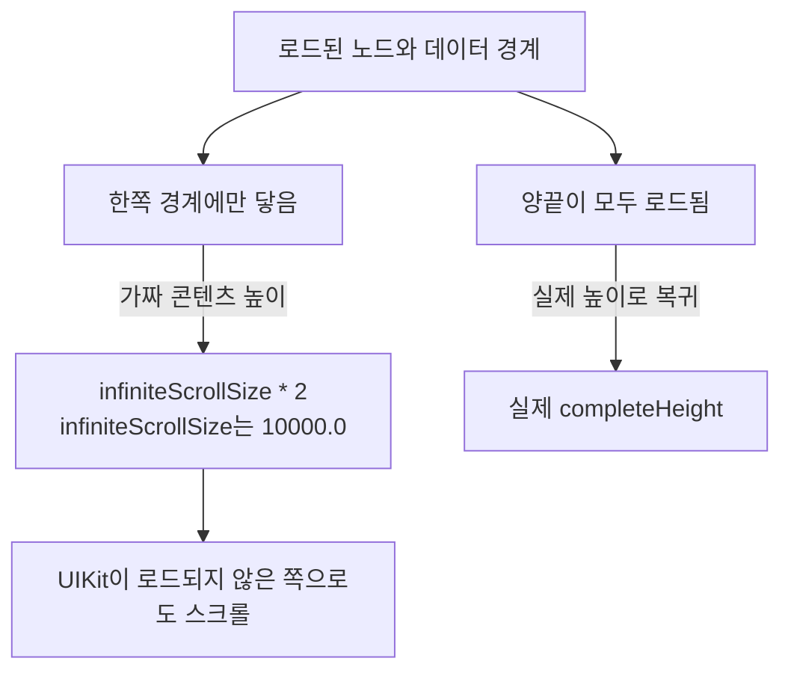
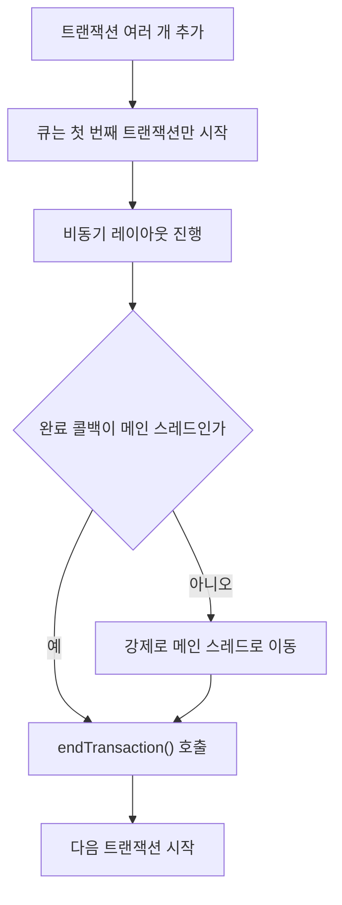
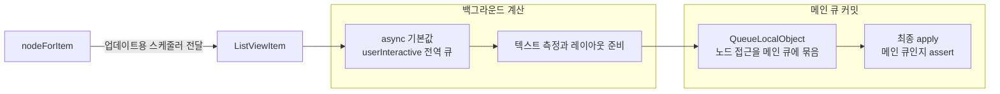
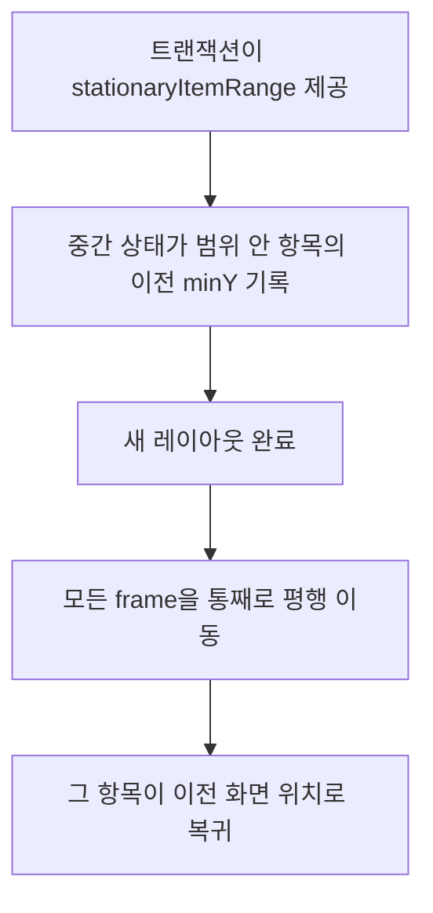

# 리스트와 스크롤

웹: /docs/ios/04-listview-scroll/ · Markdown: /docs/ios/04-listview-scroll.md

> 보이지 않는 UIScrollView, π 회전으로 뒤집은 채팅, 트랜잭션 기반 레이아웃.

| 기법 항목 | 리포트 선정 | 비공개 API 관련 | REA 관련 |
| --- | --- | --- | --- |
| 23 | 6 | 1 | 0 |

소스: [TelegramMessenger/Telegram-iOS@f1dd7a2d](https://github.com/TelegramMessenger/Telegram-iOS/tree/f1dd7a2dbd02cbbf513e75d5695d8d36d1cf5838)(2026-10-07) · 플랫폼: iOS · UIKit

이 장의 선정 항목:
- 04-1 [#04-01 보이지 않는 `UIScrollView`로 스크롤 물리만 가져오기](/docs/ios/04-listview-scroll/#t04-01)
- 04-2 [#04-02 20,000pt짜리 가짜 콘텐츠 높이로 아직 모르는 절반의 데이터 감당하기](/docs/ios/04-listview-scroll/#t04-02)
- 04-3 [#04-03 부모와 자식을 π만큼 두 번 회전해 뒤집힌 채팅의 글자 바로 세우기](/docs/ios/04-listview-scroll/#t04-03)
- 04-4 [#04-04 트랜잭션 큐로 비동기 레이아웃의 완료 순서 맞추기](/docs/ios/04-listview-scroll/#t04-04)
- 04-5 [#04-05 레이아웃은 비동기로, 노드 쓰기는 메인 큐에서 하기](/docs/ios/04-listview-scroll/#t04-05)
- 04-6 [#04-07 정지된 항목으로 삽입·삭제 뒤 뷰포트 고정하기](/docs/ios/04-listview-scroll/#t04-07)

주제 범위: Telegram-iOS의 `ListView`, `GridNode`, `SparseItemGrid`, `AsyncListComponent`, 그리고 CoreList의 스크롤 물리 녹화.

**결론:** `ListView`는 `UIScrollView`를 제스처와 물리 엔진으로만 써요. 노드, 가시 윈도우(화면에 실제로 노드를 만들어 두는 범위), 앵커, 애니메이션은 `ListView`가 직접 관리해요. 덕분에 채팅의 역순 데이터, 양방향 증분 로딩, 연속적으로 변하는 행 높이를 지원할 수 있어요. 소스 코드는 `UITableView`를 쓰지 않은 이유를 직접 설명하지 않아요. 여기서 말하는 트레이드오프는 구현 구조에서 읽어낸 것이라서 추론에 속해요.

아래 도표는 이 장의 기법들이 어느 구성요소와 층에 손을 대는지 묶어서 보여 줘요.



## 1. 보이지 않는 `UIScrollView`로 스크롤 물리만 가져오기 [#t04-01]

> #04-01 · Telegram-iOS · UIKit · 리포트 선정 04-1 · 검증 방식: 소스 분석 · 태그: 제스처와 스크롤
>
> 소스: [Telegram-iOS:submodules/Display/Source/ListView.swift L516–L534](https://github.com/TelegramMessenger/Telegram-iOS/blob/f1dd7a2dbd02cbbf513e75d5695d8d36d1cf5838/submodules/Display/Source/ListView.swift#L516-L534)
>
> 소스: [Telegram-iOS:submodules/Display/Source/ListView.swift L1052–L1070](https://github.com/TelegramMessenger/Telegram-iOS/blob/f1dd7a2dbd02cbbf513e75d5695d8d36d1cf5838/submodules/Display/Source/ListView.swift#L1052-L1070)

**무엇을 했나요**: `ListView`가 `ListViewScroller`(`UIScrollView`)를 숨겨요.

- 드래그, 감속, 바운스는 여전히 `UIScrollView`의 것을 그대로 써요.
- 하지만 콘텐츠를 scroll view 안에 넣지는 않아요.
- `scrollViewDidScroll`에서 변화량만큼 자체 `ASDisplayNode`들을 평행 이동시켜요.

**왜 이렇게 했나요**: 시스템 스크롤 감각을 다시 구현할 필요가 없어요. 리스트는 채팅의 의미에 맞게 아무 노드나 배치할 수 있어요. 상단과 하단에서 따로따로 로딩할 수도 있어요. 일반적인 `UITableView`는 스크롤 좌표, cell 레이아웃, 일괄 업데이트를 강하게 묶어 놓아요. 여기서는 이 셋을 서로 분리했어요.

아래 도표는 숨긴 `UIScrollView`와 `ListView`가 역할을 나누는 흐름을 보여 줘요.



> 인터랙티브 그림(list-scroller)은 웹 페이지에서 볼 수 있어요.

**핵심 코드 발췌**

```swift title="ListView.swift · L516–L534 등 2곳"
self.transactionQueue.transactionCompleted = { [weak self] in
    if let strongSelf = self {
        strongSelf.updateVisibleItemRange()
    }
}
self.scroller.alwaysBounceVertical = true
self.scroller.contentSize = CGSize(width: 0.0, height: infiniteScrollSize * 2.0)
self.scroller.isHidden = true
self.scroller.delegate = self.wrappedScrollViewDelegate
self.scroller.scrollsToTop = false
self.view.addSubview(self.scroller)
self.scroller.panGestureRecognizer.cancelsTouchesInView = true
self.view.addGestureRecognizer(self.scroller.panGestureRecognizer)
// ...
self.transactionOffset += -deltaY
self.enqueueUpdateVisibleItems(synchronous: false)
for itemNode in self.itemNodes {
    itemNode.updateFrame(itemNode.frame.offsetBy(dx: 0.0, dy: -deltaY),
        within: self.visibleSize)
}
```

**대가와 위험**: 가시성, 히트 테스트, 접근성, 스크롤바를 직접 구현해야 해요. `contentOffset`과 노드 frame은 항상 맞춰져 있어야 해요. 어긋나면 화면이 튀어요.

**증거 체인 #04-01**(iOS 바이너리 미검증)

- 소스 분석: Telegram-iOS 고정 커밋에서 행 단위로 확인했어요. 소스 위치는 총 2곳이에요.
- 리포트 요약(구현 방법): 델리게이트 `scrollViewDidScroll`이 변화량을 누적하고, 보이는 노드를 한꺼번에 오프셋해요.
- 바이너리 검증: 하지 않았어요. App Store 배포 IPA는 FairPlay로 암호화되어 있어서, 복호화된 실행 파일을 합법적으로 확보할 수 없어요.

## 2. 20,000pt짜리 가짜 콘텐츠 높이로 아직 모르는 절반의 데이터 감당하기 [#t04-02]

> #04-02 · Telegram-iOS · UIKit · 리포트 선정 04-2 · 검증 방식: 소스 분석 · 태그: 제스처와 스크롤
>
> 소스: [Telegram-iOS:submodules/Display/Source/ListView.swift L1726–L1745](https://github.com/TelegramMessenger/Telegram-iOS/blob/f1dd7a2dbd02cbbf513e75d5695d8d36d1cf5838/submodules/Display/Source/ListView.swift#L1726-L1745)

**무엇을 했나요**: `ListView`는 로드 상태에 따라 콘텐츠 높이를 다르게 잡아요.

- 이미 로드된 노드가 데이터 경계 한쪽에만 닿았을 때: `infiniteScrollSize * 2`를 써요. `infiniteScrollSize`는 초기화할 때 `10000.0`이에요.
- 양끝이 모두 로드되면: 실제 `completeHeight`로 돌아가요.

**왜 이렇게 했나요**: 채팅 기록은 일부 윈도우만 아는 경우가 많아요. 이 가짜 높이 덕분에 UIKit은 아직 로드되지 않은 쪽으로도 계속 스크롤할 수 있어요. 노드는 양방향으로 동시에 채워질 수 있어요. 일반적인 유한 `contentSize`는 아직 모르는 경계에서 너무 일찍 막혀 버려요.

아래 도표는 데이터 경계의 로드 상태에 따라 콘텐츠 높이가 달라지는 흐름을 보여 줘요.



**핵심 코드 발췌**

```swift title="ListView.swift · L1726–L1745"
if topItemFound && bottomItemFound {
    self.scroller.contentSize = CGSize(width: self.visibleSize.width, height: completeHeight)
    self.lastContentOffset = CGPoint(x: 0.0, y: -topItemEdge + self.tempTopInset)
    self.scroller.contentOffset = self.lastContentOffset
} else if topItemFound {
    self.scroller.contentSize = CGSize(width: self.visibleSize.width,
        height: infiniteScrollSize * 2.0)
    self.lastContentOffset = CGPoint(x: 0.0, y: -topItemEdge + self.tempTopInset)
    if self.scroller.contentOffset != self.lastContentOffset {
        self.scroller.contentOffset = self.lastContentOffset
    }
    self.lastContentOffset = self.scroller.contentOffset
} else if bottomItemFound {
    self.scroller.contentSize = CGSize(width: self.visibleSize.width,
        height: infiniteScrollSize * 2.0)
    self.lastContentOffset = CGPoint(x: 0.0,
        y: infiniteScrollSize * 2.0 - bottomItemEdge)
    self.scroller.contentOffset = self.lastContentOffset
}
```

**대가와 위험**: 이 높이는 실제 콘텐츠 높이가 아니에요. 코드가 오프셋을 반복해서 다시 계산하고 되써야 해요. 경계 판정이 틀리면 콘텐츠 오프셋이 갑자기 튀어요.

**증거 체인 #04-02**(iOS 바이너리 미검증)

- 소스 분석: Telegram-iOS 고정 커밋에서 행 단위로 확인했어요. 소스 위치는 총 1곳이에요.
- 리포트 요약(구현 방법): top/bottom을 찾았는지에 따라 `contentSize`와 `contentOffset`을 바꿔요.
- 바이너리 검증: 하지 않았어요. App Store 배포 IPA는 FairPlay로 암호화되어 있어서, 복호화된 실행 파일을 합법적으로 확보할 수 없어요.

## 3. 부모와 자식을 π만큼 두 번 회전해 뒤집힌 채팅의 글자 바로 세우기 [#t04-03]

> #04-03 · Telegram-iOS · UIKit · 리포트 선정 04-3 · 검증 방식: 소스 분석 · 태그: 제스처와 스크롤
>
> 소스: [Telegram-iOS:submodules/TelegramUI/Sources/ChatHistoryListNode.swift L1025–L1045](https://github.com/TelegramMessenger/Telegram-iOS/blob/f1dd7a2dbd02cbbf513e75d5695d8d36d1cf5838/submodules/TelegramUI/Sources/ChatHistoryListNode.swift#L1025-L1045)
>
> 소스: [Telegram-iOS:submodules/TelegramUI/Components/Chat/ChatMessageItemView/Sources/ChatMessageItemView.swift L669–L673](https://github.com/TelegramMessenger/Telegram-iOS/blob/f1dd7a2dbd02cbbf513e75d5695d8d36d1cf5838/submodules/TelegramUI/Components/Chat/ChatMessageItemView/Sources/ChatMessageItemView.swift#L669-L673)

**무엇을 했나요**: 회전을 두 번 겹쳐서 글자를 바로 세워요.

- 기록 리스트의 바깥쪽: `rotated`일 때 π만큼 회전해요.
- 채팅 항목: `rotated`일 때 π만큼 회전해요.

두 번 회전하면 항목의 글자는 다시 바로 서요. 바깥쪽 회전 때문에 인덱스 `0`이 화면 하단에 보여요.

**왜 이렇게 했나요**: 채팅은 최신 메시지를 리스트의 첫 항목으로 둘 수 있어요. 그러면 최신 메시지를 넣는 일이 데이터 원점 근처에 넣는 일과 같아져요. 하단 앵커링과 양방향 기록 로딩에 더 알맞아요. 일반적인 정방향 리스트는 보통 “하단으로부터의 거리”라는 특수 오프셋을 계속 관리해야 해요.

**핵심 코드 발췌**

```swift title="ChatHistoryListNode.swift · L1025–L1045 등 2곳"
self.usesCoreListBackend = useCoreListBackend
self.listView = ChatHistoryListNodeImpl.makeListView(
    rotated: rotated,
    useCoreListBackend: useCoreListBackend
)
super.init()
let _ = self.view
self.addSubnode(self.listView)
if rotated {
    self.transform = CATransform3DMakeRotation(
        CGFloat(Double.pi), 0.0, 0.0, 1.0)
}
// ...
public required init(rotated: Bool) {
    super.init(layerBacked: false, rotated: rotated)
    if rotated {
        self.transform = CATransform3DMakeRotation(
            CGFloat.pi, 0.0, 0.0, 1.0)
    }
}
```

**대가와 위험**: x, y 방향, inset(가장자리 여백), 스크롤바 가장자리, 접근성 방향을 모두 반대로 처리해야 해요. 소스도 `ListView.accessibilityScroll`에서 `rotated`에 따라 방향을 뒤집어요. 좌표 변환은 유지 비용이 높아요.

**증거 체인 #04-03**(iOS 바이너리 미검증)

- 소스 분석: Telegram-iOS 고정 커밋에서 행 단위로 확인했어요. 소스 위치는 총 2곳이에요.
- 리포트 요약(구현 방법): 리스트와 항목을 구성할 때 조건부로 `CATransform3DMakeRotation`을 설정해요.
- 바이너리 검증: 하지 않았어요. App Store 배포 IPA는 FairPlay로 암호화되어 있어서, 복호화된 실행 파일을 합법적으로 확보할 수 없어요.

## 4. 트랜잭션 큐로 비동기 레이아웃의 완료 순서 맞추기 [#t04-04]

> #04-04 · Telegram-iOS · UIKit · 리포트 선정 04-4 · 검증 방식: 소스 분석 · 태그: 성능과 메모리
>
> 소스: [Telegram-iOS:submodules/Display/Source/ListViewTransactionQueue.swift L14–L35](https://github.com/TelegramMessenger/Telegram-iOS/blob/f1dd7a2dbd02cbbf513e75d5695d8d36d1cf5838/submodules/Display/Source/ListViewTransactionQueue.swift#L14-L35)

**무엇을 했나요**: 트랜잭션 큐(`ListViewTransactionQueue`)가 트랜잭션을 한 번에 하나씩만 실행해요.

- 큐는 첫 번째 트랜잭션만 시작해요.
- 현재 트랜잭션이 끝나야 `endTransaction()`이 다음 트랜잭션을 시작해요.
- 완료 콜백이 메인 스레드가 아니면 강제로 메인 스레드로 옮겨요.

**왜 이렇게 했나요**: 행의 비동기 측정은 순서가 뒤바뀌어 끝날 수 있어요. 뒤의 diff(리스트 변경 내역)가 먼저 커밋되면 오래된 기하 정보를 바탕으로 노드를 갱신하게 돼요. 커밋을 한 줄로 세우면 모든 상태 전이가 확실한 이전 상태를 갖게 돼요.

아래 도표는 트랜잭션 큐가 트랜잭션을 한 번에 하나씩 이어 가는 순서를 보여 줘요.



**핵심 코드 발췌**

```swift title="ListViewTransactionQueue.swift · L14–L35"
public func addTransaction(_ transaction: @escaping ListViewTransaction) {
    precondition(Thread.isMainThread)
    let beginTransaction = self.transactions.count == 0
    self.transactions.append(transaction)
    if beginTransaction {
        transaction({ [weak self] in
            precondition(Thread.isMainThread)
            if Thread.isMainThread {
                if let strongSelf = self {
                    strongSelf.endTransaction()
                }
            } else {
                Queue.mainQueue().async {
                    if let strongSelf = self {
                        strongSelf.endTransaction()
                    }
                }
            }
        })
    } else {
        assert(true)
    }
}
```

**대가와 위험**: 느린 트랜잭션이 뒤의 트랜잭션을 막아요. 이 설계는 순서가 뒤바뀌는 일을 막지만, 오래된 작업을 취소하지는 않아요.

**증거 체인 #04-04**(iOS 바이너리 미검증)

- 소스 분석: Telegram-iOS 고정 커밋에서 행 단위로 확인했어요. 소스 위치는 총 1곳이에요.
- 리포트 요약(구현 방법): `ListViewTransactionQueue`가 트랜잭션을 이어 붙이고, 마무리를 강제로 메인 스레드에서 실행해요.
- 바이너리 검증: 하지 않았어요. App Store 배포 IPA는 FairPlay로 암호화되어 있어서, 복호화된 실행 파일을 합법적으로 확보할 수 없어요.

## 5. 레이아웃은 비동기로, 노드 쓰기는 메인 큐에서 하기 [#t04-05]

> #04-05 · Telegram-iOS · UIKit · 리포트 선정 04-5 · 검증 방식: 소스 분석 · 태그: 성능과 메모리
>
> 소스: [Telegram-iOS:submodules/Display/Source/ListView.swift L1820–L1838](https://github.com/TelegramMessenger/Telegram-iOS/blob/f1dd7a2dbd02cbbf513e75d5695d8d36d1cf5838/submodules/Display/Source/ListView.swift#L1820-L1838)

**무엇을 했나요**: 스레드 경계를 이렇게 나눠요.

- `nodeForItem`이 항목 업데이트용 스케줄러를 `ListViewItem`에 넘겨요.
- 기본 `async(_:)`는 `.userInteractive` 전역 큐를 써요.
- `QueueLocalObject`는 노드 접근을 메인 큐에 묶어요.
- 최종 `apply`도 메인 큐인지 assert해요(조건이 틀리면 중단하는 검사).

**왜 이렇게 했나요**: 텍스트 측정과 레이아웃 준비는 메인 스레드 밖에서 할 수 있어요. UIView와 AsyncDisplayKit 노드의 커밋은 여전히 메인 스레드에서 해요. 이렇게 계산 단계와 커밋 단계를 나눠요.

아래 도표는 레이아웃 계산과 노드 쓰기가 어느 큐에서 일어나는지 보여 줘요.



**핵심 코드 발췌**

```swift title="ListView.swift · L1820–L1838"
item.updateNode(async: { f in
    if synchronous {
        f()
    } else {
        self.async(f)
    }
}, node: {
    assert(Queue.mainQueue().isCurrent())
    return previousNode.syncWith({ $0 })
}, params: params, neighbors: neighbors, animation: updateAnimation,
completion: { (layout, apply) in
    if Thread.isMainThread {
        if synchronous {
            completion(previousNode, layout, {
                return (nil, { info in
                    assert(Queue.mainQueue().isCurrent())
                    previousNode.with({ $0.index = index; $0.appliedNeighbors = neighbors })
                    apply(info)
                })
            })
        } else {
            self.async {
```

**대가와 위험**: 항목 구현이 스레드 경계를 지켜야 해요. `async` 단계에서 UIKit에 잘못 접근하면 경쟁 상태가 생겨요. `useMainQueueTransactions`를 켜면 백그라운드 처리의 이득이 줄어요.

**증거 체인 #04-05**(iOS 바이너리 미검증)

- 소스 분석: Telegram-iOS 고정 커밋에서 행 단위로 확인했어요. 소스 위치는 총 1곳이에요.
- 리포트 요약(구현 방법): `QueueLocalObject`가 노드를 메인 큐에 묶고, apply 스레드를 assert해요.
- 바이너리 검증: 하지 않았어요. App Store 배포 IPA는 FairPlay로 암호화되어 있어서, 복호화된 실행 파일을 합법적으로 확보할 수 없어요.

## 6. 빠르게 스크롤할 때 가시 윈도우 갱신 트랜잭션을 하나만 걸기 [#t04-06]

> #04-06 · Telegram-iOS · UIKit · 검증 방식: 소스 분석 · 태그: 제스처와 스크롤
>
> 소스: [Telegram-iOS:submodules/Display/Source/ListView.swift L4618–L4642](https://github.com/TelegramMessenger/Telegram-iOS/blob/f1dd7a2dbd02cbbf513e75d5695d8d36d1cf5838/submodules/Display/Source/ListView.swift#L4618-L4642)

**무엇을 했나요**: `enqueuedUpdateVisibleItems`가 빠른 스크롤 중 갱신 요청을 하나로 합쳐요.

- 여러 번의 스크롤 콜백을 하나로 합쳐요.
- 트랜잭션이 진행되는 동안 `transactionOffset`은 계속 쌓여요.
- 오프셋에 여전히 변화가 있을 때만 다음 갱신을 추가로 걸어요.

**왜 이렇게 했나요**: `contentOffset` 콜백마다 노드를 만들고, 측정하고, 삭제하면 메인 스레드가 마비돼요. 트랜잭션을 하나만 거는 이 게이트는 자주 들어오는 입력을 한 줄로 이어지는 윈도우 갱신으로 줄여요.

**핵심 코드 발췌**

```swift title="ListView.swift · L4618–L4642"
private func enqueueUpdateVisibleItems(synchronous: Bool) {
    if !self.enqueuedUpdateVisibleItems {
        self.enqueuedUpdateVisibleItems = true
        self.transactionQueue.addTransaction({ [weak self] completion in
            if let strongSelf = self {
                strongSelf.transactionOffset = 0.0
                strongSelf.updateVisibleItemsTransaction(synchronous: synchronous, completion: {
                    var repeatUpdate = false
                    if let strongSelf = self {
                        repeatUpdate = abs(strongSelf.transactionOffset) > 0.00001
                        strongSelf.transactionOffset = 0.0
                        strongSelf.enqueuedUpdateVisibleItems = false
                    }
                    completion()
                    if repeatUpdate {
                        strongSelf.enqueueUpdateVisibleItems(synchronous: false)
                    }
                })
            }
        })
    }
}
```

**대가와 위험**: 노드 로딩이 손가락 위치보다 트랜잭션 하나만큼 늦어요. 매우 느린 기기에서는 더 작은 프리로드 윈도우가 잠깐 보일 수 있어요.

**증거 체인 #04-06**(iOS 바이너리 미검증)

- 소스 분석: Telegram-iOS 고정 커밋에서 행 단위로 확인했어요. 소스 위치는 총 1곳이에요.
- 바이너리 검증: 하지 않았어요. App Store 배포 IPA는 FairPlay로 암호화되어 있어서, 복호화된 실행 파일을 합법적으로 확보할 수 없어요.

## 7. 정지된 항목으로 삽입·삭제 뒤 뷰포트 고정하기 [#t04-07]

> #04-07 · Telegram-iOS · UIKit · 리포트 선정 04-6 · 검증 방식: 소스 분석
>
> 소스: [Telegram-iOS:submodules/Display/Source/ListViewIntermediateState.swift L409–L425](https://github.com/TelegramMessenger/Telegram-iOS/blob/f1dd7a2dbd02cbbf513e75d5695d8d36d1cf5838/submodules/Display/Source/ListViewIntermediateState.swift#L409-L425)

**무엇을 했나요**: 위치를 고정할 항목을 정해 두고, 레이아웃이 끝난 뒤 그 항목을 제자리로 되돌려요.

1. 트랜잭션이 `stationaryItemRange`(위치를 고정할 항목의 범위)를 줄 수 있어요.
2. 중간 상태는 그 범위 안에서 쓸 수 있는 항목의 이전 `minY`를 기록해요.
3. 새 레이아웃이 끝나면 모든 frame을 통째로 평행 이동시켜서 그 항목을 이전 화면 위치로 되돌려요.

**왜 이렇게 했나요**: 기록 로딩, 삭제, 행 높이 변화가 사용자가 보고 있는 메시지를 끌고 가면 안 돼요. 일반적인 일괄 업데이트가 인덱스 경로에만 기대면 상단에 보이는 항목의 위치가 튀기 쉬워요.

아래 도표는 정지 항목의 이전 위치를 기록해 두었다가 되돌리는 순서를 보여 줘요.



**핵심 코드 발췌**

```swift title="ListViewIntermediateState.swift · L409–L425"
} else if let (stationaryIndex, stationaryOffset) = self.stationaryOffset {
    for node in self.nodes {
        if node.index == stationaryIndex {
            let offset = stationaryOffset - node.frame.minY
            if abs(offset) > CGFloat.ulpOfOne {
                for i in 0 ..< self.nodes.count {
                    var frame = self.nodes[i].frame
                    frame = frame.offsetBy(dx: 0.0, dy: offset)
                    self.nodes[i].frame = frame
                }
            }
            break
        }
    }
}
```

**대가와 위험**: 호출한 쪽이 올바른 앵커를 골라야 해요. 앵커 자체가 삭제됐거나 측정이 틀렸다면 다른 위치 지정 전략으로 물러나는 수밖에 없어요.

**증거 체인 #04-07**(iOS 바이너리 미검증)

- 소스 분석: Telegram-iOS 고정 커밋에서 행 단위로 확인했어요. 소스 위치는 총 1곳이에요.
- 리포트 요약(구현 방법): `stationaryOffset`에 맞으면 중간 상태 노드의 프레임을 한꺼번에 오프셋해요.
- 바이너리 검증: 하지 않았어요. App Store 배포 IPA는 FairPlay로 암호화되어 있어서, 복호화된 실행 파일을 합법적으로 확보할 수 없어요.

## 8. 자리 표시 노드로 삭제 중인 행의 공간 지키기 [#t04-08]

> #04-08 · Telegram-iOS · UIKit · 검증 방식: 소스 분석
>
> 소스: [Telegram-iOS:submodules/Display/Source/ListViewIntermediateState.swift L823–L843](https://github.com/TelegramMessenger/Telegram-iOS/blob/f1dd7a2dbd02cbbf513e75d5695d8d36d1cf5838/submodules/Display/Source/ListViewIntermediateState.swift#L823-L843)

**무엇을 했나요**: 애니메이션으로 삭제할 때 중간 레이아웃은 이렇게 처리해요.

1. 먼저 논리 노드를 없애요.
2. 곧바로 이전 frame을 보존한 `.Placeholder`를 넣어요.
3. 나중의 replay 단계에서 이전 노드를 계속 사라지게 할 수 있어요.

이전 노드가 이미 재사용됐다면 `ListViewTempItemNode`를 대신 써요.

**왜 이렇게 했나요**: 사라지는 행이 여전히 공간을 차지해야 형제 노드가 자연스럽게 이어서 움직일 수 있어요. 또 같은 노드가 새 행이면서 동시에 사라지는 옛 행이 되는 일도 피해요. 일반적인 직접 제거는 삭제 프레임과 주변의 이동이 어긋나게 만들어요.

**핵심 코드 발췌**

```swift title="ListViewIntermediateState.swift · L823–L843"
mutating func removeNodeAtIndex(_ index: Int,
    direction: ListViewItemOperationDirectionHint?, animated: Bool,
    operations: inout [ListViewStateOperation]) {
    let node = self.nodes[index]
    if case let .Node(_, _, referenceNode, _) = node {
        let nodeFrame = node.frame
        self.nodes.remove(at: index)
        let offsetDirection: ListViewInsertionOffsetDirection
        if let direction = direction {
            offsetDirection = ListViewInsertionOffsetDirection(direction)
        } else {
            if nodeFrame.maxY < self.itemOffsetInsets.top + CGFloat.ulpOfOne {
                offsetDirection = .Down
            } else {
                offsetDirection = .Up
            }
        }
        operations.append(.Remove(index: index, offsetDirection: offsetDirection))
        if let referenceNode = referenceNode, animated {
            self.nodes.insert(.Placeholder(frame: nodeFrame), at: index)
            operations.append(.InsertDisappearingPlaceholder(
                index: index, referenceNode: referenceNode,
                offsetDirection: offsetDirection.inverted()))
```

**대가와 위험**: 상태 머신이 복잡해요. 자리 표시 노드는 제때 지워야 해요. 빠뜨리면 높이가 0인 노드나 잘못된 hit test가 남아요.

**증거 체인 #04-08**(iOS 바이너리 미검증)

- 소스 분석: Telegram-iOS 고정 커밋에서 행 단위로 확인했어요. 소스 위치는 총 1곳이에요.
- 바이너리 검증: 하지 않았어요. App Store 배포 IPA는 FairPlay로 암호화되어 있어서, 복호화된 실행 파일을 합법적으로 확보할 수 없어요.

## 9. `apparentHeight`로 실제 레이아웃 높이와 애니메이션 높이 나누기 [#t04-09]

> #04-09 · Telegram-iOS · UIKit · 검증 방식: 소스 분석
>
> 소스: [Telegram-iOS:submodules/Display/Source/ListViewItemNode.swift L569–L580](https://github.com/TelegramMessenger/Telegram-iOS/blob/f1dd7a2dbd02cbbf513e75d5695d8d36d1cf5838/submodules/Display/Source/ListViewItemNode.swift#L569-L580)
>
> 소스: [Telegram-iOS:submodules/Display/Source/ListView.swift L4822–L4841](https://github.com/TelegramMessenger/Telegram-iOS/blob/f1dd7a2dbd02cbbf513e75d5695d8d36d1cf5838/submodules/Display/Source/ListView.swift#L4822-L4841)

**무엇을 했나요**: 항목의 최종 높이와 애니메이션 중 높이를 따로 둬요.

- 항목에는 최종 `contentSize`가 있고, 프레임마다 변하는 `apparentHeight`(애니메이션 중에 보이는 높이)도 있어요.
- 애니메이션은 프레임마다 높이 차이를 계산해요.
- 리스트는 항목이 뷰포트 위쪽에 있는지 아래쪽에 있는지에 따라 형제 노드를 반대쪽으로 오프셋해요.

**왜 이렇게 했나요**: 콘텐츠는 먼저 최종 레이아웃으로 갱신해 둘 수 있어요. 바깥 프레임은 이전 높이에서 자연스럽게 이어서 바뀌어요. 내부 텍스트가 높아졌다고 해서 사용자가 보고 있는 앵커가 갑자기 움직이지 않아요.

**핵심 코드 발췌**

```swift title="ListViewItemNode.swift · L569–L580 등 2곳"
var requestUpdateVisibleItems = false
var index = 0
while index < self.itemNodes.count {
    let itemNode = self.itemNodes[index]
    let previousApparentHeight = itemNode.apparentHeight
    var invertOffsetDirection = false
    if itemNode.animate(timestamp: timestamp,
        invertOffsetDirection: &invertOffsetDirection) {
        continueAnimations = true
    }
    let updatedApparentHeight = itemNode.apparentHeight
    let apparentHeightDelta = updatedApparentHeight - previousApparentHeight
    if abs(apparentHeightDelta) > CGFloat.ulpOfOne {
        itemNode.updateFrame(itemNode.frame, within: self.visibleSize)
        let visualInsets = self.dynamicVisualInsets?() ?? self.visualInsets ?? self.insets
        if itemNode.apparentFrame.maxY <= visualInsets.top {
            offsetRanges.offset(IndexRange(first: 0, last: index),
                offset: -apparentHeightDelta)
```

**대가와 위험**: 프레임마다 이미 로드된 노드를 돌아요. 회전된 리스트는 `invertOffsetDirection`도 처리해야 해요. 단순한 Auto Layout 높이 애니메이션보다 검증하기 어려워요.

**증거 체인 #04-09**(iOS 바이너리 미검증)

- 소스 분석: Telegram-iOS 고정 커밋에서 행 단위로 확인했어요. 소스 위치는 총 2곳이에요.
- 바이너리 검증: 하지 않았어요. App Store 배포 IPA는 FairPlay로 암호화되어 있어서, 복호화된 실행 파일을 합법적으로 확보할 수 없어요.

## 10. 키보드와 inset 애니메이션을 `sublayerTransform` 하나로 바꾸기 [#t04-10]

> #04-10 · Telegram-iOS · UIKit · 검증 방식: 소스 분석 · 태그: Core Animation, 텍스트와 입력
>
> 소스: [Telegram-iOS:submodules/Display/Source/ListView.swift L3328–L3351](https://github.com/TelegramMessenger/Telegram-iOS/blob/f1dd7a2dbd02cbbf513e75d5695d8d36d1cf5838/submodules/Display/Source/ListView.swift#L3328-L3351)

**무엇을 했나요**: 행마다 애니메이션을 붙이지 않고 리스트 layer 하나에만 애니메이션을 걸어요.

1. 크기나 inset이 바뀌면 먼저 최종 frame을 커밋해요.
2. 그런 다음 리스트 layer의 `sublayerTransform`에 반대 방향 평행 이동 애니메이션을 추가해요.
3. 그러면 모든 자식 노드가 눈에 보이는 이전 위치에서 새 위치로 함께 움직여요.

**왜 이렇게 했나요**: 키보드, 내비게이션 바, 세이프 에어리어가 바뀌면 많은 행이 동시에 움직여요. 행마다 position 애니메이션을 붙이면 비용이 크고 동기화도 어긋날 수 있어요. 합성 레이어 애니메이션 하나로 노드 전체를 덮을 수 있어요.

**핵심 코드 발췌**

```swift title="ListView.swift · L3328–L3351"
let animation: CABasicAnimation
let animationCurve: ContainedViewLayoutTransitionCurve
let animationDuration: Double
switch updateSizeAndInsets.curve {
case let .Spring(duration):
    headerNodesTransition = (.animated(duration: duration, curve: .spring),
        false, -completeOffset)
    animationCurve = .spring
    let springAnimation = makeSpringAnimation("sublayerTransform", duration: duration)
    springAnimation.fromValue = NSValue(caTransform3D:
        CATransform3DMakeTranslation(0.0, -completeOffset, 0.0))
    springAnimation.toValue = NSValue(caTransform3D: CATransform3DIdentity)
    springAnimation.isRemovedOnCompletion = true
    let k = Float(UIView.animationDurationFactor())
    var speed: Float = 1.0
    if k != 0 && k != 1 {
        speed = Float(1.0) / k
    }
    if !duration.isZero {
        springAnimation.speed = speed * Float(springAnimation.duration / duration)
    }
    animationDuration = duration
    springAnimation.isAdditive = true
    animation = springAnimation
```

**대가와 위험**: 모델 레이어와 프레젠테이션 레이어가 일시적으로 달라져요. 화면 좌표를 읽을 때는 어느 레이어를 쓰는지 분명히 해야 해요. 소스는 애니메이션이 끝난 뒤에 가시성을 갱신해요.

**증거 체인 #04-10**(iOS 바이너리 미검증)

- 소스 분석: Telegram-iOS 고정 커밋에서 행 단위로 확인했어요. 소스 위치는 총 1곳이에요.
- 바이너리 검증: 하지 않았어요. App Store 배포 IPA는 FairPlay로 암호화되어 있어서, 복호화된 실행 파일을 합법적으로 확보할 수 없어요.

## 11. 뷰포트 바깥 500pt를 소프트 프리로드 윈도우로 쓰기 [#t04-11]

> #04-11 · Telegram-iOS · UIKit · 검증 방식: 소스 분석 · 태그: 성능과 메모리
>
> 소스: [Telegram-iOS:submodules/Display/Source/ListViewIntermediateState.swift L631–L653](https://github.com/TelegramMessenger/Telegram-iOS/blob/f1dd7a2dbd02cbbf513e75d5695d8d36d1cf5838/submodules/Display/Source/ListViewIntermediateState.swift#L631-L653)

**무엇을 했나요**: 프리로드 윈도우를 이렇게 정해요.

- `preloadPages`가 켜져 있으면 `ListView`가 `invisibleInset`을 `500.0`으로 설정해요.
- 중간 상태는 로드된 총 높이가 뷰포트 + 양쪽 프리로드 영역보다 클 때만 윈도우 밖의 노드를 지워요.

**왜 이렇게 했나요**: 빠르게 스크롤하려면 다음 화면의 노드가 이미 만들어져 있어야 해요. 보이는 노드만 엄격하게 유지하면 노드를 자주 만들고 없애게 되어 흰 프레임이 생겨요. 이 윈도우는 이웃한 항목의 레이아웃도 더 안정적으로 만들어요.

**핵심 코드 발췌**

```swift title="ListViewIntermediateState.swift · L631–L653"
mutating func removeInvisibleNodes(_ operations: inout [ListViewStateOperation]) {
    var i = 0
    var visibleItemNodeHeight: CGFloat = 0.0
    while i < self.nodes.count {
        visibleItemNodeHeight += self.nodes[i].frame.height
        i += 1
    }
    if visibleItemNodeHeight > (self.visibleSize.height + self.invisibleInset
        + self.invisibleInset) {
        i = self.nodes.count - 1
        while i >= 0 {
            let itemNode = self.nodes[i]
            let frame = itemNode.frame
            if frame.maxY < -self.invisibleInset
                || frame.origin.y > self.visibleSize.height + self.invisibleInset {
                operations.append(.Remove(index: i,
                    offsetDirection: frame.maxY < -self.invisibleInset ? .Down : .Up))
                self.nodes.remove(at: i)
            }
            i -= 1
        }
    }
}
```

**대가와 위험**: 메모리 소비는 행 높이에 비례해요. 큰 미디어 행에서는 500pt에 들어가는 노드 수가 아주 적어요. 고정 임계값이 모든 기기에 맞는 것은 아니에요.

**증거 체인 #04-11**(iOS 바이너리 미검증)

- 소스 분석: Telegram-iOS 고정 커밋에서 행 단위로 확인했어요. 소스 위치는 총 1곳이에요.
- 바이너리 검증: 하지 않았어요. App Store 배포 IPA는 FairPlay로 암호화되어 있어서, 복호화된 실행 파일을 합법적으로 확보할 수 없어요.

## 12. 플로팅 header로 상단·가장자리·하단 고정 한꺼번에 처리하기 [#t04-12]

> #04-12 · Telegram-iOS · UIKit · 검증 방식: 소스 분석
>
> 소스: [Telegram-iOS:submodules/Display/Source/ListView.swift L4004–L4025](https://github.com/TelegramMessenger/Telegram-iOS/blob/f1dd7a2dbd02cbbf513e75d5695d8d36d1cf5838/submodules/Display/Source/ListView.swift#L4004-L4025)

**무엇을 했나요**: header는 일반 행에 속하지 않아요.

- 논리 그룹의 상하 경계를 기준으로 독립적인 frame을 계산해요.
- header가 스스로 그릴 수 있도록 고정 거리와 정규화 계수를 노출해요.
- 전체 함수는 `.bottom`과 같은 `stackingId`끼리 서로 피하는 것도 처리해요.

**왜 이렇게 했나요**: 채팅의 날짜, 하단 바, 겹치는 header는 `UITableView` 방식의 상단 sticky만으로는 부족해요. 독립 노드는 여러 행에 걸칠 수 있고, 회전에 따라 inset의 의미가 바뀔 수 있고, 커스텀 애니메이션에도 참여할 수 있어요.

**핵심 코드 발췌**

```swift title="ListView.swift · L4004–L4025"
var stickLocationDistanceFactor: CGFloat = 0.0
var stickLocationDistance: CGFloat
switch item.stickDirection {
case .top:
    naturalY = lowerBound
    if item.isSticky {
        headerFrame = CGRect(origin: CGPoint(x: 0.0,
            y: min(max(upperDisplayBound, upperBound), lowerBound - itemHeaderHeight)),
            size: CGSize(width: self.visibleSize.width, height: itemHeaderHeight))
    } else {
        headerFrame = CGRect(origin: CGPoint(x: 0.0,
            y: min(upperBound, lowerBound - itemHeaderHeight)),
            size: CGSize(width: self.visibleSize.width, height: itemHeaderHeight))
    }
    stickLocationDistance = headerFrame.minY - upperBound
    stickLocationDistanceFactor = max(0.0,
        min(1.0, stickLocationDistance / itemHeaderHeight))
case .topEdge:
    naturalY = lowerBound
    headerFrame = CGRect(origin: CGPoint(x: 0.0,
        y: min(max(upperDisplayBound, upperBoundEdge - itemHeaderHeight),
            lowerBound - itemHeaderHeight)),
        size: CGSize(width: self.visibleSize.width, height: itemHeaderHeight))
```

**대가와 위험**: 코드가 그룹 affinity, z 순서, 붙은 항목을 관리해야 해요. header 수가 많으면 그룹화와 충돌 검사의 비용이 늘어나요.

**증거 체인 #04-12**(iOS 바이너리 미검증)

- 소스 분석: Telegram-iOS 고정 커밋에서 행 단위로 확인했어요. 소스 위치는 총 1곳이에요.
- 바이너리 검증: 하지 않았어요. App Store 배포 IPA는 FairPlay로 암호화되어 있어서, 복호화된 실행 파일을 합법적으로 확보할 수 없어요.

## 13. 전체 행 높이를 몰라도 근사 스크롤바 그리기 [#t04-13]

> #04-13 · Telegram-iOS · UIKit · 검증 방식: 소스 분석 · 태그: 제스처와 스크롤
>
> 소스: [Telegram-iOS:submodules/Display/Source/ListView.swift L4525–L4549](https://github.com/TelegramMessenger/Telegram-iOS/blob/f1dd7a2dbd02cbbf513e75d5695d8d36d1cf5838/submodules/Display/Source/ListView.swift#L4525-L4549)

**무엇을 했나요**: 직접 그리는 스크롤바는 두 단계로 위치를 계산해요.

1. 로드되지 않은 행의 높이를 `44pt`로 추정해요.
2. 처음과 끝에 보이는 행의 실제 frame과 실제 높이로 현재 뷰포트 경계를 보정해요.

**왜 이렇게 했나요**: `ListView`에는 전체 노드가 없고, 믿을 만한 전체 콘텐츠 높이도 없을 수 있어요. 그래도 길이가 대략 맞는 썸(스크롤바에서 움직이는 막대)을 보여 주는 편이 위치 피드백을 아예 끄는 것보다 나아요.

**핵심 코드 발췌**

```swift title="ListView.swift · L4525–L4549"
let averageRangeItemHeight: CGFloat = 44.0
var upperItemsHeight = floor(averageRangeItemHeight
    * CGFloat(scrollingIndicatorState.topItem.index))
var approximateContentHeight = CGFloat(scrollingIndicatorState.itemCount)
    * averageRangeItemHeight
if scrollingIndicatorState.topItem.index >= 0
    && self.items[scrollingIndicatorState.topItem.index].approximateHeight.isZero {
    upperItemsHeight -= averageRangeItemHeight
    approximateContentHeight -= averageRangeItemHeight
}
var convertedTopBoundary: CGFloat
if scrollingIndicatorState.topItem.offset < self.insets.top {
    convertedTopBoundary = (scrollingIndicatorState.topItem.offset
        - scrollingIndicatorState.insets.top) * averageRangeItemHeight
        / scrollingIndicatorState.topItem.height
} else {
    convertedTopBoundary = scrollingIndicatorState.topItem.offset
        - scrollingIndicatorState.insets.top
}
convertedTopBoundary -= upperItemsHeight
let approximateOffset = -convertedTopBoundary
var convertedBottomBoundary: CGFloat = 0.0
if scrollingIndicatorState.bottomItem.offset
    > self.visibleSize.height - self.insets.bottom {
```

**대가와 위험**: 행 높이 편차가 크면 썸의 진행도가 부정확해져요. 근사 알고리즘이지 정확한 스크롤 위치가 아니에요.

**증거 체인 #04-13**(iOS 바이너리 미검증)

- 소스 분석: Telegram-iOS 고정 커밋에서 행 단위로 확인했어요. 소스 위치는 총 1곳이에요.
- 바이너리 검증: 하지 않았어요. App Store 배포 IPA는 FairPlay로 암호화되어 있어서, 복호화된 실행 파일을 합법적으로 확보할 수 없어요.

## 14. 외부 속도를 UIKit처럼 감속하는 구간으로 주입하기 [#t04-14]

> #04-14 · Telegram-iOS · UIKit · 검증 방식: 소스 분석 · 태그: 제스처와 스크롤
>
> 소스: [Telegram-iOS:submodules/Display/Source/ListView.swift L951–L969](https://github.com/TelegramMessenger/Telegram-iOS/blob/f1dd7a2dbd02cbbf513e75d5695d8d36d1cf5838/submodules/Display/Source/ListView.swift#L951-L969)
>
> 소스: [Telegram-iOS:submodules/Display/Source/ListViewScroller.swift L44–L47](https://github.com/TelegramMessenger/Telegram-iOS/blob/f1dd7a2dbd02cbbf513e75d5695d8d36d1cf5838/submodules/Display/Source/ListViewScroller.swift#L44-L47)

**무엇을 했나요**: 외부에서 받은 속도로 감속을 이어 가요.

- `transferVelocity(_:)`는 `ConstantDisplayLinkAnimator`로 지수 감쇠(속도가 일정 비율로 줄어드는 감속)를 구동해요.
- 서브픽셀 나머지(픽셀 이하의 소수 부분)는 따로 저장하고, 정수 픽셀만 오프셋에 써요.
- `ListViewScroller.isDecelerating`은 `forceDecelerating`이 참이면 감속 중이라고 알려 줘요.

**왜 이렇게 했나요**: 외부 전환이나 커스텀 제스처가 속도를 리스트에 넘겨줄 수 있어요. 논리적 감속 상태 덕분에 header, 스크롤바, 종료 콜백이 정상 스크롤처럼 계속 처리돼요. 픽셀 단위로 맞추면 프레임마다 생기는 소수 떨림을 막을 수 있어요.

**핵심 코드 발췌**

```swift title="ListView.swift · L951–L969 등 2곳"
public func transferVelocity(_ velocity: CGFloat) {
    self.decelerationAnimator?.isPaused = true
    let startTime = CACurrentMediaTime()
    let decelerationRate: CGFloat = 0.998
    self.scroller.forceDecelerating = true
    self.decelerationAnimator = ConstantDisplayLinkAnimator(update: { [weak self] in
        guard let strongSelf = self else {
            return
        }
        let t = CACurrentMediaTime() - startTime
        var currentVelocity = velocity * 15.0
            * CGFloat(pow(Double(decelerationRate), 1000.0 * t))
        strongSelf.accumulatedTransferVelocityOffset += currentVelocity
        let signFactor: CGFloat = strongSelf.accumulatedTransferVelocityOffset >= 0.0 ? 1.0 : -1.0
        let remainder = abs(strongSelf.accumulatedTransferVelocityOffset)
            .remainder(dividingBy: UIScreenPixel)
        var currentOffset = strongSelf.scroller.contentOffset
        let addedDela = strongSelf.accumulatedTransferVelocityOffset - remainder * signFactor
        currentOffset.y += addedDela
        strongSelf.accumulatedTransferVelocityOffset -= addedDela
```

**대가와 위험**: 파라미터 `0.998`, `15.0`과 종료 임계값은 손으로 만든 모델이에요. UIKit의 경계 바운스 동작을 전부 재사용하지는 않아요. 주사율이 다른 기기에서의 감각은 검증이 필요해요.

**증거 체인 #04-14**(iOS 바이너리 미검증)

- 소스 분석: Telegram-iOS 고정 커밋에서 행 단위로 확인했어요. 소스 위치는 총 2곳이에요.
- 바이너리 검증: 하지 않았어요. App Store 배포 IPA는 FairPlay로 암호화되어 있어서, 복호화된 실행 파일을 합법적으로 확보할 수 없어요.

## 15. `GridNode`에서 `UIScrollView`의 layer를 그리기 무효화에 반응하지 않게 바꾸기 [#t04-15]

> #04-15 · Telegram-iOS · UIKit · 검증 방식: 소스 분석 · 태그: Core Animation, 제스처와 스크롤, 성능과 메모리
>
> 소스: [Telegram-iOS:submodules/Display/Source/GridNodeScroller.swift L4–L28](https://github.com/TelegramMessenger/Telegram-iOS/blob/f1dd7a2dbd02cbbf513e75d5695d8d36d1cf5838/submodules/Display/Source/GridNodeScroller.swift#L4-L28)

**무엇을 했나요**: `GridNodeScrollerView`는 `GridNodeScrollerLayer`를 backing layer(뷰가 그리는 데 쓰는 layer)로 지정해요. `GridNodeScrollerLayer`는 `setNeedsDisplay()`를 오버라이드하고 아무 동작도 하지 않아요.

**왜 이렇게 했나요**: `GridNode`는 자식 노드로 직접 그리드를 레이아웃해요. 스크롤 호스트는 콘텐츠 그리기를 맡지 않아요. 추론: 이렇게 하면 호스트 layer가 불필요하게 다시 그려지는 경로를 피할 수 있어요.

**핵심 코드 발췌**

```swift title="GridNodeScroller.swift · L4–L28"
private class GridNodeScrollerLayer: CALayer {
    override func setNeedsDisplay() {
    }
}
public class GridNodeScrollerView: UIScrollView {
    override public class var layerClass: AnyClass {
        return GridNodeScrollerLayer.self
    }
    override public init(frame: CGRect) {
        super.init(frame: frame)
        if #available(iOSApplicationExtension 11.0, iOS 11.0, *) {
            self.contentInsetAdjustmentBehavior = .never
        }
    }
    required public init?(coder aDecoder: NSCoder) {
        fatalError("init(coder:) has not been implemented")
    }
    override public func touchesShouldCancel(in view: UIView) -> Bool {
        return true
    }
}
```

**대가와 위험**: 흔하지 않은 `UIScrollView` layer 교체예요. 소스는 성능 데이터를 보여 주지 않아요. 실제 이득은 미검증이에요. 앞으로 UIKit의 backing layer 가정이 바뀔 수 있어요.

**증거 체인 #04-15**(iOS 바이너리 미검증)

- 소스 분석: Telegram-iOS 고정 커밋에서 행 단위로 확인했어요. 소스 위치는 총 1곳이에요.
- 바이너리 검증: 하지 않았어요. App Store 배포 IPA는 FairPlay로 암호화되어 있어서, 복호화된 실행 파일을 합법적으로 확보할 수 없어요.

## 16. `GridNode`에서 preload 윈도우를 먼저 잘라낸 뒤 노드 만들기 [#t04-16]

> #04-16 · Telegram-iOS · UIKit · 검증 방식: 소스 분석
>
> 소스: [Telegram-iOS:submodules/Display/Source/GridNode.swift L815–L849](https://github.com/TelegramMessenger/Telegram-iOS/blob/f1dd7a2dbd02cbbf513e75d5695d8d36d1cf5838/submodules/Display/Source/GridNode.swift#L815-L849)

**무엇을 했나요**: `GridNode`는 노드를 만들기 전에 윈도우부터 잘라요.

1. 먼저 전체 `itemLayout`에서 표시 영역에 `preloadSize`를 더한 범위를 걸러내요.
2. 이어지는 `applyPresentationLayoutTransition`은 `presentationItems`에 대해서만 `GridItemNode`를 만들거나 갱신해요.

**왜 이렇게 했나요**: 그리드는 전체 기하 정보를 갖고 있으면서도 모든 뷰를 유지하지 않을 수 있어요. `preloadSize`는 빠른 스크롤에 앞서 이웃한 항목을 미리 만들어 둬요. 모든 썸네일을 한꺼번에 만드는 일반적인 방식은 메모리를 금세 다 써 버려요.

**핵심 코드 발췌**

```swift title="GridNode.swift · L815–L849"
let lowerDisplayBound = contentOffset.y - self.gridLayout.insets.top
    - self.gridLayout.preloadSize
let upperDisplayBound = contentOffset.y + self.gridLayout.insets.bottom
    + self.gridLayout.size.height + self.gridLayout.preloadSize
var presentationItems: [GridNodePresentationItem] = []
var validSections = Set<WrappedGridSection>()
for item in self.itemLayout.items {
    if item.frame.maxY < lowerDisplayBound {
        continue
    }
    if item.frame.minY > upperDisplayBound {
        break
    }
    presentationItems.append(item)
    if self.floatingSections {
        if let section = self.items[item.index].section {
            validSections.insert(WrappedGridSection(section))
        }
    }
}
var presentationSections: [GridNodePresentationSection] = []
for section in self.itemLayout.sections {
```

**대가와 위험**: 전체 frame 배열은 여전히 데이터 양에 따라 커져요. 이 구현은 항목이 y 기준으로 단조 정렬되어 있다고 가정해서, 상한을 넘으면 `break`할 수 있어요.

**증거 체인 #04-16**(iOS 바이너리 미검증)

- 소스 분석: Telegram-iOS 고정 커밋에서 행 단위로 확인했어요. 소스 위치는 총 1곳이에요.
- 바이너리 검증: 하지 않았어요. App Store 배포 IPA는 FairPlay로 암호화되어 있어서, 복호화된 실행 파일을 합법적으로 확보할 수 없어요.

## 17. 그리드 애니메이션에서 화면 좌표를 먼저 고정하고 additive 이동하기 [#t04-17]

> #04-17 · Telegram-iOS · UIKit · 검증 방식: 소스 분석
>
> 소스: [Telegram-iOS:submodules/Display/Source/GridNode.swift L887–L899](https://github.com/TelegramMessenger/Telegram-iOS/blob/f1dd7a2dbd02cbbf513e75d5695d8d36d1cf5838/submodules/Display/Source/GridNode.swift#L887-L899)
>
> 소스: [Telegram-iOS:submodules/Display/Source/GridNode.swift L1044–L1052](https://github.com/TelegramMessenger/Telegram-iOS/blob/f1dd7a2dbd02cbbf513e75d5695d8d36d1cf5838/submodules/Display/Source/GridNode.swift#L1044-L1052)

**무엇을 했나요**: 화면 좌표를 기준으로 애니메이션을 보정해요.

1. 레이아웃을 바꾸기 전에 항목 frame에서 이전 `contentOffset`을 빼요. 화면 좌표 = 항목 frame − 이전 `contentOffset`이에요.
2. 새 레이아웃이 정해지면 살아남은 항목들의 공통 편차를 계산해요.
3. additive `position` 애니메이션(현재 값에 더해 적용하는 애니메이션)으로 보정해요.

**왜 이렇게 했나요**: 애니메이션 중에는 스크롤 오프셋과 항목 frame이 모두 바뀔 수 있어요. 콘텐츠 좌표를 그대로 비교하면 항목이 튀어요. 화면 좌표를 쓰면 눈에 보이는 연속성을 콘텐츠 좌표의 변화와 분리할 수 있어요.

**핵심 코드 발췌**

```swift title="GridNode.swift · L887–L899 등 2곳"
if saveItemFrames {
    var itemFrames: [WrappedGridItemNode: CGRect] = [:]
    let contentOffset = self.scrollView.contentOffset
    for (_, itemNode) in self.itemNodes {
        itemFrames[WrappedGridItemNode(node: itemNode)] = itemNode.frame
            .offsetBy(dx: 0.0, dy: -contentOffset.y)
    }
    for (_, sectionNode) in self.sectionNodes {
        itemFrames[WrappedGridItemNode(node: sectionNode)] = sectionNode.frame
            .offsetBy(dx: 0.0, dy: -contentOffset.y)
    }
    for itemNode in removedNodes {
        itemFrames[WrappedGridItemNode(node: itemNode)] = itemNode.frame
            .offsetBy(dx: 0.0, dy: -contentOffset.y)
    }
    previousItemFrames = itemFrames
}
if let offset = offset {
    // `timingFunction`과 `mediaTimingFunction`은 `curve`에서 온다.
    for (index, itemNode) in self.itemNodes where existingItemIndices.contains(index) {
        itemNode.layer.animatePosition(from: CGPoint(x: 0.0, y: offset),
            to: CGPoint(), duration: duration, timingFunction: timingFunction,
            mediaTimingFunction: mediaTimingFunction, additive: true)
    }
}
```

**대가와 위험**: 공통 항목이 최소 하나는 있어야 해요. 공통 항목이 없으면 위아래 경계와 방향으로 오프셋을 짐작해요. 복잡한 레이아웃 변경에서는 충분히 자연스럽지 않을 수 있어요.

**증거 체인 #04-17**(iOS 바이너리 미검증)

- 소스 분석: Telegram-iOS 고정 커밋에서 행 단위로 확인했어요. 소스 위치는 총 2곳이에요.
- 바이너리 검증: 하지 않았어요. App Store 배포 IPA는 FairPlay로 암호화되어 있어서, 복호화된 실행 파일을 합법적으로 확보할 수 없어요.

## 18. 선형 분할로 “앨범식” 균형 행 만들기 [#t04-18]

> #04-18 · Telegram-iOS · UIKit · 검증 방식: 소스 분석
>
> 소스: [Telegram-iOS:submodules/Display/Source/GridNode.swift L594–L606](https://github.com/TelegramMessenger/Telegram-iOS/blob/f1dd7a2dbd02cbbf513e75d5695d8d36d1cf5838/submodules/Display/Source/GridNode.swift#L594-L606)

**무엇을 했나요**: `.balanced`는 세 단계로 행을 나눠요.

1. 각 항목의 가로세로 비율을 가중치로 양자화해요(정수 가중치로 바꿔요).
2. 이상적인 행 높이를 기준으로 행 수를 추정해요.
3. `linearPartitionForWeights`로 연속된 항목을 나눠요.

**왜 이렇게 했나요**: 각 행의 비율 합이 뷰포트 너비에 가까워져요. 이후 코드는 그 행의 총 비율에 따라 너비를 나눠 줘요. 앨범 썸네일에 단순한 고정 열 방식처럼 커다란 빈 공간이 생기지 않아요.

**핵심 코드 발췌**

```swift title="GridNode.swift · L594–L606"
case let .balanced(idealHeight):
    var weights: [Int] = []
    for item in self.items {
        weights.append(Int(item.aspectRatio * 100))
    }
    var totalItemSize: CGFloat = 0.0
    for i in 0 ..< self.items.count {
        totalItemSize += self.items[i].aspectRatio * idealHeight
    }
    let numberOfRows = max(Int(round(totalItemSize / gridLayout.size.width)), 1)
    let partition = linearPartitionForWeights(weights,
        numberOfPartitions:numberOfRows)
    var i = 0
    var offset = CGPoint(x: 0.0, y: 0.0)
```

**대가와 위험**: 전역 분할은 모든 항목을 읽어야 해요. 대용량 데이터 집합에서 자주 재배치하면 비용이 클 수 있어요. 비율에 `100`을 곱한 뒤 잘라내기 때문에, 극단적인 비율에서는 정밀도를 잃어요.

**증거 체인 #04-18**(iOS 바이너리 미검증)

- 소스 분석: Telegram-iOS 고정 커밋에서 행 단위로 확인했어요. 소스 위치는 총 1곳이에요.
- 바이너리 검증: 하지 않았어요. App Store 배포 IPA는 FairPlay로 암호화되어 있어서, 복호화된 실행 파일을 합법적으로 확보할 수 없어요.

## 19. 희소 그리드에서 로드되지 않은 인덱스를 공백(hole)으로 보고 방향 정해 가져오기 [#t04-19]

> #04-19 · Telegram-iOS · UIKit · 검증 방식: 소스 분석
>
> 소스: [Telegram-iOS:submodules/SparseItemGrid/Sources/SparseItemGrid.swift L1305–L1329](https://github.com/TelegramMessenger/Telegram-iOS/blob/f1dd7a2dbd02cbbf513e75d5695d8d36d1cf5838/submodules/SparseItemGrid/Sources/SparseItemGrid.swift#L1305-L1329)

**무엇을 했나요**: 로드되지 않은 인덱스를 공백으로 보고 한 번만 요청해요.

1. `SparseItemGrid.Items`는 총 개수와 일부 항목만 갖고 있어요.
2. 보이는 인덱스에 항목이 없으면 가장 가까운 `HoleAnchor`를 찾아요.
3. 첫 번째 공백에 대해서만 `.toLower` 로딩 요청을 한 번 보내요.

**왜 이렇게 했나요**: 미디어 리스트는 전체 배열을 먼저 만들어 둘 필요가 없어요. 사용자가 공백까지 스크롤했을 때에야 그 영역을 로드해요. 그리드는 총 인덱스를 기준으로 안정적인 위치를 계산할 수 있어요.

**핵심 코드 발췌**

```swift title="SparseItemGrid.swift · L1305–L1329"
if !items.items.isEmpty {
    let visibleBounds = self.scrollView.bounds
    let visibleRange = layout.visibleItemRange(for: visibleBounds, count: items.count)
    for index in visibleRange.minIndex ... visibleRange.maxIndex {
        if items.item(at: index) == nil {
            let closestHole = items.closestHole(to: index)
            var closestAnchor: HoleAnchor?
            /*if let closestItem = items.closestItem(at: index), let closestHole = closestHole {
                if abs(closestItem.index - index) < abs(closestHole.index - index) {
                    closestAnchor = closestItem.holeAnchor
                } else {
                    closestAnchor = closestHole
                }
            } else if let closestItem = closestItem {
                closestAnchor = closestItem.holeAnchor
            } else if let closestHole = closestHole {*/
                closestAnchor = closestHole
            //}
            if let closestAnchor = closestAnchor {
                self.maybeLoadHoleAnchor(closestAnchor, .toLower)
            }
            break
        }
    }
}
```

**대가와 위험**: 로딩 방향이 `.toLower`로 고정되어 있어요. 코드에는 가장 가까운 항목 또는 공백을 고르는 더 복잡한 로직이 남아 있지만, 지금은 주석 처리되어 있어요. 실제 서버 페이지네이션 효과는 미검증이에요.

**증거 체인 #04-19**(iOS 바이너리 미검증)

- 소스 분석: Telegram-iOS 고정 커밋에서 행 단위로 확인했어요. 소스 위치는 총 1곳이에요.
- 바이너리 검증: 하지 않았어요. App Store 배포 IPA는 FairPlay로 암호화되어 있어서, 복호화된 실행 파일을 합법적으로 확보할 수 없어요.

## 20. 희소 그리드에서 cell 풀 대신 안정적인 id로 보이는 layer 관리하기 [#t04-20]

> #04-20 · Telegram-iOS · UIKit · 검증 방식: 소스 분석 · 태그: Core Animation, 제스처와 스크롤, 성능과 메모리
>
> 소스: [Telegram-iOS:submodules/SparseItemGrid/Sources/SparseItemGrid.swift L1095–L1119](https://github.com/TelegramMessenger/Telegram-iOS/blob/f1dd7a2dbd02cbbf513e75d5695d8d36d1cf5838/submodules/SparseItemGrid/Sources/SparseItemGrid.swift#L1095-L1119)

**무엇을 했나요**: 보이는 항목을 안정적인 id로 관리해요.

- `visibleItems`는 비즈니스상의 안정적인 id를 키로 `VisibleItem`을 저장해요.
- 여전히 보이는 id는 갱신만 해요.
- 윈도우에 처음 들어온 항목만 layer나 view를 만들고, 일괄 `bindLayers`에 들어가요.

**왜 이렇게 했나요**: 미디어 항목은 `CALayer`를 바로 쓸 수 있어요. `UICollectionViewCell`의 껍데기 레이어와 범용 재사용 프로토콜을 피해요. 재배치할 때도 id를 기준으로 드래그 중인 layer를 그대로 유지할 수 있어요.

**핵심 코드 발췌**

```swift title="SparseItemGrid.swift · L1095–L1119"
let itemLayer: VisibleItem
if let current = self.visibleItems[item.id] {
    itemLayer = current
    updateLayers.append((itemLayer, index))
} else {
    itemLayer = VisibleItem(
        layer: items.itemBinding.createLayer(item: item),
        view: items.itemBinding.createView()
    )
    itemLayer.layer?.masksToBounds = true
    self.visibleItems[item.id] = itemLayer
    bindItems.append(item)
    bindLayers.append(itemLayer)
    if let layer = itemLayer.layer {
        if let reorderingItem = self.reorderingItem,
            let visibleReorderingItem = self.visibleItems[reorderingItem.id] {
            self.scrollView.layer.insertSublayer(layer,
                below: visibleReorderingItem.layer)
        } else {
            self.scrollView.layer.addSublayer(layer)
        }
    } else if let view = itemLayer.view {
        self.scrollView.addSubview(view)
    }
}
```

**대가와 위험**: 항목 사이에서 돌려 쓰는 재사용 풀이 아니에요. 윈도우를 벗어난 layer는 바인딩이 풀리고 제거돼요. 빠르게 오가며 스크롤하면 복잡한 layer를 반복해서 만들 수 있어요.

**증거 체인 #04-20**(iOS 바이너리 미검증)

- 소스 분석: Telegram-iOS 고정 커밋에서 행 단위로 확인했어요. 소스 위치는 총 1곳이에요.
- 바이너리 검증: 하지 않았어요. App Store 배포 IPA는 FairPlay로 암호화되어 있어서, 복호화된 실행 파일을 합법적으로 확보할 수 없어요.

## 21. 긴 그라데이션 이미지 한 장과 `contentsRect`로 전역 shimmer 구동하기 [#t04-21]

> #04-21 · Telegram-iOS · UIKit · 검증 방식: 소스 분석 · 태그: Core Animation, 성능과 메모리
>
> 소스: [Telegram-iOS:submodules/SparseItemGrid/Sources/SparseItemGrid.swift L131–L145](https://github.com/TelegramMessenger/Telegram-iOS/blob/f1dd7a2dbd02cbbf513e75d5695d8d36d1cf5838/submodules/SparseItemGrid/Sources/SparseItemGrid.swift#L131-L145)

**무엇을 했나요**: `Shimmer`(로딩 자리 표시 위로 빛이 지나가는 효과)는 이미지 한 장으로 모든 셀의 효과를 구동해요.

- `1 × 320` 그라데이션 이미지 한 장을 캐시해요.
- 각 자리 표시 layer는 서로 다른 `contentsRect`만 잘라 써요.
- 매 프레임 그라데이션을 다시 그리는 대신 `contentsRect.origin.y`를 애니메이션해요.

**왜 이렇게 했나요**: 서로 다른 그리드 셀이 눈에 보이게 이어진 하나의 스윕 효과를 함께 쓸 수 있어요. Core Animation은 합성 단계에서 텍스처를 움직일 수 있어요. CPU가 셀마다 그라데이션을 반복해서 그릴 필요가 없어요.

**핵심 코드 발췌**

```swift title="SparseItemGrid.swift · L131–L145"
if let image = self.image {
    layer.contents = image.cgImage
    let shiftedContentsRect = CGRect(
        origin: CGPoint(x: 0.0, y: frame.minY / containerSize.height),
        size: CGSize(width: 1.0, height: frame.height / containerSize.height)
    )
    layer.contentsRect = shiftedContentsRect
    if layer.animation(forKey: "shimmer") == nil {
        let animation = CABasicAnimation(keyPath: "contentsRect.origin.y")
        animation.fromValue = 1.0 as NSNumber
        animation.toValue = -1.0 as NSNumber
        animation.isAdditive = true
        animation.repeatCount = .infinity
        animation.duration = 0.8
        animation.beginTime = layer.convertTime(1.0, from: nil)
        layer.add(animation, forKey: "shimmer")
    }
}
```

**대가와 위험**: 보이는 자리 표시마다 무한 CA 애니메이션이 하나씩 있어요. container 크기가 바뀌면 `contentsRect`의 정규화 계산도 함께 갱신해야 해요.

**증거 체인 #04-21**(iOS 바이너리 미검증)

- 소스 분석: Telegram-iOS 고정 커밋에서 행 단위로 확인했어요. 소스 위치는 총 1곳이에요.
- 바이너리 검증: 하지 않았어요. App Store 배포 IPA는 FairPlay로 암호화되어 있어서, 복호화된 실행 파일을 합법적으로 확보할 수 없어요.

## 22. `AsyncListComponent`에서 세로 `ListView`를 90° 회전해 재사용하기 [#t04-22]

> #04-22 · Telegram-iOS · UIKit · 검증 방식: 소스 분석 · 태그: 제스처와 스크롤
>
> 소스: [Telegram-iOS:submodules/TelegramUI/Components/AsyncListComponent/Sources/AsyncListComponent.swift L547–L558](https://github.com/TelegramMessenger/Telegram-iOS/blob/f1dd7a2dbd02cbbf513e75d5695d8d36d1cf5838/submodules/TelegramUI/Components/AsyncListComponent/Sources/AsyncListComponent.swift#L547-L558)

**무엇을 했나요**: 가로 모드는 새로운 가로 가상 리스트를 만들지 않아요. 대신 세로 `ListView`를 이렇게 돌려 써요.

1. `ListView` 전체를 음의 π/2만큼 회전해요.
2. 너비와 높이를 맞바꿔요.
3. 내부 `contentContainer`를 양의 π/2만큼 다시 회전해요.

**왜 이렇게 했나요**: 같은 가시 윈도우, diff, 재배치, 동작이 두 방향을 모두 맡을 수 있어요. 가상화 로직을 두 벌 유지할 필요가 없어요.

**핵심 코드 발췌**

```swift title="AsyncListComponent.swift · L547–L558"
let listSize: CGSize
let listInsets: UIEdgeInsets
switch component.direction {
case .vertical:
    self.listNode.transform = CATransform3DIdentity
    listSize = CGSize(width: availableSize.width, height: availableSize.height)
    listInsets = component.insets
case .horizontal:
    self.listNode.transform = CATransform3DMakeRotation(
        -CGFloat.pi / 2.0, 0.0, 0.0, 1.0)
    listSize = CGSize(width: availableSize.height, height: availableSize.width)
    listInsets = UIEdgeInsets(top: component.insets.left,
        left: component.insets.top, bottom: component.insets.right,
        right: component.insets.bottom)
}
```

**대가와 위험**: inset과 frame의 축을 바꿔야 해요. `VisibleItems`도 frame을 다시 매핑해야 해요. 회전된 좌표는 접근성과 제스처 디버깅을 더 어렵게 만들어요.

**증거 체인 #04-22**(iOS 바이너리 미검증)

- 소스 분석: Telegram-iOS 고정 커밋에서 행 단위로 확인했어요. 소스 위치는 총 1곳이에요.
- 바이너리 검증: 하지 않았어요. App Store 배포 IPA는 FairPlay로 암호화되어 있어서, 복호화된 실행 파일을 합법적으로 확보할 수 없어요.

## 23. CoreList에서 IMP swizzle로 UIKit 물리의 기준값 녹화하기 [#t04-23]

> #04-23 · Telegram-iOS · UIKit · 검증 방식: 소스 분석 · 태그: 비공개 API, 런타임 해킹, 제스처와 스크롤
>
> 소스: [Telegram-iOS:submodules/TelegramUI/Components/CoreList/CoreListDemo/ScrollPhysics/Recording/UIScrollViewPhysicsSwizzler.swift L108–L132](https://github.com/TelegramMessenger/Telegram-iOS/blob/f1dd7a2dbd02cbbf513e75d5695d8d36d1cf5838/submodules/TelegramUI/Components/CoreList/CoreListDemo/ScrollPhysics/Recording/UIScrollViewPhysicsSwizzler.swift#L108-L132)

**무엇을 했나요**: CoreList의 demo는 UIKit의 스크롤 물리를 녹화해요.

- 디버깅할 때 `UIScrollView.setContentOffset:`을 교체해요(swizzle, 런타임에 메서드 구현을 바꿔 끼우는 기법).
- 비공개 selector도 교체해서 러버밴드(스크롤 끝에서 고무줄처럼 늘어나는 효과)의 입력과 출력을 기록해요.
- 녹화된 데이터는 순수 Swift의 `ScrollReplay`가 재생해요.

**왜 이렇게 했나요**: 직접 만든 물리 엔진을 감으로 맞출 필요가 없어요. UIKit의 실제 오프셋, 제스처 속도, 바운스 결과를 프레임 단위로 비교할 수 있어요. 이 디렉터리는 기록을 인코딩 가능한 제스처 샘플로 분명하게 정의하기도 해요.

**핵심 코드 발췌**

```swift title="UIScrollViewPhysicsSwizzler.swift · L108–L132"
private static func swizzleSetContentOffset() {
    let sel = NSSelectorFromString("setContentOffset:")
    guard let method = class_getInstanceMethod(UIScrollView.self, sel) else { return }
    typealias Fn = @convention(c) (AnyObject, Selector, CGPoint) -> Void
    let original = unsafeBitCast(method_getImplementation(method), to: Fn.self)
    let block: @convention(block) (AnyObject, CGPoint) -> Void = { obj, offset in
        CaptureSink.current?.recordOffsetWrite(offset, from: obj)
        original(obj, sel, offset)
    }
    method_setImplementation(method, imp_implementationWithBlock(block))
}
private static func swizzleRubberBand() {
    let sel = NSSelectorFromString("_rubberBandOffsetForOffset:maxOffset:minOffset:range:outside:")
    guard let method = class_getInstanceMethod(UIScrollView.self, sel) else { return }
    typealias Fn = @convention(c) (AnyObject, Selector, CGFloat, CGFloat, CGFloat,
        CGFloat, UnsafeMutablePointer<ObjCBool>?) -> CGFloat
    let original = unsafeBitCast(method_getImplementation(method), to: Fn.self)
    let block: @convention(block) (AnyObject, CGFloat, CGFloat, CGFloat, CGFloat,
        UnsafeMutablePointer<ObjCBool>?) -> CGFloat = {
        obj, offset, maxOff, minOff, range, outside in
        let out = original(obj, sel, offset, maxOff, minOff, range, outside)
        CaptureSink.current?.recordRubberBand(
            .init(offset: offset, min: minOff, max: maxOff, range: range, out: out), from: obj)
        return out
    }
```

**대가와 위험**: 비공개 API의 실제 이름은 `_rubberBandOffsetForOffset:maxOffset:minOffset:range:outside:`예요. 난독화되어 있지 않아요. 소스는 `NSSelectorFromString`으로 이 문자열을 그대로 적어요. 코드 주석은 이 도구를 “Debug-only; never shipped”라고 밝혀요. 하지만 이 범위만으로는 최종 빌드에서 빠지는지 검증할 수 없어요. App Store 빌드에 들어간다면 앱 심사와 호환성 위험이 있어요.

**증거 체인 #04-23**(iOS 바이너리 미검증)

- 소스 분석: Telegram-iOS 고정 커밋에서 행 단위로 확인했어요. 소스 위치는 총 1곳이에요.
- 바이너리 검증: 하지 않았어요. App Store 배포 IPA는 FairPlay로 암호화되어 있어서, 복호화된 실행 파일을 합법적으로 확보할 수 없어요.
