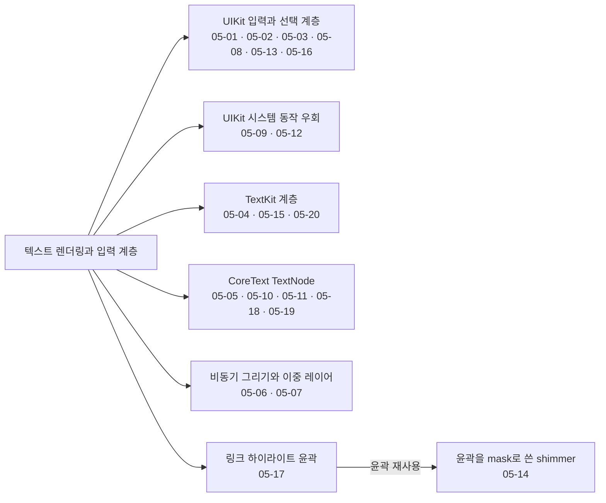
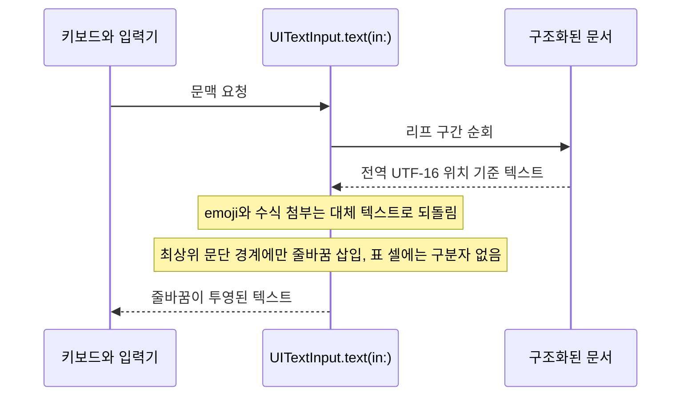
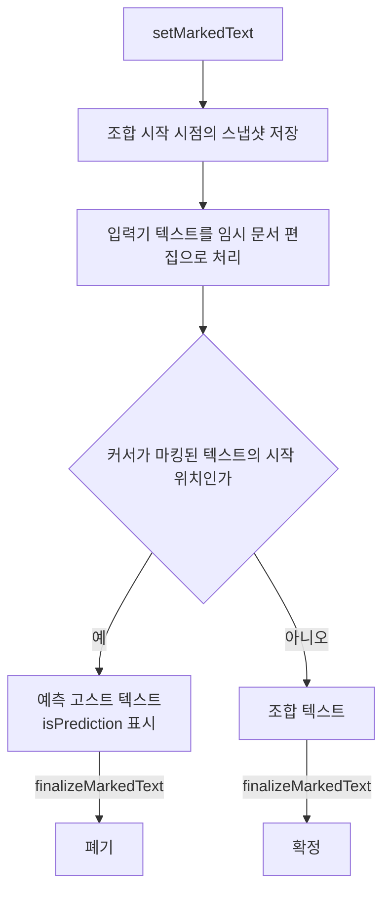
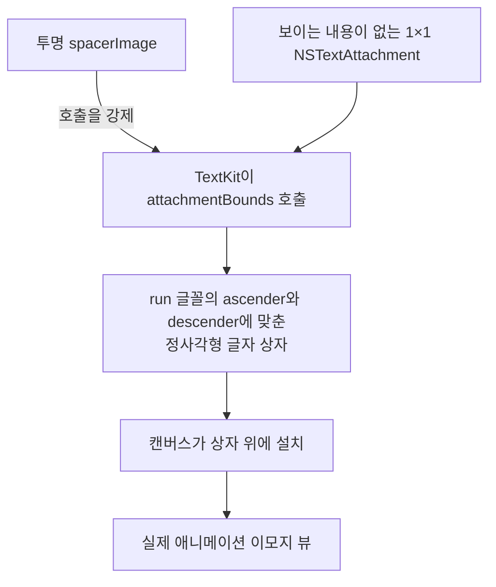
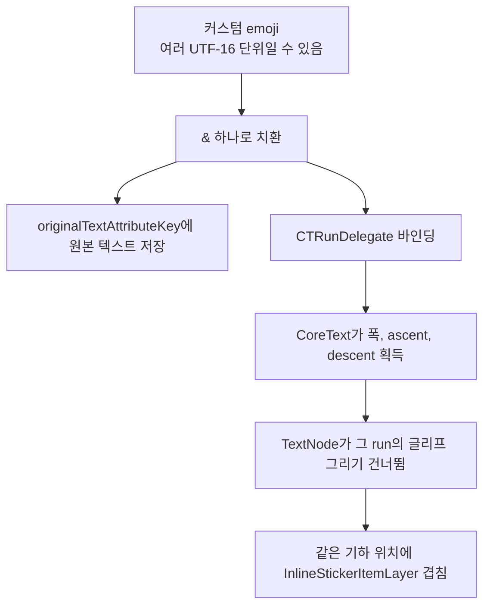
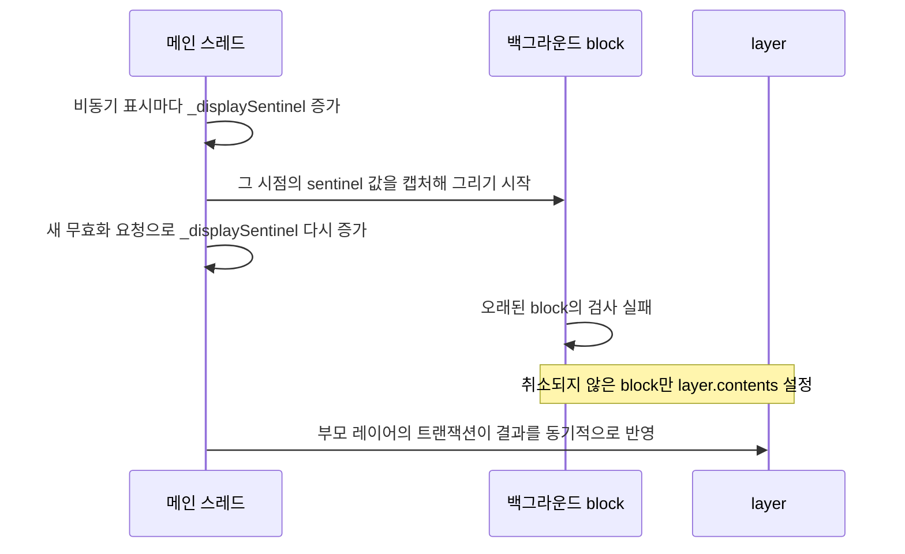

# ASDK와 텍스트

웹: /docs/ios/05-asdk-text/ · Markdown: /docs/ios/05-asdk-text.md

> AsyncDisplayKit 비동기 그리기, 직접 그리는 선택 UI, IME 수정.

| 기법 항목 | 리포트 선정 | 비공개 API 관련 | REA 연관 |
| --- | --- | --- | --- |
| 20 | 5 | 2 | 0 |

소스: [TelegramMessenger/Telegram-iOS@f1dd7a2d](https://github.com/TelegramMessenger/Telegram-iOS/tree/f1dd7a2dbd02cbbf513e75d5695d8d36d1cf5838)(2026-10-07) · 플랫폼: iOS · UIKit

이 장의 선정 항목:
- 05-1 [#05-01 시스템 선택 인터랙션을 설치하지 않고 선택 UI를 전부 직접 그리기](/docs/ios/05-asdk-text/#t05-01)
- 05-2 [#05-02 키보드에 “가상 줄바꿈”을 투영해 한글과 CJK의 문단 간 재조합 수정하기](/docs/ios/05-asdk-text/#t05-02)
- 05-3 [#05-03 IME 조합 텍스트와 인라인 예측을 “확정”과 “폐기”의 두 경로로 나누기](/docs/ios/05-asdk-text/#t05-03)
- 05-4 [#05-04 보이지 않는 1×1 `NSTextAttachment`로 공간을 확보한 뒤 실제 애니메이션 이모지 뷰를 덮어 씌우기](/docs/ios/05-asdk-text/#t05-04)
- 05-5 [#05-05 구형 텍스트 노드는 `CTRunDelegate`로 커스텀 emoji를 하나의 조판 글리프로 위장하기](/docs/ios/05-asdk-text/#t05-05)

범위: Telegram-iOS의 AsyncDisplayKit(UI를 백그라운드에서 그리는 프레임워크) 포크, CoreText(Apple의 텍스트 조판 프레임워크) 텍스트 노드, RichTextEditor의 텍스트 렌더링과 입력 계층.

결론: 이 포크는 시스템 텍스트 동작의 상당 부분을 자체 레이아웃 계층으로 옮겼어요. UIKit의 여러 결함은 아래 방법으로 피해요.

- 백그라운드 그리기
- CoreText 행 단위 기하
- 실제 첨부 뷰
- 직접 구현한 `UITextInput`(키보드와 텍스트 편집 기능이 문서와 연결되는 UIKit 프로토콜)

아래는 의외성과 엔지니어링 가치 순으로 정렬했어요. 코드는 Telegram-iOS 커밋 `f1dd7a2dbd02cbbf513e75d5695d8d36d1cf5838`에서 가져왔어요.

아래 도표는 이 장의 기법들이 텍스트 렌더링과 입력의 어느 층을 손보는지 묶어서 보여 줘요.



## 1. 시스템 선택 인터랙션을 설치하지 않고 선택 UI를 전부 직접 그리기 [#t05-01]

> #05-01 · Telegram-iOS · UIKit · 리포트 선정 05-1 · 검증 방식: 소스 분석 · 태그: 비공개 API, 텍스트와 입력, 제스처와 스크롤
>
> 소스: [Telegram-iOS:submodules/TelegramUI/Components/RichTextEditor/Sources/RichTextEditorUIKit/Canvas/DocumentCanvasView+Interaction.swift L44–L68](https://github.com/TelegramMessenger/Telegram-iOS/blob/f1dd7a2dbd02cbbf513e75d5695d8d36d1cf5838/submodules/TelegramUI/Components/RichTextEditor/Sources/RichTextEditorUIKit/Canvas/DocumentCanvasView%2BInteraction.swift#L44-L68)

**무엇을 했나요**: `DocumentCanvasView`는 `UITextInput`을 구현하지만, 시스템 선택 UI를 만드는 `UITextSelectionDisplayInteraction`은 만들지 않아요.

- `UIEditMenuInteraction`은 그대로 둬요.
- 커서, 선택 영역, 두 개의 핸들은 직접 그려요.
- 임시 인터랙션 객체는 돋보기를 드래그하는 동안에만 만들어요.

**왜 이렇게 했나요**: 소스 기록에 따르면 iOS 18+/26에서는 시스템 기본 핸들이 남아요. 커스텀 빈 뷰로는 이 핸들을 없앨 수 없어요. 직접 그리면 표 안의 커서, 핸들, 선택 영역도 가로 스크롤과 바운스를 따라가게 할 수 있어요.

**핵심 코드 발췌**

```swift title="DocumentCanvasView+Interaction.swift · L44–L68"
if #available(iOS 16.0, *) {
    installEditMenuInteraction()
}
// We deliberately do NOT add a `UITextSelectionDisplayInteraction`.
// The canvas draws ALL of its own selection visuals.
// ...
// on iOS 18+/26 the interaction installs its OWN default selection chrome.
// assigning custom no-draw views no longer suppresses default lollipops.
// ...
// Not creating the interaction at all removes that leak at the source.
// ...
// A FRESH interaction is created per loupe drag and torn down on release.
```

**대가와 위험**: 시스템 텍스트 인터랙션을 통째로 다시 구현했어요. 여러 iOS 버전의 실기기 동작에 기대고 있어요. 시스템 클래스 이름은 주석에만 나오고 비공개 API는 호출하지 않아요.

**증거 체인 #05-01**(iOS 바이너리 미검증)

- 소스 분석: Telegram-iOS 고정 커밋에서 한 줄씩 확인했어요. 소스 위치 총 1곳.
- 리포트 요약(구현 방법): 선택/커서/핸들을 모두 `DocumentCanvasView`가 그리고 관리해요.
- 바이너리 검증: 하지 않음. App Store판 IPA는 FairPlay로 암호화되어 있어서 복호화된 실행 파일을 합법적으로 얻을 수 없어요.

## 2. 키보드에 “가상 줄바꿈”을 투영해 한글과 CJK의 문단 간 재조합 수정하기 [#t05-02]

> #05-02 · Telegram-iOS · UIKit · 리포트 선정 05-2 · 검증 방식: 소스 분석 · 태그: 텍스트와 입력
>
> 소스: [Telegram-iOS:submodules/TelegramUI/Components/RichTextEditor/Sources/RichTextEditorUIKit/Canvas/DocumentCanvasView+UITextInput.swift L40–L77](https://github.com/TelegramMessenger/Telegram-iOS/blob/f1dd7a2dbd02cbbf513e75d5695d8d36d1cf5838/submodules/TelegramUI/Components/RichTextEditor/Sources/RichTextEditorUIKit/Canvas/DocumentCanvasView%2BUITextInput.swift#L40-L77)

**무엇을 했나요**: 구조화된 문서는 내부적으로 이어진 전역 UTF-16 위치를 써요. `UITextInput.text(in:)`에 텍스트를 투영(키보드에 보여 줄 텍스트로 변환)할 때만 최상위 문단 경계에 `\n`을 끼워 넣어요. emoji와 수식 첨부는 읽을 수 있는 대체 텍스트로 되돌려요.

**왜 이렇게 했나요**: 키보드는 `text(in:)`로 문맥을 읽어요.

- 줄바꿈이 없으면 한글과 CJK(한·중·일 문자) 입력기는 위아래 문단을 같은 줄로 봐요.
- 소스에는 종성(받침)이 윗줄로 넘어가는 오류가 분명하게 적혀 있어요.
- 표 셀에는 구분자를 넣지 않아서 표는 여전히 하나의 편집면이에요.

아래 도표는 키보드가 문맥을 읽을 때 가상 줄바꿈이 끼어드는 순서를 보여 줘요.



**핵심 코드 발췌**

```swift title="DocumentCanvasView+UITextInput.swift · L40–L77"
func legacyPlainText(globalFrom: Int, globalTo: Int) -> String? {
    let lo = clamp(min(globalFrom, globalTo))
    let hi = clamp(max(globalFrom, globalTo))
    var result = ""
    forEachLeafRegionInRange(lo, hi) { region, needsSeparator in
        if needsSeparator { result += "\n" }
        let rStart = region.globalStart
        let rEnd = region.globalStart + region.length
        let a = max(lo, rStart)
        let b = min(hi, rEnd)
        guard a < b else { return }
        let attr = region.layout.attributedString
        let ns = attr.string as NSString
        let slice = NSRange(location: a - rStart, length: b - a)
        attr.enumerateAttribute(.attachment, in: slice, options: []) { value, sub, _ in
            if let att = value as? EmojiTextAttachment {
                result += att.ref.altText ?? ""
            } else if let att = value as? FormulaTextAttachment {
                result += att.latex
            } else { result += ns.substring(with: sub) }
        }
    }
    return result
}
```

**대가와 위험**: 모델 위치와 키보드 텍스트 위치는 같은 시퀀스가 아니에요. 새로 추가하는 리프 영역은 모두 같은 구분 규칙을 따라야 해요. 그러지 않으면 입력기와 복사 결과가 어긋나요.

**증거 체인 #05-02**(iOS 바이너리 미검증)

- 소스 분석: Telegram-iOS 고정 커밋에서 한 줄씩 확인했어요. 소스 위치 총 1곳.
- 리포트 요약(구현 방법): 리프 구간을 돌면서 `UITextInput.text(in:)`에 투영해요.
- 바이너리 검증: 하지 않음. App Store판 IPA는 FairPlay로 암호화되어 있어서 복호화된 실행 파일을 합법적으로 얻을 수 없어요.

## 3. IME 조합 텍스트와 인라인 예측을 “확정”과 “폐기”의 두 경로로 나누기 [#t05-03]

> #05-03 · Telegram-iOS · UIKit · 리포트 선정 05-3 · 검증 방식: 소스 분석 · 태그: 텍스트와 입력, 제스처와 스크롤
>
> 소스: [Telegram-iOS:submodules/TelegramUI/Components/RichTextEditor/Sources/RichTextEditorUIKit/Canvas/DocumentCanvasView+MarkedText.swift L109–L161](https://github.com/TelegramMessenger/Telegram-iOS/blob/f1dd7a2dbd02cbbf513e75d5695d8d36d1cf5838/submodules/TelegramUI/Components/RichTextEditor/Sources/RichTextEditorUIKit/Canvas/DocumentCanvasView%2BMarkedText.swift#L109-L161)

**무엇을 했나요**: IME(입력기)가 조합 중인 텍스트를 마킹된 텍스트로 넘기면, 두 함수가 이렇게 다뤄요.

- `setMarkedText`: 먼저 조합을 시작한 시점의 스냅샷을 저장해요. 입력기 텍스트는 임시 문서 편집으로 처리해요. 커서가 마킹된 텍스트의 시작 위치에 있으면 그 텍스트를 예측으로 표시해요.
- `finalizeMarkedText`: 조합 텍스트는 확정하고 예측 고스트 텍스트는 지워요.

**왜 이렇게 했나요**: 예측 텍스트와 조합 텍스트는 성격이 달라요.

- 예측 텍스트: 사용자 콘텐츠가 아니에요. 포커스가 바뀔 때 예측 텍스트를 확정하면, 키보드가 나중에 수락하면서 치환할 때 단어가 중복돼요.
- 조합 텍스트: 유지해야 하고 독립된 실행 취소 단계가 돼야 해요.

소스는 콘텐츠 알림과 선택 알림의 트랜잭션 경계도 따로 둬요.

아래 도표는 마킹된 텍스트가 예측과 조합 텍스트로 갈려서 처리되는 흐름을 보여 줘요.



**핵심 코드 발췌**

```swift title="DocumentCanvasView+MarkedText.swift · L109–L161"
if markedRange == nil {
    inputBackend.setCompositionSnapshot(
        RichTextCompositionSnapshot(blocks: currentBlocks(), anchor: anchor, head: head))
}
inputBackend.notifyingContentChange {
    applyCaretOutcome(applyReplaceOutcome(globalFrom: lo, globalTo: hi, text: text))
    bumpDocumentRevision()
}
let newLen = (text as NSString).length
if newLen == 0 {
    inputBackend.setCompositionMarkedRange(nil, isPrediction: false)
    inputBackend.setCompositionSnapshot(nil)
} else {
    inputBackend.setCompositionMarkedRange(
        NSRange(location: lo, length: newLen),
        isPrediction: selectedRange.location == 0 && selectedRange.length == 0)
}
refreshPredictionStyling()
inputBackend.notifyingSelectionChangeIgnoringCoalescing {
    let selStart = clampGlobal(lo + selectedRange.location)
    applyCaretOutcome(.range(selStart, clampGlobal(selStart + selectedRange.length)))
}
```

**대가와 위험**: `UITextInput`의 세밀한 호출 순서에 기대고 있어요. 알림 횟수가 틀리면 입력기, 실행 취소, 호스트 스크롤이 깨져요. 코드는 최상위 본문 문단에서만 이 조합 경로를 허용해요.

**증거 체인 #05-03**(iOS 바이너리 미검증)

- 소스 분석: Telegram-iOS 고정 커밋에서 한 줄씩 확인했어요. 소스 위치 총 1곳.
- 리포트 요약(구현 방법): `setMarkedText`가 `isPrediction`을 표시하고 `finalize`가 고스트를 지워요.
- 바이너리 검증: 하지 않음. App Store판 IPA는 FairPlay로 암호화되어 있어서 복호화된 실행 파일을 합법적으로 얻을 수 없어요.

## 4. 보이지 않는 1×1 `NSTextAttachment`로 공간을 확보한 뒤 실제 애니메이션 이모지 뷰를 덮어 씌우기 [#t05-04]

> #05-04 · Telegram-iOS · UIKit · 리포트 선정 05-4 · 검증 방식: 소스 분석 · 태그: 텍스트와 입력
>
> 소스: [Telegram-iOS:submodules/TelegramUI/Components/RichTextEditor/Sources/RichTextEditorUIKit/Mapping/EmojiTextAttachment.swift L19–L62](https://github.com/TelegramMessenger/Telegram-iOS/blob/f1dd7a2dbd02cbbf513e75d5695d8d36d1cf5838/submodules/TelegramUI/Components/RichTextEditor/Sources/RichTextEditorUIKit/Mapping/EmojiTextAttachment.swift#L19-L62)
>
> 소스: [Telegram-iOS:submodules/TelegramUI/Components/RichTextEditor/Sources/RichTextEditorUIKit/Canvas/DocumentCanvasView+Emoji.swift L75–L152](https://github.com/TelegramMessenger/Telegram-iOS/blob/f1dd7a2dbd02cbbf513e75d5695d8d36d1cf5838/submodules/TelegramUI/Components/RichTextEditor/Sources/RichTextEditorUIKit/Canvas/DocumentCanvasView%2BEmoji.swift#L75-L152)

**무엇을 했나요**: 첨부(`NSTextAttachment`) 자체에는 보이는 내용이 없어요. 흐름은 이래요.

1. 함께 쓰는 투명 `spacerImage`가 TextKit(UIKit의 텍스트 레이아웃 시스템)이 `attachmentBounds`를 호출하도록 강제해요.
2. 이 호출은 run(같은 서식으로 이어지는 텍스트 구간) 글꼴의 ascender와 descender에 맞춰 정사각형 글자 상자를 확보해요.
3. 이후 캔버스가 그 상자 위에 실제 애니메이션 이모지 뷰를 설치해요.

**왜 이렇게 했나요**: 빈 첨부는 TextKit이 폭 0으로 볼 수 있어요. 애니메이션 콘텐츠를 첨부 안에 곧바로 래스터화하면 계속 재생되지 않아요. 이 방식에서는 역할이 나뉘어요.

- TextKit: 줄바꿈과 베이스라인을 맡아요.
- 실제 뷰: 움직이는 픽셀을 맡아요.

아래 도표는 TextKit이 자리를 잡고 실제 뷰가 그 위를 덮는 순서를 보여 줘요.



**핵심 코드 발췌**

```swift title="EmojiTextAttachment.swift · L19–L62 등 2곳"
final class EmojiTextAttachment: NSTextAttachment {
    let ref: EmojiRef
    let scale: CGFloat
    let renderBoost: CGFloat
    private static let spacerImage: UIImage =
        UIGraphicsImageRenderer(size: CGSize(width: 1, height: 1)).image { _ in }

    init(ref: EmojiRef, scale: CGFloat, renderBoost: CGFloat = 0) {
        self.ref = ref
        self.scale = scale
        self.renderBoost = renderBoost
        super.init(data: nil, ofType: nil)
        self.image = Self.spacerImage
    }

    private func box(for font: UIFont?) -> CGRect {
        let f = font ?? UIFont.preferredFont(forTextStyle: .body)
        let side = (f.ascender - f.descender) * scale
        return CGRect(x: 0, y: f.descender, width: side, height: side)
    }
```

**대가와 위험**: TextKit 1과 TextKit 2의 `attachmentBounds`를 모두 오버라이드해야 해요. 첨부 글자 상자와 보이는 뷰의 크기는 서로 다른 의미 체계예요. 뷰는 `renderBoost`로 행간을 넘어 번질 수 있어요.

**증거 체인 #05-04**(iOS 바이너리 미검증)

- 소스 분석: Telegram-iOS 고정 커밋에서 한 줄씩 확인했어요. 소스 위치 총 2곳.
- 리포트 요약(구현 방법): 행 글꼴의 ascender/descender로 상자를 계산해요.
- 바이너리 검증: 하지 않음. App Store판 IPA는 FairPlay로 암호화되어 있어서 복호화된 실행 파일을 합법적으로 얻을 수 없어요.

## 5. 구형 텍스트 노드는 `CTRunDelegate`로 커스텀 emoji를 하나의 조판 글리프로 위장하기 [#t05-05]

> #05-05 · Telegram-iOS · UIKit · 리포트 선정 05-5 · 검증 방식: 소스 분석 · 태그: Core Animation, 텍스트와 입력
>
> 소스: [Telegram-iOS:submodules/TelegramUI/Components/TextNodeWithEntities/Sources/TextNodeWithEntities.swift L176–L230](https://github.com/TelegramMessenger/Telegram-iOS/blob/f1dd7a2dbd02cbbf513e75d5695d8d36d1cf5838/submodules/TelegramUI/Components/TextNodeWithEntities/Sources/TextNodeWithEntities.swift#L176-L230)

**무엇을 했나요**: 커스텀 emoji를 자리 표시 글리프로 바꾸는 흐름은 이래요.

1. 여러 UTF-16 단위일 수 있는 커스텀 emoji를 `&` 하나로 바꿔요.
2. `&`가 들어간 구간에 `CTRunDelegate`(CoreText가 run의 폭과 높이를 묻는 델리게이트)를 바인딩하면 CoreText가 지정된 폭, ascent, descent를 얻어요.
3. `TextNode`는 그 run의 글리프 그리기를 건너뛰고, 같은 기하 위치에 `InlineStickerItemLayer`를 겹쳐 놓아요.

**왜 이렇게 했나요**: CoreText는 기본적으로 Telegram 애니메이션 이모지를 조판하고 재생할 수 없어요. 측정할 수 있는 자리 표시 글리프로 바꾸면 줄바꿈, 잘라내기, RTL(오른쪽에서 왼쪽으로 쓰는 문자)을 계속 CoreText가 결정해요. 원본 텍스트도 `originalTextAttributeKey`에 저장해 두어서 의미를 보존할 수 있어요.

아래 도표는 커스텀 emoji가 자리 표시 글리프로 바뀌었다가 레이어로 덮이는 흐름을 보여 줘요.



**핵심 코드 발췌**

```swift title="TextNodeWithEntities.swift · L176–L230"
let updatedSubstring = NSMutableAttributedString(string: "&")
let replacementRange = NSRange(location: 0, length: updatedSubstring.length)
updatedSubstring.addAttributes(string.attributes(at: range.location, effectiveRange: nil),
                               range: replacementRange)
updatedSubstring.addAttribute(NSAttributedString.Key("Attribute__EmbeddedItem"),
    value: InlineStickerItem(emoji: value, file: value.file,
                             fontSize: font.pointSize, enableAnimation: value.enableAnimation),
    range: replacementRange)
let itemSize = (font.pointSize * 24.0 / 17.0)
let runDelegateData = RunDelegateData(ascent: font.ascender,
                                      descent: font.descender, width: itemSize)
var callbacks = CTRunDelegateCallbacks(
    version: kCTRunDelegateCurrentVersion,
    dealloc: { dataRef in Unmanaged<RunDelegateData>.fromOpaque(dataRef).release() },
    getAscent: { dataRef in
        Unmanaged<RunDelegateData>.fromOpaque(dataRef).takeUnretainedValue().ascent
    },
    getDescent: { dataRef in
        Unmanaged<RunDelegateData>.fromOpaque(dataRef).takeUnretainedValue().descent,
    getWidth: { dataRef in
        Unmanaged<RunDelegateData>.fromOpaque(dataRef).takeUnretainedValue().width
    })
```

**대가와 위험**: `Unmanaged` 수명 주기를 직접 작성해야 해요. 자리 표시 문자와 원래 문자열의 길이가 달라요. 호출하는 쪽은 CoreText range를 원래 커스텀 emoji의 문자 range로 여기면 안 돼요.

**증거 체인 #05-05**(iOS 바이너리 미검증)

- 소스 분석: Telegram-iOS 고정 커밋에서 한 줄씩 확인했어요. 소스 위치 총 1곳.
- 리포트 요약(구현 방법): 부분 문자열을 치환하고, 그릴 때 그 run을 건너뛰며 커스텀 layer를 겹쳐요.
- 바이너리 검증: 하지 않음. App Store판 IPA는 FairPlay로 암호화되어 있어서 복호화된 실행 파일을 합법적으로 얻을 수 없어요.

## 6. 비동기 그리기는 원자적 sentinel로 오래된 프레임을 취소하고 메인 스레드에서 원자적으로 결과를 반영하기 [#t05-06]

> #05-06 · Telegram-iOS · UIKit · 검증 방식: 소스 분석 · 태그: Core Animation, 성능과 메모리
>
> 소스: [Telegram-iOS:submodules/AsyncDisplayKit/Source/ASDisplayNode+AsyncDisplay.mm L333–L411](https://github.com/TelegramMessenger/Telegram-iOS/blob/f1dd7a2dbd02cbbf513e75d5695d8d36d1cf5838/submodules/AsyncDisplayKit/Source/ASDisplayNode%2BAsyncDisplay.mm#L333-L411)

**무엇을 했나요**: 비동기 표시의 흐름은 이래요.

1. 비동기로 표시할 때마다 `_displaySentinel`(요청마다 올리는 세대 번호)을 올려요.
2. 백그라운드 block은 그 시점의 값을 캡처해요.
3. 새 무효화 요청이 들어오면 오래된 block의 검사가 실패해요.
4. 완료 block은 취소되지 않았을 때만 `layer.contents`를 설정해요.
5. 비동기 작업은 부모 레이어의 트랜잭션에 추가되고, 트랜잭션은 메인 스레드에서 동기적으로 결과를 반영해요.

**왜 이렇게 했나요**: 텍스트 목록은 스크롤하고 재사용하는 동안 빠르게 바뀌어요. 큐에 남은 오래된 bitmap이 새 콘텐츠를 덮어쓰면 안 돼요. 이미 실행 중인 그리기는 안정적으로 취소할 수 없어서 GCD 취소만으로는 부족해요.

아래 도표는 오래된 프레임이 sentinel 검사에서 걸러지는 순서를 보여 줘요.



**핵심 코드 발췌**

```objc title="ASDisplayNode+AsyncDisplay.mm · L333–L411"
asdisplaynode_iscancelled_block_t isCancelledBlock = nil;
if (asynchronously) {
  uint displaySentinelValue = ++_displaySentinel;
  __weak ASDisplayNode *weakSelf = self;
  isCancelledBlock = ^BOOL{
    __strong ASDisplayNode *self = weakSelf;
    return self == nil || (displaySentinelValue != self->_displaySentinel.load());
  };
} else {
  isCancelledBlock = ^BOOL{ return NO; };
}
asyncdisplaykit_async_transaction_operation_block_t displayBlock =
  [self _displayBlockWithAsynchronous:asynchronously
                     isCancelledBlock:isCancelledBlock rasterizing:NO];
if (!displayBlock) { return; }
```

**대가와 위험**: 모든 그리기 구현이 `isCancelled`를 자주 검사해야 해요. 그리기 코드가 검사하지 않으면 CPU는 여전히 낭비돼요. 노드와 layer의 메인 스레드 친화성 제약이 엄격해요.

**증거 체인 #05-06**(iOS 바이너리 미검증)

- 소스 분석: Telegram-iOS 고정 커밋에서 한 줄씩 확인했어요. 소스 위치 총 1곳.
- 바이너리 검증: 하지 않음. App Store판 IPA는 FairPlay로 암호화되어 있어서 복호화된 실행 파일을 합법적으로 얻을 수 없어요.

## 7. “기반 레이어 지우기 + 클리핑 재그리기 레이어”로 spoiler 텍스트를 이중 레이어로 렌더링하기 [#t05-07]

> #05-07 · Telegram-iOS · UIKit · 검증 방식: 소스 분석 · 태그: Core Animation, 텍스트와 입력, 성능과 메모리
>
> 소스: [Telegram-iOS:submodules/Display/Source/TextNode.swift L2567–L2640](https://github.com/TelegramMessenger/Telegram-iOS/blob/f1dd7a2dbd02cbbf513e75d5695d8d36d1cf5838/submodules/Display/Source/TextNode.swift#L2567-L2640)
>
> 소스: [Telegram-iOS:submodules/Display/Source/TextNode.swift L2785–L2851](https://github.com/TelegramMessenger/Telegram-iOS/blob/f1dd7a2dbd02cbbf513e75d5695d8d36d1cf5838/submodules/Display/Source/TextNode.swift#L2785-L2851)

**무엇을 했나요**: spoiler(가려 둔 텍스트)를 레이어 두 개로 그려요.

- 일반 텍스트 레이어: 먼저 한 줄 전체를 그린 뒤, spoiler의 단어별 사각형 영역을 `clear`해요.
- `displaySpoilers`를 켠 두 번째 레이어: 그 사각형들 안의 글리프만 클리핑해서 그려요.

이펙트 노드가 두 레이어를 각각 제어할 수 있어요.

**왜 이렇게 했나요**: 원래 attributed string의 전경색을 직접 바꾸면 조판, 히트 테스트, 캐시에 영향을 줘요. 이중 레이어 bitmap은 같은 `CTLine` 기하를 유지해요. 단어별 사각형 덕분에 이펙트가 행 상자 전체를 덮지 않고 글자에 딱 붙어요.

**핵심 코드 발췌**

```swift title="TextNode.swift · L2567–L2640 등 2곳"
if layout.displaySpoilers && !line.spoilers.isEmpty {
    context.saveGState()
    var clipRects: [CGRect] = []
    for spoiler in line.spoilerWords {
        var rect = spoiler.frame.offsetBy(dx: lineFrame.minX,
                                          dy: lineFrame.minY - UIScreenPixel)
        rect.size.height += 1.0 + UIScreenPixel
        clipRects.append(rect)
    }
    context.clip(to: clipRects)
}
let glyphRuns = CTLineGetGlyphRuns(line.line) as NSArray
for run in glyphRuns {
    let run = run as! CTRun
    // ...
    CTRunDraw(run, context, CFRangeMake(0, glyphCount))
}
// ...
if !line.spoilers.isEmpty {
    if layout.displaySpoilers { context.restoreGState() }
    else { clearRects.append(contentsOf: line.spoilerWords.map { $0.frame }) }
}
```

**대가와 위험**: 레이어 두 개를 렌더링하면 그리기와 메모리 비용이 늘어요. `clearRects`의 좌표나 픽셀 정렬이 틀리면 글자 가장자리가 드러나요. 이 메커니즘은 오프스크린 레이어 렌더링에만 맞아요.

**증거 체인 #05-07**(iOS 바이너리 미검증)

- 소스 분석: Telegram-iOS 고정 커밋에서 한 줄씩 확인했어요. 소스 위치 총 2곳.
- 바이너리 검증: 하지 않음. App Store판 IPA는 FairPlay로 암호화되어 있어서 복호화된 실행 파일을 합법적으로 얻을 수 없어요.

## 8. TextKit 2는 RTL 커서 정지를 바로잡기 위해 일부러 `.selection` 기하를 사용하기 [#t05-08]

> #05-08 · Telegram-iOS · UIKit · 검증 방식: 소스 분석 · 태그: 텍스트와 입력, 제스처와 스크롤
>
> 소스: [Telegram-iOS:submodules/TelegramUI/Components/RichTextEditor/Sources/RichTextEditorUIKit/Layout/BlockLayout.swift L138–L157](https://github.com/TelegramMessenger/Telegram-iOS/blob/f1dd7a2dbd02cbbf513e75d5695d8d36d1cf5838/submodules/TelegramUI/Components/RichTextEditor/Sources/RichTextEditorUIKit/Layout/BlockLayout.swift#L138-L157)

**무엇을 했나요**: 커서 위치를 조회할 때 TextKit 2의 `.standard` segment 대신 `.selection` segment를 써요. 빈 RTL 문단에서는 커서를 컨테이너의 오른쪽 끝에 직접 놓기도 해요.

**왜 이렇게 했나요**: 소스는 `.standard`가 RTL에서 오른쪽 정렬되지 않은 좌표를 보고한다고 지적해요. 줄바꿈 끝의 커서가 옛 위치에 머물러요. `.selection`은 선택 영역과 일치하는 실제 글리프 기하를 줘요.

**핵심 코드 발췌**

```swift title="BlockLayout.swift · L138–L157"
func caretRect(atOffset offset: Int) -> CGRect {
    if length == 0, emptyTextCaretDirection == .rightToLeft {
        return CGRect(x: container.size.width - 2, y: 0, width: 2, height: 20)
    }
    guard let range = textRange(offset, offset) else {
        return CGRect(x: 0, y: 0, width: 2, height: 20)
    }
    var rect = CGRect(x: 0, y: 0, width: 2, height: 20)
    layoutManager.enumerateTextSegments(in: range, type: .selection, options: []) {
        _, frame, _, _ in
        rect = CGRect(x: frame.minX, y: frame.minY, width: 2,
                      height: max(frame.height, 20))
        return false
    }
    return rect
}
```

**대가와 위험**: TextKit 2의 segment 동작에 기대고 있어요. 커서를 조회할 때마다 layout segment를 하나씩 훑어요. 긴 문단에서 드래그가 잦으면 비용이 들 수 있어요.

**증거 체인 #05-08**(iOS 바이너리 미검증)

- 소스 분석: Telegram-iOS 고정 커밋에서 한 줄씩 확인했어요. 소스 위치 총 1곳.
- 바이너리 검증: 하지 않음. App Store판 IPA는 FairPlay로 암호화되어 있어서 복호화된 실행 파일을 합법적으로 얻을 수 없어요.

## 9. `UITextView` 스크롤을 끄면서도 스크롤이 켜져 있다고 믿게 하기 [#t05-09]

> #05-09 · Telegram-iOS · UIKit · 검증 방식: 소스 분석 · 태그: 텍스트와 입력, 제스처와 스크롤
>
> 소스: [Telegram-iOS:submodules/AsyncDisplayKit/Source/ASEditableTextNode.mm L69–L135](https://github.com/TelegramMessenger/Telegram-iOS/blob/f1dd7a2dbd02cbbf513e75d5695d8d36d1cf5838/submodules/AsyncDisplayKit/Source/ASEditableTextNode.mm#L69-L135)

**무엇을 했나요**: `ASPanningOverriddenUITextView`는 바깥에는 “스크롤 불가”라고 알리면서도 부모 클래스의 `scrollEnabled`는 항상 `YES`로 둬요. 자체 pan, `contentSize`, `contentOffset` 업데이트는 막아요.

**왜 이렇게 했나요**: 소스는 rdar://14729288을 인용해요. `UITextView.scrollEnabled = NO`이면 `contentSize`를 계산하지 않아요. 바깥쪽 스크롤 컨테이너는 레이아웃을 위해 이 크기가 필요해요. 이 클래스는 TextKit의 스크롤 레이아웃 경로를 유지하면서 실제 스크롤 제스처는 부모 컨테이너에 넘겨요.

**핵심 코드 발췌**

```objc title="ASEditableTextNode.mm · L69–L135"
- (BOOL)scrollEnabled { return _shouldBlockPanGesture; }

- (void)setScrollEnabled:(BOOL)scrollEnabled
{
  _shouldBlockPanGesture = !scrollEnabled;
  self.scrollsToTop = scrollEnabled;
  [super setScrollEnabled:YES];
}

- (void)setContentSize:(CGSize)contentSize {
  if (_shouldBlockPanGesture) { return; }
  [super setContentSize:contentSize];
}

- (void)setContentOffset:(CGPoint)contentOffset {
  if (_shouldBlockPanGesture) { return; }
  [super setContentOffset:contentOffset];
}

- (void)setContentOffset:(CGPoint)contentOffset animated:(BOOL)animated {
  if (_shouldBlockPanGesture) { return; }
  [super setContentOffset:contentOffset animated:animated];
}
```

**대가와 위험**: `UIScrollView`의 핵심 속성 여러 개를 오버라이드해요. 시스템의 자동 스크롤, 키보드 회피, 앞으로의 TextKit 동작과 충돌할 수 있어요. 이 경로는 편집용 텍스트 노드로 한정돼요.

**증거 체인 #05-09**(iOS 바이너리 미검증)

- 소스 분석: Telegram-iOS 고정 커밋에서 한 줄씩 확인했어요. 소스 위치 총 1곳.
- 바이너리 검증: 하지 않음. App Store판 IPA는 FairPlay로 암호화되어 있어서 복호화된 실행 파일을 합법적으로 얻을 수 없어요.

## 10. 커스텀 잘림 token은 `CTLineCreateTruncatedLine`을 두 번 호출해 token이 잘려 나가지 않게 하기 [#t05-10]

> #05-10 · Telegram-iOS · UIKit · 검증 방식: 소스 분석 · 태그: 텍스트와 입력
>
> 소스: [Telegram-iOS:submodules/Display/Source/TextNode.swift L1991–L2055](https://github.com/TelegramMessenger/Telegram-iOS/blob/f1dd7a2dbd02cbbf513e75d5695d8d36d1cf5838/submodules/Display/Source/TextNode.swift#L1991-L2055)

**무엇을 했나요**: `TextNode`는 이렇게 잘라요.

1. 먼저 token(잘린 자리에 붙이는 꼬리 콘텐츠)의 폭을 재요.
2. 처음에는 전체 폭으로 CoreText에 잘라내기를 요청해요.
3. 만들어진 run의 소스 range가 원래 문자열의 끝에 닿았는지 확인해요.
4. token이 없으면 쓸 수 있는 폭에서 token 폭을 뺀 뒤 한 번 더 잘라요.

명시적 줄바꿈으로 잘릴 때는 token을 `additionalTrailingLine`으로 저장해요.

**왜 이렇게 했나요**: 커스텀 token에는 글자, 아이콘, 동작 안내가 들어갈 수 있어요. CoreText 잘라내기를 한 번만 하면 token이 나타난다는 보장이 없어요. 기본 `UILabel`의 잘라내기로는 줄바꿈 지점에 독립된 스타일의 꼬리 콘텐츠를 추가로 그릴 수도 없어요.

**핵심 코드 발췌**

```swift title="TextNode.swift · L1991–L2055"
let truncationToken = CTLineCreateWithAttributedString(truncatedTokenString)
let truncationTokenWidth = CTLineGetTypographicBounds(truncationToken, nil, nil, nil)
    - CTLineGetTrailingWhitespaceWidth(truncationToken)
var effectiveLineRange = brokenLineRange
var measureFitWidth = CTLineGetTypographicBounds(originalLine, nil, nil, nil)
    - CTLineGetTrailingWhitespaceWidth(originalLine)
if customTruncationToken != nil && lineRange.location + lineRange.length < attributedString.length {
    measureFitWidth += truncationTokenWidth
}
// ...
let coreTextLine1 = CTLineCreateTruncatedLine(originalLine,
    max(1.0, Double(lineConstrainedSize.width)), truncationType, truncationToken)
    ?? truncationToken
let runs = (CTLineGetGlyphRuns(coreTextLine1) as [AnyObject]) as! [CTRun]
var hasTruncationToken = false
for run in runs {
    let runRange = CTRunGetStringRange(run)
    if runRange.location + runRange.length >= nsString.length {
        hasTruncationToken = true
        break
    }
}
```

**대가와 위험**: 코드는 CoreText run의 source range로 token이 있는지 판단해요. 복잡한 양방향 텍스트와 첨부가 있으면 이 판단을 유지보수하기가 어려워요.

**증거 체인 #05-10**(iOS 바이너리 미검증)

- 소스 분석: Telegram-iOS 고정 커밋에서 한 줄씩 확인했어요. 소스 위치 총 1곳.
- 바이너리 검증: 하지 않음. App Store판 IPA는 FairPlay로 암호화되어 있어서 복호화된 실행 파일을 합법적으로 얻을 수 없어요.

## 11. CoreText 행 단위 “컷아웃” 조판을 직접 작성해 아바타나 말풍선 모서리 자리 확보하기 [#t05-11]

> #05-11 · Telegram-iOS · UIKit · 검증 방식: 소스 분석 · 태그: 텍스트와 입력
>
> 소스: [Telegram-iOS:submodules/Display/Source/TextNode.swift L1803–L1855](https://github.com/TelegramMessenger/Telegram-iOS/blob/f1dd7a2dbd02cbbf513e75d5695d8d36d1cf5838/submodules/Display/Source/TextNode.swift#L1803-L1855)

**무엇을 했나요**: 레이아웃 담당자는 컷아웃(아바타나 말풍선 모서리처럼 텍스트가 비켜 가야 하는 영역)에 따라 행을 이렇게 처리해요.

- 각 행의 세로 범위가 왼쪽 위나 오른쪽 위 컷아웃에 닿는지 판단해요. 닿는 행은 쓸 수 있는 폭을 줄여요.
- 왼쪽 위 컷아웃은 행의 x도 평행 이동해요.
- 아래쪽 컷아웃은 레이아웃이 끝난 뒤 마지막 행을 넓힐지 높이를 늘릴지 정해요.

**왜 이렇게 했나요**: `UILabel`과 표준 `NSTextContainer`로는 앞쪽 몇 행에만 영향을 주는 이런 말풍선 홈을 나타내기 어려워요. CoreText typesetter는 행마다 다른 폭을 쓸 수 있고, 정확한 문자와 히트 기하도 유지해요.

**핵심 코드 발췌**

```swift title="TextNode.swift · L1803–L1855"
if let topLeft = cutout?.topLeft {
    cutoutMinY = -fontLineSpacing
    cutoutMaxY = topLeft.height + fontLineSpacing
    cutoutWidth = topLeft.width
    cutoutOffset = cutoutWidth
    cutoutEnabled = true
} else if let topRight = cutout?.topRight {
    cutoutMinY = -fontLineSpacing
    cutoutMaxY = topRight.height + fontLineSpacing
    cutoutWidth = topRight.width
    cutoutEnabled = true
}
// ...
if cutoutEnabled {
    if lineOriginY - fontLineHeight < cutoutMaxY &&
       lineOriginY + fontLineHeight > cutoutMinY {
        lineConstrainedWidth = max(1.0, lineConstrainedWidth - cutoutWidth)
        lineConstrainedWidthDelta = -cutoutWidth
        lineCutoutOffset = cutoutOffset
        lineAdditionalWidth = cutoutWidth
    }
}
let lineCharacterCount = CTTypesetterSuggestLineBreak(
    typesetter, lastLineCharacterIndex, Double(lineConstrainedWidth))
```

**대가와 위험**: 이 로직은 자연 정렬, RTL, 잘라내기, 속성 사각형과 함께 유지보수해야 해요. 컷아웃이 글꼴 행 높이와 만나는 경계는 픽셀 단위로 테스트해야 해요.

**증거 체인 #05-11**(iOS 바이너리 미검증)

- 소스 분석: Telegram-iOS 고정 커밋에서 한 줄씩 확인했어요. 소스 위치 총 1곳.
- 바이너리 검증: 하지 않음. App Store판 IPA는 FairPlay로 암호화되어 있어서 복호화된 실행 파일을 합법적으로 얻을 수 없어요.

## 12. layer-backed 노드는 약한 프록시로 `CALayer.delegate` 댕글링 포인터 수정하기 [#t05-12]

> #05-12 · Telegram-iOS · UIKit · 검증 방식: 소스 분석 · 태그: Core Animation
>
> 소스: [Telegram-iOS:submodules/AsyncDisplayKit/Source/ASDisplayNode.mm L582–L609](https://github.com/TelegramMessenger/Telegram-iOS/blob/f1dd7a2dbd02cbbf513e75d5695d8d36d1cf5838/submodules/AsyncDisplayKit/Source/ASDisplayNode.mm#L582-L609)

**무엇을 했나요**: layer-backed 노드는 자신을 `CALayer.delegate`에 직접 넘기지 않아요. 약한 타깃 프록시를 만들고, 그 프록시를 associated object(런타임에 다른 객체에 붙이는 연관 객체)로 강하게 쥐고 있어요. layer가 node보다 오래 살아남으면 프록시가 콜백을 안전하게 삼켜요.

**왜 이렇게 했나요**: 소스는 `CALayer.delegate`가 문서상으로는 weak이지만 구현상으로는 `assign`처럼 동작한다고 분명히 적어요. 직접 대입하면 백그라운드 해제나 외부에서의 layer 보유 때 댕글링 포인터(이미 해제된 객체를 가리키는 포인터)가 남아요.

**핵심 코드 발췌**

```objc title="ASDisplayNode.mm · L582–L609"
if (_flags.layerBacked) {
  _layer = [self _locked_layerToLoad];
  static int ASLayerDelegateAssociationKey;
  /**
   * CALayer's .delegate property is documented to be weak,
   * but the implementation is actually assign.
   */
  ASWeakProxy *instance = [ASWeakProxy weakProxyWithTarget:self];
  _layer.delegate = (id<CALayerDelegate>)instance;
  objc_setAssociatedObject(_layer, &ASLayerDelegateAssociationKey, instance,
                           OBJC_ASSOCIATION_RETAIN_NONATOMIC);
} else {
  _view = [self _locked_viewToLoad];
  _view.asyncdisplaykit_node = self;
  _layer = _view.layer;
}
_layer.asyncdisplaykit_node = self;
self._locked_asyncLayer.asyncDelegate = self;
```

**대가와 위험**: 프록시 때문에 콜백이 조용히 사라질 수 있어요. 연관 객체는 수명 주기에 암묵적 관계를 더해요. 구현은 공개 문서만이 아니라 시스템의 실제 동작에 기반해요.

**증거 체인 #05-12**(iOS 바이너리 미검증)

- 소스 분석: Telegram-iOS 고정 커밋에서 한 줄씩 확인했어요. 소스 위치 총 1곳.
- 바이너리 검증: 하지 않음. App Store판 IPA는 FairPlay로 암호화되어 있어서 복호화된 실행 파일을 합법적으로 얻을 수 없어요.

## 13. 문자열 분할로 비공개 자동 수정 프롬프트 클래스를 참조하고 비공개 교체 메뉴 항목 비활성화하기 [#t05-13]

> #05-13 · Telegram-iOS · UIKit · 검증 방식: 소스 분석 · 태그: 비공개 API, 런타임 해킹, 텍스트와 입력
>
> 소스: [Telegram-iOS:submodules/AsyncDisplayKit/Source/ASEditableTextNode.mm L141–L175](https://github.com/TelegramMessenger/Telegram-iOS/blob/f1dd7a2dbd02cbbf513e75d5695d8d36d1cf5838/submodules/AsyncDisplayKit/Source/ASEditableTextNode.mm#L141-L175)
>
> 소스: [Telegram-iOS:submodules/AsyncDisplayKit/Source/ASEditableTextNode.mm L448–L460](https://github.com/TelegramMessenger/Telegram-iOS/blob/f1dd7a2dbd02cbbf513e75d5695d8d36d1cf5838/submodules/AsyncDisplayKit/Source/ASEditableTextNode.mm#L448-L460)

**무엇을 했나요**: 편집 텍스트 뷰는 두 가지를 해요.

- `_promptForReplace:`와 일부 서식 메뉴를 막아요.
- 자동 수정 프롬프트를 탭하면 `dropAutocorrection`을 호출해요. 이 메서드는 먼저 `unmarkText`를 하고, 선택 영역을 한 글자 앞으로 옮겼다가 되돌려 UIKit 상태를 새로 고쳐요.

**왜 이렇게 했나요**: 커스텀 편집기는 시스템 교체 프롬프트의 기본 흐름을 받아들이지 않아요. 호환되지 않는 메뉴와 예측 상태를 꺼서, 같은 내용을 UIKit과 노드 계층이 동시에 수정하는 일을 막아야 해요.

**핵심 코드 발췌**

```objc title="ASEditableTextNode.mm · L141–L175 등 2곳"
if (action == @selector(paste:)) {
  NSArray *items = [UIMenuController sharedMenuController].menuItems;
  if (((UIMenuItem *)items.firstObject).action == @selector(toggleBoldface:)) {
    return false;
  }
  return true;
}
static SEL promptForReplaceSelector;
static dispatch_once_t onceToken;
dispatch_once(&onceToken, ^{
  promptForReplaceSelector = NSSelectorFromString(@"_promptForReplace:");
});
if (action == promptForReplaceSelector) { return false; }
if (action == @selector(toggleUnderline:)) { return false; }
return [super canPerformAction:action withSender:sender];
// ...
promptClass = NSClassFromString([[NSString alloc]
  initWithFormat:@"%@AutocorrectInlinePrompt", @"UI"]);
if (result != nil && [result class] == promptClass) {
  [self dropAutocorrection];
}
```

**비공개 API 난독화 복원**: 코드에서 비공개 이름을 이렇게 확인해요.

- 비공개 selector(Objective-C 메서드 이름): 실제 이름은 `_promptForReplace:`예요. `NSSelectorFromString(@"_promptForReplace:")`로 직접 확인돼요.
- 비공개 클래스 이름: 실제 이름은 `UIAutocorrectInlinePrompt`예요. 형식 문자열 `@"%@AutocorrectInlinePrompt"`와 인자 `@"UI"`를 이어 붙여 확인해요.

**대가와 위험**: 비공개 API 이름이 있어요. 코드는 selector와 런타임 클래스를 비교만 하고 비공개 selector를 전송하지는 않아요. 그래도 정적 검토와 시스템의 이름 변경에는 여전히 위험이 있어요. 이 항목에는 심사 위험이 있어요.

**증거 체인 #05-13**(iOS 바이너리 미검증)

- 소스 분석: Telegram-iOS 고정 커밋에서 한 줄씩 확인했어요. 소스 위치 총 2곳.
- 바이너리 검증: 하지 않음. App Store판 IPA는 FairPlay로 암호화되어 있어서 복호화된 실행 파일을 합법적으로 얻을 수 없어요.

## 14. 링크 하이라이트 윤곽을 mask로 재사용해 글자 모양 안에서만 흐르는 shimmer 구현하기 [#t05-14]

> #05-14 · Telegram-iOS · UIKit · 검증 방식: 소스 분석 · 태그: Metal / GPU, 텍스트와 입력
>
> 소스: [Telegram-iOS:submodules/TelegramUI/Components/TextLoadingEffect/Sources/TextLoadingEffect.swift L49–L59](https://github.com/TelegramMessenger/Telegram-iOS/blob/f1dd7a2dbd02cbbf513e75d5695d8d36d1cf5838/submodules/TelegramUI/Components/TextLoadingEffect/Sources/TextLoadingEffect.swift#L49-L59)
>
> 소스: [Telegram-iOS:submodules/TelegramUI/Components/TextLoadingEffect/Sources/TextLoadingEffect.swift L106–L115](https://github.com/TelegramMessenger/Telegram-iOS/blob/f1dd7a2dbd02cbbf513e75d5695d8d36d1cf5838/submodules/TelegramUI/Components/TextLoadingEffect/Sources/TextLoadingEffect.swift#L106-L115)

**무엇을 했나요**: `TextLoadingEffectView`는 shimmer(빛이 훑고 지나가는 로딩 효과)를 이렇게 만들어요.

- 윤곽: `LinkHighlightingNode`가 만든 여러 행에 걸친 둥근 윤곽을 UIView mask로 설정해요.
- 움직임: 폭이 좁은 템플릿 그라데이션 이미지를 움직여요.
- 이미지: 콘텐츠 레이어와 윤곽선 레이어에 각각 그라데이션 이미지가 한 장씩 있어요.

**왜 이렇게 했나요**: 프레임마다 텍스트를 다시 그리거나 행마다 그라데이션 layer를 만들 필요가 없어요. 윤곽은 텍스트 range나 rect가 바뀔 때만 갱신해요. Core Animation은 `position.x`만 바꿔요.

**핵심 코드 발췌**

```swift title="TextLoadingEffect.swift · L49–L59 등 2곳"
self.isUserInteractionEnabled = false
self.maskContentsView.mask = self.maskHighlightNode.view
self.maskContentsView.addSubview(self.backgroundView)
self.addSubview(self.maskContentsView)
self.maskBorderContentsView.mask = self.maskBorderHighlightNode.view
self.maskBorderContentsView.addSubview(self.borderBackgroundView)
self.addSubview(self.maskBorderContentsView)
// ...
private func updateAnimations(size: CGSize) {
    if self.backgroundView.layer.animation(forKey: "shimmer") != nil { return }
    let animation = self.backgroundView.layer.makeAnimation(
        from: 0.0 as NSNumber,
        to: (size.width + self.gradientWidth) as NSNumber,
        keyPath: "position.x", timingFunction: CAMediaTimingFunctionName.easeOut.rawValue,
        duration: self.duration, delay: 0.0, mediaTimingFunction: nil,
        removeOnCompletion: true, additive: true)
    animation.repeatCount = Float.infinity
    self.backgroundView.layer.add(animation, forKey: "shimmer")
    self.borderBackgroundView.layer.add(animation, forKey: "shimmer")
}
```

**대가와 위험**: UIView mask는 오프스크린 합성을 일으킬 수 있어요. 긴 텍스트와 여러 이펙트 인스턴스는 GPU 대역폭을 늘려요. 애니메이션은 hierarchy에 들어올 때만 시작해요.

**증거 체인 #05-14**(iOS 바이너리 미검증)

- 소스 분석: Telegram-iOS 고정 커밋에서 한 줄씩 확인했어요. 소스 위치 총 2곳.
- 바이너리 검증: 하지 않음. App Store판 IPA는 FairPlay로 암호화되어 있어서 복호화된 실행 파일을 합법적으로 얻을 수 없어요.

## 15. RichText spoiler는 표시 속성으로 글리프를 숨기고 안정적인 식별자로 파티클 레이어를 풀링하기 [#t05-15]

> #05-15 · Telegram-iOS · UIKit · 검증 방식: 소스 분석 · 태그: 텍스트와 입력
>
> 소스: [Telegram-iOS:submodules/TelegramUI/Components/RichTextEditor/Sources/RichTextEditorUIKit/Canvas/DocumentCanvasView+Spoilers.swift L37–L55](https://github.com/TelegramMessenger/Telegram-iOS/blob/f1dd7a2dbd02cbbf513e75d5695d8d36d1cf5838/submodules/TelegramUI/Components/RichTextEditor/Sources/RichTextEditorUIKit/Canvas/DocumentCanvasView%2BSpoilers.swift#L37-L55)
>
> 소스: [Telegram-iOS:submodules/TelegramUI/Components/RichTextEditor/Sources/RichTextEditorUIKit/Layout/BlockLayout.swift L301–L339](https://github.com/TelegramMessenger/Telegram-iOS/blob/f1dd7a2dbd02cbbf513e75d5695d8d36d1cf5838/submodules/TelegramUI/Components/RichTextEditor/Sources/RichTextEditorUIKit/Layout/BlockLayout.swift#L301-L339)

**무엇을 했나요**: spoiler 표시를 이렇게 처리해요.

- 캔버스는 선택 영역에 따라 spoiler 표시 여부를 정해요.
- `BlockLayout`은 TextKit 2의 rendering attribute로 숨길 글리프를 투명하게 그리고 storage는 바꾸지 않아요.
- 파티클 뷰의 key는 레이아웃 객체의 식별자와 문단 내 run 인덱스로 만들어요. 변하기 쉬운 전역 문자 오프셋은 쓰지 않아요.

**왜 이렇게 했나요**: 이 방식은 이런 이점이 있어요.

- 투명 표시 속성은 기존 줄바꿈과 텍스트 기하를 유지해요.
- spoiler 위쪽 글자를 편집해도 파티클 뷰를 다시 만들지 않아요.
- spoiler가 없을 때의 커서 이동은 O(1) 빠른 경로를 타요.
- 같은 숨김 범위에서는 `renderVersion`을 올리지 않아서 의미 없는 재그리기를 피해요.

**핵심 코드 발췌**

```swift title="DocumentCanvasView+Spoilers.swift · L37–L55 등 2곳"
func syncSpoilers() {
    guard documentHasSpoilers || !spoilerRuns.isEmpty || !spoilerDustViews.isEmpty else { return }
    let runs = computeSpoilerRuns()
    spoilerRuns = runs
    let hideChanged = applySpoilerHiding(runs)
    reconcileSpoilerDust(runs)
    if hideChanged { setNeedsLayout() }
}
// ...
func setSpoilerHidden(_ ranges: [NSRange]) -> Bool {
    let effective = ranges.filter { $0.length > 0 }
    if effective == spoilerLocalRanges { return false }
    for prev in spoilerRanges {
        layoutManager.removeRenderingAttribute(.foregroundColor, for: prev)
    }
    spoilerRanges = []
    renderVersion &+= 1
    for r in effective {
        guard let tr = textRange(r.location, r.location + r.length) else { continue }
        layoutManager.addRenderingAttribute(.foregroundColor, value: UIColor.clear, for: tr)
        spoilerRanges.append(tr)
    }
    spoilerLocalRanges = effective
    return true
}
```

**대가와 위험**: 이 숨김 메커니즘은 TextKit 2 경로에서만 동작해요. `BlockLayoutTK1`은 범위만 기록하고 색을 다시 입히지 않는다고 분명히 적어요. 선택 영역과 렌더링 상태가 얽혀 있어서 재그리기 타이밍이 복잡해져요.

**증거 체인 #05-15**(iOS 바이너리 미검증)

- 소스 분석: Telegram-iOS 고정 커밋에서 한 줄씩 확인했어요. 소스 위치 총 2곳.
- 바이너리 검증: 하지 않음. App Store판 IPA는 FairPlay로 암호화되어 있어서 복호화된 실행 파일을 합법적으로 얻을 수 없어요.

## 16. Markdown 붙여넣기를 두 개의 run-loop 실행 취소 그룹으로 나누고 중간 깜빡임 억제하기 [#t05-16]

> #05-16 · Telegram-iOS · UIKit · 검증 방식: 소스 분석 · 태그: 텍스트와 입력, 성능과 메모리
>
> 소스: [Telegram-iOS:submodules/TelegramUI/Components/RichTextEditor/Sources/RichTextEditorUIKit/Canvas/DocumentCanvasView+Clipboard.swift L198–L224](https://github.com/TelegramMessenger/Telegram-iOS/blob/f1dd7a2dbd02cbbf513e75d5695d8d36d1cf5838/submodules/TelegramUI/Components/RichTextEditor/Sources/RichTextEditorUIKit/Canvas/DocumentCanvasView%2BClipboard.swift#L198-L224)

**무엇을 했나요**: 호스트가 일반 텍스트 Markdown을 리치 텍스트 문서로 변환할 때, 편집기는 붙여넣기를 두 단계로 나눠요.

1. 먼저 일반 텍스트를 붙여넣어요. 이 첫 단계에서는 호스트에 알리지 않아서 사용자는 중간의 일반 텍스트를 보지 못해요.
2. 다음 메인 run-loop(이벤트 루프의 한 턴)에서 리치 텍스트로 바꿔요.

**왜 이렇게 했나요**: `UndoManager.groupsByEvent`는 같은 이벤트 안의 실행 취소 등록을 하나로 합쳐요. 다음 이벤트로 나누면 첫 번째 실행 취소는 리치 텍스트에서 원래의 Markdown으로 되돌려요. 두 번째 실행 취소에서야 붙여넣은 내용이 지워져요.

**핵심 코드 발췌**

```swift title="DocumentCanvasView+Clipboard.swift · L198–L224"
func pasteMarkdownTwoStep(plainText: String, rich: Document) {
    guard !rich.blocks.isEmpty else { return }
    let plain = plainTextFragment(plainText)
    guard !plain.blocks.isEmpty else { return }
    var range = (start: 0, end: 0)
    suppressHostChangeNotification = true
    editing {
        range = spliceFragmentInEditing(plain)
        return .unchanged
    }
    suppressHostChangeNotification = false
    DispatchQueue.main.async { [weak self] in
        guard let self else { return }
        let size = self.documentSize
        let lo = max(0, min(range.start, size))
        let hi = max(lo, min(range.end, size))
        guard lo < hi else { return }
        self.replaceRange(globalFrom: lo, globalTo: hi, with: rich)
    }
}
```

**대가와 위험**: 비동기 두 번째 단계 전에 문서가 다른 동작으로 바뀔 수 있어요. 코드는 범위와 현재 `documentSize`로 다시 클램프하지만 의미를 완전히 보존하지는 못해요. 빠르게 편집하는 중에는 경쟁 상태를 신중히 다뤄야 해요.

**증거 체인 #05-16**(iOS 바이너리 미검증)

- 소스 분석: Telegram-iOS 고정 커밋에서 한 줄씩 확인했어요. 소스 위치 총 1곳.
- 바이너리 검증: 하지 않음. App Store판 IPA는 FairPlay로 암호화되어 있어서 복호화된 실행 파일을 합법적으로 얻을 수 없어요.

## 17. 링크 하이라이트가 인접한 행의 사각형을 이어 붙여 하나의 연속된 둥근 윤곽으로 만들기 [#t05-17]

> #05-17 · Telegram-iOS · UIKit · 검증 방식: 소스 분석
>
> 소스: [Telegram-iOS:submodules/Display/Source/LinkHighlightingNode.swift L59–L195](https://github.com/TelegramMessenger/Telegram-iOS/blob/f1dd7a2dbd02cbbf513e75d5695d8d36d1cf5838/submodules/Display/Source/LinkHighlightingNode.swift#L59-L195)

**무엇을 했나요**: 하이라이트 그리기 코드는 이 순서로 윤곽을 만들어요.

1. 먼저 인접하지 않은 사각형을 분리해요.
2. 거의 같은 좌우 가장자리는 스냅해요.
3. 여러 행 사각형의 바깥 둘레를 따라 `CGPath` 하나를 만들어요.
4. 행 폭이 바뀌는 곳에 연결용 둥근 모서리를 추가해요.

**왜 이렇게 했나요**: 행마다 둥근 사각형을 따로 그리면 줄바꿈 지점에 틈이 남아요. 그대로 다각형으로 이으면 불연속한 행 사이에 비스듬한 다리가 생겨요. 이 알고리즘은 두 가지 시각적 오류를 모두 피해요.

**핵심 코드 발췌**

```swift title="LinkHighlightingNode.swift · L59–L195"
var combinedRects: [[CGRect]] = []
var currentRects: [CGRect] = []
for rect in rects {
    if rect.width.isZero {
        if !currentRects.isEmpty { combinedRects.append(currentRects) }
        currentRects.removeAll()
    } else {
        if let last = currentRects.last,
           !last.insetBy(dx: -1.0, dy: -1.0).intersects(rect) {
            combinedRects.append(currentRects)
            currentRects.removeAll()
        }
        currentRects.append(rect)
    }
}
if !currentRects.isEmpty { combinedRects.append(currentRects) }
for rects in combinedRects {
    var rects = rects.map {
        $0.insetBy(dx: -inset, dy: -inset).offsetBy(dx: -topLeft.x, dy: -topLeft.y)
    }
    let minRadius: CGFloat = 2.0
    // ... snap near-equal left and right edges before stitching the path.
}
```

**대가와 위험**: 최악의 경우 스냅 루프는 `rects.count * rects.count`만큼 돌아요. 여러 행에 걸친 긴 링크는 CPU를 더 써요. 경계에 1pt 허용 오차를 쓰기 때문에 스케일이 바뀔 때는 회귀 테스트가 필요해요.

**증거 체인 #05-17**(iOS 바이너리 미검증)

- 소스 분석: Telegram-iOS 고정 커밋에서 한 줄씩 확인했어요. 소스 위치 총 1곳.
- 바이너리 검증: 하지 않음. App Store판 IPA는 FairPlay로 암호화되어 있어서 복호화된 실행 파일을 합법적으로 얻을 수 없어요.

## 18. 텍스트 레이아웃은 영향을 주는 모든 조건을 비교하고, 일치하면 이전 `TextNodeLayout`을 그대로 재사용하기 [#t05-18]

> #05-18 · Telegram-iOS · UIKit · 검증 방식: 소스 분석 · 태그: 텍스트와 입력
>
> 소스: [Telegram-iOS:submodules/Display/Source/TextNode.swift L2854–L2906](https://github.com/TelegramMessenger/Telegram-iOS/blob/f1dd7a2dbd02cbbf513e75d5695d8d36d1cf5838/submodules/Display/Source/TextNode.swift#L2854-L2906)

**무엇을 했나요**: `asyncLayout`은 현재 layout을 캡처한 뒤 아래 값을 검사해요.

- 크기
- 최대 행 수
- 잘라내기 방식
- 컷아웃
- 정렬
- 행간
- 배경색
- attributed string

모두 같으면 이전 layout을 그대로 돌려줘요. 그렇지 않으면 새 레이아웃을 계산하고, 바뀐 경우에만 `setNeedsDisplay`를 호출해요.

**왜 이렇게 했나요**: `CTTypesetter`, 속성 순회, 히트 사각형 계산은 메시지 목록에서 비용이 커요. 레이아웃 객체는 각 행, 첨부, spoiler 사각형도 저장해요. 그래서 재사용하면 기하 체인 전체를 다시 계산하지 않아도 돼요.

**핵심 코드 발췌**

```swift title="TextNode.swift · L2854–L2906"
let existingLayout: TextNodeLayout? = maybeNode?.cachedLayout
return { arguments in
    let layout: TextNodeLayout
    var updated = false
    if let existingLayout = existingLayout,
       existingLayout.constrainedSize == arguments.constrainedSize,
       existingLayout.maximumNumberOfLines == arguments.maximumNumberOfLines,
       existingLayout.truncationType == arguments.truncationType,
       existingLayout.cutout == arguments.cutout,
       existingLayout.explicitAlignment == arguments.alignment,
       existingLayout.lineSpacing.isEqual(to: arguments.lineSpacing) {
        // ... compare background color and attributed string.
        if stringMatch { layout = existingLayout }
        else {
            layout = TextNode.calculateLayout(attributedString: arguments.attributedString,
                minimumNumberOfLines: arguments.minimumNumberOfLines,
                maximumNumberOfLines: arguments.maximumNumberOfLines,
                truncationType: arguments.truncationType,
                backgroundColor: arguments.backgroundColor,
                constrainedSize: arguments.constrainedSize, alignment: arguments.alignment)
            updated = true
        }
    // ...
```

**대가와 위험**: 레이아웃에 영향을 주는 매개변수를 새로 추가하면 동등성 판단에도 반드시 넣어야 해요. 빠뜨리면 오래된 bitmap이나 잘못된 히트 박스가 생겨요. `NSAttributedString.isEqual(to:)`는 긴 텍스트에서는 비용도 들어요.

**증거 체인 #05-18**(iOS 바이너리 미검증)

- 소스 분석: Telegram-iOS 고정 커밋에서 한 줄씩 확인했어요. 소스 위치 총 1곳.
- 바이너리 검증: 하지 않음. App Store판 IPA는 FairPlay로 암호화되어 있어서 복호화된 실행 파일을 합법적으로 얻을 수 없어요.

## 19. tint 가능한 글자와 tint 불가능한 컬러 emoji를 겹쳐진 두 텍스트 노드로 분리하기 [#t05-19]

> #05-19 · Telegram-iOS · UIKit · 검증 방식: 소스 분석 · 태그: Core Animation, 텍스트와 입력, 성능과 메모리
>
> 소스: [Telegram-iOS:submodules/TelegramUI/Components/MultiScaleTextNode/Sources/MultiScaleTextNode.swift L6–L25](https://github.com/TelegramMessenger/Telegram-iOS/blob/f1dd7a2dbd02cbbf513e75d5695d8d36d1cf5838/submodules/TelegramUI/Components/MultiScaleTextNode/Sources/MultiScaleTextNode.swift#L6-L25)

**무엇을 했나요**: 상태마다 같은 텍스트 레이아웃을 두 벌 유지해요.

- 한 벌: 일반 글자만 그려요.
- 다른 한 벌: 컬러 emoji만 그려요.

두 벌을 겹쳐 놓아요. `updateTintColor`는 글자 레이어의 layer tint만 바꿔요.

**왜 이렇게 했나요**: `layerTintColor`는 글자 상태를 효율적으로 보간하고 색을 바꿀 수 있어요. 컬러 emoji까지 함께 단색으로 물들이면 안 돼요. `TextNode`의 `renderContentTypes`가 run 수준에서 두 종류의 콘텐츠를 걸러내어 위치를 맞춰요.

**핵심 코드 발췌**

```swift title="MultiScaleTextNode.swift · L6–L25"
private final class MultiScaleTextStateNode: ASDisplayNode {
    let tintTextNode: ImmediateTextNode
    let noTintTextNode: ImmediateTextNode

    override init() {
        self.tintTextNode = ImmediateTextNode()
        self.tintTextNode.displaysAsynchronously = false
        self.tintTextNode.renderContentTypes =
            TextNode.RenderContentTypes.all.subtracting(TextNode.RenderContentTypes.emoji)

        self.noTintTextNode = ImmediateTextNode()
        self.noTintTextNode.displaysAsynchronously = false
        self.noTintTextNode.renderContentTypes = .emoji

        super.init()
        self.addSubnode(self.tintTextNode)
        self.addSubnode(self.noTintTextNode)
    }
}
```

**대가와 위험**: 텍스트를 두 번 조판하고 그려요. 이 컴포넌트는 비동기 표시를 꺼 두었어요. 그래서 짧은 텍스트의 상태 전환에는 맞지만 긴 문단에는 맞지 않아요.

**증거 체인 #05-19**(iOS 바이너리 미검증)

- 소스 분석: Telegram-iOS 고정 커밋에서 한 줄씩 확인했어요. 소스 위치 총 1곳.
- 바이너리 검증: 하지 않음. App Store판 IPA는 FairPlay로 암호화되어 있어서 복호화된 실행 파일을 합법적으로 얻을 수 없어요.

## 20. AsyncDisplayKit의 TextKit 포크는 커스텀 컨테이너로 인용문 홈을 유지하고 커스텀 emoji 글리프를 건너뛰기 [#t05-20]

> #05-20 · Telegram-iOS · UIKit · 검증 방식: 소스 분석 · 태그: 텍스트와 입력
>
> 소스: [Telegram-iOS:submodules/AsyncDisplayKit/Source/ASTextKitComponents.mm L26–L80](https://github.com/TelegramMessenger/Telegram-iOS/blob/f1dd7a2dbd02cbbf513e75d5695d8d36d1cf5838/submodules/AsyncDisplayKit/Source/ASTextKitComponents.mm#L26-L80)

**무엇을 했나요**: 포크는 두 클래스를 구현해요.

- `ASCustomTextContainer`: 인용문의 첫 줄을 100pt 줄여요.
- `ASCustomLayoutManager`: `Attribute__CustomEmoji`를 만나면 부모 클래스의 그 glyph 그리기를 호출하지 않아요.

**왜 이렇게 했나요**: 일반 편집 텍스트의 줄바꿈은 여전히 TextKit이 맡아요. 커스텀 컨테이너는 조판 전체를 다시 쓰지 않고도 인용 아이콘 자리를 비워요. emoji glyph를 건너뛰면 바깥의 동적 콘텐츠가 그 자리를 덮을 수 있어요. 그래서 정적 글리프와 애니메이션이 동시에 나타나는 일을 피해요.

**핵심 코드 발췌**

```objc title="ASTextKitComponents.mm · L26–L80"
- (BOOL)isSimpleRectangularTextContainer { return false; }

- (CGRect)lineFragmentRectForProposedRect:(CGRect)proposedRect
    atIndex:(NSUInteger)characterIndex
    writingDirection:(NSWritingDirection)baseWritingDirection
    remainingRect:(nullable CGRect *)remainingRect
{
  CGRect result = [super lineFragmentRectForProposedRect:proposedRect
      atIndex:characterIndex writingDirection:baseWritingDirection remainingRect:remainingRect];
  NSTextStorage *textStorage = self.layoutManager.textStorage;
  // ... inspect `Attribute__Blockquote` and whether this is its first line.
  if (isFirstLine) { result.size.width -= 100.0f; }
  return result;
}

- (void)showCGGlyphs:(const CGGlyph *)glyphs positions:(const CGPoint *)positions
    count:(NSUInteger)glyphCount font:(UIFont *)font matrix:(CGAffineTransform)textMatrix
    attributes:(NSDictionary<NSAttributedStringKey,id> *)attributes inContext:(CGContextRef)graphicsContext
{
  for (NSUInteger i = 0; i < glyphCount; i++) {
    if (attributes[@"Attribute__CustomEmoji"] != nil) { continue; }
    [super showCGGlyphs:&glyphs[i] positions:&positions[i] count:1 font:font
                 matrix:textMatrix attributes:attributes inContext:graphicsContext];
  }
}
```

**대가와 위험**: 100pt는 하드코딩된 기하예요. 인용문 글꼴, 화면 폭, 아이콘 레이아웃이 바뀌면 여백이 너무 커질 수 있어요. 커스텀 layout manager는 TextKit의 glyph 콜백 순서에 기대고 있어요.

**증거 체인 #05-20**(iOS 바이너리 미검증)

- 소스 분석: Telegram-iOS 고정 커밋에서 한 줄씩 확인했어요. 소스 위치 총 1곳.
- 바이너리 검증: 하지 않음. App Store판 IPA는 FairPlay로 암호화되어 있어서 복호화된 실행 파일을 합법적으로 얻을 수 없어요.

## 부록 [#appendix]

### 추가 검증 설명 [#추가-검증-설명]

- `ASDisplayNode`는 기본적으로 비동기 표시를 켜요. `drawParametersForAsyncLayer:`의 결과를 메인 스레드에서 꺼낸 뒤 백그라운드 그리기에 넘겨요. 위치: Telegram-iOS:submodules/AsyncDisplayKit/Source/ASDisplayNode+AsyncDisplay.mm#L39-L49, #L181-L192.
- `ASDisplayNode`는 아직 로드되지 않았을 때만 `layerBacked` 전환을 허용해요. view-backed 하위 노드를 layer-backed 부모 노드에 추가하는 것도 금지해요. 위치: Telegram-iOS:submodules/AsyncDisplayKit/Source/ASDisplayNode.mm#L756-L784, #L2065-L2068.
- 리치 텍스트의 직접 그리는 커서는 공개 프로토콜 `UITextCursorView`를 구현해요. iOS 17+의 `UITextLoupeSession`에 삽입점 뷰를 제공해요. 위치: Telegram-iOS:submodules/TelegramUI/Components/RichTextEditor/Sources/RichTextEditorUIKit/Canvas/CaretView.swift#L78-L93.
- 이번에는 업스트림 Texture와의 이력 차이 비교를 하지 않았어요. 이 문서의 “포크” 결론은 현재 저장소의 실제 소스만을 근거로 해요.
