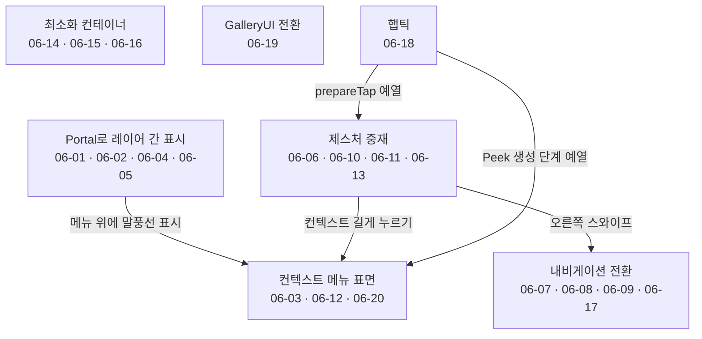
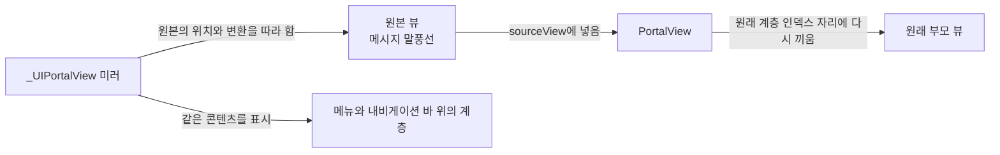
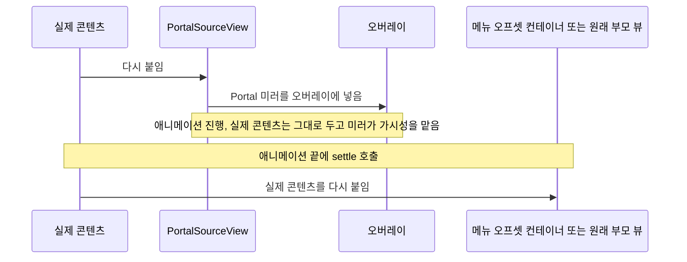
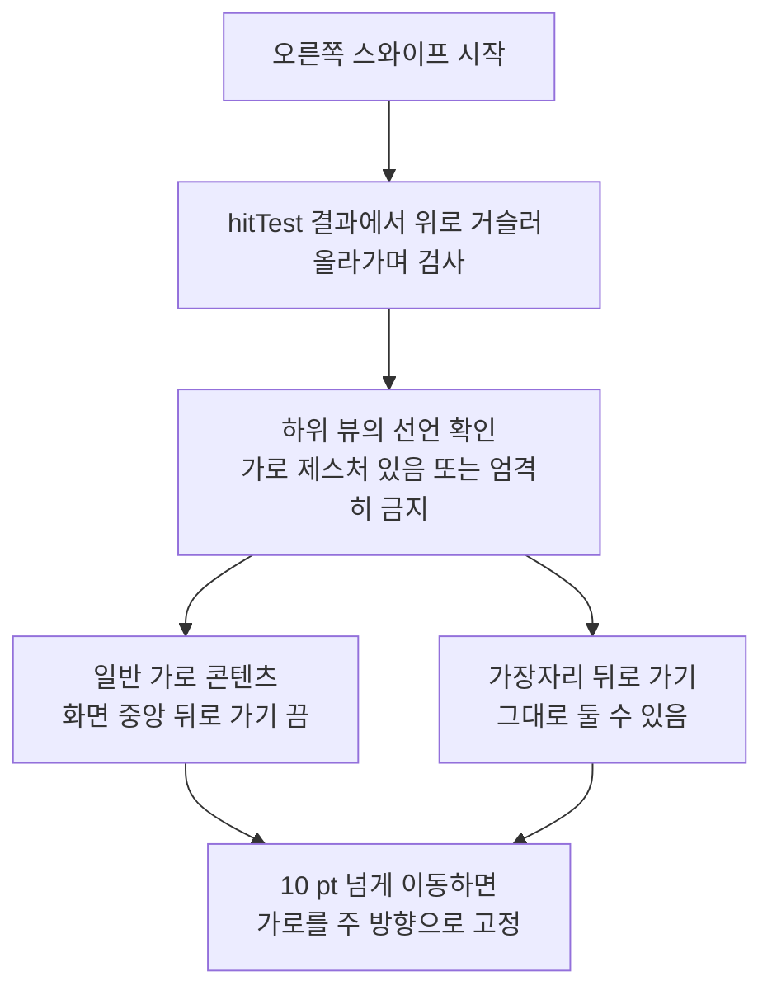
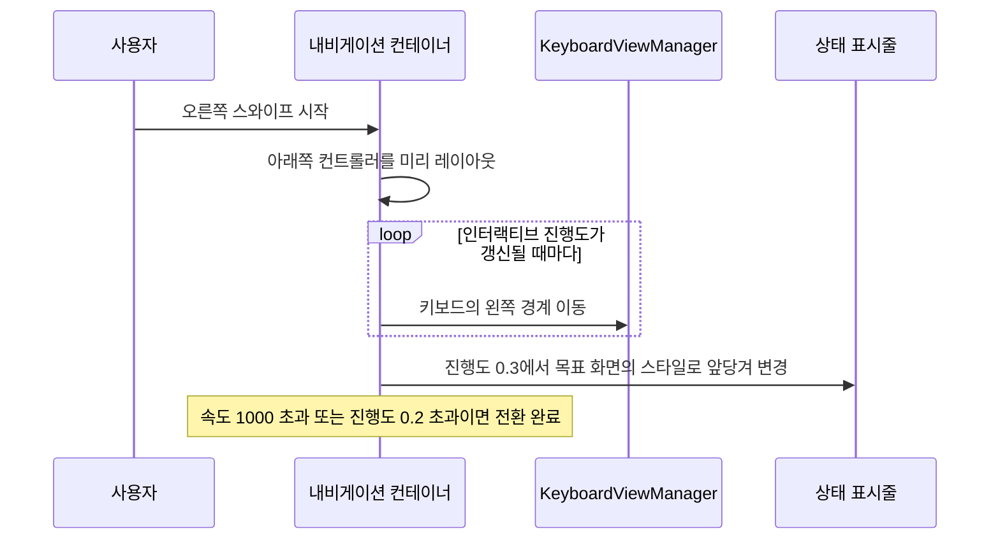

# 내비게이션, 제스처와 컨텍스트 메뉴

웹: /docs/ios/06-navigation-gesture-context/ · Markdown: /docs/ios/06-navigation-gesture-context.md

> _UIPortalView 레이어 간 표시, 컨텍스트 메뉴와 제스처 중재.

| 기법 항목 | 리포트 선정 | 관련 비공개 API | REA 연관 |
| --- | --- | --- | --- |
| 20 | 5 | 4 | 0 |

소스: [TelegramMessenger/Telegram-iOS@f1dd7a2d](https://github.com/TelegramMessenger/Telegram-iOS/tree/f1dd7a2dbd02cbbf513e75d5695d8d36d1cf5838)(2026-10-07) · 플랫폼: iOS · UIKit

이 장의 선정 항목:
- 06-1 [#06-01 비공개 `_UIPortalView`로 같은 콘텐츠를 레이어 간에 표시하기](/docs/ios/06-navigation-gesture-context/#t06-01)
- 06-2 [#06-02 Portal로 원본 콘텐츠를 보관하고, 애니메이션 끝에서 명시적으로 돌려주기](/docs/ios/06-navigation-gesture-context/#t06-02)
- 06-3 [#06-03 투명 배경에 1×1 이미지를 넣어 “보이지만 눌리지 않는” 메뉴 바깥 탭 고치기](/docs/ios/06-navigation-gesture-context/#t06-03)
- 06-4 [#06-06 전체 화면 오른쪽 스와이프 뒤로 가기: 히트 뷰 체인을 먼저 보고 방향 임계값으로 판정하기](/docs/ios/06-navigation-gesture-context/#t06-06)
- 06-5 [#06-07 뒤로 가기 진행도를 수동으로 구동하고, 키보드와 상태 표시줄 동기화하기](/docs/ios/06-navigation-gesture-context/#t06-07)

이 주제의 범위: Telegram-iOS의 자체 제작 내비게이션, 제스처 중재, 컨텍스트 메뉴, 최소화 컨테이너, GalleryUI 전환. 일반 비즈니스 로직은 포함하지 않아요.

아래 도표는 이 장의 기법들이 어느 구성요소를 다루는지, 그리고 서로 어떻게 이어지는지 묶어서 보여 줘요.



## 1. 비공개 `_UIPortalView`로 같은 콘텐츠를 레이어 간에 표시하기 [#t06-01]

> #06-01 · Telegram-iOS · UIKit · 리포트 선정 06-1 · 검증 방식: 소스 분석 · 태그: 비공개 API
>
> 소스: [Telegram-iOS:submodules/Display/Source/PortalView.swift L4–L35](https://github.com/TelegramMessenger/Telegram-iOS/blob/f1dd7a2dbd02cbbf513e75d5695d8d36d1cf5838/submodules/Display/Source/PortalView.swift#L4-L35)
>
> 소스: [Telegram-iOS:submodules/UIKitRuntimeUtils/Source/UIKitRuntimeUtils/UIKitUtils.m L211–L235](https://github.com/TelegramMessenger/Telegram-iOS/blob/f1dd7a2dbd02cbbf513e75d5695d8d36d1cf5838/submodules/UIKitRuntimeUtils/Source/UIKitRuntimeUtils/UIKitUtils.m#L211-L235)
>
> 위치 설명: Telegram-iOS:submodules/Display/Source/PortalView.swift#L4-L35; 비공개 API 정의: Telegram-iOS:submodules/UIKitRuntimeUtils/Source/UIKitRuntimeUtils/UIKitUtils.m#L211-L235

**무엇을 했나요**: 원본 뷰를 따라 하는 Portal 뷰(원본과 같은 콘텐츠를 다른 계층에 보여 주는 뷰)를 하나 만들어요.

- 원본 뷰의 위치와 변환을 그대로 따라 해요.
- alpha는 따라 하지 않고, 히트 테스트(터치가 어느 뷰에 닿았는지 찾는 과정)도 받지 않아요.
- `PortalView`는 원본 뷰를 `sourceView`에 넣고, 원래 계층 인덱스 자리에 강제로 다시 끼워 넣어요.

**왜 이렇게 했나요**: 컨텍스트 메뉴는 메시지 말풍선을 메뉴와 내비게이션 바 위에 보여 줘야 해요. 방법마다 이래요.

- 실제 말풍선을 직접 옮기면 채팅 트리가 깨져요.
- 일반 스냅샷은 콘텐츠를 계속 재생하지 못하고 상태 변화에도 반응하지 못해요.
- Portal은 두 계층에서 같은 콘텐츠를 보여 줄 수 있어요.

아래 도표는 원본 말풍선과 Portal 미러가 어떻게 연결되는지 보여 줘요.



**핵심 코드 발췌**

```objc title="PortalView.swift · L4–L35 등 2곳"
UIView<UIKitPortalViewProtocol> * _Nullable makePortalView(bool matchPosition) {
    static Class portalViewClass = nil;
    static dispatch_once_t onceToken;
    dispatch_once(&onceToken, ^{
        portalViewClass = NSClassFromString([@[@"_", @"UI", @"Portal", @"View"] componentsJoinedByString:@""]);
    });
    if (!portalViewClass) {
        return nil;
    }
    UIView<UIKitPortalViewProtocol> *view = [[portalViewClass alloc] init];
    if (@available(iOS 14.0, *)) {
        view.forwardsClientHitTestingToSourceView = false;
    }
    view.matchesPosition = matchPosition;
    view.matchesTransform = matchPosition;
    view.matchesAlpha = false;
    if (@available(iOS 14.0, *)) {
        view.allowsHitTesting = false;
    }
    return view;
}
```

**비공개 API 난독화 복원**: 배열을 이어 붙이면 `_UIPortalView`가 돼요. `@"_" + @"UI" + @"Portal" + @"View"`와 `NSClassFromString`을 근거로 확인했어요. 관련 속성으로 `matchesPosition`, `matchesTransform`, `allowsHitTesting`이 있어요.

**대가와 위험**: 공개되지 않은 UIKit API예요. App Store 심사와 시스템 호환성 위험이 아주 높아요. 클래스가 없으면 `nil`을 돌려줘요.

**증거 체인 #06-01**(iOS 바이너리 미검증)

- 소스 분석: Telegram-iOS 고정 커밋에서 행 단위로 확인했어요. 소스 위치는 모두 2곳이에요.
- 리포트 요약(구현 방법): `NSClassFromString`으로 클래스 이름을 이어 붙이고, 속성은 버전 가드를 두고 설정해요.
- 바이너리 검증: 하지 않았어요. App Store 배포 IPA는 FairPlay로 암호화돼 있어서 복호화된 실행 파일을 합법적으로 얻을 수 없어요.

## 2. Portal로 원본 콘텐츠를 보관하고, 애니메이션 끝에서 명시적으로 돌려주기 [#t06-02]

> #06-02 · Telegram-iOS · UIKit · 리포트 선정 06-2 · 검증 방식: 소스 분석 · 태그: 비공개 API
>
> 소스: [Telegram-iOS:submodules/TelegramUI/Components/ContextControllerImpl/Sources/ContextControllerExtractedPresentationNode.swift L175–L196](https://github.com/TelegramMessenger/Telegram-iOS/blob/f1dd7a2dbd02cbbf513e75d5695d8d36d1cf5838/submodules/TelegramUI/Components/ContextControllerImpl/Sources/ContextControllerExtractedPresentationNode.swift#L175-L196)

**무엇을 했나요**: 순서대로 이렇게 움직여요.

1. 실제 콘텐츠를 `PortalSourceView`에 다시 붙여요.
2. Portal 미러를 오버레이에 넣어요.
3. 애니메이션이 끝나면 `settle`을 호출해서 실제 콘텐츠를 메뉴 오프셋 컨테이너나 원래 부모 뷰에 다시 붙여요.

**왜 이렇게 했나요**: 이 방식은 실제 콘텐츠를 그대로 두고, 레이어 사이의 가시성은 미러가 맡아요. 원본 말풍선은 내비게이션 바와 메뉴 도금 레이어를 가로질러야 하는데, 다른 방법에는 문제가 있기 때문이에요.

- 콘텐츠만 옮기면 원래 채팅 컨테이너에 잘려요.
- 스냅샷만 옮기면 동적 콘텐츠를 잃어요.

아래 도표는 실제 콘텐츠와 Portal 미러가 애니메이션 앞뒤로 움직이는 순서를 보여 줘요.



**핵심 코드 발췌**

```swift title="ContextControllerExtractedPresentationNode.swift · L175–L196"
let wrapperFrameInWindow = CGRect(origin: wrapperOriginInWindow, size: containingItem.view.bounds.size)
wrapper.frame = surface.convert(wrapperFrameInWindow, from: nil)
surface.addSubview(wrapper)

switch containingItem {
case let .node(containingNode):
    wrapper.addSubview(containingNode.contentNode.view)
case let .view(containingView):
    wrapper.addSubview(containingView.contentView)
}

wrapper.addPortal(view: clone)
overlayHost.addSubview(clone.view)

self.surface = surface
self.wrapper = wrapper
self.clone = clone
self.containingItem = containingItem

return wrapper.layer
```

**대가와 위험**: 이 경로는 #06-01의 비공개 `_UIPortalView`에 기대고 있어요. 코드 주석은 `contentNode.frame.origin == .zero`가 숨은 전제라고 인정해요. 이후 호출한 쪽이 레이아웃을 바꾸면 위치 오차가 생겨요.

**증거 체인 #06-02**(iOS 바이너리 미검증)

- 소스 분석: Telegram-iOS 고정 커밋에서 행 단위로 확인했어요. 소스 위치는 모두 1곳이에요.
- 리포트 요약(구현 방법): 컨테이너에서 `addPortal(view:)`를 호출하고 settle 단계에서 원래대로 되돌려요.
- 바이너리 검증: 하지 않았어요. App Store 배포 IPA는 FairPlay로 암호화돼 있어서 복호화된 실행 파일을 합법적으로 얻을 수 없어요.

## 3. 투명 배경에 1×1 이미지를 넣어 “보이지만 눌리지 않는” 메뉴 바깥 탭 고치기 [#t06-03]

> #06-03 · Telegram-iOS · UIKit · 리포트 선정 06-3 · 검증 방식: 소스 분석 · 태그: 비공개 API, Core Animation
>
> 소스: [Telegram-iOS:submodules/TelegramUI/Components/ContextControllerImpl/Sources/ContextSourceContainer.swift L410–L423](https://github.com/TelegramMessenger/Telegram-iOS/blob/f1dd7a2dbd02cbbf513e75d5695d8d36d1cf5838/submodules/TelegramUI/Components/ContextControllerImpl/Sources/ContextSourceContainer.swift#L410-L423)

**무엇을 했나요**: 메뉴 배경 레이어는 색이 `.clear`여도 완전히 투명한 `contents`(레이어가 그리는 이미지)를 가져요. 그래서 배경 레이어가 계속 터치 전달에 참여해요. 그 결과 메뉴 바깥의 탭을 받아 메뉴를 닫을 수 있어요.

**왜 이렇게 했나요**: 투명한 `UIView`를 덮는 것만으로는 부족할 수 있어요. 이 코드의 주석에는 iOS 27에서 직접 재 본 결과가 적혀 있어요. 투명 배경과 아주 낮은 alpha는 문서에 없는 임계값의 영향을 받아요. 완전 투명 이미지는 화면에 보이는 부작용을 피해요.

**핵심 코드 발췌**

```swift title="ContextSourceContainer.swift · L410–L423"
// This is what catches a tap outside the menu contents, which is what dismisses the menu.
// A layer that renders nothing at all does not receive those taps.
// The filter is not in `-hitTest:`.
// It is in touch delivery, against what the layer actually renders.
// Giving the layer fully transparent contents is enough to make it participate.
// It does not depend on an undocumented opacity threshold.
// Invisible, and harmless for the dim/blur cases.
self.backgroundNode.layer.contents = transparentHitTestImage.cgImage

for i in 0 ..< configuration.sources.count {
    let source = configuration.sources[i]
    let mappedSource = Source(
        controller: controller,
        id: source.id,
        title: source.title,
        footer: source.footer,
```

**대가와 위험**: Core Animation의 터치 전달 동작에 기대는 호환성 기법이에요. 비공개 API는 아니에요. 나중에 시스템이 투명 콘텐츠의 히트 규칙을 바꾸면 회귀 테스트가 필요해요.

**증거 체인 #06-03**(iOS 바이너리 미검증)

- 소스 분석: Telegram-iOS 고정 커밋에서 행 단위로 확인했어요. 소스 위치는 모두 1곳이에요.
- 리포트 요약(구현 방법): 1×1 투명 이미지를 만들어 `backgroundNode.layer.contents`에 넣어요.
- 바이너리 검증: 하지 않았어요. App Store 배포 IPA는 FairPlay로 암호화돼 있어서 복호화된 실행 파일을 합법적으로 얻을 수 없어요.

## 4. 스케일이 없는 오버레이로 추출하기 전에, 조상의 스케일 보정하기 [#t06-04]

> #06-04 · Telegram-iOS · UIKit · 검증 방식: 소스 분석
>
> 소스: [Telegram-iOS:submodules/TelegramUI/Components/ContextControllerImpl/Sources/ContextControllerExtractedPresentationNode.swift L776–L800](https://github.com/TelegramMessenger/Telegram-iOS/blob/f1dd7a2dbd02cbbf513e75d5695d8d36d1cf5838/submodules/TelegramUI/Components/ContextControllerImpl/Sources/ContextControllerExtractedPresentationNode.swift#L776-L800)

**무엇을 했나요**: 세 단계로 스케일을 보정해요.

1. 원본 뷰의 스케일을 `윈도우에서 보이는 너비 ÷ 모델 너비`로 알아내요.
2. 이렇게 알아낸 스케일을 추출 컨테이너에 적용해요.
3. 이 스케일은 퇴장 때 보정에 쓰려고 저장해 둬요.

**왜 이렇게 했나요**: 메시지 말풍선은 이미 스케일된 시트 안에 있을 수 있어요. 오버레이 윈도우에는 보통 시트의 그 스케일 변환(조상 변환)이 없어요. 그대로 다시 붙이면 말풍선이 순식간에 1:1 크기로 튀어요. 윈도우 좌표를 읽으면 실제로 보이는 스케일을 알아낼 수 있어요.

**핵심 코드 발췌**

```swift title="ContextControllerExtractedPresentationNode.swift · L776–L800"
let contentNodeValue = ItemContentNode(containingItem: takeInfo.containingItem)
contentNodeValue.animateClippingFromContentAreaInScreenSpace = takeInfo.contentAreaInScreenSpace
contentNodeValue.sourceTransitionSurface = takeInfo.sourceTransitionSurface

let sourceView = takeInfo.containingItem.view
let modeledWidth = sourceView.bounds.width
if modeledWidth > 0.001 {
    let visualWidth = sourceView.convert(sourceView.bounds, to: nil).width
    let detectedScale = visualWidth / modeledWidth
    if abs(detectedScale - 1.0) > 0.001 {
        contentNodeValue.presentationScale = detectedScale
        contentNodeValue.offsetContainerNode.layer.transform = CATransform3DMakeScale(
            detectedScale, detectedScale, 1.0
        )
    }
}

self.scrollNode.insertSubnode(contentNodeValue, aboveSubnode: self.actionsContainerNode)
self.itemContentNode = contentNodeValue
```

**대가와 위험**: 너비 하나로 등비 스케일(가로세로를 같은 비율로 바꾸는 스케일)만 계산해요. 비등비 변환, 회전, 원근은 미검증이에요. Portal 경로는 `presentationScale == 1.0`일 때만 켜져요.

**증거 체인 #06-04**(iOS 바이너리 미검증)

- 소스 분석: Telegram-iOS 고정 커밋에서 행 단위로 확인했어요. 소스 위치는 모두 1곳이에요.
- 바이너리 검증: 하지 않았어요. App Store 배포 IPA는 FairPlay로 암호화돼 있어서 복호화된 실행 파일을 합법적으로 얻을 수 없어요.

## 5. 퇴장 중에 presentation layer로 착지점 다시 지정하기 [#t06-05]

> #06-05 · Telegram-iOS · UIKit · 검증 방식: 소스 분석 · 태그: Core Animation
>
> 소스: [Telegram-iOS:submodules/TelegramUI/Components/ContextControllerImpl/Sources/ContextControllerExtractedPresentationNode.swift L2271–L2295](https://github.com/TelegramMessenger/Telegram-iOS/blob/f1dd7a2dbd02cbbf513e75d5695d8d36d1cf5838/submodules/TelegramUI/Components/ContextControllerImpl/Sources/ContextControllerExtractedPresentationNode.swift#L2271-L2295)

**무엇을 했나요**: 메뉴가 퇴장하는 동안 원본 메시지의 높이가 바뀌어도 전체 레이아웃을 다시 돌리지 않아요.

대신 `presentation()`(화면에 지금 보이는 상태를 담은 레이어)과 모델 레이어(최종 값을 담은 레이어)의 차이(잔차)를 읽어요. 그리고 안정적인 key로 `bounds.origin.y`의 가산 애니메이션 하나를 교체하고, 남은 시간만 써요.

**왜 이렇게 했나요**: 퇴장 중에는 반응 행이 바뀌어서 원본 메시지가 위로 올라갈 수 있어요. 이때 방법마다 결과가 달라요.

- 일반적인 재레이아웃: 말풍선이 옛 목표로 튀게 만들어요.
- `position.y`를 다시 내보내기: 완료 콜백이 달린 메인 애니메이션을 방해해요.
- 따로 둔 `bounds.origin.y`: 메인 애니메이션의 의미를 지켜 줘요.

**핵심 코드 발췌**

```swift title="ContextControllerExtractedPresentationNode.swift · L2271–L2295"
let displacement = residual + modelDelta / compensationScale

var durationFactor = UIView.animationDurationFactor()
if durationFactor.isZero {
    durationFactor = 1.0
}
let elapsed = (CACurrentMediaTime() - animatingOutState.startTimestamp) / durationFactor
let remainingDuration = max(0.0, animatingOutState.duration - elapsed)

let key = "animateOutRetarget"
if abs(displacement) < CGFloat.ulpOfOne || remainingDuration < Double.ulpOfOne {
    animateLayer.removeAnimation(forKey: key)
} else {
    animateLayer.animate(
        from: displacement as NSNumber,
        to: 0.0 as NSNumber,
        keyPath: "bounds.origin.y",
        timingFunction: animatingOutState.timingFunction,
        duration: remainingDuration,
        delay: 0.0,
        additive: true,
        key: key
    )
}
```

**대가와 위험**: 이 로직은 Core Animation의 모델 레이어와 프레젠테이션 레이어 차이에 크게 기대요. `from == to`는 피해야 해요. 그렇지 않으면 애니메이션이 실행되지 않거나 콜백이 오지 않아요. 유지 보수 비용이 높아요.

**증거 체인 #06-05**(iOS 바이너리 미검증)

- 소스 분석: Telegram-iOS 고정 커밋에서 행 단위로 확인했어요. 소스 위치는 모두 1곳이에요.
- 바이너리 검증: 하지 않았어요. App Store 배포 IPA는 FairPlay로 암호화돼 있어서 복호화된 실행 파일을 합법적으로 얻을 수 없어요.

## 6. 전체 화면 오른쪽 스와이프 뒤로 가기: 히트 뷰 체인을 먼저 보고 방향 임계값으로 판정하기 [#t06-06]

> #06-06 · Telegram-iOS · UIKit · 리포트 선정 06-4 · 검증 방식: 소스 분석 · 태그: 제스처와 스크롤
>
> 소스: [Telegram-iOS:submodules/Display/Source/InteractiveTransitionGestureRecognizer.swift L106–L128](https://github.com/TelegramMessenger/Telegram-iOS/blob/f1dd7a2dbd02cbbf513e75d5695d8d36d1cf5838/submodules/Display/Source/InteractiveTransitionGestureRecognizer.swift#L106-L128)
>
> 소스: [Telegram-iOS:submodules/Display/Source/InteractiveTransitionGestureRecognizer.swift L169–L213](https://github.com/TelegramMessenger/Telegram-iOS/blob/f1dd7a2dbd02cbbf513e75d5695d8d36d1cf5838/submodules/Display/Source/InteractiveTransitionGestureRecognizer.swift#L169-L213)

**무엇을 했나요**: 인식기는 `hitTest`(터치가 닿은 뷰를 찾는 UIKit 메서드) 결과에서 시작해 뷰 체인을 위로 거슬러 올라가며 찾아요.

- 하위 뷰는 “가로 제스처가 있음” 또는 “엄격히 금지”를 선언할 수 있어요.
- 일반 가로 콘텐츠는 화면 중앙에서의 뒤로 가기를 꺼요.
- 가장자리 뒤로 가기는 그대로 둘 수 있어요.
- 10 pt 넘게 움직이고 나서야 인식기가 가로를 주 방향으로 고정해요.

**왜 이렇게 했나요**: 이 방식은 화면 의미 판단을 히트 뷰에 맡기고, 가장자리에는 탈출구를 남겨 둬요. 인식기 하나만 쓰는 방법에는 한계가 있기 때문이에요.

- `UIScreenEdgePanGestureRecognizer` 하나로는 Telegram의 전체 화면 뒤로 가기를 만들 수 없어요.
- 전체 화면 `UIPanGestureRecognizer` 하나만 쓰면 캐러셀, 미디어, 가로 목록의 제스처를 빼앗아요.

아래 도표는 뒤로 가기 제스처가 히트 뷰 체인과 방향 임계값으로 판정되는 순서를 보여 줘요.



**핵심 코드 발췌**

```swift title="InteractiveTransitionGestureRecognizer.swift · L106–L128 등 2곳"
if let target = self.view?.hitTest(self.firstLocation, with: event) {
    let horizontalGestures = hasHorizontalGestures(
        target, point: self.view?.convert(self.firstLocation, to: target)
    )
    switch horizontalGestures {
    case .some, .strict:
        if allowedDirections.contains(.down) {
        } else if case .strict = horizontalGestures {
            allowedDirections = []
        } else if allowedDirections.contains(.leftEdge) || allowedDirections.contains(.rightEdge) {
            allowedDirections.remove(.leftCenter)
            allowedDirections.remove(.rightCenter)
        }
    case .none:
        break
    }
}
if allowedDirections.isEmpty {
    self.state = .failed
} else {
    self.currentAllowedDirections = allowedDirections
}
```

**대가와 위험**: 우선순위는 여러 커스텀 `UIView` 확장 속성에 기대요. 이 속성을 등록하지 않은 가로 컨트롤은 잘못 판정될 수 있어요. 임계값은 경험으로 정한 값이라 실기기에서 조정해야 해요.

**증거 체인 #06-06**(iOS 바이너리 미검증)

- 소스 분석: Telegram-iOS 고정 커밋에서 행 단위로 확인했어요. 소스 위치는 모두 2곳이에요.
- 리포트 요약(구현 방법): 10pt를 감지하면 방향을 잠그고, 가장자리에는 탈출구를 남겨요.
- 바이너리 검증: 하지 않았어요. App Store 배포 IPA는 FairPlay로 암호화돼 있어서 복호화된 실행 파일을 합법적으로 얻을 수 없어요.

## 7. 뒤로 가기 진행도를 수동으로 구동하고, 키보드와 상태 표시줄 동기화하기 [#t06-07]

> #06-07 · Telegram-iOS · UIKit · 리포트 선정 06-5 · 검증 방식: 소스 분석 · 태그: 텍스트와 입력
>
> 소스: [Telegram-iOS:submodules/Display/Source/Navigation/NavigationContainer.swift L236–L313](https://github.com/TelegramMessenger/Telegram-iOS/blob/f1dd7a2dbd02cbbf513e75d5695d8d36d1cf5838/submodules/Display/Source/Navigation/NavigationContainer.swift#L236-L313)

**무엇을 했나요**: 뒤로 가기 중에 이렇게 움직여요.

- 오른쪽 스와이프가 시작되면 내비게이션 컨테이너가 아래쪽 컨트롤러를 미리 레이아웃해요.
- 인터랙티브 진행도가 갱신될 때마다 키보드의 왼쪽 경계를 옮겨요.
- 진행도가 `0.3`에 이르면 상태 표시줄 스타일을 목표 화면의 스타일로 앞당겨 바꿔요.
- 속도가 `1000`을 넘거나 진행도가 `0.2`를 넘으면 전환을 끝내요.

**왜 이렇게 했나요**: 시스템 내비게이션 전환은 직접 만든 `KeyboardViewManager`를 알지 못해요. 키보드와 상태 표시줄이 화면과 함께 밀려나지 않으면 전환 중에 잔상이 남거나 갑자기 바뀌어요. 아래쪽 화면을 미리 레이아웃해 두면 처음 보일 때 빈 화면이 생기는 것도 막아요.

아래 도표는 뒤로 가기 진행도에 맞춰 키보드와 상태 표시줄이 함께 움직이는 순서를 보여 줘요.



**핵심 코드 발췌**

```swift title="NavigationContainer.swift · L236–L313"
let navigationTransitionCoordinator = NavigationTransitionCoordinator(transition: .Pop, isInteractive: true, isFlat: self.isFlat, container: self, topNode: topNode, topNavigationBar: topController.transitionNavigationBar, bottomNode: bottomNode, bottomNavigationBar: bottomController.transitionNavigationBar, screenCornerRadius: screenCornerRadius, didUpdateProgress: { [weak self, weak bottomController] progress, transition, topFrame, bottomFrame in
    if let strongSelf = self {
        if let top = strongSelf.state.top {
            strongSelf.syncKeyboard(leftEdge: top.value.displayNode.frame.minX, transition: transition)
            
            var updatedStatusBarStyle = strongSelf.statusBarStyle
            if let bottomController = bottomController, progress >= 0.3 {
                updatedStatusBarStyle = bottomController.statusBar.statusBarStyle
            } else {
                updatedStatusBarStyle = top.value.statusBar.statusBarStyle
            }
            if strongSelf.statusBarStyle != updatedStatusBarStyle {
                strongSelf.statusBarStyle = updatedStatusBarStyle
                strongSelf.statusBarStyleUpdated?(.animated(duration: 0.3, curve: .easeInOut))
            }
        }
    }
})
bottomController.displayNode.recursivelyEnsureDisplaySynchronously(true)
```

**대가와 위험**: 상태 표시줄과 완료 임계값은 코드에 고정돼 있어요. 복잡한 입력창의 외관 생명주기는 따로 처리해야 해요. 코드는 입력 높이를 잠깐 무시하고 편집 상태를 닫아요.

**증거 체인 #06-07**(iOS 바이너리 미검증)

- 소스 분석: Telegram-iOS 고정 커밋에서 행 단위로 확인했어요. 소스 위치는 모두 1곳이에요.
- 리포트 요약(구현 방법): 진행도 콜백에서 `syncKeyboard`와 상태 표시줄 콜백을 갱신해요.
- 바이너리 검증: 하지 않았어요. App Store 배포 IPA는 FairPlay로 암호화돼 있어서 복호화된 실행 파일을 합법적으로 얻을 수 없어요.

## 8. 픽셀에 정렬된 수동 기하로 내비게이션 시차와 그림자 구현하기 [#t06-08]

> #06-08 · Telegram-iOS · UIKit · 검증 방식: 소스 분석 · 태그: Core Animation, 성능과 메모리
>
> 소스: [Telegram-iOS:submodules/Display/Source/NavigationTransitionCoordinator.swift L158–L187](https://github.com/TelegramMessenger/Telegram-iOS/blob/f1dd7a2dbd02cbbf513e75d5695d8d36d1cf5838/submodules/Display/Source/NavigationTransitionCoordinator.swift#L158-L187)

**무엇을 했나요**: 코디네이터(전환을 조율하는 객체)가 이렇게 처리해요.

- 상단 페이지, 하단 페이지, 마스크, 그림자를 각각 독립된 노드로 나눠요.
- 상단 페이지는 화면 픽셀에 맞춰 정렬해요.
- 평면이 아닌 컨테이너에서는 하단 페이지가 거리의 30%만 움직여서 시차(두 페이지가 다른 속도로 움직이는 효과)를 만들어요.
- 초기화할 때 최대 프레임 레이트의 `SharedDisplayLinkDriver` 링크도 함께 잡아 둬요.

**왜 이렇게 했나요**: `UINavigationController`의 기본 전환은 커스텀 컨테이너에 맞추기 어려워요. 프레임을 각각 계산하면 제스처 진행도를 곧바로 화면에 대응시킬 수 있어요. 픽셀 정렬은 천천히 드래그할 때 글자와 경계가 떨리는 현상을 줄여요.

**핵심 코드 발췌**

```swift title="NavigationTransitionCoordinator.swift · L158–L187"
let containerSize = self.container.bounds.size
let topFrame = CGRect(
    origin: CGPoint(x: floorToScreenPixels(position * containerSize.width), y: 0.0),
    size: containerSize
)
let bottomFrame = CGRect(
    origin: CGPoint(
        x: self.isFlat ? -floorToScreenPixels((1.0 - position) * containerSize.width)
                       : ((position - 1.0) * containerSize.width * 0.3),
        y: 0.0
    ),
    size: containerSize
)
transition.updateFrame(node: self.topNode, frame: topFrame, completion: { _ in
    if canInvokeCompletion { completion() } else { hadEarlyCompletion = true }
})
transition.updateFrame(node: self.dimNode, frame: CGRect(
    origin: CGPoint(x: 0.0, y: dimInset),
    size: CGSize(width: max(0.0, topFrame.minX + self.container.overflowInset + 62.0), height: self.container.bounds.size.height - dimInset)
))
transition.updateAlpha(node: self.dimNode, alpha: (1.0 - position) * 0.15)
transition.updateFrame(node: self.bottomNode, frame: bottomFrame)
```

**대가와 위험**: 오버레이 노드가 여러 개라서 레이어 합성 비용이 늘어요. 내비게이션 생명주기, 모서리 둥글기, 완료 콜백을 수동으로 유지해야 해서 복잡도가 높아요.

**증거 체인 #06-08**(iOS 바이너리 미검증)

- 소스 분석: Telegram-iOS 고정 커밋에서 행 단위로 확인했어요. 소스 위치는 모두 1곳이에요.
- 바이너리 검증: 하지 않았어요. App Store 배포 IPA는 FairPlay로 암호화돼 있어서 복호화된 실행 파일을 합법적으로 얻을 수 없어요.

## 9. 전환 중 내비게이션 바 두 개를 임시로 다시 붙이고, 클리핑 컨테이너로 잘라 내기 [#t06-09]

> #06-09 · Telegram-iOS · UIKit · 검증 방식: 소스 분석 · 태그: 성능과 메모리
>
> 소스: [Telegram-iOS:submodules/Display/Source/NavigationBarTransitionContainer.swift L22–L68](https://github.com/TelegramMessenger/Telegram-iOS/blob/f1dd7a2dbd02cbbf513e75d5695d8d36d1cf5838/submodules/Display/Source/NavigationBarTransitionContainer.swift#L22-L68)

**무엇을 했나요**: 컨테이너가 이렇게 처리해요.

- 두 내비게이션 바의 원래 부모 노드를 저장해 둬요.
- 전환 중에는 두 내비게이션 바를 각각 독립된 클리핑 노드(영역 밖을 잘라 내는 노드)에 다시 붙여요.
- `layout()`은 진행도에 따라 상단 클리핑 영역을 옮기고 하단의 가시 너비를 좁혀요.
- 전환이 끝나면 내비게이션 바를 원래 자리로 돌려놔요.

**왜 이렇게 했나요**: 두 내비게이션 바를 그냥 평행 이동하면 상단 바가 하단 바를 덮어요. 클리핑 너비를 조절하면 두 바가 경계에서 깔끔하게 맞물려요. 버튼마다 스냅샷을 만들 필요도 없어요.

**핵심 코드 발췌**

```swift title="NavigationBarTransitionContainer.swift · L22–L68"
self.topNavigationBar = topNavigationBar
self.topNavigationBarSupernode = topNavigationBar.supernode
self.bottomNavigationBar = bottomNavigationBar
self.bottomNavigationBarSupernode = bottomNavigationBar.supernode

self.topClippingNode = ASDisplayNode()
self.topClippingNode.clipsToBounds = true
self.bottomClippingNode = ASDisplayNode()
self.bottomClippingNode.clipsToBounds = true

self.topClippingNode.addSubnode(self.topNavigationBar)
self.bottomClippingNode.addSubnode(self.bottomNavigationBar)
self.addSubnode(self.bottomClippingNode)
self.addSubnode(self.topClippingNode)

func complete() {
    self.topNavigationBarSupernode?.addSubnode(self.topNavigationBar)
    self.bottomNavigationBarSupernode?.addSubnode(self.bottomNavigationBar)
}
```

**대가와 위험**: 전환 중에는 부모 노드 관계가 바뀌어요. `supernode`를 캐시해 두는 호출자는 모두 오류가 날 수 있어요. 이 컨테이너는 완료 경로와 취소 경로 모두에서 노드를 반드시 돌려놔야 해요.

**증거 체인 #06-09**(iOS 바이너리 미검증)

- 소스 분석: Telegram-iOS 고정 커밋에서 행 단위로 확인했어요. 소스 위치는 모두 1곳이에요.
- 바이너리 검증: 하지 않았어요. App Store 배포 IPA는 FairPlay로 암호화돼 있어서 복호화된 실행 파일을 합법적으로 얻을 수 없어요.

## 10. 컨텍스트 길게 누르기: 시스템 왼쪽 가장자리를 먼저 피하고 제스처 트리 전체를 능동적으로 취소하기 [#t06-10]

> #06-10 · Telegram-iOS · UIKit · 검증 방식: 소스 분석 · 태그: 제스처와 스크롤
>
> 소스: [Telegram-iOS:submodules/Display/Source/ContextGesture.swift L130–L178](https://github.com/TelegramMessenger/Telegram-iOS/blob/f1dd7a2dbd02cbbf513e75d5695d8d36d1cf5838/submodules/Display/Source/ContextGesture.swift#L130-L178)

**무엇을 했나요**: `ContextGesture`는 이렇게 동작해요.

- 윈도우 왼쪽 8 pt 안쪽의 누름을 거부해요.
- 지연이 지나면 디스플레이 링크로 누름 진행도를 애니메이션해요.
- 실제로 활성화되면 윈도우 안에서 같은 종류의 제스처를 취소하고, 부모 뷰 체인을 따라 다른 제스처를 `.failed`로 만들어요.

**왜 이렇게 했나요**: 이유는 세 가지예요.

- 왼쪽 가장자리는 시스템 뒤로 가기와 앱의 전체 화면 뒤로 가기를 위해 비워 두는 영역이에요.
- 일반 길게 누르기로는 이미 시작된 목록 탭과 부모 제스처를 안정적으로 정리할 수 없어요.
- 능동적으로 취소하면 메뉴가 열린 뒤에는 상호작용을 맡는 쪽이 하나만 남아요.

**핵심 코드 발췌**

```swift title="ContextGesture.swift · L130–L178"
let windowLocation = touch.location(in: nil)
if windowLocation.x < 8.0 {
    self.state = .failed
    return
}

let delayTimer = Timer(timeInterval: self.beginDelay, target: TimerTargetWrapper { [weak self] in
    guard let strongSelf = self, let _ = strongSelf.delayTimer else {
        return
    }
    strongSelf.isValidated = true
    if strongSelf.animator == nil {
        strongSelf.animator = DisplayLinkAnimator(duration: 0.2, from: 0.0, to: 1.0, update: { value in
            guard let strongSelf = self else {
                return
            }
            if strongSelf.isValidated {
                strongSelf.currentProgress = value
                strongSelf.activationProgress?(value, .update)
            }
        }, completion: {
            guard let strongSelf = self else {
                return
            }
            switch strongSelf.state {
            case .possible:
                strongSelf.delayTimer?.invalidate()
                strongSelf.animator?.invalidate()
                strongSelf.activated?(strongSelf, location)
                strongSelf.wasActivated = true
                // ... 같은 윈도우와 부모 체인의 제스처를 취소한다.
                strongSelf.state = .began
            default:
                break
            }
        })
    }
}, selector: #selector(TimerTargetWrapper.timerEvent), userInfo: nil, repeats: false)
```

**대가와 위험**: 다른 인식기의 `state` 속성을 손으로 고쳐 쓰는 건 남의 영역에 깊이 개입하는 중재예요. 새 제스처를 추가하면 잘못 취소되지 않는지 검증해야 해요. 왼쪽 가장자리 8 pt는 화면 끝에서 메뉴를 쓰기 어렵게 만들어요.

**증거 체인 #06-10**(iOS 바이너리 미검증)

- 소스 분석: Telegram-iOS 고정 커밋에서 행 단위로 확인했어요. 소스 위치는 모두 1곳이에요.
- 바이너리 검증: 하지 않았어요. App Store 배포 IPA는 FairPlay로 암호화돼 있어서 복호화된 실행 파일을 합법적으로 얻을 수 없어요.

## 11. 인식기 하나로 탭, 더블 탭, 길게 누르기, 우클릭, 누르고 있기를 모두 처리하기 [#t06-11]

> #06-11 · Telegram-iOS · UIKit · 검증 방식: 소스 분석 · 태그: 제스처와 스크롤
>
> 소스: [Telegram-iOS:submodules/Display/Source/TapLongTapOrDoubleTapGestureRecognizer.swift L181–L239](https://github.com/TelegramMessenger/Telegram-iOS/blob/f1dd7a2dbd02cbbf513e75d5695d8d36d1cf5838/submodules/Display/Source/TapLongTapOrDoubleTapGestureRecognizer.swift#L181-L239)

**무엇을 했나요**: 이 커스텀 인식기는 히트 위치에 따라 대기 전략을 골라요. 다음 동작을 구분해요.

- 단일 탭
- 더블 탭
- 길게 누르기
- 보조 클릭
- hold

hold 분기는 먼저 `prepareTap()`을 호출해요. 길게 누르기가 발동하면 같은 종류의 인식기를 모두 취소하고, 조상 스크롤 뷰의 pan도 끝내요.

**왜 이렇게 했나요**: 표준 인식기 여러 개를 쓰려면 `require(toFail:)`가 필요한데, 지연과 충돌을 위치에 따라 바꾸기 어려워요. 이 상태 머신은 타이머를 하나만 둬요. `UIButton`의 표준 탭도 빼앗지 않아요.

**핵심 코드 발췌**

```swift title="TapLongTapOrDoubleTapGestureRecognizer.swift · L181–L239"
if #available(iOS 13.4, *) {
    isSecondary = event.buttonMask == .secondary
} else {
    isSecondary = false
}

if let hitResult = self.view?.hitTest(touch.location(in: self.view), with: event),
   let _ = hitResult as? UIButton {
    self.state = .failed
    return
}

self.tapCount += 1
if self.tapCount == 2 && self.touchCount == 1 {
    self.timer?.invalidate()
    self.timer = nil
    self.lastRecognizedGestureAndLocation = (.doubleTap, self.location(in: self.view))
    self.state = .ended
} else {
    let touchLocationAndTimestamp = (touch.location(in: self.view), CACurrentMediaTime())
    self.touchLocationAndTimestamp = touchLocationAndTimestamp
    var tapAction: TapLongTapOrDoubleTapGestureRecognizerAction = .waitForDoubleTap
    if let tapActionAtPoint = self.tapActionAtPoint {
        tapAction = tapActionAtPoint(touchLocationAndTimestamp.0)
    }
```

**대가와 위험**: 기본값 0.3초와 단일 탭 뒤의 0.16초는 일부러 넣은 지연이에요. `cancelScrollViewGestures`는 조상 `UIPanGestureRecognizer`를 곧바로 끝내요. 서드파티 뷰에 영향을 줄 수 있어요.

**증거 체인 #06-11**(iOS 바이너리 미검증)

- 소스 분석: Telegram-iOS 고정 커밋에서 행 단위로 확인했어요. 소스 위치는 모두 1곳이에요.
- 바이너리 검증: 하지 않았어요. App Store 배포 IPA는 FairPlay로 암호화돼 있어서 복호화된 실행 파일을 합법적으로 얻을 수 없어요.

## 12. Peek를 원본 사각형에서 튀어나오게 하고, 활성화 모드에 따라 블러 전략 바꾸기 [#t06-12]

> #06-12 · Telegram-iOS · UIKit · 검증 방식: 소스 분석 · 태그: 제스처와 스크롤
>
> 소스: [Telegram-iOS:submodules/TelegramUI/Components/ContextControllerImpl/Sources/PeekControllerNode.swift L271–L300](https://github.com/TelegramMessenger/Telegram-iOS/blob/f1dd7a2dbd02cbbf513e75d5695d8d36d1cf5838/submodules/TelegramUI/Components/ContextControllerImpl/Sources/PeekControllerNode.swift#L271-L300)

**무엇을 했나요**: Peek(길게 눌렀을 때 뜨는 미리 보기)는 이렇게 동작해요.

- 원본 사각형의 중심으로 가산 위치 스프링(현재 위치에 더해 적용하는 스프링 애니메이션)을 계산해요.
- 이미 나타난 콘텐츠는 원본 너비와 콘텐츠 너비의 비율만큼 스케일되면서 들어와요.
- 생성 단계에서 드래그로 활성화되면 `UIVisualEffectView` 블러를 써요. 누름으로 활성화되면 반투명 단색 마스크를 써요.
- 생성 단계에서 햅틱도 미리 예열해 둬요.

**왜 이렇게 했나요**: 원본에서 미리 보기로 이어지는 기하가 끊기지 않으면 고정 중심 스케일보다 자연스러워요. 활성화 방식마다 필요한 게 달라요.

- 드래그 메뉴: 배경이 뒤로 물러나야 해요.
- 누름 메뉴: 더 직접적인 눌림 피드백이 필요해요.

일반 모달 표시로는 이 두 상호작용을 표현할 수 없어요.

**핵심 코드 발췌**

```swift title="PeekControllerNode.swift · L271–L300"
func animateIn(from rect: CGRect) {
    self.dimNode.layer.animateAlpha(from: 0.0, to: 1.0, duration: 0.3)
    self.blurView.layer.animateAlpha(from: 0.0, to: self.blurView.alpha, duration: 0.3)

    let offset = CGPoint(
        x: rect.midX - self.containerNode.position.x,
        y: rect.midY - self.containerNode.position.y
    )
    self.containerNode.layer.animateSpring(
        from: NSValue(cgPoint: offset), to: NSValue(cgPoint: CGPoint()),
        keyPath: "position", duration: 0.4, initialVelocity: 0.0,
        damping: 110.0, additive: true
    )

    if let appeared = self.controller?.appeared {
        appeared()
        let scale = rect.width / self.contentNode.frame.width
        self.containerNode.layer.animateSpring(
            from: scale as NSNumber, to: 1.0 as NSNumber,
            keyPath: "transform.scale", duration: 0.4, initialVelocity: 0.0, damping: 110.0
        )
    }
}
```

**대가와 위험**: 스케일을 너비만 기준으로 계산해요. 폭이 아주 좁은 원본 사각형은 급격한 스케일이 생길 수 있어요. `UIVisualEffectView`는 복잡한 배경 위에서 합성 비용이 높아요.

**증거 체인 #06-12**(iOS 바이너리 미검증)

- 소스 분석: Telegram-iOS 고정 커밋에서 행 단위로 확인했어요. 소스 위치는 모두 1곳이에요.
- 바이너리 검증: 하지 않았어요. App Store 배포 IPA는 FairPlay로 암호화돼 있어서 복호화된 실행 파일을 합법적으로 얻을 수 없어요.

## 13. 가장 안쪽 스크롤 뷰가 맨 위에 있을 때만 아래로 밀어 닫기 허용하기 [#t06-13]

> #06-13 · Telegram-iOS · UIKit · 검증 방식: 소스 분석 · 태그: 제스처와 스크롤
>
> 소스: [Telegram-iOS:submodules/SwipeToDismissGesture/Sources/SwipeToDismissGestureRecognizer.swift L48–L107](https://github.com/TelegramMessenger/Telegram-iOS/blob/f1dd7a2dbd02cbbf513e75d5695d8d36d1cf5838/submodules/SwipeToDismissGesture/Sources/SwipeToDismissGestureRecognizer.swift#L48-L107)

**무엇을 했나요**: 인식기는 이렇게 판정해요.

- 터치 지점에서 재귀적으로 `UIScrollView`를 찾아요.
- 스크롤 위치가 상단 inset(콘텐츠 위쪽 여백) 이상일 때만 자격을 유지해요.
- 가로 이동이 5 pt를 넘으면 실패해요.
- 아래로 2 pt를 넘게 움직여야 시작해요.

**왜 이렇게 했나요**: 스크롤 콘텐츠가 맨 위로 돌아오지 않았다면, 아래로 당기는 동작은 페이지를 닫는 대신 계속 스크롤해야 해요. 내부 델리게이트는 다른 제스처와 동시에 인식되는 것을 허용해요. 다만 일반 `UIPanGestureRecognizer`에게는 스스로 지라고 요구해요.

**핵심 코드 발췌**

```swift title="SwipeToDismissGestureRecognizer.swift · L48–L107"
var found = false
let point = touch.location(in: self.view)
if let scrollView = traceScrollView(view: view, point: point) {
    let contentOffset = scrollView.contentOffset
    let contentInset = scrollView.contentInset
    if contentOffset.y.isLessThanOrEqualTo(contentInset.top) {
        found = true
    }
}
if found {
    self.beginPosition = point
} else {
    self.state = .failed
}

let translation = CGPoint(x: point.x - self.beginPosition.x, y: point.y - self.beginPosition.y)
if self.state == .possible {
    if abs(translation.x) > 5.0 {
        self.state = .failed
        return
    }
    if lockDown && translation.y > 2.0 {
        self.state = .began
    }
}
```

**대가와 위험**: 모든 하위 뷰를 재귀적으로 훑어요. 깊고 동적인 뷰 트리에서는 히트 비용이 늘어나요. 이 규칙은 `UIScrollView`만 알아보기 때문에, 커스텀 스크롤 컨테이너는 따로 맞춰야 해요.

**증거 체인 #06-13**(iOS 바이너리 미검증)

- 소스 분석: Telegram-iOS 고정 커밋에서 행 단위로 확인했어요. 소스 위치는 모두 1곳이에요.
- 바이너리 검증: 하지 않았어요. App Store 배포 IPA는 FairPlay로 암호화돼 있어서 복호화된 실행 파일을 합법적으로 얻을 수 없어요.

## 14. 최소화한 뒤 지연을 두고 살아 있는 컨트롤러를 스냅샷으로 교체하기 [#t06-14]

> #06-14 · Telegram-iOS · UIKit · 검증 방식: 소스 분석
>
> 소스: [Telegram-iOS:submodules/TelegramUI/Components/MinimizedContainer/Sources/MinimizedContainer.swift L125–L137](https://github.com/TelegramMessenger/Telegram-iOS/blob/f1dd7a2dbd02cbbf513e75d5695d8d36d1cf5838/submodules/TelegramUI/Components/MinimizedContainer/Sources/MinimizedContainer.swift#L125-L137)

**무엇을 했나요**: 최소화 카드가 이렇게 바뀌어요.

1. 먼저 실제 컨트롤러 뷰를 담아요.
2. 0.45초 뒤에 콘텐츠 스냅샷을 캡처해요.
3. 실제 뷰를 없애고 스냅샷과 자체 제목 표시줄만 남겨요.

**왜 이렇게 했나요**: 최소화 컨테이너는 전체 화면 Web App이나 컨트롤러 여러 개를 보여 줄 수 있어요. 실제 페이지를 계속 마운트해 두면 그리기, 타이머, 터치 부담이 생겨요. 지연을 두면 최소화에 들어갈 때는 실제 콘텐츠를 쓰고, 그 뒤에 가벼운 정적 카드로 바꿀 수 있어요.

**핵심 코드 발췌**

```swift title="MinimizedContainer.swift · L125–L137"
self.addSubnode(self.containerNode)
self.controllerView = self.item.controller.displayNode.view
self.containerNode.view.addSubview(self.item.controller.displayNode.view)

Queue.mainQueue().after(0.45) {
    self.isReady = true
    if !self.isDismissed, let snapshotView = self.item.controller.makeContentSnapshotView() {
        self.containerNode.view.addSubview(self.snapshotContainerView)
        self.snapshotView = snapshotView
        self.controllerView?.removeFromSuperview()
        self.controllerView = nil
        self.snapshotContainerView.addSubview(snapshotView)
        self.requestLayout(transition: .immediate)
    }
}

self.addSubnode(self.headerNode)
self.addSubnode(self.dimCoverNode)
```

**대가와 위험**: 스냅샷은 갱신되지 않아요. 실제 뷰와 스냅샷이 잠깐 교체되는 사이에 깜빡일 수 있어요. 컨트롤러가 `makeContentSnapshotView()`를 올바르게 구현해야 해요.

**증거 체인 #06-14**(iOS 바이너리 미검증)

- 소스 분석: Telegram-iOS 고정 커밋에서 행 단위로 확인했어요. 소스 위치는 모두 1곳이에요.
- 바이너리 검증: 하지 않았어요. App Store 배포 IPA는 FairPlay로 암호화돼 있어서 복호화된 실행 파일을 합법적으로 얻을 수 없어요.

## 15. 비공개 `CAFilter`로 스냅샷에 배경 블러 보충하기 [#t06-15]

> #06-15 · Telegram-iOS · UIKit · 검증 방식: 소스 분석 · 태그: 비공개 API, Core Animation
>
> 소스: [Telegram-iOS:submodules/TelegramUI/Components/MinimizedContainer/Sources/MinimizedContainer.swift L272–L295](https://github.com/TelegramMessenger/Telegram-iOS/blob/f1dd7a2dbd02cbbf513e75d5695d8d36d1cf5838/submodules/TelegramUI/Components/MinimizedContainer/Sources/MinimizedContainer.swift#L272-L295)
>
> 소스: [Telegram-iOS:submodules/UIKitRuntimeUtils/Source/UIKitRuntimeUtils/UIKitUtils.m L259–L267](https://github.com/TelegramMessenger/Telegram-iOS/blob/f1dd7a2dbd02cbbf513e75d5695d8d36d1cf5838/submodules/UIKitRuntimeUtils/Source/UIKitRuntimeUtils/UIKitUtils.m#L259-L267)
>
> 위치 설명: Telegram-iOS:submodules/TelegramUI/Components/MinimizedContainer/Sources/MinimizedContainer.swift#L272-L295; 비공개 API 정의: Telegram-iOS:submodules/UIKitRuntimeUtils/Source/UIKitRuntimeUtils/UIKitUtils.m#L259-L267

**무엇을 했나요**: 카드 스냅샷의 비율이 컨테이너와 맞지 않으면 스냅샷을 하나 더 캡처해요. 추가로 캡처한 스냅샷의 `layer.filters`에 가우시안 블러를 설정하고, 선명한 스냅샷 아래에 깔아서 빈 영역을 채워요.

**왜 이렇게 했나요**: 스냅샷을 그냥 늘리면 모양이 일그러져요. 단색 가장자리는 어색해 보여요. 블러 복제본은 배경을 자연스럽게 넓히면서도 원본 콘텐츠의 비율을 지켜요.

**핵심 코드 발췌**

```swift title="MinimizedContainer.swift · L272–L295 등 2곳"
if requiresBlur {
    let blurredSnapshotView: UIView?
    if let current = self.blurredSnapshotView {
        blurredSnapshotView = current
    } else {
        blurredSnapshotView = snapshotView.snapshotView(afterScreenUpdates: false)
        if let blurredSnapshotView {
            if let blurFilter = makeBlurFilter() {
                blurFilter.setValue(20.0 as NSNumber, forKey: "inputRadius")
                blurFilter.setValue(true as NSNumber, forKey: "inputNormalizeEdges")
                blurredSnapshotView.layer.filters = [blurFilter]
            }
            self.snapshotContainerView.insertSubview(blurredSnapshotView, at: 0)
            self.blurredSnapshotView = blurredSnapshotView
        }
    }
    blurredSnapshotView?.frame = blurFrame
} else if let blurredSnapshotView = self.blurredSnapshotView {
    self.blurredSnapshotView = nil
    blurredSnapshotView.layer.animateAlpha(from: 1.0, to: 0.0, duration: 0.2,
        removeOnCompletion: false, completion: { _ in blurredSnapshotView.removeFromSuperview() })
}
```

**비공개 API 난독화 복원**: `makeBlurFilter()`는 `NSClassFromString(@"CAFilter")`를 바로 실행한 뒤 `filterWithName:@"gaussianBlur"`를 호출해요. 실제 비공개 클래스 이름은 `CAFilter`예요. 문자열을 이어 붙여 숨기는 방식이 아니에요.

**대가와 위험**: `CAFilter`와 `CALayer.filters`를 이렇게 쓰는 건 비공개 API예요. 심사 위험이 아주 높아요. 필터 반경과 키 값도 시스템에 따라 바뀔 수 있어요.

**증거 체인 #06-15**(iOS 바이너리 미검증)

- 소스 분석: Telegram-iOS 고정 커밋에서 행 단위로 확인했어요. 소스 위치는 모두 2곳이에요.
- 바이너리 검증: 하지 않았어요. App Store 배포 IPA는 FairPlay로 암호화돼 있어서 복호화된 실행 파일을 합법적으로 얻을 수 없어요.

## 16. 3D 변환으로 최소화된 페이지를 스크롤 가능한 카드 더미로 쌓기 [#t06-16]

> #06-16 · Telegram-iOS · UIKit · 검증 방식: 소스 분석 · 태그: Metal / GPU, 제스처와 스크롤
>
> 소스: [Telegram-iOS:submodules/TelegramUI/Components/MinimizedContainer/Sources/MinimizedContainer.swift L935–L1017](https://github.com/TelegramMessenger/Telegram-iOS/blob/f1dd7a2dbd02cbbf513e75d5695d8d36d1cf5838/submodules/TelegramUI/Components/MinimizedContainer/Sources/MinimizedContainer.swift#L935-L1017)

**무엇을 했나요**: 카드 더미가 상태마다 이렇게 움직여요.

- 펼쳐지면 각 카드는 스크롤 위치에 따라 `final3dTransform`을 계산해요.
- 하이라이트된 카드는 추가로 `0.04`만큼 회전해요.
- 닫히는 중인 카드는 가로 오프셋을 따로 받아요.
- 접힐 때는 맨 위가 아닌 카드가 비율에 맞춰 작아지면서 아래로 가라앉아요.

**왜 이렇게 했나요**: 일반 `UITableView`의 평면 카드에는 작업 전환기 같은 깊이감이 없어요. 변환이 스크롤 경계에 묶여 있어서, 스크롤하면 카드가 끊김 없이 기울어져요. 코드는 맨 위 카드의 `zPosition`도 `10000`으로 설정해서 가려지지 않게 해요.

**핵심 코드 발췌**

```swift title="MinimizedContainer.swift · L935–L1017"
if self.isExpanded {
    let currentItemFrame = frameForIndex(
        index: index, size: layout.size, insets: itemInsets,
        itemCount: self.items.count, boundingSize: layout.size
    )
    let currentItemTransform = final3dTransform(
        for: currentItemFrame.minY, size: currentItemFrame.size,
        contentHeight: contentHeight, itemCount: self.items.count,
        additionalAngle: self.highlightedItemId == item.id ? 0.04 : nil,
        scrollBounds: effectiveScrollBounds, insets: itemInsets
    )
    var effectiveItemFrame = currentItemFrame
    let effectiveItemTransform = currentItemTransform
    if let dismissingItemId = self.dismissingItemId,
       let deletingIndex = self.items.firstIndex(where: { $0.id == dismissingItemId }),
       let offset = self.dismissingItemOffset, deletingIndex == index {
        effectiveItemFrame = effectiveItemFrame.offsetBy(dx: offset, dy: 0.0)
    }
    itemFrame = effectiveItemFrame
    itemTransform = effectiveItemTransform
    itemNode.isCovered = false
}
```

**대가와 위험**: 전체 화면 카드가 많으면 변환과 그림자 때문에 GPU 합성 부담이 늘어요. 3D 기하의 터치 영역은 여전히 변환 전 레이아웃이 기준이라 추가 검증이 필요해요.

**증거 체인 #06-16**(iOS 바이너리 미검증)

- 소스 분석: Telegram-iOS 고정 커밋에서 행 단위로 확인했어요. 소스 위치는 모두 1곳이에요.
- 바이너리 검증: 하지 않았어요. App Store 배포 IPA는 FairPlay로 암호화돼 있어서 복호화된 실행 파일을 합법적으로 얻을 수 없어요.

## 17. iPad 분할 화면에서 실제 화면 가장자리의 안전 영역만 해당 창에 주기 [#t06-17]

> #06-17 · Telegram-iOS · UIKit · 검증 방식: 소스 분석 · 태그: 제스처와 스크롤
>
> 소스: [Telegram-iOS:submodules/Display/Source/Navigation/NavigationSplitContainer.swift L73–L106](https://github.com/TelegramMessenger/Telegram-iOS/blob/f1dd7a2dbd02cbbf513e75d5695d8d36d1cf5838/submodules/Display/Source/Navigation/NavigationSplitContainer.swift#L73-L106)

**무엇을 했나요**: iPad 분할 화면에서 이렇게 처리해요.

- 분할 너비를 화면 너비의 3분의 1에서 2분의 1 사이로 제한해요.
- master에서는 오른쪽 안전 영역을 없애고, detail에서는 왼쪽 안전 영역을 없애요.
- 두 창 각각에 대해 상태 표시줄 높이만큼의 스크롤 프록시 영역(상태 표시줄을 탭해 맨 위로 스크롤하는 동작을 받는 영역)을 만들어요.

**왜 이렇게 했나요**: 가운데 구분선은 화면 가장자리가 아니에요. 두 창이 모두 안전 영역 전체를 물려받으면 분할 지점에서 콘텐츠에 여백이 두 번 생겨요. 창마다 따로 프록시를 두면 상태 표시줄을 탭해 맨 위로 스크롤하는 익숙한 동작을 유지할 수 있어요.

**핵심 코드 발췌**

```swift title="NavigationSplitContainer.swift · L73–L106"
let masterWidth: CGFloat = min(max(320.0, floor(layout.size.width / 3.0)), floor(layout.size.width / 2.0))
let detailWidth = layout.size.width - masterWidth
let scrollToTopHeight = max(layout.statusBarHeight ?? layout.safeInsets.top, 1.0)
return (
    master: CGRect(origin: CGPoint(), size: CGSize(width: masterWidth, height: scrollToTopHeight)),
    detail: CGRect(origin: CGPoint(x: masterWidth, y: 0.0), size: CGSize(width: detailWidth, height: scrollToTopHeight))
)

var masterSafeInsets = layout.safeInsets
masterSafeInsets.right = 0.0
var detailSafeInsets = layout.safeInsets
detailSafeInsets.left = 0.0

self.masterContainer.update(
    layout: ContainerViewLayout(size: CGSize(width: masterWidth, height: layout.size.height),
        metrics: layout.metrics, deviceMetrics: layout.deviceMetrics,
        intrinsicInsets: layout.intrinsicInsets, safeInsets: masterSafeInsets,
        additionalInsets: UIEdgeInsets(), statusBarHeight: layout.statusBarHeight,
```

**대가와 위험**: 너비 정책이 고정돼 있어요. 아주 좁은 멀티태스킹 윈도우에서 읽기 편한지는 검증이 필요해요. 프록시 뷰의 생명주기는 상위 내비게이션 컨트롤러가 관리해요.

**증거 체인 #06-17**(iOS 바이너리 미검증)

- 소스 분석: Telegram-iOS 고정 커밋에서 행 단위로 확인했어요. 소스 위치는 모두 1곳이에요.
- 바이너리 검증: 하지 않았어요. App Store 배포 IPA는 FairPlay로 암호화돼 있어서 복호화된 실행 파일을 합법적으로 얻을 수 없어요.

## 18. 햅틱 생성기를 스타일별로 캐시하고, 제스처가 시작될 때 예열하기 [#t06-18]

> #06-18 · Telegram-iOS · UIKit · 검증 방식: 소스 분석 · 태그: 제스처와 스크롤, 성능과 메모리
>
> 소스: [Telegram-iOS:submodules/Display/Source/HapticFeedback.swift L29–L39](https://github.com/TelegramMessenger/Telegram-iOS/blob/f1dd7a2dbd02cbbf513e75d5695d8d36d1cf5838/submodules/Display/Source/HapticFeedback.swift#L29-L39)
>
> 소스: [Telegram-iOS:submodules/Display/Source/HapticFeedback.swift L41–L67](https://github.com/TelegramMessenger/Telegram-iOS/blob/f1dd7a2dbd02cbbf513e75d5695d8d36d1cf5838/submodules/Display/Source/HapticFeedback.swift#L41-L67)

**무엇을 했나요**: 래퍼가 이렇게 동작해요.

- selection, notification, impact 생성기를 필요할 때 만들어요.
- impact 생성기는 스타일별로 캐시해요.
- 길게 누르기 hold와 Peek 생성 단계에서는 먼저 `prepareTap()`을 호출해요.
- `click05`, `click06`, `veryLight`는 iOS 13 이후 낮은 강도로 흉내 내요.

**왜 이렇게 했나요**: 햅틱은 처음 발동할 때 시각 애니메이션보다 늦을 수 있어요. 미리 예열하면 길게 누르기의 임계점에서 더 잘 맞아요. 캐시를 쓰면 생성기를 반복해서 만들지 않아도 돼요.

**핵심 코드 발췌**

```swift title="HapticFeedback.swift · L29–L39 등 2곳"
func prepareTap() {
    if let selectionGenerator = self.selectionGenerator {
        selectionGenerator.prepare()
    }
}

func tap() {
    if let selectionGenerator = self.selectionGenerator {
        selectionGenerator.selectionChanged()
    }
}

private func impactGenerator(for style: ImpactHapticFeedbackStyle) -> UIImpactFeedbackGenerator {
    if let impactGenerator = self.impactGenerators[style] {
        return impactGenerator
    }
    let impactGenerator: UIImpactFeedbackGenerator
    switch style {
    case .light: impactGenerator = UIImpactFeedbackGenerator(style: .light)
    case .medium: impactGenerator = UIImpactFeedbackGenerator(style: .medium)
    case .heavy: impactGenerator = UIImpactFeedbackGenerator(style: .heavy)
    case .soft: impactGenerator = UIImpactFeedbackGenerator(style: .soft)
    case .rigid: impactGenerator = UIImpactFeedbackGenerator(style: .rigid)
    case .veryLight, .click05, .click06: impactGenerator = UIImpactFeedbackGenerator()
    }
    self.impactGenerators[style] = impactGenerator
    return impactGenerator
}
```

**대가와 위험**: 스타일별 캐시를 하나씩 해제하는 경로가 없어요. 하드웨어에 따라 `impactOccurred(intensity:)`의 느낌이 달라요. 눈에 띄는 심사 위험은 없어요.

**증거 체인 #06-18**(iOS 바이너리 미검증)

- 소스 분석: Telegram-iOS 고정 커밋에서 행 단위로 확인했어요. 소스 위치는 모두 2곳이에요.
- 바이너리 검증: 하지 않았어요. App Store 배포 IPA는 FairPlay로 암호화돼 있어서 복호화된 실행 파일을 합법적으로 얻을 수 없어요.

## 19. 갤러리 퇴장 때 원본 스냅샷이 이어받고, 애니메이션 세 개가 끝나기를 기다리기 [#t06-19]

> #06-19 · Telegram-iOS · UIKit · 검증 방식: 소스 분석
>
> 소스: [Telegram-iOS:submodules/GalleryUI/Sources/Items/ChatAnimationGalleryItem.swift L276–L312](https://github.com/TelegramMessenger/Telegram-iOS/blob/f1dd7a2dbd02cbbf513e75d5695d8d36d1cf5838/submodules/GalleryUI/Sources/Items/ChatAnimationGalleryItem.swift#L276-L312)

**무엇을 했나요**: 갤러리를 닫을 때 이렇게 움직여요.

- 원본 노드가 준 `copyView`를 콘텐츠 아래에 끼워 넣어요.
- 스냅샷은 전체 화면 콘텐츠의 기하에서 원본 위치로 변환돼요.
- 실제 전체 화면 노드는 동시에 페이드 아웃하면서 스케일돼요.
- 위치, 스케일, 스냅샷 애니메이션이 모두 끝나야 스냅샷을 없애고 콜백을 호출해요.

**왜 이렇게 했나요**: 원본 채팅 셀은 다른 스크롤 레이어에 있거나 다시 그려지는 중일 수 있어요. 반대로 전체 화면 콘텐츠를 직접 옮기면 부모 계층에 잘려요. 스냅샷이 이어받으면 시각적으로 끊기지 않으면서 원본 트리가 따로 복구되게 할 수 있어요.

**핵심 코드 발췌**

```swift title="ChatAnimationGalleryItem.swift · L276–L312"
self.view.insertSubview(copyView, belowSubview: self.containerNode.view)
copyView.frame = transformedSelfFrame

let intermediateCompletion = { [weak copyView] in
    if positionCompleted && boundsCompleted && copyCompleted {
        copyView?.removeFromSuperview()
        completion()
    }
}

copyView.layer.animateAlpha(from: 0.0, to: 1.0, duration: 0.1, removeOnCompletion: false)
copyView.layer.animatePosition(
    from: CGPoint(x: transformedCopyViewInitialFrame.midX, y: transformedCopyViewInitialFrame.midY),
    to: CGPoint(x: transformedSelfFrame.midX, y: transformedSelfFrame.midY),
    duration: 0.25, timingFunction: kCAMediaTimingFunctionSpring, removeOnCompletion: false
)
let scale = CGSize(
    width: transformedCopyViewInitialFrame.size.width / transformedSelfFrame.size.width,
    height: transformedCopyViewInitialFrame.size.height / transformedSelfFrame.size.height
)
copyView.layer.animate(
    from: NSValue(caTransform3D: CATransform3DMakeScale(scale.width, scale.height, 1.0)),
    to: NSValue(caTransform3D: CATransform3DIdentity), keyPath: "transform",
    timingFunction: kCAMediaTimingFunctionSpring, duration: 0.25, removeOnCompletion: false,
    completion: { _ in copyCompleted = true; intermediateCompletion() }
)
```

**대가와 위험**: 스냅샷은 전환 중에 갱신되지 않아요. 세 경로의 완료 상태를 엄격하게 유지해야 해요. 어느 한 경로라도 콜백이 오지 않으면 닫기 완료가 막혀요.

**증거 체인 #06-19**(iOS 바이너리 미검증)

- 소스 분석: Telegram-iOS 고정 커밋에서 행 단위로 확인했어요. 소스 위치는 모두 1곳이에요.
- 바이너리 검증: 하지 않았어요. App Store 배포 IPA는 FairPlay로 암호화돼 있어서 복호화된 실행 파일을 합법적으로 얻을 수 없어요.

## 20. 반응 패널을 상단 오버스크롤로 확장하고, 스크롤 pan을 능동적으로 취소하기 [#t06-20]

> #06-20 · Telegram-iOS · UIKit · 검증 방식: 소스 분석 · 태그: 제스처와 스크롤
>
> 소스: [Telegram-iOS:submodules/TelegramUI/Components/ContextControllerImpl/Sources/ContextControllerExtractedPresentationNode.swift L590–L631](https://github.com/TelegramMessenger/Telegram-iOS/blob/f1dd7a2dbd02cbbf513e75d5695d8d36d1cf5838/submodules/TelegramUI/Components/ContextControllerImpl/Sources/ContextControllerExtractedPresentationNode.swift#L590-L631)

**무엇을 했나요**: 반응 패널은 이렇게 동작해요.

- 메뉴 콘텐츠가 한 화면에 못 미치면 상단 오버스크롤(맨 위를 넘어 당기는 스크롤)만 허용해요.
- 오버스크롤 거리에 먼저 `0.35`를 곱해서 줄여요.
- 30 pt를 넘으면 스크롤 뷰 자체의 pan을 취소하고 반응 패널을 새 상태로 확장해요.

**왜 이렇게 했나요**: 일반 `UIScrollView`의 바운스는 되돌아오기만 해요. 여기서는 바운스를 반응 선택기의 점진적 입력으로 바꿔요. 원래 pan을 취소하면 스크롤 바운스와 패널 확장이 동시에 부딪히는 일을 막을 수 있어요.

**핵심 코드 발췌**

```swift title="ContextControllerExtractedPresentationNode.swift · L590–L631"
case .topOnly:
    if scrollView.contentSize.height <= scrollView.bounds.height {
        if adjustedBounds.origin.y > 0.0 {
            adjustedBounds.origin.y = 0.0
        } else {
            adjustedBounds.origin.y = floorToScreenPixels(adjustedBounds.origin.y * 0.35)
            topOverscroll = -adjustedBounds.origin.y
        }
    } else {
        if adjustedBounds.origin.y < 0.0 {
            adjustedBounds.origin.y = floorToScreenPixels(adjustedBounds.origin.y * 0.35)
            topOverscroll = -adjustedBounds.origin.y
        } else if adjustedBounds.origin.y + adjustedBounds.height > scrollView.contentSize.height {
            adjustedBounds.origin.y = scrollView.contentSize.height - adjustedBounds.height
        }
    }
self.scrollNode.bounds = adjustedBounds

if let reactionContextNode = self.reactionContextNode {
    if !reactionContextNode.isExpanded && reactionContextNode.canBeExpanded {
        if topOverscroll > 30.0 && self.scroller.isTracking {
            self.scroller.panGestureRecognizer.state = .cancelled
            reactionContextNode.expand()
        } else {
            reactionContextNode.updateExtension(distance: topOverscroll)
        }
    }
}
```

**대가와 위험**: 시스템의 `panGestureRecognizer.state`를 직접 `.cancelled`로 설정해요. 이 방식은 iOS 버전별로 검증해야 해요. 30 pt와 감쇠 비율은 코드에 고정돼 있어요.

**증거 체인 #06-20**(iOS 바이너리 미검증)

- 소스 분석: Telegram-iOS 고정 커밋에서 행 단위로 확인했어요. 소스 위치는 모두 1곳이에요.
- 바이너리 검증: 하지 않았어요. App Store 배포 IPA는 FairPlay로 암호화돼 있어서 복호화된 실행 파일을 합법적으로 얻을 수 없어요.
