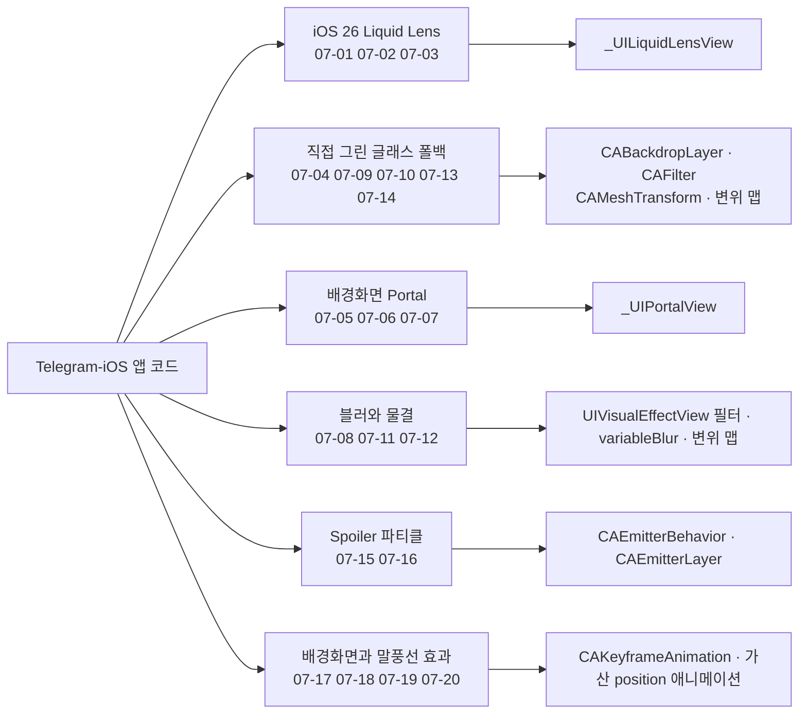
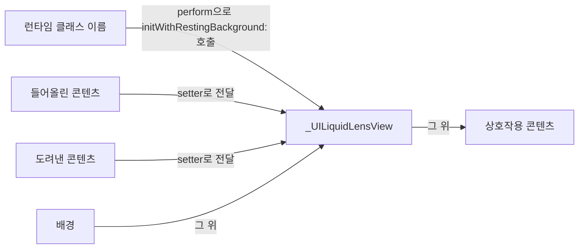
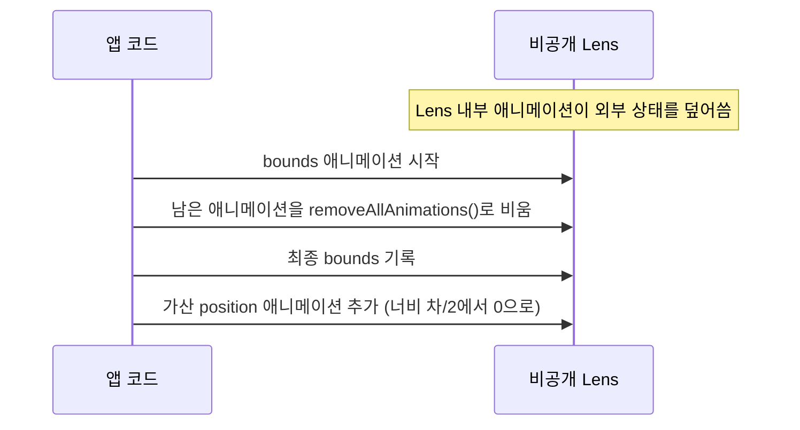
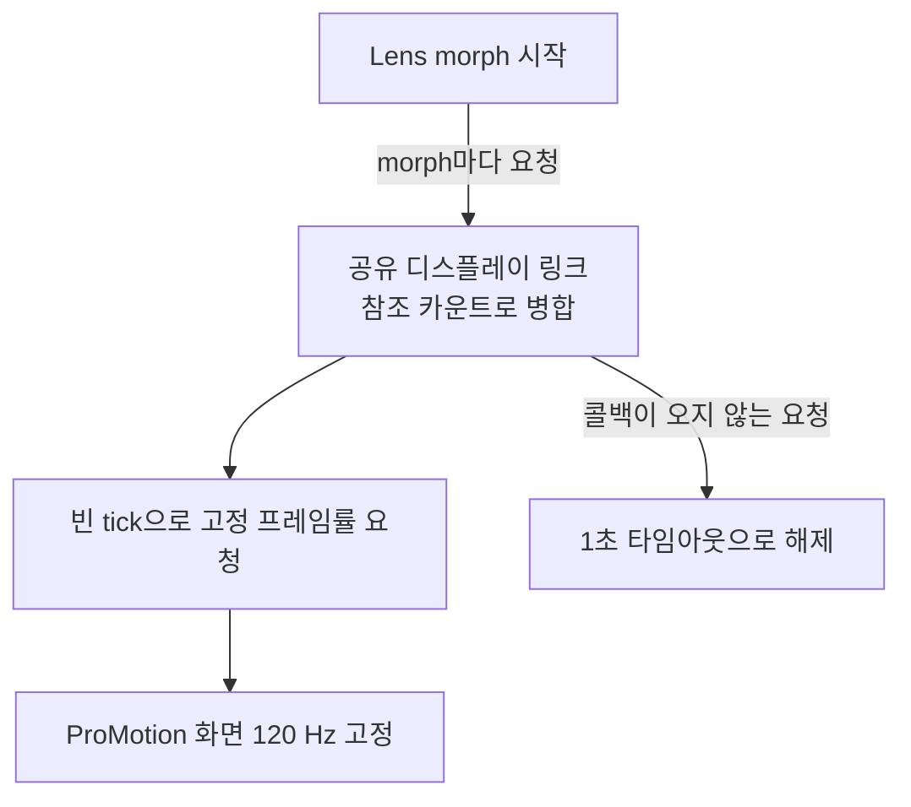
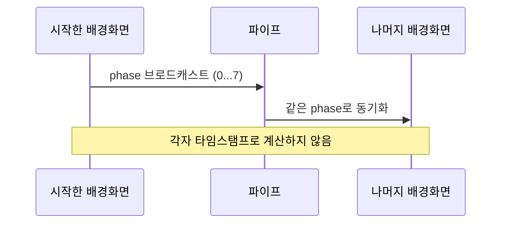

# 시각 효과와 글래스

웹: /docs/ios/07-visual-effects-glass/ · Markdown: /docs/ios/07-visual-effects-glass.md

> 비공개 Liquid Lens, CABackdropLayer, 가변 블러.

| 기법 항목 | 리포트 선정 | 관련 비공개 API | REA 연관 |
| --- | --- | --- | --- |
| 20 | 5 | 18 | 0 |

소스: [TelegramMessenger/Telegram-iOS@f1dd7a2d](https://github.com/TelegramMessenger/Telegram-iOS/tree/f1dd7a2dbd02cbbf513e75d5695d8d36d1cf5838)(2026-10-07) · 플랫폼: iOS · UIKit

이 장의 선정 항목:
- 07-1 [#07-01 iOS 26의 비공개 Liquid Lens를 직접 구동하기](/docs/ios/07-visual-effects-glass/#t07-01)
- 07-2 [#07-02 비공개 Lens에 바운스 갱신과 위치 애니메이션 보완하기](/docs/ios/07-visual-effects-glass/#t07-02)
- 07-3 [#07-03 비공개 Lens 애니메이션 중 120 Hz 강제하기](/docs/ios/07-visual-effects-glass/#t07-03)
- 07-4 [#07-09 `CABackdropLayer`와 컬러 매트릭스로 구버전 글래스를 직접 만들기](/docs/ios/07-visual-effects-glass/#t07-09)
- 07-5 [#07-10 비공개 `CAMeshTransform`으로 backdrop 가장자리를 글래스처럼 굴절시키기](/docs/ios/07-visual-effects-glass/#t07-10)

범위: Telegram-iOS의 비공개 Core Animation 시각 효과, Liquid Glass, 배경화면이 비치는 말풍선, 파티클 마스크, 그라데이션 배경화면, 가장자리 블러.

**결론: 이 버전은 비공개 CA(Core Animation) 파이프라인을 폴백할 수 있는 기능으로 감쌌어요.**

- iOS 26에서는 비공개 Liquid Lens를 먼저 써요.
- 구형 시스템에서는 글래스를 직접 그리고 비공개 backdrop을 써요.
- `_UIPortalView`로 채팅 말풍선이 같은 배경화면을 비추게 하기도 해요.

아래는 의외성과 엔지니어링 가치 순으로 정렬했어요.

아래 도표는 이 장의 기법들이 어떤 효과 묶음과 비공개 구성요소에 손을 대는지 보여 줘요.



## 1. iOS 26의 비공개 Liquid Lens를 직접 구동하기 [#t07-01]

> #07-01 · Telegram-iOS · UIKit · 리포트 선정 07-1 · 검증 방식: 소스 분석 · 태그: 비공개 API, 런타임 해킹
>
> 소스: [Telegram-iOS:submodules/TelegramUI/Components/LiquidLens/Sources/LiquidLensView.swift L198–L257](https://github.com/TelegramMessenger/Telegram-iOS/blob/f1dd7a2dbd02cbbf513e75d5695d8d36d1cf5838/submodules/TelegramUI/Components/LiquidLens/Sources/LiquidLensView.swift#L198-L257)

**무엇을 했나요**: Liquid Lens(배경 굴절과 콘텐츠 도려내기를 함께 처리하는 iOS 26의 비공개 뷰 `_UILiquidLensView`)를 이렇게 구동해요.

1. 런타임 클래스 이름으로 `_UILiquidLensView`를 만들어요.
2. 들어올린 콘텐츠와 도려낸 콘텐츠를 비공개 Lens에 넘겨요.
3. Lens는 배경과 상호작용 콘텐츠 사이에 놓아요.

**왜 이렇게 했나요**: 일반 `UIVisualEffectView`에는 시스템 Lens의 들어올림 변형이 없어요. 비공개 Lens는 배경 굴절과 콘텐츠 도려내기를 함께 처리할 수 있어요.

아래 도표는 비공개 Lens가 만들어지고 다른 뷰 사이에 놓이는 구성을 보여 줘요.



**핵심 코드 발췌**

```swift title="LiquidLensView.swift · L198–L257"
if #available(iOS 26.0, *) {
    if let viewClass = NSClassFromString("_UILiquidLensView") as AnyObject as? NSObjectProtocol {
        let allocSelector = NSSelectorFromString("alloc")
        let initSelector = NSSelectorFromString("initWithRestingBackground:")
        let objcAlloc = viewClass.perform(allocSelector).takeUnretainedValue()
        let instance = objcAlloc.perform(initSelector, with: UIView()).takeUnretainedValue()
        self.lensView = instance as? UIView
    }
}

if let lensView = self.lensView {
    lensView.layer.zPosition = 10.0
    self.liftedContainerView.addSubview(self.restingBackgroundView)
    self.containerView.addSubview(self.liftedContainerView)
    self.containerView.addSubview(lensView)
    self.containerView.addSubview(self.contentView)
    lensView.perform(NSSelectorFromString("setLiftedContentView:"), with: self.liftedContainerView)
    lensView.perform(NSSelectorFromString("setOverridePunchoutView:"), with: self.contentView)
}
```

**대가와 위험**:

- 비공개 클래스와 비공개 selector를 써요.
- 심사 위험이 매우 높아요.
- 앞으로 시스템이 ABI(바이너리 수준의 함수 호출 규약)를 없애거나 바꿀 수 있어요.

**증거 체인 #07-01**(iOS 바이너리 미검증)

- 소스 분석: Telegram-iOS 고정 커밋에서 한 줄씩 확인했고, 소스 위치는 총 1곳이에요.
- 리포트 요약(구현 방법): `perform`으로 비공개 `initWithRestingBackground:`와 setter를 불러요.
- 바이너리 검증: 하지 않았어요. App Store 배포 IPA는 FairPlay로 암호화되어 있어서 복호화된 실행 파일을 합법적으로 얻을 수 없어요.

## 2. 비공개 Lens에 바운스 갱신과 위치 애니메이션 보완하기 [#t07-02]

> #07-02 · Telegram-iOS · UIKit · 리포트 선정 07-2 · 검증 방식: 소스 분석 · 태그: 비공개 API
>
> 소스: [Telegram-iOS:submodules/TelegramUI/Components/LiquidLens/Sources/LiquidLensView.swift L375–L415](https://github.com/TelegramMessenger/Telegram-iOS/blob/f1dd7a2dbd02cbbf513e75d5695d8d36d1cf5838/submodules/TelegramUI/Components/LiquidLens/Sources/LiquidLensView.swift#L375-L415)
>
> 소스: [Telegram-iOS:submodules/TelegramUI/Components/LiquidLens/Sources/LiquidLensView.swift L490–L502](https://github.com/TelegramMessenger/Telegram-iOS/blob/f1dd7a2dbd02cbbf513e75d5695d8d36d1cf5838/submodules/TelegramUI/Components/LiquidLens/Sources/LiquidLensView.swift#L490-L502)

**무엇을 했나요**: 바운스 갱신 때 이 순서로 처리해요.

1. bounds 애니메이션을 시작해요.
2. 비공개 Lens에 남은 애니메이션을 비워요.
3. 최종 bounds를 기록해요.
4. 너비 변화에 따라 달라지는 가산 position 애니메이션(현재 값에 더해지는 위치 애니메이션)을 하나 더 추가해요.

**왜 이렇게 했나요**: Lens 내부 애니메이션이 외부 상태를 덮어써요. 코드 주석은 이 위치 보정이 필요하다고 분명히 적어 두었어요. 이 보정이 필요한 근본 원인은 소스에 “알 수 없음”으로 적혀 있어요.

아래 도표는 바운스 갱신 때 Lens의 애니메이션을 정리하고 위치를 보완하는 순서를 보여 줘요.



**핵심 코드 발췌**

```swift title="LiquidLensView.swift · L375–L415 등 2곳"
let liftedInset: CGFloat = params.isLifted ? params.liftedInset : (-params.inset)
let lensBounds = CGRect(origin: CGPoint(), size: CGSize(
    width: params.baseFrame.width + liftedInset * 2.0,
    height: params.baseFrame.height + liftedInset * 2.0
))
let lensCenter = CGPoint(x: params.baseFrame.midX, y: params.baseFrame.midY)
let previousBounds: CGRect = lensView.bounds
transition.animateView {
    lensView.bounds = lensBounds
}
if let info = transition.userData(TransitionInfo.self), info.disableAnimationWorkarounds {
} else {
    lensView.layer.removeAllAnimations()
    lensView.bounds = lensBounds
}
transition.setPosition(view: lensView, position: lensCenter, completion: { [weak self] flag in
    guard let self, flag else { return }
    if !self.isApplyingLensParams { self.isAnimating = false }
})
transition.animatePosition(
    layer: lensView.layer,
    from: CGPoint(x: (lensBounds.width - previousBounds.width) * 0.5, y: 0.0),
    to: CGPoint(), additive: true
)
```

**대가와 위험**:

- 문서로 정리되지 않은 애니메이션 타이밍에 기대고 있어요.
- `removeAllAnimations()`가 시스템이 새로 추가한 애니메이션을 끊을 수 있어요.
- 보정 공식은 실기기에서 회귀 테스트를 계속 해야 해요.

**증거 체인 #07-02**(iOS 바이너리 미검증)

- 소스 분석: Telegram-iOS 고정 커밋에서 한 줄씩 확인했고, 소스 위치는 총 2곳이에요.
- 리포트 요약(구현 방법): 전후 크기를 기록하고 `animatePosition`이 “너비 차/2”에서 0으로 돌아오게 해요.
- 바이너리 검증: 하지 않았어요. App Store 배포 IPA는 FairPlay로 암호화되어 있어서 복호화된 실행 파일을 합법적으로 얻을 수 없어요.

## 3. 비공개 Lens 애니메이션 중 120 Hz 강제하기 [#t07-03]

> #07-03 · Telegram-iOS · UIKit · 리포트 선정 07-3 · 검증 방식: 소스 분석 · 태그: 비공개 API
>
> 소스: [Telegram-iOS:submodules/TelegramUI/Components/LensTransition/Sources/LiquidMorphTransition.swift L75–L145](https://github.com/TelegramMessenger/Telegram-iOS/blob/f1dd7a2dbd02cbbf513e75d5695d8d36d1cf5838/submodules/TelegramUI/Components/LensTransition/Sources/LiquidMorphTransition.swift#L75-L145)

**무엇을 했나요**: Lens morph 동안 120 Hz를 유지하는 방법은 이래요.

- morph마다 공유 디스플레이 링크(화면 갱신 주기에 맞춰 콜백을 부르는 타이머)를 요청해요.
- ProMotion(고주사율 화면 기술)을 지원하는 화면을 120 Hz로 고정해요.
- 참조 카운트로 동시에 진행되는 morph를 하나로 합쳐요.
- 콜백이 오지 않는 요청은 1초 타임아웃으로 풀어 줘요.

**왜 이렇게 했나요**: 소스 주석에는 시스템 morph가 약 80 Hz로 떨어진다고 적혀 있어요. 빈 tick이 디스플레이 링크가 고정 프레임률을 계속 요청하게 만들어요. 일반 애니메이션에서 범위 하한만 지정하면 시스템이 스로틀링할 수 있어요.

아래 도표는 Lens morph 동안 공유 디스플레이 링크로 120 Hz를 유지하는 흐름을 보여 줘요.



**핵심 코드 발췌**

```swift title="LiquidMorphTransition.swift · L75–L145"
private static let maximumDuration: Double = 1.0

static let shared = LiquidMorphFrameRateBoost()
private var displayLink: CADisplayLink?
private var count = 0

func claim(screen: UIScreen?) -> Claim {
    assert(Thread.isMainThread)
    self.count += 1
    if self.displayLink == nil, let screen, screen.maximumFramesPerSecond >= 120 {
        let displayLink = CADisplayLink(target: Target(), selector: #selector(Target.tick))
        displayLink.preferredFrameRateRange = CAFrameRateRange(
            minimum: 120.0, maximum: 120.0, preferred: 120.0
        )
        displayLink.add(to: .main, forMode: .common)
        self.displayLink = displayLink
    }
    let claim = Claim()
    DispatchQueue.main.asyncAfter(deadline: .now() + Self.maximumDuration) {
        claim.end()
    }
    return claim
}
```

**대가와 위험**:

- 120 Hz로 고정하면 전력 소모가 늘어요.
- 타임아웃 값은 관측으로 얻은 값이라 앞으로 나올 시스템에는 맞지 않을 수 있어요.
- iOS 26 이상이면서 고주사율 화면일 때만 적용돼요.

**증거 체인 #07-03**(iOS 바이너리 미검증)

- 소스 분석: Telegram-iOS 고정 커밋에서 한 줄씩 확인했고, 소스 위치는 총 1곳이에요.
- 리포트 요약(구현 방법): `.common` 모드로 RunLoop에 추가하고 1초 타임아웃을 최후 대비책(폴백)으로 둬요.
- 바이너리 검증: 하지 않았어요. App Store 배포 IPA는 FairPlay로 암호화되어 있어서 복호화된 실행 파일을 합법적으로 얻을 수 없어요.

## 4. 비공개 Lens가 없을 때 휘도→Alpha 변환으로 도려낸 글래스 흉내 내기 [#t07-04]

> #07-04 · Telegram-iOS · UIKit · 검증 방식: 소스 분석 · 태그: 비공개 API, Core Animation
>
> 소스: [Telegram-iOS:submodules/TelegramUI/Components/LiquidLens/Sources/LiquidLensView.swift L267–L296](https://github.com/TelegramMessenger/Telegram-iOS/blob/f1dd7a2dbd02cbbf513e75d5695d8d36d1cf5838/submodules/TelegramUI/Components/LiquidLens/Sources/LiquidLensView.swift#L267-L296)
>
> 소스: [Telegram-iOS:submodules/TelegramUI/Components/LiquidLens/Sources/LiquidLensView.swift L470–L488](https://github.com/TelegramMessenger/Telegram-iOS/blob/f1dd7a2dbd02cbbf513e75d5695d8d36d1cf5838/submodules/TelegramUI/Components/LiquidLens/Sources/LiquidLensView.swift#L470-L488)

**무엇을 했나요**: 도려낸 글래스를 이렇게 흉내 내요.

- 흰색 컨테이너를 콘텐츠 mask로 써요.
- mask에 비공개 `luminanceToAlpha` 필터(밝기를 투명도로 바꾸는 필터)를 추가해요.
- 늘일 수 있는 둥근 캡슐 이미지로 도려낼 영역을 조절해요.

**왜 이렇게 했나요**: 구형 시스템에는 `_UILiquidLensView`가 없어요. 일반 사각형 클리핑으로는 투시 구멍을 만들 수 없어요. 휘도→Alpha 변환을 쓰면 검은 blob이 콘텐츠를 곧바로 지울 수 있어요.

**핵심 코드 발췌**

```swift title="LiquidLensView.swift · L267–L296 등 2곳"
let legacySelectionView = GlassBackgroundView.ContentImageView()
self.legacySelectionView = legacySelectionView
if let backgroundView = self.backgroundView {
    backgroundView.contentView.insertSubview(legacySelectionView, at: 0)
} else {
    self.containerView.insertSubview(legacySelectionView, at: 0)
}

let legacyContentMaskView = UIView()
legacyContentMaskView.backgroundColor = .white
self.legacyContentMaskView = legacyContentMaskView
self.contentView.mask = legacyContentMaskView
if let filter = CALayer.luminanceToAlpha() {
    legacyContentMaskView.layer.filters = [filter]
}

let legacyContentMaskBlobView = UIImageView()
self.legacyContentMaskBlobView = legacyContentMaskBlobView
legacyContentMaskView.addSubview(legacyContentMaskBlobView)
```

**대가와 위험**:

- `CAFilter`는 비공개 API예요.
- 폴백 효과에는 실제 굴절이 없어요.
- 레이어 mask가 오프스크린 렌더링을 일으킬 수 있어요.

**증거 체인 #07-04**(iOS 바이너리 미검증)

- 소스 분석: Telegram-iOS 고정 커밋에서 한 줄씩 확인했고, 소스 위치는 총 2곳이에요.
- 바이너리 검증: 하지 않았어요. App Store 배포 IPA는 FairPlay로 암호화되어 있어서 복호화된 실행 파일을 합법적으로 얻을 수 없어요.

## 5. 스크린샷 대신 `_UIPortalView`로 원격 뷰 복제하기 [#t07-05]

> #07-05 · Telegram-iOS · UIKit · 검증 방식: 소스 분석 · 태그: 비공개 API, 런타임 해킹, 텍스트와 입력
>
> 소스: [Telegram-iOS:submodules/UIKitRuntimeUtils/Source/UIKitRuntimeUtils/UIKitUtils.m L211–L235](https://github.com/TelegramMessenger/Telegram-iOS/blob/f1dd7a2dbd02cbbf513e75d5695d8d36d1cf5838/submodules/UIKitRuntimeUtils/Source/UIKitRuntimeUtils/UIKitUtils.m#L211-L235)

**무엇을 했나요**: `_UIPortalView`(같은 렌더링 소스를 다른 계층에 보여 주는 비공개 뷰)를 이렇게 써요.

1. 런타임에 `_UIPortalView`를 찾아 인스턴스를 만들어요.
2. 소스 뷰의 위치와 변환을 동기화해요.
3. 히트 테스트(터치가 닿은 뷰를 가리는 판정) 전달과 portal 히트 테스트를 꺼요.

**왜 이렇게 했나요**: 스크린샷이나 `contentsRect`는 원본 배경화면과 동기화되어 갱신되지 않아요. Portal은 같은 렌더링 소스를 다른 계층에 보여 줘요. 그래서 프레임마다 콘텐츠를 반대로 평행 이동할 필요가 없어요.

**핵심 코드 발췌**

```objc title="UIKitUtils.m · L211–L235"
static Class portalViewClass = nil;
static dispatch_once_t onceToken;
dispatch_once(&onceToken, ^{
    portalViewClass = NSClassFromString([@[@"_", @"UI", @"Portal", @"View"] componentsJoinedByString:@""]);
});
if (!portalViewClass) {
    return nil;
}
UIView<UIKitPortalViewProtocol> *view = [[portalViewClass alloc] init];
if (!view) {
    return nil;
}
if (@available(iOS 14.0, *)) {
    view.forwardsClientHitTestingToSourceView = false;
}
view.matchesPosition = matchPosition;
view.matchesTransform = matchPosition;
view.matchesAlpha = false;
if (@available(iOS 14.0, *)) {
    view.allowsHitTesting = false;
}
```

**대가와 위험**:

- `_UIPortalView`는 비공개 UIKit 클래스예요.
- 클래스 이름은 배열을 이어 붙여서 숨겨 놓았어요. 난독화를 풀면 `_UIPortalView`예요. 이어 붙인 텍스트로 이 이름을 직접 확인할 수 있어요.
- 심사 위험이 매우 높아요.

**증거 체인 #07-05**(iOS 바이너리 미검증)

- 소스 분석: Telegram-iOS 고정 커밋에서 한 줄씩 확인했고, 소스 위치는 총 1곳이에요.
- 바이너리 검증: 하지 않았어요. App Store 배포 IPA는 FairPlay로 암호화되어 있어서 복호화된 실행 파일을 합법적으로 얻을 수 없어요.

## 6. Portal 재바인딩 후 원래 위치에 다시 삽입해 렌더링 갱신 강제하기 [#t07-06]

> #07-06 · Telegram-iOS · UIKit · 검증 방식: 소스 분석 · 태그: 비공개 API, Core Animation
>
> 소스: [Telegram-iOS:submodules/Display/Source/PortalView.swift L15–L28](https://github.com/TelegramMessenger/Telegram-iOS/blob/f1dd7a2dbd02cbbf513e75d5695d8d36d1cf5838/submodules/Display/Source/PortalView.swift#L15-L28)

**무엇을 했나요**: UIView와 순수 CALayer, 두 가지 호스트를 모두 처리하면서 이 순서로 해요.

1. `sourceView`를 다시 설정해요.
2. portal을 원래 인덱스에 다시 삽입해요.

**왜 이렇게 했나요**: 비공개 `sourceView`만 바꿔서는 portal 재구성이 일어나지 않을 수 있어요. 제자리에 다시 삽입하면 z-order(겹침 순서)가 바뀌지 않아요. 그러면서도 UIKit이나 CA가 소스를 다시 연결하도록 강제할 수 있어요.

**핵심 코드 발췌**

```swift title="PortalView.swift · L15–L28"
func reloadPortal(sourceView: PortalSourceView) {
    self.view.sourceView = sourceView
    self.sourceView = sourceView

    if let portalSuperview = self.view.superview,
       let index = portalSuperview.subviews.firstIndex(of: self.view) {
        portalSuperview.insertSubview(self.view, at: index)
    } else if let portalSuperlayer = self.view.layer.superlayer,
              let index = portalSuperlayer.sublayers?.firstIndex(of: self.view.layer) {
        portalSuperlayer.insertSublayer(self.view.layer, at: UInt32(index))
    }
}

func disablePortal() {
    self.view.sourceView = nil
    self.sourceView = nil
}
```

**대가와 위험**: 비공개 portal이 무효화되는 방식에 기대고 있어요.
다시 삽입하면 호스트의 계층 애니메이션과 충돌할 수 있어요.

**증거 체인 #07-06**(iOS 바이너리 미검증)

- 소스 분석: Telegram-iOS 고정 커밋에서 한 줄씩 확인했고, 소스 위치는 총 1곳이에요.
- 바이너리 검증: 하지 않았어요. App Store 배포 IPA는 FairPlay로 암호화되어 있어서 복호화된 실행 파일을 합법적으로 얻을 수 없어요.

## 7. 채팅 말풍선이 같은 동적 배경화면을 진짜로 “비춰” 보이기 [#t07-07]

> #07-07 · Telegram-iOS · UIKit · 검증 방식: 소스 분석 · 태그: 비공개 API
>
> 소스: [Telegram-iOS:submodules/WallpaperBackgroundNode/Sources/WallpaperBackgroundNode.swift L1988–L2023](https://github.com/TelegramMessenger/Telegram-iOS/blob/f1dd7a2dbd02cbbf513e75d5695d8d36d1cf5838/submodules/WallpaperBackgroundNode/Sources/WallpaperBackgroundNode.swift#L1988-L2023)

**무엇을 했나요**: 말풍선마다 배경화면을 다시 그리지 않아요.

- 말풍선 유형마다 고유한 배경화면 portal 소스가 있어요.
- 말풍선 노드는 같은 소스의 `PortalView`만 보여 줘요.

**왜 이렇게 했나요**: 기존 `contentsRect` 방식은 스크롤 반대 방향의 변위를 직접 관리해야 했어요. 소스 주석에 따르면 `contentsRect` 방식은 배경화면 전체를 말풍선 안에 밀어 넣어요. Portal을 쓰면 스크롤, 애니메이션, 배경화면 좌표가 자연스럽게 맞아요.

**핵심 코드 발췌**

```swift title="WallpaperBackgroundNode.swift · L1988–L2023"
let sourceView: PortalSourceView?
switch type {
case .free:
    sourceView = self.freeBackgroundPortalSourceView
case .incoming:
    sourceView = self.incomingBackgroundPortalSourceView
case .outgoing:
    sourceView = self.outgoingBackgroundPortalSourceView
}

guard let sourceView, let portalView = PortalView(matchPosition: true) else {
    return nil
}
sourceView.addPortal(view: portalView)
return WallpaperBackgroundNodeImpl.BubbleBackgroundPortalNodeImpl(
    portalView: portalView
)
```

**대가와 위험**: `_UIPortalView`에 기대고 있어요.
비공개 클래스가 없으면 평평한 테마 말풍선으로 되돌아가요.

**증거 체인 #07-07**(iOS 바이너리 미검증)

- 소스 분석: Telegram-iOS 고정 커밋에서 한 줄씩 확인했고, 소스 위치는 총 1곳이에요.
- 바이너리 검증: 하지 않았어요. App Store 배포 IPA는 FairPlay로 암호화되어 있어서 복호화된 실행 파일을 합법적으로 얻을 수 없어요.

## 8. `UIVisualEffectView` 내부 필터를 분해해 제어 가능한 내비게이션 블러 얻기 [#t07-08]

> #07-08 · Telegram-iOS · UIKit · 검증 방식: 소스 분석 · 태그: 비공개 API, Core Animation
>
> 소스: [Telegram-iOS:submodules/Display/Source/NavigationBackgroundView.swift L62–L108](https://github.com/TelegramMessenger/Telegram-iOS/blob/f1dd7a2dbd02cbbf513e75d5695d8d36d1cf5838/submodules/Display/Source/NavigationBackgroundView.swift#L62-L108)

**무엇을 했나요**: 이 순서로 내부 필터를 분해해요.

1. 공개 `UIVisualEffectView`에서 시스템 내부 레이어를 꺼내요.
2. 내부 시각 서브뷰를 숨겨요.
3. `gaussianBlur`와 선택적인 `colorSaturate`만 남겨요.

**왜 이렇게 했나요**: 표준 효과에는 시스템이 정한 색 덧입히기와 머티리얼 레이어가 들어 있어요. 내비게이션 바에는 배경 샘플링, 블러, 채도만 있으면 돼요. 이 방식은 접근성 “투명도 감소” 폴백도 그대로 지켜요.

**핵심 코드 발췌**

```swift title="NavigationBackgroundView.swift · L62–L108"
if self.enableBlur && !sharedIsReduceTransparencyEnabled
    && ((self._color.alpha > .ulpOfOne && self._color.alpha < 0.95) || forceKeepBlur) {
    if self.effectView == nil {
        let effectView = UIVisualEffectView(effect: UIBlurEffect(style: .light))
        for subview in effectView.subviews {
            if subview.description.contains("VisualEffectSubview") {
                subview.isHidden = true
            }
        }
        if let sublayer = effectView.layer.sublayers?[0], let filters = sublayer.filters {
            sublayer.backgroundColor = nil
            sublayer.isOpaque = false
            var allowedKeys: [String] = ["gaussianBlur"]
            if self.enableSaturation { allowedKeys.append("colorSaturate") }
            sublayer.filters = filters.filter { filter in
                let filterName = String(describing: filter)
                return allowedKeys.contains(filterName)
            }
        }
    }
}
```

**대가와 위험**:

- 내부 서브뷰 설명과 layer 순서에 기대고 있어요.
- `filters`는 비공개 CA 속성이에요.
- 앞으로 시스템이 효과 구조를 바꾸면 이 구현이 깨져요.

**증거 체인 #07-08**(iOS 바이너리 미검증)

- 소스 분석: Telegram-iOS 고정 커밋에서 한 줄씩 확인했고, 소스 위치는 총 1곳이에요.
- 바이너리 검증: 하지 않았어요. App Store 배포 IPA는 FairPlay로 암호화되어 있어서 복호화된 실행 파일을 합법적으로 얻을 수 없어요.

## 9. `CABackdropLayer`와 컬러 매트릭스로 구버전 글래스를 직접 만들기 [#t07-09]

> #07-09 · Telegram-iOS · UIKit · 리포트 선정 07-4 · 검증 방식: 소스 분석 · 태그: 비공개 API, Core Animation
>
> 소스: [Telegram-iOS:submodules/TelegramUI/Components/GlassBackgroundComponent/Sources/LegacyGlassView.swift L7–L13](https://github.com/TelegramMessenger/Telegram-iOS/blob/f1dd7a2dbd02cbbf513e75d5695d8d36d1cf5838/submodules/TelegramUI/Components/GlassBackgroundComponent/Sources/LegacyGlassView.swift#L7-L13)
>
> 소스: [Telegram-iOS:submodules/TelegramUI/Components/GlassBackgroundComponent/Sources/LegacyGlassView.swift L145–L172](https://github.com/TelegramMessenger/Telegram-iOS/blob/f1dd7a2dbd02cbbf513e75d5695d8d36d1cf5838/submodules/TelegramUI/Components/GlassBackgroundComponent/Sources/LegacyGlassView.swift#L145-L172)

**무엇을 했나요**: 비공개 `CABackdropLayer`를 만들어 이 순서로 적용해요.

1. backdrop-aware 컬러 매트릭스(색을 변환하는 행렬 필터)를 적용해요.
2. 작은 반경의 가우시안 블러를 적용해요.

**왜 이렇게 했나요**: `CABackdropLayer`는 뒤쪽에 이미 합성된 화면을 직접 샘플링해요. 컬러 매트릭스는 공개 blur보다 강한 글래스 색조를 만들어요. 네이티브 Liquid Glass를 쓸 수 없을 때 쓰는 전통적인 폴백이에요.

**핵심 코드 발췌**

```swift title="LegacyGlassView.swift · L7–L13 등 2곳"
private let backdropLayerClass: NSObject? = {
    let name = ("CA" as NSString).appendingFormat("BackdropLayer")
    if let cls = NSClassFromString(name as String) as AnyObject as? NSObject {
        return cls
    }
    return nil
}()

if let blurFilter = CALayer.blur(), let colorMatrixFilter = CALayer.colorMatrix() {
    blurFilter.setValue(2.0 as NSNumber, forKey: "inputRadius")
    var matrix: [Float32] = [
        2.6705, -1.1087999, -0.1117, 0.0, 0.049999997,
        -0.3295, 1.8914, -0.111899994, 0.0, 0.049999997,
        -0.3297, -1.1084, 2.8881, 0.0, 0.049999997,
        0.0, 0.0, 0.0, 1.0, 0.0
    ]
    colorMatrixFilter.setValue(NSValue(bytes: &matrix,
        objCType: "{CAColorMatrix=ffffffffffffffffffff}"), forKey: "inputColorMatrix")
    colorMatrixFilter.setValue(true as NSNumber, forKey: "inputBackdropAware")
    backdropLayer.filters = [colorMatrixFilter, blurFilter]
}
```

**대가와 위험**:

- `CABackdropLayer`, `CAFilter`, KVC는 모두 비공개 API를 쓰는 거예요.
- 클래스 이름은 문자열을 이어 붙여서 숨겨 놓았어요. 난독화를 풀면 `CABackdropLayer`예요. `"CA" + "BackdropLayer"`로 이 이름을 직접 확인할 수 있어요.
- 심사 위험이 매우 높아요.

**증거 체인 #07-09**(iOS 바이너리 미검증)

- 소스 분석: Telegram-iOS 고정 커밋에서 한 줄씩 확인했고, 소스 위치는 총 2곳이에요.
- 리포트 요약(구현 방법): `NSClassFromString("CABackdropLayer")`와 `CAFilter` 체인.
- 바이너리 검증: 하지 않았어요. App Store 배포 IPA는 FairPlay로 암호화되어 있어서 복호화된 실행 파일을 합법적으로 얻을 수 없어요.

## 10. 비공개 `CAMeshTransform`으로 backdrop 가장자리를 글래스처럼 굴절시키기 [#t07-10]

> #07-10 · Telegram-iOS · UIKit · 리포트 선정 07-5 · 검증 방식: 소스 분석 · 태그: 비공개 API
>
> 소스: [Telegram-iOS:submodules/TelegramUI/Components/GlassBackgroundComponent/Sources/LegacyGlassView.swift L198–L230](https://github.com/TelegramMessenger/Telegram-iOS/blob/f1dd7a2dbd02cbbf513e75d5695d8d36d1cf5838/submodules/TelegramUI/Components/GlassBackgroundComponent/Sources/LegacyGlassView.swift#L198-L230)
>
> 소스: [Telegram-iOS:submodules/TelegramUI/Components/MeshTransform/Sources/MeshTransform.swift L132–L148](https://github.com/TelegramMessenger/Telegram-iOS/blob/f1dd7a2dbd02cbbf513e75d5695d8d36d1cf5838/submodules/TelegramUI/Components/MeshTransform/Sources/MeshTransform.swift#L132-L148)

**무엇을 했나요**: 이 순서로 굴절을 흉내 내요.

1. 둥근 사각형에 맞는 변위 메시(격자 점을 옮겨 화면을 비트는 메시)를 만들어요.
2. 이 메시를 backdrop(`CABackdropLayer`)의 비공개 `meshTransform` 키에 기록해요.
3. 크기가 바뀔 때는 이전 메시와 새 메시를 명시적으로 보간해요.

**왜 이렇게 했나요**: 일반 둥근 모서리 클리핑은 배경 샘플링 지점을 움직이지 못해요. 메시는 가장자리에서 backdrop을 어긋나게 해서 굴절을 흉내 낼 수 있어요. 명시적인 메시 애니메이션은 형태가 갑자기 바뀌는 것을 막아 줘요.

**핵심 코드 발췌**

```swift title="LegacyGlassView.swift · L198–L230 등 2곳"
let meshTransform = MeshTransform.roundedRect(
    width: size.width,
    height: size.height,
    cornerRadius: cornerRadius,
    displacementMagnitudeU: displacementMagnitudeU,
    displacementMagnitudeV: displacementMagnitudeV,
    outerEdgeDistance: outerEdgeDistance
).mesh.makeValue()

if let meshTransform {
    if !transition.animation.isImmediate,
       let previousTransform = backdropLayer.value(forKey: "meshTransform") as? NSObject {
        backdropLayer.removeAnimation(forKey: "meshTransform")
        backdropLayer.setValue(meshTransform, forKey: "meshTransform")
        transition.animateMeshTransform(
            layer: backdropLayer, from: previousTransform, to: meshTransform
        )
    } else {
        backdropLayer.setValue(meshTransform, forKey: "meshTransform")
    }
}
```

**대가와 위험**:

- `meshTransform`은 비공개 속성이에요.
- 구현이 비공개 `CAMeshTransform`에 기대고 있어요.
- 메시 토폴로지가 바뀌면 보간이 무효가 돼요.

**증거 체인 #07-10**(iOS 바이너리 미검증)

- 소스 분석: Telegram-iOS 고정 커밋에서 한 줄씩 확인했고, 소스 위치는 총 2곳이에요.
- 리포트 요약(구현 방법): 변위 메시 `roundedRect`를 구성하고 전후 메시를 애니메이션해요.
- 바이너리 검증: 하지 않았어요. App Store 배포 IPA는 FairPlay로 암호화되어 있어서 복호화된 실행 파일을 합법적으로 얻을 수 없어요.

## 11. 가변 블러 반경을 너비 1픽셀짜리 mask에 인코딩하기 [#t07-11]

> #07-11 · Telegram-iOS · UIKit · 검증 방식: 소스 분석 · 태그: 비공개 API
>
> 소스: [Telegram-iOS:submodules/TelegramUI/Components/EdgeEffect/Sources/EdgeEffect.swift L693–L698](https://github.com/TelegramMessenger/Telegram-iOS/blob/f1dd7a2dbd02cbbf513e75d5695d8d36d1cf5838/submodules/TelegramUI/Components/EdgeEffect/Sources/EdgeEffect.swift#L693-L698)
>
> 소스: [Telegram-iOS:submodules/TelegramUI/Components/EdgeEffect/Sources/EdgeEffect.swift L709–L732](https://github.com/TelegramMessenger/Telegram-iOS/blob/f1dd7a2dbd02cbbf513e75d5695d8d36d1cf5838/submodules/TelegramUI/Components/EdgeEffect/Sources/EdgeEffect.swift#L709-L732)

**무엇을 했나요**: 이 순서로 가변 블러 반경을 mask에 담아요.

1. 너비 1픽셀의 흑백 그라데이션 이미지를 만들어요.
2. 이 이미지를 늘려 아무 너비나 덮어요.
3. 이미지를 비공개 `variableBlur`(위치마다 반경이 다른 블러)의 `inputMaskImage`로 써요.

**왜 이렇게 했나요**: 가변 블러는 수직 방향으로만 변해요. 너비 1픽셀 템플릿을 쓰면 큰 비트맵 전체를 만들지 않아도 돼요. 공개 `UIBlurEffect`는 mask로 국소 반경을 지정할 수 없어요.

**핵심 코드 발췌**

```swift title="EdgeEffect.swift · L693–L698 등 2곳"
if let cgImage = image?.cgImage {
    variableBlur.setValue(cgImage, forKey: "inputMaskImage")
}
self.layer.filters = [variableBlur]

let baseHeight = max(1.0, params.gradient.height + inwardsExtension)
let resizingInverted = params.placement.position != .bottom
self.gradientImage = generateImage(CGSize(width: 1.0, height: baseHeight), opaque: false,
    rotatedContext: { size, context in
        let gradientColors = [
            UIColor.white.withAlphaComponent(1.0).cgColor,
            UIColor.white.withAlphaComponent(0.0).cgColor
        ] as CFArray
        let gradient = CGGradient(colorsSpace: CGColorSpaceCreateDeviceRGB(),
            colors: gradientColors, locations: [0.0, 1.0])!
        context.drawLinearGradient(gradient, start: .zero,
            end: CGPoint(x: 0.0, y: size.height), options: [])
    }
)?.resizableImage(withCapInsets: UIEdgeInsets(bottom: baseHeight), resizingMode: .stretch)
```

**대가와 위험**:

- `variableBlur`와 `inputMaskImage`는 비공개 API예요.
- 그라데이션 방향과 밝기 의미가 시스템 필터와 맞아야 해요.
- 이 레이어는 오프스크린 합성을 늘릴 수도 있어요.

**증거 체인 #07-11**(iOS 바이너리 미검증)

- 소스 분석: Telegram-iOS 고정 커밋에서 한 줄씩 확인했고, 소스 위치는 총 2곳이에요.
- 바이너리 검증: 하지 않았어요. App Store 배포 IPA는 FairPlay로 암호화되어 있어서 복호화된 실행 파일을 합법적으로 얻을 수 없어요.

## 12. 물결은 변위 맵을 우선 쓰고, 없으면 메시 변형으로 폴백하기 [#t07-12]

> #07-12 · Telegram-iOS · UIKit · 검증 방식: 소스 분석 · 태그: 비공개 API, 성능과 메모리
>
> 소스: [Telegram-iOS:submodules/TelegramUI/Components/SpaceWarpView/Sources/SpaceWarpView.swift L888–L912](https://github.com/TelegramMessenger/Telegram-iOS/blob/f1dd7a2dbd02cbbf513e75d5695d8d36d1cf5838/submodules/TelegramUI/Components/SpaceWarpView/Sources/SpaceWarpView.swift#L888-L912)

**무엇을 했나요**: 물결은 변위 맵을 우선 써요.

- 저해상도 변위 맵(픽셀을 얼마나 옮길지 담은 이미지)을 먼저 만들어요.
- 성능에 맞춰 맵 해상도를 알아서 조절해요.
- 변위 레이어가 없으면 비공개 mesh 변형으로 폴백해요.

**왜 이렇게 했나요**: 변위 맵은 샘플링 비용이 낮아요. 메시 경로는 변위 필터가 없는 경로와도 호환돼요. 두 경로 모두 아래쪽 콘텐츠에 방사형 물결을 만들어요.

**핵심 코드 발췌**

```swift title="SpaceWarpView.swift · L888–L912"
if self.backdropLayer != nil {
    if let displacementMapLayer = self.displacementMapLayer {
        let baseMapResolution = (
            x: max(2, resolution.x / 2),
            y: max(2, resolution.y / 2)
        )
        let mapResolution = self.adaptiveDisplacementMapResolution(
            from: baseMapResolution
        )
        displacementMapLayer.contents = self.makeDisplacementMapImage(
            size: size, resolution: mapResolution, params: params
        )
        self.transformContainerLayer.setValue(nil, forKey: "meshTransform")
    } else {
        if let meshTransform = self.makeRippleMeshTransform(
            size: size, resolution: resolution, params: params
        ) {
            self.transformContainerLayer.setValue(meshTransform, forKey: "meshTransform")
        }
    }
}
```

**대가와 위험**:

- 맵에는 해상도 아티팩트(해상도 때문에 생기는 화질 왜곡)가 생길 수 있어요.
- 폴백은 비공개 `meshTransform`을 써요.
- 두 렌더링 경로의 시각 결과가 같아야 해요.

**증거 체인 #07-12**(iOS 바이너리 미검증)

- 소스 분석: Telegram-iOS 고정 커밋에서 한 줄씩 확인했고, 소스 위치는 총 1곳이에요.
- 바이너리 검증: 하지 않았어요. App Store 배포 IPA는 FairPlay로 암호화되어 있어서 복호화된 실행 파일을 합법적으로 얻을 수 없어요.

## 13. 직접 그린 Liquid Glass에서 Metal로 비공개 변위 맵의 RG 인코딩 출력하기 [#t07-13]

> #07-13 · Telegram-iOS · UIKit · 검증 방식: 소스 분석 · 태그: 비공개 API, Metal / GPU
>
> 소스: [Telegram-iOS:submodules/TelegramUI/Components/LiquidGlassShapes/Metal/LiquidGlassShapes.metal L497–L524](https://github.com/TelegramMessenger/Telegram-iOS/blob/f1dd7a2dbd02cbbf513e75d5695d8d36d1cf5838/submodules/TelegramUI/Components/LiquidGlassShapes/Metal/LiquidGlassShapes.metal#L497-L524)

**무엇을 했나요**: Metal로 변위 맵을 이렇게 출력해요.

- Shader(GPU에서 실행되는 그래픽 프로그램)가 각 도형 가장자리에서 안쪽으로 향하는 샘플링 오프셋을 계산해요.
- X와 Y 오프셋을 빨강·초록 채널에 인코딩해요.
- 중립값 `0.5`는 변위가 없다는 뜻이에요.

**왜 이렇게 했나요**: 글래스 가장자리에는 더 안쪽의 배경 콘텐츠가 보여야 해요. 굴절 필드를 변위 맵으로 미리 렌더링해 두면 뒤따르는 필터가 샘플링할 수 있어요. 그러면 콘텐츠 shader에서 도형 거리를 반복해서 계산하지 않아도 돼요.

**핵심 코드 발췌**

```cpp title="LiquidGlassShapes.metal · L497–L524"
float2 sampleOffset = float2(0.0);
for (int i = 0; i < 3; i++) {
    if (uniforms.layerRimGlass[i].y == 0.0) {
        continue;
    }
    LiquidGlassShapeSample shape = liquidGlassShape(samples, i, point, uniforms);
    float coverage = liquidGlassCoverage(shape.distance, pixelsPerPoint);
    float falloff = 1.0 - saturate(max(shape.distance, 0.0) / uniforms.glassBand);
    sampleOffset += shape.inwardNormal * (
        uniforms.glassShift * falloff * falloff * coverage
    );
}

float2 encoded = saturate(
    0.5 - 0.5 * sampleOffset / uniforms.glassAmount
);
return half4(half(encoded.x), half(encoded.y), 1.0, 1.0);
```

**대가와 위험**:

- 비공개 `displacementMap` 필터에 기대는 한 심사 위험이 남아요.
- 변위량과 필터 `amount`가 정확히 맞아야 해요.
- 도형 세 개를 도는 루프는 상한이 고정되어 있어요.

**증거 체인 #07-13**(iOS 바이너리 미검증)

- 소스 분석: Telegram-iOS 고정 커밋에서 한 줄씩 확인했고, 소스 위치는 총 1곳이에요.
- 바이너리 검증: 하지 않았어요. App Store 배포 IPA는 FairPlay로 암호화되어 있어서 복호화된 실행 파일을 합법적으로 얻을 수 없어요.

## 14. 프레임마다 글래스를 직접 그리되, 화면에서 벗어나면 비싼 Surface를 즉시 해제하기 [#t07-14]

> #07-14 · Telegram-iOS · UIKit · 검증 방식: 소스 분석 · 태그: 비공개 API
>
> 소스: [Telegram-iOS:submodules/TelegramUI/Components/LiquidGlassShapes/Sources/LiquidGlassShapesLayer.swift L358–L389](https://github.com/TelegramMessenger/Telegram-iOS/blob/f1dd7a2dbd02cbbf513e75d5695d8d36d1cf5838/submodules/TelegramUI/Components/LiquidGlassShapes/Sources/LiquidGlassShapesLayer.swift#L358-L389)
>
> 소스: [Telegram-iOS:submodules/TelegramUI/Components/LiquidGlassShapes/Sources/LiquidGlassSurfaceReleasePolicy.swift L7–L25](https://github.com/TelegramMessenger/Telegram-iOS/blob/f1dd7a2dbd02cbbf513e75d5695d8d36d1cf5838/submodules/TelegramUI/Components/LiquidGlassShapes/Sources/LiquidGlassSurfaceReleasePolicy.swift#L7-L25)

**무엇을 했나요**:

- 콘텐츠, 마스크, 변위 맵마다 전용 Surface(렌더링 결과를 담는 버퍼)를 렌더링해요.
- 소스 주석에 따르면 녹음 blob의 3x Surface는 약 5.5 MB예요.
- 윈도우를 벗어날 때는 현재 run loop(이벤트를 처리하는 반복 루프) 끝까지 미뤘다가 정책을 검사해요.

**왜 이렇게 했나요**: 전용 Surface는 프레임마다 다시 그려지는 레이어에 알맞아요. 바로 해제하면 윈도우 사이를 옮겨 가는 짧은 빈 구간까지 잘못 건드려요. run loop 한 번을 늦추면 쓸데없이 다시 할당하는 일을 피할 수 있어요.

**핵심 코드 발췌**

```swift title="LiquidGlassShapesLayer.swift · L358–L389 등 2곳"
let spec = RenderLayerSpec(
    size: renderSize,
    edgeInset: Constants.edgeInset,
    prefersDedicatedSurface: true
)
context.renderToLayer(
    spec: spec,
    state: LiquidGlassShapesRenderState<Pass, Kind>.self,
    layer: layer,
    inputs: samples,
    commands: { encoder, placement, samples in
        guard let samples else { return }
        encoder.setFragmentBytes(&uniforms,
            length: MemoryLayout<LiquidGlassShapesUniforms>.stride, index: 0)
        encoder.setFragmentBuffer(samples, offset: 0, index: 1)
        encoder.drawPrimitives(type: .triangle, vertexStart: 0, vertexCount: 6)
    }
)
```

**대가와 위험**:

- Surface가 여러 개면 VRAM(GPU 메모리) 최대 사용량이 올라가요.
- 리소스를 해제하는 시점은 윈도우 생명 주기와 맞아야 해요.
- 뚜렷한 비공개 API 위험은 없어요.

**증거 체인 #07-14**(iOS 바이너리 미검증)

- 소스 분석: Telegram-iOS 고정 커밋에서 한 줄씩 확인했고, 소스 위치는 총 2곳이에요.
- 바이너리 검증: 하지 않았어요. App Store 배포 IPA는 FairPlay로 암호화되어 있어서 복호화된 실행 파일을 합법적으로 얻을 수 없어요.

## 15. Spoiler에서 비공개 `CAEmitterBehavior`로 반짝임과 인력 구현하기 [#t07-15]

> #07-15 · Telegram-iOS · UIKit · 검증 방식: 소스 분석 · 태그: 비공개 API, 런타임 해킹, Core Animation, 텍스트와 입력
>
> 소스: [Telegram-iOS:submodules/TelegramUI/Components/RichTextEditor/Sources/RichTextEditorUIKit/Canvas/SpoilerDustView.swift L239–L250](https://github.com/TelegramMessenger/Telegram-iOS/blob/f1dd7a2dbd02cbbf513e75d5695d8d36d1cf5838/submodules/TelegramUI/Components/RichTextEditor/Sources/RichTextEditorUIKit/Canvas/SpoilerDustView.swift#L239-L250)

**무엇을 했나요**:

- IMP(메서드 구현을 가리키는 함수 포인터)로 비공개 emitter 팩토리를 불러요.
- 호출하는 쪽은 반짝임과 attractor(파티클을 끌어당기는 동작) 동작 객체를 얻을 수 있어요.
- 파티클 방출은 여전히 공개 `CAEmitterLayer`가 맡아요.

**왜 이렇게 했나요**: 공개 emitter API에는 twinkle이나 attractor가 없어요. 시스템 동작 덕분에 먼지가 단순한 등속 무작위 점에 그치지 않아요. 손가락이나 무작위 지점 주변에 활발한 spoiler 표면을 만들 수 있어요.

**핵심 코드 발췌**

```swift title="SpoilerDustView.swift · L239–L250"
/// Private `CAEmitterBehavior` bridge (no public API exists for the twinkle / attractor).
@available(iOS 13.0, *)
extension CAEmitterCell {
    static func createEmitterBehavior(type: String) -> NSObject {
        let selector = ["behaviorWith", "Type:"].joined()
        let behaviorClass = NSClassFromString(["CA", "Emitter", "Behavior"].joined())
            as! NSObject.Type
        let behaviorWithType = behaviorClass.method(
            for: NSSelectorFromString(selector)
        )!
        let castedBehaviorWithType = unsafeBitCast(
            behaviorWithType,
            to: (@convention(c) (Any?, Selector, Any?) -> NSObject).self
        )
        return castedBehaviorWithType(
            behaviorClass, NSSelectorFromString(selector), type
        )
    }
}
```

**대가와 위험**:

- 비공개 클래스, selector, `unsafeBitCast`는 위험이 매우 높아요.
- 난독화를 푼 클래스 이름은 `CAEmitterBehavior`예요.
- 난독화를 푼 selector는 `behaviorWithType:`이에요.
- 클래스 이름과 selector 모두 배열을 이어 붙인 텍스트로 직접 확인돼요.

**증거 체인 #07-15**(iOS 바이너리 미검증)

- 소스 분석: Telegram-iOS 고정 커밋에서 한 줄씩 확인했고, 소스 위치는 총 1곳이에요.
- 바이너리 검증: 하지 않았어요. App Store 배포 IPA는 FairPlay로 암호화되어 있어서 복호화된 실행 파일을 합법적으로 얻을 수 없어요.

## 16. 탭해서 spoiler를 드러낼 때 반전 방사형 mask로 파티클을 접점에서 터뜨리기 [#t07-16]

> #07-16 · Telegram-iOS · UIKit · 검증 방식: 소스 분석 · 태그: 텍스트와 입력, 성능과 메모리
>
> 소스: [Telegram-iOS:submodules/TelegramUI/Components/RichTextEditor/Sources/RichTextEditorUIKit/Canvas/SpoilerDustView.swift L183–L199](https://github.com/TelegramMessenger/Telegram-iOS/blob/f1dd7a2dbd02cbbf513e75d5695d8d36d1cf5838/submodules/TelegramUI/Components/RichTextEditor/Sources/RichTextEditorUIKit/Canvas/SpoilerDustView.swift#L183-L199)

**무엇을 했나요**:

- 중심은 투명하고 바깥은 불투명한 mask를 만들어요.
- 반경은 10 pt와 텍스트 영역 크기, 두 값의 제한을 받아요.
- 이 mask가 파티클 공개 영역의 접점 구멍으로 쓰여요.

**왜 이렇게 했나요**: 바로 페이드 아웃하면 균일하게 사라질 뿐이에요. 반전 mask는 접점 근처가 먼저 비도록 유지해요. 주변 파티클은 계속 방출되고 반짝일 수 있어요.

**핵심 코드 발췌**

```swift title="SpoilerDustView.swift · L183–L199"
private static func emitterMaskImage(size: CGSize, position: CGPoint) -> UIImage? {
    guard size.width > 0, size.height > 0 else { return nil }
    let renderer = UIGraphicsImageRenderer(size: size)
    return renderer.image { ctx in
        let c = ctx.cgContext
        c.clear(CGRect(origin: .zero, size: size))
        let locations: [CGFloat] = [0.0, 0.7, 0.95, 1.0]
        let colors = [
            UIColor(white: 1, alpha: 0).cgColor,
            UIColor(white: 1, alpha: 0).cgColor,
            UIColor(white: 1, alpha: 1).cgColor,
            UIColor(white: 1, alpha: 1).cgColor
        ] as CFArray
        let endRadius = min(10.0, min(size.width, size.height) * 0.4)
        c.drawRadialGradient(gradient, startCenter: position, startRadius: 0,
            endCenter: position, endRadius: endRadius, options: .drawsAfterEndLocation)
    }
}
```

**대가와 위험**:

- `UIImage`를 매번 만들면 CPU와 메모리 비용이 들어요.
- 코드에서는 큰 크기의 다운샘플링 경로가 빠져 있어요.
- 이 제한은 짧은 텍스트 줄에서는 성립하지만 큰 영역에서는 검증되지 않았어요.

**증거 체인 #07-16**(iOS 바이너리 미검증)

- 소스 분석: Telegram-iOS 고정 커밋에서 한 줄씩 확인했고, 소스 위치는 총 1곳이에요.
- 바이너리 검증: 하지 않았어요. App Store 배포 IPA는 FairPlay로 암호화되어 있어서 복호화된 실행 파일을 합법적으로 얻을 수 없어요.

## 17. 동적 그라데이션은 프레임마다 shader를 계산하는 것이 아니라 8단계를 미리 구워 `contents`를 애니메이션하기 [#t07-17]

> #07-17 · Telegram-iOS · UIKit · 검증 방식: 소스 분석 · 태그: Core Animation, 성능과 메모리
>
> 소스: [Telegram-iOS:submodules/GradientBackground/Sources/SoftwareGradientBackground.swift L637–L675](https://github.com/TelegramMessenger/Telegram-iOS/blob/f1dd7a2dbd02cbbf513e75d5695d8d36d1cf5838/submodules/GradientBackground/Sources/SoftwareGradientBackground.swift#L637-L675)
>
> 소스: [Telegram-iOS:submodules/GradientBackground/Sources/SoftwareGradientBackground.swift L770–L794](https://github.com/TelegramMessenger/Telegram-iOS/blob/f1dd7a2dbd02cbbf513e75d5695d8d36d1cf5838/submodules/GradientBackground/Sources/SoftwareGradientBackground.swift#L770-L794)

**무엇을 했나요**: 이 순서로 동적 그라데이션을 애니메이션해요.

1. 그라데이션 비트맵 시퀀스를 먼저 만들어요.
2. `CAKeyframeAnimation`으로 layer의 `contents`를 애니메이션해요.
3. 같은 키프레임을 원색 레이어와 채도를 낮춘 clone에 똑같이 맞춰요.

**왜 이렇게 했나요**: 소프트웨어로 그라데이션을 만들면 비용이 커요. 만드는 시점을 단계가 전환될 때로 옮기면 프레임마다 CPU로 다시 그릴 필요가 없어요. clone이 같은 리듬을 쓰므로 배경화면과 dimmed 사본이 어긋나지 않아요.

**핵심 코드 발췌**

```swift title="SoftwareGradientBackground.swift · L637–L675 등 2곳"
self.contentView.layer.removeAnimation(forKey: "contents")
self.contentView.layer.add(animation, forKey: "contents")

if !self.rawCloneNodes.isEmpty {
    let cloneAnimation = CAKeyframeAnimation(keyPath: "contents")
    cloneAnimation.values = images.map { $0.0.cgImage! }
    cloneAnimation.duration = animation.duration
    cloneAnimation.calculationMode = animation.calculationMode
    cloneAnimation.isRemovedOnCompletion = animation.isRemovedOnCompletion
    cloneAnimation.fillMode = animation.fillMode
    cloneAnimation.beginTime = animation.beginTime
    for cloneNode in self.rawCloneNodes {
        if let value = cloneNode.value {
            value.image = images.last?.0
            value.layer.removeAnimation(forKey: "contents")
            value.layer.add(cloneAnimation, forKey: "contents")
        }
    }
}
```

**대가와 위험**:

- 비트맵 키프레임이 메모리를 차지해요.
- 빠르게 연속으로 트리거하면 비트맵을 계속 다시 만들어요.
- 이 방식에서 색이 얼마나 부드럽게 이어지는지는 단계 수에 달려 있어요.

**증거 체인 #07-17**(iOS 바이너리 미검증)

- 소스 분석: Telegram-iOS 고정 커밋에서 한 줄씩 확인했고, 소스 위치는 총 2곳이에요.
- 바이너리 검증: 하지 않았어요. App Store 배포 IPA는 FairPlay로 암호화되어 있어서 복호화된 실행 파일을 합법적으로 얻을 수 없어요.

## 18. 여러 동적 배경화면이 공유 단계로 위상을 일치시키기 [#t07-18]

> #07-18 · Telegram-iOS · UIKit · 검증 방식: 소스 분석 · 태그: 비공개 API
>
> 소스: [Telegram-iOS:submodules/GradientBackground/Sources/SoftwareGradientBackground.swift L770–L794](https://github.com/TelegramMessenger/Telegram-iOS/blob/f1dd7a2dbd02cbbf513e75d5695d8d36d1cf5838/submodules/GradientBackground/Sources/SoftwareGradientBackground.swift#L770-L794)

**무엇을 했나요**:

- 단계 순환을 `0...7`로 제한해요.
- 시작한 쪽을 뺀 나머지 배경을 같은 `phase`로 동기화해요.
- 각자 타임스탬프로 계산하는 대신 파이프로 브로드캐스트해요.

**왜 이렇게 했나요**: 같은 채팅에 메인 배경화면과 clone이 동시에 있을 수 있어요. 단계가 따로 움직이면 두 그라데이션 색이 어긋나요. 명시적으로 위상을 동기화하면 “같은 배경화면”이라는 느낌이 유지돼요.

아래 도표는 여러 동적 배경화면이 하나의 phase로 맞춰지는 순서를 보여 줘요.



**핵심 코드 발췌**

```swift title="SoftwareGradientBackground.swift · L770–L794"
if extendAnimation || backwards {
    self.invalidated = true
} else {
    if self.phase == 0 {
        self.phase = 7
    } else {
        self.phase = self.phase - 1
    }
}
if self.useSharedAnimationPhase {
    GradientBackgroundNode.sharedPhase = self.phase
    GradientBackgroundNode.sharedAnimationSyncPipe.putNext(
        SharedAnimationUpdate(phase: self.phase, sender: self)
    )
}
if let size = self.validLayout {
    self.updateLayout(size: size, transition: transition,
        extendAnimation: extendAnimation, backwards: backwards, completion: completion)
} else {
    completion()
}
```

**대가와 위험**:

- 파이프 구독자의 생명 주기를 올바르게 정리해야 해요.
- 8개의 이산 단계는 매우 느린 애니메이션에서 튀는 것처럼 보일 수 있어요.
- 뚜렷한 비공개 API 위험은 없어요.

**증거 체인 #07-18**(iOS 바이너리 미검증)

- 소스 분석: Telegram-iOS 고정 커밋에서 한 줄씩 확인했고, 소스 위치는 총 1곳이에요.
- 바이너리 검증: 하지 않았어요. App Store 배포 IPA는 FairPlay로 암호화되어 있어서 복호화된 실행 파일을 합법적으로 얻을 수 없어요.

## 19. Shimmer를 초광폭 mask와 가산 position으로 무한 스크롤하기 [#t07-19]

> #07-19 · Telegram-iOS · UIKit · 검증 방식: 소스 분석 · 태그: 비공개 API, Core Animation, 제스처와 스크롤
>
> 소스: [Telegram-iOS:submodules/TelegramUI/Components/ShimmeringMask/Sources/ShimmeringMaskView.swift L61–L81](https://github.com/TelegramMessenger/Telegram-iOS/blob/f1dd7a2dbd02cbbf513e75d5695d8d36d1cf5838/submodules/TelegramUI/Components/ShimmeringMask/Sources/ShimmeringMaskView.swift#L61-L81)
>
> 소스: [Telegram-iOS:submodules/TelegramUI/Components/ShimmeringMask/Sources/ShimmeringMaskView.swift L104–L127](https://github.com/TelegramMessenger/Telegram-iOS/blob/f1dd7a2dbd02cbbf513e75d5695d8d36d1cf5838/submodules/TelegramUI/Components/ShimmeringMask/Sources/ShimmeringMaskView.swift#L104-L127)

**무엇을 했나요**: Shimmer(밝은 띠가 콘텐츠 위를 지나가는 효과)를 이렇게 만들어요.

- mask가 실제 콘텐츠보다 두 번의 전체 이동 거리만큼 넓어요.
- 애니메이션은 `position.x`에만 가산 변위를 줘요.
- 레이아웃이 바뀌면 정적 기준 위치를 먼저 갱신한 뒤 애니메이션을 다시 시작해요.

**왜 이렇게 했나요**: 초광폭 mask를 쓰면 밝은 띠가 콘텐츠 밖에서 들어오고 나갈 수 있어요. 가산 애니메이션은 model layer를 끝 지점까지 기록할 필요가 없어요. 기준 위치를 다시 설정하면 크기가 바뀐 뒤의 깜빡임을 막을 수 있어요.

**핵심 코드 발췌**

```swift title="ShimmeringMaskView.swift · L61–L81 등 2곳"
let travelDelta = params.containerWidth + params.gradientWidth
let animation = self.maskLayer.makeAnimation(
    from: 0.0 as NSNumber,
    to: travelDelta as NSNumber,
    keyPath: "position.x",
    timingFunction: CAMediaTimingFunctionName.easeOut.rawValue,
    duration: self.duration,
    delay: 0.0,
    mediaTimingFunction: nil,
    removeOnCompletion: true,
    additive: true
)
animation.repeatCount = Float.infinity
self.maskLayer.add(animation, forKey: "shimmer")

let travelDistance = containerWidth + gradientWidth
let maskWidth = size.width + 2.0 * travelDistance
let staticPositionX = -gradientWidth * 0.5 - offsetX
let maskPosition = CGPoint(x: staticPositionX, y: size.height * 0.5)
transition.setBounds(layer: self.maskLayer, bounds: maskBounds)
transition.setPosition(layer: self.maskLayer, position: maskPosition)
```

**대가와 위험**:

- 영구 CA 애니메이션은 합성 리소스를 차지해요.
- 계층에 들어간 뒤에야 시작하기 때문에 `HierarchyTrackingLayer` 타이밍에 기대고 있어요.
- 뚜렷한 비공개 API 위험은 없어요.

**증거 체인 #07-19**(iOS 바이너리 미검증)

- 소스 분석: Telegram-iOS 고정 커밋에서 한 줄씩 확인했고, 소스 위치는 총 2곳이에요.
- 바이너리 검증: 하지 않았어요. App Store 배포 IPA는 FairPlay로 암호화되어 있어서 복호화된 실행 파일을 합법적으로 얻을 수 없어요.

## 20. 말풍선 찢어진 가장자리에서 “1픽셀 오버슈트”로 타일링 이음새 없애기 [#t07-20]

> #07-20 · Telegram-iOS · UIKit · 검증 방식: 소스 분석 · 태그: 비공개 API
>
> 소스: [Telegram-iOS:submodules/ChatMessageBackground/Sources/ChatMessageBackgroundTear.swift L289–L314](https://github.com/TelegramMessenger/Telegram-iOS/blob/f1dd7a2dbd02cbbf513e75d5695d8d36d1cf5838/submodules/ChatMessageBackground/Sources/ChatMessageBackgroundTear.swift#L289-L314)

**무엇을 했나요**:

- 검은 찢김 띠가 말풍선 경계를 넘어가요.
- 흰색 가장자리 이미지는 overhang과 꼬리용 예약 열을 피해요.
- 위쪽 가장자리 이미지는 일부러 화면 픽셀 1개만큼 높이를 줄여요.

**왜 이렇게 했나요**: 검은 띠를 오버슈트시키면 말풍선 윤곽에 남는 가는 선을 없앨 수 있어요. 흰 가장자리가 전체 너비이면 배경화면이 말풍선 밖까지 그려져요. 1픽셀을 줄이면 타일 이미지가 되감기며 반 픽셀 흰 틈이 생기는 것을 피해요.

**핵심 코드 발췌**

```swift title="ChatMessageBackgroundTear.swift · L289–L314"
let graphicsInset = bubbleTearHorizontalOverhang + bubbleTearGraphicsHorizontalInset
let graphicsX = graphicsInset + self.tailInsets.left
let graphicsWidth = max(0.0, size.width - graphicsInset * 2.0
    - self.tailInsets.left - self.tailInsets.right)

if let topEdgeView {
    topEdgeView.frame = CGRect(
        x: graphicsX,
        y: bubbleTearEdgeInset,
        width: graphicsWidth,
        height: bubbleTearEdgeHeight - UIScreenPixel
    )
}
if let bottomEdgeView {
    bottomEdgeView.frame = CGRect(
        x: graphicsX,
        y: size.height - bubbleTearEdgeHeight - bubbleTearEdgeInset,
        width: graphicsWidth,
        height: bubbleTearEdgeHeight
    )
}
```

**대가와 위험**:

- 현재 리소스 크기와 픽셀 격자에 기대고 있어요.
- 말풍선 꼬리나 타일 높이를 바꾸면 반드시 다시 테스트해야 해요.
- 뚜렷한 비공개 API 위험은 없어요.

**증거 체인 #07-20**(iOS 바이너리 미검증)

- 소스 분석: Telegram-iOS 고정 커밋에서 한 줄씩 확인했고, 소스 위치는 총 1곳이에요.
- 바이너리 검증: 하지 않았어요. App Store 배포 IPA는 FairPlay로 암호화되어 있어서 복호화된 실행 파일을 합법적으로 얻을 수 없어요.
