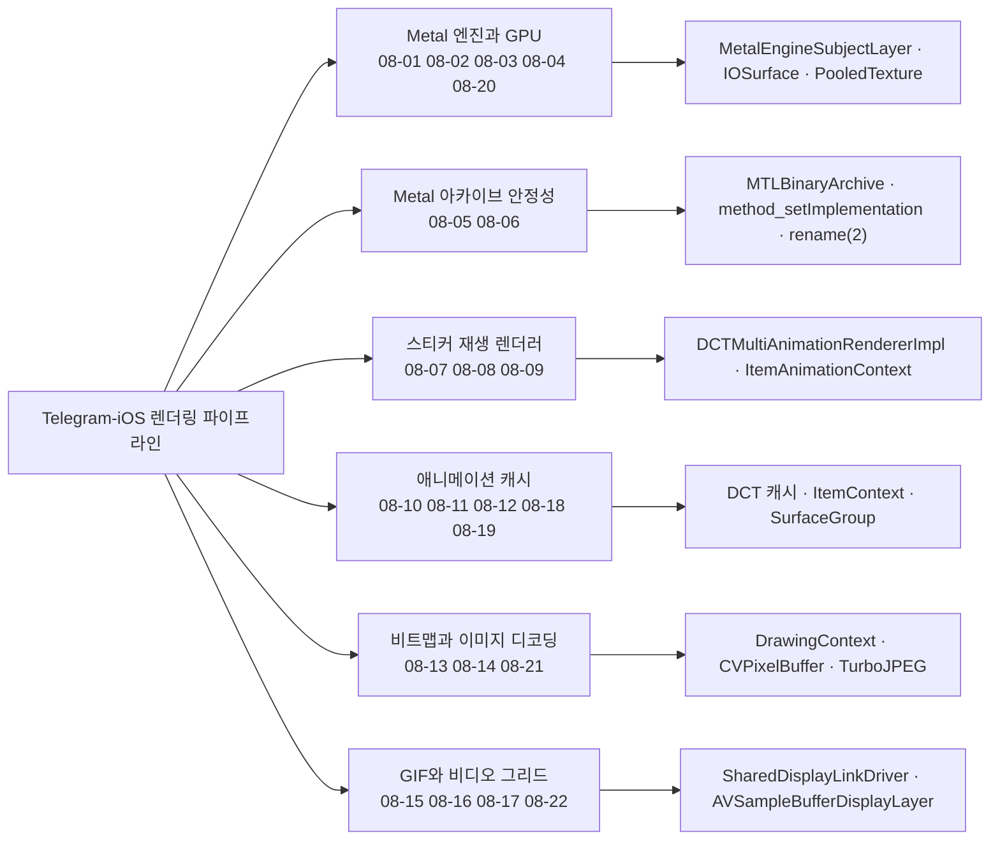
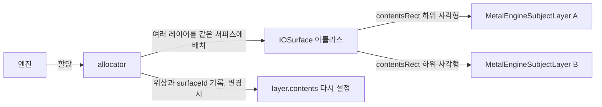
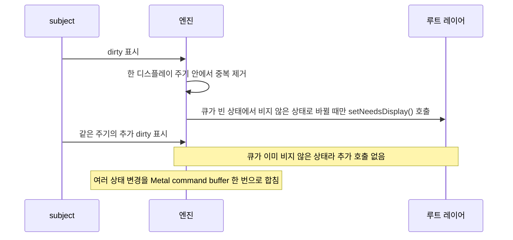
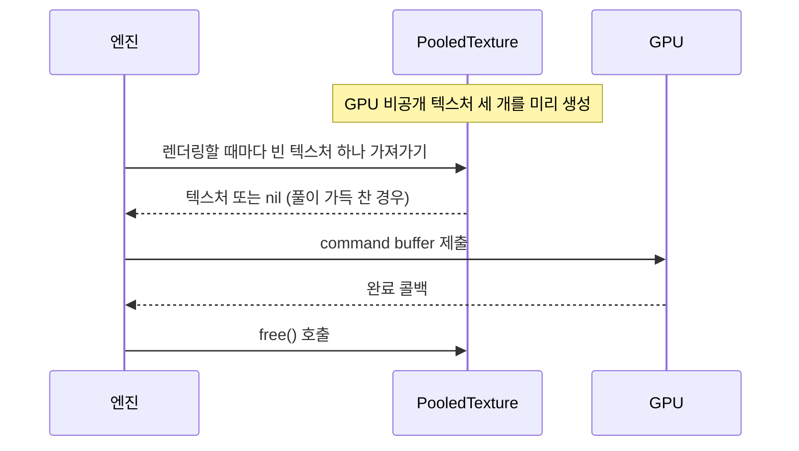
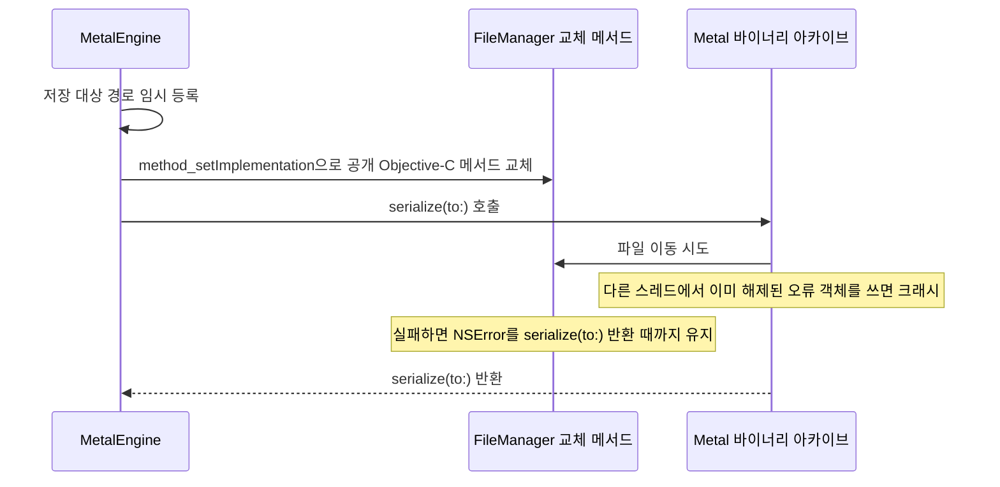

# 렌더링과 성능

웹: /docs/ios/08-rendering-perf/ · Markdown: /docs/ios/08-rendering-perf.md

> IOSurface 아틀라스, Metal 트리플 버퍼링, 공유 DisplayLink.

| 기법 항목 | 리포트 선정 | 관련 비공개 API | REA 연관 |
| --- | --- | --- | --- |
| 22 | 4 | 2 | 1 |

소스: [TelegramMessenger/Telegram-iOS@f1dd7a2d](https://github.com/TelegramMessenger/Telegram-iOS/tree/f1dd7a2dbd02cbbf513e75d5695d8d36d1cf5838)(2026-10-07) · 플랫폼: iOS · UIKit

이 장의 선정 항목:
- 08-1 [#08-01 `IOSurface` 아틀라스 한 장으로 독립된 여러 레이어 담기](/docs/ios/08-rendering-perf/#t08-01)
- 08-2 [#08-03 처음 dirty가 된 subject에서만 그리기를 한 번 요청하기](/docs/ios/08-rendering-perf/#t08-03)
- 08-3 [#08-04 비공개 텍스처를 트리플 버퍼링하고 GPU 완료 후 반납하기](/docs/ios/08-rendering-perf/#t08-04)
- 08-4 [#08-05 Objective-C 메서드 교체로 `MTLBinaryArchive` 크래시 피하기](/docs/ios/08-rendering-perf/#t08-05)

**주제 범위: Telegram-iOS의 렌더링 파이프라인, Metal, 애니메이션 스티커 성능.**

아래 결론은 `f1dd7a2dbd02cbbf513e75d5695d8d36d1cf5838`의 로컬 소스 코드에서 나왔어요. 항목은 의외성과 엔지니어링 가치 순으로 정렬했어요.

`MetalEngine`에서는 `CAMetalLayer`를 찾지 못했어요. 여기서 공유 캐리어(여러 레이어가 함께 쓰는 그리기 대상)는 실제로 `IOSurface` 아틀라스(여러 레이어의 그림을 한 장의 공유 서피스에 모아 둔 것)예요.

아래 도표는 이 장의 기법들이 렌더링 파이프라인의 어느 구성요소를 다루는지 묶어서 보여 줘요.



## 1. `IOSurface` 아틀라스 한 장으로 독립된 여러 레이어 담기 [#t08-01]

> #08-01 · Telegram-iOS · UIKit · 리포트 선정 08-1 · 검증 방식: 소스 분석 · 태그: Core Animation, Metal / GPU
>
> 소스: [Telegram-iOS:submodules/MetalEngine/Sources/MetalEngine.swift L920–L976](https://github.com/TelegramMessenger/Telegram-iOS/blob/f1dd7a2dbd02cbbf513e75d5695d8d36d1cf5838/submodules/MetalEngine/Sources/MetalEngine.swift#L920-L976)

**무엇을 했나요**: 여러 레이어가 서피스 한 장을 나눠 써요.

- 엔진이 여러 `MetalEngineSubjectLayer`를 같은 `IOSurface`에 할당해요.
- 각 레이어는 `contentsRect`로 자기 하위 사각형만 보여 줘요.
- 엔진은 아틀라스가 바뀔 때만 `layer.contents`를 다시 설정해요.

**왜 이렇게 했나요**: 보통은 효과 레이어마다 텍스처나 레이어 콘텐츠를 만들어요. 여기서는 작은 효과를 공유 서피스에 묶어요. 그러면 서피스 수, 텍스처 할당, Core Animation 커밋 부담이 줄어요.

아래 도표는 여러 레이어가 하나의 IOSurface 아틀라스를 나눠 쓰는 구조를 보여 줘요.



**핵심 코드 발췌**

```swift title="MetalEngine.swift · L920–L976"
if let surface = self.addSurface(width: surfaceWidth, height: surfaceHeight,
                                 pixelFormat: renderSpec.pixelFormat) {
    if let allocation = surface.allocateIfPossible(
        renderingParameters: renderingParameters
    ) {
        layer.surfaceAllocation = allocation
        layer.contentsRect = allocation.effectivePhase.contentsRect
        updatedSurfaceId = allocation.surfaceId
    }
}
// ...
if previousSurfaceId != updatedSurfaceId {
    if let updatedSurfaceId {
        layer.contents = self.surfaces[updatedSurfaceId]?.ioSurface
    } else {
        layer.contents = nil
    }
}
```

**대가와 위험**: 아틀라스 할당기가 복잡해요. 할당에 실패하면 레이어 콘텐츠가 비워져요. 코드는 비공개 `CAMetalLayer` API를 쓰지 않아요.

**증거 체인 #08-01**(iOS 바이너리 미검증)

- 소스 분석: Telegram-iOS 고정 커밋에서 한 줄씩 확인했어요. 소스 위치 총 1곳.
- 리포트 요약(구현 방법): allocator가 위상과 `surfaceId`를 기록하고, 변경되면 `contents`를 다시 설정해요.
- 바이너리 검증: 하지 않음. App Store 버전 IPA는 FairPlay로 암호화되어 있어서 복호화된 실행 파일을 합법적으로 얻을 수 없어요.

## 2. EDR 대형 레이어는 고정 아틀라스를 포기해 32 MB 낭비 피하기 [#t08-02]

> #08-02 · Telegram-iOS · UIKit · 검증 방식: 소스 분석
>
> 소스: [Telegram-iOS:submodules/MetalEngine/Sources/MetalEngine.swift L920–L975](https://github.com/TelegramMessenger/Telegram-iOS/blob/f1dd7a2dbd02cbbf513e75d5695d8d36d1cf5838/submodules/MetalEngine/Sources/MetalEngine.swift#L920-L975)

**무엇을 했나요**: 레이어 크기에 따라 서피스를 다르게 골라요.

- 작은 일반 레이어는 먼저 고정 서피스에 넣어요.
- 크기가 1024에 이르는 레이어는 크기에 딱 맞는 서피스를 써요.
- `rgba16Float`도 정렬된 전용 크기를 써요.

**왜 이렇게 했나요**: HDR/EDR(밝기 범위를 넓힌 고다이내믹 레인지) 픽셀은 차지하는 공간이 더 커요. 고정 2048 아틀라스를 쓰면 펼쳐진 효과 하나가 약 32 MB를 차지해요. 이 분기를 두면 소수의 큰 레이어 때문에 아틀라스 한 장 전체의 비용을 치르지 않아도 돼요.

**핵심 코드 발췌**

```swift title="MetalEngine.swift · L920–L975"
} else if renderingParameters.allocationWidth >= 1024 ||
          renderingParameters.allocationHeight >= 1024 {
    let surfaceWidth = max(1024, alignUp(
        renderingParameters.allocationWidth * 2, alignment: 64
    ))
    let surfaceHeight = max(512, alignUp(
        renderingParameters.allocationHeight, alignment: 64
    ))
    if let surface = self.addSurface(width: surfaceWidth,
                                     height: surfaceHeight,
                                     pixelFormat: renderSpec.pixelFormat) {
        if let allocation = surface.allocateIfPossible(
            renderingParameters: renderingParameters
        ) {
            layer.surfaceAllocation = allocation
            layer.contentsRect = allocation.effectivePhase.contentsRect
        }
    }
}
// EDR is normally used by one expanded subject. Avoid a full 32 MB atlas.
```

**대가와 위험**: 휴리스틱 임계값 모음이에요. 기기와 효과 크기에 따라 다시 조정해야 할 수 있어요.

**증거 체인 #08-02**(iOS 바이너리 미검증)

- 소스 분석: Telegram-iOS 고정 커밋에서 한 줄씩 확인했어요. 소스 위치 총 1곳.
- 바이너리 검증: 하지 않음. App Store 버전 IPA는 FairPlay로 암호화되어 있어서 복호화된 실행 파일을 합법적으로 얻을 수 없어요.

## 3. 처음 dirty가 된 subject에서만 그리기를 한 번 요청하기 [#t08-03]

> #08-03 · Telegram-iOS · UIKit · 리포트 선정 08-2 · 검증 방식: 소스 분석
>
> 소스: [Telegram-iOS:submodules/MetalEngine/Sources/MetalEngine.swift L1043–L1071](https://github.com/TelegramMessenger/Telegram-iOS/blob/f1dd7a2dbd02cbbf513e75d5695d8d36d1cf5838/submodules/MetalEngine/Sources/MetalEngine.swift#L1043-L1071)

**무엇을 했나요**: dirty(다시 그려야 한다고 표시된 상태)인 subject를 모아서 그리기를 한 번만 요청해요.

- 엔진이 subject마다 안정적인 내부 번호를 붙여요.
- 한 디스플레이 주기 안에서는 dirty subject의 중복을 없애요.
- dirty subject 큐가 빈 상태에서 비지 않은 상태로 바뀔 때만 루트 레이어의 `setNeedsDisplay()`를 호출해요.

**왜 이렇게 했나요**: 뷰마다 갱신하는 보통의 방식은 디스플레이 요청이 중복돼요. 여기서는 여러 상태 변경을 Metal command buffer 한 번으로 합쳐요.

아래 도표는 dirty subject가 쌓여도 그리기 요청이 한 번만 나가는 순서를 보여 줘요.



**핵심 코드 발췌**

```swift title="MetalEngine.swift · L1043–L1071"
let isFirst = self.updatedSubjectIds.isEmpty

if !self.updatedSubjectIds.contains(internalId) {
    self.updatedSubjectIds.append(internalId)
    self.updatedSubjects.append(SubjectReference(subject: subject))
}

if isFirst {
    self.setNeedsDisplay()
}
```

**대가와 위험**: subject의 `update`는 합쳐진 최종 상태를 처리할 수 있어야 해요. 선형 `contains`를 자주 호출하기 때문에 subject가 아주 많으면 추가 비용이 들어요.

**증거 체인 #08-03**(iOS 바이너리 미검증)

- 소스 분석: Telegram-iOS 고정 커밋에서 한 줄씩 확인했어요. 소스 위치 총 1곳.
- 리포트 요약(구현 방법): `updatedSubjectIds`의 비어 있음/포함 여부 로직으로 병합해요.
- 바이너리 검증: 하지 않음. App Store 버전 IPA는 FairPlay로 암호화되어 있어서 복호화된 실행 파일을 합법적으로 얻을 수 없어요.

## 4. 비공개 텍스처를 트리플 버퍼링하고 GPU 완료 후 반납하기 [#t08-04]

> #08-04 · Telegram-iOS · UIKit · 리포트 선정 08-3 · 검증 방식: 소스 분석 · 태그: 비공개 API, Metal / GPU
>
> 소스: [Telegram-iOS:submodules/MetalEngine/Sources/MetalEngine.swift L217–L268](https://github.com/TelegramMessenger/Telegram-iOS/blob/f1dd7a2dbd02cbbf513e75d5695d8d36d1cf5838/submodules/MetalEngine/Sources/MetalEngine.swift#L217-L268)

**무엇을 했나요**: 텍스처 풀을 이렇게 써요.

- `PooledTexture`가 GPU 비공개 텍스처 세 개를 미리 만들어요.
- 엔진이 렌더링할 때마다 빈 텍스처 하나를 가져가요.
- 엔진은 command buffer 완료 콜백에서 `free()`를 호출해요.

**왜 이렇게 했나요**: GPU가 아직 읽고 있는 텍스처는 다시 쓰이지 않아요. 트리플 버퍼링(텍스처를 세 개 두고 돌려 쓰는 방식) 덕분에 CPU가 여러 주기를 연속으로 제출할 수 있어요. `.private`는 CPU에서 보이는 저장소의 추가 비용도 피해요.

아래 도표는 트리플 버퍼링 풀에서 텍스처를 가져가고 GPU 완료 후 돌려주는 순서를 보여 줘요.



**핵심 코드 발췌**

```swift title="MetalEngine.swift · L217–L268"
self.textures = (0 ..< 3).compactMap { _ -> Texture? in
    let descriptor = MTLTextureDescriptor.texture2DDescriptor(
        pixelFormat: spec.pixelFormat.metalFormat,
        width: spec.width, height: spec.height, mipmapped: false
    )
    descriptor.storageMode = .private
    descriptor.usage = [.shaderRead, .shaderWrite]
    return device.makeTexture(descriptor: descriptor).map(Texture.init)
}
// ...
for texture in self.textures {
    if !texture.isInUse {
        texture.isInUse = true
        context.freeResourcesOnCompletion.append(texture)
        return TexturePlaceholder(placeholer: placeholder, spec: self.spec)
    }
}
```

**대가와 위험**: 풀이 가득 차면 `nil`을 반환해요. 그래서 호출자는 이번 프레임에 렌더링하지 않는 경우를 받아들일 수 있어야 해요. 규격마다 VRAM 세 장이 고정으로 묶여 있어요.

**증거 체인 #08-04**(iOS 바이너리 미검증)

- 소스 분석: Telegram-iOS 고정 커밋에서 한 줄씩 확인했어요. 소스 위치 총 1곳.
- 리포트 요약(구현 방법): `usage [.shaderRead,.shaderWrite]`와 완료 큐 회수.
- 바이너리 검증: 하지 않음. App Store 버전 IPA는 FairPlay로 암호화되어 있어서 복호화된 실행 파일을 합법적으로 얻을 수 없어요.

## 5. Objective-C 메서드 교체로 `MTLBinaryArchive` 크래시 피하기 [#t08-05]

> #08-05 · Telegram-iOS · UIKit · 리포트 선정 08-4 · 검증 방식: 소스 분석, REA 바이너리, REA 런타임 관측 · 태그: 비공개 API, Metal / GPU
>
> 소스: [Telegram-iOS:submodules/MetalEngine/Sources/MetalBinaryArchiveSerialization.swift L22–L90](https://github.com/TelegramMessenger/Telegram-iOS/blob/f1dd7a2dbd02cbbf513e75d5695d8d36d1cf5838/submodules/MetalEngine/Sources/MetalBinaryArchiveSerialization.swift#L22-L90)

**무엇을 했나요**: 아카이브를 저장하는 동안 크래시가 나지 않게 보호해요.

1. Metal 바이너리 아카이브를 저장하기 전에 대상 경로를 임시로 등록해요.
2. 그리고 `FileManager`의 공개 Objective-C 메서드를 교체해요(런타임에 메서드 구현을 바꿔 끼워요).
3. 실패하면 `NSError`가 `serialize(to:)`가 반환될 때까지 살아 있게 붙들어 둬요.

**왜 이렇게 했나요**: 소스 주석에 iOS 26.3과 macOS 27의 크래시가 기록되어 있어요. Metal이 다른 스레드에서 이미 해제된 오류 객체를 써요. 일반 `do/catch`로는 이 크래시를 막을 수 없어요.

아래 도표는 MTLBinaryArchive 저장 중 NSError가 먼저 해제되는 크래시를 막는 순서를 보여 줘요.



**핵심 코드 발췌**

```swift title="MetalBinaryArchiveSerialization.swift · L22–L90"
static func serialize(_ archive: MTLBinaryArchive, to url: URL) throws {
    guard let failedMoveErrors = FailedMoveErrors.shared else {
        throw UnprotectedError()
    }
    failedMoveErrors.beginKeeping(forTarget: url)
    defer { failedMoveErrors.endKeeping(forTarget: url) }
    try archive.serialize(to: url)
}
// ...
let selector = NSSelectorFromString(
    "replaceItemAtURL:withItemAtURL:backupItemName:options:resultingItemURL:error:"
)
guard let method = class_getInstanceMethod(FileManager.self, selector) else { return nil }
let original = unsafeBitCast(method_getImplementation(method), to: ReplaceItemImplementation.self)
method_setImplementation(method, imp_implementationWithBlock(
    unsafeBitCast(replacement, to: AnyObject.self)
))
```

**대가와 위험**: 프로세스 수준의 메서드 교체예요. 공개 selector의 ABI에 기대고 있어요. 시스템 구현이 바뀌면 보호가 무력해져요. 비공개 API는 호출하지 않아요.

**증거 체인 #08-05**(버전 차이)

- 소스 분석: Telegram-iOS 고정 커밋에서 한 줄씩 확인했어요. 소스 위치 총 1곳.
- 리포트 요약(구현 방법): `method_setImplementation`으로 block을 주입하고, 바깥에서 파일 이동을 보호해요.
- REA 17번 항목(버전 차이; REA 바이너리, REA 런타임 관측): 13.0 바이너리: `_TtC11MetalEngine16FailedMoveErrors`; 완전한 selector 문자열 `replaceItemAtURL:withItemAtURL:backupItemName:options:resultingItemURL:error:`; `method_setImplementation` import; macOS 26.7: 시작 후 40초 안에 `method_setImplementation` 호출 없음; 결론: 버전 차이: 2025-07의 TelegramSwift 소스에는 없고 13.0에 들어왔어요

## 6. 저장 마커와 `rename(2)`로 캐시 크래시 루프 막기 [#t08-06]

> #08-06 · Telegram-iOS · UIKit · 검증 방식: 소스 분석 · 태그: 성능과 메모리
>
> 소스: [Telegram-iOS:submodules/MetalEngine/Sources/MetalPipelineCache.swift L233–L309](https://github.com/TelegramMessenger/Telegram-iOS/blob/f1dd7a2dbd02cbbf513e75d5695d8d36d1cf5838/submodules/MetalEngine/Sources/MetalPipelineCache.swift#L233-L309)

**무엇을 했나요**: 저장 과정을 이렇게 진행해요.

- 파이프라인이 한꺼번에 생성된 뒤 1초 늦춰서 병합 저장해요.
- 저장 전에 `.saving` 마커를 만들어요.
- 먼저 무작위 임시 파일에 쓰고, 원자적 `rename(2)`(중간 상태 없이 한 번에 바뀌는 파일 이름 변경)로 예전 아카이브를 교체해요.

**왜 이렇게 했나요**: 불완전한 아카이브와 반복되는 크래시는 이후의 시작을 망쳐요. 마커가 있으면 지난 저장이 중단됐는지 알 수 있어요. 원자적 교체 덕분에 읽는 쪽은 예전 파일이나 새 파일 중 하나만 봐요.

**핵심 코드 발췌**

```swift title="MetalPipelineCache.swift · L233–L309"
self.isSaveScheduled = true
self.saveQueue.asyncAfter(deadline: .now() + 1.0) { [weak self] in
    self?.save()
}
// ...
let saveMarkerUrl = MetalPipelineCache.saveMarkerUrl(archiveUrl: url)
guard FileManager.default.createFile(atPath: saveMarkerUrl.path, contents: nil) else { return }
defer { let _ = try? FileManager.default.removeItem(at: saveMarkerUrl) }

let temporaryUrl = url.deletingLastPathComponent().appendingPathComponent(
    UUID().uuidString + ".tmp"
)
try MetalBinaryArchiveSerialization.serialize(archive, to: temporaryUrl)
if rename(temporaryUrl.path, url.path) != 0 {
    let _ = try? FileManager.default.removeItem(at: temporaryUrl)
}
```

**대가와 위험**: 파일 시스템 오류가 나면 이번 캐시는 포기해요. 첫 시작이나 버전이 바뀐 경우에는 여전히 파이프라인을 다시 컴파일해야 해요.

**증거 체인 #08-06**(iOS 바이너리 미검증)

- 소스 분석: Telegram-iOS 고정 커밋에서 한 줄씩 확인했어요. 소스 위치 총 1곳.
- 바이너리 검증: 하지 않음. App Store 버전 IPA는 FairPlay로 암호화되어 있어서 복호화된 실행 파일을 합법적으로 얻을 수 없어요.

## 7. 타이머 하나로 DCT 애니메이션 전체를 구동하고 배터리 상태에 따라 30 FPS로 낮추기 [#t08-07]

> #08-07 · Telegram-iOS · UIKit · 검증 방식: 소스 분석 · 태그: 텍스트와 입력
>
> 소스: [Telegram-iOS:submodules/TelegramUI/Components/DCTMultiAnimationRendererImpl/Sources/DCTMultiAnimationRendererImpl.swift L893–L934](https://github.com/TelegramMessenger/Telegram-iOS/blob/f1dd7a2dbd02cbbf513e75d5695d8d36d1cf5838/submodules/TelegramUI/Components/DCTMultiAnimationRendererImpl/Sources/DCTMultiAnimationRendererImpl.swift#L893-L934)

**무엇을 했나요**: 렌더러 하나와 timer 하나로 모든 애니메이션을 구동해요.

- `DCTMultiAnimationRendererImpl`(DCT 압축 캐시를 재생하는 렌더러) 하나가 timer 하나로 활성 항목을 모두 구동해요.
- 활성 항목이 없으면 곧바로 timer를 없애요.
- 저전력이거나 CPU 코어 수가 2 이하이면 `frameSkip`이 2가 돼요.

**왜 이렇게 했나요**: 스티커마다 자기 timer를 만들면 기기가 한꺼번에 깨어나는 문제가 생겨요. 여기서는 자원이 부족한 기기에서 약 30 FPS로 고정해요. `common` mode 덕분에 스크롤 중에도 애니메이션이 계속 진행돼요.

**핵심 코드 발췌**

```swift title="DCTMultiAnimationRendererImpl.swift · L893–L934"
private(set) var isPlaying: Bool = false {
    didSet {
        if self.isPlaying != oldValue {
            if self.isPlaying {
                if self.displayTimer == nil {
                    let frameInterval = Double(self.frameSkip) / 60.0
                    let displayTimer = Foundation.Timer(
                        timeInterval: frameInterval, target: TimerTarget { [weak self] in
                            self?.animationTick(frameInterval: frameInterval)
                        }, selector: #selector(TimerTarget.timerEvent),
                        userInfo: nil, repeats: true
                    )
                    self.displayTimer = displayTimer
                    RunLoop.main.add(displayTimer, forMode: .common)
                }
            } else if let displayTimer = self.displayTimer {
                self.displayTimer = nil
                displayTimer.invalidate()
            }
        }
    }
}
```

**대가와 위험**: timer는 엄격한 수직 동기화를 보장하지 않아요. 저전력 모드에서는 애니메이션의 시간 정밀도와 부드러움이 떨어져요.

**증거 체인 #08-07**(iOS 바이너리 미검증)

- 소스 분석: Telegram-iOS 고정 커밋에서 한 줄씩 확인했어요. 소스 위치 총 1곳.
- 바이너리 검증: 하지 않음. App Store 버전 IPA는 FairPlay로 암호화되어 있어서 복호화된 실행 파일을 합법적으로 얻을 수 없어요.

## 8. 같은 스티커는 한 번만 디코딩하고 여러 약한 대상으로 팬아웃하기 [#t08-08]

> #08-08 · Telegram-iOS · UIKit · 검증 방식: 소스 분석
>
> 소스: [Telegram-iOS:submodules/TelegramUI/Components/DCTMultiAnimationRendererImpl/Sources/DCTMultiAnimationRendererImpl.swift L686–L743](https://github.com/TelegramMessenger/Telegram-iOS/blob/f1dd7a2dbd02cbbf513e75d5695d8d36d1cf5838/submodules/TelegramUI/Components/DCTMultiAnimationRendererImpl/Sources/DCTMultiAnimationRendererImpl.swift#L686-L743)

**무엇을 했나요**: 같은 스티커를 하나의 컨텍스트에 모아 프레임을 나눠 줘요(팬아웃).

- 기본 `uniqueId`는 0이에요.
- 같은 리소스와 크기는 같은 `ItemAnimationContext`에 걸려요.
- 이 컨텍스트가 같은 프레임을 약한 참조 대상 여러 개에 나눠 줘요.
- 호출자는 `unique`로 독립된 타임라인을 강제할 수 있어요.

**왜 이렇게 했나요**: 이모지 그리드에는 같은 애니메이션이 자주 반복해서 나와요. 일반 노드는 디코딩과 프레임 진행을 중복해요. 여기서는 여러 레이어가 프레임 읽기 한 번을 함께 써요.

**핵심 코드 발췌**

```swift title="DCTMultiAnimationRendererImpl.swift · L686–L743"
let itemKey = ItemKey(id: itemId, width: Int(size.width),
                      height: Int(size.height), uniqueId: uniqueId)
let itemContext: ItemAnimationContext
if let current = self.itemContexts[itemKey] {
    itemContext = current
} else {
    let queueAffinity = self.nextQueueAffinity
    self.nextQueueAffinity += 1
    itemContext = ItemAnimationContext(cache: cache,
        queueAffinity: queueAffinity, itemId: itemId, size: size,
        useYuvA: useYuvA, fetch: fetch, stateUpdated: { [weak self] in
            self?.updateIsPlaying()
        })
    self.itemContexts[itemKey] = itemContext
}
let index = itemContext.targets.add(Weak(target))
itemContext.updateAddedTarget(target: target)
```

**대가와 위험**: 공유 항목은 기본적으로 위상이 같아요. 위상이 달라야 하면 `unique`를 설정해야 해요. 약한 대상을 정리하는 경로가 더 복잡해요.

**증거 체인 #08-08**(iOS 바이너리 미검증)

- 소스 분석: Telegram-iOS 고정 커밋에서 한 줄씩 확인했어요. 소스 위치 총 1곳.
- 바이너리 검증: 하지 않음. App Store 버전 IPA는 FairPlay로 암호화되어 있어서 복호화된 실행 파일을 합법적으로 얻을 수 없어요.

## 9. 고정 백그라운드 큐 두 개로 병렬 디코딩하고 메인 스레드에 일괄 제출하기 [#t08-09]

> #08-09 · Telegram-iOS · UIKit · 검증 방식: 소스 분석 · 태그: Core Animation, 성능과 메모리
>
> 소스: [Telegram-iOS:submodules/TelegramUI/Components/DCTMultiAnimationRendererImpl/Sources/DCTMultiAnimationRendererImpl.swift L1026–L1077](https://github.com/TelegramMessenger/Telegram-iOS/blob/f1dd7a2dbd02cbbf513e75d5695d8d36d1cf5838/submodules/TelegramUI/Components/DCTMultiAnimationRendererImpl/Sources/DCTMultiAnimationRendererImpl.swift#L1026-L1077)

**무엇을 했나요**: 디코딩은 병렬로, 제출은 한꺼번에 해요.

1. 렌더러가 안정적인 `queueAffinity`(애니메이션마다 정해진 큐 소속)에 따라 프레임 작업을 고정 큐 두 개로 나눠요.
2. 두 파티션이 끝나면 모든 레이어 업데이트 클로저를 메인 스레드로 보내요.

**왜 이렇게 했나요**: 스티커마다 작업을 디스패치하는 대신 동시성을 두 갈래로 제한해요. 소속이 안정적이라서 같은 애니메이션에 접근하는 스레드가 이리저리 바뀌지도 않아요.

**핵심 코드 발췌**

```swift title="DCTMultiAnimationRendererImpl.swift · L1026–L1077"
let tasks0 = tasks.filter { $0.queueAffinity % 2 == 0 }
let tasks1 = tasks.filter { $0.queueAffinity % 2 == 1 }
let allTasks = [tasks0, tasks1]
let taskCompletions = Atomic<[Int: [() -> Void]]>(value: [:])
let queues: [Queue] = [ItemAnimationContext.queue0, ItemAnimationContext.queue1]

for i in 0 ..< 2 {
    let partTasks = allTasks[i]
    queues[i].async {
        var completions: [() -> Void] = []
        for task in partTasks { completions.append(task.task()) }
        let _ = taskCompletions.modify { current in
            var current = current
            current[i] = completions
            return current
        }
    }
}
```

**대가와 위험**: 큐 하나에서 느린 작업이 나오면 메인 스레드 일괄 제출 전체가 늦어져요. 기기 코어 수가 더 많아도 두 갈래만 써요.

**증거 체인 #08-09**(iOS 바이너리 미검증)

- 소스 분석: Telegram-iOS 고정 커밋에서 한 줄씩 확인했어요. 소스 위치 총 1곳.
- 바이너리 검증: 하지 않음. App Store 버전 IPA는 FairPlay로 암호화되어 있어서 복호화된 실행 파일을 합법적으로 얻을 수 없어요.

## 10. DCT 캐시가 키프레임과 차분 프레임을 YUVA 평면으로 저장하기 [#t08-10]

> #08-10 · Telegram-iOS · UIKit · 검증 방식: 소스 분석 · 태그: 성능과 메모리
>
> 소스: [Telegram-iOS:submodules/TelegramUI/Components/DCTAnimationCacheImpl/Sources/DCTAnimationCacheImpl.swift L366–L445](https://github.com/TelegramMessenger/Telegram-iOS/blob/f1dd7a2dbd02cbbf513e75d5695d8d36d1cf5838/submodules/TelegramUI/Components/DCTAnimationCacheImpl/Sources/DCTAnimationCacheImpl.swift#L366-L445)

**무엇을 했나요**: 프레임을 DCT 계수 평면으로 저장해요.

- 캐시가 프레임을 Y, U, V, Alpha 네 개의 DCT 계수 평면(합쳐서 YUVA)으로 바꿔요.
- 키프레임(다른 프레임 없이 복원되는 프레임)이 아닌 프레임은 이전 프레임과의 계수 차이를 저장해요.
- 프레임마다 키프레임 표시와 네 평면의 길이가 붙어요.

**왜 이렇게 했나요**: RGBA 전체 프레임 캐시는 디스크와 메모리 대역폭을 키워요. 이웃한 스티커 프레임은 보통 변화가 작아요. 차분 DCT 덕분에 대량의 이모지 애니메이션을 로컬 캐시에 담기 알맞아요.

**핵심 코드 발췌**

```swift title="DCTAnimationCacheImpl.swift · L366–L445"
let isKeyframe: Bool
if !isFirstFrame && !insertKeyframe {
    isKeyframe = false
    // previous + delta = current
    // delta = current - previous
    yuvaSurface.toCoefficients(target: differenceCoefficients)
    differenceCoefficients.subtract(other: previousCoefficients)
    dctCoefficients = differenceCoefficients
} else {
    isKeyframe = true
    yuvaSurface.toCoefficients(target: dctCoefficients)
}
// ...
try compressedWriter.writeUInt32(isKeyframe ? 1 : 0)
for i in 0 ..< 4 {
    let dctPlane: DctCoefficientPlane
    // yPlane, uPlane, vPlane, aPlane
    try compressedWriter.writeUInt32(UInt32(dctPlane.data.count))
    try dctPlane.data.withUnsafeBytes { bytes in
        try compressedWriter.write(bytes: bytes.baseAddress!.assumingMemoryBound(to: UInt8.self),
                                   count: bytes.count)
    }
}
```

**대가와 위험**: 차분 프레임에서 복원하려면 앞선 프레임이 필요해요. 손상되거나 아무 위치로 점프하면 복원 비용이 더 커요. arm64가 아닌 코드는 모든 프레임을 강제로 키프레임으로 만들어요.

**증거 체인 #08-10**(iOS 바이너리 미검증)

- 소스 분석: Telegram-iOS 고정 커밋에서 한 줄씩 확인했어요. 소스 위치 총 1곳.
- 바이너리 검증: 하지 않음. App Store 버전 IPA는 FairPlay로 암호화되어 있어서 복호화된 실행 파일을 합법적으로 얻을 수 없어요.

## 11. “단일 비행(single-flight)” 요청으로 캐시 구축을 공유하고 구독자가 없으면 중단하기 [#t08-11]

> #08-11 · Telegram-iOS · UIKit · 검증 방식: 소스 분석 · 태그: 성능과 메모리
>
> 소스: [Telegram-iOS:submodules/TelegramUI/Components/DCTAnimationCacheImpl/Sources/DCTAnimationCacheImpl.swift L1343–L1423](https://github.com/TelegramMessenger/Telegram-iOS/blob/f1dd7a2dbd02cbbf513e75d5695d8d36d1cf5838/submodules/TelegramUI/Components/DCTAnimationCacheImpl/Sources/DCTAnimationCacheImpl.swift#L1343-L1423)

**무엇을 했나요**: 캐시 구축을 single-flight(같은 키의 요청을 하나만 실행하고 결과를 공유하는 방식)로 공유해요.

- 캐시 키가 같은 읽기 요청자는 같은 `ItemContext`에 붙어요.
- 처음 읽는 요청자만 가져오기와 압축을 시작해요.
- 뒤이은 요청자는 결과를 구독해요.
- 마지막 구독자가 떠나면 가져오기를 dispose하고 writer를 취소로 표시해요.

**왜 이렇게 했나요**: 빠르게 스크롤하면 같은 스티커를 여러 cell이 요청해요. 일반적인 구현은 다운로드, 디코딩, 디스크 쓰기를 중복해요. 여기서는 쓰기도 제한된 `fetchQueues`로 돌려 가며 처리해요.

**핵심 코드 발췌**

```swift title="DCTAnimationCacheImpl.swift · L1343–L1423"
let key = ItemKey(id: sourceId, width: Int(size.width), height: Int(size.height))
let itemContext: ItemContext
var beginFetch = false
if let current = self.itemContexts[key] {
    itemContext = current
} else {
    itemContext = ItemContext()
    self.itemContexts[key] = itemContext
    beginFetch = true
}
let index = itemContext.subscribers.add(updateResult)

if beginFetch {
    let fetchQueueIndex = self.nextFetchQueueIndex
    self.nextFetchQueueIndex += 1
    guard let writer = AnimationCacheItemWriterImpl(
        queue: self.fetchQueues[fetchQueueIndex % self.fetchQueues.count],
        allocateTempFile: self.allocateTempFile, completion: { /* ... */ }
    ) else { return EmptyDisposable }
```

**대가와 위험**: 첫 요청이 실패하면 같은 키의 구독자가 영향을 받아요. 구독과 취소는 캐시 큐 안에서 일어나야 해요.

**증거 체인 #08-11**(iOS 바이너리 미검증)

- 소스 분석: Telegram-iOS 고정 커밋에서 한 줄씩 확인했어요. 소스 위치 총 1곳.
- 바이너리 검증: 하지 않음. App Store 버전 IPA는 FairPlay로 암호화되어 있어서 복호화된 실행 파일을 합법적으로 얻을 수 없어요.

## 12. 더 높은 해상도의 캐시에서 더 작은 캐시를 즉시 파생하기 [#t08-12]

> #08-12 · Telegram-iOS · UIKit · 검증 방식: 소스 분석 · 태그: 성능과 메모리
>
> 소스: [Telegram-iOS:submodules/TelegramUI/Components/DCTAnimationCacheImpl/Sources/DCTAnimationCacheImpl.swift L1139–L1186](https://github.com/TelegramMessenger/Telegram-iOS/blob/f1dd7a2dbd02cbbf513e75d5695d8d36d1cf5838/submodules/TelegramUI/Components/DCTAnimationCacheImpl/Sources/DCTAnimationCacheImpl.swift#L1139-L1186)

**무엇을 했나요**: 요청한 크기의 캐시가 없으면 더 높은 해상도 캐시에서 만들어요.

- 캐시가 더 높은 해상도 버전을 읽을 수 있어요.
- 네 개의 YUVA 평면을 직접 줄여요.
- 줄인 결과를 필요한 크기의 DCT 캐시로 되써 넣어요.

**왜 이렇게 했나요**: 원본 애니메이션을 다시 읽고 Lottie를 다시 래스터화하는 일을 피해요. YUV 평면을 줄이면 ARGB로 왕복 변환하는 일도 피해요.

**핵심 코드 발췌**

```swift title="DCTAnimationCacheImpl.swift · L1139–L1186"
for _ in 0 ..< higherResolutionItem.numFrames {
    try writer.addYUV(with: { yuva in
        guard let frame = higherResolutionItem.advance(
            advance: .frames(1),
            requestedFormat: .yuva(rowAlignment: yuva.yPlane.rowAlignment)
        ) else { return nil }
        switch frame.frame.format {
        case let .yuva(y, u, v, a):
            yuva.yPlane.copyScaled(fromPlane: y)
            yuva.uPlane.copyScaled(fromPlane: u)
            yuva.vPlane.copyScaled(fromPlane: v)
            yuva.aPlane.copyScaled(fromPlane: a)
        default: return nil
        }
        return frame.frame.duration
    }, proposedWidth: width, proposedHeight: height, insertKeyframe: true)
}
```

**대가와 위험**: 파생 과정은 CPU, I/O, 추가 공간을 써요. 파생 버전을 모두 키프레임으로 만들기 때문에 파일이 더 커질 수 있어요.

**증거 체인 #08-12**(iOS 바이너리 미검증)

- 소스 분석: Telegram-iOS 고정 커밋에서 한 줄씩 확인했어요. 소스 위치 총 1곳.
- 바이너리 검증: 하지 않음. App Store 버전 IPA는 FairPlay로 암호화되어 있어서 복호화된 실행 파일을 합법적으로 얻을 수 없어요.

## 13. `DrawingContext`가 비트맵 버퍼의 소유권을 `CGImage`에 곧바로 넘기기 [#t08-13]

> #08-13 · Telegram-iOS · UIKit · 검증 방식: 소스 분석
>
> 소스: [Telegram-iOS:submodules/Display/Source/GenerateImage.swift L619–L700](https://github.com/TelegramMessenger/Telegram-iOS/blob/f1dd7a2dbd02cbbf513e75d5695d8d36d1cf5838/submodules/Display/Source/GenerateImage.swift#L619-L700)

**무엇을 했나요**: 비트맵 버퍼를 복사 없이 `CGImage`에 넘겨요.

- `DrawingContext`는 통일된 기기 행 정렬(한 행의 바이트 크기를 맞추는 규칙)을 써요.
- `CGContext`가 `ASCGImageBuffer`에 직접 그리게 해요.
- `CGImage`를 만들 때 `createDataProviderAndInvalidate()`가 버퍼 소유권을 넘겨요.

**왜 이렇게 했나요**: 일반 `UIImage` 컨텍스트는 중간에 데이터를 자주 복사해요. 여기서는 그리기, `CGImage` provider, 해제가 같은 메모리 블록을 함께 써요.

**핵심 코드 발췌**

```swift title="GenerateImage.swift · L619–L700"
self.bytesPerRow = bytesPerRow ??
    DeviceGraphicsContextSettings.shared.bytesPerRow(forWidth: Int(scaledSize.width))
self.length = self.bytesPerRow * Int(scaledSize.height)
guard let imageBuffer = ASCGImageBuffer(length: UInt(self.length)) else { return nil }
self.imageBuffer = imageBuffer

guard let context = CGContext(
    data: self.imageBuffer.mutableBytes,
    width: Int(self.scaledSize.width), height: Int(self.scaledSize.height),
    bitsPerComponent: DeviceGraphicsContextSettings.shared.bitsPerComponent,
    bytesPerRow: self.bytesPerRow,
    space: colorSpace ?? DeviceGraphicsContextSettings.shared.colorSpace,
    bitmapInfo: self.bitmapInfo.rawValue,
    releaseCallback: nil, releaseInfo: nil
) else { return nil }
self.context = context
// ...
let dataProvider = self.imageBuffer.createDataProviderAndInvalidate()
```

**대가와 위험**: `hasGeneratedImage` 이후에는 다시 생성할 수 없어요. 호출자는 이 context에 계속 쓸 수 없어요.

**증거 체인 #08-13**(iOS 바이너리 미검증)

- 소스 분석: Telegram-iOS 고정 커밋에서 한 줄씩 확인했어요. 소스 위치 총 1곳.
- 바이너리 검증: 하지 않음. App Store 버전 IPA는 FairPlay로 암호화되어 있어서 복호화된 실행 파일을 합법적으로 얻을 수 없어요.

## 14. 제자리 바이트로 IOSurface 속성이 있는 `CVPixelBuffer` 만들기 [#t08-14]

> #08-14 · Telegram-iOS · UIKit · 검증 방식: 소스 분석 · 태그: Metal / GPU
>
> 소스: [Telegram-iOS:submodules/Display/Source/GenerateImage.swift L702–L724](https://github.com/TelegramMessenger/Telegram-iOS/blob/f1dd7a2dbd02cbbf513e75d5695d8d36d1cf5838/submodules/Display/Source/GenerateImage.swift#L702-L724)

**무엇을 했나요**: 같은 메모리를 `CVPixelBuffer`로 감싸요.

- `DrawingContext`의 비트맵을 복사하지 않아요.
- 같은 주소를 `CVPixelBufferCreateWithBytes`에 넘기고, release callback으로 `ASCGImageBuffer`의 수명을 관리해요.
- options로 IOSurface 속성을 요청해요.

**왜 이렇게 했나요**: 이 경로는 CPU 래스터화 결과를 비디오나 레이어 경로에 곧바로 넘겨요. `CGImage`를 먼저 만들고 새 픽셀 버퍼에 다시 그리는 과정을 피해요.

**핵심 코드 발췌**

```swift title="GenerateImage.swift · L702–L724"
let ioSurfaceProperties = NSMutableDictionary()
let options = NSMutableDictionary()
options.setObject(ioSurfaceProperties,
                  forKey: kCVPixelBufferIOSurfacePropertiesKey as NSString)

var pixelBuffer: CVPixelBuffer?
CVPixelBufferCreateWithBytes(nil, Int(self.scaledSize.width),
    Int(self.scaledSize.height), kCVPixelFormatType_32BGRA,
    self.bytes, self.bytesPerRow, { pointer, _ in
        if let pointer = pointer {
            Unmanaged<ASCGImageBuffer>.fromOpaque(pointer).release()
        }
    }, Unmanaged.passRetained(self.imageBuffer).toOpaque(),
    options as CFDictionary, &pixelBuffer)

self.hasGeneratedImage = true
return pixelBuffer
```

**대가와 위험**: 픽셀 포맷과 바이트 순서가 정확히 일치해야 해요. 버퍼는 `CVPixelBuffer`가 해제되기 전에는 다시 쓸 수 없어요.

**증거 체인 #08-14**(iOS 바이너리 미검증)

- 소스 분석: Telegram-iOS 고정 커밋에서 한 줄씩 확인했어요. 소스 위치 총 1곳.
- 바이너리 검증: 하지 않음. App Store 버전 IPA는 FairPlay로 암호화되어 있어서 복호화된 실행 파일을 합법적으로 얻을 수 없어요.

## 15. GIF 그리드는 디스플레이 링크 하나를 쓰고 두 프레임만 미리 읽기 [#t08-15]

> #08-15 · Telegram-iOS · UIKit · 검증 방식: 소스 분석
>
> 소스: [Telegram-iOS:submodules/TelegramUI/Components/BatchVideoRendering/Sources/BatchVideoRenderingContext.swift L268–L372](https://github.com/TelegramMessenger/Telegram-iOS/blob/f1dd7a2dbd02cbbf513e75d5695d8d36d1cf5838/submodules/TelegramUI/Components/BatchVideoRendering/Sources/BatchVideoRenderingContext.swift#L268-L372)

**무엇을 했나요**: GIF 그리드가 디스플레이 링크 하나를 공유해요.

- 여러 GIF 비디오 대상이 디스플레이 링크(화면 주사율에 맞춰 콜백을 부르는 타이머)를 `SharedDisplayLinkDriver`로 함께 써요.
- 대상마다 최대 두 프레임까지 채워요.
- 미리 읽기는 모두 `sharedQueue`에서 끝내요.
- `isRendering`이 같은 시점에 디코딩 배치가 중복으로 시작되는 것을 막아요.

**왜 이렇게 했나요**: GIF마다 자기 디스플레이 링크와 깊은 큐를 가지면 CPU와 메모리를 많이 써요. 두 프레임은 부드러움과 메모리 사이에서 분명한 상한이에요.

**핵심 코드 발췌**

```swift title="BatchVideoRenderingContext.swift · L268–L372"
if !self.targetContexts.isEmpty {
    if self.displayLink == nil {
        self.displayLink = SharedDisplayLinkDriver.shared.add { [weak self] _ in
            self?.updateRendering()
        }
    }
} else {
    self.displayLink = nil
}
// ...
if targetState.sampleBuffers.count < 2 {
    renderIds[id] = 2 - targetState.sampleBuffers.count
}
// ...
BatchVideoRenderingContext.sharedQueue.async {
    for (id, (count, readingContext)) in readingContexts {
        for _ in 0 ..< count {
            if let sampleBuffer = readingContext.unsafeGet()?.advance() {
                sampleBuffers[id]?.append(sampleBuffer)
            }
        }
    }
}
```

**대가와 위험**: 디코딩 큐는 공유 병목이에요. 복잡한 비디오 때문에 다른 그리드 항목의 프레임 보충이 느려질 수 있어요.

**증거 체인 #08-15**(iOS 바이너리 미검증)

- 소스 분석: Telegram-iOS 고정 커밋에서 한 줄씩 확인했어요. 소스 위치 총 1곳.
- 바이너리 검증: 하지 않음. App Store 버전 IPA는 FairPlay로 암호화되어 있어서 복호화된 실행 파일을 합법적으로 얻을 수 없어요.

## 16. 각 레이어의 재생 시계를 믿지 않고 벽시계로 `CMSampleBuffer` 재생하기 [#t08-16]

> #08-16 · Telegram-iOS · UIKit · 검증 방식: 소스 분석 · 태그: 텍스트와 입력, 성능과 메모리
>
> 소스: [Telegram-iOS:submodules/TelegramUI/Components/BatchVideoRendering/Sources/BatchVideoRenderingContext.swift L53–L87](https://github.com/TelegramMessenger/Telegram-iOS/blob/f1dd7a2dbd02cbbf513e75d5695d8d36d1cf5838/submodules/TelegramUI/Components/BatchVideoRendering/Sources/BatchVideoRenderingContext.swift#L53-L87)

**무엇을 했나요**: 레이어 시계 대신 공통 벽시계로 재생 시점을 정해요.

- 배치 처리기가 `CACurrentMediaTime()`을 공통 벽시계(실제로 흐르는 시각)로 써요.
- 이미 표시된 프레임의 PTS(프레임을 표시할 시각을 나타내는 타임스탬프)와 실제로 지난 시간을 비교해요.
- PTS가 거꾸로 가면 이전 프레임의 duration으로 루프 경계를 판정해요.

**왜 이렇게 했나요**: `AVSampleBufferDisplayLayer`마다 따로 스케줄링하면 GIF 그리드의 위상이 어긋나요. 이 코드는 다음 프레임을 언제 쓸지를 한곳에서 통일해 정해요.

**핵심 코드 발췌**

```swift title="BatchVideoRenderingContext.swift · L53–L87"
let sampleBuffer = self.sampleBuffers[0]
let sampleBufferPts = CMSampleBufferGetPresentationTimeStamp(sampleBuffer).seconds
let sampleBufferDuration = CMSampleBufferGetDuration(sampleBuffer).seconds
if let lastRenderedFrame = self.lastRenderedFrame {
    let elapsedTime = timestamp - lastRenderedFrame.timestamp
    let ptsDifference = sampleBufferPts - lastRenderedFrame.pts
    if ptsDifference < 0.0 {
        if elapsedTime >= lastRenderedFrame.duration {
            self.lastRenderedFrame = (timestamp, sampleBufferPts, sampleBufferDuration)
            self.sampleBuffers.removeFirst()
            return sampleBuffer
        }
    } else if elapsedTime >= ptsDifference {
        self.lastRenderedFrame = (timestamp, sampleBufferPts, sampleBufferDuration)
        self.sampleBuffers.removeFirst()
        return sampleBuffer
    }
}
```

**대가와 위험**: 소프트웨어 시계예요. 메인 스레드가 멈춘 뒤에는 정확히 따라잡지 않고 표시를 늦춰요.

**증거 체인 #08-16**(iOS 바이너리 미검증)

- 소스 분석: Telegram-iOS 고정 커밋에서 한 줄씩 확인했어요. 소스 위치 총 1곳.
- 바이너리 검증: 하지 않음. App Store 버전 IPA는 FairPlay로 암호화되어 있어서 복호화된 실행 파일을 합법적으로 얻을 수 없어요.

## 17. 작은 크기의 GIF는 디블로킹 필터를 끄고 디코딩 불가 파일은 차단하기 [#t08-17]

> #08-17 · Telegram-iOS · UIKit · 검증 방식: 소스 분석
>
> 소스: [Telegram-iOS:submodules/TelegramUI/Components/BatchVideoRendering/Sources/BatchVideoRenderingContext.swift L90–L162](https://github.com/TelegramMessenger/Telegram-iOS/blob/f1dd7a2dbd02cbbf513e75d5695d8d36d1cf5838/submodules/TelegramUI/Components/BatchVideoRendering/Sources/BatchVideoRenderingContext.swift#L90-L162)

**무엇을 했나요**: 두 가지 규칙을 둬요.

- 그리드 GIF를 약 93 pt로 표시할 때 디코더가 디블로킹 필터(압축 블록 경계의 격자 무늬를 줄이는 필터)를 건너뛰어요.
- 파일 전체에서 유효한 프레임이 나오지 않거나, 있어서는 안 되는 대기 상태가 나타나면 영구히 실패로 표시해요.

**왜 이렇게 했나요**: 디블로킹 필터는 작은 썸네일에서는 알아채기 어렵지만 일괄 디코딩 비용의 큰 몫을 차지해요. 영구 차단을 하면 지원할 수 없는 10-bit 파일이 처음부터 반복해서 디코딩되며 공유 큐를 막는 일도 피해요.

**핵심 코드 발췌**

```swift title="BatchVideoRenderingContext.swift · L90–L162"
let reader = FFMpegFileReader(
    source: .file(self.dataPath),
    useHardwareAcceleration: false,
    // These render into ~93pt tiles, where deblocking is not visible.
    skipLoopFilter: true,
    selectedStream: .mediaType(.video),
    seek: nil, maxReadablePts: nil
)
// ...
case .endOfStream:
    if !self.readerDidProduceFrame {
        self.isFailed = true
        break outer
    }
    self.reader = nil
case .waitingForMoreData:
    self.isFailed = true
    break outer
```

**대가와 위험**: 작은 크기의 비디오에서 블록 현상이 약간 늘 수 있어요. 실패한 비디오는 객체가 다시 만들어질 때까지 정적 썸네일만 남아요.

**증거 체인 #08-17**(iOS 바이너리 미검증)

- 소스 분석: Telegram-iOS 고정 커밋에서 한 줄씩 확인했어요. 소스 위치 총 1곳.
- 바이너리 검증: 하지 않음. App Store 버전 IPA는 FairPlay로 암호화되어 있어서 복호화된 실행 파일을 합법적으로 얻을 수 없어요.

## 18. Lottie 캐시는 한 프레임 걸러 한 번씩 고정으로 래스터화하기 [#t08-18]

> #08-18 · Telegram-iOS · UIKit · 검증 방식: 소스 분석 · 태그: 성능과 메모리
>
> 소스: [Telegram-iOS:submodules/TelegramUI/Components/LottieAnimationCache/Sources/LottieAnimationCache.swift L10–L60](https://github.com/TelegramMessenger/Telegram-iOS/blob/f1dd7a2dbd02cbbf513e75d5695d8d36d1cf5838/submodules/TelegramUI/Components/LottieAnimationCache/Sources/LottieAnimationCache.swift#L10-L60)

**무엇을 했나요**: Lottie(벡터 애니메이션 포맷) 캐시를 두 프레임당 한 장으로 만들어요.

- Lottie 캐시는 무조건 `frameSkip = 2`를 써요.
- 두 프레임의 시간을 비트맵 한 장에 합쳐요.
- 백그라운드 writer 큐에서 생성하고, 언제든 취소에 응답해요.

**왜 이렇게 했나요**: 비용이 큰 벡터 래스터화(벡터를 픽셀 이미지로 바꾸는 일)와 이후 저장할 프레임 수를 곧바로 절반으로 줄여요. 스티커에서 눈으로 얻는 이득은 보통 60 FPS의 이득보다 커요.

**핵심 코드 발췌**

```swift title="LottieAnimationCache.swift · L10–L60"
let decompressedData = TGGUnzipData(data, 2 * 1024 * 1024) ?? data
guard let animation = makeLottieInstance(
    data: decompressedData, fitzModifier: .none,
    colorReplacements: nil, cacheKey: "", settings: lottieSettings
) else {
    writer.finish()
    return
}

let frameSkip: Int = 2
let frameDuration = Double(frameSkip) / Double(animation.frameRate)
for i in stride(from: 0, through: animation.frameCount - 1, by: frameSkip) {
    if writer.isCancelled { break }
    writer.add(with: { surface in
        animation.renderFrame(with: i, into: surface.argb,
            width: Int32(surface.width), height: Int32(surface.height),
            bytesPerRow: Int32(surface.bytesPerRow))
        return frameDuration
    }, proposedWidth: width, proposedHeight: height,
       insertKeyframe: i == 0 || keyframeOnly)
}
```

**대가와 위험**: 고프레임률 Lottie는 프레임률이 절반으로 떨어져요. 소스에는 CPU에 기반한 옛 정책이 남아 있지만 주석 처리되어 있어요.

**증거 체인 #08-18**(iOS 바이너리 미검증)

- 소스 분석: Telegram-iOS 고정 커밋에서 한 줄씩 확인했어요. 소스 위치 총 1곳.
- 바이너리 검증: 하지 않음. App Store 버전 IPA는 FairPlay로 암호화되어 있어서 복호화된 실행 파일을 합법적으로 얻을 수 없어요.

## 19. Subcodec이 여러 스프라이트를 인코딩 스트림 하나로 합치고 각자의 영역으로 다시 자르기 [#t08-19]

> #08-19 · Telegram-iOS · UIKit · 검증 방식: 소스 분석
>
> 소스: [Telegram-iOS:submodules/TelegramUI/Components/SubcodecMultiAnimationRendererImpl/Sources/SubcodecMultiAnimationRendererImpl.swift L206–L288](https://github.com/TelegramMessenger/Telegram-iOS/blob/f1dd7a2dbd02cbbf513e75d5695d8d36d1cf5838/submodules/TelegramUI/Components/SubcodecMultiAnimationRendererImpl/Sources/SubcodecMultiAnimationRendererImpl.swift#L206-L288)

**무엇을 했나요**: 같은 크기의 스티커를 그룹으로 묶어 스트림 하나로 만들어요.

- 크기가 같은 스티커는 `SurfaceGroup`에 들어가요.
- 스티커마다 slot 하나를 차지해요.
- slot 하나라도 앞으로 나아가면 surface는 합성 NAL 스트림(비디오 인코더가 내보내는 비트스트림) 하나만 내보내요.
- 최근 프레임을 디코딩하고 color/alpha 영역에 따라 각 대상으로 다시 잘라요.

**왜 이렇게 했나요**: N개의 작은 애니메이션을 인코딩하고 디코딩하는 일을 한꺼번에 처리하는 방식이에요. 스티커마다 비디오 스트림과 디코더를 따로 유지하는 일을 피할 수 있어요.

**핵심 코드 발췌**

```swift title="SubcodecMultiAnimationRendererImpl.swift · L206–L288"
var anyAdvanced = false
for (slot, context) in self.spriteContexts {
    guard context.isPlaying else { continue }
    context.remainingDuration -= advanceTimestamp
    if context.remainingDuration <= 0.0 {
        surface.advanceSprite(atSlot: Int32(slot))
        context.currentFrameIndex += 1
        if context.currentFrameIndex >= context.metadata.frameCount {
            context.currentFrameIndex = 0
        }
        context.remainingDuration = context.metadata.frameDurations[context.currentFrameIndex]
        anyAdvanced = true
    }
}
if !anyAdvanced { return }
self.accumulatedNalData = Data()
try? surface.emitFrameIfNeeded { [weak self] data in
    self?.accumulatedNalData.append(data)
}
guard let frames = try? decoder.decodeStream(self.accumulatedNalData) else { return }
```

**대가와 위험**: 스티커 하나가 바뀌면 그룹 전체를 인코딩하고 디코딩해요. 현재 `extractCGImage`는 CPU로 픽셀마다 YCbCr 변환을 해요. 너무 큰 그룹은 오히려 이득이 안 될 수 있어요.

**증거 체인 #08-19**(iOS 바이너리 미검증)

- 소스 분석: Telegram-iOS 고정 커밋에서 한 줄씩 확인했어요. 소스 위치 총 1곳.
- 바이너리 검증: 하지 않음. App Store 버전 IPA는 FairPlay로 암호화되어 있어서 복호화된 실행 파일을 합법적으로 얻을 수 없어요.

## 20. 먼지 효과는 파티클 상태 갱신과 그리기를 모두 GPU에 두기 [#t08-20]

> #08-20 · Telegram-iOS · UIKit · 검증 방식: 소스 분석 · 태그: Metal / GPU
>
> 소스: [Telegram-iOS:submodules/TelegramUI/Components/DustEffect/Sources/DustEffectLayer.swift L295–L362](https://github.com/TelegramMessenger/Telegram-iOS/blob/f1dd7a2dbd02cbbf513e75d5695d8d36d1cf5838/submodules/TelegramUI/Components/DustEffect/Sources/DustEffectLayer.swift#L295-L362)

**무엇을 했나요**: 파티클 계산과 그리기를 모두 GPU에서 해요.

- 먼지 item마다 GPU buffer에 파티클을 저장해요.
- compute shader(GPU에서 범용 계산을 하는 셰이더)가 상태를 초기화하고 갱신해요.
- 렌더링 단계는 정점 여섯 개짜리 사각형으로 인스턴스 그리기(같은 도형을 draw call 한 번에 여러 개 그리는 방식)를 하며, 파티클 위치를 CPU로 읽어 오지 않아요.

**왜 이렇게 했나요**: CPU로 파티클마다 갱신하고 레이어마다 그리면 객체와 제출이 대량으로 생겨요. 인스턴스 그리기는 마스크 한 덩어리의 파티클을 draw call 한 번으로 압축해요.

**핵심 코드 발췌**

```swift title="DustEffectLayer.swift · L295–L362"
let threadgroupSize = MTLSize(width: 32, height: 1, depth: 1)
let threadgroupCount = MTLSize(
    width: (particleRowCount * particleColumnCount + threadgroupSize.width - 1)
        / threadgroupSize.width,
    height: 1, depth: 1
)
computeEncoder.setBuffer(particleBuffer.buffer, offset: 0, index: 0)
if !item.particleBufferIsInitialized {
    item.particleBufferIsInitialized = true
    computeEncoder.setComputePipelineState(state.computePipelineStateInitializeParticle)
    computeEncoder.dispatchThreadgroups(threadgroupCount,
                                        threadsPerThreadgroup: threadgroupSize)
}
computeEncoder.setComputePipelineState(state.computePipelineStateUpdateParticle)
computeEncoder.dispatchThreadgroups(threadgroupCount,
                                    threadsPerThreadgroup: threadgroupSize)
// ...
encoder.drawPrimitives(type: .triangle, vertexStart: 0, vertexCount: 6,
                       instanceCount: particleCount)
```

**대가와 위험**: 파티클 수는 item 크기에서 나와요. 넓은 면적의 효과는 buffer와 인스턴스 수를 빠르게 키워요. 시간 간격은 `UIView.animationDurationFactor()`의 영향도 받아요.

**증거 체인 #08-20**(iOS 바이너리 미검증)

- 소스 분석: Telegram-iOS 고정 커밋에서 한 줄씩 확인했어요. 소스 위치 총 1곳.
- 바이너리 검증: 하지 않음. App Store 버전 IPA는 FairPlay로 암호화되어 있어서 복호화된 실행 파일을 합법적으로 얻을 수 없어요.

## 21. JPEG 디코딩은 TurboJPEG 빠른 경로를 고르고 vImage는 타일로 나누지 않게 하기 [#t08-21]

> #08-21 · Telegram-iOS · UIKit · 검증 방식: 소스 분석 · 태그: 성능과 메모리
>
> 소스: [Telegram-iOS:submodules/MozjpegBinding/Sources/MozjpegBinding.mm L735–L811](https://github.com/TelegramMessenger/Telegram-iOS/blob/f1dd7a2dbd02cbbf513e75d5695d8d36d1cf5838/submodules/MozjpegBinding/Sources/MozjpegBinding.mm#L735-L811)

**무엇을 했나요**: JPEG 디코딩을 세 단계로 해요.

1. 행 너비를 32바이트로 정렬해요.
2. TurboJPEG(빠른 JPEG 디코딩 라이브러리)에 빠른 DCT와 빠른 업샘플링을 쓰라고 요구해요.
3. 이어서 vImage(Apple의 이미지 처리 프레임워크) 연산 두 번으로 앱이 필요로 하는 채널 순서로 바꿔요.

**왜 이렇게 했나요**: 이 경로는 범용 `UIImage` 디코딩에서 통제할 수 없는 지연 디코딩을 피해요. 빠른 플래그는 처리량을 우선해요. `kvImageDoNotTile`은 내부 타일 분할의 스케줄링 비용을 피해요.

**핵심 코드 발췌**

```objc title="MozjpegBinding.mm · L735–L811"
int sourceBytesPerRow = (3 * width + 31) & ~0x1F;
int targetBytesPerRow = (4 * width + 31) & ~0x1F;
unsigned char *buffer = (uint8_t *)malloc(sourceBytesPerRow * height);

tjDecompress2(_jpegDecompressor, _compressedImage, jpegSize,
              buffer, width, sourceBytesPerRow, height, TJPF_RGB,
              TJFLAG_FASTDCT | TJFLAG_FASTUPSAMPLE);

vImage_Buffer source = { .width = width, .height = height,
                         .rowBytes = sourceBytesPerRow, .data = buffer };
vImage_Buffer target = { .width = width, .height = height,
                         .rowBytes = targetBytesPerRow, .data = targetBuffer };
vImageConvert_RGB888toARGB8888(&source, nil, 0xff, &target,
                                false, kvImageDoNotTile);
const uint8_t permuteMap[4] = {3, 2, 1, 0};
vImagePermuteChannels_ARGB8888(&target, &permuteTarget, permuteMap,
                               kvImageDoNotTile);
```

**대가와 위험**: `FASTDCT`와 빠른 업샘플링은 JPEG 품질을 조금 희생해요. 메모리 피크에서는 RGB, ARGB, 재배열 버퍼를 동시에 쥐고 있어요.

**증거 체인 #08-21**(iOS 바이너리 미검증)

- 소스 분석: Telegram-iOS 고정 커밋에서 한 줄씩 확인했어요. 소스 위치 총 1곳.
- 바이너리 검증: 하지 않음. App Store 버전 IPA는 FairPlay로 암호화되어 있어서 복호화된 실행 파일을 합법적으로 얻을 수 없어요.

## 22. `AVSampleBufferDisplayLayer`를 재사용하고 암묵적 액션을 끄기 [#t08-22]

> #08-22 · Telegram-iOS · UIKit · 검증 방식: 소스 분석 · 태그: Core Animation, 성능과 메모리
>
> 소스: [Telegram-iOS:submodules/SoftwareVideo/Sources/SampleBufferPool.swift L6–L65](https://github.com/TelegramMessenger/Telegram-iOS/blob/f1dd7a2dbd02cbbf513e75d5695d8d36d1cf5838/submodules/SoftwareVideo/Sources/SampleBufferPool.swift#L6-L65)

**무엇을 했나요**: 레이어를 풀에서 꺼내 쓰고 되돌려요.

- `takeSampleBufferLayer()`가 전역 원자적 풀에서 레이어를 꺼내요.
- 반납할 때는 메인 스레드에서 flush하고, 이미지를 비우고, transform을 초기화해요.
- 하위 클래스는 모든 layer action에 빈 `CAAction`을 반환해요.

**왜 이렇게 했나요**: 스크롤되는 미디어 cell에서 비디오 레이어를 자주 만들면 비용이 커요. 객체 풀은 할당을 줄여요. 빈 action은 재사용과 속성 변경 때문에 의미 없는 Core Animation 암묵적 애니메이션이 생기는 것을 막아요.

**핵심 코드 발췌**

```swift title="SampleBufferPool.swift · L6–L65"
private final class SampleBufferLayerImplNullAction: NSObject, CAAction {
    @objc func run(forKey event: String, object anObject: Any,
                   arguments dict: [AnyHashable : Any]?) {}
}

private final class SampleBufferLayerImpl: AVSampleBufferDisplayLayer {
    override func action(forKey event: String) -> CAAction? {
        return SampleBufferLayerImplNullAction()
    }
}

private let pool = Atomic<[AVSampleBufferDisplayLayer]>(value: [])
// ...
Queue.mainQueue().async {
    layer.flushAndRemoveImage()
    layer.setAffineTransform(CGAffineTransform.identity)
    let _ = pool.modify { list in
        var list = list
        list.append(layer)
        return list
    }
}
```

**대가와 위험**: 풀은 상한이 없는 배열이에요. 시뮬레이터에서는 일부러 풀로 회수하지 않아요. 호출자는 래퍼 객체가 올바르게 해제되도록 해야 해요.

**증거 체인 #08-22**(iOS 바이너리 미검증)

- 소스 분석: Telegram-iOS 고정 커밋에서 한 줄씩 확인했어요. 소스 위치 총 1곳.
- 바이너리 검증: 하지 않음. App Store 버전 IPA는 FairPlay로 암호화되어 있어서 복호화된 실행 파일을 합법적으로 얻을 수 없어요.
