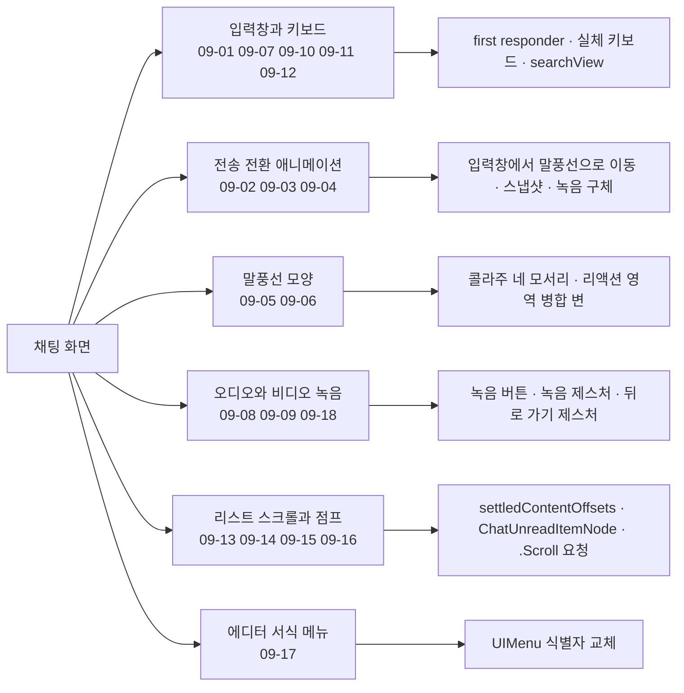
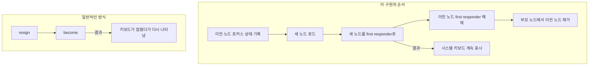
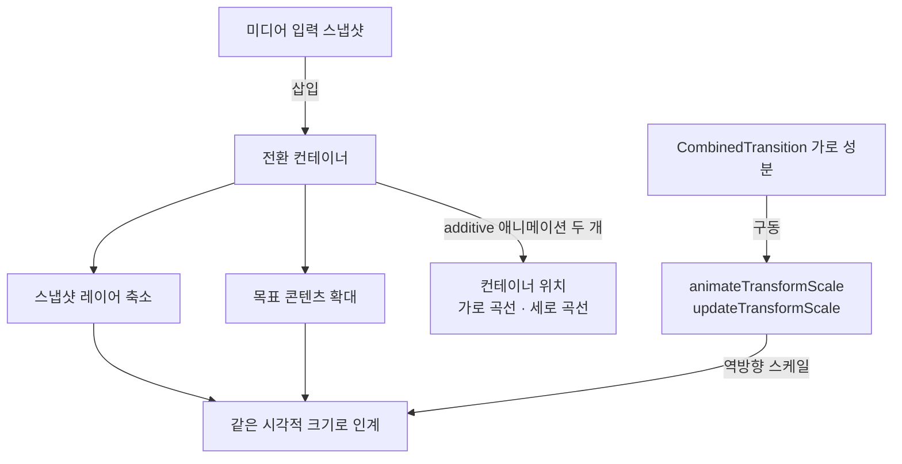
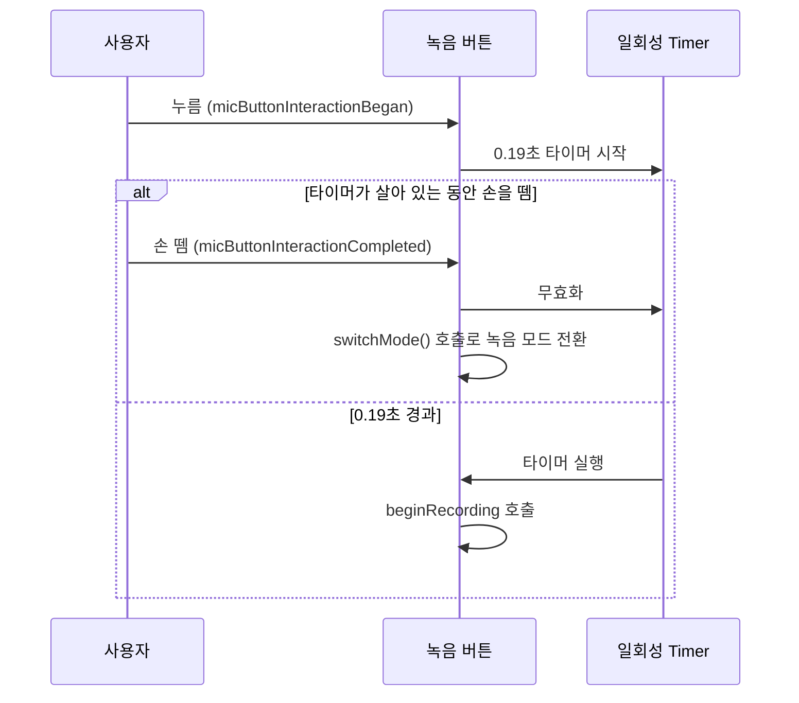
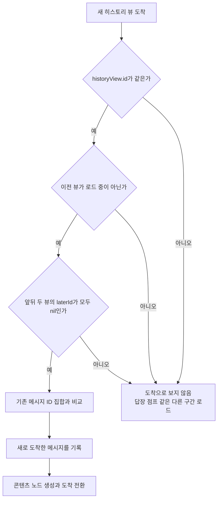

# 채팅 화면

웹: /docs/ios/09-chat-screen/ · Markdown: /docs/ios/09-chat-screen.md

> 입력창 포커스 인계, 메시지 전환, 리스트 도달 판정.

| 기법 항목 | 리포트 선정 | 관련 비공개 API | REA 연관 |
| --- | --- | --- | --- |
| 18 | 8 | 0 | 0 |

소스: [TelegramMessenger/Telegram-iOS@f1dd7a2d](https://github.com/TelegramMessenger/Telegram-iOS/tree/f1dd7a2dbd02cbbf513e75d5695d8d36d1cf5838)(2026-10-07) · 플랫폼: iOS · UIKit

이 장의 선정 항목:
- 09-1 [#09-01 먼저 first responder를 넘기고, 그다음 이전 입력창 해제하기](/docs/ios/09-chat-screen/#t09-01)
- 09-2 [#09-03 미디어 스냅샷을 역방향 스케일로 말풍선에 인계하기](/docs/ios/09-chat-screen/#t09-03)
- 09-3 [#09-04 녹음 구체가 직접 날아가 음성 말풍선으로 들어가기](/docs/ios/09-chat-screen/#t09-04)
- 09-4 [#09-05 미디어 콜라주의 네 모서리마다 독립적으로 병합 형태 정하기](/docs/ios/09-chat-screen/#t09-05)
- 09-5 [#09-08 녹음 버튼을 빠르게 탭하면 모드 바꾸고, 길게 눌러야 녹음 시작하기](/docs/ios/09-chat-screen/#t09-08)
- 09-6 [#09-13 리스트 업데이트 전에 안정된 오프셋을 한 번만 샘플링하기](/docs/ios/09-chat-screen/#t09-13)
- 09-7 [#09-15 답장 점프를 새 메시지 도착으로 위장하지 않기](/docs/ios/09-chat-screen/#t09-15)
- 09-8 [#09-17 식별자로 에디터 서식 메뉴를 교체하고 시스템 메뉴의 나머지 항목은 유지하기](/docs/ios/09-chat-screen/#t09-17)

주제 범위: Telegram-iOS 채팅 화면의 앱 계층 UIKit 기법. 말풍선, 입력, 미디어 키보드, 녹음, 전송 전환, 스크롤, 점프, 편집 메뉴를 다뤄요. 범용 ListView, 비공개 API, Portal/Liquid Glass, 키보드 윈도우는 다루지 않아요.

아래 도표는 이 장의 기법들이 채팅 화면의 어느 영역을 다루는지 묶어서 보여 줘요.



## 1. 먼저 first responder를 넘기고, 그다음 이전 입력창 해제하기 [#t09-01]

> #09-01 · Telegram-iOS · UIKit · 리포트 선정 09-1 · 검증 방식: 소스 분석
>
> 소스: [Telegram-iOS:submodules/TelegramUI/Components/Chat/ChatTextInputPanelNode/Sources/ChatTextInputPanelNode.swift L1124–L1141](https://github.com/TelegramMessenger/Telegram-iOS/blob/f1dd7a2dbd02cbbf513e75d5695d8d36d1cf5838/submodules/TelegramUI/Components/Chat/ChatTextInputPanelNode/Sources/ChatTextInputPanelNode.swift#L1124-L1141)

**무엇을 했나요**: 새 입력 노드를 먼저 first responder(키보드 입력을 받는 뷰)로 만들어요. 그런 다음에야 이전 노드가 first responder를 내려놓게 해요.

**왜 이렇게 했나요**: 이렇게 하면 시스템 키보드가 계속 보여요. `resign`을 먼저 하고 `become`을 나중에 하는 일반적인 방식은 키보드가 접혔다가 다시 나타나요.

아래 도표는 새 입력 노드로 포커스를 먼저 넘기는 순서를 일반적인 방식과 비교해 보여 줘요.



**핵심 코드 발췌**

```swift title="ChatTextInputPanelNode.swift · L1124–L1141"
/// Replace the current legacy input node with a freshly-built native node, transferring first-responder
/// status (become-new BEFORE resign-old, so the keyboard is not dismissed and re-presented). The caller sets
/// content on the new node immediately afterwards.
private func replaceLegacyWithNative() {
    guard let old = self.richTextInputNode, !old.usesNativeRichTextEngine else {
        return
    }
    let wasFirstResponder = old.isInputFirstResponder
    self.loadTextInputNode(useNative: true)
    guard let new = self.richTextInputNode, new !== old else {
        return
    }
    if wasFirstResponder {
        new.makeInputFirstResponder()
    }
    old.resignInputFirstResponder()
    old.asNode.removeFromSupernode()
}
```

**대가와 위험**: 새 노드는 편집 가능한 초기화를 먼저 끝내야 해요. 그러지 않으면 포커스와 내용이 잠깐 어긋나요.

**증거 체인 #09-01**(iOS 바이너리 미검증)

- 소스 분석: Telegram-iOS 고정 커밋에서 한 줄씩 확인했어요. 소스 위치는 모두 1곳이에요.
- 리포트 요약(구현 방법): 이전 노드의 포커스 상태를 먼저 기록하고, 새 노드를 로드한 뒤 포커스를 옮겨요. 마지막으로 부모 노드에서 이전 노드를 없애요.
- 바이너리 검증: 하지 않았어요. App Store 배포 IPA는 FairPlay로 암호화돼 있어서, 복호화된 실행 파일을 합법적으로 얻을 수 없어요.

## 2. 텍스트 전송 애니메이션에서 가로축과 세로축의 곡선 분리하기 [#t09-02]

> #09-02 · Telegram-iOS · UIKit · 검증 방식: 소스 분석 · 태그: 텍스트와 입력
>
> 소스: [Telegram-iOS:submodules/TelegramUI/Sources/ChatMessageTransitionNode.swift L689–L713](https://github.com/TelegramMessenger/Telegram-iOS/blob/f1dd7a2dbd02cbbf513e75d5695d8d36d1cf5838/submodules/TelegramUI/Sources/ChatMessageTransitionNode.swift#L689-L713)

**무엇을 했나요**: 가로 이동과 세로 이동을 두 개의 애니메이션으로 나눠요. 그런 다음 입력창 배경과 내용을 목표 말풍선에 넘겨요.

**왜 이렇게 했나요**: 말풍선이 아래쪽 입력창에서 날아올 때는 방향마다 속도 곡선이 달라야 해요. `UIView` 이동 애니메이션 하나로는 두 방향을 동시에 맞추기 어려워요.

**핵심 코드 발췌**

```swift title="ChatMessageTransitionNode.swift · L689–L713"
let horizontalCurve = ChatMessageTransitionNodeImpl.horizontalAnimationCurve
let horizontalTransition: ContainedViewLayoutTransition = .animated(duration: horizontalDuration, curve: horizontalCurve)
let verticalCurve = ChatMessageTransitionNodeImpl.verticalAnimationCurve
let verticalTransition: ContainedViewLayoutTransition = .animated(duration: verticalDuration, curve: verticalCurve)

let combinedTransition = CombinedTransition(horizontal: horizontalTransition, vertical: verticalTransition)

self.containerNode.frame = targetAbsoluteRect.offsetBy(dx: -self.contextSourceNode.contentRect.minX, dy: -self.contextSourceNode.contentRect.minY)
self.contextSourceNode.updateAbsoluteRect?(self.containerNode.frame, UIScreen.main.bounds.size)

self.containerNode.layer.animatePosition(from: CGPoint(x: 0.0, y: sourceAbsoluteRect.maxY - targetAbsoluteRect.maxY), to: CGPoint(), duration: verticalDuration, delay: delay, mediaTimingFunction: verticalCurve.mediaTimingFunction, additive: true, force: true, completion: { [weak self] _ in
    guard let strongSelf = self else {
        return
    }
    strongSelf.endAnimation()
})
self.containerNode.layer.animatePosition(from: CGPoint(x: sourceAbsoluteRect.minX - targetAbsoluteRect.minX, y: 0.0), to: CGPoint(), duration: horizontalDuration, delay: delay, mediaTimingFunction: horizontalCurve.mediaTimingFunction, additive: true)

if let itemNode = self.itemNode as? ChatMessageBubbleItemNode {
    itemNode.animateContentFromTextInputField(
        textInput: ChatMessageBubbleItemNode.AnimationTransitionTextInput(
            backgroundView: textInput.backgroundView,
            contentView: textInput.contentView,
            sourceRect: textInput.sourceRect,
```

**대가와 위험**: 좌표를 먼저 같은 컨테이너 기준으로 환산해야 해요. 곡선이나 지속 시간이 맞지 않으면 배경과 글자가 따로 떨어져요.

**증거 체인 #09-02**(iOS 바이너리 미검증)

- 소스 분석: Telegram-iOS 고정 커밋에서 한 줄씩 확인했어요. 소스 위치는 모두 1곳이에요.
- 바이너리 검증: 하지 않았어요. App Store 배포 IPA는 FairPlay로 암호화돼 있어서, 복호화된 실행 파일을 합법적으로 얻을 수 없어요.

## 3. 미디어 스냅샷을 역방향 스케일로 말풍선에 인계하기 [#t09-03]

> #09-03 · Telegram-iOS · UIKit · 리포트 선정 09-2 · 검증 방식: 소스 분석
>
> 소스: [Telegram-iOS:submodules/TelegramUI/Sources/ChatMessageTransitionNode.swift L986–L1010](https://github.com/TelegramMessenger/Telegram-iOS/blob/f1dd7a2dbd02cbbf513e75d5695d8d36d1cf5838/submodules/TelegramUI/Sources/ChatMessageTransitionNode.swift#L986-L1010)

**무엇을 했나요**: 미디어 입력 스냅샷을 전환 컨테이너에 넣어요. 동시에 목표 콘텐츠는 확대하고 스냅샷 레이어는 반대로 축소해요.

**왜 이렇게 했나요**: 두 레이어가 같은 시각적 크기에서 인계돼요. 스냅샷 하나만 직접 스케일하는 일반적인 방식은 목표 콘텐츠가 급격히 변하는 것이 그대로 드러나요.

아래 도표는 미디어 스냅샷을 말풍선에 인계할 때 스케일과 위치가 따로 움직이는 구조를 보여 줘요.



**핵심 코드 발췌**

```swift title="ChatMessageTransitionNode.swift · L986–L1010"
let combinedTransition = CombinedTransition(horizontal: .animated(duration: horizontalDuration, curve: ChatMessageTransitionNodeImpl.horizontalAnimationCurve), vertical: .animated(duration: verticalDuration, curve: ChatMessageTransitionNodeImpl.verticalAnimationCurve))

if let itemNode = self.itemNode as? ChatMessageBubbleItemNode {
    itemNode.animateContentFromMediaInput(snapshotView: snapshotView, transition: combinedTransition)
}

self.containerNode.frame = targetAbsoluteRect.offsetBy(dx: -self.contextSourceNode.contentRect.minX, dy: -self.contextSourceNode.contentRect.minY)

snapshotView.center = targetAbsoluteRect.center.offsetBy(dx: -self.containerNode.frame.minX, dy: -self.containerNode.frame.minY)
self.containerNode.view.addSubview(snapshotView)

self.contextSourceNode.updateAbsoluteRect?(self.containerNode.frame, UIScreen.main.bounds.size)

self.containerNode.layer.animatePosition(from: CGPoint(x: 0.0, y: sourceAbsoluteRect.midY - targetAbsoluteRect.midY), to: CGPoint(), duration: horizontalDuration, delay: delay, mediaTimingFunction: ChatMessageTransitionNodeImpl.horizontalAnimationCurve.mediaTimingFunction, additive: true, force: true)
self.containerNode.layer.animatePosition(from: CGPoint(x: sourceAbsoluteRect.midX - targetAbsoluteRect.midX, y: 0.0), to: CGPoint(), duration: verticalDuration, delay: delay, mediaTimingFunction: ChatMessageTransitionNodeImpl.verticalAnimationCurve.mediaTimingFunction, additive: true, force: true, completion: { [weak self] _ in
    guard let strongSelf = self else {
        return
    }
    strongSelf.endAnimation()
})

combinedTransition.horizontal.animateTransformScale(node: self.contextSourceNode.contentNode, from: CGPoint(x: sourceBackgroundAbsoluteRect.width / targetAbsoluteRect.width, y: sourceBackgroundAbsoluteRect.height / targetAbsoluteRect.height))

combinedTransition.horizontal.updateTransformScale(layer: snapshotView.layer, scale: CGPoint(x: 1.0 / (sourceBackgroundAbsoluteRect.width / targetAbsoluteRect.width), y: 1.0 / (sourceBackgroundAbsoluteRect.height / targetAbsoluteRect.height)))
```

**대가와 위험**: 소스와 목표의 크기가 0이면 안 돼요. 비율 계산이 틀리면 프레임이 튀거나 이미지가 늘어나요.

**증거 체인 #09-03**(iOS 바이너리 미검증)

- 소스 분석: Telegram-iOS 고정 커밋에서 한 줄씩 확인했어요. 소스 위치는 모두 1곳이에요.
- 리포트 요약(구현 방법): `CombinedTransition`의 가로 성분이 `animateTransformScale`과 `updateTransformScale`을 구동하고, 컨테이너 위치는 additive 애니메이션 두 개로 가로 곡선과 세로 곡선을 따로 타요.
- 바이너리 검증: 하지 않았어요. App Store 배포 IPA는 FairPlay로 암호화돼 있어서, 복호화된 실행 파일을 합법적으로 얻을 수 없어요.

## 4. 녹음 구체가 직접 날아가 음성 말풍선으로 들어가기 [#t09-04]

> #09-04 · Telegram-iOS · UIKit · 리포트 선정 09-3 · 검증 방식: 소스 분석
>
> 소스: [Telegram-iOS:submodules/TelegramUI/Sources/ChatMessageTransitionNode.swift L904–L928](https://github.com/TelegramMessenger/Telegram-iOS/blob/f1dd7a2dbd02cbbf513e75d5695d8d36d1cf5838/submodules/TelegramUI/Sources/ChatMessageTransitionNode.swift#L904-L928)

**무엇을 했나요**: 녹음 구체의 스냅샷을 찍지 않아요. 구체 자체가 메시지 안의 재생 버튼 위치로 날아가게 해요.

**왜 이렇게 했나요**: 구체는 자기 애니메이션 상태를 계속 이어 갈 수 있어요. 정적 스냅샷은 물결과 음량 같은 동적인 모습이 멈춰 버려요.

**핵심 코드 발췌**

```swift title="ChatMessageTransitionNode.swift · L904–L928"
// No snapshot of the blob: it flies itself, in its own container, along the same path as the
// play button here in the chat, crossfading into it at the start.
let sourceAbsoluteRect = convertRenderedSourceRect(localRect, from: container, toAnimatingView: self.view)

let combinedTransition = CombinedTransition(horizontal: .animated(duration: horizontalDuration, curve: ChatMessageTransitionNodeImpl.horizontalAnimationCurve), vertical: .animated(duration: verticalDuration, curve: ChatMessageTransitionNodeImpl.verticalAnimationCurve))

if let itemNode = self.itemNode as? ChatMessageBubbleItemNode {
    if let contextContainer = itemNode.animateFromMicInput(sourceSize: sourceAbsoluteRect.size, transition: combinedTransition) {
        self.containerNode.addSubnode(contextContainer.contentNode)

        let targetAbsoluteRect = contextContainer.view.convertAcrossWindows(contextContainer.contentRect, to: self.view)

        self.containerNode.frame = targetAbsoluteRect.offsetBy(dx: -contextContainer.contentRect.minX, dy: -contextContainer.contentRect.minY)
        contextContainer.updateAbsoluteRect?(self.containerNode.frame, UIScreen.main.bounds.size)

        let _ = audioMicInput.micButton.animateDecorationToSentMessage(targetRect: targetAbsoluteRect, in: self.view, duration: verticalDuration, horizontalCurve: ChatMessageTransitionNodeImpl.horizontalAnimationCurve, verticalCurve: ChatMessageTransitionNodeImpl.verticalAnimationCurve)

        self.containerNode.layer.animatePosition(from: CGPoint(x: 0.0, y: sourceAbsoluteRect.midY - targetAbsoluteRect.midY), to: CGPoint(), duration: verticalDuration, delay: delay, mediaTimingFunction: ChatMessageTransitionNodeImpl.verticalAnimationCurve.mediaTimingFunction, additive: true, force: true, completion: { [weak self, weak contextContainer] _ in
            guard let strongSelf = self else {
                return
            }
            if let contextContainer = contextContainer {
                contextContainer.isExtractedToContextPreview = false
                contextContainer.isExtractedToContextPreviewUpdated?(false)
                contextContainer.addSubnode(contextContainer.contentNode)
```

**대가와 위험**: 끝날 때 꺼내 뒀던 콘텐츠 노드를 복원해야 해요. 정리를 빠뜨리면 노드가 사라지거나 두 번 마운트돼요.

**증거 체인 #09-04**(iOS 바이너리 미검증)

- 소스 분석: Telegram-iOS 고정 커밋에서 한 줄씩 확인했어요. 소스 위치는 모두 1곳이에요.
- 리포트 요약(구현 방법): `animateFromMicInput`이 말풍선의 컨텍스트 컨테이너를 꺼내고, `animateDecorationToSentMessage`가 구체를 구동해요. 애니메이션이 끝나면 콘텐츠 노드를 원래 컨테이너에 되돌려 놓아요.
- 바이너리 검증: 하지 않았어요. App Store 배포 IPA는 FairPlay로 암호화돼 있어서, 복호화된 실행 파일을 합법적으로 얻을 수 없어요.

## 5. 미디어 콜라주의 네 모서리마다 독립적으로 병합 형태 정하기 [#t09-05]

> #09-05 · Telegram-iOS · UIKit · 리포트 선정 09-4 · 검증 방식: 소스 분석
>
> 소스: [Telegram-iOS:submodules/TelegramUI/Components/Chat/ChatMessageBubbleItemNode/Sources/ChatMessageBubbleItemNode.swift L3353–L3375](https://github.com/TelegramMessenger/Telegram-iOS/blob/f1dd7a2dbd02cbbf513e75d5695d8d36d1cf5838/submodules/TelegramUI/Components/Chat/ChatMessageBubbleItemNode/Sources/ChatMessageBubbleItemNode.swift#L3353-L3375)

**무엇을 했나요**: 콜라주의 네 모서리마다 인접 상태를 따로 계산해요. 일반 병합과 말풍선 병합도 구분해요.

**왜 이렇게 했나요**: 콜라주 가장자리와 메시지 그룹 가장자리가 겹쳐요. 모서리 반경을 하나로 통일하면 꼬리와 바깥쪽 가장자리를 표현할 수 없어요.

**핵심 코드 발췌**

```swift title="ChatMessageBubbleItemNode.swift · L3353–L3375"
let position = framesAndPositions[mosaicIndex].1

let topLeft: ChatMessageBubbleContentMosaicNeighbor
let topRight: ChatMessageBubbleContentMosaicNeighbor
let bottomLeft: ChatMessageBubbleContentMosaicNeighbor
let bottomRight: ChatMessageBubbleContentMosaicNeighbor

switch firstNodeTopPosition {
case .Neighbour:
    topLeft = .merged
    topRight = .merged
case .BubbleNeighbour:
    topLeft = .mergedBubble
    topRight = .mergedBubble
case let .None(status):
    if position.contains(.top) && position.contains(.left) {
        switch status {
        case .Left, .Both:
            topLeft = .mergedBubble
        case .Right:
            topLeft = .none(tail: false)
        case .None:
            topLeft = .none(tail: false)
        }
```

**대가와 위험**: 상태 조합이 많아요. 콜라주 위치를 새로 추가할 때는 모든 모서리의 분기를 빠짐없이 채워야 해요.

**증거 체인 #09-05**(iOS 바이너리 미검증)

- 소스 분석: Telegram-iOS 고정 커밋에서 한 줄씩 확인했어요. 소스 위치는 모두 1곳이에요.
- 리포트 요약(구현 방법): 셀이 콜라주에서 차지하는 위치(`.top`, `.left` 등)와 위아래 이웃의 병합 상태로 `switch`를 해요.
- 바이너리 검증: 하지 않았어요. App Store 배포 IPA는 FairPlay로 암호화돼 있어서, 복호화된 실행 파일을 합법적으로 얻을 수 없어요.

## 6. 리액션 영역에서 말풍선의 아래쪽 병합 변 바꾸기 [#t09-06]

> #09-06 · Telegram-iOS · UIKit · 검증 방식: 소스 분석
>
> 소스: [Telegram-iOS:submodules/TelegramUI/Components/Chat/ChatMessageBubbleItemNode/Sources/ChatMessageBubbleItemNode.swift L2395–L2415](https://github.com/TelegramMessenger/Telegram-iOS/blob/f1dd7a2dbd02cbbf513e75d5695d8d36d1cf5838/submodules/TelegramUI/Components/Chat/ChatMessageBubbleItemNode/Sources/ChatMessageBubbleItemNode.swift#L2395-L2415)

**무엇을 했나요**: 리액션이 있고 미리보기가 아닐 때 아래쪽 병합 상태를 덮어써요. 수신 메시지는 왼쪽 변을, 발신 메시지는 오른쪽 변을 골라요.

**왜 이렇게 했나요**: 리액션 영역은 말풍선 아래에 붙어요. 다음 메시지와의 병합 관계를 그대로 따르지 않고, 같은 쪽으로 이어지는 윤곽이 필요해요.

**핵심 코드 발췌**

```swift title="ChatMessageBubbleItemNode.swift · L2395–L2415"
let topNodeMergeStatus: ChatMessageBubbleMergeStatus = mergedTop.merged ? (incoming ? .Left : .Right) : .None(incoming ? .Incoming : .Outgoing)
var bottomNodeMergeStatus: ChatMessageBubbleMergeStatus = mergedBottom.merged ? (incoming ? .Left : .Right) : .None(incoming ? .Incoming : .Outgoing)

let bubbleReactions: ReactionsMessageAttribute
if needReactions || forceReactionsOutside {
    bubbleReactions = mergedMessageReactions(attributes: item.message.attributes, isTags: item.message.areReactionsTags(accountPeerId: item.context.account.peerId)) ?? ReactionsMessageAttribute(canViewList: false, isTags: false, reactions: [], recentPeers: [], topPeers: [])
} else {
    bubbleReactions = ReactionsMessageAttribute(canViewList: false, isTags: false, reactions: [], recentPeers: [], topPeers: [])
}
if !bubbleReactions.reactions.isEmpty && !item.presentationData.isPreview {
    if incoming {
        bottomNodeMergeStatus = .Left
    } else {
        bottomNodeMergeStatus = .Right
    }
}

var currentCredibilityIcon: (EmojiStatusComponent.Content, UIColor?)?

let displayEphemeralBadge: Bool
if ephemeralBadgeText != nil && !mergedTop.merged && !hidesHeaders && item.message.adAttribute == nil {
```

**대가와 위험**: 리액션 표시 규칙이 모서리 반경 규칙과 엮여 있어요. 리액션 위치를 바꿀 때는 메시지 그룹을 회귀 테스트해야 해요.

**증거 체인 #09-06**(iOS 바이너리 미검증)

- 소스 분석: Telegram-iOS 고정 커밋에서 한 줄씩 확인했어요. 소스 위치는 모두 1곳이에요.
- 바이너리 검증: 하지 않았어요. App Store 배포 IPA는 FairPlay로 암호화돼 있어서, 복호화된 실행 파일을 합법적으로 얻을 수 없어요.

## 7. 텍스트 측정값에 따라 늘어나되 최대 열두 줄까지인 입력창 [#t09-07]

> #09-07 · Telegram-iOS · UIKit · 검증 방식: 소스 분석 · 태그: 텍스트와 입력
>
> 소스: [Telegram-iOS:submodules/TelegramUI/Components/Chat/ChatTextInputPanelNode/Sources/ChatTextInputPanelNode.swift L1410–L1429](https://github.com/TelegramMessenger/Telegram-iOS/blob/f1dd7a2dbd02cbbf513e75d5695d8d36d1cf5838/submodules/TelegramUI/Components/Chat/ChatTextInputPanelNode/Sources/ChatTextInputPanelNode.swift#L1410-L1429)

**무엇을 했나요**: 쓸 수 있는 너비로 서식 있는 텍스트의 높이를 재요. 높이를 1줄에서 12줄 사이로 제한하고 오버플로 표시도 함께 돌려줘요.

**왜 이렇게 했나요**: 입력창은 텍스트에 따라 늘어나되 채팅 내용을 삼켜서는 안 돼요. `contentSize`만으로는 버튼과 안쪽 여백을 동시에 빼기 어려워요.

**핵심 코드 발췌**

```swift title="ChatTextInputPanelNode.swift · L1410–L1429"
var textFieldHeight: CGFloat
var isOverflow = false
if let richTextInputNode = self.richTextInputNode {
    let maxTextWidth = width - textFieldInsets.left - textFieldInsets.right - actualTextInputViewInternalInsets.left - actualTextInputViewInternalInsets.right
    let measuredHeight = richTextInputNode.textHeightForWidth(maxTextWidth, rightInset: textInputViewRealInsets.right)
    
    let unboundTextFieldHeight = max(textFieldMinHeight, ceil(measuredHeight))
    
    let maxNumberOfLines = max(1, min(12, (Int(fieldMaxHeight - 11.0) - 33) / 22))
    
    let updatedMaxHeight = (CGFloat(maxNumberOfLines) * (22.0 + 2.0) + 10.0)
    
    textFieldHeight = max(textFieldMinHeight, unboundTextFieldHeight)
    isOverflow = textFieldHeight > updatedMaxHeight
    textFieldHeight = min(textFieldHeight, updatedMaxHeight)
} else {
    textFieldHeight = textFieldMinHeight
}

return (accessoryButtonsWidth, textFieldHeight, isOverflow)
```

**대가와 위험**: 행 높이 상수는 22예요. 폰트나 단락 스타일이 바뀌면 상한 공식을 다시 보정해야 해요.

**증거 체인 #09-07**(iOS 바이너리 미검증)

- 소스 분석: Telegram-iOS 고정 커밋에서 한 줄씩 확인했어요. 소스 위치는 모두 1곳이에요.
- 바이너리 검증: 하지 않았어요. App Store 배포 IPA는 FairPlay로 암호화돼 있어서, 복호화된 실행 파일을 합법적으로 얻을 수 없어요.

## 8. 녹음 버튼을 빠르게 탭하면 모드 바꾸고, 길게 눌러야 녹음 시작하기 [#t09-08]

> #09-08 · Telegram-iOS · UIKit · 리포트 선정 09-5 · 검증 방식: 소스 분석
>
> 소스: [Telegram-iOS:submodules/TelegramUI/Components/ChatTextInputMediaRecordingButton/Sources/ChatTextInputMediaRecordingButton.swift L519–L550](https://github.com/TelegramMessenger/Telegram-iOS/blob/f1dd7a2dbd02cbbf513e75d5695d8d36d1cf5838/submodules/TelegramUI/Components/ChatTextInputMediaRecordingButton/Sources/ChatTextInputMediaRecordingButton.swift#L519-L550)

**무엇을 했나요**: 0.19초 지연 뒤에야 `beginRecording`을 호출해요. 타이머가 살아 있는 동안 사용자가 손을 떼면 녹음 모드를 바꿔요.

**왜 이렇게 했나요**: 같은 버튼이 오디오와 비디오의 진입점을 겸해요. 바로 녹음을 시작하면 단순한 탭이 잘못된 녹음으로 이어져요.

아래 도표는 녹음 버튼을 누른 뒤 0.19초 안에 손을 떼는 경우와 계속 누르는 경우의 차이를 보여 줘요.



**핵심 코드 발췌**

```swift title="ChatTextInputMediaRecordingButton.swift · L519–L550"
public func micButtonInteractionBegan() {
    if self.fadeDisabled {
        self.recordingDisabled()
    } else {
        self.modeTimeoutTimer?.invalidate()
        let modeTimeoutTimer = SwiftSignalKit.Timer(timeout: 0.19, repeat: false, completion: { [weak self] in
            if let strongSelf = self {
                strongSelf.modeTimeoutTimer = nil
                strongSelf.beginRecording()
            }
        }, queue: Queue.mainQueue())
        self.modeTimeoutTimer = modeTimeoutTimer
        modeTimeoutTimer.start()
    }
}

// ...
public func micButtonInteractionCompleted(_ velocity: CGPoint) {
    if let modeTimeoutTimer = self.modeTimeoutTimer {
        modeTimeoutTimer.invalidate()
        self.modeTimeoutTimer = nil
        self.switchMode()
    }
    self.endRecording(true)
}
```

**대가와 위험**: 0.19초만큼 길게 누르기의 시작이 늦어져요. 임계값은 햅틱 피드백과 함께 테스트해야 해요.

**증거 체인 #09-08**(iOS 바이너리 미검증)

- 소스 분석: Telegram-iOS 고정 커밋에서 한 줄씩 확인했어요. 소스 위치는 모두 1곳이에요.
- 리포트 요약(구현 방법): `micButtonInteractionBegan`이 일회성 `SwiftSignalKit.Timer`를 시작해요. `micButtonInteractionCompleted`는 타이머가 아직 있으면 무효화하고 `switchMode()`를 호출해요.
- 바이너리 검증: 하지 않았어요. App Store 배포 IPA는 FairPlay로 암호화돼 있어서, 복호화된 실행 파일을 합법적으로 얻을 수 없어요.

## 9. 녹음 제스처에서 가로 이동, 취소 이동, 잠금을 나눠 보고하기 [#t09-09]

> #09-09 · Telegram-iOS · UIKit · 검증 방식: 소스 분석 · 태그: 제스처와 스크롤
>
> 소스: [Telegram-iOS:submodules/TelegramUI/Components/ChatTextInputMediaRecordingButton/Sources/ChatTextInputMediaRecordingButton.swift L553–L575](https://github.com/TelegramMessenger/Telegram-iOS/blob/f1dd7a2dbd02cbbf513e75d5695d8d36d1cf5838/submodules/TelegramUI/Components/ChatTextInputMediaRecordingButton/Sources/ChatTextInputMediaRecordingButton.swift#L553-L575)

**무엇을 했나요**: 컨트롤 바의 가로 이동과 취소 안내의 이동을 따로 저장해요. 잠금 이벤트에서는 잠금을 보고하고 잠금을 허용해요.

**왜 이렇게 했나요**: 위로 밀어 잠그는 동작과 옆으로 밀어 취소하는 동작은 서로 다른 시각 요소를 써요. 이동값 하나로 합치면 두 피드백이 서로 간섭해요.

**핵심 코드 발췌**

```swift title="ChatTextInputMediaRecordingButton.swift · L553–L575"
public func micButtonInteractionUpdate(_ offset: CGPoint) {
    self.controlsOffset = offset.x
    self.offsetRecordingControls()
}

public func micButtonInteractionUpdateCancelTranslation(_ translation: CGFloat) {
    self.cancelTranslation = translation
    self.updateCancelTranslation()
}

public func micButtonInteractionLocked() {
    self.updateLocked(true)
}

public func micButtonInteractionRequestedLockedAction() {
}

public func micButtonInteractionStopped() {
    self.stopRecording()
}

public func micButtonShouldLock() -> Bool {
    return true
}
```

**대가와 위험**: 이 클래스는 무조건 `true`를 돌려줘요. 구체적인 잠금 임계값은 부모 클래스의 제스처 구현이 정하는데, 이 노트에서는 검증하지 않았어요.

**증거 체인 #09-09**(iOS 바이너리 미검증)

- 소스 분석: Telegram-iOS 고정 커밋에서 한 줄씩 확인했어요. 소스 위치는 모두 1곳이에요.
- 바이너리 검증: 하지 않았어요. App Store 배포 IPA는 FairPlay로 암호화돼 있어서, 복호화된 실행 파일을 합법적으로 얻을 수 없어요.

## 10. 미디어 패널이 허용될 때만 자동으로 텍스트 입력으로 되돌아가기 [#t09-10]

> #09-10 · Telegram-iOS · UIKit · 검증 방식: 소스 분석 · 태그: 텍스트와 입력
>
> 소스: [Telegram-iOS:submodules/TelegramUI/Sources/ChatControllerNode.swift L1035–L1051](https://github.com/TelegramMessenger/Telegram-iOS/blob/f1dd7a2dbd02cbbf513e75d5695d8d36d1cf5838/submodules/TelegramUI/Sources/ChatControllerNode.swift#L1035-L1051)

**무엇을 했나요**: 입력 패널이 텍스트 모드를 요청하면 먼저 현재의 실체 키보드에 물어봐요. `.media` 상태만 `.text`로 바꿔요.

**왜 이렇게 했나요**: 일부 실체 키보드 상태는 자동으로 거둬들이면 안 돼요. 강제로 전환하면 이모지, 스티커, 검색 조작이 끊겨요.

**핵심 코드 발췌**

```swift title="ChatControllerNode.swift · L1035–L1051"
self.textInputPanelNode?.switchToTextInputIfNeeded = { [weak self] in
    guard let strongSelf = self, let interfaceInteraction = strongSelf.interfaceInteraction else {
        return
    }
    
    if let inputNode = strongSelf.inputNode as? ChatEntityKeyboardInputNode, !inputNode.canSwitchToTextInputAutomatically {
        return
    }
    
    interfaceInteraction.updateInputModeAndDismissedButtonKeyboardMessageId({ state in
        switch state.inputMode {
        case .media:
            return (.text, state.keyboardButtonsMessage?.id)
        default:
            return (state.inputMode, state.keyboardButtonsMessage?.id)
        }
    })
}
```

**대가와 위험**: 전환을 허용할지는 `canSwitchToTextInputAutomatically`에 숨어 있어요. 이 속성이 구체적으로 어떻게 판정하는지는 이 노트에서 검증하지 않았어요.

**증거 체인 #09-10**(iOS 바이너리 미검증)

- 소스 분석: Telegram-iOS 고정 커밋에서 한 줄씩 확인했어요. 소스 위치는 모두 1곳이에요.
- 바이너리 검증: 하지 않았어요. App Store 배포 IPA는 FairPlay로 암호화돼 있어서, 복호화된 실행 파일을 합법적으로 얻을 수 없어요.

## 11. 숨겨진 입력창의 높이를 컴포넌트 입력으로 받는 실체 키보드 [#t09-11]

> #09-11 · Telegram-iOS · UIKit · 검증 방식: 소스 분석 · 태그: 텍스트와 입력, 성능과 메모리
>
> 소스: [Telegram-iOS:submodules/TelegramUI/Components/ChatEntityKeyboardInputNode/Sources/ChatEntityKeyboardInputNode.swift L1814–L1836](https://github.com/TelegramMessenger/Telegram-iOS/blob/f1dd7a2dbd02cbbf513e75d5695d8d36d1cf5838/submodules/TelegramUI/Components/ChatEntityKeyboardInputNode/Sources/ChatEntityKeyboardInputNode.swift#L1814-L1836)

**무엇을 했나요**: 전체 레이아웃 상태를 캐시해요. 숨겨진 텍스트 입력 패널의 높이를 실체 키보드 컴포넌트에 넘겨요.

**왜 이렇게 했나요**: 이모지 검색은 118포인트까지 늘어날 수 있어요. 동시에 콘텐츠가 숨겨진 입력 영역을 누르지 않아야 해요. 키보드 전체 높이만 쓰면 이렇게 부분적으로 걸리는 제약이 사라져요.

**핵심 코드 발췌**

```swift title="ChatEntityKeyboardInputNode.swift · L1814–L1836"
public override func updateLayout(width: CGFloat, leftInset: CGFloat, rightInset: CGFloat, bottomInset: CGFloat, standardInputHeight: CGFloat, inputHeight: CGFloat, maximumHeight: CGFloat, inputPanelHeight: CGFloat, transition: ContainedViewLayoutTransition, interfaceState: ChatPresentationInterfaceState, layoutMetrics: LayoutMetrics, deviceMetrics: DeviceMetrics, isVisible: Bool, isExpanded: Bool) -> (CGFloat, CGFloat) {
    self.currentState = (width, leftInset, rightInset, bottomInset, standardInputHeight, inputHeight, maximumHeight, inputPanelHeight, interfaceState, layoutMetrics, deviceMetrics, isVisible, isExpanded)

    let innerTransition: ComponentTransition
    if let scheduledInnerTransition = self.scheduledInnerTransition {
        self.scheduledInnerTransition = nil
        innerTransition = scheduledInnerTransition
    } else {
        innerTransition = ComponentTransition(transition)
    }

    let wasMarkedInputCollapsed = self.isMarkInputCollapsed
    self.isMarkInputCollapsed = false

    var expandedHeight = standardInputHeight
    if self.isEmojiSearchActive && !isExpanded {
        expandedHeight += 118.0
    }

    var hiddenInputHeight: CGFloat = 0.0
    if self.hideInput && !self.adjustLayoutForHiddenInput {
        hiddenInputHeight = inputPanelHeight
    }
```

**대가와 위험**: `hideInput`과 `adjustLayoutForHiddenInput`을 조합하면 상태 행렬이 돼요. 상태가 바뀔 때마다 레이아웃을 다시 계산하도록 트리거해야 해요.

**증거 체인 #09-11**(iOS 바이너리 미검증)

- 소스 분석: Telegram-iOS 고정 커밋에서 한 줄씩 확인했어요. 소스 위치는 모두 1곳이에요.
- 바이너리 검증: 하지 않았어요. App Store 배포 IPA는 FairPlay로 암호화돼 있어서, 복호화된 실행 파일을 합법적으로 얻을 수 없어요.

## 12. 처음 나타날 때만 즉시 트리를 만드는 이모지 검색 오버레이 [#t09-12]

> #09-12 · Telegram-iOS · UIKit · 검증 방식: 소스 분석 · 태그: 텍스트와 입력
>
> 소스: [Telegram-iOS:submodules/TelegramUI/Components/EntityKeyboard/Sources/EntityKeyboard.swift L813–L842](https://github.com/TelegramMessenger/Telegram-iOS/blob/f1dd7a2dbd02cbbf513e75d5695d8d36d1cf5838/submodules/TelegramUI/Components/EntityKeyboard/Sources/EntityKeyboard.swift#L813-L842)

**무엇을 했나요**: 검색을 기존 키보드 위의 독립된 `searchView`에 둬요. 처음 나타날 때는 페이드 인하면서 상단 패널의 이동에 맞추고, 끝낼 때는 페이드 아웃한 뒤 없애요.

**왜 이렇게 했나요**: Pager는 그대로 두고 검색 콘텐츠를 오버레이로 대신해요. 키보드 전체를 다시 만들면 페이지 위치를 잃고 깜빡임도 늘어나요.

**핵심 코드 발췌**

```swift title="EntityKeyboard.swift · L813–L842"
if let current = self.searchView {
    searchView = current
} else {
    searchViewTransition = .immediate
    searchView = ComponentHostView<EntitySearchContentEnvironment>()
    self.searchView = searchView
    self.addSubview(searchView)
    
    animateIn = true
    component.topPanelExtensionUpdated(0.0, transition)
}

// ...
searchViewTransition.setFrame(view: searchView, frame: CGRect(origin: CGPoint(), size: availableSize))
if animateIn {
    transition.animateAlpha(view: searchView, from: 0.0, to: 1.0)
    transition.animatePosition(view: searchView, from: CGPoint(x: 0.0, y: self.topPanelExtension ?? 0.0), to: CGPoint(), additive: true, completion: nil)
}
```

**대가와 위험**: 오버레이와 Pager는 `inputHeight`가 일치해야 해요. 어긋나면 키보드 가장자리에 틈이 생겨요.

**증거 체인 #09-12**(iOS 바이너리 미검증)

- 소스 분석: Telegram-iOS 고정 커밋에서 한 줄씩 확인했어요. 소스 위치는 모두 1곳이에요.
- 바이너리 검증: 하지 않았어요. App Store 배포 IPA는 FairPlay로 암호화돼 있어서, 복호화된 실행 파일을 합법적으로 얻을 수 없어요.

## 13. 리스트 업데이트 전에 안정된 오프셋을 한 번만 샘플링하기 [#t09-13]

> #09-13 · Telegram-iOS · UIKit · 리포트 선정 09-6 · 검증 방식: 소스 분석
>
> 소스: [Telegram-iOS:submodules/TelegramUI/Sources/ChatHistoryListNode.swift L2515–L2534](https://github.com/TelegramMessenger/Telegram-iOS/blob/f1dd7a2dbd02cbbf513e75d5695d8d36d1cf5838/submodules/TelegramUI/Sources/ChatHistoryListNode.swift#L2515-L2534)

**무엇을 했나요**: 리스트 트랜잭션을 준비할 때 `settledContentOffsets`를 한 번만 읽어요. 같은 샘플로 최신 메시지에 붙어 있는지, 화면이 가득 차 있는지를 판단해요.

**왜 이렇게 했나요**: 애니메이션 중에 지오메트리를 두 번 읽으면 서로 다른 프레임의 값일 수 있어요. 따로 읽으면 위치를 유지할지 정하는 판단이 서로 모순돼요.

**핵심 코드 발췌**

```swift title="ChatHistoryListNode.swift · L2515–L2534"
if let strongSelf = self, updatedScrollPosition == nil, case .InteractiveChanges = reason, let previous = previous {
    // ONE sample feeds both gates below. They are compared against each other to decide a
    // scroll position, and this runs while a transaction is being PREPARED — so the
    // question is what state the list is in, not where a pass in flight happens to have
    // the content at this instant. On ListViewImpl the settled and presented geometries
    // are the same thing; under a hosting backend, two separate reads would let "am I
    // pinned to the newest message" and "does the content fill the screen" describe
    // different moments of the same animation.
    let settledOffsets = strongSelf.listView.settledContentOffsets()

    if case let .known(offset) = settledOffsets.top, abs(offset) <= 0.9 {
        var fillsScreen = true
        switch settledOffsets.bottom {
        case let .known(bottomOffset):
            if bottomOffset <= strongSelf.listView.visibleSize.height - strongSelf.insets.bottom {
                fillsScreen = false
            }
        default:
            break
        }
```

**대가와 위험**: 리스트 구현이 안정된 오프셋을 준다는 전제에 기대요. 커스텀 호스팅 백엔드도 이 의미를 지켜야 해요.

**증거 체인 #09-13**(iOS 바이너리 미검증)

- 소스 분석: Telegram-iOS 고정 커밋에서 한 줄씩 확인했어요. 소스 위치는 모두 1곳이에요.
- 리포트 요약(구현 방법): `.InteractiveChanges` 분기 첫머리에서 샘플을 한 번 가져오고, 최신 메시지에 붙어 있는지 보는 조건과 화면이 가득 찼는지 보는 조건 모두 이 샘플을 써요.
- 바이너리 검증: 하지 않았어요. App Store 배포 IPA는 FairPlay로 암호화돼 있어서, 복호화된 실행 파일을 합법적으로 얻을 수 없어요.

## 14. 읽지 않은 메시지 구분선이 화면 밖이면 강제로 다시 포커스하기 [#t09-14]

> #09-14 · Telegram-iOS · UIKit · 검증 방식: 소스 분석 · 태그: 성능과 메모리
>
> 소스: [Telegram-iOS:submodules/TelegramUI/Sources/ChatHistoryListNode.swift L2957–L2975](https://github.com/TelegramMessenger/Telegram-iOS/blob/f1dd7a2dbd02cbbf513e75d5695d8d36d1cf5838/submodules/TelegramUI/Sources/ChatHistoryListNode.swift#L2957-L2975)

**무엇을 했나요**: 기존 항목 노드를 순회해요. `ChatUnreadItemNode`를 찾으면 그 노드가 보이도록 바로 보장해요.

**왜 이렇게 했나요**: 읽지 않은 메시지 구분선은 사용자가 위치를 다시 잡는 시각적 기준점이에요. 메시지 인덱스로만 스크롤하면 트랜잭션 뒤에 구분선이 화면 밖에 남아요.

**핵심 코드 발췌**

```swift title="ChatHistoryListNode.swift · L2957–L2975"
let _ = self.clientId.swap(nextClientId)
nextClientId += 1

self.listView.updateVisibleItemRange(force: true)
}

func refocusOnUnreadMessagesIfNeeded() {
    self.forEachItemNode({ itemNode in
        if let itemNode = itemNode as? ChatUnreadItemNode {
            self.listView.ensureItemNodeVisible(itemNode, animated: false, overflow: 0.0, curve: .Default(duration: nil))
        }
    })
}

private func maybeInsertPendingAdMessage(historyView: ChatHistoryView, toLaterRange: (Int, Int), toEarlierRange: (Int, Int)) {
    if self.pendingDynamicAdMessages.isEmpty {
        return
    }
    
    var eligibleMessageIndices = Set<MessageIndex>()
```

**대가와 위험**: 현재 항목 노드를 순회해요. 보이는 범위가 아주 크면 메인 스레드 작업이 조금 늘어나요.

**증거 체인 #09-14**(iOS 바이너리 미검증)

- 소스 분석: Telegram-iOS 고정 커밋에서 한 줄씩 확인했어요. 소스 위치는 모두 1곳이에요.
- 바이너리 검증: 하지 않았어요. App Store 배포 IPA는 FairPlay로 암호화돼 있어서, 복호화된 실행 파일을 합법적으로 얻을 수 없어요.

## 15. 답장 점프를 새 메시지 도착으로 위장하지 않기 [#t09-15]

> #09-15 · Telegram-iOS · UIKit · 리포트 선정 09-7 · 검증 방식: 소스 분석
>
> 소스: [Telegram-iOS:submodules/TelegramUI/Sources/ChatHistoryListNode.swift L4095–L4115](https://github.com/TelegramMessenger/Telegram-iOS/blob/f1dd7a2dbd02cbbf513e75d5695d8d36d1cf5838/submodules/TelegramUI/Sources/ChatHistoryListNode.swift#L4095-L4115)

**무엇을 했나요**: 콘텐츠 노드를 만들기 전에 실제로 새로 도착한 메시지를 기록해요. 답장 점프를 포함해 다른 구간의 히스토리를 로드하는 경우는 분명하게 제외해요.

**왜 이렇게 했나요**: 답장 점프로 삽입된 항목은 로드 결과일 뿐이에요. 답장 점프로 삽입된 항목을 수신 메시지로 다루면 도착 전환이 잘못 재생돼요.

아래 도표는 새 메시지 도착으로 볼지 판정하는 조건을 순서대로 보여 줘요.



**핵심 코드 발췌**

```swift title="ChatHistoryListNode.swift · L4095–L4115"
private func dequeueHistoryViewTransitions() {
    if self.enqueuedHistoryViewTransitions.isEmpty || self.hasActiveTransition {
        return
    }
    self.hasActiveTransition = true
    let transition = self.enqueuedHistoryViewTransitions.removeFirst()

    // Record live arrivals before creating their content nodes. Loading another history
    // window (including a reply jump) must never look like a newly received transfer.
    if case .InteractiveChanges = transition.reason,
       !transition.insertItems.isEmpty,
       self.controllerInteraction.canReadHistory,
       let previous = self.historyView,
       previous.id == transition.historyView.id,
       !previous.originalView.isLoading, previous.originalView.laterId == nil,
       transition.historyView.originalView.laterId == nil {
        let previousIds = Set(previous.originalView.entries.map { $0.message.id })
        let previousLastIndex = previous.originalView.entries.map { $0.message.index }.max()
        for entry in transition.historyView.originalView.entries {
            let message = entry.message
```

**대가와 위험**: 도착 판정은 히스토리 뷰의 `id`, 로드 상태, `laterId`에 기대요. 데이터 소스의 의미가 바뀌면 다시 검토해야 해요.

**증거 체인 #09-15**(iOS 바이너리 미검증)

- 소스 분석: Telegram-iOS 고정 커밋에서 한 줄씩 확인했어요. 소스 위치는 모두 1곳이에요.
- 리포트 요약(구현 방법): 판정 조건은 세 가지예요.
  - `historyView.id`가 같아요.
  - 이전 뷰가 로드 중이 아니에요.
  - 앞뒤 두 뷰의 `laterId`가 모두 `nil`이에요.

  이 조건을 모두 만족하면 기존 메시지 ID 집합과 비교해요.
- 바이너리 검증: 하지 않았어요. App Store 배포 IPA는 FairPlay로 암호화돼 있어서, 복호화된 실행 파일을 합법적으로 얻을 수 없어요.

## 16. 하이라이트, 인용, 답장 설정을 함께 싣는 점프 요청 [#t09-16]

> #09-16 · Telegram-iOS · UIKit · 검증 방식: 소스 분석 · 태그: 제스처와 스크롤
>
> 소스: [Telegram-iOS:submodules/TelegramUI/Sources/ChatHistoryListNode.swift L3856–L3879](https://github.com/TelegramMessenger/Telegram-iOS/blob/f1dd7a2dbd02cbbf513e75d5695d8d36d1cf5838/submodules/TelegramUI/Sources/ChatHistoryListNode.swift#L3856-L3879)

**무엇을 했나요**: 하이라이트, 인용 조각, 답장 스레드, 스크롤 앵커를 한 번의 `.Scroll` 요청에 담아요. 요청마다 새 위치 식별자도 만들어요.

**왜 이렇게 했나요**: 시각적으로 위치를 지정하는 일은 단순한 오프셋이 아니에요. 목표 메시지만 넘기면 인용 하이라이트나 점프 뒤 답장 상태 열기를 표현할 수 없어요.

**핵심 코드 발췌**

```swift title="ChatHistoryListNode.swift · L3856–L3879"
if let currentMessage = currentMessage {
    self.chatHistoryLocationValue = ChatHistoryLocationInput(content: .Scroll(subject: MessageHistoryScrollToSubject(index: .message(currentMessage.index), quote: nil), anchorIndex: .message(currentMessage.index), sourceIndex: .upperBound, scrollPosition: .top(0.0), animated: true, highlight: true, setupReply: false), id: self.takeNextHistoryLocationId())
}
}
}

public func scrollToStartOfHistory() {
    self.beganDragging?()
    self.chatHistoryLocationValue = ChatHistoryLocationInput(content: .Scroll(subject: MessageHistoryScrollToSubject(index: .lowerBound, quote: nil), anchorIndex: .lowerBound, sourceIndex: .upperBound, scrollPosition: .bottom(0.0), animated: true, highlight: false, setupReply: false), id: self.takeNextHistoryLocationId())
}

public func scrollToEndOfHistory() {
    self.beganDragging?()
    switch self.visibleContentOffset() {
    case let .known(value) where value <= CGFloat.ulpOfOne:
        break
    default:
        let locationInput = ChatHistoryLocationInput(content: .Scroll(subject: MessageHistoryScrollToSubject(index: .upperBound, quote: nil), anchorIndex: .upperBound, sourceIndex: .lowerBound, scrollPosition: .top(0.0), animated: true, highlight: false, setupReply: false), id: self.takeNextHistoryLocationId())
        self.chatHistoryLocationValue = locationInput
    }
}

public func scrollToMessage(from fromIndex: MessageIndex, to toIndex: MessageIndex, animated: Bool, highlight: Bool = true, quote: (string: String, offset: Int?)? = nil, subject: EngineMessageReplyInnerSubject? = nil, scrollPosition: ListViewScrollPosition = .center(.bottom), setupReply: Bool = false) {
    self.chatHistoryLocationValue = ChatHistoryLocationInput(content: .Scroll(subject: MessageHistoryScrollToSubject(index: .message(toIndex), quote: quote.flatMap { quote in MessageHistoryScrollToSubject.Quote(string: quote.string, offset: quote.offset) }, subject: subject, setupReply: setupReply), anchorIndex: .message(toIndex), sourceIndex: .message(fromIndex), scrollPosition: scrollPosition, animated: animated, highlight: highlight, setupReply: setupReply), id: self.takeNextHistoryLocationId())
}
```

**대가와 위험**: 요청 파라미터가 길어요. 점프 의미를 새로 추가할 때 불리언 값 하나를 빠뜨리기 쉬워요.

**증거 체인 #09-16**(iOS 바이너리 미검증)

- 소스 분석: Telegram-iOS 고정 커밋에서 한 줄씩 확인했어요. 소스 위치는 모두 1곳이에요.
- 바이너리 검증: 하지 않았어요. App Store 배포 IPA는 FairPlay로 암호화돼 있어서, 복호화된 실행 파일을 합법적으로 얻을 수 없어요.

## 17. 식별자로 에디터 서식 메뉴를 교체하고 시스템 메뉴의 나머지 항목은 유지하기 [#t09-17]

> #09-17 · Telegram-iOS · UIKit · 리포트 선정 09-8 · 검증 방식: 소스 분석
>
> 소스: [Telegram-iOS:submodules/TelegramUI/Components/Chat/ChatTextInputPanelNode/Sources/ChatTextInputPanelNode.swift L5201–L5220](https://github.com/TelegramMessenger/Telegram-iOS/blob/f1dd7a2dbd02cbbf513e75d5695d8d36d1cf5838/submodules/TelegramUI/Components/Chat/ChatTextInputPanelNode/Sources/ChatTextInputPanelNode.swift#L5201-L5220)

**무엇을 했나요**: 에디터에 내장된 서식 하위 메뉴를 없애요. 그런 다음 정해진 위치에 채팅 입력창 자체의 서식 메뉴를 끼워 넣어요.

**왜 이렇게 했나요**: 기본 메뉴에 있는 나머지 시스템 기능은 그대로 지켜요. 현지화된 제목으로 걸러 내면 언어가 바뀔 때 동작하지 않아요.

**핵심 코드 발췌**

```swift title="ChatTextInputPanelNode.swift · L5201–L5220"
children.append(contentsOf: [
    UIAction(title: self.strings?.TextFormat_Strikethrough ?? "Strikethrough", image: nil) { [weak richTextInputNode] _ in
        richTextInputNode?.performFormatAction(.strikethrough)
    },
    UIAction(title: self.strings?.TextFormat_Underline ?? "Underline", image: nil) { [weak richTextInputNode] _ in
        richTextInputNode?.performFormatAction(.underline)
    }
])
children.append(UIAction(title: self.strings?.TextFormat_Code ?? "Code", image: nil) { [weak richTextInputNode] _ in
    richTextInputNode?.performFormatAction(.code)
})

let formatMenu = UIMenu(title: self.strings?.TextFormat_Format ?? "Format", image: nil, children: children)

// Drop the editor's built-in "Format" submenu by its language-independent identifier, then
// splice in the composer's after the system Cut/Copy/Paste actions.
var elements = defaultElements.filter { ($0 as? UIMenu)?.identifier != UIMenu.Identifier("org.telegram.RichTextEditor.format") }
let insertIndex = min(1, elements.count)
elements.insert(formatMenu, at: insertIndex)
return elements
}
```

**대가와 위험**: 커스텀 식별자는 에디터와의 계약에 속해요. 에디터가 업그레이드되면 이 식별자가 아직 있는지 검증해야 해요.

**증거 체인 #09-17**(iOS 바이너리 미검증)

- 소스 분석: Telegram-iOS 고정 커밋에서 한 줄씩 확인했어요. 소스 위치는 모두 1곳이에요.
- 리포트 요약(구현 방법): `UIMenu.Identifier("org.telegram.RichTextEditor.format")`으로 `defaultElements`를 필터링한 뒤, 인덱스 1에 새 메뉴를 삽입해요.
- 바이너리 검증: 하지 않았어요. App Store 배포 IPA는 FairPlay로 암호화돼 있어서, 복호화된 실행 파일을 합법적으로 얻을 수 없어요.

## 18. 녹음 중에는 인터랙티브 뒤로 가기 제스처 끄기 [#t09-18]

> #09-18 · Telegram-iOS · UIKit · 검증 방식: 소스 분석 · 태그: 제스처와 스크롤
>
> 소스: [Telegram-iOS:submodules/TelegramUI/Sources/ChatControllerNode.swift L1098–L1120](https://github.com/TelegramMessenger/Telegram-iOS/blob/f1dd7a2dbd02cbbf513e75d5695d8d36d1cf5838/submodules/TelegramUI/Sources/ChatControllerNode.swift#L1098-L1120)

**무엇을 했나요**: 윈도우 팬 인식기를 등록한 뒤, 인터랙티브 화면 전환의 동적 비활성화 콜백을 제공해요. 녹음 중이면 콜백이 `true`를 돌려줘요.

**왜 이렇게 했나요**: 녹음 중에 옆으로 밀어 뒤로 가면 녹음 상호작용이 끊겨요. 일반적인 뒤로 가기 제스처는 채팅의 녹음 상태를 알지 못해요.

**핵심 코드 발췌**

```swift title="ChatControllerNode.swift · L1098–L1120"
self.panRecognizer = recognizer
self.view.addGestureRecognizer(recognizer)

self.view.disablesInteractiveTransitionGestureRecognizerNow = { [weak self] in
    guard let strongSelf = self else {
        return false
    }
    if let _ = strongSelf.chatPresentationInterfaceState.inputTextPanelState.mediaRecordingState {
        return true
    }
    var hasChatThemeScreen = false
    strongSelf.controller?.window?.forEachController { c in
        if c is ChatThemeScreen {
            hasChatThemeScreen = true
        }
    }
    if hasChatThemeScreen {
        return true
    }
    
    return false
}
}
```

**대가와 위험**: 주제 화면에서도 뒤로 가기 제스처가 꺼져요. 전체 화면 채팅 상태를 새로 추가할 때는 이 콜백에도 함께 넣어야 해요.

**증거 체인 #09-18**(iOS 바이너리 미검증)

- 소스 분석: Telegram-iOS 고정 커밋에서 한 줄씩 확인했어요. 소스 위치는 모두 1곳이에요.
- 바이너리 검증: 하지 않았어요. App Store 배포 IPA는 FairPlay로 암호화돼 있어서, 복호화된 실행 파일을 합법적으로 얻을 수 없어요.
