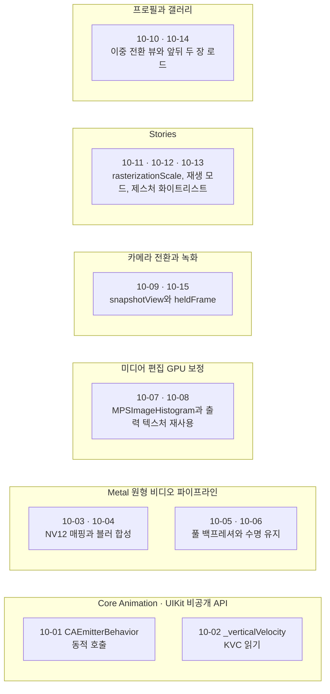
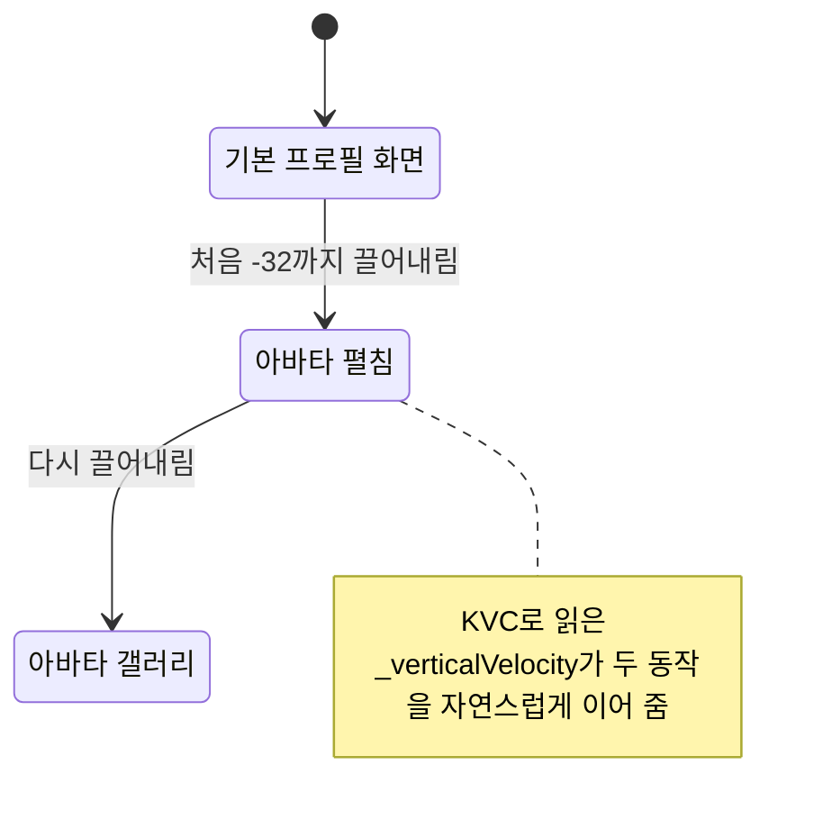
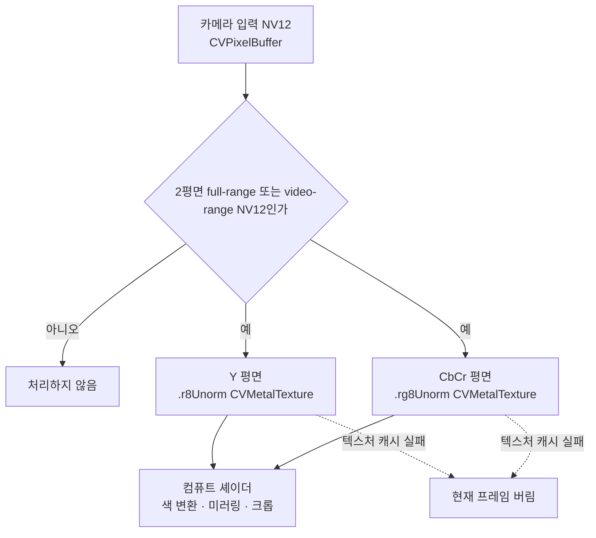
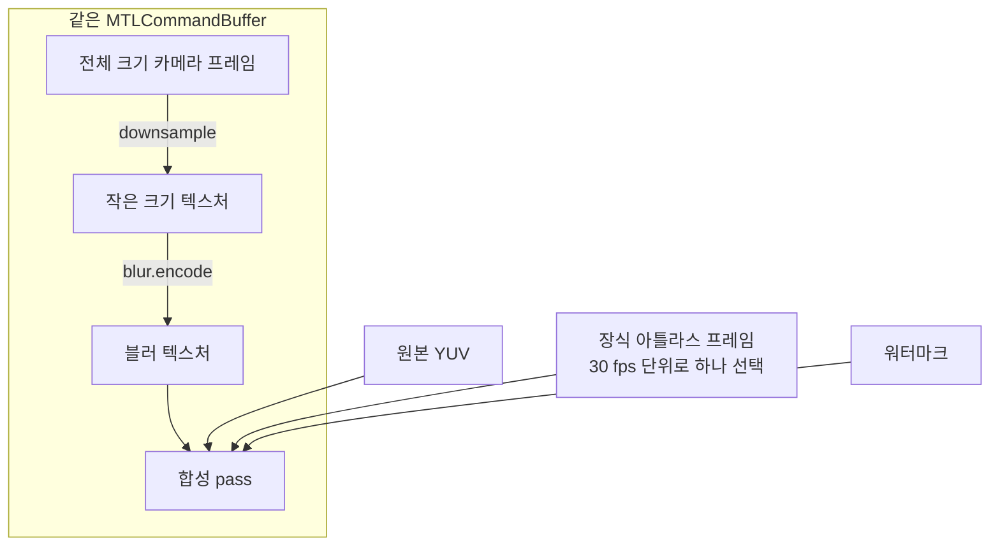
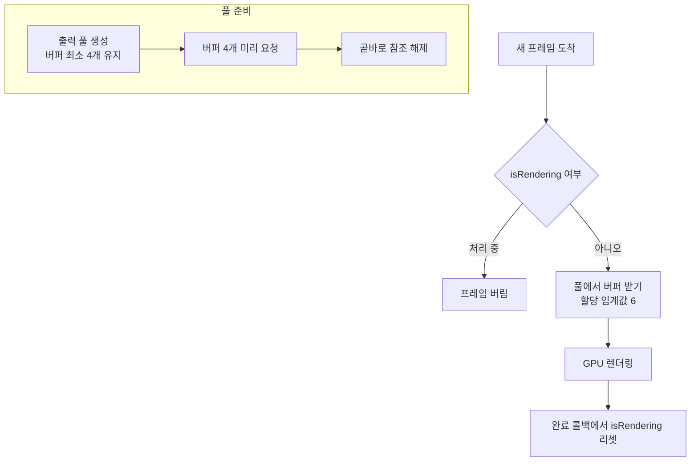
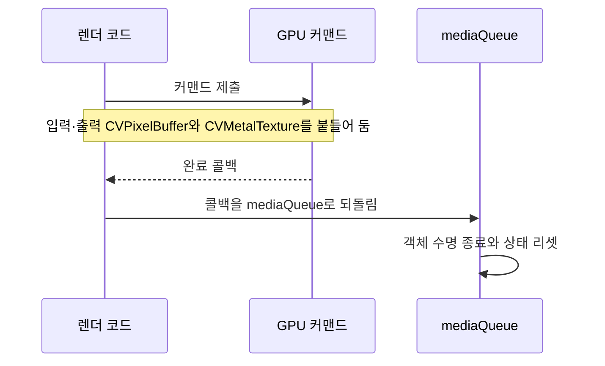

# 미디어, Stories, 프로필 화면

웹: /docs/ios/10-media-stories-peerinfo/ · Markdown: /docs/ios/10-media-stories-peerinfo.md

> 파티클 동작, 제로 카피 비디오 텍스처, 프로필 화면의 풀다운 갤러리.

| 기법 항목 | 리포트 선정 | 관련 비공개 API | REA 연관 |
| --- | --- | --- | --- |
| 15 | 5 | 7 | 0 |

소스 코드: [TelegramMessenger/Telegram-iOS@f1dd7a2d](https://github.com/TelegramMessenger/Telegram-iOS/tree/f1dd7a2dbd02cbbf513e75d5695d8d36d1cf5838)(2026-10-07) · 플랫폼: iOS · UIKit

이 장의 선정 항목:
- 10-1 [#10-02 비공개 `_verticalVelocity`로 두 번째 풀다운을 아바타 갤러리로 바꾸는 프로필 화면](/docs/ios/10-media-stories-peerinfo/#t10-02)
- 10-2 [#10-03 NV12의 두 평면을 제로 카피로 Metal에 매핑하는 원형 비디오](/docs/ios/10-media-stories-peerinfo/#t10-03)
- 10-3 [#10-04 먼저 저해상도로 블러한 뒤 같은 커맨드 버퍼에서 합성하는 원형 비디오](/docs/ios/10-media-stories-peerinfo/#t10-04)
- 10-4 [#10-05 상한이 있는 `CVPixelBufferPool`로 백프레셔를 거는 원형 비디오](/docs/ios/10-media-stories-peerinfo/#t10-05)
- 10-5 [#10-06 처리가 끝나기 전까지 픽셀 버퍼와 텍스처를 명시적으로 살려 두기](/docs/ios/10-media-stories-peerinfo/#t10-06)

이 주제의 범위: Telegram-iOS의 Stories, 카메라, 미디어 편집, DrawingUI, 프로필 아바타, GalleryUI, Gifts와 Premium의 리치 미디어 인터랙션 및 렌더링 구현.

결론: 이 범위에서 가장 과감한 방식은 두 가지예요.

- 비공개 Core Animation이나 UIKit 구현을 직접 건드려요.
- 프리뷰, 필터, 3D 애니메이션을 제어할 수 있는 GPU 파이프라인을 만들어요.

이번에 읽은 코드에서는 Stories의 "큐브 페이지 넘김" 구현을 확인하지 못했어요. 그래서 이 문서는 그 내용을 결론으로 다루지 않아요.

아래 도표는 이 장의 기법이 어느 층과 구성요소에 손을 대는지 묶음별로 보여 줘요.



## 1. 런타임으로 비공개 `CAEmitterBehavior` 호출하기 [#t10-01]

> #10-01 · Telegram-iOS · UIKit · 검증 방식: 소스 분석 · 태그: 비공개 API, 런타임 해킹, Core Animation
>
> 소스 코드: [Telegram-iOS:submodules/Display/Source/UIKitUtils.swift L935–L943](https://github.com/TelegramMessenger/Telegram-iOS/blob/f1dd7a2dbd02cbbf513e75d5695d8d36d1cf5838/submodules/Display/Source/UIKitUtils.swift#L935-L943)
>
> 소스 코드: [Telegram-iOS:submodules/TelegramUI/Components/Gifts/GiftViewScreen/Sources/GiftAuctionBidScreen.swift L3263–L3284](https://github.com/TelegramMessenger/Telegram-iOS/blob/f1dd7a2dbd02cbbf513e75d5695d8d36d1cf5838/submodules/TelegramUI/Components/Gifts/GiftViewScreen/Sources/GiftAuctionBidScreen.swift#L3263-L3284)
>
> 위치 설명: `Telegram-iOS:submodules/Display/Source/UIKitUtils.swift#L935-L943`; 호출처 `Telegram-iOS:submodules/TelegramUI/Components/Gifts/GiftViewScreen/Sources/GiftAuctionBidScreen.swift#L3263-L3284`

**무엇을 했나요**: 코드가 클래스 이름 `CAEmitterBehavior`와 selector(Objective-C 메서드 이름) `behaviorWithType:`을 문자열 조각으로 동적으로 조립해요. 이어서 KVC(문자열 키로 속성을 읽고 쓰는 방식)로 파티클에 `colorOverLife`와 `simpleAttractor` 동작을 설정해요.

**왜 이렇게 했나요**: 공개 API인 `CAEmitterLayer`로는 기본 파티클 속성만 설정할 수 있어요. 이 비공개 동작을 쓰면 두 가지를 할 수 있어요.

- 색이 수명에 따라 변하게 해요.
- 파티클이 어트랙터에 끌려가게 해요.

**핵심 코드 발췌**

```swift title="UIKitUtils.swift · L935–L943 등 2곳"
public extension CAEmitterCell {
    static func createEmitterBehavior(type: String) -> NSObject {
        let selector = ["behaviorWith", "Type:"].joined(separator: "")
        let behaviorClass = NSClassFromString(["CA", "Emitter", "Behavior"].joined(separator: "")) as! NSObject.Type
        let behaviorWithType = behaviorClass.method(for: NSSelectorFromString(selector))!
        let castedBehaviorWithType = unsafeBitCast(
            behaviorWithType,
            to: (@convention(c) (Any?, Selector, Any?) -> NSObject).self
        )
        return castedBehaviorWithType(behaviorClass, NSSelectorFromString(selector), type)
    }
}
// GiftAuctionBidScreen.swift
let staticColorBehavior = CAEmitterCell.createEmitterBehavior(type: "colorOverLife")
staticColorBehavior.setValue(staticColors, forKey: "colors")
staticEmitter.setValue([staticColorBehavior], forKey: "emitterBehaviors")
let attractor = CAEmitterCell.createEmitterBehavior(type: "simpleAttractor")
attractor.setValue("attractor", forKey: "name")
self.staticEmitterLayer.setValue([attractor], forKey: "emitterBehaviors")
```

**난독화 복원 확인**: 클래스 이름 배열을 이어 붙이면 곧바로 `CAEmitterBehavior`가 나와요. `["behaviorWith", "Type:"]`을 이어 붙이면 곧바로 `behaviorWithType:`이 나와요. `NSClassFromString`, `NSSelectorFromString`, `unsafeBitCast`가 호출 대상을 분명히 보여 줘요.

**대가와 위험**: 비공개 API예요. App Review에서 거부될 위험이 있어요. 시스템 구현이 바뀌면 강제 언래핑 크래시가 나요.

**증거 체인 #10-01** (iOS 바이너리 미검증)

- 소스 분석: Telegram-iOS 고정 커밋에서 한 줄씩 확인했어요. 소스 위치는 모두 2곳이에요.
- 바이너리 검증: 하지 않았어요. App Store 버전 IPA는 FairPlay로 암호화되어 있어서 복호화된 실행 파일을 합법적으로 얻을 수 없어요.

## 2. 비공개 `_verticalVelocity`로 두 번째 풀다운을 아바타 갤러리로 바꾸는 프로필 화면 [#t10-02]

> #10-02 · Telegram-iOS · UIKit · 리포트 선정 10-1 · 검증 방식: 소스 분석 · 태그: 비공개 API, 제스처와 스크롤
>
> 소스 코드: [Telegram-iOS:submodules/TelegramUI/Components/PeerInfo/PeerInfoScreen/Sources/PeerInfoScreen.swift L5984–L6021](https://github.com/TelegramMessenger/Telegram-iOS/blob/f1dd7a2dbd02cbbf513e75d5695d8d36d1cf5838/submodules/TelegramUI/Components/PeerInfo/PeerInfoScreen/Sources/PeerInfoScreen.swift#L5984-L6021)

**무엇을 했나요**: 코드가 `"_"`와 `"verticalVelocity"`를 이어 붙여 `_verticalVelocity`를 만들고, KVC로 `UIScrollView`의 비공개 세로 속도를 읽어요. 풀다운(화면을 아래로 끌어내리는 제스처)에 따라 화면이 두 단계로 바뀌어요.

1. 처음 `-32`까지 끌어내리면 아바타가 펼쳐져요.
2. 펼쳐진 뒤 다시 끌어내리면 갤러리가 열려요.

**왜 이렇게 했나요**: `UIScrollViewDelegate`는 현재 스크롤 속도를 공개하지 않아요. `panGestureRecognizer.velocity(in:)`는 내부 스크롤 감속 속도를 완전히 대신하지 못해요. `_verticalVelocity` 값을 읽으면 아바타가 펼쳐지는 동작과 뒤이은 제스처가 더 자연스럽게 이어져요.

아래 도표는 프로필 화면에서 풀다운이 아바타 펼침과 갤러리 열기로 이어지는 단계를 보여 줘요.



**핵심 코드 발췌**

```swift title="PeerInfoScreen.swift · L5984–L6021"
func scrollViewDidScroll(_ scrollView: UIScrollView) {
    guard !self.ignoreScrolling else {
        return
    }
    self.headerNode.headerEdgeEffectContainer.center = CGPoint(
        x: 0.0, y: scrollView.contentOffset.y
    )
    if !self.state.isEditing {
        if self.canAddVelocity {
            self.previousVelocityM1 = self.previousVelocity
            if let value = (scrollView.value(
                forKey: (["_", "verticalVelocity"] as [String]).joined()
            ) as? NSNumber)?.doubleValue {
                self.previousVelocity = CGFloat(value)
            }
        }
        let offsetY = self.scrollNode.view.contentOffset.y
        var shouldBeExpanded: Bool?
        if offsetY <= -32.0 && scrollView.isDragging && scrollView.isTracking {
            if let peer = self.data?.peer, self.chatLocation.threadId == nil,
               peer.smallProfileImage != nil && self.state.updatingAvatar == nil {
                shouldBeExpanded = true
            }
        }
```

**난독화 복원 확인**: 문자열 배열에 `.joined()`를 거치면 `_verticalVelocity`가 돼요. 이 키를 읽는 호출은 바로 `scrollView.value(forKey:)`예요.

**대가와 위험**: UIKit의 비공개 KVC 키에 접근해요. 심사 위험이 있어요. 새 시스템에서는 KVC가 예외를 던지거나 빈 값을 반환할 수 있어요.

**증거 체인 #10-02** (iOS 바이너리 미검증)

- 소스 분석: Telegram-iOS 고정 커밋에서 한 줄씩 확인했어요. 소스 위치는 모두 1곳이에요.
- 리포트 요약(구현 방법): `@"_"+"verticalVelocity"`를 이어 붙여 `valueForKey:`로 읽어요.
- 바이너리 검증: 하지 않았어요. App Store 버전 IPA는 FairPlay로 암호화되어 있어서 복호화된 실행 파일을 합법적으로 얻을 수 없어요.

## 3. NV12의 두 평면을 제로 카피로 Metal에 매핑하는 원형 비디오 [#t10-03]

> #10-03 · Telegram-iOS · UIKit · 리포트 선정 10-2 · 검증 방식: 소스 분석 · 태그: Metal / GPU, 성능과 메모리
>
> 소스 코드: [Telegram-iOS:submodules/Camera/CameraNeo/Sources/RoundVideoFrameProcessor.swift L467–L516](https://github.com/TelegramMessenger/Telegram-iOS/blob/f1dd7a2dbd02cbbf513e75d5695d8d36d1cf5838/submodules/Camera/CameraNeo/Sources/RoundVideoFrameProcessor.swift#L467-L516)

**무엇을 했나요**: 카메라 입력의 NV12 데이터(밝기 Y 평면과 색 CbCr 평면, 두 평면으로 이루어진 픽셀 포맷)를 `CGImage`를 거치지 않고 메모리 복사 없이(제로 카피) Metal 텍스처로 매핑해요.

- Y 평면은 `.r8Unorm`으로 매핑해요.
- CbCr 평면은 `.rg8Unorm`으로 매핑해요.
- 이후 컴퓨트 셰이더(GPU에서 범용 계산을 하는 프로그램)가 색 변환, 미러링, 크롭을 해요.

**왜 이렇게 했나요**: CPU에서 이미지로 변환하면 메모리 대역폭과 지연이 늘어나요. 2평면 텍스처 덕분에 `CVPixelBuffer`가 그대로 GPU 입력이 돼요. 실시간 원형 비디오 프리뷰와 녹화에 잘 맞아요.

아래 도표는 카메라 입력의 NV12 데이터가 CGImage 없이 GPU까지 가는 길을 보여 줘요.



**핵심 코드 발췌**

```swift title="RoundVideoFrameProcessor.swift · L467–L516"
private func makeInputTextures(pixelBuffer: CVPixelBuffer)
-> (y: CVMetalTexture, cbcr: CVMetalTexture)? {
    var yTexture: CVMetalTexture?
    let yStatus = CVMetalTextureCacheCreateTextureFromImage(
        kCFAllocatorDefault, self.textureCache, pixelBuffer, nil,
        .r8Unorm, CVPixelBufferGetWidthOfPlane(pixelBuffer, 0),
        CVPixelBufferGetHeightOfPlane(pixelBuffer, 0), 0, &yTexture
    )
    var cbcrTexture: CVMetalTexture?
    let cbcrStatus = CVMetalTextureCacheCreateTextureFromImage(
        kCFAllocatorDefault, self.textureCache, pixelBuffer, nil,
        .rg8Unorm, CVPixelBufferGetWidthOfPlane(pixelBuffer, 1),
        CVPixelBufferGetHeightOfPlane(pixelBuffer, 1), 1, &cbcrTexture
    )
    guard yStatus == kCVReturnSuccess, cbcrStatus == kCVReturnSuccess,
          let yTexture, let cbcrTexture else {
        return nil
    }
    return (yTexture, cbcrTexture)
}
```

**대가와 위험**: 지원하는 픽셀 포맷을 처리해야 해요. 코드는 2평면 full-range나 video-range NV12만 받아요. 텍스처 캐시가 실패하면 현재 프레임을 버려요.

**증거 체인 #10-03** (iOS 바이너리 미검증)

- 소스 분석: Telegram-iOS 고정 커밋에서 한 줄씩 확인했어요. 소스 위치는 모두 1곳이에요.
- 리포트 요약(구현 방법): 평면마다 `CVMetalTexture`를 만들고, 실패하면 프레임을 버려요.
- 바이너리 검증: 하지 않았어요. App Store 버전 IPA는 FairPlay로 암호화되어 있어서 복호화된 실행 파일을 합법적으로 얻을 수 없어요.

## 4. 먼저 저해상도로 블러한 뒤 같은 커맨드 버퍼에서 합성하는 원형 비디오 [#t10-04]

> #10-04 · Telegram-iOS · UIKit · 리포트 선정 10-3 · 검증 방식: 소스 분석 · 태그: Metal / GPU
>
> 소스 코드: [Telegram-iOS:submodules/Camera/CameraNeo/Sources/RoundVideoFrameProcessor.swift L332–L385](https://github.com/TelegramMessenger/Telegram-iOS/blob/f1dd7a2dbd02cbbf513e75d5695d8d36d1cf5838/submodules/Camera/CameraNeo/Sources/RoundVideoFrameProcessor.swift#L332-L385)

**무엇을 했나요**: 프레임 하나를 세 단계로 처리해요.

1. 30 fps 단위로 장식 아틀라스 프레임을 하나씩 골라요.
2. 카메라 프레임을 작은 크기의 텍스처에 쓰고, 그 작은 텍스처에 블러를 적용해요.
3. 합성기가 블러 텍스처, 원본 YUV, 아틀라스, 워터마크를 읽어 합성해요.

**왜 이렇게 했나요**: 전체 크기 카메라 프레임을 직접 블러하면 비용이 커요. 먼저 다운샘플링(해상도 줄이기)하면 컨볼루션 작업량이 크게 줄어요. 같은 `MTLCommandBuffer`(GPU에 보내는 명령 묶음)를 쓰니까 GPU 작업 순서도 유지돼요.

아래 도표는 원형 비디오 한 프레임이 다운샘플, 블러, 합성 순서로 처리되는 과정을 보여 줘요.



**핵심 코드 발췌**

```swift title="RoundVideoFrameProcessor.swift · L332–L385"
let effectiveAnimationTime = animationTime.isFinite
    ? max(0.0, animationTime) : 0.0
let frameIndex = Int(floor(effectiveAnimationTime * 30.0))
    % RoundVideoDecorationAnimation.frameCount
uniforms.decoration = SIMD4<Float>(
    Float(frameIndex), Float(RoundVideoDecorationAnimation.columns),
    Float(RoundVideoDecorationAnimation.rows), 0.0
)
guard let downsampleEncoder = commandBuffer.makeComputeCommandEncoder() else {
    return
}
downsampleEncoder.setComputePipelineState(decoration.downsamplePipelineState)
downsampleEncoder.setTexture(primaryY, index: 0)
downsampleEncoder.setTexture(primaryCbCr, index: 1)
downsampleEncoder.setTexture(decoration.downsampleTexture, index: 4)
Self.dispatch(encoder: downsampleEncoder,
              pipelineState: decoration.downsamplePipelineState,
              width: RoundVideoMetalDecoration.blurWidth,
              height: RoundVideoMetalDecoration.blurHeight)
downsampleEncoder.endEncoding()
decoration.blur.encode(commandBuffer: commandBuffer,
                       sourceTexture: decoration.downsampleTexture,
                       destinationTexture: decoration.blurredTexture)
```

**대가와 위험**: 장식 애니메이션이 30 fps로 고정돼요. 작은 텍스처를 블러하면 디테일이 사라질 수 있어요. 이 경로는 기기가 Metal을 지원해야 해요.

**증거 체인 #10-04** (iOS 바이너리 미검증)

- 소스 분석: Telegram-iOS 고정 커밋에서 한 줄씩 확인했어요. 소스 위치는 모두 1곳이에요.
- 리포트 요약(구현 방법): `downsample`→`blur.encode`→합성 pass.
- 바이너리 검증: 하지 않았어요. App Store 버전 IPA는 FairPlay로 암호화되어 있어서 복호화된 실행 파일을 합법적으로 얻을 수 없어요.

## 5. 상한이 있는 `CVPixelBufferPool`로 백프레셔를 거는 원형 비디오 [#t10-05]

> #10-05 · Telegram-iOS · UIKit · 리포트 선정 10-4 · 검증 방식: 소스 분석
>
> 소스 코드: [Telegram-iOS:submodules/Camera/CameraNeo/Sources/RoundVideoFrameProcessor.swift L218–L272](https://github.com/TelegramMessenger/Telegram-iOS/blob/f1dd7a2dbd02cbbf513e75d5695d8d36d1cf5838/submodules/Camera/CameraNeo/Sources/RoundVideoFrameProcessor.swift#L218-L272)

**무엇을 했나요**: 백프레셔(처리가 밀릴 때 새 입력을 제한하는 것)를 세 군데에서 걸어요.

- 출력 풀은 버퍼를 최소 4개 유지해요.
- 코드는 버퍼 4개를 미리 요청한 뒤 곧바로 참조를 해제해요. 풀의 할당 임계값은 6이에요.
- `isRendering`은 한 번에 한 프레임만 처리되도록 보장해요.

**왜 이렇게 했나요**: 미리 데워 두면 첫 프레임과 카메라 전환 때 생기는 임시 할당을 피할 수 있어요. 임계값은 인코딩이나 GPU가 뒤처질 때 프레임이 끝없이 쌓이는 것을 막아요. 실시간 카메라에서는 프레임을 일부러 버리는 편이 메모리가 부풀어 오르는 것보다 대체로 나아요.

아래 도표는 출력 풀의 사전 준비와 한 번에 한 프레임만 처리하는 흐름을 보여 줘요.



**핵심 코드 발췌**

```swift title="RoundVideoFrameProcessor.swift · L218–L272"
self.outputPool = outputPool
self.outputPoolAuxiliaryAttributes = [
    kCVPixelBufferPoolAllocationThresholdKey as String: 6
] as CFDictionary
var preallocatedBuffers: [CVPixelBuffer] = []
for _ in 0 ..< 4 {
    var pixelBuffer: CVPixelBuffer?
    if CVPixelBufferPoolCreatePixelBufferWithAuxAttributes(
        kCFAllocatorDefault,
        outputPool,
        self.outputPoolAuxiliaryAttributes,
        &pixelBuffer
    ) == kCVReturnSuccess, let pixelBuffer {
        preallocatedBuffers.append(pixelBuffer)
    }
}
preallocatedBuffers.removeAll()
func render(
    primary: VideoFrameSource,
    secondary: VideoFrameSource?,
    mixFactor: Float,
    animationTime: Double,
    completion: @escaping (ProcessedVideoFrame?) -> Void
) {
    guard !self.isRendering else {
        return
    }
```

**대가와 위험**: 바쁠 때는 새 프레임을 버려요. 사양이 낮은 기기에서는 프리뷰가 끊겨 보일 수 있어요. `isRendering`은 완료 콜백에서 올바르게 리셋되어야 해요.

**증거 체인 #10-05** (iOS 바이너리 미검증)

- 소스 분석: Telegram-iOS 고정 커밋에서 한 줄씩 확인했어요. 소스 위치는 모두 1곳이에요.
- 리포트 요약(구현 방법): `kCVPixelBufferPoolAllocationThresholdKey:6`으로 픽셀 버퍼를 만들어요.
- 바이너리 검증: 하지 않았어요. App Store 버전 IPA는 FairPlay로 암호화되어 있어서 복호화된 실행 파일을 합법적으로 얻을 수 없어요.

## 6. 처리가 끝나기 전까지 픽셀 버퍼와 텍스처를 명시적으로 살려 두기 [#t10-06]

> #10-06 · Telegram-iOS · UIKit · 리포트 선정 10-5 · 검증 방식: 소스 분석 · 태그: 비공개 API, Metal / GPU
>
> 소스 코드: [Telegram-iOS:submodules/Camera/CameraNeo/Sources/RoundVideoFrameProcessor.swift L406–L434](https://github.com/TelegramMessenger/Telegram-iOS/blob/f1dd7a2dbd02cbbf513e75d5695d8d36d1cf5838/submodules/Camera/CameraNeo/Sources/RoundVideoFrameProcessor.swift#L406-L434)

**무엇을 했나요**: 코드는 입력과 출력 `CVPixelBuffer`, 그리고 `CVMetalTexture`를 붙들고 있다가, GPU 커맨드가 끝난 뒤에야 이 객체들의 수명을 끝내요. 완료 콜백도 카메라의 `mediaQueue`로 되돌아가요.

**왜 이렇게 했나요**: Swift의 지역 변수는 GPU가 끝나기 전에 해제될 수 있어요. 커맨드 버퍼를 제출했다고 해서 Core Video 객체가 아직 살아 있다는 보장은 없어요. 객체를 붙들고 있으면 간헐적인 검은 프레임, 무효 텍스처 접근, 경쟁 상태를 피해요.

아래 도표는 GPU 커맨드가 끝날 때까지 Core Video 객체를 붙들고 있는 순서를 보여 줘요.



**핵심 코드 발췌**

```swift title="RoundVideoFrameProcessor.swift · L406–L434"
let retainedPixelBuffers = [
    primary.pixelBuffer, effectiveSecondary.pixelBuffer, outputPixelBuffer
]
let retainedTextures = [
    primaryTextures.y, primaryTextures.cbcr,
    secondaryTextures.y, secondaryTextures.cbcr, outputTexture
]
self.isRendering = true
commandBuffer.addCompletedHandler { [weak self] commandBuffer in
    let processedFrame: ProcessedVideoFrame?
    if commandBuffer.status == .completed {
        processedFrame = ProcessedVideoFrame(pixelBuffer: outputPixelBuffer)
    } else {
        processedFrame = nil
    }
    self?.mediaQueue.async { [weak self] in
        guard let self else {
            return
        }
        self.isRendering = false
        withExtendedLifetime(retainedPixelBuffers) {
            withExtendedLifetime(retainedTextures) {
                completion(processedFrame)
            }
        }
    }
}
commandBuffer.commit()
```

**대가와 위험**: 처리 중인 프레임마다 버퍼 여러 개를 차지해요. 프레임을 하나씩만 허용하는 백프레셔가 이 비용을 제한해요. 뚜렷한 비공개 API 위험은 없어요.

**증거 체인 #10-06** (iOS 바이너리 미검증)

- 소스 분석: Telegram-iOS 고정 커밋에서 한 줄씩 확인했어요. 소스 위치는 모두 1곳이에요.
- 리포트 요약(구현 방법): `CVPixelBuffer`/`CVMetalTexture`를 캡처하고, 메인 미디어 큐로 돌아가 상태를 리셋해요.
- 바이너리 검증: 하지 않았어요. App Store 버전 IPA는 FairPlay로 암호화되어 있어서 복호화된 실행 파일을 합법적으로 얻을 수 없어요.

## 7. 블록 단위 히스토그램으로 국소 보정 LUT를 만드는 미디어 편집기 [#t10-07]

> #10-07 · Telegram-iOS · UIKit · 검증 방식: 소스 분석 · 태그: 비공개 API, Metal / GPU
>
> 소스 코드: [Telegram-iOS:submodules/TelegramUI/Components/MediaEditor/Sources/EnhanceRenderPass.swift L154–L188](https://github.com/TelegramMessenger/Telegram-iOS/blob/f1dd7a2dbd02cbbf513e75d5695d8d36d1cf5838/submodules/TelegramUI/Components/MediaEditor/Sources/EnhanceRenderPass.swift#L154-L188)

**무엇을 했나요**: 이미지를 격자 블록으로 나눠 세 단계로 처리해요.

1. 블록마다 `MPSImageHistogram`(밝기 분포)을 계산해요.
2. 블록별 히스토그램을 공유 비공개 버퍼에 써요.
3. 컴퓨트 셰이더가 LUT(입력 값을 출력 값으로 바꿔 주는 조회표) 묶음을 만들어요.

**왜 이렇게 했나요**: 전역 자동 보정은 국소적인 그림자나 하이라이트를 왜곡할 수 있어요. 블록 히스토그램은 국소 대비 향상에 해당해요. GPU 히스토그램과 LUT 덕분에 슬라이더를 조절하는 동안 픽셀을 읽어 오지 않아도 돼요.

**핵심 코드 발췌**

```swift title="EnhanceRenderPass.swift · L154–L188"
let histogramSize = calculation.histogramSize(forSourceFormat: input.pixelFormat)
for i in 0 ..< lutCount {
    let col = i % gridSize.width
    let row = i / gridSize.width
    calculation.clipRectSource = MTLRegionMake2D(
        col * tileSize.width, row * tileSize.height,
        tileSize.width, tileSize.height
    )
    calculation.encode(to: commandBuffer, sourceTexture: input,
                       histogram: histogramBuffer,
                       histogramOffset: i * histogramSize)
}
guard let computeCommandEncoder = commandBuffer.makeComputeCommandEncoder() else {
    return nil
}
guard let pipelineState = self.pipelineState else {
    return nil
}
var parameters = MediaEditorEnhanceLUTGeneratorParameters(
    histogramBins: UInt32(binCount),
    clipLimit: UInt32(clipLimitValue),
    totalPixelCountPerTile: UInt32(tileSize.width * tileSize.height),
    numberOfLUTs: UInt32(lutCount)
)
computeCommandEncoder.setComputePipelineState(pipelineState)
computeCommandEncoder.setBuffer(histogramBuffer, offset: 0, index: 0)
computeCommandEncoder.setBytes(&parameters,
    length: MemoryLayout<MediaEditorEnhanceLUTGeneratorParameters>.size, index: 1)
```

**대가와 위험**: 격자가 작으면 과하게 처리된 것처럼 보여요. 프레임마다 히스토그램 버퍼를 만드는 비용도 여전히 있어요. 이 코드는 Metal Performance Shaders가 필요해요.

**증거 체인 #10-07** (iOS 바이너리 미검증)

- 소스 분석: Telegram-iOS 고정 커밋에서 한 줄씩 확인했어요. 소스 위치는 모두 1곳이에요.
- 바이너리 검증: 하지 않았어요. App Store 버전 IPA는 FairPlay로 암호화되어 있어서 복호화된 실행 파일을 합법적으로 얻을 수 없어요.

## 8. 비공개 출력 텍스처를 재사용하고 불필요한 화면 지우기를 건너뛰는 보정 필터 [#t10-08]

> #10-08 · Telegram-iOS · UIKit · 검증 방식: 소스 분석 · 태그: 비공개 API, Metal / GPU, 성능과 메모리
>
> 소스 코드: [Telegram-iOS:submodules/TelegramUI/Components/MediaEditor/Sources/EnhanceRenderPass.swift L199–L245](https://github.com/TelegramMessenger/Telegram-iOS/blob/f1dd7a2dbd02cbbf513e75d5695d8d36d1cf5838/submodules/TelegramUI/Components/MediaEditor/Sources/EnhanceRenderPass.swift#L199-L245)

**무엇을 했나요**: 필터는 세 가지 방식으로 비용을 줄여요.

- 출력 텍스처를 처음 실행할 때만 만들어요.
- 텍스처는 `.private` 저장 모드를 써요.
- 렌더 패스는 로드 액션(패스 시작 때 이전 내용을 어떻게 다룰지 정하는 설정)으로 `.dontCare`를 써요.

**왜 이렇게 했나요**: 편집 프리뷰는 같은 크기의 미디어를 반복해서 렌더링해요. 텍스처를 반복해서 할당하면 메모리와 프레임 시간이 흔들려요. 프래그먼트 셰이더가 모든 픽셀을 덮어쓰니까, 화면을 지우거나 이전 내용을 불러올 이유가 없어요.

**핵심 코드 발췌**

```swift title="EnhanceRenderPass.swift · L199–L245"
func process(input: MTLTexture, lookupTexture: MTLTexture,
             value: simd_float1, gridSize: simd_float2,
             device: MTLDevice, commandBuffer: MTLCommandBuffer) -> MTLTexture? {
    self.setupVerticesBuffer(device: device)
    let width = input.width
    let height = input.height
    if self.cachedTexture == nil {
        let textureDescriptor = MTLTextureDescriptor()
        textureDescriptor.textureType = .type2D
        textureDescriptor.width = width
        textureDescriptor.height = height
        textureDescriptor.pixelFormat = input.pixelFormat
        textureDescriptor.storageMode = .private
        textureDescriptor.usage = [.shaderRead, .shaderWrite, .renderTarget]
        guard let texture = device.makeTexture(descriptor: textureDescriptor) else {
            return input
        }
        self.cachedTexture = texture
    }
    let renderPassDescriptor = MTLRenderPassDescriptor()
    renderPassDescriptor.colorAttachments[0].texture = self.cachedTexture!
    renderPassDescriptor.colorAttachments[0].loadAction = .dontCare
    renderPassDescriptor.colorAttachments[0].storeAction = .store
```

**대가와 위험**: 입력 크기나 포맷이 객체 수명 중에 바뀌면 캐시가 맞지 않을 수 있어요. 이 코드 조각 자체에는 다시 만드는 로직이 보이지 않아요. 이 가정은 미검증이에요.

**증거 체인 #10-08** (iOS 바이너리 미검증)

- 소스 분석: Telegram-iOS 고정 커밋에서 한 줄씩 확인했어요. 소스 위치는 모두 1곳이에요.
- 바이너리 검증: 하지 않았어요. App Store 버전 IPA는 FairPlay로 암호화되어 있어서 복호화된 실행 파일을 합법적으로 얻을 수 없어요.

## 9. 내장 카메라를 전환할 때 이전 프리뷰를 멈추고 원형 반투명 블러 겹치기 [#t10-09]

> #10-09 · Telegram-iOS · UIKit · 검증 방식: 소스 분석 · 태그: Metal / GPU
>
> 소스 코드: [Telegram-iOS:submodules/DrawingUI/Sources/DrawingStickerEntityView.swift L558–L595](https://github.com/TelegramMessenger/Telegram-iOS/blob/f1dd7a2dbd02cbbf513e75d5695d8d36d1cf5838/submodules/DrawingUI/Sources/DrawingStickerEntityView.swift#L558-L595)

**무엇을 했나요**: 카메라를 전환하는 동안 이전 프리뷰의 정지 화면을 보여 줘요.

1. 카메라를 전환하기 전에 먼저 `snapshotView`를 가져와요.
2. 스냅샷은 제자리에 둬요.
3. 뒤집기 애니메이션으로 원형의 어두운 블러 레이어를 보여 줘요.
4. 전환이 끝나면 반투명 블러와 스냅샷을 각각 페이드 아웃해요.

**왜 이렇게 했나요**: `AVCaptureSession`에서 전면과 후면 카메라를 전환하면 검은 프레임이나 노출 점프가 자주 생겨요. 정지 스냅샷이 화면 내용을 이어 줘요. 블러 레이어는 스냅샷이 새 카메라를 반영하지 못한다는 사실도 가려 줘요.

**핵심 코드 발췌**

```swift title="DrawingStickerEntityView.swift · L558–L595"
public func beginCameraSwitch() {
    guard let cameraPreviewView = self.cameraPreviewView,
          self.cameraBlurView == nil else {
        return
    }
    if let snapshot = cameraPreviewView.snapshotView(afterScreenUpdates: false) {
        self.cameraSnapshotView = snapshot
        self.addSubview(snapshot)
    }
    let blurView = BlurView(effect: nil)
    blurView.clipsToBounds = true
    blurView.frame = self.bounds
    blurView.layer.cornerRadius = self.bounds.width / 2.0
    self.addSubview(blurView)
    UIView.transition(with: self, duration: 0.4,
                      options: [.transitionFlipFromLeft, .curveEaseOut]) {
        blurView.effect = UIBlurEffect(style: .dark)
    }
    self.cameraBlurView = blurView
}
public func commitCameraSwitch() {
    if let cameraBlurView = self.cameraBlurView {
        self.cameraBlurView = nil
        UIView.animate(withDuration: 0.4) {
            cameraBlurView.effect = nil
        }
```

**대가와 위험**: 스냅샷은 마지막 프레임만 보여 줘요. 전환이 느리면 사용자에게 얼어붙은 화면이 보여요. 블러 효과는 GPU 합성 비용도 늘려요.

**증거 체인 #10-09** (iOS 바이너리 미검증)

- 소스 분석: Telegram-iOS 고정 커밋에서 한 줄씩 확인했어요. 소스 위치는 모두 1곳이에요.
- 바이너리 검증: 하지 않았어요. App Store 버전 IPA는 FairPlay로 암호화되어 있어서 복호화된 실행 파일을 합법적으로 얻을 수 없어요.

## 10. 이중 전환 뷰로 썸네일과 전체 화면의 모서리 둥글기를 맞추는 GalleryUI [#t10-10]

> #10-10 · Telegram-iOS · UIKit · 검증 방식: 소스 분석
>
> 소스 코드: [Telegram-iOS:submodules/GalleryUI/Sources/Items/UniversalVideoGalleryItem.swift L2565–L2589](https://github.com/TelegramMessenger/Telegram-iOS/blob/f1dd7a2dbd02cbbf513e75d5695d8d36d1cf5838/submodules/GalleryUI/Sources/Items/UniversalVideoGalleryItem.swift#L2565-L2589)

**무엇을 했나요**: 갤러리는 전환 뷰를 두 개 만들어요.

- 하나는 상위 transition surface에 넣어요.
- 다른 하나는 항목 자체에 남겨요.

전환 콜백은 원본 크기, 목표 크기, 화면 모서리 반경, `progress`를 받아요.

**왜 이렇게 했나요**: 뷰 하나로는 부모 뷰를 넘나드는 좌표계와 항목 내부의 가림 처리를 동시에 올바르게 처리할 수 없어요. 뷰를 둘로 나누면 전환 중에 빈 구멍이 생기지 않아요. 하드웨어 화면 모서리 반경을 명시적으로 넘기면 전체 화면 쪽이 기기 모양에 맞아요.

**핵심 코드 발췌**

```swift title="UniversalVideoGalleryItem.swift · L2565–L2589"
let transitionContentSourceFrame = contentTransition.sourceView.convert(
    contentTransition.sourceRect, to: transitionContentSuperview
)
let transitionContentDestinationFrame = self.view.convert(
    self.view.bounds, to: transitionContentSuperview
)
let transitionContentSelfSourceFrame = contentTransition.sourceView.convert(
    contentTransition.sourceRect, to: self.view
)
let transitionContentSelfDestinationFrame = self.view.convert(
    self.view.bounds, to: self.view
)
let screenCornerRadius: CGFloat = validLayout.layout.deviceMetrics.screenCornerRadius
transitionContentView.frame = transitionContentSourceFrame
contentTransition.updateView(transitionContentView,
    GalleryItemScrubberTransition.Content.TransitionState(
        sourceSize: transitionContentSourceFrame.size,
        destinationSize: transitionContentDestinationFrame.size,
        destinationCornerRadius: screenCornerRadius, progress: 0.0
    ), .immediate)
transitionSelfContentView.frame = transitionContentSelfSourceFrame
contentTransition.updateView(transitionSelfContentView,
    GalleryItemScrubberTransition.Content.TransitionState(
        sourceSize: transitionContentSelfSourceFrame.size,
        destinationSize: transitionContentSelfDestinationFrame.size,
        destinationCornerRadius: screenCornerRadius, progress: 0.0
    ), .immediate)
let transition: ContainedViewLayoutTransition = .animated(duration: 0.25, curve: .spring)
transition.updateFrame(view: transitionContentView,
                       frame: transitionContentDestinationFrame)
```

**대가와 위험**: 실제 모서리 반경 보간은 `updateView` 클로저를 넘겨주는 쪽에서 해요. 그 쪽 코드는 이번에 읽은 코드 조각에 없어요. 그래서 보간 공식은 미검증이에요. 임시 뷰가 두 개 있어서 전환이 복잡해져요.

**증거 체인 #10-10** (iOS 바이너리 미검증)

- 소스 분석: Telegram-iOS 고정 커밋에서 한 줄씩 확인했어요. 소스 위치는 모두 1곳이에요.
- 바이너리 검증: 하지 않았어요. App Store 버전 IPA는 FairPlay로 암호화되어 있어서 복호화된 실행 파일을 합법적으로 얻을 수 없어요.

## 11. 퇴장할 때 복제 레이어의 래스터화 배율을 화면 배율로 재귀적으로 되돌리는 Stories [#t10-11]

> #10-11 · Telegram-iOS · UIKit · 검증 방식: 소스 분석 · 태그: 성능과 메모리
>
> 소스 코드: [Telegram-iOS:submodules/TelegramUI/Components/Stories/StoryContainerScreen/Sources/StoryItemSetContainerComponent.swift L2382–L2407](https://github.com/TelegramMessenger/Telegram-iOS/blob/f1dd7a2dbd02cbbf513e75d5695d8d36d1cf5838/submodules/TelegramUI/Components/Stories/StoryContainerScreen/Sources/StoryItemSetContainerComponent.swift#L2382-L2407)

**무엇을 했나요**: `fixScale`은 레이어와 모든 하위 레이어의 `rasterizationScale`(레이어를 비트맵으로 굳힐 때의 배율)을 `UIScreenScale`로 설정해요. 퇴장할 때 스토리 콘텐츠와 대상 아바타에 각각 전환용 복제본이 하나씩 있어요. 코드는 주 복제본을 부모 뷰를 넘나들며 옮기기 전에 전역 좌표를 환산해요.

**왜 이렇게 했나요**: 이미 래스터화된 아바타를 확대하면 흐려져요. 배율을 재귀적으로 복원하면 복제본이 선명하게 유지돼요. 복제본이 둘이라서 원본 쪽 페이드 아웃과 대상 쪽 페이드 인이 겹칠 수 있어요.

**핵심 코드 발췌**

```swift title="StoryItemSetContainerComponent.swift · L2382–L2407"
if let transitionViewImpl = transitionView?.makeView() {
    fixScale(layer: transitionViewImpl.layer)
    transitionViewsImpl.append(transitionViewImpl)
    let transitionSourceContainerView = UIView(frame: self.bounds)
    transitionSourceContainerView.isUserInteractionEnabled = false
    self.componentContainerView.insertSubview(
        transitionSourceContainerView, aboveSubview: self.itemsContainerView
    )
    transitionSourceContainerView.addSubview(transitionViewImpl)
    if let insertCloneTransitionView = transitionView?.insertCloneTransitionView {
        if let transitionCloneViewImpl = transitionView?.makeView() {
            fixScale(layer: transitionCloneViewImpl.layer)
            transitionViewsImpl.append(transitionCloneViewImpl)
            transitionCloneMasterView.isUserInteractionEnabled = false
            let globalFrame = transitionCloneMasterView.convert(
                transitionCloneMasterView.bounds, to: nil
            )
            insertCloneTransitionView(transitionCloneMasterView)
            if let newParentView = transitionCloneMasterView.superview {
                newParentView.frame = newParentView.convert(globalFrame, from: nil)
            }
            self.transitionCloneContainerView.addSubview(transitionCloneViewImpl)
            transitionSourceContainerView.layer.animateAlpha(
                from: 1.0, to: 0.0, duration: 0.16, removeOnCompletion: false
            )
        }
    }
}
```

**대가와 위험**: 하위 레이어 트리 전체를 재귀적으로 순회해요. 레이어 트리가 크면 메인 스레드 시간을 많이 써요. 동적 비디오 콘텐츠는 그 시점의 스냅샷 느낌만 남을 수 있어요.

**증거 체인 #10-11** (iOS 바이너리 미검증)

- 소스 분석: Telegram-iOS 고정 커밋에서 한 줄씩 확인했어요. 소스 위치는 모두 1곳이에요.
- 바이너리 검증: 하지 않았어요. App Store 버전 IPA는 FairPlay로 암호화되어 있어서 복호화된 실행 파일을 합법적으로 얻을 수 없어요.

## 12. 모든 일시정지 원인을 재생 모드 함수 하나로 모으는 Stories [#t10-12]

> #10-12 · Telegram-iOS · UIKit · 검증 방식: 소스 분석 · 태그: 텍스트와 입력, 제스처와 스크롤
>
> 소스 코드: [Telegram-iOS:submodules/TelegramUI/Components/Stories/StoryContainerScreen/Sources/StoryItemSetContainerComponent.swift L1430–L1479](https://github.com/TelegramMessenger/Telegram-iOS/blob/f1dd7a2dbd02cbbf513e75d5695d8d36d1cf5838/submodules/TelegramUI/Components/Stories/StoryContainerScreen/Sources/StoryItemSetContainerComponent.swift#L1430-L1479)

**무엇을 했나요**: 재생 모드는 다음 상태가 함께 정해요.

- 확대/축소
- 풀다운
- 메뉴
- 입력
- 녹음
- 스티커
- 개인정보 페이지

컨텍스트 메뉴나 텍스트 선택은 `.blurred`를 반환해요. 나머지 방해 상태는 보통 `.pause`를 반환해요.

**왜 이렇게 했나요**: UI마다 따로 비디오를 일시정지하면 재개를 빠뜨리거나 경쟁이 생기기 쉬워요. 함수 하나가 상태 우선순위를 명시적으로 만들어 줘요. 재생 모드 함수 하나로 모은 덕분에, 길게 눌러 일시정지한 뒤의 "슬라이드하여 위치 지정" 화면도 `isProgressPaused`를 다시 쓸 수 있어요.

**핵심 코드 발췌**

```swift title="StoryItemSetContainerComponent.swift · L1430–L1479"
private func itemProgressMode() -> StoryContentItem.ProgressMode {
    guard let component = self.component else {
        return .pause
    }
    if component.pinchState != nil {
        return .pause
    }
    if self.verticalPanState != nil {
        return .pause
    }
    if self.contextController != nil {
        return .blurred
    }
    if self.inputPanelExternalState.isEditing || component.isProgressPaused ||
       self.sendMessageContext.actionSheet != nil ||
       self.sendMessageContext.isViewingAttachedStickers ||
       self.sendMessageContext.audioRecorderValue != nil ||
       self.sendMessageContext.videoRecorderValue != nil ||
       self.viewListDisplayState != .hidden {
        return .pause
    }
    if let reactionContextNode = self.reactionContextNode,
       reactionContextNode.isReactionSearchActive {
        return .pause
    }
    if self.privacyController != nil {
        return .pause
    }
```

**대가와 위험**: 조건 목록이 매우 길어요. 오버레이를 새로 추가할 때는 반드시 목록에 넣어야 해요. 빠뜨리면 모달 UI 뒤에서 스토리가 계속 재생돼요.

**증거 체인 #10-12** (iOS 바이너리 미검증)

- 소스 분석: Telegram-iOS 고정 커밋에서 한 줄씩 확인했어요. 소스 위치는 모두 1곳이에요.
- 바이너리 검증: 하지 않았어요. App Store 버전 IPA는 FairPlay로 암호화되어 있어서 복호화된 실행 파일을 합법적으로 얻을 수 없어요.

## 13. 탭이 팬에 양보하도록 명시하고, 스크롤 팬과만 함께 인식하는 Stories [#t10-13]

> #10-13 · Telegram-iOS · UIKit · 검증 방식: 소스 분석 · 태그: 비공개 API, 제스처와 스크롤
>
> 소스 코드: [Telegram-iOS:submodules/TelegramUI/Components/Stories/StoryContainerScreen/Sources/StoryItemSetContainerComponent.swift L910–L937](https://github.com/TelegramMessenger/Telegram-iOS/blob/f1dd7a2dbd02cbbf513e75d5695d8d36d1cf5838/submodules/TelegramUI/Components/Stories/StoryContainerScreen/Sources/StoryItemSetContainerComponent.swift#L910-L937)

**무엇을 했나요**: 제스처 인식기 사이의 관계를 두 가지로 정해요.

- 탭 인식기는 팬(드래그) 인식기가 실패하기를 기다려요.
- 스토리의 메인 팬은 스크롤 뷰나 현재 시청자 목록의 팬과만 동시에 인식돼요. 그 밖의 조합은 거부해요.

**왜 이렇게 했나요**: 가장자리를 탭해 페이지를 넘기는 동작이 풀다운 닫기나 가로 드래그를 빼앗으면 안 돼요. 동시 인식을 완전히 막으면 스크롤 목록과 스토리 컨테이너가 버벅거려요. 화이트리스트가 제스처의 부작용을 제한해요.

**핵심 코드 발췌**

```swift title="StoryItemSetContainerComponent.swift · L910–L937"
@objc public func gestureRecognizer(
    _ gestureRecognizer: UIGestureRecognizer,
    shouldRequireFailureOf otherGestureRecognizer: UIGestureRecognizer
) -> Bool {
    if gestureRecognizer is UITapGestureRecognizer {
        if otherGestureRecognizer is UIPanGestureRecognizer {
            return true
        }
        return false
    } else {
        return false
    }
}
public func gestureRecognizer(
    _ gestureRecognizer: UIGestureRecognizer,
    shouldRecognizeSimultaneouslyWith otherGestureRecognizer: UIGestureRecognizer
) -> Bool {
    if gestureRecognizer is UIPanGestureRecognizer {
        if let otherGestureRecognizer = otherGestureRecognizer as? UIPanGestureRecognizer {
            if otherGestureRecognizer.view is UIScrollView {
                return true
            }
            if let component = self.component,
               let viewList = self.viewLists[component.slice.item.id],
               let viewListView = viewList.view.view as? StoryItemSetViewListComponent.View,
               otherGestureRecognizer.view === viewListView {
                return true
            }
        }
        return false
    } else {
        return false
    }
}
```

**대가와 위험**: 새로 추가하는 스크롤 가능한 서브뷰는 화이트리스트에 추가해야 해요. 그러지 않으면 스토리 팬과 충돌할 수 있어요. 뚜렷한 비공개 API 위험은 없어요.

**증거 체인 #10-13** (iOS 바이너리 미검증)

- 소스 분석: Telegram-iOS 고정 커밋에서 한 줄씩 확인했어요. 소스 위치는 모두 1곳이에요.
- 바이너리 검증: 하지 않았어요. App Store 버전 IPA는 FairPlay로 암호화되어 있어서 복호화된 실행 파일을 합법적으로 얻을 수 없어요.

## 14. 현재 항목 앞뒤 두 장만 미리 로드하는 아바타 갤러리 [#t10-14]

> #10-14 · Telegram-iOS · UIKit · 검증 방식: 소스 분석 · 태그: 비공개 API, 성능과 메모리
>
> 소스 코드: [Telegram-iOS:submodules/PeerInfoAvatarListNode/Sources/PeerInfoAvatarListNode.swift L1649–L1673](https://github.com/TelegramMessenger/Telegram-iOS/blob/f1dd7a2dbd02cbbf513e75d5695d8d36d1cf5838/submodules/PeerInfoAvatarListNode/Sources/PeerInfoAvatarListNode.swift#L1649-L1673)

**무엇을 했나요**: 아바타 캐러셀 윈도우는 현재 항목의 앞뒤 각각 두 항목으로 고정돼요.

- 코드는 리소스 ID로 노드를 재사용해요.
- 중앙 항목은 요청될 때만 동기적으로 로드해요.
- 첫 항목은 전체 크기 리소스로 제한할 수도 있어요.

**왜 이렇게 했나요**: 아바타에는 비디오와 고해상도 사진이 들어 있을 수 있어요. 모든 아바타를 한꺼번에 로드하면 디코딩 메모리를 차지해요. 윈도우 단위로 미리 가져오면 옆 항목으로 넘길 때 기다리는 시간이 줄어요.

**핵심 코드 발췌**

```swift title="PeerInfoAvatarListNode.swift · L1649–L1673"
if self.currentIndex >= 0 && self.currentIndex < self.items.count {
    let preloadSpan: Int = 2
    for i in max(0, self.currentIndex - preloadSpan) ...
             min(self.currentIndex + preloadSpan, self.items.count - 1) {
        if self.items[i].representations.isEmpty {
            continue
        }
        validIds.append(self.items[i].id)
        var itemNode: PeerInfoAvatarListItemNode?
        var wasAdded = false
        if let current = self.itemNodes[self.items[i].id] {
            itemNode = current
            if update {
                var synchronous = synchronous && i == self.currentIndex
                if case .custom = self.items[i], self.updateCustomItemsOnlySynchronously {
                    synchronous = true
                }
                current.setup(item: self.items[i], isMain: i == 0,
                    synchronous: synchronous && i == self.currentIndex,
                    fullSizeOnly: self.firstFullSizeOnly && i == 0)
            }
        } else if let peer = self.peer {
            wasAdded = true
            let addedItemNode = PeerInfoAvatarListItemNode(context: self.context, peer: peer)
            itemNode = addedItemNode
            addedItemNode.setup(item: self.items[i], isMain: i == 0,
                progress: i == 0 ? self.additionalEntryProgress : nil,
                synchronous: (i == 0 && i == self.currentIndex) ||
                    (synchronous && i == self.currentIndex),
                fullSizeOnly: self.firstFullSizeOnly && i == 0)
```

**대가와 위험**: 두 항목을 넘게 빠르게 건너뛰면 여전히 로딩 자리표시자가 나타날 수 있어요. 캐시 무효화와 `validIds` 정리 로직은 일관되게 유지해야 해요. 뚜렷한 비공개 API 위험은 없어요.

**증거 체인 #10-14** (iOS 바이너리 미검증)

- 소스 분석: Telegram-iOS 고정 커밋에서 한 줄씩 확인했어요. 소스 위치는 모두 1곳이에요.
- 바이너리 검증: 하지 않았어요. App Store 버전 IPA는 FairPlay로 암호화되어 있어서 복호화된 실행 파일을 합법적으로 얻을 수 없어요.

## 15. 전면과 후면 카메라를 전환할 때 첫 프레임을 보류하고 녹화 타임라인 보정하기 [#t10-15]

> #10-15 · Telegram-iOS · UIKit · 검증 방식: 소스 분석 · 태그: 텍스트와 입력
>
> 소스 코드: [Telegram-iOS:submodules/Camera/CameraNeo/Sources/VideoRecorder.swift L277–L317](https://github.com/TelegramMessenger/Telegram-iOS/blob/f1dd7a2dbd02cbbf513e75d5695d8d36d1cf5838/submodules/Camera/CameraNeo/Sources/VideoRecorder.swift#L277-L317)

**무엇을 했나요**: 녹화기는 카메라 전환 때 두 가지를 해요.

- `videoTimelineOffset`으로 표시 시간을 다시 매핑해요.
- 카메라를 전환한 뒤의 첫 프레임을 먼저 `heldFrame`에 보류해요. 해석이 끝나면 이 첫 프레임은 정상적인 정지 경계 검사를 건너뛸 수 있어요.

**왜 이렇게 했나요**: 전면과 후면 카메라를 전환할 때 타임스탬프가 점프할 수 있어요. 그대로 쓰면 PTS(프레임의 표시 시각)가 단조 증가하지 않거나 첫 프레임이 잘못 잘려요. 보류해 두면 전환의 재타이밍 상태가 끝나기를 기다릴 수 있어요.

**핵심 코드 발췌**

```swift title="VideoRecorder.swift · L277–L317"
let frame = PendingVideoFrame(
    source: source,
    rawPresentationTime: rawPresentationTime,
    presentationTime: rawPresentationTime - self.videoTimelineOffset
)
if var retiming = self.singleCameraSwitch,
   retiming.isCommitted,
   !retiming.isResolved,
   retiming.to == position {
    if retiming.heldFrame == nil {
        retiming.heldFrame = frame
    }
    self.singleCameraSwitch = retiming
    return
}
let isFirstSwitchFrame = self.consumeFirstSingleCameraSwitchVideoFrameIfNeeded(frame)
self.submitVideoFrame(frame, allowPastStopBoundary: isFirstSwitchFrame)
}
private func submitVideoFrame(_ frame: PendingVideoFrame,
                              allowPastStopBoundary: Bool = false) {
    if let lastVideoTime = self.lastVideoTime,
       frame.presentationTime <= lastVideoTime {
        return
    }
    if self.stopRequested && self.videoReachedStopTarget &&
       !allowPastStopBoundary {
        return
    }
```

**대가와 위험**: 전환 해석이 실패하면 프레임 하나를 잃을 수 있어요. 상태 머신이라서 유지보수가 어려워요. 녹화 타임라인의 전체 보정 경로는 이 코드 조각에서 검증하지 않았어요.

**증거 체인 #10-15** (iOS 바이너리 미검증)

- 소스 분석: Telegram-iOS 고정 커밋에서 한 줄씩 확인했어요. 소스 위치는 모두 1곳이에요.
- 바이너리 검증: 하지 않았어요. App Store 버전 IPA는 FairPlay로 암호화되어 있어서 복호화된 실행 파일을 합법적으로 얻을 수 없어요.
