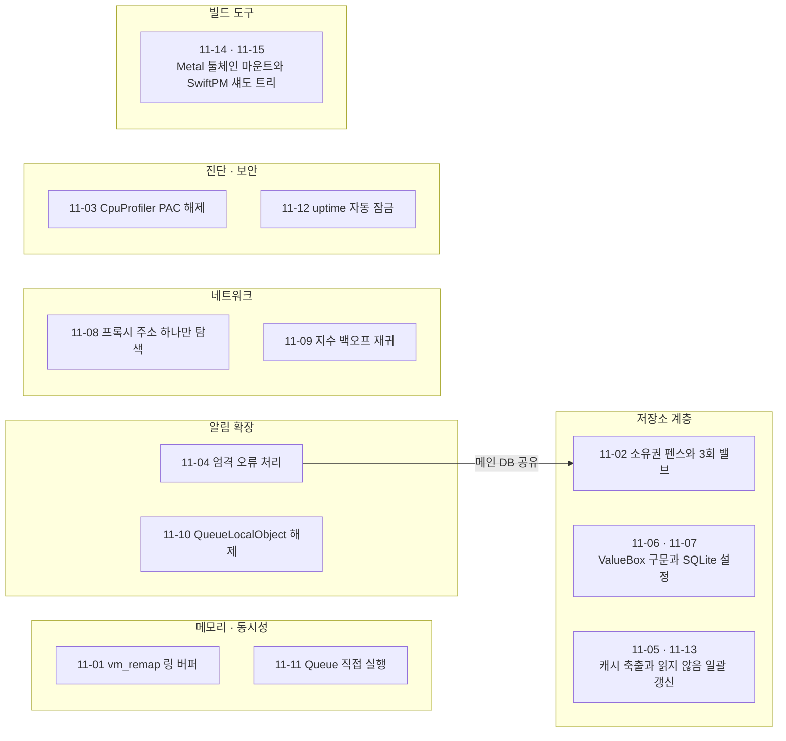
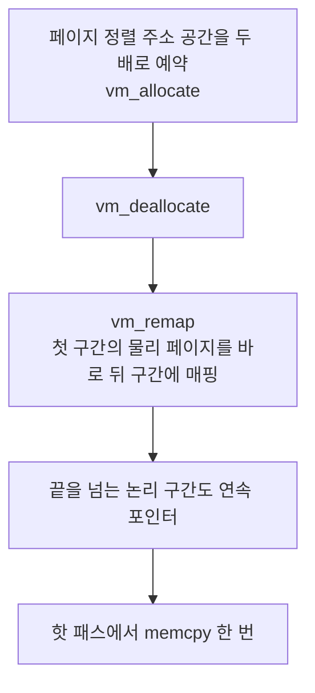
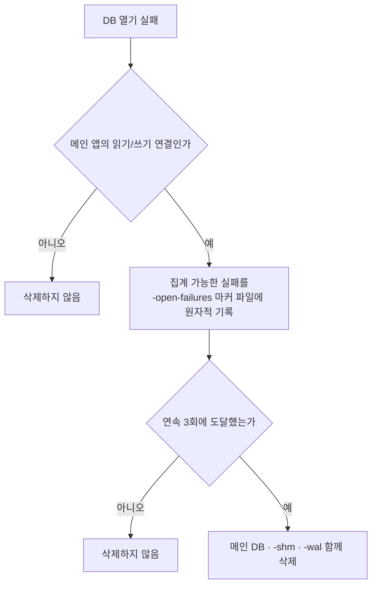
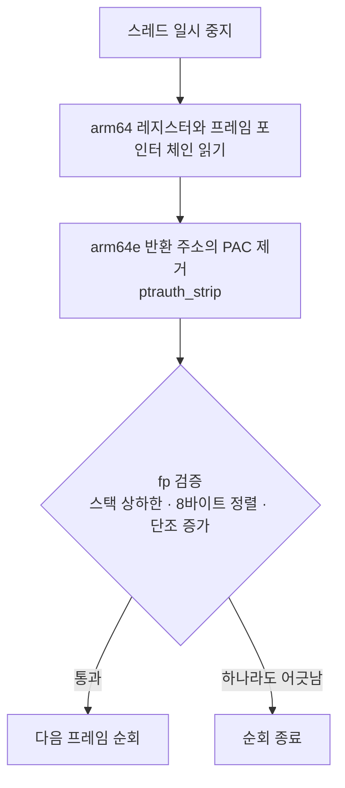
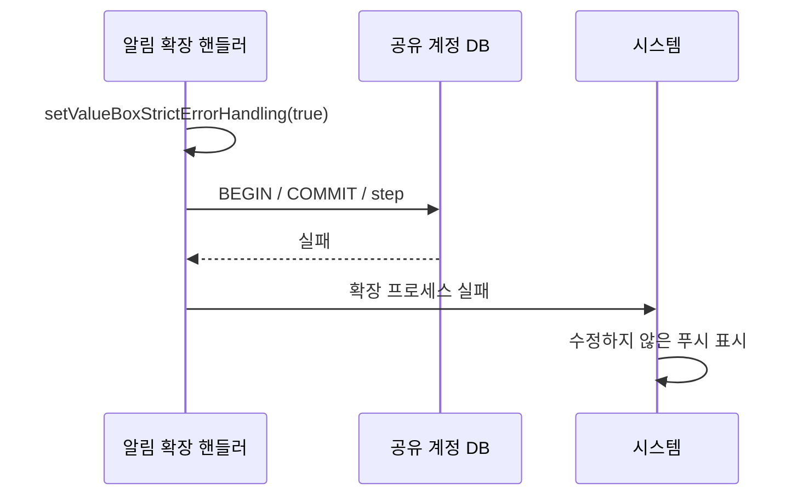
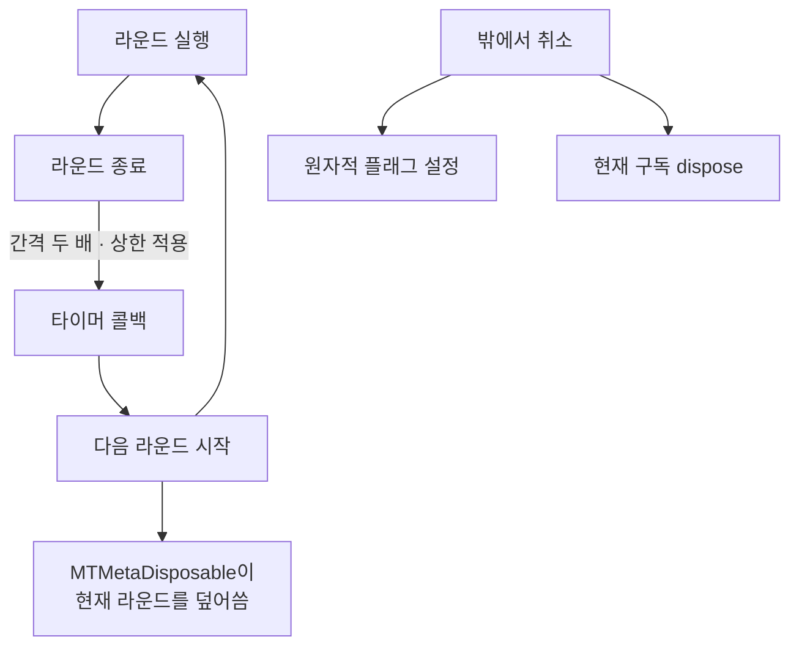

# 비 UI 코어

웹: /docs/ios/11-core-nonui/ · Markdown: /docs/ios/11-core-nonui.md

> 이중 가상 매핑 링 버퍼, 공유 SQLite 보호, 샘플러.

| 기법 항목 | 리포트 선정 | 비공개 API 관련 | REA 연관 |
| --- | --- | --- | --- |
| 15 | 5 | 0 | 1 |

소스: [TelegramMessenger/Telegram-iOS@f1dd7a2d](https://github.com/TelegramMessenger/Telegram-iOS/tree/f1dd7a2dbd02cbbf513e75d5695d8d36d1cf5838)(2026-10-07) · 플랫폼: iOS · UIKit

이 장의 선정 항목:
- 11-1 [#11-01 이중 가상 매핑으로 링 버퍼의 랩어라운드 없애기](/docs/ios/11-core-nonui/#t11-01)
- 11-2 [#11-02 “소유권 펜스”와 3회 밸브로 공유 SQLite 보호하기](/docs/ios/11-core-nonui/#t11-02)
- 11-3 [#11-03 CPU 샘플링할 때 PAC를 직접 풀고 스택 순회를 제한하기](/docs/ios/11-core-nonui/#t11-03)
- 11-4 [#11-04 반쪽 트랜잭션으로 계속하지 않고 크래시를 택하는 알림 확장](/docs/ios/11-core-nonui/#t11-04)
- 11-5 [#11-09 취소 가능한 지연 재귀로 지수 백오프 구현](/docs/ios/11-core-nonui/#t11-09)

이 주제의 범위: Telegram-iOS 비 UI 코어: 동시성, 저장소, 확장, 네트워크와 빌드.

결론: 이번에 기법 15건을 기록했어요. 핵심 주제는 이래요.

- 가상 메모리
- 프로세스 간 SQLite
- 확장의 시간 제한
- 빌드 우회

검토 기준은 `f1dd7a2dbd02cbbf513e75d5695d8d36d1cf5838`이에요. 이 범위에서 난독화된 비공개 API 이름은 발견되지 않았어요.

아래 도표는 이 장의 기법이 손대는 구성요소를 묶음별로 보여 줘요.



## 1. 이중 가상 매핑으로 링 버퍼의 랩어라운드 없애기 [#t11-01]

> #11-01 · Telegram-iOS · 비 UI · 리포트 선정 11-1 · 검증 방식: 소스 분석, REA 바이너리
>
> 소스: [Telegram-iOS:submodules/RingBuffer/Sources/RingBuffer.m L33–L105](https://github.com/TelegramMessenger/Telegram-iOS/blob/f1dd7a2dbd02cbbf513e75d5695d8d36d1cf5838/submodules/RingBuffer/Sources/RingBuffer.m#L33-L105)

**무엇을 했나요**: 링 버퍼(고정 크기 버퍼를 원형으로 돌려 쓰는 구조)를 만들 때 주소 공간을 이렇게 구성해요.

1. 먼저 페이지 정렬된 주소 공간을 두 배로 예약해요.
2. 첫 번째 구간의 물리 페이지를 바로 뒤의 두 번째 구간에 매핑해요.

그러면 끝을 넘어가는 논리적 연속 구간도 모두 연속 포인터가 돼요.

**왜 이렇게 했나요**: 일반 링 버퍼는 랩어라운드(끝에 닿으면 처음으로 돌아가는) 지점에서 두 구간으로 나뉘어요. 호출자는 분기하거나 두 번 복사해야 해요. 여기서는 비용을 초기화로 옮겼어요. 그래서 핫 패스에서 `memcpy` 한 번이면 돼요.

아래 도표는 링 버퍼의 미러 윈도우를 만드는 초기화 순서를 보여 줘요.



**핵심 코드 발췌**

```objc title="RingBuffer.m · L33–L105"
buffer->length = (int32_t)round_page(length);
// Temporarily allocate twice the length, so we have the contiguous address space to
// support a second instance of the buffer directly after
vm_address_t bufferAddress;
kern_return_t result = vm_allocate(mach_task_self(),
                                   &bufferAddress,
                                   buffer->length * 2,
                                   VM_FLAGS_ANYWHERE);
result = vm_deallocate(mach_task_self(),
                       bufferAddress + buffer->length,
                       buffer->length);
// Re-map the buffer to the address space immediately after the buffer
vm_address_t virtualAddress = bufferAddress + buffer->length;
vm_prot_t cur_prot, max_prot;
result = vm_remap(mach_task_self(),
                  &virtualAddress,
                  buffer->length,
                  0,
                  0,
                  mach_task_self(),
                  bufferAddress,
                  0,
                  &cur_prot,
                  &max_prot,
                  VM_INHERIT_DEFAULT);
```

**대가와 위험**: Mach `vm_remap`과 주소 공간의 연속성에 기대고 있어요. 초기화는 3회 재시도해요. 가상 주소는 용량의 두 배를 차지해요.

**증거 체인 #11-01** (공유 모듈의 간접 증거)

- 소스 분석: Telegram-iOS 고정 커밋에서 행 단위로 확인했어요. 소스 위치는 모두 1곳이에요.
- 리포트 요약(구현 방법): `vm_allocate`→`vm_deallocate`→`vm_remap`으로 미러 윈도우를 구성해요.
- REA 20번 항목(공유 모듈의 간접 증거; REA 바이너리): 13.0 바이너리: `vm_allocate`, `vm_remap` import; `RingBuffer` 관련 문자열 4건; macOS 26.7: 실행하지 않음; 결론: 릴리스됨(간접)

## 2. “소유권 펜스”와 3회 밸브로 공유 SQLite 보호하기 [#t11-02]

> #11-02 · Telegram-iOS · 비 UI · 리포트 선정 11-2 · 검증 방식: 소스 분석
>
> 소스: [Telegram-iOS:submodules/Postbox/Sources/SqliteValueBox.swift L254–L303](https://github.com/TelegramMessenger/Telegram-iOS/blob/f1dd7a2dbd02cbbf513e75d5695d8d36d1cf5838/submodules/Postbox/Sources/SqliteValueBox.swift#L254-L303)

**무엇을 했나요**: `SqliteValueBox`는 데이터베이스를 지우는 조건을 엄격하게 둬요.

- 메인 앱의 읽기/쓰기 연결만 데이터베이스를 지울 수 있게 해요.
- 연속으로 집계할 수 있는 열기 실패는 원자적 마커 파일에 기록해요.
- 3회에 도달한 뒤에야 메인 DB, `-shm`, `-wal`을 함께 지워요.

**왜 이렇게 했나요**: 알림 확장은 메인 DB를 공유해요. 잠금 화면 데이터 보호, 락 경합, 리소스 고갈이 있다고 해서 DB가 손상된 것은 아니에요. 바로 지우면 일시적으로 열리지 않는 상황이 로컬 데이터 손실로 이어져요. 메인 DB만 지워도 오래된 WAL(변경을 로그 파일에 먼저 적는 SQLite 방식) 인덱스가 새 WAL과 짝지어져요.

아래 도표는 DB 열기 실패가 삭제로 이어지는 조건을 보여 줘요.



**핵심 코드 발췌**

```swift title="SqliteValueBox.swift · L254–L303"
/// Whether this connection may delete the database to recover from an error.
/// Only the owning read-write connection (the main app) may do so.
let removeDatabaseOnError: Bool
static let openFailureWipeThreshold = 3
private static func openFailuresPath(databasePath: String) -> String {
    return databasePath + "-open-failures"
}
static func shouldWipeAfterOpenFailure(
    databasePath: String, systemErrno: Int32
) -> Bool {
    guard shouldCountOpenFailure(systemErrno: systemErrno) else {
        return false
    }
    let failures = self.consecutiveOpenFailures(databasePath: databasePath) + 1
    let _ = try? Data(String(failures).utf8).write(
        to: URL(fileURLWithPath: self.openFailuresPath(databasePath: databasePath)),
        options: .atomic
    )
    return failures >= self.openFailureWipeThreshold
}
static func removeDatabaseFiles(databasePath: String) {
    for suffix in ["", "-shm", "-wal", "-open-failures"] {
        let _ = try? FileManager.default.removeItem(atPath: databasePath + suffix)
    }
}
```

**대가와 위험**: 메인 앱에서 집계할 수 있는 실패가 연속 3회 나면 여전히 빈 DB를 다시 만들어요. 이 정책은 잘못 지우는 일을 막는 데 우선순위를 두기 때문에, 실제로 손상됐을 때 복구가 늦어질 수 있어요.

**증거 체인 #11-02** (iOS 바이너리 미검증)

- 소스 분석: Telegram-iOS 고정 커밋에서 행 단위로 확인했어요. 소스 위치는 모두 1곳이에요.
- 리포트 요약(구현 방법): `-open-failures` 마커 파일의 원자적 쓰기와 임계값 판단.
- 바이너리 검증: 하지 않음. App Store 버전 IPA는 FairPlay로 암호화되어 있어서 복호화된 실행 파일을 합법적으로 얻을 수 없어요.

## 3. CPU 샘플링할 때 PAC를 직접 풀고 스택 순회를 제한하기 [#t11-03]

> #11-03 · Telegram-iOS · 비 UI · 리포트 선정 11-3 · 검증 방식: 소스 분석
>
> 소스: [Telegram-iOS:submodules/CpuProfiler/Sources/CpuProfiler.mm L42–L99](https://github.com/TelegramMessenger/Telegram-iOS/blob/f1dd7a2dbd02cbbf513e75d5695d8d36d1cf5838/submodules/CpuProfiler/Sources/CpuProfiler.mm#L42-L99)

**무엇을 했나요**: `CpuProfiler`는 일시 중지된 스레드의 arm64 레지스터와 프레임 포인터 체인을 직접 읽어요. 먼저 arm64e 반환 주소의 PAC(포인터 인증 코드)를 없애요. 그다음 프레임 포인터를 검사하다가 아래 조건 중 하나라도 어긋나면 순회를 끝내요.

- 스택 상하한
- 8바이트 정렬
- 단조 증가하는 프레임 포인터

**왜 이렇게 했나요**: 심볼화 도구는 프로세스 안에서 자주 샘플링하기에 맞지 않아요. PAC 비트를 없애지 않으면 주소를 해석할 수 없어요. 검증되지 않은 프레임 체인은 스택 밖의 쓰레기 값을 읽어서 크래시를 일으켜요.

아래 도표는 CpuProfiler가 스택을 순회하는 순서와 순회를 끝내는 조건을 보여 줘요.



**핵심 코드 발췌**

```objc title="CpuProfiler.mm · L42–L99"
/// arm64e signs return addresses stored on the stack.
inline uintptr_t strippedPointer(uintptr_t value) {
#if __has_feature(ptrauth_calls)
    return (uintptr_t)ptrauth_strip((void *)value, ptrauth_key_return_address);
#else
    return value & 0x000000ffffffffffULL;
#endif
}
int walkStack(thread_t thread, uintptr_t stackLow, uintptr_t stackHigh,
              uintptr_t *frames) {
    arm_thread_state64_t state;
    mach_msg_type_number_t stateCount = ARM_THREAD_STATE64_COUNT;
    if (thread_get_state(thread, ARM_THREAD_STATE64,
                         (thread_state_t)&state, &stateCount) != KERN_SUCCESS) {
        return 0;
    }
    const uintptr_t pc = (uintptr_t)arm_thread_state64_get_pc(state);
    const uintptr_t lr = strippedPointer((uintptr_t)arm_thread_state64_get_lr(state));
    uintptr_t framePointer = (uintptr_t)arm_thread_state64_get_fp(state);
    if (framePointer < stackLow ||
        framePointer + 2 * sizeof(uintptr_t) > stackHigh) {
        break;
    }
    const uintptr_t returnAddress = strippedPointer(
        *(uintptr_t *)(framePointer + sizeof(uintptr_t)));
```

**대가와 위험**: Mach 스레드 API를 써요. 샘플링하려면 다른 스레드를 잠시 일시 중지해야 해요. arm64가 아닌 플랫폼에서는 콜 스택을 수집하지 않아요.

**증거 체인 #11-03** (iOS 바이너리 미검증)

- 소스 분석: Telegram-iOS 고정 커밋에서 행 단위로 확인했어요. 소스 위치는 모두 1곳이에요.
- 리포트 요약(구현 방법): `ptrauth_strip`, `fp`가 범위 안에 있고 8바이트 정렬인지 검증.
- 바이너리 검증: 하지 않음. App Store 버전 IPA는 FairPlay로 암호화되어 있어서 복호화된 실행 파일을 합법적으로 얻을 수 없어요.

## 4. 반쪽 트랜잭션으로 계속하지 않고 크래시를 택하는 알림 확장 [#t11-04]

> #11-04 · Telegram-iOS · 비 UI · 리포트 선정 11-4 · 검증 방식: 소스 분석
>
> 소스: [Telegram-iOS:Telegram/NotificationService/Sources/NotificationService.swift L766–L778](https://github.com/TelegramMessenger/Telegram-iOS/blob/f1dd7a2dbd02cbbf513e75d5695d8d36d1cf5838/Telegram/NotificationService/Sources/NotificationService.swift#L766-L778)

**무엇을 했나요**: 알림 확장은 핸들러를 시작할 때 `setValueBoxStrictErrorHandling(true)`를 켜요. SQLite의 `BEGIN`, `COMMIT`, `step`이 실패하면 확장 프로세스가 실패해요. 그러면 시스템이 수정하지 않은 푸시를 보여 줘요.

**왜 이렇게 했나요**: 이 확장은 메인 앱과 계정 데이터베이스를 프로세스 간에 공유해요. 조용히 실패하면 원자적이지 않은 상태가 남아요. 코드에는 이 상태가 차분 폴링을 영구 라이브락(멈추지는 않지만 진전 없이 계속 도는 상태)에 빠뜨린다고 적혀 있어요.

아래 도표는 알림 확장이 SQLite 실패를 프로세스 실패로 바꾸는 순서를 보여 줘요.



**핵심 코드 발췌**

```swift title="NotificationService.swift · L766–L778"
private let notificationKeyDisposable = MetaDisposable()
private let pollDisposable = MetaDisposable()
// Handler creation is, for practical purposes, when the system's ~30 s extension
// budget started ticking; the connection deadline on the poll path counts from here.
private let startTimestamp = CFAbsoluteTimeGetCurrent()

init?(queue: Queue, episode: String, updateCurrentContent: @escaping (NotificationContent) -> Void,
      completed: @escaping () -> Void, requestIdentifier: String,
      payload: [AnyHashable: Any]) {
    self.queue = queue

    // In the extension, database BEGIN/COMMIT/step failures must crash (the system then
    // falls back to displaying the unmodified push) instead of failing silently: silent
    // failures under cross-process lock contention produce non-atomic writes and pin the
    // account state, turning the difference polling loop into an infinite livelock.
    setValueBoxStrictErrorHandling(true)
```

**대가와 위험**: 가용성을 일부러 낮추는 장애 정책이에요. 사용자는 원본 알림을 볼 수 있어요. 이 정책이 막는 것은 더 오래 이어지는 CPU 점유와 계정 상태 정지예요.

**증거 체인 #11-04** (iOS 바이너리 미검증)

- 소스 분석: Telegram-iOS 고정 커밋에서 행 단위로 확인했어요. 소스 위치는 모두 1곳이에요.
- 리포트 요약(구현 방법): 핸들러를 초기화하는 즉시 엄격 모드로 전환하고, 실패하면 프로세스를 종료해요.
- 바이너리 검증: 하지 않음. App Store 버전 IPA는 FairPlay로 암호화되어 있어서 복호화된 실행 파일을 합법적으로 얻을 수 없어요.

## 5. 하드 링크된 여러 경로를 하나의 캐시 축출 단위로 병합 [#t11-05]

> #11-05 · Telegram-iOS · 비 UI · 검증 방식: 소스 분석 · 태그: 성능과 메모리
>
> 소스: [Telegram-iOS:submodules/Postbox/Sources/TimeBasedCleanup.swift L255–L284](https://github.com/TelegramMessenger/Telegram-iOS/blob/f1dd7a2dbd02cbbf513e75d5695d8d36d1cf5838/submodules/Postbox/Sources/TimeBasedCleanup.swift#L255-L284)

**무엇을 했나요**: 정리기는 이렇게 동작해요.

- `(st_dev, st_ino)`로 같은 물리 파일을 알아봐요.
- 첫 번째 경로가 크기를 기록해요.
- 하드 링크가 더 있으면 같은 임시 데이터베이스 행에만 덧붙여요.
- 축출할 때는 모든 경로를 함께 unlink해요.

**왜 이렇게 했나요**: 다운로드가 끝난 파일 하나에 `<id>`와 `<id>_partial` 두 디렉터리 항목이 있을 수 있어요. 경로별로 합산하면 용량이 중복으로 계산돼요. 경로 하나만 지워도 inode 데이터 블록은 해제되지 않아요.

**핵심 코드 발췌**

```swift title="TimeBasedCleanup.swift · L255–L284"
var identity: FileIdentity?
var isAdditionalLink = false
if value.st_nlink > 1 {
    let fileIdentity = FileIdentity(
        device: UInt64(UInt32(bitPattern: value.st_dev)),
        inode: UInt64(value.st_ino)
    )
    identity = fileIdentity
    isAdditionalLink = !seenLinkedInodes.insert(fileIdentity).inserted
}

if isAdditionalLink {
    if performSizeMapping, let identity = identity {
        tempDatabase.addLink(pathBuffer: pathBuffer,
                             pathSize: strnlen(pathBuffer, 1024),
                             identity: identity)
    }
} else {
    result.totalSize += UInt64(value.st_size)
    if performSizeMapping {
        tempDatabase.add(pathBuffer: pathBuffer,
                         pathSize: strnlen(pathBuffer, 1024),
                         size: Int64(value.st_size),
                         timestamp: scanTimestamp(value.st_mtimespec.tv_sec),
                         identity: identity)
```

**대가와 위험**: 스캔할 때 `Set<FileIdentity>`를 유지해야 해요. `st_nlink > 1`일 때만 이 경로로 들어가요. 비정상적인 파일 시스템 동작은 코드에서 검증하지 않았어요.

**증거 체인 #11-05** (iOS 바이너리 미검증)

- 소스 분석: Telegram-iOS 고정 커밋에서 행 단위로 확인했어요. 소스 위치는 모두 1곳이에요.
- 바이너리 검증: 하지 않음. App Store 버전 IPA는 FairPlay로 암호화되어 있어서 복호화된 실행 파일을 합법적으로 얻을 수 없어요.

## 6. 행 ID 없는 테이블과 영속 구문으로 컴팩트한 ValueBox 구현 [#t11-06]

> #11-06 · Telegram-iOS · 비 UI · 검증 방식: 소스 분석 · 태그: 성능과 메모리
>
> 소스: [Telegram-iOS:submodules/Postbox/Sources/SqliteValueBox.swift L898–L952](https://github.com/TelegramMessenger/Telegram-iOS/blob/f1dd7a2dbd02cbbf513e75d5695d8d36d1cf5838/submodules/Postbox/Sources/SqliteValueBox.swift#L898-L952)

**무엇을 했나요**: `ValueBox`는 이렇게 구성돼요.

- 논리 테이블 ID에 따라 `t<ID>`를 동적으로 만들어요.
- 바이너리 기본 키 테이블은 `WITHOUT ROWID`를 쓸 수 있어요.
- 테이블별로 쿼리 구문을 캐시하고 `SQLITE_PREPARE_PERSISTENT`로 컴파일해요.

**왜 이렇게 했나요**: 작은 키-값 테이블에는 SQLite의 암묵적 행 ID를 중복해서 저장할 필요가 없어요. 자주 읽을 때 같은 SQL을 반복해서 파싱해서도 안 돼요. 객체 하나가 구문을 재사용하기 전에 `reset()`하고 새 키를 바인딩해요.

**핵심 코드 발췌**

```swift title="SqliteValueBox.swift · L898–L952"
private func createTable(database: Database, table: ValueBoxTable) {
    switch table.keyType {
    case .binary:
        var createStatement =
            "CREATE TABLE IF NOT EXISTS t\(table.id) (key BLOB PRIMARY KEY, value BLOB)"
        if table.compactValuesOnCreation {
            createStatement += " WITHOUT ROWID"
        }
        let resultCode = database.execute(createStatement)
        assert(resultCode)
    }
}
if let statement = self.getStatements[table.id] {
    resultStatement = statement
} else {
    var statement: OpaquePointer? = nil
    let status = sqlite3_prepare_v3(self.database.handle,
        "SELECT value FROM t\(table.id) WHERE key=?", -1,
        SQLITE_PREPARE_PERSISTENT, &statement, nil)
    precondition(status == SQLITE_OK)
    let preparedStatement = SqlitePreparedStatement(statement: statement)
    self.getStatements[table.id] = preparedStatement
    resultStatement = preparedStatement
}
resultStatement.reset()
```

**대가와 위험**: 접근한 테이블마다 미리 컴파일한 구문이 계속 남아 있어요. 동적 SQL은 테이블 ID를 이어 붙여 만들어요. 이 ID는 외부 문자열이 아니라 내부 `ValueBoxTable`에서 나와요.

**증거 체인 #11-06** (iOS 바이너리 미검증)

- 소스 분석: Telegram-iOS 고정 커밋에서 행 단위로 확인했어요. 소스 위치는 모두 1곳이에요.
- 바이너리 검증: 하지 않음. App Store 버전 IPA는 FairPlay로 암호화되어 있어서 복호화된 실행 파일을 합법적으로 얻을 수 없어요.

## 7. SQLite mmap을 명시적으로 끄고 영속성 트레이드오프를 분리 [#t11-07]

> #11-07 · Telegram-iOS · 비 UI · 검증 방식: 소스 분석 · 태그: 성능과 메모리
>
> 소스: [Telegram-iOS:submodules/Postbox/Sources/SqliteValueBox.swift L590–L628](https://github.com/TelegramMessenger/Telegram-iOS/blob/f1dd7a2dbd02cbbf513e75d5695d8d36d1cf5838/submodules/Postbox/Sources/SqliteValueBox.swift#L590-L628)

**무엇을 했나요**: 캐시를 끈 연결은 이렇게 설정해요.

- SQLite 페이지 캐시를 32로 제한해요.
- SQLite mmap은 명시적으로 꺼요.
- WAL, `synchronous=NORMAL`, 메모리 임시 테이블을 함께 써요.
- 체크포인트에는 여전히 `fullfsync`를 요구해요.

**왜 이렇게 했나요**: 이 파라미터 조합은 런타임 지연, 메모리, 영속성의 트레이드오프를 분리해요. `useCaches`가 거짓일 때 32페이지 제한은 임시 연결이나 확장 연결에 특히 잘 맞아요. 코드는 `mmap_size`를 끄는 구체적인 시스템 결함을 설명하지 않아요. 그 이유는 **미검증**이에요.

**핵심 코드 발췌**

```swift title="SqliteValueBox.swift · L590–L628"
if !self.useCaches {
    resultCode = database.execute("PRAGMA cache_size=32")
    assert(resultCode)
}
resultCode = database.execute("PRAGMA mmap_size=0")
assert(resultCode)
resultCode = database.execute("PRAGMA synchronous=NORMAL")
assert(resultCode)
resultCode = database.execute("PRAGMA temp_store=MEMORY")
assert(resultCode)
resultCode = database.execute("PRAGMA journal_mode=WAL")
assert(resultCode)
resultCode = database.execute("PRAGMA cipher_memory_security = OFF")
assert(resultCode)

self.pageSize = Int(self.runPragma(database, "page_size"))
// ...
let _ = self.runPragma(database, "checkpoint_fullfsync = 1")
assert(self.runPragma(database, "checkpoint_fullfsync") == "1")
```

**대가와 위험**: `synchronous=NORMAL`은 단일 트랜잭션의 내구성이 `FULL`보다 낮아요. `cipher_memory_security = OFF`는 SQLCipher의 메모리 소거 보호도 약하게 만들어요. 파라미터 호환성은 번들된 SQLite/SQLCipher에 달려 있어요.

**증거 체인 #11-07** (iOS 바이너리 미검증)

- 소스 분석: Telegram-iOS 고정 커밋에서 행 단위로 확인했어요. 소스 위치는 모두 1곳이에요.
- 바이너리 검증: 하지 않음. App Store 버전 IPA는 FairPlay로 암호화되어 있어서 복호화된 실행 파일을 합법적으로 얻을 수 없어요.

## 8. MTProxy와 Web 프록시는 주소 하나만 탐색 [#t11-08]

> #11-08 · Telegram-iOS · 비 UI · 검증 방식: 소스 분석
>
> 소스: [Telegram-iOS:submodules/MtProtoKit/Sources/MTDiscoverConnectionSignals.m L194–L225](https://github.com/TelegramMessenger/Telegram-iOS/blob/f1dd7a2dbd02cbbf513e75d5695d8d36d1cf5838/submodules/MtProtoKit/Sources/MTDiscoverConnectionSignals.m#L194-L225)

**무엇을 했나요**: MTProxy(Telegram용 프록시)나 Web 프록시일 때 탐색 로직은 이렇게 동작해요.

- 주소 하나를 골라요.
- IPv4를 먼저 골라요.
- 프록시가 설정되어 있기만 하면 80과 5222 대체 포트 탐색도 꺼요.

**왜 이렇게 했나요**: 이 두 종류의 프록시는 목적지 주소를 무시하거나 다르게 해석해요. 주소 수 × 포트 수만큼 탐색해도 정보가 늘지 않아요. 프록시에 닿지 않을 때 이렇게 여러 갈래로 뻗으면 알림 확장의 재시도 폭풍이 더 커져요.

**핵심 코드 발췌**

```objc title="MTDiscoverConnectionSignals.m · L194–L225"
if (proxySettings != nil &&
    (proxySettings.secret != nil || proxySettings.webProxy)) {
    // An MTProxy chooses the datacenter from the obfuscated header and a WEB relay
    // ignores the address it is handed, so every probe through either lands in the
    // same place: N of them carry exactly the information of one.
    MTDatacenterAddress *chosen = nil;
    for (MTDatacenterAddress *address in bestAddressList) {
        if (![self isIpv6:address.ip]) {
            chosen = address;
            break;
        }
    }
    if (chosen == nil) {
        chosen = bestAddressList.firstObject;
    }
    return chosen == nil ? @[] : @[chosen];
}
+ (NSArray<NSNumber *> *)alternatePortsForProxySettings:
    (MTSocksProxySettings *)proxySettings {
    if (proxySettings != nil) {
        return @[];
    }
    return @[@80, @5222];
}
```

**대가와 위험**: 주소를 하나만 쓰는 정책은 중복을 줄여요. IPv4 우선은 코드상의 정책일 뿐, 현재 네트워크에서 최적의 경로를 보장하지는 않아요.

**증거 체인 #11-08** (iOS 바이너리 미검증)

- 소스 분석: Telegram-iOS 고정 커밋에서 행 단위로 확인했어요. 소스 위치는 모두 1곳이에요.
- 바이너리 검증: 하지 않음. App Store 버전 IPA는 FairPlay로 암호화되어 있어서 복호화된 실행 파일을 합법적으로 얻을 수 없어요.

## 9. 취소 가능한 지연 재귀로 지수 백오프 구현 [#t11-09]

> #11-09 · Telegram-iOS · 비 UI · 리포트 선정 11-5 · 검증 방식: 소스 분석
>
> 소스: [Telegram-iOS:submodules/MtProtoKit/Sources/MTDiscoverConnectionSignals.m L228–L257](https://github.com/TelegramMessenger/Telegram-iOS/blob/f1dd7a2dbd02cbbf513e75d5695d8d36d1cf5838/submodules/MtProtoKit/Sources/MTDiscoverConnectionSignals.m#L228-L257)

**무엇을 했나요**: 지수 백오프(재시도 간격을 두 배씩 늘리는 방식)를 이렇게 구현해요.

- 매 라운드가 끝난 뒤에야 타이머 콜백에서 다음 라운드를 시작해요.
- 간격은 두 배씩 늘어나고 상한이 있어요.
- `MTMetaDisposable`이 현재 라운드를 덮어써요.
- 밖에서 취소하면 원자적 플래그를 설정하고 현재 구독을 dispose해요.

**왜 이렇게 했나요**: 동기 재귀는 콜 스택을 키워요. 고정된 짧은 간격은 네트워크가 끊겨도 연결을 계속 만들어요. 이 구현은 오래된 라운드를 줄줄이 남겨 두지 않고, 취소하면 현재 작업을 바로 끊어요.

아래 도표는 라운드가 끝난 뒤에 다음 라운드를 예약하는 흐름과 취소 경로를 보여 줘요.



**핵심 코드 발췌**

```objc title="MTDiscoverConnectionSignals.m · L228–L257"
+ (void)_startBackoffRoundOf:(MTSignal *)signal
                       delay:(NSTimeInterval)delay
                    maxDelay:(NSTimeInterval)maxDelay
                       queue:(MTQueue *)queue
                  subscriber:(MTSubscriber *)subscriber
           currentDisposable:(MTMetaDisposable *)currentDisposable
                  isDisposed:(MTAtomic *)isDisposed {
    if ([[isDisposed value] boolValue]) {
        return;
    }
    NSTimeInterval nextDelay = MIN(delay * 2.0, maxDelay);
    MTSignal *round = [signal then:[[MTSignal complete] delay:delay onQueue:queue]];
    // The recursion happens from the delay timer's completion, so it never grows the stack.
    [currentDisposable setDisposable:[round startWithNext:^(id next) {
        [subscriber putNext:next];
    } error:^(id error) {
        [subscriber putError:error];
    } completed:^{
        [self _startBackoffRoundOf:signal delay:nextDelay maxDelay:maxDelay
            queue:queue subscriber:subscriber
            currentDisposable:currentDisposable isDisposed:isDisposed];
    }]];
}
```

**대가와 위험**: 지터(재시도 간격에 섞는 무작위 편차)가 없어요. 여러 클라이언트가 같은 백오프 박자로 다시 시도할 수 있어요.

**증거 체인 #11-09** (iOS 바이너리 미검증)

- 소스 분석: Telegram-iOS 고정 커밋에서 행 단위로 확인했어요. 소스 위치는 모두 1곳이에요.
- 리포트 요약(구현 방법): `then(delay:)`로 연결하고 `MTMetaDisposable`이 현재 구독을 덮어써요.
- 바이너리 검증: 하지 않음. App Store 버전 IPA는 FairPlay로 암호화되어 있어서 복호화된 실행 파일을 합법적으로 얻을 수 없어요.

## 10. 만료될 때 큐 로컬 객체를 해제해 알림 파이프라인 전체를 취소 [#t11-10]

> #11-10 · Telegram-iOS · 비 UI · 검증 방식: 소스 분석 · 태그: 텍스트와 입력
>
> 소스: [Telegram-iOS:Telegram/NotificationService/Sources/NotificationService.swift L2748–L2765](https://github.com/TelegramMessenger/Telegram-iOS/blob/f1dd7a2dbd02cbbf513e75d5695d8d36d1cf5838/Telegram/NotificationService/Sources/NotificationService.swift#L2748-L2765)

**무엇을 했나요**: `serviceExtensionTimeWillExpire()`는 네트워크 작업을 하나씩 멈추지 않아요. 대신 이렇게 해요.

1. `QueueLocalObject`를 비워요.
2. 핸들러가 소멸될 때 `MetaDisposable`이 해제되면서 폴링을 dispose하고 keep-alive 연결을 끊어요.
3. 그런 다음 최신 콘텐츠나 원본 콘텐츠를 제출해요.

**왜 이렇게 했나요**: iOS가 확장의 시간을 회수한다고 해서 프로세스를 바로 죽이는 것은 아니에요. 콘텐츠 콜백만 호출하면 차분 동기화가 여전히 CPU를 쓸 수 있어요. 그래서 객체 소유권이 비동기 파이프라인 전체의 취소 스위치가 돼요.

**핵심 코드 발췌**

```swift title="NotificationService.swift · L2748–L2765"
override func serviceExtensionTimeWillExpire() {
    // Releasing impl deallocates the handler on its queue, which disposes the in-flight
    // poll (getDifference/state replay) and drops the keep-alive network connection.
    // Without this, that work keeps running after the system takes back control and
    // continues to consume CPU for as long as the extension process stays alive.
    self.impl = nil

    if let contentHandler = self.contentHandler {
        self.contentHandler = nil

        Logger.shared.log("NotificationService \(self.episode ?? \"???\")",
                          "Completing due to serviceExtensionTimeWillExpire")

        if let content = self.content.with({ $0 }) {
            contentHandler(content.generate())
        } else if let initialContent = self.initialContent {
            contentHandler(initialContent)
        }
    }
}
```

**대가와 위험**: 이 정책은 소멸자 체인이 모든 구독을 올바르게 해제한다는 데 기대고 있어요. 새로 추가한 작업을 핸들러가 소유하지 않으면 자동으로 취소되지 않아요.

**증거 체인 #11-10** (iOS 바이너리 미검증)

- 소스 분석: Telegram-iOS 고정 커밋에서 행 단위로 확인했어요. 소스 위치는 모두 1곳이에요.
- 바이너리 검증: 하지 않음. App Store 버전 IPA는 FairPlay로 암호화되어 있어서 복호화된 실행 파일을 합법적으로 얻을 수 없어요.

## 11. `async`라는 이름의 큐 호출을 같은 큐 안에서 바로 실행하기 [#t11-11]

> #11-11 · Telegram-iOS · 비 UI · 검증 방식: 소스 분석 · 태그: 성능과 메모리
>
> 소스: [Telegram-iOS:submodules/SSignalKit/SwiftSignalKit/Source/Queue.swift L42–L81](https://github.com/TelegramMessenger/Telegram-iOS/blob/f1dd7a2dbd02cbbf513e75d5695d8d36d1cf5838/submodules/SSignalKit/SwiftSignalKit/Source/Queue.swift#L42-L81)

**무엇을 했나요**: `Queue`는 이렇게 동작해요.

- 직렬 큐에 `DispatchSpecificKey`를 설정해요.
- 대상 큐 안에서는 `async`와 `sync` 모두 클로저를 바로 실행해요.
- 메인 큐는 `Thread.isMainThread`로 알아봐요.

**왜 이렇게 했나요**: 같은 큐에서 `sync`를 쓰면 데드락이 생겨요. 무조건 `async`로 보내도 큐잉 지연이 한 번 더 붙어요. 이 래퍼는 큐 친화성을 일관되게 유지하고 불필요한 점프를 없애요.

**핵심 코드 발췌**

```swift title="Queue.swift · L42–L81"
public init(name: String? = nil, qos: DispatchQoS = .default) {
    self.nativeQueue = DispatchQueue(label: name ?? "", qos: qos)
    self.specialIsMainQueue = false
    self.nativeQueue.setSpecific(key: QueueSpecificKey, value: self.specific)
}

public func isCurrent() -> Bool {
    if DispatchQueue.getSpecific(key: QueueSpecificKey) === self.specific {
        return true
    } else if self.specialIsMainQueue && Thread.isMainThread {
        return true
    } else {
        return false
    }
}

public func async(_ f: @escaping () -> Void) {
    if self.isCurrent() {
        f()
    } else {
        self.nativeQueue.async(execute: f)
    }
}
```

**대가와 위험**: `async`가 더 이상 비동기 경계를 보장하지 않아요. 호출자가 지연 실행이나 재진입 격리에 기대면 직관과 다르게 동작해요.

**증거 체인 #11-11** (iOS 바이너리 미검증)

- 소스 분석: Telegram-iOS 고정 커밋에서 행 단위로 확인했어요. 소스 위치는 모두 1곳이에요.
- 바이너리 검증: 하지 않음. App Store 버전 IPA는 FairPlay로 암호화되어 있어서 복호화된 실행 파일을 합법적으로 얻을 수 없어요.

## 12. 부팅 시각과 가동 시간으로 되돌릴 수 없는 자동 잠금 구현 [#t11-12]

> #11-12 · Telegram-iOS · 비 UI · 검증 방식: 소스 분석 · 태그: 런타임 해킹, 텍스트와 입력
>
> 소스: [Telegram-iOS:submodules/AppLock/Sources/AppLock.swift L18–L39](https://github.com/TelegramMessenger/Telegram-iOS/blob/f1dd7a2dbd02cbbf513e75d5695d8d36d1cf5838/submodules/AppLock/Sources/AppLock.swift#L18-L39)

**무엇을 했나요**: 잠금 여부를 이렇게 판단해요.

- 잠금 상태에는 시작 시각과 부팅 후 가동 초를 저장해요.
- 기기가 재부팅됐다면 바로 잠가요.
- 재부팅되지 않았다면 사용자가 바꿀 수 있는 벽시계 시간 대신 `uptime`으로 타임아웃을 비교해요.

**왜 이렇게 했나요**: 일반적인 `Date` 차이는 수동 시간 변경과 시간대 변화의 영향을 받아요. uptime만 따로 저장하면 재부팅을 넘어 비교할 수 없어요. 이 이원 타임스탬프가 두 경우를 함께 처리해요.

**핵심 코드 발췌**

```swift title="AppLock.swift · L18–L39"
private func isLocked(passcodeSettings: PresentationPasscodeSettings,
                      state: LockState) -> Bool {
    if state.isManuallyLocked {
        return true
    } else if let autolockTimeout = passcodeSettings.autolockTimeout {
        var bootTimestamp: Int32 = 0
        let uptime = getDeviceUptimeSeconds(&bootTimestamp)
        let timestamp = MonotonicTimestamp(bootTimestamp: bootTimestamp,
                                           uptime: uptime)

        let applicationActivityTimestamp = state.applicationActivityTimestamp

        if let applicationActivityTimestamp = applicationActivityTimestamp {
            if timestamp.bootTimestamp != applicationActivityTimestamp.bootTimestamp {
                return true
            }
            if timestamp.uptime >= applicationActivityTimestamp.uptime + autolockTimeout {
                return true
            }
        } else {
            return true
        }
    }
    return false
}
```

**대가와 위험**: `getDeviceUptimeSeconds`는 `KERN_BOOTTIME`과 `time()`으로 계산해요. 시스템 시계가 비정상일 때의 경계 동작은 코드에서 검증하지 않았어요.

**증거 체인 #11-12** (iOS 바이너리 미검증)

- 소스 분석: Telegram-iOS 고정 커밋에서 행 단위로 확인했어요. 소스 위치는 모두 1곳이에요.
- 바이너리 검증: 하지 않음. App Store 버전 IPA는 FairPlay로 암호화되어 있어서 복호화된 실행 파일을 합법적으로 얻을 수 없어요.

## 13. 메시지 인덱스를 먼저 모은 뒤 읽지 않음 상태를 한꺼번에 갱신 [#t11-13]

> #11-13 · Telegram-iOS · 비 UI · 검증 방식: 소스 분석 · 태그: 성능과 메모리
>
> 소스: [Telegram-iOS:submodules/Postbox/Sources/MessageHistoryTable.swift L234–L260](https://github.com/TelegramMessenger/Telegram-iOS/blob/f1dd7a2dbd02cbbf513e75d5695d8d36d1cf5838/submodules/Postbox/Sources/MessageHistoryTable.swift#L234-L260)

**무엇을 했나요**: peer(대화 상대나 채팅)별 작업 루프는 이렇게 동작해요.

- 키 하나, 쓰기 버퍼, 인코더를 재사용해요.
- 새로 추가된 수신 메시지 인덱스를 `Set`에 넣어요.
- 순서에 민감한 작업을 만나거나 루프 끝에 이르렀을 때만 `addIncomingMessages`를 한꺼번에 호출해요.

**왜 이렇게 했나요**: 삽입할 때마다 읽지 않음 상태를 바꾸면 같은 파생 구조를 계속 갱신하게 돼요. 집합은 중복 인덱스도 없애 줘요. 한꺼번에 제출하면 이후의 삭제와 타임스탬프 갱신 작업에 필요한 순서 경계를 지킬 수 있어요.

**핵심 코드 발췌**

```swift title="MessageHistoryTable.swift · L234–L260"
let sharedKey = self.key(MessageIndex(
    id: MessageId(peerId: PeerId(0), namespace: 0, id: 0), timestamp: 0
))
let sharedBuffer = WriteBuffer()
let sharedEncoder = PostboxEncoder()
var outputOperations: [MessageHistoryOperation] = []
var accumulatedRemoveIndices: [(MessageIndex)] = []
var accumulatedAddedIncomingMessageIndices = Set<MessageIndex>()
var updatedCombinedState: CombinedPeerReadState?
var invalidateReadState = false

let commitAccumulatedAddedIndices: () -> Void = {
    if !accumulatedAddedIncomingMessageIndices.isEmpty {
        let (combinedState, invalidate) = self.readStateTable.addIncomingMessages(
            peerId, indices: accumulatedAddedIncomingMessageIndices
        )
        if let combinedState = combinedState {
            updatedCombinedState = combinedState
        }
        if invalidate {
            invalidateReadState = true
        }
        accumulatedAddedIncomingMessageIndices.removeAll()
    }
}
```

**대가와 위험**: 이 상태 머신은 각 `switch` 분기에서 언제 플러시하는지에 크게 기대고 있어요. 작업 유형을 새로 추가할 때 `commitAccumulatedAddedIndices()`를 빠뜨리기 쉬워요.

**증거 체인 #11-13** (iOS 바이너리 미검증)

- 소스 분석: Telegram-iOS 고정 커밋에서 행 단위로 확인했어요. 소스 위치는 모두 1곳이에요.
- 바이너리 검증: 하지 않음. App Store 버전 IPA는 FairPlay로 암호화되어 있어서 복호화된 실행 파일을 합법적으로 얻을 수 없어요.

## 14. 새로 시작한 VM에서 Metal 툴체인을 미리 마운트 [#t11-14]

> #11-14 · Telegram-iOS · 비 UI · 검증 방식: 소스 분석 · 태그: Metal / GPU
>
> 소스: [Telegram-iOS:build-system/Make/TartBuild.py L968–L998](https://github.com/TelegramMessenger/Telegram-iOS/blob/f1dd7a2dbd02cbbf513e75d5695d8d36d1cf5838/build-system/Make/TartBuild.py#L968-L998)

**무엇을 했나요**: Tart 빌드 스크립트는 이렇게 동작해요.

- Bazel보다 먼저 Xcode 26의 Metal cryptex를 차례대로 마운트해요.
- `xcrun metal`이 실패하는 것을 알아채면 Xcode 기본 툴체인 안의 같은 이름 stub을 심볼릭 링크로 덮어써요.

**왜 이렇게 했나요**: 늦게 마운트하면 이런 문제가 생겨요.

- 약 17개의 동시 `MetalCompile` 액션과 경쟁하게 돼요.
- `xcrun`이 잘못된 `metal` stub을 찾아요.

스크립트는 두 실패 조건을 모두 미리 처리해요.

**핵심 코드 발췌**

```python title="TartBuild.py · L968–L998"
# Since Xcode 26 the Metal toolchain is an optional download that only works while
# its cryptex DMG is mounted at /Volumes/MetalToolchainCryptex.
# Xcode remounts it lazily, which races when bazel starts ~17 MetalCompile actions.
# Mounting it once, serially, before bazel runs removes the race.
guest_build_sh = '''
    set -x
    set -e

    if [ ! -d /Volumes/MetalToolchainCryptex ]; then
        METAL_DMG="$(ls -t /System/Library/AssetsV2/com_apple_MobileAsset_MetalToolchain/*.asset/AssetData/Restore/*.dmg 2>/dev/null | head -n 1)"
        if [ -n "$METAL_DMG" ]; then
            hdiutil attach "$METAL_DMG" -mountpoint /Volumes/MetalToolchainCryptex -nobrowse -quiet || true
        fi
    fi
    METAL_REAL=/Volumes/MetalToolchainCryptex/Metal.xctoolchain/usr/bin/metal
    if [ -x "$METAL_REAL" ] && ! xcrun metal --version >/dev/null 2>&1; then
        sudo ln -sf "$METAL_REAL" "$(xcode-select -p)/Toolchains/XcodeDefault.xctoolchain/usr/bin/metal" || true
    fi
    xcrun metal --version || true
    xcrun -f metallib || true
'''
```

**대가와 위험**: VM 안의 Xcode 툴체인 경로를 고쳐요. 스크립트가 `|| true`로 오류를 넘기기 때문에 실제 툴체인 설치 문제를 가릴 수 있어요. 이 기법은 Xcode 26의 디렉터리 구조에 기대고 있어요.

**증거 체인 #11-14** (iOS 바이너리 미검증)

- 소스 분석: Telegram-iOS 고정 커밋에서 행 단위로 확인했어요. 소스 위치는 모두 1곳이에요.
- 바이너리 검증: 하지 않음. App Store 버전 IPA는 FairPlay로 암호화되어 있어서 복호화된 실행 파일을 합법적으로 얻을 수 없어요.

## 15. Bazel 그래프에서 SwiftPM용 섀도 소스 트리 생성 [#t11-15]

> #11-15 · Telegram-iOS · 비 UI · 검증 방식: 소스 분석
>
> 소스: [Telegram-iOS:build-system/generate_spm.py L333–L378](https://github.com/TelegramMessenger/Telegram-iOS/blob/f1dd7a2dbd02cbbf513e75d5695d8d36d1cf5838/build-system/generate_spm.py#L333-L378)

**무엇을 했나요**: 스크립트는 이렇게 동작해요.

- Bazel이 출력한 모듈 목록을 읽어요.
- `spm-files`에 모듈 디렉터리를 만들되, 일반 소스와 `bazel-out`의 생성 소스 모두 상대 심볼릭 링크만 만들어요.
- 선언된 모듈 디렉터리에 속하지 않는 입력은 거부해요.

**왜 이렇게 했나요**: SwiftPM(Swift 패키지 매니저)이 방대한 소스를 복사하지 않고도 실제 소스 파일을 바로 인덱싱할 수 있어요. 상대 링크 덕분에 생성된 트리 전체를 옮길 수도 있어요. 경로 검증은 모듈 목록이 상관없는 파일을 실수로 패키지에 끌어들이는 일을 막아 줘요.

**핵심 코드 발췌**

```python title="generate_spm.py · L333–L378"
for source in module["sources"] + module.get("hdrs", []) + module.get("textual_hdrs", []):
    # Process all sources (both regular and generated) with symlinks
    if source.startswith("bazel-out/"):
        if module["path"] in source:
            source_file_name = source[source.index(module["path"]) + len(module["path"]) + 1:]
        else:
            print("Source {} is not inside module path {}".format(source, module["path"]))
            sys.exit(1)
    else:
        if not source.startswith(module["path"]):
            print("Source {} is not inside module path {}".format(source, module["path"]))
            sys.exit(1)
        source_file_name = source[len(module["path"]) + 1:]

    symlink_location = os.path.join(module_directory, source_file_name)
    symlink_parent = os.path.dirname(symlink_location)
    create_spm_directory(symlink_parent)

    num_parent_dirs = symlink_location.count(os.path.sep)
    relative_prefix = "".join(["../"] * num_parent_dirs)
    symlink_target = relative_prefix + source
    link_spm_file(symlink_target, symlink_location)
```

**대가와 위험**: IDE와 도구가 심볼릭 링크를 올바르게 따라가야 해요. 생성된 디렉터리가 Bazel 그래프와 맞지 않으면 스크립트를 다시 실행해야 해요. 이 스크립트가 경로 계층을 세는 방식은 유지보수 비용이 있어요.

**증거 체인 #11-15** (iOS 바이너리 미검증)

- 소스 분석: Telegram-iOS 고정 커밋에서 행 단위로 확인했어요. 소스 위치는 모두 1곳이에요.
- 바이너리 검증: 하지 않음. App Store 버전 IPA는 FairPlay로 암호화되어 있어서 복호화된 실행 파일을 합법적으로 얻을 수 없어요.
