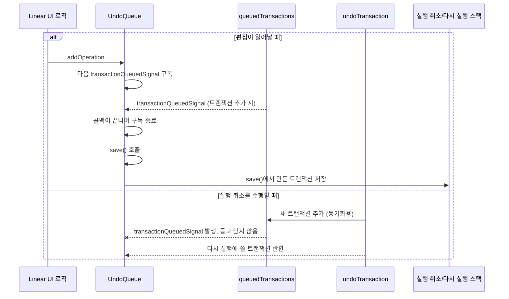

# 5장: 기타

웹: /docs/linear/05-misc/ · Markdown: /docs/linear/05-misc.md

> 트랜잭션으로 실행 취소와 다시 실행을 구현하는 방법을 살펴봐요.

> 이 문서는 Wenzhao Hu의 [Reverse Engineering Linear's Sync Engine](https://github.com/wzhudev/reverse-linear-sync-engine/blob/45dc91e78e03300b69cc088057a28c42cee35a41/README.md)을 한국어로 옮기고 말투를 다듬은 번역이에요. 원문과 번역 모두 [CC BY 4.0](https://creativecommons.org/licenses/by/4.0/deed.ko) 라이선스를 따라요.

## 실행 취소와 다시 실행 [#undo--redo]

LSE의 실행 취소와 다시 실행은 트랜잭션을 기반으로 해요. 트랜잭션 종류마다 고유한 `undoTransaction` 메서드가 있어요.

- 이 메서드가 실행 취소 로직을 수행해요.
- 다시 실행에 쓸 다른 트랜잭션을 반환해요.

예를 들어 `UpdateTransaction`의 `undoTransaction` 메서드는 모델의 프로퍼티를 이전 값으로 되돌리고, `UndoQueue`에 넣을 새 `UpdateTransaction`을 반환해요. 트랜잭션이 실행 취소 로직을 실행할 때는 새 트랜잭션을 만들어서 `queuedTransactions`에 추가해요. 그래야 동기화가 제대로 이뤄져요.

그런데 `UndoManager`는 어떤 트랜잭션을 실행 취소/다시 실행 스택에 넣을지 어떻게 정할까요? 답은 Linear의 UI 로직에 있어요. 사용자의 편집으로 생긴 트랜잭션과 실행 취소 로직이 만든 트랜잭션을 UI 로직이 구분해요.

```jsx
n.title !== d &&
  o.undoQueue.addOperation(
    s.jsxs(s.Fragment, {
      children: [
        "update title of issue ",
        s.jsx(Le, {
          model: n,
        }),
      ],
    }),
    () => {
      (n.title = d), n.save();
    }
  );
```

편집이 일어나면 UI가 `UndoQueue.addOperation`을 불러요. 그러면 `UndoQueue`가 다음 `transactionQueuedSignal`을 구독하고 실행 취소 항목을 만들어요. 이 시그널은 트랜잭션이 `queuedTransactions`에 추가될 때 발생해요. 순서는 이래요.

1. UI가 `UndoQueue.addOperation`을 불러요.
2. `UndoQueue`가 다음 `transactionQueuedSignal`을 구독해요.
3. 콜백이 끝나면 구독도 끝나요.
4. 이때 `save()`가 호출되고, `save()`에서 만들어진 트랜잭션이 실행 취소/다시 실행 스택에 들어가요.

반면 실행 취소를 수행할 때는 시그널이 발생해도 실행 취소 항목을 새로 만들지 않아요. 그동안에는 `UndoQueue`가 시그널을 듣고 있지 않기 때문이에요.

실행 취소를 수행하면 `undoTransaction` 메서드가 다시 실행에 쓸 트랜잭션을 반환해요.

아래 도표는 편집과 실행 취소가 각각 실행 취소 항목을 어떻게 다루는지 보여 줘요.


