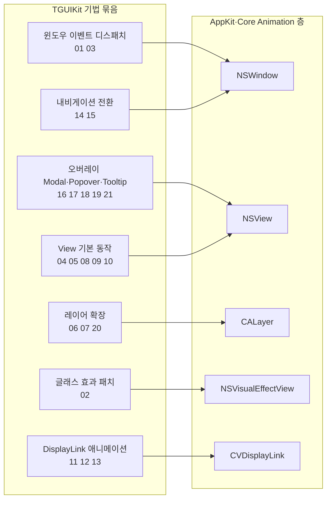
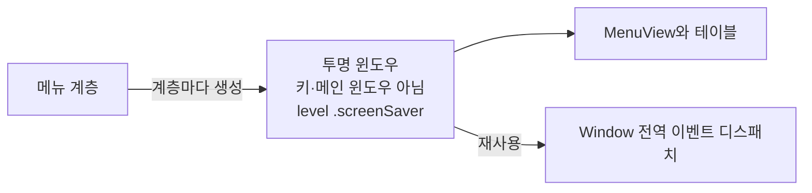
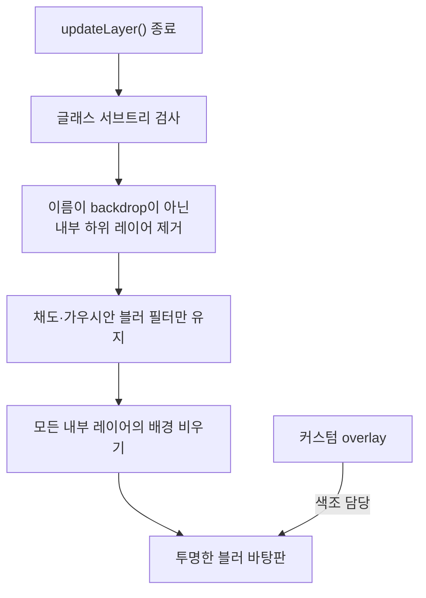
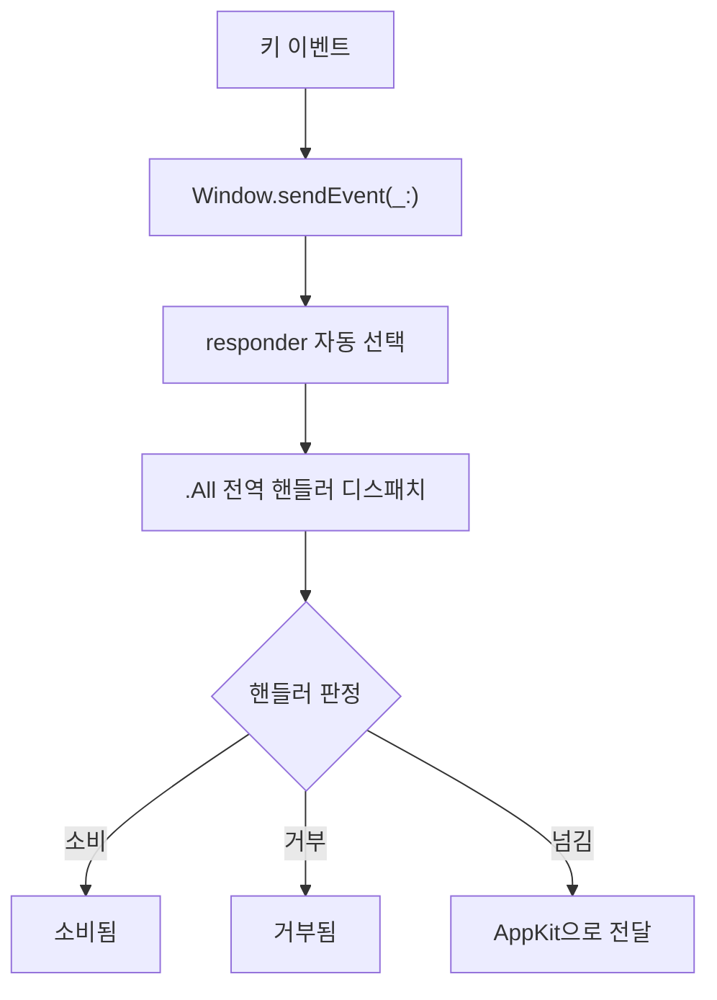
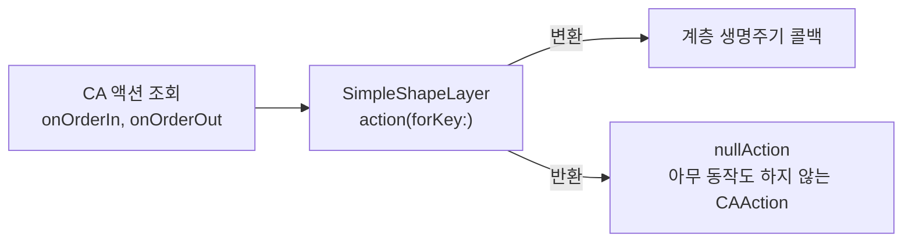
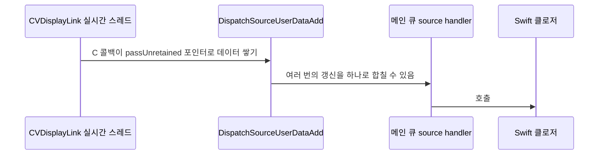

# TGUIKit 코어

웹: /docs/macos/12-tguikit-core/ · Markdown: /docs/macos/12-tguikit-core.md

> AppKit으로 UIKit을 재현해요: 키 윈도우가 아닌 메뉴, 키보드 디스패치, 레이어 변환.

| 기법 항목 | 리포트 선정 | 관련 비공개 API | REA 연관 |
| --- | --- | --- | --- |
| 21 | 6 | 1 | 4 |

소스: [overtake/TelegramSwift@579cebbf](https://github.com/overtake/TelegramSwift/tree/579cebbf0c01fd41b712eff3647fa7f69db9665d) (2025-07-29) · 플랫폼: macOS · AppKit

이 장의 선정 항목:
- 12-1 [#12-01 키 윈도우가 아닌 윈도우로 전체 기능의 AppMenu를 직접 그리기](/docs/macos/12-tguikit-core/#t12-01)
- 12-2 [#12-02 글래스 효과의 내부 레이어와 필터 삭제하기](/docs/macos/12-tguikit-core/#t12-02)
- 12-3 [#12-03 우선순위로 Window 키보드 디스패치 재작성하기](/docs/macos/12-tguikit-core/#t12-03)
- 12-4 [#12-04 조건부 `updateLayer`로 UIKit 변환 속성 흉내 내기](/docs/macos/12-tguikit-core/#t12-04)
- 12-5 [#12-05 기본 View에서 좌표 뒤집기를 통일하고 암시적 애니메이션 끄기](/docs/macos/12-tguikit-core/#t12-05)
- 12-6 [#12-06 빈 CAAction으로 계층 진입 알림 겸용하기](/docs/macos/12-tguikit-core/#t12-06)

이 주제의 범위: TelegramSwift의 `packages/TGUIKit/Sources`에 있는 뷰, 레이어, 윈도우, 컨트롤러, 내비게이션, 모달, 오버레이, 메뉴, 디스플레이 갱신의 기반.

**결론:** TGUIKit은 AppKit을 주된 UI 상태 머신으로 쓰지 않아요. `NSView`, `CALayer`, `NSWindow`를 조합해서 UIKit 방식의 프레임워크를 만들어 내요. 가장 가치 있는 방식은 다음 네 가지예요.

- 상위 수준 메뉴를 직접 그리기
- 윈도우 이벤트 체인 가로채기
- 내비게이션 전환을 수동으로 구동하기
- `NSVisualEffectView`의 내부 레이어를 직접 패치하기

> 버전 근거: TelegramSwift `579cebbf0c01fd41b712eff3647fa7f69db9665d`. 아래 결론은 모두 읽은 소스에서 나왔어요. 문자열 연결, Base64, 해시로 난독화한 selector 이름은 발견되지 않았어요. `window`, `paste:`, `copy:`, `contentsMultiplyColor`는 모두 평문으로 나타나요.

아래 도표는 이 장의 기법들이 AppKit과 Core Animation의 어느 구성요소에 손을 대는지 묶어서 보여 줘요.



## 1. 키 윈도우가 아닌 윈도우로 전체 기능의 AppMenu를 직접 그리기 [#t12-01]

> #12-01 · TelegramSwift · AppKit · 리포트 선정 12-1 · 검증 방식: 소스 분석
>
> 소스: [TelegramSwift:packages/TGUIKit/Sources/AppMenuController.swift L607–L681](https://github.com/overtake/TelegramSwift/blob/579cebbf0c01fd41b712eff3647fa7f69db9665d/packages/TGUIKit/Sources/AppMenuController.swift#L607-L681)

**무엇을 했나요**: `NSMenu`의 네이티브 팝업 흐름을 호출하지 않아요. 대신 이렇게 해요.

- 메뉴 계층마다 윈도우를 하나씩 만들어요. 이 윈도우는 투명하고, 키 윈도우(키보드 입력을 받는 윈도우)가 아니며, 메인 윈도우도 아니에요.
- 윈도우 레벨은 `.screenSaver`로 설정해요.
- 메뉴 내용은 `MenuView`와 테이블이 그려요.

**왜 이렇게 했나요**: 네이티브 `NSMenu`로는 커스텀 행, 동적 검색, 다단계 애니메이션을 담기 어려워요. 독립된 윈도우를 쓰면 하위 메뉴가 따로 레이아웃돼요. 또 메뉴가 `Window`의 전역 이벤트 디스패치를 재사용할 수 있어요.

아래 도표는 메뉴 하나가 전용 윈도우와 전역 이벤트 디스패치에 연결되는 구조를 보여 줘요.



**핵심 코드 발췌**

```swift title="AppMenuController.swift · L607–L681"
private func getView(for menu: ContextMenu, screen: NSScreen,
                     parentView: Window?, submenuId: Int64?) -> Window {
    let panel = Window(contentRect: .zero,
                       styleMask: [.fullSizeContentView],
                       backing: .buffered, defer: false)
    panel._canBecomeMain = false
    panel._canBecomeKey = false
    panel.level = .screenSaver
    panel.backgroundColor = .clear
    panel.isOpaque = false
    panel.hasShadow = false

    let contentView = View()
    panel.contentView = contentView
    contentView.backgroundColor = .clear
    contentView.flip = false
    contentView.layer?.isOpaque = false

    let view = MenuView(frame: .zero)
    view.submenuId = submenuId
    view.parentView = parentView
    // ...
    panel.setFrame(view.frame.insetBy(dx: -20, dy: -20), display: false)
    panel.contentView?.addSubview(view)
}
```

**대가와 위험**: `.screenSaver`는 메뉴를 매우 높은 레벨에 올려 놓아서 다른 오버레이를 가릴 수 있어요. 이 방식은 접근성과 시스템 메뉴에 대한 기대를 깨뜨릴 수 있어요. 또 유지보수하는 사람은 여러 윈도우의 포커스와 닫기도 처리해야 해요.

**증거 체인 #12-01** (개별 검증 안 함)

- 소스 분석: TelegramSwift 고정 커밋에서 행 단위로 확인했어요. 소스 위치는 총 1곳이에요.
- 리포트 요약(구현 방법): `Window` + `MenuView`를 자체 구축해서 레이아웃과 이벤트를 독립시켜요.
- 바이너리 검증: 이 항목은 개별 대조하지 않았어요. REA 주제 노트에 대조를 마친 20개 항목이 나열되어 있어요.

## 2. 글래스 효과의 내부 레이어와 필터 삭제하기 [#t12-02]

> #12-02 · TelegramSwift · AppKit · 리포트 선정 12-2 · 검증 방식: 소스 분석, REA 바이너리, macOS 26.7 실측 · 태그: Core Animation
>
> 소스: [TelegramSwift:packages/TGUIKit/Sources/VisualEffectView.swift L47–L79](https://github.com/overtake/TelegramSwift/blob/579cebbf0c01fd41b712eff3647fa7f69db9665d/packages/TGUIKit/Sources/VisualEffectView.swift#L47-L79)

**무엇을 했나요**: `VisualEffect`는 `updateLayer()`가 끝날 때마다 글래스 서브트리(글래스 효과를 이루는 레이어 트리)를 검사하고 이렇게 정리해요.

1. 이름이 `backdrop`이 아닌 내부 하위 레이어를 제거해요.
2. 채도와 가우시안 블러 필터만 남겨요.
3. 모든 내부 레이어의 배경을 비워요.

**왜 이렇게 했나요**: 일반 `NSVisualEffectView`는 시스템 머티리얼의 배경과 추가 효과를 유지해서 Telegram의 테마에 맞추기 어려워요. 그래서 이렇게 정리하면 시스템 글래스가 투명한 블러 바탕판으로 격하되고, 색조는 커스텀 `overlay`가 맡아요.

아래 도표는 글래스 서브트리를 투명한 블러 바탕판으로 줄이는 순서를 보여 줘요.



**핵심 코드 발췌**

```swift title="VisualEffectView.swift · L47–L79"
open override func updateLayer() {
    super.updateLayer()
    if #available(macOS 10.13, *) {
        guard let backdrop = self.layer?.sublayers?.first else {
            return
        }
        let sublayers = backdrop.sublayers ?? []
        for layer in sublayers {
            if layer.name != "backdrop" && layer.name != "Backdrop" {
                layer.removeFromSuperlayer()
            }
        }
        let allowedKeys: [String] = [
            "colorSaturate",
            "gaussianBlur"
        ]
        sublayers.first?.filters = sublayers.first?.filters?.filter { filter in
            guard let filter = filter as? NSObject else { return true }
            let filterName = String(describing: filter)
            return allowedKeys.contains(filterName)
        }
        // ...
```

**대가와 위험**: AppKit이 보장하지 않는 레이어 순서, 레이어 이름, 필터 서술에 기대고 있어요. `backdrop`, `Backdrop`, `filters`의 조합은 새 시스템에서 작동하지 않을 수 있어요. 코드는 최소 버전을 macOS 10.13으로 보호하지만 호환성 최후 대비책(폴백)은 없어요.

**증거 체인 #12-02** (릴리스됨 · 계속 사용 가능)

- 소스 분석: TelegramSwift 고정 커밋에서 행 단위로 확인했어요. 소스 위치는 총 1곳이에요.
- 리포트 요약(구현 방법): 하위 레이어를 순회하며 이름과 필터 서술의 화이트리스트로 걸러 내요.
- REA 3번 항목 (릴리스됨 · 계속 사용 가능; REA 바이너리, macOS 26.7 실측): 13.0 바이너리: 화이트리스트 `["colorSaturate","gaussianBlur"]`가 작은 문자열로 `__DATA.__data` 0x5e75720/30에 저장되어 있고, 표식 바이트는 0xED/0xEC예요; macOS 26.7: 실제 레이어 트리: `kCUIVariantSidebarMaterial` › `Backdrop`(`CABackdropLayer`, 필터 `sdrNormalize`, `gaussianBlur`, `colorSaturate`), `fill`, `tone`, `Chameleon`(`CAChameleonLayer`); 결론: 코드가 `backdrop`과 `Backdrop`을 모두 매칭하므로 구조는 여전히 들어맞아요. 새로 나타난 `sdrNormalize`를 삭제하게 되는데, 그 영향은 미검증

## 3. 우선순위로 Window 키보드 디스패치 재작성하기 [#t12-03]

> #12-03 · TelegramSwift · AppKit · 리포트 선정 12-3 · 검증 방식: 소스 분석 · 태그: 텍스트와 입력
>
> 소스: [TelegramSwift:packages/TGUIKit/Sources/Window.swift L781–L824](https://github.com/overtake/TelegramSwift/blob/579cebbf0c01fd41b712eff3647fa7f69db9665d/packages/TGUIKit/Sources/Window.swift#L781-L824)

**무엇을 했나요**: `Window.sendEvent(_:)`는 먼저 responder(이벤트를 받을 객체)를 자동으로 골라요. 이어서 `.All` 전역 핸들러를 먼저 디스패치해요. 그 뒤의 규칙은 이래요.

- 우선순위가 더 높은 전역 핸들러만 특정 키를 가로챌 수 있어요.
- `.supreme`은 수정자 키 판정을 건너뛸 수 있어요.
- 핸들러는 이벤트를 소비하거나, 거부하거나, AppKit에 넘길 수 있어요.

**왜 이렇게 했나요**: AppKit의 responder chain(이벤트를 받을 객체를 차례로 찾는 체인)은 모달, 내비게이션, 팝업, 안내 메시지의 명시적 우선순위를 표현하지 못해요. 이 방식은 Escape, Return, 전역 닫기 동작에 확정된 순서를 줘요. 또 낮은 계층의 페이지가 높은 계층 오버레이의 키 입력을 가로채지 못하게 막아요.

아래 도표는 `Window.sendEvent(_:)`가 키 이벤트를 처리하는 흐름을 보여 줘요.



**핵심 코드 발췌**

```swift title="Window.swift · L781–L824"
let eventType = event.type
if sheets.isEmpty {
    if eventType == .keyDown {
        applyResponderIfNeeded(event)
        cleanUndefinedHandlers()
        if let globalHandlers = keyHandlers[.All]?.sorted(by: >),
           let keyCode = KeyboardKey(rawValue:event.keyCode) {
            for globalHandler in globalHandlers {
                let handle = keyHandlers[keyCode]?.sorted(by: >).first
                if handle == nil || globalHandler.priority > handle!.priority {
                    if (handle?.modifierFlags == nil ||
                        !event.modifierFlags.contains(handle!.modifierFlags!)) ||
                        globalHandler.priority == .supreme {
                        switch globalHandler.handler(event) {
                        case .invoked: return
                        case .rejected: break
                        case .invokeNext:
                            super.sendEvent(event)
                            return
                        }
                    }
                }
            }
        }
        // ...
```

**대가와 위험**: `sheets`가 비어 있지 않으면 이 메서드는 이벤트를 `super`에 전달하지 않아요. 이 분기에는 뚜렷한 동작 위험이 있어요. 표시하는 쪽은 모두 제때 `removeAllHandlers(for:)`를 호출해야 해요. 빠뜨리면 유령 단축키가 생겨요.

**증거 체인 #12-03** (개별 검증 안 함)

- 소스 분석: TelegramSwift 고정 커밋에서 행 단위로 확인했어요. 소스 위치는 총 1곳이에요.
- 리포트 요약(구현 방법): `sendEvent` 안에서 표를 조회해 실행하고, 필요하면 AppKit에 돌려줘요.
- 바이너리 검증: 이 항목은 개별 대조하지 않았어요. REA 주제 노트에 대조를 마친 20개 항목이 나열되어 있어요.

## 4. 조건부 `updateLayer`로 UIKit 변환 속성 흉내 내기 [#t12-04]

> #12-04 · TelegramSwift · AppKit · 리포트 선정 12-4 · 검증 방식: 소스 분석 · 태그: Core Animation
>
> 소스: [TelegramSwift:packages/TGUIKit/Sources/View.swift L109–L153](https://github.com/overtake/TelegramSwift/blob/579cebbf0c01fd41b712eff3647fa7f69db9665d/packages/TGUIKit/Sources/View.swift#L109-L153)

**무엇을 했나요**: `View`는 앵커 포인트, 변환, 하위 레이어 변환을 저장 속성으로 감싸요.

- 속성이 바뀌면 `updateLayer()`를 직접 호출해요.
- 속성이 하나라도 쓰일 때만 AppKit의 `updateLayer` 경로를 요청해요.

**왜 이렇게 했나요**: 이렇게 감싸면 `NSView`가 UIKit에 가까운 layer-transform API를 갖게 돼요. 조건부 `wantsUpdateLayer`는 모든 일반 뷰가 layer 업데이트를 타는 일을 피해요. 일반적인 방식은 각 호출 지점에서 `layer`를 직접 고쳐서 상태가 더 흩어져요.

**핵심 코드 발췌**

```swift title="View.swift · L109–L153"
public var _transformation: CATransform3D? = nil {
    didSet { self.updateLayer() }
}
public var _anchorPoint: NSPoint? = nil {
    didSet { self.updateLayer() }
}
public var _sublayerTransform: CATransform3D? = nil {
    didSet { self.updateLayer() }
}
open override var wantsUpdateLayer: Bool {
    return self._anchorPoint != nil || self._transformation != nil ||
        self._sublayerTransform != nil
}
open override func updateLayer() {
    super.updateLayer()
    if let _anchorPoint = _anchorPoint {
        self.setAnchorPoint(anchorPoint: _anchorPoint)
    }
    if let _transformation = _transformation {
        self.layer?.transform = _transformation
    }
    if let _sublayerTransform = _sublayerTransform {
        self.layer?.sublayerTransform = _sublayerTransform
    }
}
```

**대가와 위험**: `setAnchorPoint`의 구체적인 보정 구현은 다른 익스텐션에 있어요. 이 코드는 `nil`이 아닐 때만 값을 써요. 속성을 다시 `nil`로 설정해도 여기서는 기본 변환이 복원되지 않아요. 그래서 호출하는 쪽이 이 동작 방식을 알아야 해요.

**증거 체인 #12-04** (개별 검증 안 함)

- 소스 분석: TelegramSwift 고정 커밋에서 행 단위로 확인했어요. 소스 위치는 총 1곳이에요.
- 리포트 요약(구현 방법): 저장 속성 + `updateLayer()`로 `layer`에 기록해요.
- 바이너리 검증: 이 항목은 개별 대조하지 않았어요. REA 주제 노트에 대조를 마친 20개 항목이 나열되어 있어요.

## 5. 기본 View에서 좌표 뒤집기를 통일하고 암시적 애니메이션 끄기 [#t12-05]

> #12-05 · TelegramSwift · AppKit · 리포트 선정 12-5 · 검증 방식: 소스 분석 · 태그: Core Animation
>
> 소스: [TelegramSwift:packages/TGUIKit/Sources/View.swift L356–L397](https://github.com/overtake/TelegramSwift/blob/579cebbf0c01fd41b712eff3647fa7f69db9665d/packages/TGUIKit/Sources/View.swift#L356-L397)

**무엇을 했나요**: 모든 `View`는 기본적으로 layer-backed(뷰가 `CALayer`를 바탕으로 동작하는 방식)예요. `flip`(좌표 뒤집기)의 기본값은 `true`예요. 초기화에서는 이렇게 설정해요.

- 레이어의 암시적 애니메이션을 꺼요.
- 자동 서브뷰 크기 조정을 꺼요.
- layer를 필요할 때만 다시 그리게 해요.

**왜 이렇게 했나요**: 각 설정에는 이유가 있어요.

- 좌표를 뒤집으면 원점이 왼쪽 위가 되어서 UIKit 및 채팅 목록 레이아웃과 맞아요.
- 암시적 애니메이션을 끄면 `frame`이나 색상을 한 번 갱신했을 때 통제할 수 없는 CA(Core Animation) 애니메이션이 일어나는 일을 피할 수 있어요.
- `onSetNeedsDisplay`는 그리기 요청을 명시적 무효화로 모아요.

**핵심 코드 발췌**

```swift title="View.swift · L356–L397"
open override var isFlipped: Bool {
    return flip
}
private func initialize() {
    acceptsTouchEvents = true
    self.wantsLayer = true
    self.layer?.masksToBounds = true
    self.autoresizesSubviews = false
    self.layer?.disableActions()

    self.layer?.backgroundColor = backgroundColor.cgColor
    self.layer?.isOpaque = true
    self.layerContentsRedrawPolicy = .onSetNeedsDisplay
    if #available(macOS 10.15, *) {
        self.layer?.cornerCurve = .continuous
    }
}
```

**대가와 위험**:

- 모든 하위 클래스가 뒤집힌 좌표를 물려받아요.
- 네이티브의 뒤집히지 않은 `NSView`와 섞을 때는 명시적으로 변환해야 해요.
- 기본 `masksToBounds`는 그림자와 경계를 벗어나는 애니메이션을 잘라 내요.

**증거 체인 #12-05** (개별 검증 안 함)

- 소스 분석: TelegramSwift 고정 커밋에서 행 단위로 확인했어요. 소스 위치는 총 1곳이에요.
- 리포트 요약(구현 방법): 초기화 때 layer를 설정하고 `layerContentsRedrawPolicy=.onSetNeedsDisplay`를 지정해요.
- 바이너리 검증: 이 항목은 개별 대조하지 않았어요. REA 주제 노트에 대조를 마친 20개 항목이 나열되어 있어요.

## 6. 빈 CAAction으로 계층 진입 알림 겸용하기 [#t12-06]

> #12-06 · TelegramSwift · AppKit · 리포트 선정 12-6 · 검증 방식: 소스 분석 · 태그: Core Animation
>
> 소스: [TelegramSwift:packages/TGUIKit/Sources/SimpleLayer.swift L19–L42](https://github.com/overtake/TelegramSwift/blob/579cebbf0c01fd41b712eff3647fa7f69db9665d/packages/TGUIKit/Sources/SimpleLayer.swift#L19-L42)

**무엇을 했나요**: `SimpleShapeLayer`는 CA의 `onOrderIn`과 `onOrderOut` 액션 조회를 가로채요.

- 이 두 액션을 계층 생명주기 콜백(레이어가 계층에 들어가고 나갈 때 불리는 함수)으로 바꿔요.
- 이벤트가 무엇이든 아무 동작도 하지 않는 `CAAction`을 반환해요.
- 초기화 때 Retina 배율을 설정해요.

**왜 이렇게 했나요**: 일반 `CALayer`에는 `didMoveToSuperview`에 해당하는 공개 콜백이 없어요. 이 방식을 쓰면 레이어를 넣고 빼는 걸 감시하려고 별도의 `NSView`를 두지 않아도 돼요. 레이어 속성의 암시적 애니메이션도 한꺼번에 꺼요.

아래 도표는 `SimpleShapeLayer`가 CA의 액션 조회를 가로채는 흐름을 보여 줘요.



**핵심 코드 발췌**

```swift title="SimpleLayer.swift · L19–L42"
open class SimpleShapeLayer : CAShapeLayer {
    public var didEnterHierarchy: (() -> Void)?
    public var didExitHierarchy: (() -> Void)?
    public private(set) var isInHierarchy: Bool = false

    override open func action(forKey event: String) -> CAAction? {
        if event == kCAOnOrderIn {
            self.isInHierarchy = true
            self.didEnterHierarchy?()
        } else if event == kCAOnOrderOut {
            self.isInHierarchy = false
            self.didExitHierarchy?()
        }
        return nullAction
    }

    override public init() {
        super.init()
        contentsScale = System.backingScale
    }
}
```

**대가와 위험**: `action(forKey:)`는 이 레이어의 모든 기본 CA 애니메이션을 막아요. 그래서 호출하는 쪽이 애니메이션을 직접 추가해야 해요. `kCAOnOrderIn`과 `kCAOnOrderOut`이 언제 발동하는지는 계속 회귀 검증을 해야 해요.

**증거 체인 #12-06** (개별 검증 안 함)

- 소스 분석: TelegramSwift 고정 커밋에서 행 단위로 확인했어요. 소스 위치는 총 1곳이에요.
- 리포트 요약(구현 방법): `action(forKey:)`를 재정의해서 `nullAction`을 반환해요.
- 바이너리 검증: 이 항목은 개별 대조하지 않았어요. REA 주제 노트에 대조를 마친 20개 항목이 나열되어 있어요.

## 7. 비공개 KVC 키로 Layer 내용 색칠하기 [#t12-07]

> #12-07 · TelegramSwift · AppKit · 검증 방식: 소스 분석, REA 바이너리, macOS 26.7 실측 · 태그: 비공개 API, 런타임 해킹, Core Animation
>
> 소스: [TelegramSwift:packages/TGUIKit/Sources/Extensions.swift L560–L580](https://github.com/overtake/TelegramSwift/blob/579cebbf0c01fd41b712eff3647fa7f69db9665d/packages/TGUIKit/Sources/Extensions.swift#L560-L580)

**무엇을 했나요**: 익스텐션이 KVC(키 이름으로 속성을 읽고 쓰는 Key-Value Coding)로 `contentsMultiplyColor`를 읽고 써요. 이 값을 `layerTintColor`로 감싸요. 같은 익스텐션은 많은 layer action을 `NSNull()`에 매핑하기도 해요.

**왜 이렇게 했나요**: 원래 있던 `contents` 이미지를 곱셈 색으로 바꿔 칠할 수 있는 것으로 보여요. 테마마다 이미지를 다시 만들지 않아도 돼요. 소스가 `contentsMultiplyColor`를 평문으로 드러내므로 selector 난독화는 없어요. Apple이 이 키를 공개 API로 분류하는지는 미검증이에요.

**핵심 코드 발췌**

```swift title="Extensions.swift · L560–L580"
public extension CALayer {
    var layerTintColor: CGColor? {
        get {
            if let value = self.value(forKey: "contentsMultiplyColor"),
               CFGetTypeID(value as CFTypeRef) == CGColor.typeID {
                let result = value as! CGColor
                return result
            } else {
                return nil
            }
        }
        set(value) {
            self.setValue(value, forKey: "contentsMultiplyColor")
        }
    }

    func disableActions() -> Void {
        self.actions = ["onOrderIn":NSNull(), "sublayers":NSNull(),
                        "bounds":NSNull(), "frame":NSNull(),
                        "background":NSNull(), "position":NSNull(),
                        "contents":NSNull(), "backgroundColor":NSNull()]
        removeAllAnimations()
    }
}
```

**대가와 위험**: 모르는 KVC 키는 런타임에 예외를 던져요. 이 키는 CA 구현에 기대고 있어서 심사 위험과 시스템 호환성 위험이 있어요. `disableActions()`는 이미 있던 애니메이션까지 지워요. 그래서 진행 중인 전환에서 함부로 호출하면 안 돼요.

**증거 체인 #12-07** (릴리스됨 · 계속 사용 가능)

- 소스 분석: TelegramSwift 고정 커밋에서 행 단위로 확인했어요. 소스 위치는 총 1곳이에요.
- REA 2번 항목 (릴리스됨 · 계속 사용 가능; REA 바이너리, macOS 26.7 실측): 13.0 바이너리: `__cstring` 0x104b6ef30; macOS 26.7: `CALayer`가 getter와 setter에 응답해요; 결론: 릴리스됨, 여전히 사용 가능

## 8. 장식 View가 히트 테스트를 통과하게 하기 [#t12-08]

> #12-08 · TelegramSwift · AppKit · 검증 방식: 소스 분석 · 태그: Core Animation
>
> 소스: [TelegramSwift:packages/TGUIKit/Sources/View.swift L421–L443](https://github.com/overtake/TelegramSwift/blob/579cebbf0c01fd41b712eff3647fa7f69db9665d/packages/TGUIKit/Sources/View.swift#L421-L443)

**무엇을 했나요**: `isEventLess`가 참이면 이렇게 동작해요.

- 뷰는 여전히 표시에는 참여해요.
- 히트 테스트(포인터 위치에서 이벤트를 받을 뷰를 찾는 검사)의 결과로는 반환되지 않아요.
- 같은 클래스, `ImageView`, `LayerBackedView`의 장식 레이어도 건너뛰어요.

**왜 이렇게 했나요**: 배경, 그림자, 이미지는 컨트롤을 덮는 일이 잦아요. 일반적인 AppKit에서는 장식 레이어마다 히트 테스트를 재정의해야 해요. 여기서는 “눈에는 보이지만 상호작용은 받지 않는다”를 기본 동작으로 만들어요.

**핵심 코드 발췌**

```swift title="View.swift · L421–L443"
open override func hitTest(_ point: NSPoint) -> NSView? {
    if isEventLess {
        let view = super.hitTest(point)
        if let view = view as? View {
            if view.isEventLess || view === self {
                return nil
            }
        }
        if let view = view as? ImageView {
            if view.isEventLess || view === self {
                return nil
            }
        }
        if let view = view as? LayerBackedView {
            if view.isEventLess || view === self {
                return nil
            }
        }
        return view
    } else {
        return super.hitTest(point)
    }
}
```

**대가와 위험**: 이 로직은 나열된 세 가지 타입만 알아봐요. 새로운 장식 클래스는 마우스를 다시 가로챌 수 있어요. 중첩된 eventless 뷰와 실제로 상호작용하는 서브뷰는 계층을 신중하게 배치해야 해요.

**증거 체인 #12-08** (개별 검증 안 함)

- 소스 분석: TelegramSwift 고정 커밋에서 행 단위로 확인했어요. 소스 위치는 총 1곳이에요.
- 바이너리 검증: 이 항목은 개별 대조하지 않았어요. REA 주제 노트에 대조를 마친 20개 항목이 나열되어 있어요.

## 9. 실제 hit-test로 hover 판정 바로잡기 [#t12-09]

> #12-09 · TelegramSwift · AppKit · 검증 방식: 소스 분석
>
> 소스: [TelegramSwift:packages/TGUIKit/Sources/Extensions.swift L724–L775](https://github.com/overtake/TelegramSwift/blob/579cebbf0c01fd41b712eff3647fa7f69db9665d/packages/TGUIKit/Sources/Extensions.swift#L724-L775)

**무엇을 했나요**: `_mouseInside()`는 hover(마우스가 뷰 위에 있는 상태)를 판정할 때 좌표가 bounds 안에 있는지만 검사하지 않아요. 이 순서로 판정해요.

1. 콘텐츠 뷰의 실제 히트 결과를 얻어요.
2. eventless 장식 레이어와 `VisualEffect`는 통과할 수 있는 것으로 봐요.
3. superview 체인을 따라 올라가며 검사하고, `NSTableView`의 행 뷰는 hit-test를 한 번 더 해요.

**왜 이렇게 했나요**: 투명한 마스크와 글래스는 단순한 bounds 검사로는 잘못 판정하기 쉬워요. 테이블의 가상 행도 히트 계층을 불안정하게 만들어요. 이 메서드는 hover, 길게 누르기, 오버레이 닫기를 실제로 상호작용할 수 있는 계층 위에 세워요.

**핵심 코드 발췌**

```swift title="Extensions.swift · L724–L775"
func _mouseInside() -> Bool {
    if let window = self.window {
        var location:NSPoint = window.mouseLocationOutsideOfEventStream
        location = self.convert(location, from: nil)
        if let view = window.contentView!.hitTest(
            window.mouseLocationOutsideOfEventStream) {
            if let view = view as? View {
                if view.isEventLess {
                    return NSPointInRect(location, self.bounds)
                }
            } else if let view = view as? ImageView, view.isEventLess {
                return NSPointInRect(location, self.bounds)
            } else if let view = view as? LayerBackedView, view.isEventLess {
                return NSPointInRect(location, self.bounds)
            } else if let view = view as? EventLessView, view.isEventLess {
                return NSPointInRect(location, self.bounds)
            } else if let _ = view as? VisualEffect {
                return NSPointInRect(location, self.bounds)
            }
            if view == self {
                return NSPointInRect(location, self.bounds)
            }
```

**대가와 위험**: 호출할 때마다 `hitTest`, 좌표 변환, 경우에 따라 테이블 조회까지 실행해요. 마우스 이동이 잦으면 비용이 들어요. 구체적인 하위 클래스에 기대고 있어서 확장하기 어려워요.

**증거 체인 #12-09** (개별 검증 안 함)

- 소스 분석: TelegramSwift 고정 커밋에서 행 단위로 확인했어요. 소스 위치는 총 1곳이에요.
- 바이너리 검증: 이 항목은 개별 대조하지 않았어요. REA 주제 노트에 대조를 마친 20개 항목이 나열되어 있어요.

## 10. `NSTrackingArea`로 비활성 윈도우 hover 처리하기 [#t12-10]

> #12-10 · TelegramSwift · AppKit · 검증 방식: 소스 분석
>
> 소스: [TelegramSwift:packages/TGUIKit/Sources/Control.swift L220–L245](https://github.com/overtake/TelegramSwift/blob/579cebbf0c01fd41b712eff3647fa7f69db9665d/packages/TGUIKit/Sources/Control.swift#L220-L245)

**무엇을 했나요**: 컨트롤은 tracking area(마우스 진입과 이탈을 감지하는 영역)를 이렇게 다뤄요.

- 윈도우에 들어가거나 superview가 바뀐 뒤 tracking area를 다시 만들어요.
- `.inVisibleRect`를 쓰므로 오래된 bounds에 기대지 않아요.
- `.activeInActiveApp`과 `.assumeInside`를 써요.

**왜 이렇게 했나요**: 일반 tracking area는 윈도우가 포커스를 잃거나, 스크롤로 잘리거나, 동적으로 추가될 때 hover를 놓치기 쉬워요. 두 옵션의 역할은 이래요.

- `assumeInside`: 컨트롤이 추가되자마자 내부 상태를 갖게 해요.
- `activeInActiveApp`: 비활성 앱에서도 마우스 상태를 계속 갱신하게 해요.

**핵심 코드 발췌**

```swift title="Control.swift · L220–L245"
open override func updateTrackingAreas() {
    super.updateTrackingAreas();
    if let trackingArea = trackingArea {
        self.removeTrackingArea(trackingArea)
    }
    trackingArea = nil
    if let _ = window, visibleRect != .zero {
        let options:NSTrackingArea.Options = [
            .cursorUpdate, .mouseEnteredAndExited, .mouseMoved,
            .activeInActiveApp, .assumeInside, .inVisibleRect
        ]
        self.trackingArea = NSTrackingArea(rect: self.bounds,
            options: options, owner: self, userInfo: nil)
        self.addTrackingArea(self.trackingArea!)
    }
}
open override func viewDidMoveToSuperview() {
    super.viewDidMoveToSuperview()
    updateTrackingAreas()
}
```

**대가와 위험**: `updateTrackingAreas()`가 호출될 때마다 객체를 지우고 새로 만들어요. 복잡한 목록에서는 추가 비용이 생겨요. `.assumeInside`는 마우스가 실제로 컨트롤 안에 없는데도 먼저 hover를 일으킬 수 있어요.

**증거 체인 #12-10** (개별 검증 안 함)

- 소스 분석: TelegramSwift 고정 커밋에서 행 단위로 확인했어요. 소스 위치는 총 1곳이에요.
- 바이너리 검증: 이 항목은 개별 대조하지 않았어요. REA 주제 노트에 대조를 마친 20개 항목이 나열되어 있어요.

## 11. CVDisplayLink 콜백을 메인 큐로 안전하게 넘기기 [#t12-11]

> #12-11 · TelegramSwift · AppKit · 검증 방식: 소스 분석, REA 바이너리, REA 런타임 관측
>
> 소스: [TelegramSwift:packages/TGUIKit/Sources/DisplayLinkAnimator.swift L22–L64](https://github.com/overtake/TelegramSwift/blob/579cebbf0c01fd41b712eff3647fa7f69db9665d/packages/TGUIKit/Sources/DisplayLinkAnimator.swift#L22-L64)

**무엇을 했나요**: CVDisplayLink(디스플레이 갱신 주기에 맞춰 콜백을 부르는 타이머)의 콜백을 메인 큐로 이렇게 넘겨요.

1. CVDisplayLink의 실시간 스레드는 `DispatchSourceUserDataAdd`에 데이터를 쌓기만 해요. C 콜백은 `passUnretained`로 source 포인터를 전달해요.
2. 그다음에 메인 큐의 source handler가 Swift 클로저를 호출해요.

**왜 이렇게 했나요**: AppKit 뷰는 메인 스레드에서만 갱신할 수 있어요. CVDisplayLink 콜백 안에서 UI를 직접 바꾸면 스레드 제약을 어겨요. 사용자 데이터 source는 여러 번의 갱신을 하나로 합칠 수도 있어서, 메인 큐에 프레임마다 작업이 쌓이는 일을 피해요.

아래 도표는 CVDisplayLink 콜백이 메인 큐의 Swift 클로저까지 넘어가는 순서를 보여 줘요.



**핵심 코드 발췌**

```swift title="DisplayLinkAnimator.swift · L22–L64"
init?(onQueue queue: DispatchQueue = DispatchQueue.main) {
    source = DispatchSource.makeUserDataAddSource(queue: queue)
    var timerRef : CVDisplayLink? = nil
    var successLink = CVDisplayLinkCreateWithCGDisplay(
        CGMainDisplayID(), &timerRef)
    if let timer = timerRef {
        successLink = CVDisplayLinkSetOutputCallback(timer, {
            (timer, currentTime, outputTime, _, _, sourceUnsafeRaw) -> CVReturn in
            if let sourceUnsafeRaw = sourceUnsafeRaw {
                let sourceUnmanaged = Unmanaged<DispatchSourceUserDataAdd>
                    .fromOpaque(sourceUnsafeRaw)
                sourceUnmanaged.takeUnretainedValue().add(data: 1)
            }
            return kCVReturnSuccess
        }, Unmanaged.passUnretained(source).toOpaque())
        guard successLink == kCVReturnSuccess else {
            NSLog("Failed to create timer with active display")
            return nil
        }
        self.timer = timer
    } else {
        return nil
    }
    source.setEventHandler(handler: { [weak self] in self?.callback?() })
}
```

**대가와 위험**: `takeUnretainedValue()`를 쓰려면 source의 생명주기가 콜백보다 길어야 해요. 주석도 이 전제를 분명히 밝혀 두었어요. `cancel()` 뒤에는 `resume()`을 다시 호출할 수 없어요. 그래서 같은 `DisplayLink`의 생명주기는 재시작할 수 없어요. 실제 재시작 경로가 있는지는 미검증이에요.

**증거 체인 #12-11** (릴리스됨 · 계속 사용 가능)

- 소스 분석: TelegramSwift 고정 커밋에서 행 단위로 확인했어요. 소스 위치는 총 1곳이에요.
- REA 14번 항목 (릴리스됨 · 계속 사용 가능; REA 바이너리, REA 런타임 관측): 13.0 바이너리: `CVDisplayLinkCreateWithActiveCGDisplays`, `CVDisplayLinkSetOutputHandler` 등 9개를 임포트해요; macOS 26.7: 시작 후 40초 안에는 호출되지 않았어요(로그인 화면, 원인 미검증); 결론: 릴리스됨

## 12. DisplayLink 하나를 공유하고 요청에 따라 프레임 낮추기 [#t12-12]

> #12-12 · TelegramSwift · AppKit · 검증 방식: 소스 분석, REA 바이너리, REA 런타임 관측 · 태그: 성능과 메모리
>
> 소스: [TelegramSwift:packages/TGUIKit/Sources/DisplayLinkAnimator.swift L228–L280](https://github.com/overtake/TelegramSwift/blob/579cebbf0c01fd41b712eff3647fa7f69db9665d/packages/TGUIKit/Sources/DisplayLinkAnimator.swift#L228-L280)

**무엇을 했나요**: `SharedDisplayLinkDriver`가 요청을 한데 모아 관리해요.

- 낮은 프레임 레이트 요청은 디스플레이의 실제 주기를 누적해요.
- 누적값이 목표 주기의 95%에 이르러야 콜백해요.
- 무효가 된 link는 이번 라운드가 끝난 뒤 역순으로 정리해요.

**왜 이렇게 했나요**: 모션마다 DisplayLink를 하나씩 만들면 콜백과 객체 비용이 늘어나요. 이 드라이버는 여러 애니메이션을 하나의 디스플레이 동기화 소스로 합쳐요. 그래서 낮은 프레임 레이트의 애니메이션이 높은 주사율로 계산되지 않아도 돼요.

**핵심 코드 발췌**

```swift title="DisplayLinkAnimator.swift · L228–L280"
private func displayLinkEvent(duration: TimeInterval) {
    self.isProcessingEvent = true
    var removeIndices: [Int]?
    loop: for i in 0 ..< self.requests.count {
        let request = self.requests[i]
        if let link = request.link, link.isValid {
            if !link.isPaused {
                var itemDuration = duration
                switch request.framesPerSecond {
                case let .fps(value):
                    let secondsPerFrame = 1.0 / CGFloat(value)
                    itemDuration = secondsPerFrame
                    request.lastDuration += duration
                    if request.lastDuration >= secondsPerFrame * 0.95 {
                    } else {
                        continue loop
                    }
                case .max:
                    break
                }
                request.lastDuration = 0.0
                link.update(itemDuration)
            }
        }
    // ...
```

**대가와 위험**:

- `CGMainDisplayID()`를 써요. 다중 디스플레이에서는 윈도우가 자기가 있는 화면의 주사율을 따르지 않을 수 있어요.
- `0.95`는 경험적 임계값이어서 120Hz 같은 주파수에서는 떨림이 있을 수 있어요.

**증거 체인 #12-12** (릴리스됨 · 계속 사용 가능)

- 소스 분석: TelegramSwift 고정 커밋에서 행 단위로 확인했어요. 소스 위치는 총 1곳이에요.
- REA 14번 항목 (릴리스됨 · 계속 사용 가능; REA 바이너리, REA 런타임 관측): 13.0 바이너리: `CVDisplayLinkCreateWithActiveCGDisplays`, `CVDisplayLinkSetOutputHandler` 등 9개를 임포트해요; macOS 26.7: 시작 후 40초 안에는 호출되지 않았어요(로그인 화면, 원인 미검증); 결론: 릴리스됨

## 13. CAMediaTimingFunction의 3차 베지어를 직접 풀기 [#t12-13]

> #12-13 · TelegramSwift · AppKit · 검증 방식: 소스 분석
>
> 소스: [TelegramSwift:packages/TGUIKit/Sources/DisplayLinkAnimator.swift L448–L469](https://github.com/overtake/TelegramSwift/blob/579cebbf0c01fd41b712eff3647fa7f69db9665d/packages/TGUIKit/Sources/DisplayLinkAnimator.swift#L448-L469)

**무엇을 했나요**: `DisplayLinkAnimator`는 수치를 CA에 넘기지 않아요. 대신 이렇게 해요.

- `CAMediaTimingFunction`에서 제어점을 뽑아요.
- 디스플레이가 갱신될 때마다 베지어 곡선을 풀어요.
- 보간 결과를 콜백으로 돌려줘요.

**왜 이렇게 했나요**: 일부 상태는 layer 속성이 아니어서 `CABasicAnimation`이 직접 구동할 수 없어요. 직접 보간하면 두 가지가 좋아져요.

- 레이아웃, 텍스트, 비즈니스 상태를 동시에 갱신할 수 있어요.
- 콜백이 디스플레이 갱신과 동기화되는 것도 보장해요.

**핵심 코드 발췌**

```swift title="DisplayLinkAnimator.swift · L448–L469"
@objc private func tick(_ isFirst: Bool) {
    if self.completed { return }
    let timestamp = CACurrentMediaTime()
    var t = min(timestamp - self.startTime, self.duration) / self.duration
    t = max(0.0, t)
    t = min(1.0, t)
    let solved: Float
    if isFirst {
        solved = 0
    } else {
        solved = TimingFunctionSolve(timingControlPoints, Float(t),
                                     solveEps(Float(duration)))
    }
    self.update(self.fromValue * CGFloat(1 - solved) +
                self.toValue * CGFloat(solved))
    if abs(t - 1.0) < Double.ulpOfOne {
        self.completed = true
        self.displayLink?.invalidate()
        self.completion()
    }
}
```

**대가와 위험**: 소스의 `UnitBezier` 구현은 뉴턴 반복과 이분법 폴백을 써요. 구현 복잡도가 CA 애니메이션보다 높아요. `duration == 0`이면 0으로 나누는 위험이 생겨요. 그래서 호출하는 쪽이 이 값을 피해야 해요.

**증거 체인 #12-13** (개별 검증 안 함)

- 소스 분석: TelegramSwift 고정 커밋에서 행 단위로 확인했어요. 소스 위치는 총 1곳이에요.
- 바이너리 검증: 이 항목은 개별 대조하지 않았어요. REA 주제 노트에 대조를 마친 20개 항목이 나열되어 있어요.

## 14. 내비게이션 push 전에 동적 하위 콘텐츠 동결하기 [#t12-14]

> #12-14 · TelegramSwift · AppKit · 검증 방식: 소스 분석
>
> 소스: [TelegramSwift:packages/TGUIKit/Sources/NavigationViewController.swift L770–L794](https://github.com/overtake/TelegramSwift/blob/579cebbf0c01fd41b712eff3647fa7f69db9665d/packages/TGUIKit/Sources/NavigationViewController.swift#L770-L794)

**무엇을 했나요**: 내비게이션 push를 이렇게 처리해요.

- push 전에 내비게이션 컨트롤러가 새 페이지의 동적 콘텐츠를 재귀적으로 잠가요.
- 새 페이지는 오른쪽에서 들여와요.
- 이전 페이지는 왼쪽으로 너비의 3분의 1만큼 움직여요.
- 불투명한 페이지에만 가장자리 그림자를 붙여요.
- 전환이 끝나면 `restoreHierarchyDynamicContent()`를 호출해요.

**왜 이렇게 했나요**: 채팅 UI 안에는 스크롤, 움짤, 비동기 다시 그리기가 있을 수 있어요. 동적 콘텐츠를 동결하면 전환 중 다시 그리기가 서로 부딪히는 일이 줄어요. 3분의 1 시차는 이전 페이지가 뒤에 있다는 계층감을 살려요. 일반 AppKit 컨트롤러에는 UIKit push 같은 이런 조합 동작이 없어요.

**핵심 코드 발췌**

```swift title="NavigationViewController.swift · L770–L794"
case .push:
    controller.view.disableHierarchyDynamicContent()
    previous.viewWillDisappear(true);
    controller.viewWillAppear(true);

    nfrom = popInteractiveInset != nil ? popInteractiveInset! : frame.width
    nto = keepLeft
    pfrom = previous.view.frame.minX
    if previous.stake.keepLeft > 0 && previous.stake.keepLeft != frame.width {
        pto = frame.maxX
    } else if keepLeft > 0 {
        pto = 0
    } else {
        pto = -round(NSWidth(self.frame)/3.0)
    }
    previous.view.setFrameOrigin(NSMakePoint(pfrom, previous.frame.minY))
    controller.view.setFrameOrigin(NSMakePoint(nfrom, controller.frame.minY))
    containerView.addSubview(controller.view, positioned: .above,
                             relativeTo: previous.view)
    sto = -shadowView.frame.width + keepLeft
    if controller.isOpaque {
        addShadowView(.right, controller: controller,
                      updateOrigin: shadowView.superview == nil)
    }
```

**대가와 위험**: 재귀적 동결은 `View`와 `TableRowView`만 처리해요. 다른 동적 `NSView`는 잠기지 않아요. 잠금 복원은 애니메이션 completion에 기대고 있어요. 애니메이션이 중단되면 잘못된 상태가 남을 수 있어요.

**증거 체인 #12-14** (개별 검증 안 함)

- 소스 분석: TelegramSwift 고정 커밋에서 행 단위로 확인했어요. 소스 위치는 총 1곳이에요.
- 바이너리 검증: 이 항목은 개별 대조하지 않았어요. REA 주제 노트에 대조를 마친 20개 항목이 나열되어 있어요.

## 15. 스크롤 휠의 가로 delta를 취소 가능한 인터랙티브 내비게이션으로 바꾸기 [#t12-15]

> #12-15 · TelegramSwift · AppKit · 검증 방식: 소스 분석 · 태그: 제스처와 스크롤
>
> 소스: [TelegramSwift:packages/TGUIKit/Sources/NavigationViewController.swift L1225–L1249](https://github.com/overtake/TelegramSwift/blob/579cebbf0c01fd41b712eff3647fa7f69db9665d/packages/TGUIKit/Sources/NavigationViewController.swift#L1225-L1249)

**무엇을 했나요**: 가로 스크롤 휠 제스처는 두 페이지의 위치를 연속해서 직접 바꿔요.

- 현재 페이지는 delta(스크롤 변화량) 전체만큼 움직여요.
- 이전 페이지는 3분의 1만 움직여요.
- 그림자, 경계, 내비게이션 바도 함께 갱신돼요.
- 반환값은 소비한 delta를 `Window` 상태 머신에 넘겨요.

**왜 이렇게 했나요**: AppKit의 `swipe(with:)`는 이런 연속적인 페이지 위치 제어를 제공하지 않아요. model frame을 직접 고치면 손가락을 따라가는 느낌을 만들 수 있어요. 바깥쪽 코드는 가로 목록, 가로 스크롤 뷰, 이미 표시된 popover도 제외해요.

**핵심 코드 발췌**

```swift title="NavigationViewController.swift · L1225–L1249"
case let .swiping(delta, previous):
    let settings = self.controller.stake
    let keepLeft: CGFloat = self.frame.width == settings.keepLeft
        ? 0 : settings.keepLeft
    let nPosition = min(max(keepLeft, delta + keepLeft),
                        self.containerView.frame.width)
    self.controller.view._change(pos: NSMakePoint(
        nPosition, self.controller.view.frame.minY), animated: false)
    let previousStart = keepLeft > 0 ? 0
        : -round(NSWidth(self.containerView.frame)/3.0)
    previous.view._change(pos: NSMakePoint(
        min(previousStart + max(delta, 0) / 3.0, 0),
        previous.view.frame.minY), animated: false)
    self.shadowView.setFrameOrigin(nPosition - self.shadowView.frame.width,
                                   self.shadowView.frame.minY)
    self.navigationLeftBorder.setFrameOrigin(
        nPosition - self.navigationLeftBorder.frame.width,
        self.navigationLeftBorder.frame.minY)
    self.shadowView.layer?.opacity = min(1.0 - Float(
        nPosition / self.containerView.frame.width) + 0.2, 1.0)
    // ...
```

**대가와 위험**: 이 제스처는 가로 스크롤 컴포넌트와 태생적으로 경쟁해요. 코드는 클래스 이름 `HorizontalRowView`, `HorizontalScrollView`, `HorizontalTableView`에 기대고 있어요. 잘못 알아보면 정상적인 스크롤을 빼앗아요.

**증거 체인 #12-15** (개별 검증 안 함)

- 소스 분석: TelegramSwift 고정 커밋에서 행 단위로 확인했어요. 소스 위치는 총 1곳이에요.
- 바이너리 검증: 이 항목은 개별 대조하지 않았어요. REA 주제 노트에 대조를 마친 20개 항목이 나열되어 있어요.

## 16. contentView 오버레이로 AppKit sheet 대체하기 [#t12-16]

> #12-16 · TelegramSwift · AppKit · 검증 방식: 소스 분석
>
> 소스: [TelegramSwift:packages/TGUIKit/Sources/Modal.swift L654–L700](https://github.com/overtake/TelegramSwift/blob/579cebbf0c01fd41b712eff3647fa7f69db9665d/packages/TGUIKit/Sources/Modal.swift#L654-L700)

**무엇을 했나요**: `Modal`은 `window.contentView`에 추가되는 `ModalBackground`이고, sheet(윈도우에 붙어서 나타나는 AppKit 모달 창)를 여는 `beginSheet`가 아니에요.

- 최상위 responder, 전역 키 입력, Escape, Return을 등록해요.
- 배경 컨트롤은 바깥 클릭으로 닫기, 또는 아래 계층으로 클릭 넘기기도 맡아요.

**왜 이렇게 했나요**: 네이티브 sheet는 윈도우 상호작용과 애니메이션 스타일을 제한해요. 오버레이는 다음을 지원할 수 있어요.

- 전체 화면
- 부분 parent view
- 블러 배경
- 커스텀 전환

내비게이션 스택과 responder 우선순위 시스템을 함께 쓸 수도 있어요.

**핵심 코드 발췌**

```swift title="Modal.swift · L654–L700"
background.addSubview(container)
background.userInteractionEnabled = controller.handleEvents
if controller.handleEvents {
    window.set(responder: { [weak controller] () -> NSResponder? in
        return controller?.firstResponder()
    }, with: self, priority: controller.responderPriority)
    if controller.handleAllEvents {
        window.set(handler: { [weak controller] _ -> KeyHandlerResult in
            if let controller = controller, controller.redirectMouseAfterClosing {
                controller.close()
                return .rejected
            }
            return .invokeNext
        }, with: self, for: .All, priority: controller.responderPriority)
    }
    window.set(escape: { [weak self] _ -> KeyHandlerResult in
        if self?.controller?.escapeKeyAction() == .rejected {
            if self?.controller?.closable == true {
                self?.controller?.close()
            }
        }
        return .invoked
    }, with: self, priority: controller.responderPriority)
    // ...
```

**대가와 위험**: 모달이 제대로 동작하는지는 전적으로 커스텀 이벤트 체인에 달려 있어요. 오버레이는 네이티브 sheet의 접근성, 윈도우 관리, 차단 동작을 자동으로 얻지 못해요. handler를 올바르게 지우지 않으면 닫힌 뒤에도 키 입력을 계속 소비해요.

**증거 체인 #12-16** (개별 검증 안 함)

- 소스 분석: TelegramSwift 고정 커밋에서 행 단위로 확인했어요. 소스 위치는 총 1곳이에요.
- 바이너리 검증: 이 항목은 개별 대조하지 않았어요. REA 주제 노트에 대조를 마친 20개 항목이 나열되어 있어요.

## 17. 모달 컨테이너를 래스터화해 그림자 비용 낮추기 [#t12-17]

> #12-17 · TelegramSwift · AppKit · 검증 방식: 소스 분석 · 태그: 성능과 메모리
>
> 소스: [TelegramSwift:packages/TGUIKit/Sources/Modal.swift L604–L631](https://github.com/overtake/TelegramSwift/blob/579cebbf0c01fd41b712eff3647fa7f69db9665d/packages/TGUIKit/Sources/Modal.swift#L604-L631)

**무엇을 했나요**: 모달은 컨테이너를 두 겹으로 만들어요.

- 바깥 컨테이너는 그림자가 경계를 넘는 것을 허용해요.
- 안쪽 컨테이너는 둥근 모서리 내용을 잘라 내요.
- 바깥 레이어에서 rasterization(레이어를 비트맵으로 캐시하는 기능)을 켜고 배율을 현재 화면 배율로 설정해요.
- 테두리는 별도 레이어로 분리해요.

**왜 이렇게 했나요**: 둥근 모서리, 그림자, 복잡한 하위 뷰를 가진 모달은 이동 애니메이션 중에 비용이 커요. 먼저 래스터화하면 반복되는 합성을 줄일 수 있어요. 이중 컨테이너는 내용 자르기와 그림자 표시를 동시에 만족시켜요.

**핵심 코드 발췌**

```swift title="Modal.swift · L604–L631"
let noBorder = controller.contentBelowBackground ||
    controller.containerBackground == .clear || controller.isFullScreen ||
    !controller.hasBorder
container = ModalContainerView(frame: noBorder ? containerRect :
    containerRect.insetBy(dx: -1, dy: -1))
container.layer?.cornerRadius = controller.cornerRadius
container.background = controller.containerBackground

self.container.layer?.shouldRasterize = true
self.container.layer?.rasterizationScale = CGFloat(System.backingScale)
self.container.layer?.isOpaque = false

let shadow = NSShadow()
shadow.shadowBlurRadius = 20
shadow.shadowColor = NSColor.black.withAlphaComponent(0.3)
shadow.shadowOffset = NSMakeSize(0, 0)
self.container.shadow = shadow

container.layer?.masksToBounds = false
container.container.layer?.masksToBounds = true
container.container.layer?.cornerRadius = controller.cornerRadius
container.borderView.layer?.borderColor =
    controller.modalTheme.grayText.withAlphaComponent(0.1).cgColor
container.borderView.layer?.cornerRadius = controller.cornerRadius
```

**대가와 위험**:

- 내용이 자주 바뀌면 래스터화는 캐시를 계속 다시 만들어요.
- 캐시는 비디오 메모리도 차지해요.
- 디스플레이를 넘나들 때 `System.backingScale`이 제때 갱신되지 않으면 흐려질 수 있어요.

**증거 체인 #12-17** (개별 검증 안 함)

- 소스 분석: TelegramSwift 고정 커밋에서 행 단위로 확인했어요. 소스 위치는 총 1곳이에요.
- 바이너리 검증: 이 항목은 개별 대조하지 않았어요. REA 주제 노트에 대조를 마친 20개 항목이 나열되어 있어요.

## 18. 트리거 컨트롤 위치에서 커스텀 Popover 확대하기 [#t12-18]

> #12-18 · TelegramSwift · AppKit · 검증 방식: 소스 분석
>
> 소스: [TelegramSwift:packages/TGUIKit/Sources/Popover.swift L243–L274](https://github.com/overtake/TelegramSwift/blob/579cebbf0c01fd41b712eff3647fa7f69db9665d/packages/TGUIKit/Sources/Popover.swift#L243-L274)

**무엇을 했나요**: `Popover`는 확대의 앵커를 이렇게 정해요.

1. 컨트롤의 중심을 화면 좌표로 변환해요.
2. 이어서 배경 좌표로 변환해서 확대의 앵커로 삼아요.
3. 배경이 뒤집혀 있으면 y를 보정해요.

확대와 reveal 두 가지 애니메이션을 제공하며, 완료된 뒤에야 first responder를 설정해요.

**왜 이렇게 했나요**: `NSPopover`의 애니메이션과 스타일은 시스템이 통제해요. 커스텀 overlay는 실제 트리거 지점에서 펼쳐질 수 있어요. first responder 설정을 미루면 등장 애니메이션 중에 입력 포커스가 깜빡이는 일을 피할 수 있어요.

**핵심 코드 발췌**

```swift title="Popover.swift · L243–L274"
let point = control.convert(NSMakePoint(control.frame.width / 2,
                                        control.frame.height / 2), to: nil)
var anchor = strongSelf.background.convert(point, from: nil)
if strongSelf.background.flip {
    anchor.y += strongSelf.background.frame.height
}
let completion:(Bool)->Void = { [weak controller] _ in
    if let strongSelf = self, !once {
        once = true
        controller?.viewDidAppear(strongSelf.animates)
        if result == true {
            _ = strongSelf.window?.makeFirstResponder(
                controller?.firstResponder())
        } else if result == false {
            _ = strongSelf.window?.makeFirstResponder(nil)
        }
    }
}
switch strongSelf.animationMode {
case .classic:
    strongSelf.background.layer?.animateScaleSpringFrom(
        anchor: anchor, from: 0.1, to: 1.0, duration: 0.4, bounce: false)
    strongSelf.background.layer?.animateAlpha(from: 0, to: 1,
                                               duration: 0.2, completion: completion)
// ...
```

**대가와 위험**: 좌표가 컨트롤, 화면, 배경의 세 단계 변환을 거쳐요. 뒤집기 보정은 현재의 `background.flip`에 기대고 있어요. 다중 디스플레이에서 쓰거나 윈도우를 옮길 때는 반드시 회귀 검증을 해야 해요.

**증거 체인 #12-18** (개별 검증 안 함)

- 소스 분석: TelegramSwift 고정 커밋에서 행 단위로 확인했어요. 소스 위치는 총 1곳이에요.
- 바이너리 검증: 이 항목은 개별 대조하지 않았어요. REA 주제 노트에 대조를 마친 20개 항목이 나열되어 있어요.

## 19. Tooltip의 좌표를 반전하고 픽셀 정렬하기 [#t12-19]

> #12-19 · TelegramSwift · AppKit · 검증 방식: 소스 분석 · 태그: 제스처와 스크롤
>
> 소스: [TelegramSwift:packages/TGUIKit/Sources/TooltipController.swift L192–L231](https://github.com/overtake/TelegramSwift/blob/579cebbf0c01fd41b712eff3647fa7f69db9665d/packages/TGUIKit/Sources/TooltipController.swift#L192-L231)

**무엇을 했나요**: Tooltip은 대상 뷰를 기준으로 위치를 변환해요.

- 부모 콘텐츠가 뒤집혀 있으면 y를 직접 반전해요.
- x 좌표는 backing scale(화면의 픽셀 배율)에 맞춰 내림 정렬해요.
- 안내 문구는 좌우 10 pt 안으로 제한해요.
- 화살표는 컨트롤의 중심이나 마우스 위치를 자동으로 가리킬 수 있어요.

**왜 이렇게 했나요**: TGUIKit에는 뒤집힌 `View`도 있고 네이티브의 뒤집히지 않은 뷰도 올라올 수 있어요. 직접 반전하면 툴팁이 엉뚱한 쪽에 나타나는 일을 피할 수 있어요. 픽셀 정렬은 Retina에서 반 픽셀 흐림이 생기는 일을 피해요.

**핵심 코드 발췌**

```swift title="TooltipController.swift · L192–L231"
let updatePosition:(Bool)->Void = { [weak tooltip, weak view, weak window] animated in
    if let tooltip = tooltip, let view = view, let window = window {
        var point = view.convert(NSZeroPoint, to: nil)
        if window.contentView!.isFlipped {
            point.y = window.contentView!.frame.height - point.y -
                view.frame.height / 2 - 10
        }
        point.y += offset.y
        let pos = NSMakePoint(min(max(floorToScreenPixels(
            System.backingScale, point.x -
            (tooltip.frame.width - view.frame.width) / 2), 10),
            window.frame.width - tooltip.frame.width - 10), point.y)
        tooltip.change(pos: pos, animated: isExists || animated)
    }
}
updatePosition(isExists)
if autoCorner {
    let point = tooltip.convert(NSMakePoint(floorToScreenPixels(
        System.backingScale, view.frame.width / 2), 0), from: view)
    tooltip.move(corner: point.x, animated: isExists)
} else {
    let mousePoint = tooltip.convert(location, from: nil)
    tooltip.move(corner: mousePoint.x, animated: isExists)
}
```

**대가와 위험**:

- y 좌표의 `-10`은 시각적으로 정한 상수예요.
- 큰 툴팁은 가로 경계만 제한해요.
- `TableView`가 스크롤될 때만 재배치 리스너를 등록하고, 다른 스크롤 컨테이너는 다루지 않아요.

**증거 체인 #12-19** (개별 검증 안 함)

- 소스 분석: TelegramSwift 고정 커밋에서 행 단위로 확인했어요. 소스 위치는 총 1곳이에요.
- 바이너리 검증: 이 항목은 개별 대조하지 않았어요. REA 주제 노트에 대조를 마친 20개 항목이 나열되어 있어요.

## 20. SimpleLayer를 복제해 배경화면 가로 타일링 구현하기 [#t12-20]

> #12-20 · TelegramSwift · AppKit · 검증 방식: 소스 분석 · 태그: Core Animation
>
> 소스: [TelegramSwift:packages/TGUIKit/Sources/ViewController.swift L94–L150](https://github.com/overtake/TelegramSwift/blob/579cebbf0c01fd41b712eff3647fa7f69db9665d/packages/TGUIKit/Sources/ViewController.swift#L94-L150)

**무엇을 했나요**: `BackgroundView.TileControl`은 타일링을 이렇게 구현해요.

- 너비에 따라 이미지 블록 수를 계산해요.
- 부족한 `SimpleLayer`만 추가하거나 지워요.
- 각 블록은 메인 레이어의 콘텐츠, 블렌드 모드, 배경, 투명도를 재사용해요.
- 그다음 코드가 레이어마다 frame을 갱신하고 대상 레이어에 넣어요.

**왜 이렇게 했나요**: `draw(_:)`에서 큰 비트맵을 반복해서 그리거나 이어 붙이지 않아요. 정적 `contents`는 CA가 합성할 수 있어요. 레이어 수가 윈도우 너비에 따라 늘고 줄어서, 채팅 배경의 타일링 효과에 알맞아요.

**핵심 코드 발췌**

```swift title="ViewController.swift · L94–L150"
if let superlayer = superlayer {
    if let tile = tile {
        let size = tile.size
        let tileSize = size.aspectFitted(frame.size)
        if shouldTile {
            if tileSize.width < frame.width {
                while rects.reduce(CGFloat(0), { $0 + $1.width }) < frame.width {
                    let width = rects.reduce(CGFloat(0), { $0 + $1.width })
                    rects.append(CGRect(origin: .init(x: width,
                        y: (frame.height - tileSize.height) / 2), size: tileSize))
                }
            } else {
                rects.append(frame.focus(size.aspectFilled(frame.size)))
            }
        } else {
            rects.append(frame.focus(size.aspectFilled(frame.size)))
        }
        while self.tileLayers.count > rects.count {
            self.tileLayers.removeLast().removeFromSuperlayer()
        }
        while self.tileLayers.count < rects.count {
            let layer = SimpleLayer()
            self.tileLayers.append(layer)
        }
        // ...
```

**대가와 위험**: 루프 안에서 매번 `reduce`로 현재 총 너비를 계산해요. 아주 넓은 윈도우와 작은 이미지에서는 이차 복잡도가 생겨요. layer가 많아지면 합성 비용도 늘어나요.

**증거 체인 #12-20** (개별 검증 안 함)

- 소스 분석: TelegramSwift 고정 커밋에서 행 단위로 확인했어요. 소스 위치는 총 1곳이에요.
- 바이너리 검증: 이 항목은 개별 대조하지 않았어요. REA 주제 노트에 대조를 마친 20개 항목이 나열되어 있어요.

## 21. 전역 마우스 이동 폴링으로 Popover를 열어 두기 [#t12-21]

> #12-21 · TelegramSwift · AppKit · 검증 방식: 소스 분석
>
> 소스: [TelegramSwift:packages/TGUIKit/Sources/Popover.swift L282–L338](https://github.com/overtake/TelegramSwift/blob/579cebbf0c01fd41b712eff3647fa7f69db9665d/packages/TGUIKit/Sources/Popover.swift#L282-L338)

**무엇을 했나요**: 마우스 위치를 폴링(일정 간격으로 상태를 반복 확인하는 방식)으로 확인해요.

1. 마우스가 처음 컨트롤과 popover를 벗어나면 코드가 200 ms 주기의 루프 신호를 시작해요.
2. 루프는 마우스가 컨트롤이나 popover 어느 쪽으로든 돌아왔는지 검사해요.
3. 마우스가 눌려 있지 않고 컨텍스트 메뉴도 없으면 popover를 닫아요.

**왜 이렇게 했나요**: 서로 독립된 두 뷰 사이에는 틈이 있는 경우가 많아요. `mouseExited`에서 곧바로 닫으면 사용자가 popover로 옮겨 갈 수 없어요. 지연 폴링은 마우스가 틈을 건널 때 여유를 줘요.

**핵심 코드 발췌**

```swift title="Popover.swift · L282–L338"
let nHandler:(Control) -> Void = { [weak strongSelf] control in
    if let strongSelf = strongSelf {
        let s = Signal<Void,NoError>.single(Void()) |> delay(0.2,
            queue: Queue.mainQueue()) |> then(Signal<Void,NoError>.single(Void())
            |> delay(0.2, queue: Queue.mainQueue()) |> restart)
        strongSelf.disposable.set(s.start(next: { [weak strongSelf] () in
            if let strongSelf = strongSelf {
                if !strongSelf.inside() && !control.mouseInside() {
                    if (NSEvent.pressedMouseButtons & (1 << 0)) == 0 {
                        if !contextMenuOnScreen() {
                            strongSelf.hide()
                        }
                    }
                }
            }
        }))
    }
}
var first: Bool = true
// ...
```

**대가와 위험**: 이건 tracking area가 아니라 폴링이에요. 활성 popover마다 200 ms마다 한 번씩 검사를 실행해요. `disposable`의 생명주기 처리가 잘못되면 무효한 루프가 남을 수 있어요.

**증거 체인 #12-21** (개별 검증 안 함)

- 소스 분석: TelegramSwift 고정 커밋에서 행 단위로 확인했어요. 소스 위치는 총 1곳이에요.
- 바이너리 검증: 이 항목은 개별 대조하지 않았어요. REA 주제 노트에 대조를 마친 20개 항목이 나열되어 있어요.
