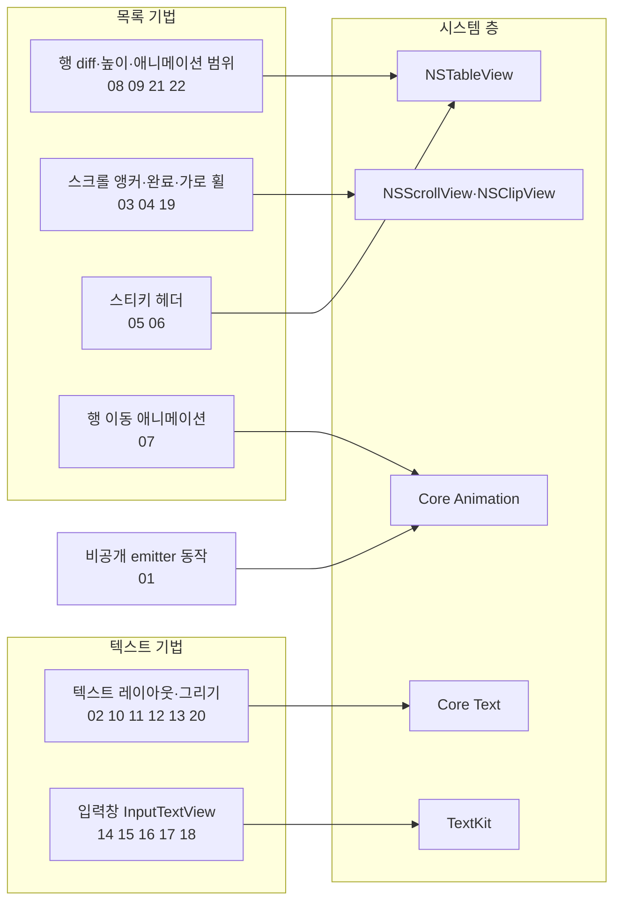
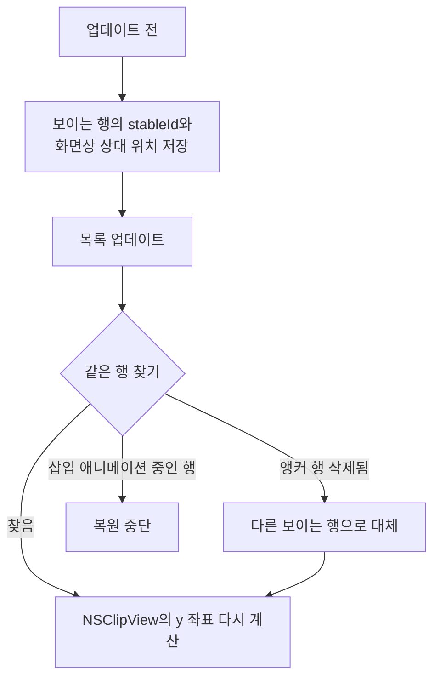
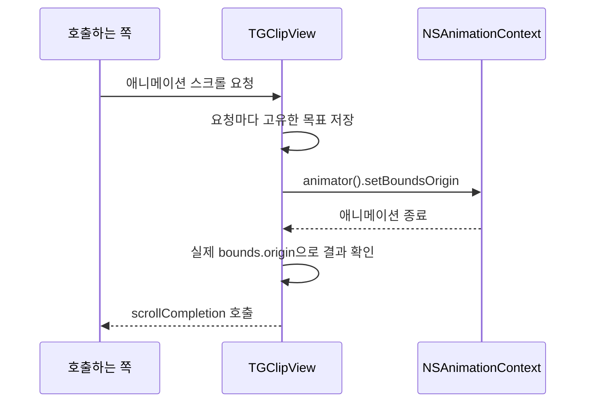
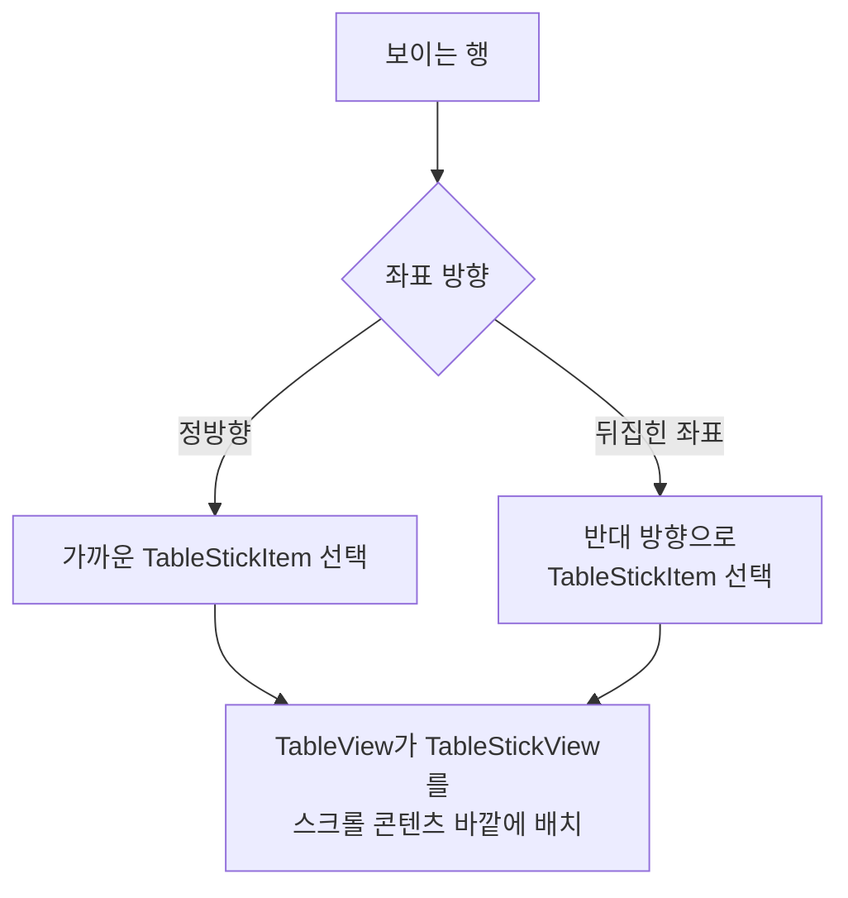
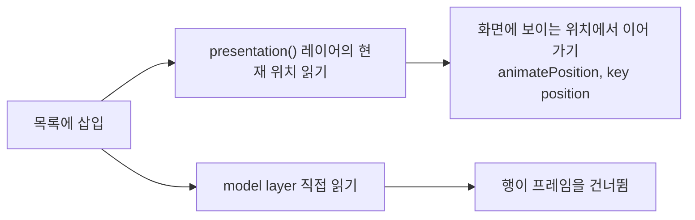

# 목록, 스크롤, 텍스트

웹: /docs/macos/13-table-scroll-text/ · Markdown: /docs/macos/13-table-scroll-text.md

> NSTableView 행 높이 자체 관리, 스크롤 앵커, Core Text 선택 영역.

| 기법 항목 | 리포트 선정 | 관련 비공개 API | REA 연관 |
| --- | --- | --- | --- |
| 22 | 7 | 1 | 1 |

소스: [overtake/TelegramSwift@579cebbf](https://github.com/overtake/TelegramSwift/tree/579cebbf0c01fd41b712eff3647fa7f69db9665d)(2025-07-29) · 플랫폼: macOS · AppKit

이 장의 선정 항목:
- 13-1 [#13-01 `CAEmitterLayer`의 비공개 동작으로 상호작용 가능한 투명 잉크 만들기](/docs/macos/13-table-scroll-text/#t13-01)
- 13-2 [#13-02 Core Text로 빈 오프셋을 되짚어 여러 줄 선택 영역의 끝부분 바로잡기](/docs/macos/13-table-scroll-text/#t13-02)
- 13-3 [#13-03 순수 offset 대신 안정적인 식별자로 스크롤 앵커 복원하기](/docs/macos/13-table-scroll-text/#t13-03)
- 13-4 [#13-04 부드러운 스크롤에서 목표 지점을 저장하고 진행 중인 애니메이션을 동기적으로 마무리하기](/docs/macos/13-table-scroll-text/#t13-04)
- 13-5 [#13-05 스티키 헤더를 스크롤 뷰와 같은 계층으로 옮기고 뒤집힌 목록에 맞추기](/docs/macos/13-table-scroll-text/#t13-05)
- 13-6 [#13-06 스티키 헤더가 다음 헤더를 누를 때 y축 밀어내기와 계층을 직접 계산하기](/docs/macos/13-table-scroll-text/#t13-06)
- 13-7 [#13-07 presentation layer로 행 이동을 받아내고 Core Animation을 수동으로 보완하기](/docs/macos/13-table-scroll-text/#t13-07)

이 주제의 범위: TelegramSwift의 `packages/TGUIKit`과 `packages/InputView`에 있는 macOS 목록, 스크롤, 텍스트 시스템.

아래 도표는 이 장의 기법들이 목록, 스크롤, 텍스트 시스템의 어느 구성요소에 손을 대는지 묶어서 보여 줘요.



## 1. `CAEmitterLayer`의 비공개 동작으로 상호작용 가능한 투명 잉크 만들기 [#t13-01]

> #13-01 · TelegramSwift · AppKit · 리포트 선정 13-1 · 검증 방식: 소스 분석, REA 바이너리, macOS 26.7 실측 · 태그: 비공개 API, Core Animation
>
> 소스: [TelegramSwift:packages/TGUIKit/Sources/InvisibleInkDustView.swift L340–L369](https://github.com/overtake/TelegramSwift/blob/579cebbf0c01fd41b712eff3647fa7f69db9665d/packages/TGUIKit/Sources/InvisibleInkDustView.swift#L340-L369)

**무엇을 했나요**: `emitterBehaviors.randomAttractor0`의 비공개 속성을 애니메이션해요. 그러면 파티클의 인력과 위치가 계속 무작위로 바뀌어요.

**왜 이렇게 했나요**: 공개 `CAEmitterLayer` API는 attractor 동작(파티클을 끌어당기는 동작)을 주지 않아요. 이 비공개 동작을 쓰면 “잉크가 흐른다”는 물리적 느낌을 렌더링 서비스 쪽에 맡길 수 있어요.

**핵심 코드 발췌**

```swift title="InvisibleInkDustView.swift · L340–L369"
let falloffAnimation1 = CABasicAnimation(
    keyPath: "emitterBehaviors.randomAttractor0.falloff"
)
falloffAnimation1.beginTime = 0.0
falloffAnimation1.fillMode = .both
falloffAnimation1.isRemovedOnCompletion = false
falloffAnimation1.autoreverses = true
falloffAnimation1.repeatCount = .infinity
falloffAnimation1.duration = 2.0
falloffAnimation1.fromValue = -20.0 as NSNumber
falloffAnimation1.toValue = 60.0 as NSNumber
falloffAnimation1.timingFunction = CAMediaTimingFunction(name: .easeInEaseOut)
self.emitterLayer?.add(
    falloffAnimation1,
    forKey: "emitterBehaviors.randomAttractor0.falloff"
)

let positionAnimation1 = CAKeyframeAnimation(
    keyPath: "emitterBehaviors.randomAttractor0.position"
)
positionAnimation1.beginTime = 0.0
positionAnimation1.fillMode = .both
positionAnimation1.isRemovedOnCompletion = false
positionAnimation1.autoreverses = true
positionAnimation1.repeatCount = .infinity
positionAnimation1.duration = 3.0
positionAnimation1.calculationMode = .discrete
```

**대가와 위험**: 비공개 API를 쓰므로 심사 거부와 시스템 호환성 위험이 따라요.

`emitterBehaviors`와 `randomAttractor0`는 평문 KVC key(속성을 문자열 이름으로 가리키는 키)예요. 문자열을 이어 붙이거나 base64로 난독화한 것이 아니에요. 코드는 L415-L416에서도 같은 접두어 `emitterBehaviors`로 `fingerAttractor`를 기록해요. 그래서 실제 비공개 API 이름이 `emitterBehaviors`라는 걸 확인할 수 있어요.

**증거 체인 #13-01**(릴리스됨 · 계속 사용 가능)

- 소스 분석: TelegramSwift 고정 커밋에서 한 줄씩 확인했고, 소스 위치는 총 1곳이에요.
- 리포트 요약(구현 방법): 런타임에 클래스 이름과 `behaviorWithType:`을 조립하고 IMP 함수 포인터로 불러요.
- REA 1번 항목(릴리스됨 · 계속 사용 가능; REA 바이너리, macOS 26.7 실측)
  - 13.0 바이너리에서 `"CA"`, `"Emitter"`, `"Behavior"`는 Swift 작은 문자열로 `__DATA.__data` 0x5e75208/18/28에 저장되어 있고, `"behaviorWith"`, `"Type:"`는 0x5e751c0/d0에 저장되어 있어요.
  - 전체 이름 `CAEmitterBehavior`와 `behaviorWithType`은 한 번도 나오지 않아요.
  - `"simpleAttractor"`는 5곳, `"valueOverLife"`는 3곳에서 `MOVZ/MOVK` 즉치값(명령어에 직접 들어간 상수)으로 컴파일되어 있어요.
  - KVC 경로 `emitterBehaviors.fingerAttractor.*`와 `randomAttractor0/1.*`는 평문으로 `__cstring`에 저장되어 있어요.
  - macOS 26.7에서는 클래스가 있고, `+behaviorWithType:`도 있고, 두 유형 모두 만들 수 있어요.
  - 결론: 릴리스되었고 현재 시스템에서도 여전히 사용 가능해요

## 2. Core Text로 빈 오프셋을 되짚어 여러 줄 선택 영역의 끝부분 바로잡기 [#t13-02]

> #13-02 · TelegramSwift · AppKit · 리포트 선정 13-2 · 검증 방식: 소스 분석 · 태그: 텍스트와 입력
>
> 소스: [TelegramSwift:packages/TGUIKit/Sources/TextView.swift L2482–L2499](https://github.com/overtake/TelegramSwift/blob/579cebbf0c01fd41b712eff3647fa7f69db9665d/packages/TGUIKit/Sources/TextView.swift#L2482-L2499)

**무엇을 했나요**: 선택 영역 끝 인덱스의 Core Text 가로 오프셋(글자의 가로 위치)이 0이면 앞쪽으로 한 글자씩 물러나며 다시 시도해요. 그다음 보정한 양 끝 오프셋으로 하이라이트 사각형을 그려요.

**왜 이렇게 했나요**: Core Text는 줄바꿈, 줄 끝, 일부 glyph(글자 모양 단위) 조합에서 0 오프셋을 돌려줘요. 이 0을 그대로 쓰면 여러 줄 선택 영역이 반대 방향 너비가 되거나 사라져요.

**핵심 코드 발췌**

```swift title="TextView.swift · L2482–L2499"
var ascent: CGFloat = 0
var descent: CGFloat = 0
var leading: CGFloat = 0

var width: CGFloat = CGFloat(
    CTLineGetTypographicBounds(line, &ascent, &descent, &leading)
)

let startOffset = CTLineGetOffsetForStringIndex(line, beginLineIndex, nil)
var endOffset = CTLineGetOffsetForStringIndex(line, endLineIndex, nil)

if beginLineIndex < endLineIndex {
    var index = endLineIndex - 1
    while endOffset == 0 && index > 0 {
        endOffset = CTLineGetOffsetForStringIndex(line, index, nil)
        index -= 1
    }
}

width = endOffset - startOffset
```

**대가와 위험**: 이 보정 루프는 Core Text의 인덱스 의미에 기대고 있어요. 복잡한 결합 문자의 경계는 여전히 수동 회귀 테스트가 필요해요. 모든 Unicode 경계 사례를 검증하지는 않았어요.

**증거 체인 #13-02**(개별 검증 안 함)

- 소스 분석: TelegramSwift 고정 커밋에서 한 줄씩 확인했고, 소스 위치는 총 1곳이에요.
- 리포트 요약(구현 방법): `CTLineGetOffsetForStringIndex`로 한 글자씩 뒤로 물러나요.
- 바이너리 검증: 이 항목은 개별 검증하지 않았어요. REA 주제 노트에 검증을 마친 20개 항목이 나열되어 있어요.

## 3. 순수 offset 대신 안정적인 식별자로 스크롤 앵커 복원하기 [#t13-03]

> #13-03 · TelegramSwift · AppKit · 리포트 선정 13-3 · 검증 방식: 소스 분석 · 태그: 제스처와 스크롤
>
> 소스: [TelegramSwift:packages/TGUIKit/Sources/TableView.swift L1882–L1914](https://github.com/overtake/TelegramSwift/blob/579cebbf0c01fd41b712eff3647fa7f69db9665d/packages/TGUIKit/Sources/TableView.swift#L1882-L1914)

**무엇을 했나요**: 목록 업데이트 전후로 나눠 처리해요.

- 업데이트 전: 보이는 행의 `stableId`(바뀌지 않는 행 식별자)와 화면상 상대 위치를 저장해요.
- 업데이트 후: 같은 행을 찾아 `NSClipView`의 y 좌표를 다시 계산해요.

**왜 이렇게 했나요**: 메시지를 삽입하거나 행 높이를 다시 계산하면 절대 offset이 바뀌어요. 안정적인 앵커(복원 기준으로 삼는 행)는 채팅 읽기 위치가 튀는 것을 막고, 정방향과 뒤집힌 좌표를 모두 지원해요.

아래 도표는 목록 업데이트 전후로 스크롤 위치를 복원하는 순서를 보여 줘요.



**핵심 코드 발췌**

```swift title="TableView.swift · L1882–L1914"
let strideTo: StrideTo<Int> = stride(
    from: visibleItems.count - 1,
    to: -1,
    by: -1
)

for i in strideTo {
    let visible = visibleItems[i]
    if let item = self.item(stableId: visible.0.stableId) {
        nrect = rectOf(item: item)

        if let view = viewNecessary(at: i) {
            if view.isInsertionAnimated {
                break
            }
        }

        let y: CGFloat
        if !tableView.isFlipped {
            y = nrect.minY - (frame.height - visible.1) + nrect.height
        } else {
            y = nrect.minY - visible.1
        }

        self.clipView.updateBounds(to: NSMakePoint(0, y))
        break
    }
}
```

**대가와 위험**: 앵커 행이 삭제되면 다른 보이는 행으로 물러나요. 삽입 애니메이션 중인 행을 만나면 복원을 중단해요. 아직 안정되지 않은 기하(위치와 크기) 상태를 따라가지 않기 위해서예요.

**증거 체인 #13-03**(개별 검증 안 함)

- 소스 분석: TelegramSwift 고정 커밋에서 한 줄씩 확인했고, 소스 위치는 총 1곳이에요.
- 리포트 요약(구현 방법): 보이는 항목을 역순으로 훑고, 삽입 애니메이션 중인 항목은 건너뛰어요.
- 바이너리 검증: 이 항목은 개별 검증하지 않았어요. REA 주제 노트에 검증을 마친 20개 항목이 나열되어 있어요.

## 4. 부드러운 스크롤에서 목표 지점을 저장하고 진행 중인 애니메이션을 동기적으로 마무리하기 [#t13-04]

> #13-04 · TelegramSwift · AppKit · 리포트 선정 13-4 · 검증 방식: 소스 분석 · 태그: 제스처와 스크롤
>
> 소스: [TelegramSwift:packages/TGUIKit/Sources/TGClipView.swift L158–L203](https://github.com/overtake/TelegramSwift/blob/579cebbf0c01fd41b712eff3647fa7f69db9665d/packages/TGUIKit/Sources/TGClipView.swift#L158-L203)

**무엇을 했나요**: `TGClipView`가 애니메이션 스크롤마다 고유한 목표 지점을 저장해요. 애니메이션이 끝나는 시점에는 실제 `bounds.origin`으로 결과를 확인해요.

**왜 이렇게 했나요**: `NSScrollView`의 일반 스크롤에는 비즈니스 수준의 완료 결과가 없어요. 이 방식에서는 애니메이션이 끝난 뒤에도 목록이 대기 중인 transition을 계속 처리할 수 있어요.

아래 도표는 `TGClipView`가 애니메이션 스크롤의 목표를 저장하고 끝에서 결과를 확인하는 순서를 보여 줘요.



**핵심 코드 발췌**

```swift title="TGClipView.swift · L158–L203"
if point == self.destinationOrigin {
    return
}
self.scrollCompletion = completion
self.destinationOrigin = point

if animated {
    self.point = point
    NSAnimationContext.runAnimationGroup({ ctx in
        ctx.duration = 0.35
        let timingFunction = CAMediaTimingFunction(
            controlPoints: 0.5, 1.0 + 0.4 / 3.0, 1.0, 1.0
        )
        ctx.timingFunction = timingFunction
        self.animator().setBoundsOrigin(point)
    }, completionHandler: {
        self.destinationOrigin = nil
        self.point = nil
        self.scrollCompletion?(point == self.bounds.origin)
        self.scrollDidComplete?(point == self.bounds.origin)
    })
} else {
    self.updateBounds(to: point)
    self.point = nil
    self.destinationOrigin = nil
    self.scrollCompletion?(true)
    self.scrollDidComplete?(true)
}
```

**대가와 위험**: `scrollCompletion`은 콜백을 담는 슬롯이 하나뿐이라서, 새 요청이 이전 콜백을 덮어써요. 그래서 호출하는 쪽에서 동시에 일어나는 스크롤을 직렬화해야 해요.

**증거 체인 #13-04**(개별 검증 안 함)

- 소스 분석: TelegramSwift 고정 커밋에서 한 줄씩 확인했고, 소스 위치는 총 1곳이에요.
- 리포트 요약(구현 방법): `NSAnimationContext`로 `animator().setBoundsOrigin`을 감싸요.
- 바이너리 검증: 이 항목은 개별 검증하지 않았어요. REA 주제 노트에 검증을 마친 20개 항목이 나열되어 있어요.

## 5. 스티키 헤더를 스크롤 뷰와 같은 계층으로 옮기고 뒤집힌 목록에 맞추기 [#t13-05]

> #13-05 · TelegramSwift · AppKit · 리포트 선정 13-5 · 검증 방식: 소스 분석 · 태그: 제스처와 스크롤
>
> 소스: [TelegramSwift:packages/TGUIKit/Sources/TableView.swift L1424–L1445](https://github.com/overtake/TelegramSwift/blob/579cebbf0c01fd41b712eff3647fa7f69db9665d/packages/TGUIKit/Sources/TableView.swift#L1424-L1445)

**무엇을 했나요**: 보이는 행 중에서 좌표 방향에 따라 가장 가까운 `TableStickItem`을 찾아요. 그다음 `TableView`가 `TableStickView`를 스크롤 콘텐츠 바깥에 둬요.

**왜 이렇게 했나요**: `NSTableView`에는 채팅 스타일의 스티키 행(스크롤해도 화면 위쪽에 붙어 있는 행)을 위한 믿을 만한 메커니즘이 없어요. 뒤집힌 좌표에서는 “이전 행”의 방향이 반대가 되기 때문에 코드가 명시적으로 나눠서 처리해요.

아래 도표는 좌표 방향에 따라 스티키 헤더 후보를 고르고 배치하는 흐름을 보여 줘요.



**핵심 코드 발췌**

```swift title="TableView.swift · L1424–L1445"
let range = self.tableView.rows(in: NSMakeRect(
    visibleRect.minX,
    visibleRect.minY,
    visibleRect.width,
    visibleRect.height - stickTopInset - secondaryOffset
))

if let stickClass = stickClass, !updating {
    let flipped = tableView.isFlipped
    var index: Int = flipped
        ? range.location
        : range.location + range.length - 1

    let scrollInset = self.documentOffset.y - stickTopInset
        + (flipped ? 0 : frame.height)
    var item: TableRowItem? = optionalItem(at: index)

    if !flipped {
        while let s = item, !s.isKind(of: stickClass) {
            index += 1
            item = self.optionalItem(at: index)
        }
    } else {
        while let s = item, !s.isKind(of: stickClass) {
            index -= 1
            item = self.optionalItem(at: index)
        }
    }
}
```

**대가와 위험**: 이 알고리즘은 행 정렬 및 `isFlipped`와 강하게 얽혀 있어요. 목록을 업데이트하는 동안에는 알고리즘을 일부러 건너뛰어요. 전환 중에 잘못된 행을 고르지 않기 위해서예요.

**증거 체인 #13-05**(개별 검증 안 함)

- 소스 분석: TelegramSwift 고정 커밋에서 한 줄씩 확인했고, 소스 위치는 총 1곳이에요.
- 리포트 요약(구현 방법): 보이는 행의 `NSRange`와 스크롤 inset을 기준으로 골라요.
- 바이너리 검증: 이 항목은 개별 검증하지 않았어요. REA 주제 노트에 검증을 마친 20개 항목이 나열되어 있어요.

## 6. 스티키 헤더가 다음 헤더를 누를 때 y축 밀어내기와 계층을 직접 계산하기 [#t13-06]

> #13-06 · TelegramSwift · AppKit · 리포트 선정 13-6 · 검증 방식: 소스 분석
>
> 소스: [TelegramSwift:packages/TGUIKit/Sources/TableView.swift L1503–L1553](https://github.com/overtake/TelegramSwift/blob/579cebbf0c01fd41b712eff3647fa7f69db9665d/packages/TGUIKit/Sources/TableView.swift#L1503-L1553)

**무엇을 했나요**: 후보 헤더의 실제 row rect(행이 차지하는 사각 영역)로, 덮이는 헤더의 y 오프셋을 계산해요. 두 번째 스티키 헤더를 위해 `secondaryOffset`을 따로 잡아 둬요.

**왜 이렇게 했나요**: 일반 sticky header는 상단에만 고정돼요. 채팅 날짜 헤더는 옆에 있는 헤더가 나타나면 밀려나야 하고, 다른 층의 헤더와도 함께 있어야 해요.

**핵심 코드 발췌**

```swift title="TableView.swift · L1503–L1553"
let rect: NSRect = self.rectOf(item: item)
let dif: CGFloat
if currentStick != nil {
    dif = min(scrollInset - rect.maxY, item.heightValue)
} else {
    dif = item.heightValue
}
var yTopOffset: CGFloat
if !flipped {
    yTopOffset = min(
        (scrollInset - rect.maxY - secondaryOffset) - rect.height,
        0
    )
} else {
    yTopOffset = min(
        -(rect.height + (scrollInset - rect.minY - secondaryOffset)),
        0
    )
}
if yTopOffset <= -rect.height {
    yTopOffset = 0
}
let updatedPoint = NSMakePoint(
    0,
    yTopOffset + stickTopInset + secondaryOffset
)
```

**대가와 위험**: 위치를 계산하는 기하 공식이 복잡해요. 여백을 바꾸거나 세 번째 층의 헤더를 추가할 때는 유지보수하는 사람이 분기도 함께 고쳐야 해요.

**증거 체인 #13-06**(개별 검증 안 함)

- 소스 분석: TelegramSwift 고정 커밋에서 한 줄씩 확인했고, 소스 위치는 총 1곳이에요.
- 리포트 요약(구현 방법): `scrollInset/secondaryOffset`과 행 높이를 합쳐 오프셋을 구해요.
- 바이너리 검증: 이 항목은 개별 검증하지 않았어요. REA 주제 노트에 검증을 마친 20개 항목이 나열되어 있어요.

## 7. presentation layer로 행 이동을 받아내고 Core Animation을 수동으로 보완하기 [#t13-07]

> #13-07 · TelegramSwift · AppKit · 리포트 선정 13-7 · 검증 방식: 소스 분석 · 태그: Core Animation
>
> 소스: [TelegramSwift:packages/TGUIKit/Sources/TableAnimationInterface.swift L95–L110](https://github.com/overtake/TelegramSwift/blob/579cebbf0c01fd41b712eff3647fa7f69db9665d/packages/TGUIKit/Sources/TableAnimationInterface.swift#L95-L110)

**무엇을 했나요**: 목록에 삽입할 때 `presentation()` 레이어(화면에 실제로 보이는 상태를 담은 레이어)의 현재 위치를 읽어요. 그러면 model layer(최종 값을 담은 레이어)가 갑자기 바꾼 값이 아니라, 화면에 실제로 보이는 위치에서 애니메이션을 이어 가요.

**왜 이렇게 했나요**: 연속 merge 중에는 이전 프레임의 위치 애니메이션이 아직 끝나지 않았을 수 있어요. model layer를 바로 읽으면 행이 프레임을 건너뛰어요.

아래 도표는 행 삽입 때 위치 애니메이션을 어디서 이어 가는지 두 방식으로 비교해 보여 줘요.



**핵심 코드 발췌**

```swift title="TableAnimationInterface.swift · L95–L110"
if let view = table.viewNecessary(at: idx), let layer = view.layer {
    var inset = (layer.frame.minY - height)
    if let presentLayer = layer.presentation(),
       presentLayer.animation(forKey: "position") != nil {
        inset = presentLayer.position.y
    }

    let from: CGPoint = NSMakePoint(0, inset)
    let to: CGPoint = NSMakePoint(0, layer.position.y)

    layer.animatePosition(
        from: from,
        to: to,
        duration: 0.2,
        timingFunction: .easeOut
    )
    animatedItems.append(
        AnimateItem(index: added[0].index, from: from, to: to)
    )
}
```

**대가와 위험**: 이 로직은 커스텀 `animatePosition` 확장과 애니메이션 key `position`에 기대고 있어요. 애니메이션 key를 바꾸면 조용히 동작하지 않게 돼요.

**증거 체인 #13-07**(개별 검증 안 함)

- 소스 분석: TelegramSwift 고정 커밋에서 한 줄씩 확인했고, 소스 위치는 총 1곳이에요.
- 리포트 요약(구현 방법): 애니메이션 key `position`을 감지하고 `animatePosition`을 구성해요.
- 바이너리 검증: 이 항목은 개별 검증하지 않았어요. REA 주제 노트에 검증을 마친 20개 항목이 나열되어 있어요.

## 8. 역순 메시지 스트림을 위한 독립적인 증분 diff 작성하기 [#t13-08]

> #13-08 · TelegramSwift · AppKit · 검증 방식: 소스 분석
>
> 소스: [TelegramSwift:packages/TGUIKit/Sources/MergeLists.swift L288–L312](https://github.com/overtake/TelegramSwift/blob/579cebbf0c01fd41b712eff3647fa7f69db9665d/packages/TGUIKit/Sources/MergeLists.swift#L288-L312)

**무엇을 했나요**: `mergeListsStableWithUpdatesReversed`가 반대 방향 비교 규칙으로 삭제, 삽입, 업데이트 인덱스를 만들어요. 업데이트된 항목의 이전 인덱스도 그대로 보존해요.

**왜 이렇게 했나요**: 역순 채팅 데이터에는 정순 merge를 그대로 재사용할 수 없어요. 이전 인덱스를 보존하면 뷰가 알맞은 삽입 및 이동 애니메이션을 고를 수 있어요.

**핵심 코드 발췌**

```swift title="MergeLists.swift · L288–L312"
if let left = left, let right = right {
    if left.stableId == right.stableId && (left != right || allUpdated) {
        updatedIndices.append((i, right, previousIndices[left.stableId]!))
        i += 1
        j += 1
    } else {
        if left == right && !allUpdated {
            i += 1
            j += 1
        } else if left > right {
            removeIndices.append(i)
            i += 1
        } else if !(left < right) {
            removeIndices.append(i)
            i += 1
        } else {
            j += 1
        }
    }
} else if let _ = left {
    removeIndices.append(i)
    i += 1
} else if let _ = right {
    j += 1
} else {
    break
}
```

**대가와 위험**: 제네릭 요소(목록에 담기는 타입)가 `Comparable`, `Identifiable`, 동등성을 모두 올바르게 구현해야 해요. 요소 정렬이 불안정하면 잘못된 diff가 대량으로 생겨요.

**증거 체인 #13-08**(개별 검증 안 함)

- 소스 분석: TelegramSwift 고정 커밋에서 한 줄씩 확인했고, 소스 위치는 총 1곳이에요.
- 바이너리 검증: 이 항목은 개별 검증하지 않았어요. REA 주제 노트에 검증을 마친 20개 항목이 나열되어 있어요.

## 9. 보이는 행만 재배치하고 수동 행 높이 알림으로 `NSTableView` 구동하기 [#t13-09]

> #13-09 · TelegramSwift · AppKit · 검증 방식: 소스 분석
>
> 소스: [TelegramSwift:packages/TGUIKit/Sources/TableView.swift L1083–L1101](https://github.com/overtake/TelegramSwift/blob/579cebbf0c01fd41b712eff3647fa7f69db9665d/packages/TGUIKit/Sources/TableView.swift#L1083-L1101)

**무엇을 했나요**: 윈도우 너비가 바뀌면 이렇게 처리해요.

1. 보이는 range(행 범위)에만 `makeSize`를 불러요.
2. 높이가 달라진 행만 reload해요.
3. `NSTableView`에 높이를 다시 계산하라고 알려요.

**왜 이렇게 했나요**: 채팅 행의 텍스트 레이아웃은 비용이 커요. 테이블 전체를 재배치하면 윈도우 크기를 조절할 때 버벅이고 지금 읽던 위치가 흐트러져요.

**핵심 코드 발췌**

```swift title="TableView.swift · L1083–L1101"
beginTableUpdates()
for i in range.min ..< range.max {
    let item = self.item(at: i)
    let before = item.heightValue
    let updated = item.makeSize(frame.width, oldWidth: oldWidth)
    let after = item.heightValue
    if (before != after && updated) || item.instantlyResize || inLiveResize {
        reloadData(row: i, animated: false)
        noteHeightOfRow(i, false)
    }
}
endTableUpdates()
if !tableView.inLiveResize && oldWidth != 0 {
    saveScrollState(visibleItems)
}

for listener in scrollListeners {
    listener.handler(self.scrollPosition().current)
}
```

**대가와 위험**: 보이지 않는 행은 보일 때까지 재배치가 미뤄져요. 행 항목은 `makeSize`가 멱등(여러 번 불러도 결과가 같은 성질)이라는 것을 보장해야 해요.

**증거 체인 #13-09**(개별 검증 안 함)

- 소스 분석: TelegramSwift 고정 커밋에서 한 줄씩 확인했고, 소스 위치는 총 1곳이에요.
- 바이너리 검증: 이 항목은 개별 검증하지 않았어요. REA 주제 노트에 검증을 마친 20개 항목이 나열되어 있어요.

## 10. `TextNode`로 같은 입력의 Core Text layout 재사용하기 [#t13-10]

> #13-10 · TelegramSwift · AppKit · 검증 방식: 소스 분석 · 태그: 텍스트와 입력, 성능과 메모리
>
> 소스: [TelegramSwift:packages/TGUIKit/Sources/TextNode.swift L342–L369](https://github.com/overtake/TelegramSwift/blob/579cebbf0c01fd41b712eff3647fa7f69db9665d/packages/TGUIKit/Sources/TextNode.swift#L342-L369)

**무엇을 했나요**: `layoutText`가 다음 항목을 모두 캐시 키로 써요.

- 제약 크기
- 잘림 정책
- 구멍 뚫기
- 선택 상태
- attributed string(속성이 붙은 문자열)

이 키가 전부 같으면 이전 layout을 그대로 재사용해요.

**왜 이렇게 했나요**: Core Text의 줄바꿈과 glyph run 구성은 채팅 스크롤에서 시간이 가장 많이 드는 핫스팟이에요. 캐시가 같은 텍스트를 레이아웃 단계에서 반복해서 측정하는 일을 막아 줘요.

**핵심 코드 발췌**

```swift title="TextNode.swift · L342–L369"
let existingLayout: TextNodeLayout? = maybeNode?.currentLayout
let layout: TextNodeLayout

if let existingLayout = existingLayout,
   existingLayout.constrainedSize == constrainedSize,
   existingLayout.maximumNumberOfLines == maximumNumberOfLines,
   existingLayout.truncationType == truncationType,
   existingLayout.cutout == cutout,
   existingLayout.selected == selected,
   existingLayout.alignment == alignment {
    let stringMatch: Bool
    if let existingString = existingLayout.attributedString,
       let string = attributedString {
        stringMatch = existingString == string
    } else if existingLayout.attributedString == nil && attributedString == nil {
        stringMatch = true
    } else {
        stringMatch = false
    }

    if stringMatch {
        layout = existingLayout
    } else {
        layout = TextNode.getlayout(attributedString: attributedString, maximumNumberOfLines: maximumNumberOfLines, truncationType: truncationType, backgroundColor: backgroundColor, constrainedSize: constrainedSize, cutout: cutout,selected:selected, alignment: alignment, lineSpacing: lineSpacing)
    }
}
```

**대가와 위험**: 캐시 매칭이 `NSAttributedString`의 동등성에 기대고 있어요. 속성 객체의 동등성 구현이 불안정하면 적중률이 떨어져요.

**증거 체인 #13-10**(개별 검증 안 함)

- 소스 분석: TelegramSwift 고정 커밋에서 한 줄씩 확인했고, 소스 위치는 총 1곳이에요.
- 바이너리 검증: 이 항목은 개별 검증하지 않았어요. REA 주제 노트에 검증을 마친 20개 항목이 나열되어 있어요.

## 11. `NSTextView`를 우회해 glyph run 단위로 직접 메시지 텍스트 그리기 [#t13-11]

> #13-11 · TelegramSwift · AppKit · 검증 방식: 소스 분석 · 태그: 텍스트와 입력
>
> 소스: [TelegramSwift:packages/TGUIKit/Sources/TextNode.swift L305–L335](https://github.com/overtake/TelegramSwift/blob/579cebbf0c01fd41b712eff3647fa7f69db9665d/packages/TGUIKit/Sources/TextNode.swift#L305-L335)

**무엇을 했나요**: `TextNode`가 텍스트를 직접 그리는 과정은 이래요.

- Core Graphics 좌표계를 직접 뒤집어요.
- 줄마다, `CTRun`(같은 속성으로 이어지는 glyph 묶음)마다 텍스트를 그려요.
- 가운데 정렬 pen offset을 계산해요.

**왜 이렇게 했나요**: 편집할 수 없는 대량의 메시지에는 `NSTextView`의 편집, 레이아웃, 서브뷰 비용이 필요 없어요. Core Text로 그리면 선택, spoiler(내용을 가려 두는 효과), 임베디드 레이어(텍스트 사이에 끼워 넣은 동적 이모지 같은 콘텐츠를 그리는 레이어)를 한꺼번에 제어하기에도 편해요.

**핵심 코드 발췌**

```swift title="TextNode.swift · L305–L335"
if let layout = self.currentLayout {
    let textMatrix = context.textMatrix
    let textPosition = context.textPosition
    context.textMatrix = CGAffineTransform(scaleX: 1.0, y: -1.0)
    for i in 0 ..< layout.lines.count {
        let line = layout.lines[i]
        var penFlush: CGFloat = 0.0
        if layout.alignment == .center {
            penFlush = 0.5
        }
        let penOffset = CGFloat(
            CTLineGetPenOffsetForFlush(line.line, penFlush, Double(dirtyRect.width))
        )
        context.textPosition = CGPoint(
            x: penOffset + dirtyRect.minX + line.frame.minX,
            y: line.frame.minY + dirtyRect.minY
        )
        let glyphRuns = CTLineGetGlyphRuns(line.line) as NSArray
        for run in glyphRuns {
            let run = run as! CTRun
            CTRunDraw(run, context, CFRangeMake(0, CTRunGetGlyphCount(run)))
        }
    }
    context.textMatrix = textMatrix
    context.textPosition = CGPoint(x: textPosition.x, y: textPosition.y)
}
```

**대가와 위험**: 구현하는 쪽이 좌표, 잘림, 접근성, 상호작용을 책임져야 해요. 강제 캐스팅 `run as! CTRun`은 Core Text가 돌려주는 타입에 기대고 있어요.

**증거 체인 #13-11**(개별 검증 안 함)

- 소스 분석: TelegramSwift 고정 커밋에서 한 줄씩 확인했고, 소스 위치는 총 1곳이에요.
- 바이너리 검증: 이 항목은 개별 검증하지 않았어요. REA 주제 노트에 검증을 마친 20개 항목이 나열되어 있어요.

## 12. 임베디드 콘텐츠를 텍스트 흐름에 남겨 두고 독립 레이어로 렌더링하기 [#t13-12]

> #13-12 · TelegramSwift · AppKit · 검증 방식: 소스 분석 · 태그: Core Animation, 텍스트와 입력
>
> 소스: [TelegramSwift:packages/TGUIKit/Sources/TextView.swift L1014–L1049](https://github.com/overtake/TelegramSwift/blob/579cebbf0c01fd41b712eff3647fa7f69db9665d/packages/TGUIKit/Sources/TextView.swift#L1014-L1049)

**무엇을 했나요**: `CTLine`에서 임베디드 범위의 좌우 경계를 정확히 구해요. floor/ceil과 대체 오프셋을 써서 정수가 아닌 glyph 좌표에서 생기는 틈을 줄여요.

**왜 이렇게 했나요**: 동적 이모지 같은 콘텐츠는 일반 문자 그리기만으로는 표현할 수 없어요. 독립된 `embeddedContainer` 레이어가 애니메이션을 재생하는 동안에도, 임베디드 자리의 글자는 줄바꿈에 계속 참여해요.

**핵심 코드 발췌**

```swift title="TextView.swift · L1014–L1049"
func addEmbeddedItem(
    item: AnyHashable,
    line: CTLine,
    ascent: CGFloat,
    descent: CGFloat,
    startIndex: Int,
    endIndex: Int,
    rightInset: CGFloat = 0.0
) {
    var secondaryLeftOffset: CGFloat = 0.0
    let rawLeftOffset = CTLineGetOffsetForStringIndex(
        line, startIndex, &secondaryLeftOffset
    )
    var leftOffset = floor(rawLeftOffset)
    if !rawLeftOffset.isEqual(to: secondaryLeftOffset) {
        leftOffset = floor(secondaryLeftOffset)
    }

    var secondaryRightOffset: CGFloat = 0.0
    let rawRightOffset = CTLineGetOffsetForStringIndex(
        line, endIndex, &secondaryRightOffset
    )
    var rightOffset = ceil(rawRightOffset)
    if !rawRightOffset.isEqual(to: secondaryRightOffset) {
        rightOffset = ceil(secondaryRightOffset)
    }

    let lineRange = NSMakeRange(
        CTLineGetStringRange(line).location,
        CTLineGetStringRange(line).length
    )
}
```

**대가와 위험**: 임베디드 범위가 여러 줄에 걸치면 이후 로직이 그 범위를 거부해요. 임베디드 객체는 원본 attributed string의 인덱스와 계속 동기화되어 있어야 해요.

**증거 체인 #13-12**(개별 검증 안 함)

- 소스 분석: TelegramSwift 고정 커밋에서 한 줄씩 확인했고, 소스 위치는 총 1곳이에요.
- 바이너리 검증: 이 항목은 개별 검증하지 않았어요. REA 주제 노트에 검증을 마친 20개 항목이 나열되어 있어요.

## 13. spoiler로 가릴 때 글자 위에 떠 있는 임베디드 레이어도 함께 숨기기 [#t13-13]

> #13-13 · TelegramSwift · AppKit · 검증 방식: 소스 분석 · 태그: Core Animation
>
> 소스: [TelegramSwift:packages/TGUIKit/Sources/TextView.swift L3383–L3397](https://github.com/overtake/TelegramSwift/blob/579cebbf0c01fd41b712eff3647fa7f69db9665d/packages/TGUIKit/Sources/TextView.swift#L3383-L3397)

**무엇을 했나요**: 임베디드 레이어의 중심점이 spoiler rect와 겹치면 그 layer의 opacity를 0으로 만들어요.

**왜 이렇게 했나요**: spoiler가 Core Text glyph만 가리면 독립 애니메이션 이모지가 내용을 드러내요. 그래서 두 렌더링 파이프라인(Core Text 그리기와 독립 이모지 레이어)을 모두 보완해요.

**핵심 코드 발췌**

```swift title="TextView.swift · L3383–L3397"
public func checkEmbeddedUnderSpoiler() {
    if let layout = self.textLayout {
        let rects = layout.spoilerRects().map { $0.0 }
        let sublayers = embeddedContainer.sublayers ?? []
        for subview in sublayers {
            var isHidden = false
            loop: for rect in rects {
                if NSIntersectsRect(
                    NSMakeRect(subview.frame.midX, subview.frame.midY, 1, 1),
                    rect
                ) {
                    isHidden = true
                    break loop
                }
            }
            subview.opacity = isHidden ? 0 : 1
        }
    }
}
```

**대가와 위험**: 중심점으로 판정하면 부분적으로 가려진 상태를 표현할 수 없어요. 매우 넓은 임베디드 콘텐츠는 가장자리에서 spoiler와 시각적으로 어긋날 수 있어요.

**증거 체인 #13-13**(개별 검증 안 함)

- 소스 분석: TelegramSwift 고정 커밋에서 한 줄씩 확인했고, 소스 위치는 총 1곳이에요.
- 바이너리 검증: 이 항목은 개별 검증하지 않았어요. REA 주제 노트에 검증을 마친 20개 항목이 나열되어 있어요.

## 14. 입력창은 두 번째 TextKit 스택으로 높이를 측정해 표시 레이아웃 오염 피하기 [#t13-14]

> #13-14 · TelegramSwift · AppKit · 검증 방식: 소스 분석 · 태그: 텍스트와 입력
>
> 소스: [TelegramSwift:packages/InputView/Sources/InputView/ChatInputTextView.swift L695–L721](https://github.com/overtake/TelegramSwift/blob/579cebbf0c01fd41b712eff3647fa7f69db9665d/packages/InputView/Sources/InputView/ChatInputTextView.swift#L695-L721)

**무엇을 했나요**: `InputTextView`가 두 번째 TextKit 스택(독립된 storage, layout manager, 높이 제한 없는 container)으로 높이를 측정해요. 텍스트나 너비가 바뀔 때만 측정 레이아웃을 무효로 만들어요.

**왜 이렇게 했나요**: 화면에 표시되는 layout manager를 재사용하면 삽입점(커서), 선택, 첨부 레이아웃과 부딪쳐요. 따로 측정하면 입력 뷰를 안정적으로 유지할 수 있어요.

**핵심 코드 발췌**

```swift title="ChatInputTextView.swift · L695–L721"
public func textHeightForWidth(_ width: CGFloat) -> CGFloat {
    let measureSize = CGSize(width: width, height: 1000000.0)

    if self.measurementTextStorage != self.attributedString()
        || self.measurementTextContainer.size != measureSize {
        self.measurementTextStorage.setAttributedString(self.attributedString())
        self.measurementTextContainer.size = measureSize
        self.measurementLayoutManager.invalidateLayout(
            forCharacterRange: NSRange(
                location: 0,
                length: self.measurementTextStorage.length
            ),
            actualCharacterRange: nil
        )
        self.measurementLayoutManager.ensureLayout(
            for: self.measurementTextContainer
        )
    }

    var textSize = self.measurementLayoutManager.usedRect(
        for: self.measurementTextContainer
    ).size
    if string.isEmpty {
        textSize.height += 2
    }
    return textSize.height + insets.top + insets.bottom
        + self.textContainerOrigin.y * 2
}
```

**대가와 위험**: 텍스트가 바뀔 때마다 attributed string 전체를 비교해요. 아주 긴 초안(입력 중인 글)은 비교와 복사 비용을 늘려요.

**증거 체인 #13-14**(개별 검증 안 함)

- 소스 분석: TelegramSwift 고정 커밋에서 한 줄씩 확인했고, 소스 위치는 총 1곳이에요.
- 바이너리 검증: 이 항목은 개별 검증하지 않았어요. REA 주제 노트에 검증을 마친 20개 항목이 나열되어 있어요.

## 15. `NSTextContainer`의 행 조각을 재정의해 인용 블록용 불규칙 여백 확보하기 [#t13-15]

> #13-15 · TelegramSwift · AppKit · 검증 방식: 소스 분석 · 태그: 텍스트와 입력
>
> 소스: [TelegramSwift:packages/InputView/Sources/InputView/ChatInputTextView.swift L467–L503](https://github.com/overtake/TelegramSwift/blob/579cebbf0c01fd41b712eff3647fa7f69db9665d/packages/InputView/Sources/InputView/ChatInputTextView.swift#L467-L503)

**무엇을 했나요**: 입력창은 TextKit이 line fragment(한 줄이 놓일 사각 영역)를 요청할 때마다 quote 속성을 검사해요. 인용 블록 행은 동적으로 좁아지고 오른쪽으로 밀려요.

**왜 이렇게 했나요**: 단일 `textContainerInset`으로는 첫 줄과 일반 줄이 서로 다른 인용 장식을 표현할 수 없어요. fragment의 위치와 크기를 재정의하면 글자가 사이드바를 자연스럽게 비켜 가요.

**핵심 코드 발췌**

```swift title="ChatInputTextView.swift · L467–L503"
override func lineFragmentRect(
    forProposedRect proposedRect: CGRect,
    at characterIndex: Int,
    writingDirection baseWritingDirection: NSWritingDirection,
    remaining remainingRect: UnsafeMutablePointer<CGRect>?
) -> CGRect {
    var result = super.lineFragmentRect(
        forProposedRect: proposedRect,
        at: characterIndex,
        writingDirection: baseWritingDirection,
        remaining: remainingRect
    )

    result.origin.x -= 5.0
    result.size.width -= 5.0

    if let textStorage = self.layoutManager?.textStorage {
        let string: NSString = textStorage.string as NSString
        let index = Int(characterIndex)
        if index >= 0 && index < string.length {
            let attributes = textStorage.attributes(at: index, effectiveRange: nil)
            let blockQuote = attributes[TextInputAttributes.quote] as? NSObject
            if let blockQuote = blockQuote {
                result.origin.x += 9.0
                result.size.width -= 9.0
                result.size.width -= 7.0
```

**대가와 위험**: 이 방식은 `TextInputAttributes.quote`의 객체 동등성에 기대고 있어요. TextKit 2는 이 오버라이드를 자동으로 재사용하지 않아요.

**증거 체인 #13-15**(개별 검증 안 함)

- 소스 분석: TelegramSwift 고정 커밋에서 한 줄씩 확인했고, 소스 위치는 총 1곳이에요.
- 바이너리 검증: 이 항목은 개별 검증하지 않았어요. REA 주제 노트에 검증을 마친 20개 항목이 나열되어 있어요.

## 16. 커스텀 이모지는 `NSTextAttachment`가 아니라 glyph rect 위의 오버레이 [#t13-16]

> #13-16 · TelegramSwift · AppKit · 검증 방식: 소스 분석
>
> 소스: [TelegramSwift:packages/InputView/Sources/InputView/ChatInputTextView.swift L743–L769](https://github.com/overtake/TelegramSwift/blob/579cebbf0c01fd41b712eff3647fa7f69db9665d/packages/InputView/Sources/InputView/ChatInputTextView.swift#L743-L769)

**무엇을 했나요**: 이모지를 이렇게 그려요.

1. `customEmoji` 속성으로 문자 범위를 찾아요.
2. 이 범위를 glyph range와 bounding rect로 바꿔요.
3. 바깥쪽 `emojiContent`가 이 rect를 받아 이모지를 렌더링해요.

**왜 이렇게 했나요**: `NSTextAttachment`는 복잡한 애니메이션을 담기 어렵고 spoiler와 함께 제어하기도 어려워요. 글자 위에 얹는 오버레이는 TextKit의 자연스러운 줄바꿈을 그대로 둬요.

**핵심 코드 발췌**

```swift title="ChatInputTextView.swift · L743–L769"
private func validateEmojies() {
    let textStorage = self.customTextStorage
    var rects: [(CGRect, TextInputTextCustomEmojiAttribute)] = []

    textStorage.enumerateAttributes(
        in: NSMakeRange(0, textStorage.length),
        options: [],
        using: { attributes, range, _ in
            if let value = attributes[TextInputAttributes.customEmoji]
                as? TextInputTextCustomEmojiAttribute {
                if let spoiler = attributes[TextInputAttributes.spoiler] as? NSNumber {
                    if spoiler == 1 {
                        return
                    }
                }
                let glyphRange = self.customLayoutManager.glyphRange(
                    forCharacterRange: range,
                    actualCharacterRange: nil
                )
                if self.customLayoutManager.isValidGlyphIndex(glyphRange.location)
                    && self.customLayoutManager.isValidGlyphIndex(
                        glyphRange.location + glyphRange.length - 1
                    ) {
                } else {
                    return
                }
```

**대가와 위험**: 여러 줄에 걸치거나 변형된 glyph의 bounding rect에는 별도 처리가 필요해요. 코드는 spoiler 안에 있는 이모지를 건너뛰어요.

**증거 체인 #13-16**(개별 검증 안 함)

- 소스 분석: TelegramSwift 고정 커밋에서 한 줄씩 확인했고, 소스 위치는 총 1곳이에요.
- 바이너리 검증: 이 항목은 개별 검증하지 않았어요. REA 주제 노트에 검증을 마친 20개 항목이 나열되어 있어요.

## 17. 전송 키는 먼저 `hasMarkedText()`를 확인해 중국어 등 입력기 후보가 잘리지 않게 하기 [#t13-17]

> #13-17 · TelegramSwift · AppKit · 검증 방식: 소스 분석 · 태그: 텍스트와 입력
>
> 소스: [TelegramSwift:packages/InputView/Sources/InputView/ChatInputTextView.swift L1163–L1184](https://github.com/overtake/TelegramSwift/blob/579cebbf0c01fd41b712eff3647fa7f69db9665d/packages/InputView/Sources/InputView/ChatInputTextView.swift#L1163-L1184)

**무엇을 했나요**: Enter를 눌렀을 때 marked text(입력기가 조합 중인 미확정 글자)가 있는지에 따라 나눠요.

- marked text가 없을 때만 Enter가 전송 delegate로 들어가요.
- 입력기의 조합 텍스트가 있으면 이벤트를 계속 `NSTextView`에 넘겨요.

**왜 이렇게 했나요**: Enter를 무조건 전송으로 취급하면 후보 확정을 삼켜 버려요. 이렇게 판정하면 시스템 입력기의 commit 의미를 그대로 지킬 수 있어요.

**핵심 코드 발췌**

```swift title="ChatInputTextView.swift · L1163–L1184"
public override func keyDown(with theEvent: NSEvent) {
    if let delegate = self.customDelegate {
        if delegate.inputViewIsEnabled(theEvent) {
            if isEnterEvent(theEvent) && !self.hasMarkedText() {
                let result = delegate.inputViewProcessEnter(theEvent)

                if (!result && (theEvent.modifierFlags.contains(.command)
                    || theEvent.modifierFlags.contains(.shift))) {
                    super.insertNewline(self)
                    return
                }

                if result {
                    return
                }
            } else if theEvent.keyCode == 53,
                      delegate.inputViewMaybeClosed() {
                return
            }

            if !theEvent.modifierFlags.contains(.command)
                || !isEnterEvent(theEvent) {
                super.keyDown(with: theEvent)
            }
        }
    } else {
        super.keyDown(with: theEvent)
    }
}
```

**대가와 위험**: AppKit의 `hasMarkedText()`에 기대고 있어요. 커스텀 입력기나 이벤트 주입 도구는 여전히 실기기 검증이 필요해요.

**증거 체인 #13-17**(개별 검증 안 함)

- 소스 분석: TelegramSwift 고정 커밋에서 한 줄씩 확인했고, 소스 위치는 총 1곳이에요.
- 바이너리 검증: 이 항목은 개별 검증하지 않았어요. REA 주제 노트에 검증을 마친 20개 항목이 나열되어 있어요.

## 18. 입력 컨트롤마다 맞춤법·문법 검사 스위치를 따로 영속화하기 [#t13-18]

> #13-18 · TelegramSwift · AppKit · 검증 방식: 소스 분석
>
> 소스: [TelegramSwift:packages/InputView/Sources/InputView/ChatInputTextView.swift L1292–L1309](https://github.com/overtake/TelegramSwift/blob/579cebbf0c01fd41b712eff3647fa7f69db9665d/packages/InputView/Sources/InputView/ChatInputTextView.swift#L1292-L1309)

**무엇을 했나요**: `InputTextView`가 AppKit의 맞춤법 및 문법 스위치를 재정의해요. 그 설정을 `TGGrowingTextView` 접미사를 붙여 `UserDefaults`에 기록해요.

**왜 이렇게 했나요**: 이 입력창은 검사 설정을 독립적으로 저장할 수 있어요. 시스템 컨트롤의 현재 임시 상태에 완전히 기대지 않아도 돼요.

**핵심 코드 발췌**

```swift title="ChatInputTextView.swift · L1292–L1309"
public override var isContinuousSpellCheckingEnabled: Bool {
    get {
        return UserDefaults.standard.bool(
            forKey: "ContinuousSpellCheckingEnabled\(settingsKey)"
        )
    }
    set {
        UserDefaults.standard.set(
            newValue,
            forKey: "ContinuousSpellCheckingEnabled\(settingsKey)"
        )
        super.isContinuousSpellCheckingEnabled = newValue
    }
}

public override var isGrammarCheckingEnabled: Bool {
    get {
        return UserDefaults.standard.bool(
            forKey: "GrammarCheckingEnabled\(settingsKey)"
        )
    }
    set {
        UserDefaults.standard.set(
            newValue,
            forKey: "GrammarCheckingEnabled\(settingsKey)"
        )
        super.isGrammarCheckingEnabled = newValue
    }
}
```

**대가와 위험**: `bool(forKey:)`는 설정되지 않은 키에 `false`를 돌려줘요. 다른 코드가 먼저 기본값을 기록하지 않으면 처음 쓸 때 맞춤법·문법 검사가 꺼져요. 기본값 등록 경로는 검증하지 않았어요.

**증거 체인 #13-18**(개별 검증 안 함)

- 소스 분석: TelegramSwift 고정 커밋에서 한 줄씩 확인했고, 소스 위치는 총 1곳이에요.
- 바이너리 검증: 이 항목은 개별 검증하지 않았어요. REA 주제 노트에 검증을 마친 20개 항목이 나열되어 있어요.

## 19. 가로 스크롤에서 세로 휠 delta를 곧바로 x로 매핑하고 경계에서 버블링하기 [#t13-19]

> #13-19 · TelegramSwift · AppKit · 검증 방식: 소스 분석 · 태그: 제스처와 스크롤
>
> 소스: [TelegramSwift:packages/TGUIKit/Sources/HorizontalTableView.swift L124–L150](https://github.com/overtake/TelegramSwift/blob/579cebbf0c01fd41b712eff3647fa7f69db9665d/packages/TGUIKit/Sources/HorizontalTableView.swift#L124-L150)

**무엇을 했나요**: 가로 컨테이너가 휠 이벤트를 이렇게 처리해요.

1. 트랙패드의 수직 delta(스크롤 이동량)를 x 방향으로 바꿔요.
2. x를 화면 픽셀에 맞춰요.
3. 스크롤할 콘텐츠가 없으면 부모 뷰에 넘겨요.

**왜 이렇게 했나요**: 가로 미디어나 태그 목록도 일반 휠 제스처에 반응해야 해요. 픽셀 정렬은 정수가 아닌 offset에서 생기는 흐림을 줄여요.

**핵심 코드 발췌**

```swift title="HorizontalTableView.swift · L124–L150"
override open func scrollWheel(with event: NSEvent) {
    if let applyExternalScroll = self.applyExternalScroll,
       applyExternalScroll(event) {
        return
    }

    var scrollPoint = contentView.bounds.origin
    let isInverted: Bool = System.isScrollInverted
    if event.scrollingDeltaY != 0 {
        if isInverted {
            scrollPoint.x += -event.scrollingDeltaY
        } else {
            scrollPoint.x -= event.scrollingDeltaY
        }
        scrollPoint.x = min(
            max(0, floorToScreenPixels(backingScaleFactor, scrollPoint.x)),
            documentView!.frame.width - frame.width
        )
        clipView.scroll(to: scrollPoint)
        window?.scrollWheel(with: event)
        return
    }

    if documentView!.frame.width > frame.width {
        if event.scrollingDeltaY != 0 || event.scrollingDeltaX != 0 {
            super.scrollWheel(with: event)
        }
    } else {
        superview?.scrollWheel(with: event)
    }
}
```

**대가와 위험**: `window`나 부모 뷰로 이벤트를 직접 전달해요. 중첩된 스크롤 컨테이너의 제스처 경합은 화면마다 검증해야 해요.

**증거 체인 #13-19**(개별 검증 안 함)

- 소스 분석: TelegramSwift 고정 커밋에서 한 줄씩 확인했고, 소스 위치는 총 1곳이에요.
- 바이너리 검증: 이 항목은 개별 검증하지 않았어요. REA 주제 노트에 검증을 마친 20개 항목이 나열되어 있어요.

## 20. 숫자 카운터는 문자열을 여러 `TextView`로 쪼개 각각 스크롤해 들어오고 나가게 하기 [#t13-20]

> #13-20 · TelegramSwift · AppKit · 검증 방식: 소스 분석 · 태그: 텍스트와 입력
>
> 소스: [TelegramSwift:packages/TGUIKit/Sources/DynamicCounterTextView.swift L171–L201](https://github.com/overtake/TelegramSwift/blob/579cebbf0c01fd41b712eff3647fa7f69db9665d/packages/TGUIKit/Sources/DynamicCounterTextView.swift#L171-L201)

**무엇을 했나요**: `DynamicCounterTextView`는 텍스트 전체를 한꺼번에 바꾸지 않아요. 문자열을 쪼갠 조각(token) 중 나가는 token과 들어오는 token이 각자 y축으로 움직이게 하고 투명도 애니메이션을 겹쳐 적용해요.

**왜 이렇게 했나요**: 텍스트 전체를 cross-fade하면 수치가 늘어나는지 줄어드는지 표현할 수 없어요. token을 쪼개면 바뀌지 않은 문자의 레이어 인스턴스도 유지할 수 있어요.

**핵심 코드 발췌**

```swift title="DynamicCounterTextView.swift · L171–L201"
if animated {
    switch updated.animation {
    case .crossFade:
        field.layer?.animateAlpha(
            from: 1,
            to: 0,
            duration: duration - 0.1,
            timingFunction: timingFunction,
            removeOnCompletion: false,
            completion: { [weak field] _ in
                field?.removeFromSuperview()
            }
        )
    case .numeric:
        field.layer?.animateAlpha(
            from: 1,
            to: 0,
            duration: duration - 0.1,
            timingFunction: timingFunction,
            removeOnCompletion: false,
            completion: { [weak field] _ in
                field?.removeFromSuperview()
            }
        )

        let direction = addition[key.hashValue]
        switch direction {
        case .forward?:
            field.layer?.animatePosition(
                from: field.frame.origin,
                to: NSMakePoint(field.frame.minX, field.frame.maxY),
                timingFunction: timingFunction,
                removeOnCompletion: false
            )
```

**대가와 위험**: token을 `hashValue`로 연결해요. 해시 충돌은 드물지만, 충돌하면 텍스트 뷰를 잘못 매칭시켜요. 이 타입이 고유성을 추가로 보장하는지는 검증하지 않았어요.

**증거 체인 #13-20**(개별 검증 안 함)

- 소스 분석: TelegramSwift 고정 커밋에서 한 줄씩 확인했고, 소스 위치는 총 1곳이에요.
- 바이너리 검증: 이 항목은 개별 검증하지 않았어요. REA 주제 노트에 검증을 마친 20개 항목이 나열되어 있어요.

## 21. 자동 행 높이와 기본 배경을 강제로 끄고 `NSTableView`의 행 기하를 완전히 장악하기 [#t13-21]

> #13-21 · TelegramSwift · AppKit · 검증 방식: 소스 분석 · 태그: Core Animation, 제스처와 스크롤
>
> 소스: [TelegramSwift:packages/TGUIKit/Sources/TableView.swift L510–L541](https://github.com/overtake/TelegramSwift/blob/579cebbf0c01fd41b712eff3647fa7f69db9665d/packages/TGUIKit/Sources/TableView.swift#L510-L541)

**무엇을 했나요**: `TGFlipableTableView`가 다음 세 가지를 꺼요.

- 교차 배경(행마다 번갈아 칠하는 배경)
- 자동 행 높이
- 레이어 다시 그리기 정책

그 대신 바깥쪽 `TableView`가 크기, 포커스, 보조 요소를 맡아요.

**왜 이렇게 했나요**: 채팅 행에는 커스텀 높이 캐시, 뒤집힌 좌표, 독립 텍스트 렌더링이 필요해요. AppKit의 자동 행 높이는 수동 `heightOfRow`와 겹쳐서 중복 측정을 일으켜요.

**핵심 코드 발췌**

```swift title="TableView.swift · L510–L541"
override init(frame frameRect: NSRect) {
    super.init(frame: frameRect)
    backgroundColor = .clear
    self.autoresizesSubviews = false
    usesAlternatingRowBackgroundColors = false
    layerContentsRedrawPolicy = .never
    usesAutomaticRowHeights = false
}

override func becomeFirstResponder() -> Bool {
    return false
}

override func rect(ofRow row: Int) -> NSRect {
    return super.rect(ofRow: row)
}
override func row(at point: NSPoint) -> Int {
    return super.row(at: point)
}
override func rows(in rect: NSRect) -> NSRange {
    return super.rows(in: rect)
}

override func isAccessibilityElement() -> Bool {
    return false
}
override func accessibilityParent() -> Any? {
    return nil
}

override public static var isCompatibleWithResponsiveScrolling: Bool {
    return true
}
```

**대가와 위험**: `TGFlipableTableView`는 자신을 접근성 트리에서 빼요. 바깥쪽에서 접근성 구현을 보충하지 않으면 보조 기술이 목록을 인식하지 못할 수 있어요. `isCompatibleWithResponsiveScrolling`은 공개 API라서 뚜렷한 심사 위험은 없어요.

**증거 체인 #13-21**(개별 검증 안 함)

- 소스 분석: TelegramSwift 고정 커밋에서 한 줄씩 확인했고, 소스 위치는 총 1곳이에요.
- 바이너리 검증: 이 항목은 개별 검증하지 않았어요. REA 주제 노트에 검증을 마친 20개 항목이 나열되어 있어요.

## 22. 스크롤 목록 업데이트 시 가시 범위로 애니메이션 대상 거르기 [#t13-22]

> #13-22 · TelegramSwift · AppKit · 검증 방식: 소스 분석 · 태그: 제스처와 스크롤
>
> 소스: [TelegramSwift:packages/TGUIKit/Sources/TableAnimationInterface.swift L41–L79](https://github.com/overtake/TelegramSwift/blob/579cebbf0c01fd41b712eff3647fa7f69db9665d/packages/TGUIKit/Sources/TableAnimationInterface.swift#L41-L79)

**무엇을 했나요**: `TableAnimationInterface`가 먼저 삽입과 삭제를 보이는 행 범위로 제한해요. 그다음 그 행들의 높이로 content offset을 보정해야 하는지 정해요.

**왜 이렇게 했나요**: 화면 밖 행에는 레이어 애니메이션이 필요 없어요. 걸러 내면 merge 중의 view 생성, CA transaction, 다시 그리기가 줄어요.

**핵심 코드 발췌**

```swift title="TableAnimationInterface.swift · L41–L79"
var range: NSRange = table.visibleRows(height)

let added = added.filter { item in
    if item.index < range.location
        || item.index > range.location + range.length {
        return false
    } else {
        return true
    }
}

let removed = removed.filter { item in
    if item.index < range.location
        || item.index > range.location + range.length {
        return false
    } else {
        return true
    }
}

for item in added {
    height += item.heightValue
}

for item in removed {
    height -= item.heightValue
}

if previousRange.length == 0 {
    return []
}
```

**대가와 위험**: 화면 밖의 변경에는 전환 애니메이션이 없어요. 방금 바뀐 영역으로 빠르게 스크롤하면 사용자는 최종 상태만 볼 수 있어요.

**증거 체인 #13-22**(개별 검증 안 함)

- 소스 분석: TelegramSwift 고정 커밋에서 한 줄씩 확인했고, 소스 위치는 총 1곳이에요.
- 바이너리 검증: 이 항목은 개별 검증하지 않았어요. REA 주제 노트에 검증을 마친 20개 항목이 나열되어 있어요.
