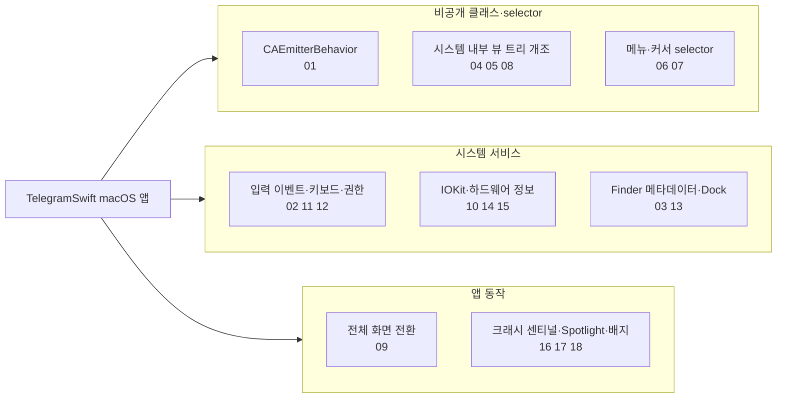
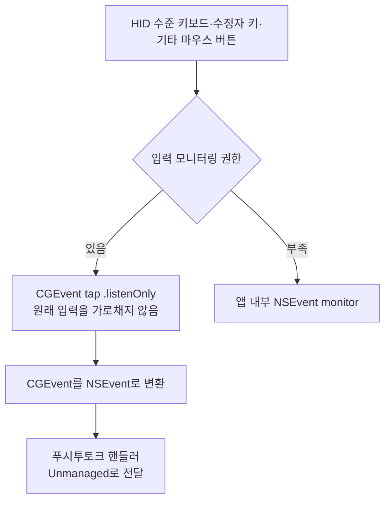
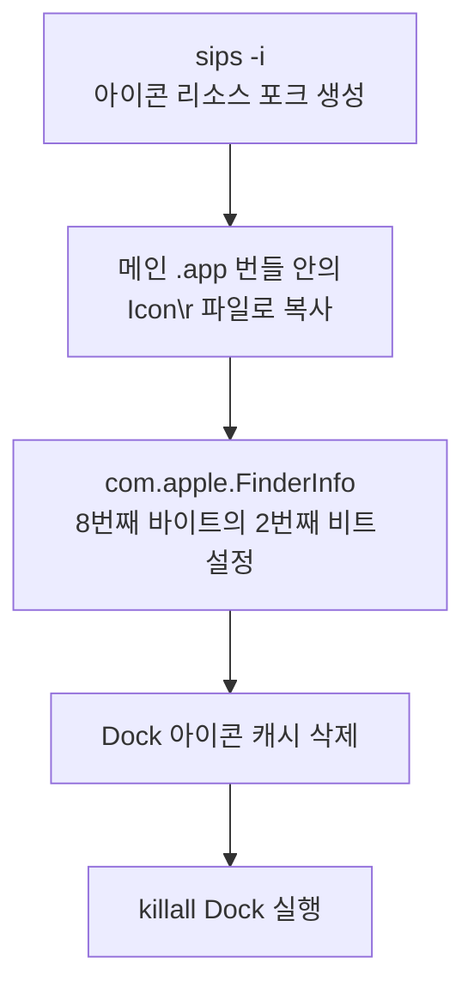
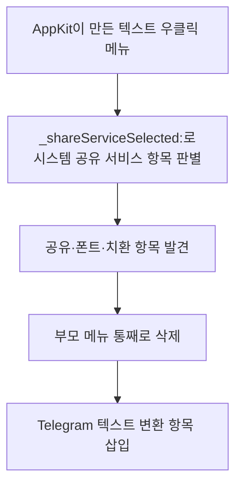

# 비공개 시스템 통합

웹: /docs/macos/14-private-system/ · Markdown: /docs/macos/14-private-system.md

> CAEmitterBehavior, CGEvent tap, Dock 리소스 포크, 시스템 뷰 트리 개조.

| 기법 항목 | 리포트 선정 | 관련 비공개 API | REA 연관 |
| --- | --- | --- | --- |
| 18 | 7 | 7 | 12 |

소스: [overtake/TelegramSwift@579cebbf](https://github.com/overtake/TelegramSwift/tree/579cebbf0c01fd41b712eff3647fa7f69db9665d)(2025-07-29) · 플랫폼: macOS · AppKit

이 장의 선정 항목:
- 14-1 [#14-02 리스닝 전용 `CGEvent` tap으로 전역 푸시투토크 구현하기](/docs/macos/14-private-system/#t14-02)
- 14-2 [#14-03 FinderInfo 비트와 리소스 포크로 Dock 아이콘을 영구히 바꾸기](/docs/macos/14-private-system/#t14-03)
- 14-3 [#14-04 `AVMovableView`를 깊이 파고들어 숨겨진 전체 화면 버튼 클릭하기](/docs/macos/14-private-system/#t14-04)
- 14-4 [#14-05 `NSTitlebarView` 내부 하위 뷰를 재배치해 50 pt 타이틀 바 확보하기](/docs/macos/14-private-system/#t14-05)
- 14-5 [#14-06 비공개 텍스트 메뉴 selector로 시스템 하위 메뉴 삭제하기](/docs/macos/14-private-system/#t14-06)
- 14-6 [#14-07 비공개 대각선 크기 조절 커서 selector 직접 호출하기](/docs/macos/14-private-system/#t14-07)
- 14-7 [#14-08 비공개 `MKZoomSegmentedControl` 클래스 이름으로 지도 확대/축소 컨트롤 옮기기](/docs/macos/14-private-system/#t14-08)

**이 주제의 범위: TelegramSwift의 macOS 비공개 API, 런타임 해킹, 시스템 통합.**

**결론: 이 버전에서 가장 과감한 방법은 아래 네 가지예요.**

- **비공개 Core Animation 동작**
- **시스템 내부 뷰 트리 개조**
- **CGEvent tap**
- **Finder 리소스 포크로 아이콘을 바꾸는 것**

`CAPortalLayer`는 실제로 쓰이는 곳이 없어요.

- `CAPortalLayer.h#L2-L23`에 선언만 있어요.
- `CAPortalLayer.m#L1`은 비어 있어요.
- 저장소 전체에 `rg`(텍스트 검색 도구)를 돌려도 이 선언과 패키지 정의만 나와요.

그래서 이 노트는 `CAPortalLayer`를 기법으로 세지 않아요.

아래 도표는 이 장의 기법들이 비공개 API, 시스템 서비스, 앱 동작 중 어느 층에 손을 대는지 묶어서 보여 줘요.



## 1. 비공개 클래스 이름을 이어 붙이고 함수 포인터로 `CAEmitterBehavior` 호출하기 [#t14-01]

> #14-01 · TelegramSwift · AppKit · 검증 방식: 소스 분석, REA 바이너리, macOS 26.7 실측 · 태그: 비공개 API, 런타임 해킹, Core Animation
>
> 소스: [TelegramSwift:packages/TGUIKit/Sources/InvisibleInkDustView.swift L12–L18](https://github.com/overtake/TelegramSwift/blob/579cebbf0c01fd41b712eff3647fa7f69db9665d/packages/TGUIKit/Sources/InvisibleInkDustView.swift#L12-L18)
>
> 소스: [TelegramSwift:packages/TGUIKit/Sources/InvisibleInkDustView.swift L111–L133](https://github.com/overtake/TelegramSwift/blob/579cebbf0c01fd41b712eff3647fa7f69db9665d/packages/TGUIKit/Sources/InvisibleInkDustView.swift#L111-L133)

**무엇을 했나요**:

1. 런타임에 비공개 클래스 `CAEmitterBehavior`를 만들어요.
2. 실제 selector인 `behaviorWithType:`도 만들어요.
3. `method(for:)`가 돌려준 IMP(메서드 구현을 가리키는 포인터)를 C 함수 포인터로 강제 변환해요.
4. `emitterBehaviors`의 KVC 키로 흡착 동작과 수명 동작을 조립해요.

**왜 이렇게 했나요**: `CAEmitterLayer`의 일반 Swift 인터페이스로는 여기서 쓰는 어트랙터(입자를 끌어당기는 흡착 동작)를 표현할 수 없어요. 그래서 시스템의 파티클 솔버를 다시 써요. 수많은 먼지 입자의 궤적을 프레임마다 직접 계산하지 않아도 돼요.

**핵심 코드 발췌**

```swift title="InvisibleInkDustView.swift · L12–L18 등 2곳"
public func createEmitterBehavior(type: String) -> NSObject {
    let selector = ["behaviorWith", "Type:"].joined(separator: "")
    let behaviorClass = NSClassFromString(["CA", "Emitter", "Behavior"].joined(separator: "")) as! NSObject.Type
    let behaviorWithType = behaviorClass.method(for: NSSelectorFromString(selector))!
    let castedBehaviorWithType = unsafeBitCast(
        behaviorWithType,
        to: (@convention(c) (Any?, Selector, Any?) -> NSObject).self
    )
    return castedBehaviorWithType(behaviorClass, NSSelectorFromString(selector), type)
}

let fingerAttractor = createEmitterBehavior(type: "simpleAttractor")
fingerAttractor.setValue("fingerAttractor", forKey: "name")
let alphaBehavior = createEmitterBehavior(type: "valueOverLife")
alphaBehavior.setValue("color.alpha", forKey: "keyPath")
alphaBehavior.setValue([0.0, 0.0, 1.0, 0.0, -1.0], forKey: "values")
alphaBehavior.setValue(true, forKey: "additive")
```

**난독화 복원 확인**:

- `['CA', 'Emitter', 'Behavior'].joined()`의 결과는 `CAEmitterBehavior`예요.
- `['behaviorWith', 'Type:'].joined()`의 결과는 `behaviorWithType:`이에요.

이 두 결과를 `NSClassFromString`과 `NSSelectorFromString`에 바로 넘겨요.

**대가와 위험**: 비공개 API예요.

- `as!`, IMP 강제 추출, `unsafeBitCast`는 클래스나 메서드가 사라지면 모두 크래시해요.
- `emitterBehaviors`와 그 KVC 경로도 시스템이 이름을 바꿀 수 있어요.
- App Store 심사 위험이 매우 높아요.

**증거 체인 #14-01**(릴리스됨 · 계속 사용 가능)

- 소스 분석: TelegramSwift 고정 커밋에서 한 줄씩 확인했어요. 소스 위치는 총 2곳이에요.
- REA 1번 항목(릴리스됨 · 계속 사용 가능; REA 바이너리, macOS 26.7 실측):
  - 13.0 바이너리: `"CA"`, `"Emitter"`, `"Behavior"`가 Swift 작은 문자열로 `__DATA.__data` 0x5e75208/18/28에 저장되어 있고, `"behaviorWith"`, `"Type:"`는 0x5e751c0/d0에 저장되어 있어요. 전체 이름 `CAEmitterBehavior`와 `behaviorWithType`은 한 번도 나타나지 않아요. `"simpleAttractor"`는 5곳, `"valueOverLife"`는 3곳에서 `MOVZ/MOVK` 즉치값으로 컴파일되어 있어요. KVC 경로 `emitterBehaviors.fingerAttractor.*`와 `randomAttractor0/1.*`는 평문으로 `__cstring`에 저장되어 있어요
  - macOS 26.7: 클래스가 있어요; `+behaviorWithType:`이 있어요; 두 타입 모두 만들어져요
  - 결론: 릴리스 빌드, 현재 시스템에서도 계속 사용 가능

## 2. 리스닝 전용 `CGEvent` tap으로 전역 푸시투토크 구현하기 [#t14-02]

> #14-02 · TelegramSwift · AppKit · 리포트 선정 14-1 · 검증 방식: 소스 분석, REA 바이너리, REA 런타임 관측 · 태그: 텍스트와 입력
>
> 소스: [TelegramSwift:Telegram-Mac/PushToTalk.swift L119–L169](https://github.com/overtake/TelegramSwift/blob/579cebbf0c01fd41b712eff3647fa7f69db9665d/Telegram-Mac/PushToTalk.swift#L119-L169)

**무엇을 했나요**:

- HID(키보드·마우스 같은 입력 장치 규격) 수준의 키보드, 수정자 키, 기타 마우스 버튼을 지켜봐요.
- `CGEvent`를 `NSEvent`로 되돌려요.
- `.listenOnly`를 고르기 때문에 리스너는 원래 입력을 가로채지 않아요.
- 권한이 부족하면 앱 내부 `NSEvent` monitor로 물러나요.

**왜 이렇게 했나요**: 일반 윈도우 이벤트는 앱이 포그라운드일 때만 동작해요. 여기서는 전역 푸시투토크(키를 누르는 동안만 말하는 기능)를 지원해야 해요. 리스닝 전용 event tap은 다른 앱의 키 동작을 그대로 지켜 줘요.

아래 도표는 리스닝 전용 `CGEvent` tap이 권한에 따라 입력을 받는 흐름을 보여 줘요.



**핵심 코드 발췌**

```swift title="PushToTalk.swift · L119–L169"
if hasPermission {
    func callback(proxy: CGEventTapProxy, type: CGEventType,
                  event: CGEvent, refcon: UnsafeMutableRawPointer?) -> Unmanaged<CGEvent>? {
        if let event = NSEvent(cgEvent: event) {
            let processor = Unmanaged<ProcessEvent>.fromOpaque(refcon!).takeUnretainedValue()
            processor.process(event)
        }
        return Unmanaged.passRetained(event)
    }
    let eventMask: Int32 = (1 << CGEventType.keyDown.rawValue)
        | (1 << CGEventType.otherMouseDown.rawValue)
        | (1 << CGEventType.otherMouseUp.rawValue)
        | (1 << CGEventType.keyUp.rawValue)
        | (1 << CGEventType.flagsChanged.rawValue)
    self.eventTap = CGEvent.tapCreate(tap: .cghidEventTap,
                                      place: .headInsertEventTap,
                                      options: .listenOnly,
                                      eventsOfInterest: CGEventMask(eventMask),
                                      callback: callback,
                                      userInfo: UnsafeMutableRawPointer(Unmanaged.passRetained(processEvent).toOpaque()))
}
```

**대가와 위험**:

- “입력 모니터링” 권한이 필요해요. 사용자가 권한을 거부할 수 있어요.
- `userInfo`는 `passRetained`로 넘기지만, 이 코드 구간에는 짝이 되는 `release`가 보이지 않아요. 다른 경로에서 해제하는지는 검증하지 않았어요.

**증거 체인 #14-02**(릴리스됨 · 계속 사용 가능)

- 소스 분석: TelegramSwift 고정 커밋에서 한 줄씩 확인했어요. 소스 위치는 총 1곳이에요.
- 리포트 요약(구현 방법): 콜백이 `NSEvent`로 변환하고, `Unmanaged`로 핸들러를 넘겨요.
- REA 10번 항목(릴리스됨 · 계속 사용 가능; REA 바이너리, REA 런타임 관측):
  - 13.0 바이너리: `CGEventTapCreate`, `CGEventTapEnable`, `IOHIDCheckAccess`, `IOHIDRequestAccess` 임포트
  - macOS 26.7: LLDB가 브레이크포인트를 SkyLight의 `SLEventTapCreate`로 해석했어요; 실행 후 40초 안에는 호출되지 않았어요
  - 결론: 릴리스 빌드; 기본값은 비활성

## 3. FinderInfo 비트와 리소스 포크로 Dock 아이콘을 영구히 바꾸기 [#t14-03]

> #14-03 · TelegramSwift · AppKit · 리포트 선정 14-2 · 검증 방식: 소스 분석, REA 바이너리 · 태그: 성능과 메모리
>
> 소스: [TelegramSwift:packages/Dock/Sources/Dock.swift L64–L93](https://github.com/overtake/TelegramSwift/blob/579cebbf0c01fd41b712eff3647fa7f69db9665d/packages/Dock/Sources/Dock.swift#L64-L93)
>
> 소스: [TelegramSwift:packages/Dock/Sources/Dock.swift L130–L158](https://github.com/overtake/TelegramSwift/blob/579cebbf0c01fd41b712eff3647fa7f69db9665d/packages/Dock/Sources/Dock.swift#L130-L158)

**무엇을 했나요**:

1. `sips -i`로 아이콘 리소스 포크(파일에 딸린 별도 데이터 영역)를 만들어요.
2. 이 리소스 포크를 메인 `.app` 번들 안의 `Icon\r`라는 이름의 파일로 복사해요.
3. `com.apple.FinderInfo`의 8번째 바이트 중 2번째 비트를 설정해요.
4. Dock 아이콘 캐시를 지우고 `killall Dock`을 실행해요.

**왜 이렇게 했나요**: `NSApplication.applicationIconImage`는 현재 프로세스의 아이콘만 바꿀 수 있어요. Finder와 Dock이 다시 시작된 뒤에도 새 아이콘을 쓴다는 보장이 없어요. 리소스 포크와 FinderInfo는 Finder의 옛 방식 커스텀 아이콘 프로토콜이에요.

아래 도표는 Dock 아이콘을 영구히 바꾸는 단계를 순서대로 보여 줘요.



**핵심 코드 발췌**

```swift title="Dock.swift · L64–L93 등 2곳"
static func enableCustomIcon(bundle: String) -> Bool {
    var info = readCustomIconAttribute(bundle: bundle)
    if info.isEmpty {
        info = Data(repeating: 0, count: kFinderInfoSize)
    }
    info[8] |= 4
    return writeCustomIconAttribute(bundle: bundle, value: info)
}

static func refreshDock(silence: Bool) -> Bool {
    let _ = launch(command: "/bin/bash", arguments: ["-c", "rm /var/folders/*/*/*/com.apple.dock.iconcache"])
    if !silence {
        let killallResult = launch(command: "/usr/bin/killall", arguments: ["Dock"])
        if killallResult != 0 { return false }
    }
    return true
}

let bundle = bundlePath()
let icon = bundle + "/Icon\r"
guard let rsrc = readResourceFork(path: path), !rsrc.isEmpty else { return nil }
if !writeResourceFork(path: icon, data: rsrc) || !enableCustomIcon(bundle: bundle) {
    return nil
}
return refreshDock(silence: silence) ? digest(rsrc) : nil
```

**대가와 위험**:

- 설치된 app bundle을 고쳐 써요. 서명, 파일 권한, 샌드박스가 이를 막을 수 있어요.
- 캐시를 지우고 Dock을 강제로 종료하면 사용자가 불편해져요.
- 시스템 캐시 경로와 Finder 메타데이터 형식도 유지 보수 위험이 있어요.

**증거 체인 #14-03**(릴리스됨 · 계속 사용 가능)

- 소스 분석: TelegramSwift 고정 커밋에서 한 줄씩 확인했어요. 소스 위치는 총 2곳이에요.
- 리포트 요약(구현 방법): POSIX 확장 속성과 `killall Dock`으로 캐시를 새로 고쳐요.
- REA 9번 항목(릴리스됨 · 계속 사용 가능; REA 바이너리):
  - 13.0 바이너리: `com.apple.ResourceFork`, `com.apple.FinderInfo`, `/usr/bin/killall`, “Failed to run `killall Dock`”; `setxattr`, `getxattr`, `removexattr` 임포트
  - macOS 26.7: 실행하지 않음(시스템 상태를 바꾸므로)
  - 결론: 릴리스 빌드. 샌드박스가 없는 Developer ID 배포 덕분에 자기 번들에 쓸 수 있어요

## 4. `AVMovableView`를 깊이 파고들어 숨겨진 전체 화면 버튼 클릭하기 [#t14-04]

> #14-04 · TelegramSwift · AppKit · 리포트 선정 14-3 · 검증 방식: 소스 분석, REA 바이너리, macOS 26.7 실측, REA 런타임 관측 · 태그: Core Animation
>
> 소스: [TelegramSwift:Telegram-Mac/MGalleryExternalVideoItem.swift L257–L267](https://github.com/overtake/TelegramSwift/blob/579cebbf0c01fd41b712eff3647fa7f69db9665d/Telegram-Mac/MGalleryExternalVideoItem.swift#L257-L267)

**무엇을 했나요**:

1. 클래스 이름으로 AVKit 내부의 `AVMovableView`를 찾아요.
2. 6단계 하위 뷰 체인의 끝이 `NSButton`이라고 가정해요.
3. `performClick`으로 그 버튼의 전체 화면 동작을 실행해요.

**왜 이렇게 했나요**: `AVPlayerView`의 시스템 컨트롤 바를 그대로 둬요. 동시에 바깥쪽 갤러리가 시스템의 전체 화면 구현을 움직일 수 있게 해요. 일반적인 공개 호출로는 이 내부 컨트롤 경로를 표현할 수 없어요.

아래 도표는 숨겨진 전체 화면 버튼까지 하위 뷰를 따라 내려가 클릭하는 경로를 보여 줘요.


**핵심 코드 발췌**

```swift title="MGalleryExternalVideoItem.swift · L257–L267"
override func toggleFullScreen() {
    if let view = _cachedView {
        let controls = HackUtils.findElements(byClass: "AVMovableView", in: view)?.first as? NSView
        if let controls = controls {
            if let view = controls.subviews.first?.subviews.first?.subviews.first?
                .subviews.last?.subviews.first?.subviews.last {
                if let view = view as? NSButton {
                    view.performClick(self)
                }
            }
        }
    }
}
```

**대가와 위험**:

- `AVMovableView`와 하위 뷰 계층은 안정적인 계약이 아니에요.
- macOS 버전이 조금만 바뀌어도 전체 화면이 동작하지 않아요.
- 타입이나 계층이 틀리면 조용히 실패할 뿐이에요.
- 심사 위험이 매우 높아요.

**증거 체인 #14-04**(버전 차이)

- 소스 분석: TelegramSwift 고정 커밋에서 한 줄씩 확인했어요. 소스 위치는 총 1곳이에요.
- 리포트 요약(구현 방법): `findElements(byClass:)`와 하위 뷰 체인으로 위치를 찾아요.
- REA 6번 항목(릴리스됨 · 계속 사용 가능; REA 바이너리, macOS 26.7 실측):
  - 13.0 바이너리: `"AVMovableView"`가 3곳의 즉치값(0x102517a20, 0x102518434, 0x1025185f8)으로 컴파일되어 있으며, 소스의 호출 지점 3곳과 일치해요
  - macOS 26.7: 클래스가 있고 `AVPlayerView` 뷰 트리에 나타나요
  - 결론: 릴리스 빌드; 내부 버튼 경로는 미검증
- REA 18번 항목(버전 차이; REA 바이너리, REA 런타임 관측):
  - 13.0 바이너리: `HackUtils`는 한 번도 나타나지 않아요; `ObjcUtils` 클래스가 있고 `findElementsByClass:inView:`와 `:array:`를 갖고 있어요
  - macOS 26.7: `ObjcUtils` 메서드는 심볼이 제거되어 LLDB로 브레이크포인트를 걸 수 없어요
  - 결론: 버전 차이: 기능이 `ObjcUtils`로 합쳐졌을 수 있어요(미검증)

## 5. `NSTitlebarView` 내부 하위 뷰를 재배치해 50 pt 타이틀 바 확보하기 [#t14-05]

> #14-05 · TelegramSwift · AppKit · 리포트 선정 14-4 · 검증 방식: 소스 분석, REA 바이너리, macOS 26.7 실측, REA 런타임 관측 · 태그: 비공개 API
>
> 소스: [TelegramSwift:Telegram-Mac/PassportWindowController.swift L89–L104](https://github.com/overtake/TelegramSwift/blob/579cebbf0c01fd41b712eff3647fa7f69db9665d/Telegram-Mac/PassportWindowController.swift#L89-L104)

**무엇을 했나요**:

1. `window.titleView`의 frame을 고쳐 써요.
2. 재귀적으로 문자열을 써서 비공개 `NSTitlebarView`를 찾아요.
3. 앞쪽 내부 하위 뷰 세 개를 차례로 돌아요.
4. 그 세 뷰를 숨기고, Retina 픽셀 단위로 반올림해 좌표를 다시 설정해요.

**왜 이렇게 했나요**: Passport 윈도우는 투명한 타이틀 바와 커스텀 내비게이션 영역을 써요. 시스템의 기본 트래픽 라이트(윈도우 왼쪽 위의 닫기·최소화·확대 버튼) 배치는 50 pt 높이에 맞지 않아요. 공개 `NSWindow` API로는 내부 하위 뷰의 좌표를 하나씩 제어할 수 없어요.

**핵심 코드 발췌**

```swift title="PassportWindowController.swift · L89–L104"
@objc func windowDidNeedSaveState(_ notification: Notification) {
    if let titleView = window.titleView {
        let frame = NSMakeRect(0, window.frame.height - barHeight, titleView.frame.width, barHeight)
        if !NSEqualRects(frame, titleView.frame) {
            titleView.frame = frame
        }
        if let controls = (HackUtils.findElements(byClass: "NSTitlebarView", in: titleView)?.first as? NSView)?.subviews {
            var xs: [CGFloat] = [18, 58, 38]
            for i in 0 ..< min(controls.count, xs.count) {
                let view = controls[i]
                view.isHidden = true
                view.setFrameOrigin(xs[i], floorToScreenPixels(System.backingScale,
                    (barHeight - view.frame.height) / 2))
            }
        }
    }
}
```

**대가와 위험**:

- `NSTitlebarView`, 하위 뷰의 순서, 앞쪽 세 하위 뷰의 의미는 모두 공개된 계약이 아니에요.
- 이 코드만으로는 앞쪽 세 하위 뷰가 각각 어느 트래픽 라이트인지 알 수 없어요.
- 좌표 순서 `[18, 58, 38]`도 옛 계층에 기대고 있어요.
- 시스템 업그레이드 위험과 심사 위험이 매우 높아요.

**증거 체인 #14-05**(버전 차이)

- 소스 분석: TelegramSwift 고정 커밋에서 한 줄씩 확인했어요. 소스 위치는 총 1곳이에요.
- 리포트 요약(구현 방법): `HackUtils.findElements`로 찾고 픽셀에 맞춰 정렬해요.
- REA 7번 항목(릴리스됨 · 계속 사용 가능; REA 바이너리, macOS 26.7 실측):
  - 13.0 바이너리: `"NSTitlebarView"`가 1곳의 즉치값(0x1036c54f8)으로 컴파일되어 있어요; `NSTitlebarContainerView`는 `__cstring`에 있어요
  - macOS 26.7: 두 클래스 모두 타이틀 바 뷰 트리에 있어요
  - 결론: 릴리스 빌드, 구조가 아직 남아 있어요
- REA 18번 항목(버전 차이; REA 바이너리, REA 런타임 관측):
  - 13.0 바이너리: `HackUtils`는 한 번도 나타나지 않아요; `ObjcUtils` 클래스가 있고 `findElementsByClass:inView:`와 `:array:`를 갖고 있어요
  - macOS 26.7: `ObjcUtils` 메서드는 심볼이 제거되어 LLDB로 브레이크포인트를 걸 수 없어요
  - 결론: 버전 차이: 기능이 `ObjcUtils`로 합쳐졌을 수 있어요(미검증)

## 6. 비공개 텍스트 메뉴 selector로 시스템 하위 메뉴 삭제하기 [#t14-06]

> #14-06 · TelegramSwift · AppKit · 리포트 선정 14-5 · 검증 방식: 소스 분석, REA 바이너리, macOS 26.7 실측 · 태그: 비공개 API, 텍스트와 입력
>
> 소스: [TelegramSwift:packages/InputView/Sources/InputView/ChatInputTextView.swift L987–L1013](https://github.com/overtake/TelegramSwift/blob/579cebbf0c01fd41b712eff3647fa7f69db9665d/packages/InputView/Sources/InputView/ChatInputTextView.swift#L987-L1013)

**무엇을 했나요**:

1. AppKit이 만든 텍스트 우클릭 메뉴를 살펴봐요.
2. `_shareServiceSelected:`로 시스템 공유 서비스 항목을 알아봐요.
3. 공유, 폰트, 치환 항목을 찾으면 그 부모 메뉴를 통째로 지워요.
4. Telegram의 텍스트 변환 항목을 끼워 넣어요.

**왜 이렇게 했나요**: `NSMenuItem`에는 이런 시스템 항목을 가려낼 안정적인 공개 분류가 없어요. action을 검사하면 현지화된 제목을 맞춰 볼 필요가 없어요. 커스텀 변환 항목의 위치도 그대로 유지할 수 있어요.

아래 도표는 텍스트 우클릭 메뉴에서 시스템 하위 메뉴를 지우고 변환 항목을 끼워 넣는 순서를 보여 줘요.



**핵심 코드 발췌**

```swift title="ChatInputTextView.swift · L987–L1013"
public override func menu(for event: NSEvent) -> NSMenu? {
    let menu = super.menu(for: event) as? NSMenu
    var removeItems = [NSMenuItem]()
    var addedTransformations = false
    menu?.items.enumerated().forEach { (idx, item) in
        if item.action == NSSelectorFromString("submenuAction:") {
            item.submenu?.items.enumerated().forEach { (subIdx, subItem) in
                if subItem.action == NSSelectorFromString("_shareServiceSelected:")
                    || subItem.action == NSSelectorFromString("orderFrontFontPanel:")
                    || subItem.action == NSSelectorFromString("orderFrontSubstitutionsPanel:")
                    || subItem.action == NSSelectorFromString("changeLayoutOrientation:") {
                    removeItems.append(item)
                } else if subItem.action == #selector(capitalizeWord(_:)) {
                    addedTransformations = true
                    if self.selectedRange.length > 0 {
                        if self.customDelegate?.inputTextCanTransform() == true {
                            self.transformItems.enumerated().forEach { (transformIdx, obj) in
                                item.submenu?.insertItem(obj, at: transformIdx)
                            }
                        }
                    }
                }
            }
        }
    }
```

**대가와 위험**:

- `_shareServiceSelected:`는 비공개 selector예요.
- `submenuAction:`과 그 밖의 시스템 메뉴 구조도 바뀔 수 있어요.
- 일부 시스템 버전에서는 엉뚱한 메뉴를 지우거나 지우려던 메뉴를 지우지 못할 수 있어요.
- 심사 위험이 있어요.

**증거 체인 #14-06**(시스템 구조 변경됨)

- 소스 분석: TelegramSwift 고정 커밋에서 한 줄씩 확인했어요. 소스 위치는 총 1곳이에요.
- 리포트 요약(구현 방법): 하위 메뉴를 돌며 selector로 걸러요.
- REA 5번 항목(시스템 구조 변경됨; REA 바이너리, macOS 26.7 실측):
  - 13.0 바이너리: 이 selector는 `__cstring`과 `__objc_methname`에 모두 있어요
  - macOS 26.7: `NSTextView` 기본 메뉴에는 없고, 공유 항목은 `_performStandardShareMenuItem:`으로 바뀌었어요. 13.0 바이너리에는 새 selector가 없어요
  - 결론: 공유 항목의 필터 조건이 26.7에서는 통하지 않을 수 있어요(추정이며 Telegram 안에서는 실측하지 않음)

## 7. 비공개 대각선 크기 조절 커서 selector 직접 호출하기 [#t14-07]

> #14-07 · TelegramSwift · AppKit · 리포트 선정 14-6 · 검증 방식: 소스 분석, REA 바이너리, macOS 26.7 실측 · 태그: 비공개 API
>
> 소스: [TelegramSwift:packages/ObjcUtils/Sources/ObjcUtils/ObjcUtils.m L30–L43](https://github.com/overtake/TelegramSwift/blob/579cebbf0c01fd41b712eff3647fa7f69db9665d/packages/ObjcUtils/Sources/ObjcUtils/ObjcUtils.m#L30-L43)

**무엇을 했나요**: `NSCursor` 클래스에 밑줄로 시작하는 selector 두 개를 보내요. 이렇게 두 종류의 대각선 윈도우 크기 조절 커서를 얻어요. 호출 지점에서는 이 커서를 이미지 편집 윈도우와 통화 윈도우의 모서리 드래그에 써요.

**왜 이렇게 했나요**: 시스템 내부 커서를 쓰면 Finder 방식의 윈도우 크기 조절과 모양을 맞출 수 있어요. 직접 그린 커서 리소스를 패키징하고 관리하지 않아도 돼요.

**핵심 코드 발췌**

```objc title="ObjcUtils.m · L30–L43"
@implementation ObjcUtils

+(NSCursor * __nullable)windowResizeNorthWestSouthEastCursor {
    NSCursor *cursor = [[NSCursor class]
        performSelector:@selector(_windowResizeNorthWestSouthEastCursor)];
    return cursor;
}

+(NSCursor * __nullable)windowResizeNorthEastSouthWestCursor {
    NSCursor *cursor = [[NSCursor class]
        performSelector:@selector(_windowResizeNorthEastSouthWestCursor)];
    return cursor;
}

+ (NSData *)dataFromHexString:(NSString *)string
```

**대가와 위험**:

- `_windowResizeNorthWestSouthEastCursor`와 `_windowResizeNorthEastSouthWestCursor`는 모두 비공개 API예요.
- 먼저 `respondsToSelector:`를 검사하지 않아요.
- selector가 사라지면 unrecognized selector 크래시가 나요.
- 심사 위험이 매우 높아요.

**증거 체인 #14-07**(릴리스됨 · 계속 사용 가능)

- 소스 분석: TelegramSwift 고정 커밋에서 한 줄씩 확인했어요. 소스 위치는 총 1곳이에요.
- 리포트 요약(구현 방법): `performSelector:`로 클래스 메서드를 호출해요.
- REA 4번 항목(릴리스됨 · 계속 사용 가능; REA 바이너리, macOS 26.7 실측):
  - 13.0 바이너리: 두 selector 모두 `__objc_methname`(0x1050992e1, 0x105099307)에 있어요
  - macOS 26.7: LLDB가 AppKit에서 `+[NSCursor _windowResizeNorthWestSouthEastCursor]` 등 두 메서드로 해석했어요
  - 결론: 릴리스 빌드, 계속 사용 가능

## 8. 비공개 `MKZoomSegmentedControl` 클래스 이름으로 지도 확대/축소 컨트롤 옮기기 [#t14-08]

> #14-08 · TelegramSwift · AppKit · 리포트 선정 14-7 · 검증 방식: 소스 분석, REA 바이너리, macOS 26.7 실측, REA 런타임 관측 · 태그: 비공개 API
>
> 소스: [TelegramSwift:Telegram-Mac/LocationModalController.swift L231–L246](https://github.com/overtake/TelegramSwift/blob/579cebbf0c01fd41b712eff3647fa7f69db9665d/Telegram-Mac/LocationModalController.swift#L231-L246)

**무엇을 했나요**:

- layout이 끝날 때마다 `MKMapView`의 내부 트리를 훑어요.
- `MKZoomSegmentedControl`을 찾아서 `(20, 20)`에 고정해요.
- map frame을 조정하는 동안에는 delegate를 잠시 비워 둬요.

**왜 이렇게 했나요**: 커스텀 지도 패널은 지도에서 보이는 영역을 바꿔요. 시스템 컨트롤의 기본 위치는 헤더 및 리스트와 겹쳐요. 공개 MapKit API는 이 확대/축소 컨트롤의 레이아웃 객체를 주지 않아요.

**핵심 코드 발췌**

```swift title="LocationModalController.swift · L231–L246"
let delegate = mapView.delegate
mapView.delegate = nil
mapView.frame = NSMakeRect(0, mapY, frame.width, mapHeight)
mapView.delegate = delegate

let pinPoint = mapView.focus(NSMakeSize(4, 4))
locationPinView.centerX(y: pinPoint.midY - locationPinView.frame.height)

expandButton.center()
loadingView.center()

let zoomControls = HackUtils.findElements(byClass: "MKZoomSegmentedControl", in: mapView).first as? NSView
if let zoomControls = zoomControls {
    zoomControls.setFrameOrigin(20, 20)
}
```

**대가와 위험**:

- `MKZoomSegmentedControl`은 내부 클래스 이름이에요. 컨트롤이 없을 수도 있고 새 MapKit에서 이름이 바뀔 수도 있어요.
- delegate를 잠시 비우면 frame을 다시 설정하는 동안의 콜백을 놓칠 수도 있어요.
- 심사 위험이 있어요.

**증거 체인 #14-08**(시스템 구조 변경됨)

- 소스 분석: TelegramSwift 고정 커밋에서 한 줄씩 확인했어요. 소스 위치는 총 1곳이에요.
- 리포트 요약(구현 방법): `findElements(byClass:)`로 컨트롤을 찾은 뒤 `setFrameOrigin`을 호출해요.
- REA 8번 항목(시스템 구조 변경됨; REA 바이너리, macOS 26.7 실측):
  - 13.0 바이너리: `__cstring` 0x104c3bd50
  - macOS 26.7: 클래스는 있지만 `showsZoomControls = true`로 설정해도 `MKMapView` 뷰 트리에는 없어요
  - 결론: 코드가 `if let`으로 보호하고 있어서 조용히 건너뛰어요(이번 테스트 조건에서)
- REA 18번 항목(버전 차이; REA 바이너리, REA 런타임 관측):
  - 13.0 바이너리: `HackUtils`는 한 번도 나타나지 않아요; `ObjcUtils` 클래스가 있고 `findElementsByClass:inView:`와 `:array:`를 갖고 있어요
  - macOS 26.7: `ObjcUtils` 메서드는 심볼이 제거되어 LLDB로 브레이크포인트를 걸 수 없어요
  - 결론: 버전 차이: 기능이 `ObjcUtils`로 합쳐졌을 수 있어요(미검증)

## 9. `CATransaction`으로 시스템 전체 화면 전환을 감싸고 상태 발행 늦추기 [#t14-09]

> #14-09 · TelegramSwift · AppKit · 검증 방식: 소스 분석 · 태그: Core Animation, 성능과 메모리
>
> 소스: [TelegramSwift:packages/TGUIKit/Sources/Window.swift L936–L958](https://github.com/overtake/TelegramSwift/blob/579cebbf0c01fd41b712eff3647fa7f69db9665d/packages/TGUIKit/Sources/Window.swift#L936-L958)

**무엇을 했나요**:

- `Window`는 `super.toggleFullScreen`을 호출하기 전후로 Core Animation 트랜잭션을 직접 열고 닫아요.
- `processFullScreen`이 먼저 끼어들 수 있게 해 줘요.
- 저장 상태는 실제 전환이 끝난 뒤에 기록해요.
- 끼어드는 쪽이 없으면 다음 메인 큐 순환에서야 신호를 내보내요.

**왜 이렇게 했나요**: `super`를 바로 호출하면 앱이 전체 화면 절차를 더 끼워 넣을 수 없어요. `Window`의 이 래퍼는 “전환 요청”과 “상태 스트림 갱신”도 나눠요. 호출하는 쪽은 시스템 애니메이션이 시작되기 전에 자기 인터페이스 상태를 준비할 수 있어요.

**핵심 코드 발췌**

```swift title="Window.swift · L936–L958"
public var processFullScreen: ((Bool, @escaping (Bool) -> Void) -> Void)?

private func invokeFullScreen(_ sender: Any?) {
    CATransaction.begin()
    super.toggleFullScreen(sender)
    CATransaction.commit()
    saver?.isFullScreen = isFullScreen
}

open override func toggleFullScreen(_ sender: Any?) {
    let newValue = !isFullScreen
    self.onToggleFullScreen?(newValue)
    if let process = processFullScreen {
        process(newValue, { [weak self] value in
            self?.invokeFullScreen(nil)
            self?.onToggleFullScreen?(newValue)
        })
    } else {
        invokeFullScreen(nil)
        DispatchQueue.main.async {
            self.isFullScreenValue.set(newValue)
        }
    }
}
```

**대가와 위험**:

- `CATransaction`이 특정 macOS 버그를 겨냥한 것인지는 검증하지 않았어요.
- 콜백 클로저는 파라미터 `value`를 무시해요.
- `processFullScreen`이 콜백하지 않으면 윈도우가 전환되지 않아요.
- 비동기 상태가 시스템이 거부한 전환과 잠깐 어긋날 수도 있어요.

**증거 체인 #14-09**(개별 검증 안 함)

- 소스 분석: TelegramSwift 고정 커밋에서 한 줄씩 확인했어요. 소스 위치는 총 1곳이에요.
- 바이너리 검증: 이 항목은 개별 검증하지 않았어요. REA 페이지에 검증을 마친 20개 항목이 나열되어 있어요.

## 10. IOPS 요약과 `AppleSmartBattery` 레지스트리 비공개 키 함께 쓰기 [#t14-10]

> #14-10 · TelegramSwift · AppKit · 검증 방식: 소스 분석, REA 바이너리, REA 런타임 관측 · 태그: 비공개 API
>
> 소스: [TelegramSwift:packages/TGUIKit/Sources/InternalFinder.swift L32–L53](https://github.com/overtake/TelegramSwift/blob/579cebbf0c01fd41b712eff3647fa7f69db9665d/packages/TGUIKit/Sources/InternalFinder.swift#L32-L53)
>
> 소스: [TelegramSwift:packages/TGUIKit/Sources/InternalFinder.swift L72–L103](https://github.com/overtake/TelegramSwift/blob/579cebbf0c01fd41b712eff3647fa7f69db9665d/packages/TGUIKit/Sources/InternalFinder.swift#L72-L103)

**무엇을 했나요**:

1. 공개 IOPS(IOKit의 전원 정보 API)로 완충 또는 방전까지 남은 시간을 얻어요.
2. IOKit의 `AppleSmartBattery` 서비스에 연결해요.
3. 용량, 사이클 횟수, 온도, 설계 사이클 수 같은 키를 직접 읽어요.
4. 전류와 전압은 부호 있는 와트 값으로 환산해요.

**왜 이렇게 했나요**: IOPS의 공개 요약에는 이런 건강 지표가 없어요. 레지스트리 키를 읽으면 Telegram이 더 자세한 내부 배터리 정보를 보여 주거나 쓸 수 있어요. 1분마다 `InternalFinder`를 새로 만들어 한 번 읽어요.

**핵심 코드 발췌**

```swift title="InternalFinder.swift · L32–L53 등 2곳"
fileprivate func open() {
    self.serviceInternal = IOServiceGetMatchingService(
        kIOMasterPortDefault, IOServiceMatching("AppleSmartBattery"))
}

public func getInternalBattery() -> InternalBattery? {
    self.open()
    if self.serviceInternal == 0 {
        return nil
    }
    let battery = self.getBatteryData()
    self.close()
    return battery
}

battery.currentCapacity = self.getIntValue("CurrentCapacity" as CFString)
battery.maxCapacity = self.getIntValue("MaxCapacity" as CFString)
battery.designCapacity = self.getIntValue("DesignCapacity" as CFString)
battery.cycleCount = self.getIntValue("CycleCount" as CFString)
battery.designCycleCount = self.getIntValue("DesignCycleCount9C" as CFString)
battery.acPowered = self.getBoolValue("ExternalConnected" as CFString)
battery.isCharging = self.getBoolValue("IsCharging" as CFString)
battery.temperature = self.getTemperature()
```

**대가와 위험**:

- `AppleSmartBattery`와 `DesignCycleCount9C` 같은 키에는 안정적인 공개 계약이 없어요.
- 기종에 따라 키가 없거나 다른 타입을 돌려줄 수 있어요.
- `getTemperature`와 제조일 부분의 강제 변환도 크래시할 수 있어요.
- 유지 보수 위험이 높아요.

**증거 체인 #14-10**(릴리스됨 · 계속 사용 가능)

- 소스 분석: TelegramSwift 고정 커밋에서 한 줄씩 확인했어요. 소스 위치는 총 2곳이에요.
- REA 11번 항목(릴리스됨 · 계속 사용 가능; REA 바이너리, REA 런타임 관측):
  - 13.0 바이너리: `IOHIDSystem`, `HIDIdleTime`, `AppleSmartBattery`; `IOServiceGetMatchingService`, `IORegistryEntryCreateCFProperty`, `IOPSCopyPowerSourcesInfo` 임포트
  - macOS 26.7: 시작할 때 `IOServiceGetMatchingService`가 6번 호출되었고, 호출 스택에 Telegram 프레임은 없어요
  - 결론: 릴리스 빌드

## 11. Carbon 키보드 레이아웃으로 물리 키를 번역하고 비 Unicode 레이아웃은 다시 시도하기 [#t14-11]

> #14-11 · TelegramSwift · AppKit · 검증 방식: 소스 분석, REA 바이너리 · 태그: 텍스트와 입력
>
> 소스: [TelegramSwift:packages/HotKey/Sources/HotKeyUtilities.m L89–L129](https://github.com/overtake/TelegramSwift/blob/579cebbf0c01fd41b712eff3647fa7f69db9665d/packages/HotKey/Sources/HotKeyUtilities.m#L89-L129)

**무엇을 했나요**:

1. 기능 키와 수정자 키를 먼저 매핑해요.
2. 일반 물리 키는 현재 ASCII 키보드 레이아웃에서 `UCKeyboardLayout`을 얻어요.
3. Cocoa 수정자 키를 Carbon 플래그로 바꿔요.
4. `UCKeyTranslate`로 사용자가 지금 쓰는 레이아웃에서의 단축키 문구를 얻어요.

**왜 이렇게 했나요**: key code를 그대로 보여 주면 비 US 키보드 사용자가 이해하기 어려워요. 일반 `NSEvent`의 문자도 단축키 설정의 물리 키 표현에는 맞지 않아요. 중국어와 일본어의 비 Unicode 레이아웃에서 나는 크래시를 피하려는 시도도 코드에 분명히 들어 있어요.

**핵심 코드 발췌**

```objc title="HotKeyUtilities.m · L89–L129"
NSString *mapped = [characterMap objectForKey:@(keyCode)];
if (mapped != nil) {
    [final appendString:mapped];
} else {
    TISInputSourceRef currentKeyboard = TISCopyCurrentASCIICapableKeyboardLayoutInputSource();
    CFDataRef uchr = (CFDataRef)TISGetInputSourceProperty(
        currentKeyboard, kTISPropertyUnicodeKeyLayoutData);
    if (!uchr) {
        CFRelease(currentKeyboard);
        currentKeyboard = TISCopyCurrentASCIICapableKeyboardLayoutInputSource();
        uchr = (CFDataRef)TISGetInputSourceProperty(
            currentKeyboard, kTISPropertyUnicodeKeyLayoutData);
    }
    const UCKeyboardLayout *keyboardLayout =
        (const UCKeyboardLayout *)CFDataGetBytePtr(uchr);
    if (keyboardLayout) {
        UInt32 keyModifiers = CarbonModifierFlagsFromCocoaModifiers(modifiers);
        OSStatus status = UCKeyTranslate(keyboardLayout, keyCode,
            kUCKeyActionDown, keyModifiers, LMGetKbdType(), 0,
            &deadKeyState, maxStringLength, &actualStringLength, unicodeString);
```

**대가와 위험**: Carbon은 옛 인터페이스예요. 두 번째 호출도 같은 획득 함수를 써요. `uchr`이 여전히 비어 있어도 `CFDataGetBytePtr`을 그대로 넘겨요. 이 보호가 충분한지는 검증하지 않았어요.

**증거 체인 #14-11**(릴리스됨 · 계속 사용 가능)

- 소스 분석: TelegramSwift 고정 커밋에서 한 줄씩 확인했어요. 소스 위치는 총 1곳이에요.
- REA 13번 항목(릴리스됨 · 계속 사용 가능; REA 바이너리):
  - 13.0 바이너리: `TISCopyCurrentKeyboardInputSource`, `TISCopyCurrentASCIICapableKeyboardLayoutInputSource`, `UCKeyTranslate` 임포트
  - macOS 26.7: 실행하지 않음
  - 결론: 릴리스 빌드

## 12. 블로킹될 수 있는 입력 모니터링 권한 요청을 메인 스레드 밖으로 옮기기 [#t14-12]

> #14-12 · TelegramSwift · AppKit · 검증 방식: 소스 분석 · 태그: 성능과 메모리
>
> 소스: [TelegramSwift:packages/HotKey/Sources/HotKeyUtilities.m L150–L176](https://github.com/overtake/TelegramSwift/blob/579cebbf0c01fd41b712eff3647fa7f69db9665d/packages/HotKey/Sources/HotKeyUtilities.m#L150-L176)

**무엇을 했나요**:

- 프롬프트 없이 확인할 때는 권한 상태를 동기적으로 돌려줘요.
- 프롬프트가 필요하면 사용자 시작 큐에서 `IOHIDRequestAccess`를 호출하고, 바로 `NO`를 돌려줘요.
- 10.15 이전에는 손쉬운 사용 권한으로 물러나요.
- 다른 메서드는 시스템 설정 딥링크도 이어 붙여요.

**왜 이렇게 했나요**: 소스 주석에 따르면 프롬프트를 띄우는 호출은 블로킹돼요. 이 호출을 메인 스레드 밖으로 옮기면 “푸시투토크 사용”을 눌렀을 때 인터페이스가 멈추는 일을 피할 수 있어요. 일반적인 동기 프롬프트는 상호작용 스레드를 그대로 막아요.

**핵심 코드 발췌**

```objc title="HotKeyUtilities.m · L150–L176"
+ (BOOL)checkInputMonitoringWithPrompt:(BOOL)prompt {
    if (@available(macOS 10.15, *)) {
        static const IOHIDRequestType accessType = kIOHIDRequestTypeListenEvent;
        if (prompt) {
            dispatch_async(dispatch_get_global_queue(QOS_CLASS_USER_INITIATED, 0), ^{
                IOHIDRequestAccess(accessType);
            });
            return NO;
        } else {
            return kIOHIDAccessTypeGranted == IOHIDCheckAccess(accessType);
        }
    } else {
        return [PermissionsManager checkAccessibilityWithPrompt:prompt];
    }
}

+ (NSURL *)securitySettingsUrlForKey:(NSString *)key {
    return [NSURL URLWithString:[NSString stringWithFormat:
        @"x-apple.systempreferences:com.apple.preference.security?%@", key]];
}
```

**대가와 위험**:

- 프롬프트의 시작과 반환값이 동기화되지 않아요. 호출하는 쪽은 상태를 다시 확인해야 해요.
- `x-apple.systempreferences` 파라미터는 안정적인 공개 URL 계약이 아니에요. macOS 버전에 따라 설정 페이지가 열리지 않을 수 있어요.

**증거 체인 #14-12**(개별 검증 안 함)

- 소스 분석: TelegramSwift 고정 커밋에서 한 줄씩 확인했어요. 소스 위치는 총 1곳이에요.
- 바이너리 검증: 이 항목은 개별 검증하지 않았어요. REA 페이지에 검증을 마친 20개 항목이 나열되어 있어요.

## 13. POSIX 확장 속성으로 Finder 메타데이터 직접 읽고 쓰기 [#t14-13]

> #14-13 · TelegramSwift · AppKit · 검증 방식: 소스 분석 · 태그: 성능과 메모리
>
> 소스: [TelegramSwift:packages/TGUIKit/Sources/XAttr.swift L4–L29](https://github.com/overtake/TelegramSwift/blob/579cebbf0c01fd41b712eff3647fa7f69db9665d/packages/TGUIKit/Sources/XAttr.swift#L4-L29)

**무엇을 했나요**:

1. 빈 버퍼로 속성의 길이를 조회해요.
2. 정확한 길이의 버퍼를 할당하고 원시 바이트를 읽어요.
3. POSIX errno는 Swift 에러로 감싸요.

Dock 패키지는 이 래퍼를 써서 `com.apple.FinderInfo`와 `com.apple.ResourceFork`를 읽고 써요.

**왜 이렇게 했나요**: `UserDefaults`와 일반 파일 내용으로는 Finder의 숨겨진 메타데이터를 수정할 수 없어요. 이 작은 래퍼 덕분에 Swift 코드가 macOS 파일 시스템 속성을 직접 다룰 수 있어요.

**핵심 코드 발췌**

```swift title="XAttr.swift · L4–L29"
public struct XAttr {
    public struct Error: Swift.Error {
        public let localizedDescription = String(utf8String: strerror(errno))
    }

    public static func set(named name: String, data: Data, atPath path: String) throws {
        if setxattr(path, name, (data as NSData).bytes, data.count, 0, 0) == -1 {
            throw Error()
        }
    }

    public static func remove(named name: String, atPath path: String) throws {
        if removexattr(path, name, 0) == -1 {
            throw Error()
        }
    }

    public static func get(named name: String, atPath path: String) throws -> Data {
        let bufLength = getxattr(path, name, nil, 0, 0, 0)
        guard bufLength != -1, let buf = malloc(bufLength),
              getxattr(path, name, buf, bufLength, 0, 0) != -1 else { throw Error() }
        return Data(bytes: buf, count: bufLength)
    }
}
```

**대가와 위험**: 이 함수에는 `free(buf)`가 없어요. `Data(bytes:count:)`가 이 버퍼를 복사하는지는 SDK 구현과 맞춰 봐야 해요. 복사하는 방식이라면 읽을 때마다 메모리 블록 하나가 새지만, 검증하지 않았어요. 확장 속성은 볼륨 형식, 권한, 샌드박스 때문에 실패하기도 해요.

**증거 체인 #14-13**(개별 검증 안 함)

- 소스 분석: TelegramSwift 고정 커밋에서 한 줄씩 확인했어요. 소스 위치는 총 1곳이에요.
- 바이너리 검증: 이 항목은 개별 검증하지 않았어요. REA 페이지에 검증을 마친 20개 항목이 나열되어 있어요.

## 14. `IOHIDSystem`에서 원시 유휴 나노초 값 읽기 [#t14-14]

> #14-14 · TelegramSwift · AppKit · 검증 방식: 소스 분석, REA 바이너리, REA 런타임 관측 · 태그: 텍스트와 입력
>
> 소스: [TelegramSwift:packages/ObjcUtils/Sources/ObjcUtils/ObjcUtils.m L1235–L1257](https://github.com/overtake/TelegramSwift/blob/579cebbf0c01fd41b712eff3647fa7f69db9665d/packages/ObjcUtils/Sources/ObjcUtils/ObjcUtils.m#L1235-L1257)

**무엇을 했나요**:

- `IOHIDSystem`을 돌면서 레지스트리 키 `HIDIdleTime`을 읽어요.
- 읽은 수를 30비트 오른쪽으로 시프트해요.
- 알림 잠금 로직은 이 값을 타임아웃과 비교해요.
- 온라인 상태는 이 값이 30초 미만일 것도 요구해요.

**왜 이렇게 했나요**: `NSApp.isActive`로는 사용자가 오랫동안 입력 장치를 건드리지 않았는지 알 수 없어요. HID 유휴 시간을 쓰면 앱 잠금과 온라인 상태가 같은 시스템 수준의 활동 신호를 쓸 수 있어요.

**핵심 코드 발췌**

```objc title="ObjcUtils.m · L1235–L1257"
int64_t SystemIdleTime(void) {
    int64_t idlesecs = -1;
    io_iterator_t iter = 0;
    if (IOServiceGetMatchingServices(kIOMasterPortDefault,
            IOServiceMatching("IOHIDSystem"), &iter) == KERN_SUCCESS) {
        io_registry_entry_t entry = IOIteratorNext(iter);
        if (entry) {
            CFMutableDictionaryRef dict = NULL;
            if (IORegistryEntryCreateCFProperties(entry, &dict,
                    kCFAllocatorDefault, 0) == KERN_SUCCESS) {
                CFNumberRef obj = CFDictionaryGetValue(dict, CFSTR("HIDIdleTime"));
                if (obj) {
                    int64_t nanoseconds = 0;
                    if (CFNumberGetValue(obj, kCFNumberSInt64Type, &nanoseconds)) {
                        idlesecs = (nanoseconds >> 30);
                    }
                }
                CFRelease(dict);
            }
            IOObjectRelease(entry);
        }
        IOObjectRelease(iter);
    }
    return idlesecs;
}
```

**대가와 위험**: `HIDIdleTime`은 레지스트리의 구현 세부 사항이에요. 소스 주석은 30비트 오른쪽 시프트가 10^9로 나누는 것과 같다고 하지만 둘은 정확히 같지 않아요. 타임아웃 경계에 약 7%의 편차가 생겨요. 하드웨어나 시스템에 따라 이 키가 없을 수 있어요.

**증거 체인 #14-14**(릴리스됨 · 계속 사용 가능)

- 소스 분석: TelegramSwift 고정 커밋에서 한 줄씩 확인했어요. 소스 위치는 총 1곳이에요.
- REA 11번 항목(릴리스됨 · 계속 사용 가능; REA 바이너리, REA 런타임 관측):
  - 13.0 바이너리: `IOHIDSystem`, `HIDIdleTime`, `AppleSmartBattery`; `IOServiceGetMatchingService`, `IORegistryEntryCreateCFProperty`, `IOPSCopyPowerSourcesInfo` 임포트
  - macOS 26.7: 시작할 때 `IOServiceGetMatchingService`가 6번 호출되었고, 호출 스택에 Telegram 프레임은 없어요
  - 결론: 릴리스 빌드

## 15. M2 이후의 일반화된 `hw.model` 때문에 `system_profiler` 실행하기 [#t14-15]

> #14-15 · TelegramSwift · AppKit · 검증 방식: 소스 분석, REA 바이너리
>
> 소스: [TelegramSwift:packages/TelegramSystem/Sources/TelegramSystem/TelegramSystem.swift L4–L52](https://github.com/overtake/TelegramSwift/blob/579cebbf0c01fd41b712eff3647fa7f69db9665d/packages/TelegramSystem/Sources/TelegramSystem/TelegramSystem.swift#L4-L52)

**무엇을 했나요**: `sysctlbyname("hw.model")`만 읽지 않아요.

1. Apple의 `system_profiler`를 실행해서 JSON 하드웨어 요약을 요청해요.
2. `machine_name`과 `chip_type`으로 표시용 모델명을 만들어요.
3. 외부 명령이 실패한 뒤에야 `sysctl`로 물러나요.

**왜 이렇게 했나요**: 소스에 따르면 M2부터 `hw.model`이 `Mac숫자,숫자` 형태만 줄 수 있어요. 네트워크 초기화에는 더 읽기 쉬운 기기 이름이 필요해요. 일반적인 sysctl 폴백으로는 이렇게 모델명이 뭉뚱그려지는 문제를 풀 수 없어요.

**핵심 코드 발췌**

```swift title="TelegramSystem.swift · L4–L52"
func deviceFromSystemProfiler() -> String? {
    // Starting with MacBook M2 the hw.model returns simply Mac[digits],[digits].
    let process = Process()
    if #available(macOS 10.13, *) {
        process.executableURL = URL(fileURLWithPath: "/usr/sbin/system_profiler")
    } else {
        process.launchPath = "/usr/sbin/system_profiler"
    }
    process.arguments = ["-json", "SPHardwareDataType", "-detailLevel", "mini"]
    let pipe = Pipe()
    process.standardOutput = pipe
    do {
        if #available(macOS 10.13, *) { try process.run() }
        else { process.launch() }
    } catch {
        return nil
    }
    process.waitUntilExit()
    let data = pipe.fileHandleForReading.readDataToEndOfFile()
    let document = try? JSONSerialization.jsonObject(with: data, options: [])
    guard let fields = (document as? [String: Any])?["SPHardwareDataType"] as? [[String: Any]],
          !fields.isEmpty else { return nil }
```

**대가와 위험**:

- `waitUntilExit()`은 외부 프로세스를 동기적으로 기다려요. `system_profiler`는 느릴 수 있어요.
- JSON 키 이름과 명령의 사용 가능 여부도 바뀔 수 있어요.
- 실패하면 빈 문자열로 떨어져요.

**증거 체인 #14-15**(릴리스됨 · 계속 사용 가능)

- 소스 분석: TelegramSwift 고정 커밋에서 한 줄씩 확인했어요. 소스 위치는 총 1곳이에요.
- REA 12번 항목(릴리스됨 · 계속 사용 가능; REA 바이너리):
  - 13.0 바이너리: `/usr/sbin/system_profiler`
  - macOS 26.7: 실행하지 않음
  - 결론: 릴리스 빌드

## 16. 시그널 핸들러 없이 타임스탬프 두 개짜리 파일로 크래시 센티널 만들기 [#t14-16]

> #14-16 · TelegramSwift · AppKit · 검증 방식: 소스 분석
>
> 소스: [TelegramSwift:packages/CrashHandler/Sources/CrashHandler/CrashHandler.swift L11–L50](https://github.com/overtake/TelegramSwift/blob/579cebbf0c01fd41b712eff3647fa7f69db9665d/packages/CrashHandler/Sources/CrashHandler/CrashHandler.swift#L11-L50)

**무엇을 했나요**: 크래시 센티널(비정상 종료를 알려 주는 표식 파일)을 이렇게 써요.

- 시작할 때 `crashhandler`라는 파일을 검사해요.
- 중간 저장 때마다 타임스탬프를 갱신해요.
- 다음에 시작할 때 파일에 타임스탬프가 하나뿐이거나 두 타임스탬프의 차이가 10초 미만이면 비정상 종료로 봐요.
- 앱 delegate는 시작 직후 한 번 기록하고, 종료할 때 파일을 지워요.

**왜 이렇게 했나요**: 이렇게 하면 크래시 signal handler의 안전하지 않은 컨텍스트를 피할 수 있어요. 외부 크래시 리포팅 서비스에도 기대지 않아요. 일반적인 “정상 종료 여부” 불리언으로는 시작 후 얼마나 버텼는지 알 수 없어요.

**핵심 코드 발췌**

```swift title="CrashHandler.swift · L11–L50"
public func isCrashedLastTime(_ folder: String) -> Bool {
    let url = folder + "/" + "crashhandler"
    if let dateString = try? String(contentsOf: URL(fileURLWithPath: url)) {
        let components = dateString.components(separatedBy: " ")
        if components.count == 2 {
            let initedDate = Int32(components[0]) ?? 0
            let lastSavedDate = Int32(components[1]) ?? 0
            return lastSavedDate - initedDate < 10
        } else {
            return true
        }
    }
    return FileManager.default.fileExists(atPath: url)
}

public func crashIntermediateDate(_ folder: String) {
    let url = folder + "/" + "crashhandler"
    if let dateString = try? String(contentsOf: URL(fileURLWithPath: url)) {
        let time = "\(Int32(Date().timeIntervalSince1970))"
        var components = dateString.components(separatedBy: " ")
        if components.count == 2 { components[1] = time }
        else if components.count == 1 { components.append(time) }
        try? FileManager.default.removeItem(atPath: url)
        FileManager.default.createFile(atPath: url,
            contents: components.joined(separator: " ").data(using: .utf8), attributes: nil)
```

**대가와 위험**:

- 이 방식은 휴리스틱 알고리즘이지 크래시를 잡아내는 게 아니에요.
- 시작하고 10초 안에 정상 종료하면 오보가 돼요.
- 파일 쓰기가 실패해도 `try?`가 무시해요.
- 초 단위 `Int32`는 2038년 오버플로 위험도 있어요.

**증거 체인 #14-16**(개별 검증 안 함)

- 소스 분석: TelegramSwift 고정 커밋에서 한 줄씩 확인했어요. 소스 위치는 총 1곳이에요.
- 바이너리 검증: 이 항목은 개별 검증하지 않았어요. REA 페이지에 검증을 마친 20개 항목이 나열되어 있어요.

## 17. 인덱스를 전부 다시 만들지 않고 안정적인 ID로 Spotlight diff하기 [#t14-17]

> #14-17 · TelegramSwift · AppKit · 검증 방식: 소스 분석
>
> 소스: [TelegramSwift:packages/Spotlight/Sources/Spotlight/Spotlight.swift L104–L157](https://github.com/overtake/TelegramSwift/blob/579cebbf0c01fd41b712eff3647fa7f69db9665d/packages/Spotlight/Sources/Spotlight/Spotlight.swift#L104-L157)

**무엇을 했나요**:

- Spotlight 항목마다 ID에 계정 ID와 peer ID(채팅 상대의 ID)가 들어 있어요.
- 이전 항목 목록을 들고 있다가 삭제, 삽입, 갱신 집합을 계산해요.
- 삽입과 갱신만 `indexSearchableItems`에 넘기고, 사라진 식별자만 지워요.
- 앱이 `CSSearchableItemActionType`을 받으면 계정에 따라 채팅으로 보내요.

**왜 이렇게 했나요**: 전체를 다시 만들면 불필요한 시스템 인덱스 I/O가 생겨요. 안정적인 ID를 쓰면 여러 계정의 같은 peer도 안전하게 구분할 수 있어요. 일반적인 전체 쓰기는 검색 기록이 자주 바뀔 때 비용이 훨씬 커져요.

**핵심 코드 발췌**

```swift title="Spotlight.swift · L104–L157"
let signal = combineLatest(queue: .mainQueue(), accountPeer, peers)
disposable.set(signal.start(next: { [weak self] accountPeer, peers in
    guard let `self` = self else { return }
    // `items` is rebuilt from the current peers.
    let (delete, insert, update) = mergeListsStableWithUpdates(
        leftList: self.previousItems, rightList: items)
    if !insert.isEmpty || !update.isEmpty {
        CSSearchableIndex.default().indexSearchableItems(
            insert.map { $0.1.item }, completionHandler: nil)
        CSSearchableIndex.default().indexSearchableItems(
            update.map { $0.1.item }, completionHandler: nil)
    }
    var deleted: [SpotlightItem] = []
    for index in delete.reversed() {
        deleted.append(self.previousItems.remove(at: index))
    }
    self.previousItems = items
    if !deleted.isEmpty {
        CSSearchableIndex.default().deleteSearchableItems(
            withIdentifiers: deleted.map { $0.stableId.stringValue }, completionHandler: nil)
    }
}))
```

**대가와 위험**: 업스트림 두 곳의 `distinctUntilChanged`는 peer의 수만 비교해요. 수는 같지만 내용이 바뀐 경우 신호가 막힐 수 있어요. 그래서 Spotlight 항목이 낡을 수 있어요. 이 위험은 같은 파일 `#L104-L121`에서 볼 수 있어요.

**증거 체인 #14-17**(개별 검증 안 함)

- 소스 분석: TelegramSwift 고정 커밋에서 한 줄씩 확인했어요. 소스 위치는 총 1곳이에요.
- 바이너리 검증: 이 항목은 개별 검증하지 않았어요. REA 페이지에 검증을 마친 20개 항목이 나열되어 있어요.

## 18. Dock 배지 문자열을 상태 표시줄 아이콘의 입력으로 쓰기 [#t14-18]

> #14-18 · TelegramSwift · AppKit · 검증 방식: 소스 분석 · 태그: 비공개 API
>
> 소스: [TelegramSwift:Telegram-Mac/GlobalBadgeNode.swift L199–L201](https://github.com/overtake/TelegramSwift/blob/579cebbf0c01fd41b712eff3647fa7f69db9665d/Telegram-Mac/GlobalBadgeNode.swift#L199-L201)
>
> 소스: [TelegramSwift:Telegram-Mac/GlobalBadgeNode.swift L235–L253](https://github.com/overtake/TelegramSwift/blob/579cebbf0c01fd41b712eff3647fa7f69db9665d/Telegram-Mac/GlobalBadgeNode.swift#L235-L253)

**무엇을 했나요**:

1. 읽지 않은 수를 먼저 `NSDockTile.badgeLabel`에 써요.
2. 상태 표시줄 아이콘 갱신 함수가 그 문자열을 읽어요.
3. 리소스 큐에서 이미지를 만들고, 메인 큐로 돌아와 상태 표시줄 이미지를 바꿔 끼워요.
4. macOS 버전과 외관에 따라 흑백 색상도 골라요.

**왜 이렇게 했나요**: 이렇게 하면 Dock과 상태 표시줄이 같은 형식으로 만든 문자열에서 값을 가져와요. 읽지 않은 수의 포맷 로직을 두 벌로 두지 않아도 돼요. 백그라운드에서 이미지를 만들면 드로잉이 메인 스레드에서 일어나는 것도 피할 수 있어요.

**핵심 코드 발췌**

```swift title="GlobalBadgeNode.swift · L199–L201 등 2곳"
if dockTile {
    NSApplication.shared.dockTile.badgeLabel = result.dockText
    forceUpdateStatusBarIconByDockTile(sharedContext: sharedContext)
}

func forceUpdateStatusBarIconByDockTile(sharedContext: SharedAccountContext) {
    if let count = Int(NSApplication.shared.dockTile.badgeLabel ?? "0") {
        var color: NSColor = .black
        if #available(OSX 10.14, *) {
            if systemAppearance.name != .aqua {
                color = .white
            }
        }
        if #available(OSX 11.0, *) {
            color = .white
        }
        resourcesQueue.async {
            let icon = generateStatusBarIcon(count, color: color)
            Queue.mainQueue().async {
                sharedContext.updateStatusBarImage(icon)
            }
        }
    }
}
```

**대가와 위험**:

- `badgeLabel`은 표시용 속성이지 강타입 상태 저장소가 아니에요.
- 빈 문자열이나 숫자가 아닌 값이 들어오면 상태 표시줄 갱신을 건너뛰어요.
- 다른 코드가 Dock을 고쳐 쓰면 상태 표시줄도 틀린 값을 따라가요.
- 뚜렷한 비공개 API 위험은 없어요.

**증거 체인 #14-18**(개별 검증 안 함)

- 소스 분석: TelegramSwift 고정 커밋에서 한 줄씩 확인했어요. 소스 위치는 총 2곳이에요.
- 바이너리 검증: 이 항목은 개별 검증하지 않았어요. REA 페이지에 검증을 마친 20개 항목이 나열되어 있어요.
