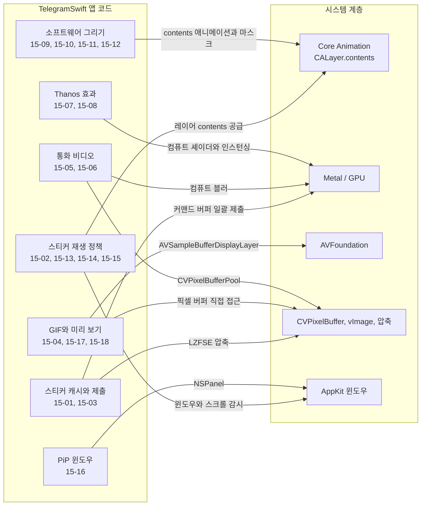
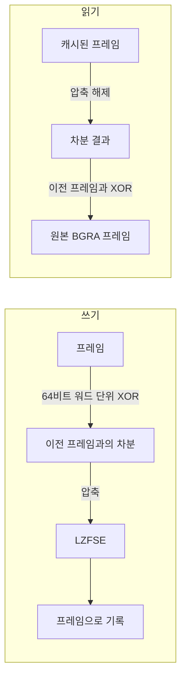
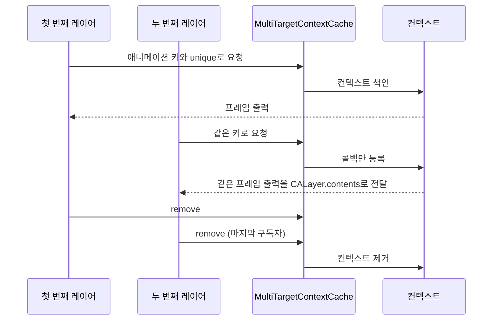
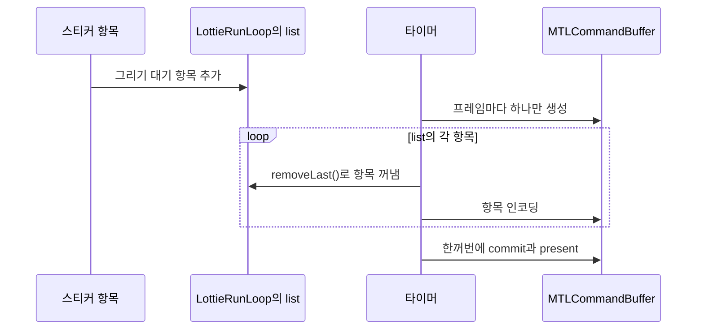
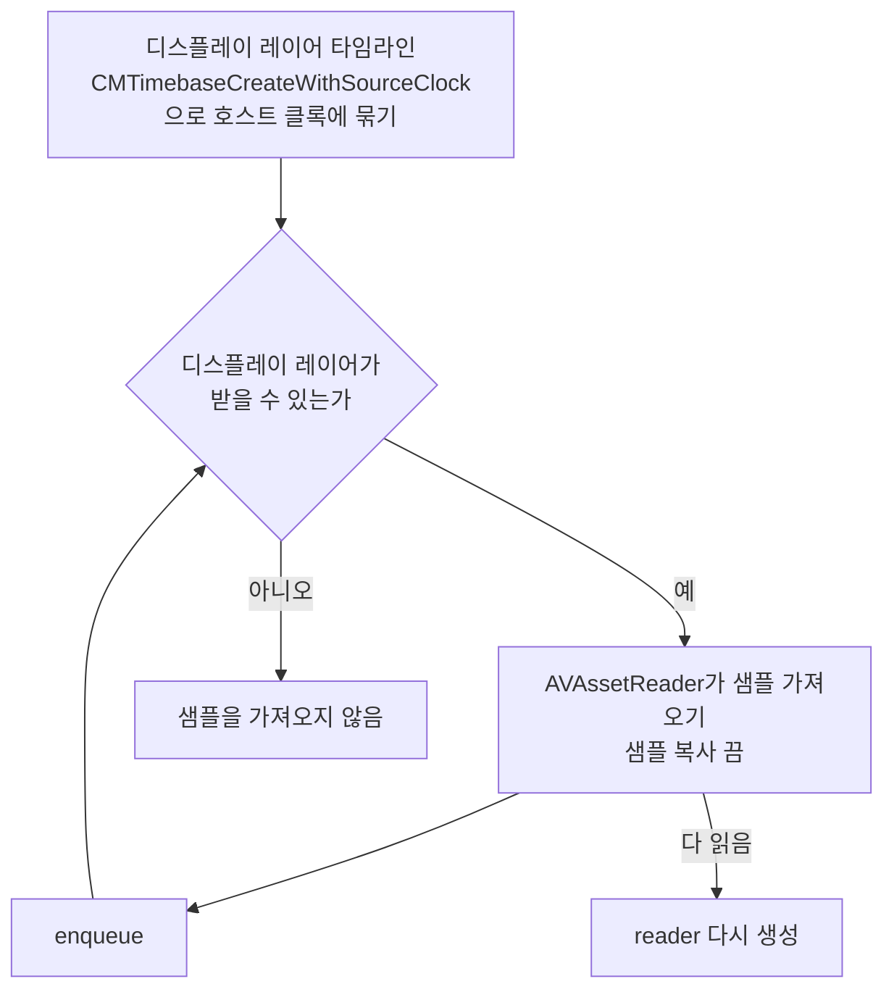
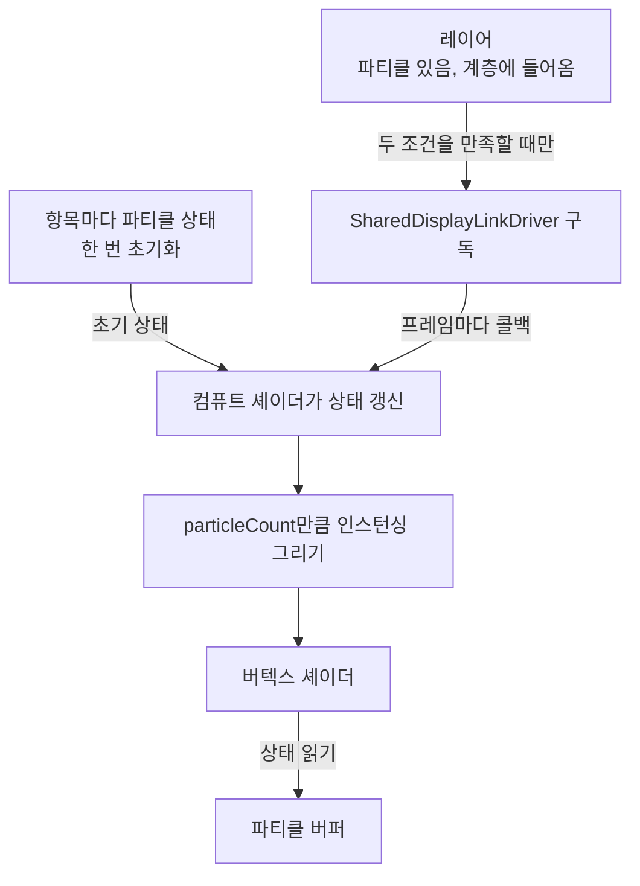

# 렌더링과 앱 레이어

웹: /docs/macos/15-rendering-app/ · Markdown: /docs/macos/15-rendering-app.md

> LZFSE 스티커 캐시, 공유 디코딩 컨텍스트, Metal 일괄 제출.

| 기법 항목 | 리포트 선정 | 관련 비공개 API | REA 연관 |
| --- | --- | --- | --- |
| 18 | 7 | 1 | 2 |

소스: [overtake/TelegramSwift@579cebbf](https://github.com/overtake/TelegramSwift/tree/579cebbf0c01fd41b712eff3647fa7f69db9665d)(2025-07-29) · 플랫폼: macOS · AppKit

이 장의 선정 항목:
- 15-1 [#15-01 XOR 프레임 차분 후 LZFSE로 스티커 픽셀 캐시 압축하기](/docs/macos/15-rendering-app/#t15-01)
- 15-2 [#15-02 같은 인라인 스티커가 디코딩과 재생 컨텍스트 하나를 공유하게 하기](/docs/macos/15-rendering-app/#t15-02)
- 15-3 [#15-03 런 루프 단위로 여러 스티커 드로잉을 Metal 커맨드 버퍼 하나로 합치기](/docs/macos/15-rendering-app/#t15-03)
- 15-4 [#15-04 GIF는 프레임별 `NSImage` 애니메이션 대신 `AVSampleBufferDisplayLayer`로 직접 프레임 공급하기](/docs/macos/15-rendering-app/#t15-04)
- 15-5 [#15-05 통화 프레임 풀이 버퍼 다섯 개에 이르면 프레임을 버려 실시간 지연 우선 제어하기](/docs/macos/15-rendering-app/#t15-05)
- 15-6 [#15-06 통화 배경은 먼저 색상 포맷을 통일하고, 다운샘플링한 뒤 컴퓨트 블러를 두 번 하기](/docs/macos/15-rendering-app/#t15-06)
- 15-7 [#15-08 Thanos 파티클은 항목이 있고 보일 때만 전역 디스플레이 링크 구독하기](/docs/macos/15-rendering-app/#t15-08)

결론: 이 클라이언트는 애니메이션 스티커, GIF, 통화 비디오, 특수 효과를 제한된 버퍼, 필요할 때만 도는 스케줄링, GPU 일괄 처리 파이프라인으로 묶어요.

이 장의 범위는 TelegramSwift의 macOS 렌더링, 미디어, 앱 레이어 기법이에요. 재사용할 만한 기법을 총 18건 확인했어요.

아래 도표는 이 장의 기법들이 어느 구성요소에 손을 대는지 묶어서 보여 줘요.



## 1. XOR 프레임 차분 후 LZFSE로 스티커 픽셀 캐시 압축하기 [#t15-01]

> #15-01 · TelegramSwift · AppKit · 리포트 선정 15-1 · 검증 방식: 소스 분석, REA 바이너리 · 태그: 성능과 메모리
>
> 소스: [TelegramSwift:packages/TelegramMedia/Sources/LottieBufferCompressor.swift L308–L350](https://github.com/overtake/TelegramSwift/blob/579cebbf0c01fd41b712eff3647fa7f69db9665d/packages/TelegramMedia/Sources/LottieBufferCompressor.swift#L308-L350)
>
> 소스: [TelegramSwift:packages/TelegramMedia/Sources/LottieBufferCompressor.swift L354–L389](https://github.com/overtake/TelegramSwift/blob/579cebbf0c01fd41b712eff3647fa7f69db9665d/packages/TelegramMedia/Sources/LottieBufferCompressor.swift#L354-L389)

**무엇을 했나요**: 스티커 프레임을 이전 프레임과의 차분으로 바꿔 압축해서 캐시해요.

- 쓸 때: 연속된 프레임을 64비트 워드 단위로 XOR(같은 비트는 0, 다른 비트는 1)해요. 그 차분 결과를 LZFSE(Apple의 압축 알고리즘)로 압축해서 프레임으로 기록해요.
- 읽을 때: 압축을 푼 뒤 이전 프레임과 다시 XOR해서 원본 BGRA 프레임을 얻어요.

**왜 이렇게 했나요**: 스티커의 이웃한 프레임은 보통 아주 비슷해요. 프레임을 그대로 캐시하면 디스크와 메모리 부담이 커져요. 차분은 0 바이트를 많이 만들어서 범용 압축 효과를 대개 끌어올려요.

아래 도표는 스티커 프레임을 캐시에 쓰고 다시 읽을 때의 흐름을 보여 줘요.



**핵심 코드 발췌**

```swift title="LottieBufferCompressor.swift · L308–L350 등 2곳"
if !self.data.hasAlreadyFrame(Int(current.1)) {
    current.0.withUnsafeBytes { pointer in
        let ui64Address = pointer.baseAddress!.assumingMemoryBound(to: UInt64.self)
        var length:Int = self.bufferSize
        if let previous = previous, enableDifference {
            let uint64Bs = self.bufferSize / 8
            previous.withUnsafeBytes { pointer in
                // ... `previous`를 `dstDelta`에 복사하고 `ui64Dst`로 다시 바인딩한다.
                var i: Int = 0
                while i < uint64Bs {
                    ui64Dst[i] = ui64Dst[i] ^ ui64Address[i]
                    i &+= 1
                }
                length = compression_encode_buffer(dst, self.bufferSize, ui8, self.bufferSize, nil, COMPRESSION_LZFSE)
            }
        } else {
            length = compression_encode_buffer(dst, self.bufferSize, address, self.bufferSize, nil, COMPRESSION_LZFSE)
        }
        _ = self.data.writeFrame(frame: Int(current.1), data: Data(bytes: dst, count: length))
    }
}
// ... 디코딩 후 UInt64 단위로 다시 XOR `previousBytes[i] ^ address[i]`.
```

**대가와 위험**:

- 아무 위치나 읽으려면 이전 프레임이 필요해요.
- 캐시된 프레임 하나가 손상되면 이후 복원에 영향을 줘요.
- `bufferSize / 8`은 픽셀 버퍼 크기가 8바이트 정렬을 만족해야 한다는 조건도 요구해요.

**증거 체인 #15-01**(릴리스됨 · 계속 사용 가능)

- 소스 분석: TelegramSwift 고정 커밋에서 행 단위로 확인했어요. 소스 위치 총 2곳.
- 리포트 요약(구현 방법): 쓸 때 이전 프레임과 XOR하고, 읽을 때 다시 XOR해서 복원해요.
- REA 15번 항목(릴리스됨 · 계속 사용 가능; REA 바이너리): 13.0 바이너리: `compression_encode_buffer`, `compression_decode_buffer` 임포트; macOS 26.7: 실행하지 않음; 결론: 릴리스 빌드

## 2. 같은 인라인 스티커가 디코딩과 재생 컨텍스트 하나를 공유하게 하기 [#t15-02]

> #15-02 · TelegramSwift · AppKit · 리포트 선정 15-2 · 검증 방식: 소스 분석 · 태그: Core Animation, 성능과 메모리
>
> 소스: [TelegramSwift:Telegram-Mac/InlineStickerItemLayer.swift L208–L250](https://github.com/overtake/TelegramSwift/blob/579cebbf0c01fd41b712eff3647fa7f69db9665d/Telegram-Mac/InlineStickerItemLayer.swift#L208-L250)

**무엇을 했나요**: 컨텍스트(스티커 하나의 디코딩과 재생을 맡는 단위)를 레이어들이 나눠 써요.

- `MultiTargetContextCache`가 애니메이션 키와 고유값으로 컨텍스트를 색인해요.
- 같은 키를 가진 두 번째 레이어는 콜백만 등록해요.
- 마지막 구독자가 제거될 때에야 컨텍스트를 없애요.

**왜 이렇게 했나요**: 채팅에는 같은 이모지가 동시에 나타날 수 있어요. 레이어마다 JSON이나 WebM을 따로 파싱하면 디코딩이 중복돼요. 이 설계는 프레임 출력 하나를 여러 `CALayer.contents`로 나눠 줘요.

아래 도표는 같은 키를 가진 두 레이어가 컨텍스트 하나를 공유하는 순서를 보여 줘요.



**핵심 코드 발췌**

```swift title="InlineStickerItemLayer.swift · L208–L250"
private static var cache: [Key : MultiTargetAnimationContext] = [:]

static func create(_ animation: LottieAnimation, key: Key,
                   displayFrame: @escaping(CGImage?)->Void,
                   release: @escaping()->Void,
                   updateState: @escaping(LottiePlayerState)->Void) -> Int {
    assertOnMainThread()
    let handlers = MultiTargetAnimationContext.Handlers(
        displayFrame: displayFrame, release: release, updateState: updateState)
    if let context = cache[key] {
        return context.add(handlers)
    }
    var token: Int = 0
    let context = MultiTargetAnimationContext(animation, handlers: handlers, token: &token)
    cache[key] = context
    return token
}

static func remove(_ token: Int, for key: Key) {
    if let context = self.cache[key], context.remove(token) {
        self.cache.removeValue(forKey: key)
    }
}
```

**대가와 위험**:

- 캐시는 정적 딕셔너리예요.
- 호출자는 `remove`를 반드시 짝지어 실행해야 해요.
- 잘못된 고유값(`unique`)은 뜻밖의 공유나 공유 손실을 일으켜요.

**증거 체인 #15-02**(개별 검증 안 함)

- 소스 분석: TelegramSwift 고정 커밋에서 행 단위로 확인했어요. 소스 위치 총 1곳.
- 리포트 요약(구현 방법): 정적 딕셔너리 캐시이며, 컨텍스트 안에서 약한 target을 유지해요.
- 바이너리 검증: 이 항목은 개별적으로 확인하지 않았어요. REA 주제 노트에 확인한 20개 항목이 나열되어 있어요.

## 3. 런 루프 단위로 여러 스티커 드로잉을 Metal 커맨드 버퍼 하나로 합치기 [#t15-03]

> #15-03 · TelegramSwift · AppKit · 리포트 선정 15-3 · 검증 방식: 소스 분석 · 태그: Metal / GPU
>
> 소스: [TelegramSwift:packages/TelegramMedia/Sources/LottiePlayer.swift L1548–L1584](https://github.com/overtake/TelegramSwift/blob/579cebbf0c01fd41b712eff3647fa7f69db9665d/packages/TelegramMedia/Sources/LottiePlayer.swift#L1548-L1584)

**무엇을 했나요**: 한 `LottieRunLoop`의 그리기를 `MTLCommandBuffer`(GPU에 보낼 명령 묶음) 하나로 합쳐 제출해요.

1. 같은 `LottieRunLoop`의 그리기 대기 항목이 `list`에 들어가요.
2. 타이머는 프레임마다 `MTLCommandBuffer`를 하나만 만들어요.
3. 각 항목을 인코딩한 뒤 한꺼번에 `commit`과 `present`를 해요.

**왜 이렇게 했나요**: 스티커마다 커맨드 버퍼를 만들고 제출하면 CPU 제출과 드라이버 오버헤드가 늘어요. 한꺼번에 제출하면 여러 `present`를 같은 GPU 스케줄링 배치에 넣을 수도 있어요.

아래 도표는 한 런 루프의 그리기 항목이 커맨드 버퍼 하나로 합쳐지는 순서를 보여 줘요.



**핵심 코드 발췌**

```swift title="LottiePlayer.swift · L1548–L1584"
private final class Loop {
    var list:[RenderLoopItem] = []
    init(_ runLoop: LottieRunLoop, commandQueue: MTLCommandQueue) {
        self.commandQueue = commandQueue
        self.timer = SwiftSignalKit.Timer(
            timeout: 1 / TimeInterval(runLoop.fps), repeat: true,
            completion: { [weak self] in self?.renderItems() }, queue: lottieStateQueue)
        self.timer?.start()
    }
    private func renderItems() {
        let commandBuffer = self.commandQueue.makeCommandBuffer()
        if let commandBuffer = commandBuffer {
            var drawables: [MTLDrawable] = []
            while !self.list.isEmpty {
                let item = self.list.removeLast()
                if let drawable = item.render(commandBuffer) { drawables.append(drawable) }
            }
            if drawables.isEmpty { return }
            commandBuffer.addScheduledHandler { _ in
                for drawable in drawables { drawable.present() }
            }
            commandBuffer.commit()
        }
    }
}
```

**대가와 위험**:

- 항목은 `removeLast()`로 역순으로 처리돼요.
- 비정상적인 항목 하나가 이 런 루프를 느리게 만들 수 있어요.
- 코드에 명시적 상한이 없어서 피크 시간에 `list`가 커질 수 있어요.

**증거 체인 #15-03**(개별 검증 안 함)

- 소스 분석: TelegramSwift 고정 커밋에서 행 단위로 확인했어요. 소스 위치 총 1곳.
- 리포트 요약(구현 방법): 타이머가 fps에 맞춰 발동하고 `drawables`를 수집한 뒤, 완료되면 한꺼번에 `commit`해요.
- 바이너리 검증: 이 항목은 개별적으로 확인하지 않았어요. REA 주제 노트에 확인한 20개 항목이 나열되어 있어요.

## 4. GIF는 프레임별 `NSImage` 애니메이션 대신 `AVSampleBufferDisplayLayer`로 직접 프레임 공급하기 [#t15-04]

> #15-04 · TelegramSwift · AppKit · 리포트 선정 15-4 · 검증 방식: 소스 분석 · 태그: Core Animation
>
> 소스: [TelegramSwift:packages/TelegramMedia/Sources/GIFPlayerView.swift L245–L301](https://github.com/overtake/TelegramSwift/blob/579cebbf0c01fd41b712eff3647fa7f69db9665d/packages/TelegramMedia/Sources/GIFPlayerView.swift#L245-L301)
>
> 소스: [TelegramSwift:packages/TelegramMedia/Sources/GIFPlayerView.swift L332–L390](https://github.com/overtake/TelegramSwift/blob/579cebbf0c01fd41b712eff3647fa7f69db9665d/packages/TelegramMedia/Sources/GIFPlayerView.swift#L332-L390)

**무엇을 했나요**: GIF를 `AVAssetReader`로 읽어 디스플레이 레이어에 직접 공급해요.

- `AVAssetReader`는 디스플레이 레이어가 받을 수 있을 때만 샘플을 가져와 `enqueue`해요.
- 샘플 복사는 꺼요.
- 디스플레이 레이어의 제어 타임라인을 호스트 클록에 묶어요.
- 다 읽은 뒤에는 reader를 다시 만들어요.

**왜 이렇게 했나요**: 프레임마다 `NSImage`를 만들면 디코딩과 메인 스레드 제출 비용이 늘어요. 디스플레이 레이어는 PTS(프레임을 보여 줄 시각)에 따라 스케줄링할 수 있어요. 백프레셔(받는 쪽이 감당할 수 있을 때만 보내는 흐름 제어) 루프 덕분에 디스플레이 레이어에 필요한 양보다 많은 샘플이 캐시에 쌓이지 않아요.

아래 도표는 GIF 프레임을 디스플레이 레이어에 공급하는 백프레셔 흐름을 보여 줘요.



**핵심 코드 발췌**

```swift title="GIFPlayerView.swift · L245–L301 등 2곳"
if let readerValue = reader.with({ $0 }), let outputValue = output.with({ $0 }) {
    let affineTransform = track.with { $0?.preferredTransform.inverted() }
    if let affineTransform = affineTransform {
        layer.setAffineTransform(affineTransform)
    }
    while layer.isReadyForMoreMediaData {
        if !stopRequesting.with({ $0 }) {
            if readerValue.status == .reading,
               let sampleBuffer = outputValue.copyNextSampleBuffer() {
                layer.enqueue(sampleBuffer)
                continue
            }
            _ = stopRequesting.modify { _ in _data.with { $0 } == nil }
            break
        }
    }
    if readerValue.status == .completed || readerValue.status == .cancelled {
        if reset.swap(false) {
            let result = restartReading(/* ... */ layer: layer, _timebase: timebase)
            if result { layer.flush() }
        }
    }
}
// ... `output.alwaysCopiesSampleData = false`。
// ... `CMTimebaseCreateWithSourceClock(... CMClockGetHostTimeClock(), ...)`。
```

**대가와 위험**:

- reader와 타임베이스를 다시 구성하는 경로가 복잡해요.
- `flush` 때 프레임이 잠깐 건너뛰어질 수 있어요.
- AVFoundation 디스플레이 레이어의 동작에 기대고 있어요.

**증거 체인 #15-04**(개별 검증 안 함)

- 소스 분석: TelegramSwift 고정 커밋에서 행 단위로 확인했어요. 소스 위치 총 2곳.
- 리포트 요약(구현 방법): `CMTimebaseCreateWithSourceClock` + 백프레셔 루프.
- 바이너리 검증: 이 항목은 개별적으로 확인하지 않았어요. REA 주제 노트에 확인한 20개 항목이 나열되어 있어요.

## 5. 통화 프레임 풀이 버퍼 다섯 개에 이르면 프레임을 버려 실시간 지연 우선 제어하기 [#t15-05]

> #15-05 · TelegramSwift · AppKit · 리포트 선정 15-5 · 검증 방식: 소스 분석
>
> 소스: [TelegramSwift:packages/TelegramMedia/Sources/MetalVideoRenderView.swift L286–L334](https://github.com/overtake/TelegramSwift/blob/579cebbf0c01fd41b712eff3647fa7f69db9665d/packages/TelegramMedia/Sources/MetalVideoRenderView.swift#L286-L334)

**무엇을 했나요**:

1. 해상도별로 `CVPixelBufferPool`(픽셀 버퍼를 모아 두고 재사용하는 풀)을 다시 써요.
2. 풀 점유가 다섯 개를 넘으면 새 통화 프레임을 곧바로 버려요.
3. 그런 다음 I420을 NV12 버퍼에 복사해요. (둘 다 YUV 비디오 픽셀 형식이에요.)

**왜 이렇게 했나요**: 실시간 통화에서는 오래된 프레임을 큐에 쌓는 것이 새 프레임을 버리는 것보다 나빠요. 하드 임계값(넘으면 무조건 버리는 상한)을 두면 느린 GPU나 느린 합성기 때문에 지연이 끝없이 쌓이는 것을 막을 수 있어요.

**핵심 코드 발췌**

```swift title="MetalVideoRenderView.swift · L286–L334"
let pool: PixelBufferPool?
if let current = pixelBufferPoolState.pool,
   current.width == width, current.height == height {
    pool = current
} else {
    pool = PixelBufferPool(width: width, height: height)
    pixelBufferPoolState.pool = pool
}
guard let pool else { return }

let auxAttributes: [String: Any] = [
    kCVPixelBufferPoolAllocationThresholdKey as String: 5 as NSNumber
]
var pixelBuffer: CVPixelBuffer?
let result = CVPixelBufferPoolCreatePixelBufferWithAuxAttributes(
    kCFAllocatorDefault, pool.pool, auxAttributes as CFDictionary, &pixelBuffer)
if result == kCVReturnWouldExceedAllocationThreshold {
    print("kCVReturnWouldExceedAllocationThreshold, dropping frame")
    return
}
guard let pixelBuffer else { return }
if !copyI420BufferToNV12Buffer(buffer: i420Buffer, pixelBuffer: pixelBuffer) { return }
```

**대가와 위험**:

- 부하가 높으면 프레임 드롭이 눈에 띄어요.
- 임계값 `5`는 경험값이에요.
- 오프라인 녹화에는 맞지 않을 수 있어요.

**증거 체인 #15-05**(개별 검증 안 함)

- 소스 분석: TelegramSwift 고정 커밋에서 행 단위로 확인했어요. 소스 위치 총 1곳.
- 리포트 요약(구현 방법): `CVPixelBufferPoolCreatePixelBufferWithAuxAttributes`가 임계값 오류를 반환하면 버려요.
- 바이너리 검증: 이 항목은 개별적으로 확인하지 않았어요. REA 주제 노트에 확인한 20개 항목이 나열되어 있어요.

## 6. 통화 배경은 먼저 색상 포맷을 통일하고, 다운샘플링한 뒤 컴퓨트 블러를 두 번 하기 [#t15-06]

> #15-06 · TelegramSwift · AppKit · 리포트 선정 15-6 · 검증 방식: 소스 분석
>
> 소스: [TelegramSwift:packages/CallVideoLayer/Sources/PrivateCallVideoLayer.swift L190–L257](https://github.com/overtake/TelegramSwift/blob/579cebbf0c01fd41b712eff3647fa7f69db9665d/packages/CallVideoLayer/Sources/PrivateCallVideoLayer.swift#L190-L257)

**무엇을 했나요**:

1. BGRA, 2평면 YUV, 3평면 YUV를 모두 RGBA로 통일해서 변환해요.
2. 배경 레이어가 보일 때만 다운샘플링(해상도를 줄이는 일)해요.
3. 가로 다음 세로 순으로 컴퓨트 블러(GPU 컴퓨트 셰이더로 하는 블러)를 해요.

**왜 이렇게 했나요**: 비디오 소스마다 색상 레이아웃이 달라요. 포맷을 통일하면 이후 렌더링이 단순해져요. 먼저 다운샘플링하고 분리형 블러를 쓰면 프레임당 텍스처 접근량이 크게 줄어요.

**핵심 코드 발췌**

```swift title="PrivateCallVideoLayer.swift · L190–L257"
switch videoTextures.textureLayout {
case let .bgra(texture):
    computeEncoder.setComputePipelineState(blurState.computePipelineStateBGRAToRGBA)
    computeEncoder.setTexture(texture.bgra, index: 0)
    computeEncoder.setTexture(rgbaTexture, index: 1)
case let .biPlanar(biPlanar):
    computeEncoder.setComputePipelineState(blurState.computePipelineStateYUVBiPlanarToRGBA)
    computeEncoder.setTexture(biPlanar.y, index: 0)
    computeEncoder.setTexture(biPlanar.uv, index: 1)
    computeEncoder.setTexture(rgbaTexture, index: 2)
case let .triPlanar(triPlanar):
    computeEncoder.setComputePipelineState(blurState.computePipelineStateYUVTriPlanarToRGBA)
    computeEncoder.setTexture(triPlanar.y, index: 0)
    computeEncoder.setTexture(triPlanar.u, index: 1)
    computeEncoder.setTexture(triPlanar.u, index: 2)
    computeEncoder.setTexture(rgbaTexture, index: 3)
}
blurState.downscaleKernel.encode(
    commandBuffer: commandBuffer, sourceTexture: rgbaTexture, destinationTexture: downscaledTexture)
computeEncoder.setComputePipelineState(blurState.computePipelineStateHorizontal)
computeEncoder.setTexture(downscaledTexture, index: 0)
computeEncoder.setTexture(blurredHorizontalTexture, index: 1)
computeEncoder.setComputePipelineState(blurState.computePipelineStateVertical)
computeEncoder.setTexture(blurredHorizontalTexture, index: 0)
computeEncoder.setTexture(blurredVerticalTexture, index: 1)
```

**대가와 위험**: 3평면 분기는 `triPlanar.u`를 인덱스 `1`과 `2`에 동시에 바인딩해요. 소스가 그렇게 구현되어 있어요. 이 바인딩이 `v` 평면이어야 하는지는 미검증이에요.

**증거 체인 #15-06**(개별 검증 안 함)

- 소스 분석: TelegramSwift 고정 커밋에서 행 단위로 확인했어요. 소스 위치 총 1곳.
- 리포트 요약(구현 방법): 서로 다른 compute pipeline을 고른 뒤 두 번째 블러를 해요.
- 바이너리 검증: 이 항목은 개별적으로 확인하지 않았어요. REA 주제 노트에 확인한 20개 항목이 나열되어 있어요.

## 7. Thanos 효과로 뷰 스냅샷을 GPU 픽셀 파티클로 바꾸고 M2 이상에서만 켜기 [#t15-07]

> #15-07 · TelegramSwift · AppKit · 검증 방식: 소스 분석 · 태그: Core Animation, Metal / GPU
>
> 소스: [TelegramSwift:packages/DustLayer/Sources/DustLayer.swift L369–L418](https://github.com/overtake/TelegramSwift/blob/579cebbf0c01fd41b712eff3647fa7f69db9665d/packages/DustLayer/Sources/DustLayer.swift#L369-L418)

**무엇을 했나요**: Thanos 효과(뷰가 파티클로 흩어지며 사라지는 효과)를 이렇게 만들어요.

1. 대상 뷰의 픽셀 스냅샷을 찍어요.
2. 스냅샷과 변환된 좌표를 윈도우 전체를 덮는 `DustLayer`에 넘겨요.
3. 파티클이 끝나면 상호작용 없는 이 오버레이 뷰가 저절로 제거돼요.

**왜 이렇게 했나요**: 원본 뷰를 조각 단위로 직접 사라지게 하면 원래 모습을 유지하기 어려워요. 스냅샷은 아무리 복잡한 UI도 하나의 통일된 텍스처로 바꿔요. M2와 ARM64 게이트는 불확실한 하드웨어 성능을 피해요.

**핵심 코드 발췌**

```swift title="DustLayer.swift · L369–L418"
public func ApplyDustAnimation(for currentView: NSView) {
    guard let window = currentView.window, isChipM2OrHigher() else {
        return
    }
    #if arch(arm64)
    window.contentView?.layer?.addSublayer(MetalEngine.shared.rootLayer)
    let metalLayer = DustLayer()
    metalLayer.isInHierarchy = true
    metalLayer.frame = window.contentView!.bounds
    let view = View(frame: metalLayer.frame.size.bounds)
    view.isEventLess = true
    view.layer?.addSublayer(metalLayer)
    window.contentView?.addSubview(view)
    metalLayer.becameEmpty = { [weak view] in
        view?.removeFromSuperview()
    }
    #endif
}

for subview in views {
    view.metalLayer.addItem(
        frame: CGRect(origin: subview.convert(.zero, to: view), size: subview.frame.size),
        image: subview.snapshot)
}
```

**대가와 위험**: Apple Silicon M2 이상 기기에서만 이 효과가 보여요. 큰 뷰의 스냅샷과 픽셀 단위 파티클은 GPU 자원을 많이 써요.

**증거 체인 #15-07**(개별 검증 안 함)

- 소스 분석: TelegramSwift 고정 커밋에서 행 단위로 확인했어요. 소스 위치 총 1곳.
- 바이너리 검증: 이 항목은 개별적으로 확인하지 않았어요. REA 주제 노트에 확인한 20개 항목이 나열되어 있어요.

## 8. Thanos 파티클은 항목이 있고 보일 때만 전역 디스플레이 링크 구독하기 [#t15-08]

> #15-08 · TelegramSwift · AppKit · 리포트 선정 15-7 · 검증 방식: 소스 분석 · 태그: Metal / GPU, 성능과 메모리
>
> 소스: [TelegramSwift:packages/DustLayer/Sources/DustLayer.swift L170–L229](https://github.com/overtake/TelegramSwift/blob/579cebbf0c01fd41b712eff3647fa7f69db9665d/packages/DustLayer/Sources/DustLayer.swift#L170-L229)
>
> 소스: [TelegramSwift:packages/DustLayer/Sources/DustLayer.swift L262–L344](https://github.com/overtake/TelegramSwift/blob/579cebbf0c01fd41b712eff3647fa7f69db9665d/packages/DustLayer/Sources/DustLayer.swift#L262-L344)

**무엇을 했나요**:

- 레이어는 파티클이 있고 계층에 들어온 경우에만 공유 디스플레이 링크(화면 주사율에 맞춰 콜백을 주는 타이머)를 구독해요.
- 항목마다 파티클 상태를 한 번만 초기화해요.
- 프레임마다 컴퓨트 셰이더가 상태를 갱신하고, `particleCount`만큼 인스턴싱(같은 도형을 한 번의 호출로 여러 개 그리는 방식)해서 그려요.

**왜 이렇게 했나요**: 타이머를 따로 두면 깨우기 횟수를 낭비해요. CPU에서 파티클을 하나씩 갱신하고 그리면 병목이 돼요. 인스턴스 드로잉은 버텍스 셰이더가 파티클 버퍼에서 상태를 가져오게 해요.

아래 도표는 Thanos 파티클이 구독을 시작하고 프레임마다 그려지는 흐름을 보여 줘요.



**핵심 코드 발췌**

```swift title="DustLayer.swift · L170–L229 등 2곳"
private func updateNeedsAnimation() {
    if !self.items.isEmpty && self.isInHierarchy {
        if self.updateLink == nil {
            self.updateLink = SharedDisplayLinkDriver.shared.add(
                framesPerSecond: .max, { [weak self] deltaTime in
                    guard let self else { return }
                    self.updateItems(deltaTime: deltaTime)
                    self.setNeedsUpdate()
                })
            self.setNeedsUpdate()
        }
    } else if self.updateLink != nil {
        self.updateLink = nil
    }
}

if !item.particleBufferIsInitialized {
    item.particleBufferIsInitialized = true
    computeEncoder.setComputePipelineState(state.computePipelineStateInitializeParticle)
    computeEncoder.dispatchThreadgroups(threadgroupCount, threadsPerThreadgroup: threadgroupSize)
}
computeEncoder.setComputePipelineState(state.computePipelineStateUpdateParticle)
encoder.setVertexBuffer(particleBuffer.buffer, offset: 0, index: 3)
encoder.setFragmentTexture(item.texture, index: 0)
encoder.drawPrimitives(type: .triangle, vertexStart: 0, vertexCount: 6, instanceCount: particleCount)
```

**대가와 위험**:

- `particleCount`는 스냅샷의 `너비 × 높이`예요. 큰 스냅샷은 인스턴스를 아주 많이 만들어요.
- 전역 디스플레이 링크는 최고 프레임 레이트로 이를 구동해요.

**증거 체인 #15-08**(개별 검증 안 함)

- 소스 분석: TelegramSwift 고정 커밋에서 행 단위로 확인했어요. 소스 위치 총 2곳.
- 리포트 요약(구현 방법): `SharedDisplayLinkDriver` 구독 콜백이 상태를 갱신하고 다시 그려요.
- 바이너리 검증: 이 항목은 개별적으로 확인하지 않았어요. REA 주제 노트에 확인한 20개 항목이 나열되어 있어요.

## 9. CPU 블러는 세 색상 채널을 64비트 누적값에 넣고 슬라이딩 2차 차분 쓰기 [#t15-09]

> #15-09 · TelegramSwift · AppKit · 검증 방식: 소스 분석 · 태그: 성능과 메모리
>
> 소스: [TelegramSwift:packages/FastBlur/Sources/FastBlur/FastBlur.m L120–L215](https://github.com/overtake/TelegramSwift/blob/579cebbf0c01fd41b712eff3647fa7f69db9665d/packages/FastBlur/Sources/FastBlur/FastBlur.m#L120-L215)

**무엇을 했나요**:

- 고정 반경 `7`로 가로와 세로 두 번 블러해요.
- RGB 채널을 `uint64_t` 하나에 묶어요.
- 2차 차분으로 슬라이딩 윈도우를 점화식(앞 단계 값에서 다음 값을 구하는 식)으로 갱신해요.
- 첫 픽셀과 마지막 픽셀로 가장자리를 연장해요.

**왜 이렇게 했나요**: 단순한 박스 블러(반경 안 픽셀의 평균)는 출력 픽셀마다 반경만큼 순회해야 해요. 점화식을 쓰면 단계마다 상수 번의 읽기와 산술만 해요. 채널을 묶으면 루프와 인덱스 연산도 줄어요.

**핵심 코드 발췌**

```objc title="FastBlur.m · L120–L215"
const int radius = 7;
const int r1 = radius + 1;
const int div = radius * 2 + 1;
if (radius > 15 || div >= w || div >= h) { return; }

uint64_t *rgb = malloc(imageStride * imageHeight * sizeof(uint64_t));
uint64_t cur = get_colors(&pix[yw]);
uint64_t rgballsum = -radius * cur;
uint64_t rgbsum = cur * ((r1 * (r1 + 1)) >> 1);

#define update(start, middle, end)                         \
rgb[y * w + x] = (rgbsum >> 6) & 0x00FF00FF00FF00FF;      \
rgballsum += get_colors(&pix[yw + (start) * 4]) -          \
    2 * get_colors(&pix[yw + (middle) * 4]) +              \
    get_colors(&pix[yw + (end) * 4]);                       \
rgbsum += rgballsum; x++;

while (x < r1) { update(0, x, x + r1); }
while (x < we) { update(x - r1, x, x + r1); }
while (x < w) { update(x - r1, x, w - 1); }
```

**대가와 위험**:

- 반경이 고정되어 있어요. 큰 반경의 블러는 여러 번 호출하거나 다른 알고리즘이 필요해요.
- 임시 버퍼를 `imageStride * imageHeight * sizeof(uint64_t)`로 할당해서 메모리 점유가 높아요.

**증거 체인 #15-09**(개별 검증 안 함)

- 소스 분석: TelegramSwift 고정 커밋에서 행 단위로 확인했어요. 소스 위치 총 1곳.
- 바이너리 검증: 이 항목은 개별적으로 확인하지 않았어요. REA 주제 노트에 확인한 20개 항목이 나열되어 있어요.

## 10. 소프트웨어 그라디언트는 아주 작은 비트맵을 먼저 렌더링한 뒤 `contents` 애니메이션하기 [#t15-10]

> #15-10 · TelegramSwift · AppKit · 검증 방식: 소스 분석 · 태그: Core Animation, 성능과 메모리
>
> 소스: [TelegramSwift:packages/TGUIKit/Sources/SoftwareGradientBackground.swift L287–L372](https://github.com/overtake/TelegramSwift/blob/579cebbf0c01fd41b712eff3647fa7f69db9665d/packages/TGUIKit/Sources/SoftwareGradientBackground.swift#L287-L372)

**무엇을 했나요**:

1. 16×16 수준의 맞춤 크기로 소프트웨어 그라디언트 프레임을 만들어요.
2. CPU에서 색상 앵커를 보간해요.
3. 미리 만든 `CGImage` 목록을 Core Animation의 `contents` 키프레임 애니메이션에 넘겨요.

**왜 이렇게 했나요**: 화면이 갱신될 때마다 전체 크기 그라디언트를 계산하면 비싸요. 그라디언트는 쌍선형 보간으로 확대해도 괜찮아요. Core Animation은 미리 계산된 프레임을 독립적으로 제출할 수 있어서, 프레임마다 Swift 드로잉 코드를 실행할 필요가 없어요.

**핵심 코드 발췌**

```swift title="SoftwareGradientBackground.swift · L287–L372"
let imageSize = size.fitted(CGSize(width: 16, height: 16)).integralFloor
let positions = gatherPositions(
    shiftArray(array: AnimatedGradientBackgroundView.basePositions, offset: self.phase % 8))

let fps: Double = extendAnimation ? 60 : 30
let maxFrame = Int(duration * fps)
for frameIndex in 0 ..< maxFrame {
    let t = curve.solve(at: CGFloat(frameIndex) / CGFloat(maxFrame - 1))
    let globalStep = Int(t * CGFloat(maxFrame))
    let stepIndex = min(stepCount - 1, globalStep / framesPerAnyStep)
    let stepT = CGFloat(stepFrameIndex) / CGFloat(stepFrames - 1)
    var morphedPositions: [CGPoint] = []
    for i in 0 ..< steps[0].count {
        morphedPositions.append(interpolatePoints(
            steps[stepIndex][i], steps[stepIndex + 1][i], at: stepT))
    }
    images.append(generateGradient(size: imageSize, colors: self.colors, positions: morphedPositions))
}
self.contentView.image = images.last
let animation = CAKeyframeAnimation(keyPath: "contents")
animation.values = images.map { $0 }
animation.duration = duration
self.contentView.layer!.add(animation, forKey: "contents")
```

**대가와 위험**:

- 애니메이션 한 번에 모든 프레임 이미지를 들고 있어요.
- 길이가 길거나 60 fps이면 순간 메모리가 늘어나요.
- 낮은 해상도는 디테일을 희생해요.

**증거 체인 #15-10**(개별 검증 안 함)

- 소스 분석: TelegramSwift 고정 커밋에서 행 단위로 확인했어요. 소스 위치 총 1곳.
- 바이너리 검증: 이 항목은 개별적으로 확인하지 않았어요. REA 주제 노트에 확인한 20개 항목이 나열되어 있어요.

## 11. Shimmer는 압축된 경로 썸네일을 비동기 비트맵 마스크로 디코딩하기 [#t15-11]

> #15-11 · TelegramSwift · AppKit · 검증 방식: 소스 분석 · 태그: 비공개 API, 성능과 메모리
>
> 소스: [TelegramSwift:packages/TGUIKit/Sources/ShimmerLayer.swift L158–L175](https://github.com/overtake/TelegramSwift/blob/579cebbf0c01fd41b712eff3647fa7f69db9665d/packages/TGUIKit/Sources/ShimmerLayer.swift#L158-L175)
>
> 소스: [TelegramSwift:packages/TGUIKit/Sources/ShimmerLayer.swift L238–L302](https://github.com/overtake/TelegramSwift/blob/579cebbf0c01fd41b712eff3647fa7f69db9665d/packages/TGUIKit/Sources/ShimmerLayer.swift#L238-L302)

**무엇을 했나요**: shimmer(로딩 중 보이는 반짝이는 자리 표시자)의 모양을 이렇게 만들어요.

1. 자체 정의한 압축 바이트 인코딩을 경로 문자열로 복원해요.
2. 동시 큐에서 경로를 `CGImage`로 래스터화해요.
3. 메인 스레드는 결과를 `mask`나 전경 레이어에 설정하기만 해요.

**왜 이렇게 했나요**: 자리 표시자 shimmer가 사각형이면 레이아웃이 드러나요. 복잡한 스티커 윤곽을 메인 스레드에서 직접 파싱하고 그리면 화면이 끊겨요. 비트맵 마스크는 윤곽에 정확히 들어맞아요.

**핵심 코드 발췌**

```swift title="ShimmerLayer.swift · L158–L175 등 2곳"
private func decodeStickerThumbnailData(_ data: Data) -> String {
    var string = "M"
    data.forEach { byte in
        if byte >= 128 + 64 {
            string.append(decodingMap[Int(byte) - 128 - 64])
        } else {
            // ... 쉼표나 마이너스 기호를 쓴다.
            string.append("\(byte & 63)")
        }
    }
    string.append("z")
    return string
}
let signal: Signal<CGImage?, NoError> = Signal { subscriber in
    let image = generateImage(size, rotatedContext: { size, context in
        var path = decodeStickerThumbnailData(data)
        if !path.hasPrefix("z") { path = "\(path)z" }
        let segments = PathDataReader(input: path).read()
        let scale = max(size.width, size.height) / max(imageSize.width, imageSize.height)
        context.scaleBy(x: scale, y: scale)
        renderPath(segments, context: context)
    })
    subscriber.putNext(image)
    subscriber.putCompletion()
    // ... `return EmptyDisposable` 후 동시 큐로 넘어간다.
```

**대가와 위험**: 경로 프로토콜은 비공개 데이터 포맷이지만 Apple 비공개 API는 아니에요. `hasPrefix("z")` 판정은 직관에 어긋나 보여요. 여기서는 소스의 동작을 그대로 유지하고, 이유는 미검증이에요.

**증거 체인 #15-11**(개별 검증 안 함)

- 소스 분석: TelegramSwift 고정 커밋에서 행 단위로 확인했어요. 소스 위치 총 2곳.
- 바이너리 검증: 이 항목은 개별적으로 확인하지 않았어요. REA 주제 노트에 확인한 20개 항목이 나열되어 있어요.

## 12. 음성 파문은 원시 볼륨을 지수 평활한 뒤 닫힌 베지어 곡선 만들기 [#t15-12]

> #15-12 · TelegramSwift · AppKit · 검증 방식: 소스 분석
>
> 소스: [TelegramSwift:packages/TGUIKit/Sources/VoiceBlobView.swift L78–L112](https://github.com/overtake/TelegramSwift/blob/579cebbf0c01fd41b712eff3647fa7f69db9665d/packages/TGUIKit/Sources/VoiceBlobView.swift#L78-L112)
>
> 소스: [TelegramSwift:packages/TGUIKit/Sources/VoiceBlobView.swift L399–L449](https://github.com/overtake/TelegramSwift/blob/579cebbf0c01fd41b712eff3647fa7f69db9665d/packages/TGUIKit/Sources/VoiceBlobView.swift#L399-L449)

**무엇을 했나요**:

- 뷰가 입력 볼륨을 정규화하고, 세 겹의 Blob 속도를 함께 조절해요.
- 디스플레이 링크는 `0.9/0.1`의 지수 저역 통과 필터(급한 변화를 걸러 값을 부드럽게 하는 필터)로 표시용 볼륨을 만들어요.
- 경로는 이웃한 점에서 얻은 제어점으로 닫힌 베지어 곡선을 이뤄요.

**왜 이렇게 했나요**: 마이크 진폭은 흔들림이 커요. 그대로 매핑하면 뾰족한 스파이크와 깜빡임이 생겨요. 이 필터와 연속 곡선은 세 겹의 무작위 형태를 안정적이고 부드럽게 유지해요.

**핵심 코드 발췌**

```swift title="VoiceBlobView.swift · L78–L112 등 2곳"
displayLinkAnimator = ConstantDisplayLinkAnimator(update: { [weak self] in
    guard let strongSelf = self, let window = self?.window, window.isVisible else { return }
    strongSelf.presentationAudioLevel =
        strongSelf.presentationAudioLevel * 0.9 + strongSelf.audioLevel * 0.1
    strongSelf.smallBlob.level = strongSelf.presentationAudioLevel
    strongSelf.mediumBlob.level = strongSelf.presentationAudioLevel
    strongSelf.bigBlob.level = strongSelf.presentationAudioLevel
})

public func updateLevel(_ level: CGFloat) {
    let normalizedLevel = min(1, max(level / maxLevel, 0))
    smallBlob.updateSpeedLevel(to: normalizedLevel)
    mediumBlob.updateSpeedLevel(to: normalizedLevel)
    bigBlob.updateSpeedLevel(to: normalizedLevel)
    audioLevel = normalizedLevel
}

let currSmoothOut = curr.smoothOut()
let nextSmoothIn = next.smoothIn()
resultPath.addCurve(to: next.point, control1: currSmoothOut, control2: nextSmoothIn)
resultPath.closeSubpath()
```

**대가와 위험**:

- 필터가 시각적 지연을 만들어요.
- 디스플레이 링크는 윈도우가 보이는지만 판단해요.
- Blob 자체의 다른 애니메이션은 저절로 멈추지 않아요.

**증거 체인 #15-12**(개별 검증 안 함)

- 소스 분석: TelegramSwift 고정 커밋에서 행 단위로 확인했어요. 소스 위치 총 2곳.
- 바이너리 검증: 이 항목은 개별적으로 확인하지 않았어요. REA 주제 노트에 확인한 20개 항목이 나열되어 있어요.

## 13. 채팅 스티커는 크기에 따라 프레임 레이트를 낮추고, 썸네일로 깜빡임 없이 이어받기 [#t15-13]

> #15-13 · TelegramSwift · AppKit · 검증 방식: 소스 분석 · 태그: Core Animation, 성능과 메모리
>
> 소스: [TelegramSwift:Telegram-Mac/ChatMediaAnimatedStickerView.swift L188–L246](https://github.com/overtake/TelegramSwift/blob/579cebbf0c01fd41b712eff3647fa7f69db9665d/Telegram-Mac/ChatMediaAnimatedStickerView.swift#L188-L246)

**무엇을 했나요**:

- 매핑 읽기로 전체 애니메이션 데이터를 로드해요.
- 200 pt(화면 좌표 단위인 포인트)보다 작은 비이모지 스티커는 30 fps로 제한해요.
- 플레이어가 실제로 `.playing`에 들어갈 때까지 썸네일을 계속 보여 주고, 그 뒤에 레이어 가시성을 전환해요.

**왜 이렇게 했나요**: 채팅 목록의 작은 스티커는 60 fps가 필요하지 않아요. 메모리 매핑을 쓰면 파일 전체를 복사하지 않아요. 상태에 따라 두 레이어를 바꿔 끼우면 네트워크와 디코딩 중에 빈 틀이 나타나는 것을 막을 수 있어요.

**핵심 코드 발췌**

```swift title="ChatMediaAnimatedStickerView.swift · L188–L246"
if resourceData.complete,
   let data = try? Data(contentsOf: URL(fileURLWithPath: resourceData.path),
                        options: [.mappedIfSafe]) {
    let playPolicy: LottiePlayPolicy = file.isEmojiAnimatedSticker ? .once : .loop
    let maximumFps: Int = size.width < 200 && !file.isEmojiAnimatedSticker ? 30 : 60
    let fitzModifier = file.animatedEmojiFitzModifier
    self?.sticker = LottieAnimation(
        compressed: data,
        key: LottieAnimationEntryKey(key: .media(file.id), size: size, fitzModifier: fitzModifier),
        cachePurpose: size.width < 200 ? .temporaryLZ4(.thumb) :
            self?.parent != nil ? .temporaryLZ4(.chat) : .none,
        playPolicy: playPolicy, maximumFps: maximumFps)
}

self.thumbView.setSignal(signal: cachedMedia(media: file, arguments: arguments,
                                             scale: backingScaleFactor), clearInstantly: updated)
if !self.thumbView.isFullyLoaded { /* 스티커 썸네일을 계속 요청한다 */ }
stateDisposable.set((self.playerView.state |> deliverOnMainQueue).start(next: { state in
    self.playerView.isHidden = state != .playing
    self.thumbView.isHidden = state == .playing
}))
```

**대가와 위험**:

- `size.width`가 유일한 등급 판단 기준이에요.
- 좁고 긴 스티커는 작은 이미지로 처리돼요.
- 썸네일과 플레이어가 짧은 시간 동안 함께 남아 있어요.

**증거 체인 #15-13**(개별 검증 안 함)

- 소스 분석: TelegramSwift 고정 커밋에서 행 단위로 확인했어요. 소스 위치 총 1곳.
- 바이너리 검증: 이 항목은 개별적으로 확인하지 않았어요. REA 주제 노트에 확인한 20개 항목이 나열되어 있어요.

## 14. 인라인 스티커는 콜드 스타트를 늦추되, 캐시 적중은 즉시 시작하게 하기 [#t15-14]

> #15-14 · TelegramSwift · AppKit · 검증 방식: 소스 분석 · 태그: Core Animation, 성능과 메모리
>
> 소스: [TelegramSwift:Telegram-Mac/InlineStickerItemLayer.swift L576–L627](https://github.com/overtake/TelegramSwift/blob/579cebbf0c01fd41b712eff3647fa7f69db9665d/Telegram-Mac/InlineStickerItemLayer.swift#L576-L627)

**무엇을 했나요**:

- 새 컨텍스트가 콜드 스타트(공유 캐시에 없는 상태에서 처음 시작)할 때는 100 ms를 기다려요.
- 아래 경우에는 곧바로 시작해요.
  - 공유 캐시에 적중했을 때
  - 강제 재생일 때
  - 지연 없음으로 지정됐을 때
- 콜백이 레이어가 윈도우를 벗어난 것을 발견하면 비동기로 스스로를 철회해요.

**왜 이렇게 했나요**: 스크롤하는 동안 인라인 이모지가 많이 스쳐 지나갈 수 있어요. 지연을 두면 이런 수명이 짧은 작업을 걸러 낼 수 있어요. 이미 있는 공유 컨텍스트에는 시작 대기를 다시 끼워 넣지 말아야 해요.

**핵심 코드 발췌**

```swift title="InlineStickerItemLayer.swift · L576–L627"
private var contextToken: (Int, MultiTargetContextCache.Key)?
private func set(_ animation: LottieAnimation?, force: Bool = false) {
    self.animation = animation
    if let animation = animation, let isPlayable = self.isPlayable, isPlayable, !stopped {
        weak var layer: InlineStickerItemLayer? = self
        let key = MultiTargetContextCache.Key(key: animation.key, unique: unique)
        delayDisposable.set(delaySignal(
            MultiTargetContextCache.exists(key) || force || noDelayBeforeplay ? 0 : 0.1
        ).start(completed: { [weak self] in
            self?.contextToken = (MultiTargetContextCache.create(animation, key: key,
                displayFrame: { image in
                    layer?.contents = image
                    if layer?.isPreviousPreview == true {
                        layer?.animateContents()
                        layer?.isPreviousPreview = false
                    }
                    if self?.superview?.window == nil {
                        DispatchQueue.main.async { self?.set(nil, force: true) }
                    }
                }, release: {}, updateState: { [weak self] state in
                    self?.updateState(state)
                }), key)
        }))
    }
}
```

**대가와 위험**:

- 처음 나타나는 이모지는 100 ms 늦게 시작할 수 있어요.
- 비동기 철회는 생명주기 경쟁 상태 처리에 기대고 있어요.
- `weak var layer`는 순환 참조를 피하지만 첫 프레임을 놓칠 수도 있어요.

**증거 체인 #15-14**(개별 검증 안 함)

- 소스 분석: TelegramSwift 고정 커밋에서 행 단위로 확인했어요. 소스 위치 총 1곳.
- 바이너리 검증: 이 항목은 개별적으로 확인하지 않았어요. REA 주제 노트에 확인한 20개 항목이 나열되어 있어요.

## 15. 인라인 스티커는 윈도우가 활성이고 스크롤 영역에 보일 때만 재생하기 [#t15-15]

> #15-15 · TelegramSwift · AppKit · 검증 방식: 소스 분석 · 태그: 제스처와 스크롤
>
> 소스: [TelegramSwift:Telegram-Mac/InlineStickerItemLayer.swift L280–L322](https://github.com/overtake/TelegramSwift/blob/579cebbf0c01fd41b712eff3647fa7f69db9665d/Telegram-Mac/InlineStickerItemLayer.swift#L280-L322)

**무엇을 했나요**: 재생 조건 세 가지를 동시에 요구해요.

- 재생 가능
- 윈도우 활성
- `visibleRect` 비영(0이 아님)

그리고 윈도우 포커스, 스크롤 클립 영역 경계, 문서 뷰 frame의 변화를 지켜보다가 곧바로 조건을 다시 계산해요.

**왜 이렇게 했나요**: `viewDidMoveToWindow`만 지켜봐서는 화면 밖으로 스크롤된 텍스트 첨부를 알아낼 수 없어요. 비활성 윈도우만 일시 정지하는 것으로는 긴 채팅 목록에서 화면 밖 애니메이션 작업을 줄이기에도 부족해요.

**핵심 코드 발췌**

```swift title="InlineStickerItemLayer.swift · L280–L322"
@objc func updateAnimatableContent() -> Void {
    if controlContent {
        var isKeyWindow = false
        if let window = window {
            if !window.canBecomeKey {
                isKeyWindow = true
            } else {
                isKeyWindow = window.isKeyWindow
            }
        }
        animateLayer.isPlayable = isKeyWindow && isPlayable && self.visibleRect != .zero
    }
}
center.addObserver(self, selector: #selector(updateAnimatableContent),
                   name: NSWindow.didBecomeKeyNotification, object: window)
center.addObserver(self, selector: #selector(updateAnimatableContent),
                   name: NSView.boundsDidChangeNotification,
                   object: self.enclosingScrollView?.contentView)
center.addObserver(self, selector: #selector(updateAnimatableContent),
                   name: NSView.frameDidChangeNotification,
                   object: self.enclosingScrollView?.documentView)
```

**대가와 위험**:

- 등록하는 알림이 많아요.
- `window.canBecomeKey == false`는 특별히 활성으로 취급해요. 비활성 패널을 위한 호환 처리인데, 구체적인 동기는 미검증이에요.

**증거 체인 #15-15**(개별 검증 안 함)

- 소스 분석: TelegramSwift 고정 커밋에서 행 단위로 확인했어요. 소스 위치 총 1곳.
- 바이너리 검증: 이 항목은 개별적으로 확인하지 않았어요. REA 주제 노트에 확인한 20개 항목이 나열되어 있어요.

## 16. PiP는 시스템 PiP 컨트롤러에 의존하지 않고, Space를 넘나드는 비활성 패널로 흉내 내기 [#t15-16]

> #15-16 · TelegramSwift · AppKit · 검증 방식: 소스 분석 · 태그: 텍스트와 입력
>
> 소스: [TelegramSwift:Telegram-Mac/PIPVideoWindow.swift L69–L150](https://github.com/overtake/TelegramSwift/blob/579cebbf0c01fd41b712eff3647fa7f69db9665d/Telegram-Mac/PIPVideoWindow.swift#L69-L150)
>
> 소스: [TelegramSwift:Telegram-Mac/PIPVideoWindow.swift L238–L303](https://github.com/overtake/TelegramSwift/blob/579cebbf0c01fd41b712eff3647fa7f69db9665d/Telegram-Mac/PIPVideoWindow.swift#L238-L303)

**무엇을 했나요**: PiP(작은 창으로 영상을 띄우는 기능)를 시스템 컨트롤러 없이 직접 만들어요.

- `NSPanel`로 떠 있는 윈도우를 직접 만들어요.
- 패널은 키보드 포커스를 빼앗지 않으며, 모든 Space(macOS의 가상 데스크톱)와 전체 화면 보조 윈도우 컬렉션에 포함돼요.
- `(3000, 3000)`으로 옮긴 `Window` 하나를 남겨 두어서 `PictureInpictureView.window`가 그 윈도우를 반환하게 해요.

**왜 이렇게 했나요**: 시스템 `AVPictureInPictureController`는 특정 재생 경로에만 맞아요. 커스텀 패널은 아무 `PictureInPictureControl.view`나 담을 수 있고, Telegram 자체의 제스처와 갤러리 이동을 다시 써요.

**핵심 코드 발췌**

```swift title="PIPVideoWindow.swift · L69–L150 등 2곳"
fileprivate class ModernPictureInPictureVideoWindow: NSPanel {
    init(_ control: PictureInPictureControl, item: MGalleryItem,
         viewer: GalleryViewer, origin: NSPoint, type: GalleryAppearType) {
        let minSize = control.view.frame.size.aspectFilled(NSMakeSize(120, 120))
        let size = item.notFittedSize.aspectFilled(NSMakeSize(250, 250)).aspectFilled(minSize)
        let newRect = NSMakeRect(origin.x, origin.y, size.width, size.height)
        __window = Window(contentRect: newRect, styleMask: [.resizable],
                          backing: .buffered, defer: true)
        __window.setFrame(NSMakeRect(3000, 3000, saver.rect.width, saver.rect.height), display: true)
        super.init(contentRect: newRect, styleMask: [.resizable, .nonactivatingPanel],
                   backing: .buffered, defer: true)
        self.collectionBehavior = [.canJoinAllSpaces, .fullScreenAuxiliary]
        self.contentView = PictureInpictureView(frame: bounds, window: __window)
        view.forceMouseDownCanMoveWindow = true
        self.contentView?.layer?.cornerRadius = 4
        control.view.frame = NSMakeRect(0, 0, newRect.width, newRect.height)
        contentView?.addSubview(control.view)
    }
}
// ... 화면 밖으로 나간 윈도우 프레임을 보이는 영역으로 되돌린다.
```

**대가와 위험**:

- 시스템 수준 PiP가 아니에요.
- 위치, 크기, 포커스, 일시 정지, 다중 디스플레이 경계를 직접 처리해야 해요.
- 비공개 API 호출은 발견되지 않았어요.

**증거 체인 #15-16**(개별 검증 안 함)

- 소스 분석: TelegramSwift 고정 커밋에서 행 단위로 확인했어요. 소스 위치 총 2곳.
- 바이너리 검증: 이 항목은 개별적으로 확인하지 않았어요. REA 주제 노트에 확인한 20개 항목이 나열되어 있어요.

## 17. GIF 트랜스코더는 극단적으로 짧은 지연을 보정하고, `CVPixelBuffer`에 직접 그리기 [#t15-17]

> #15-17 · TelegramSwift · AppKit · 검증 방식: 소스 분석
>
> 소스: [TelegramSwift:packages/TGGifConverter/Sources/TGGifConverter/TGGifConverter.m L185–L255](https://github.com/overtake/TelegramSwift/blob/579cebbf0c01fd41b712eff3647fa7f69db9665d/packages/TGGifConverter/Sources/TGGifConverter/TGGifConverter.m#L185-L255)

**무엇을 했나요**:

- GIF의 클램프(범위 제한)되지 않은 지연을 먼저 써요.
- 11 ms 미만의 지연은 모두 100 ms로 보정해요.
- 픽셀 풀에서 ARGB 버퍼를 가져와 Core Graphics가 그 버퍼에 직접 쓰게 해요.

**왜 이렇게 했나요**: 일부 GIF는 비현실적으로 짧은 지연을 보고해요. 그대로 재생하면 CPU 사용률이 높아지거나 프레임 레이트가 잘못돼요. 인코더가 쓸 수 있는 `CVPixelBuffer`에 직접 그리면 불필요한 이미지 중간 전달을 피해요.

**핵심 코드 발췌**

```objc title="TGGifConverter.m · L185–L255"
float frameDuration = 0.1f;
NSDictionary *gifProperties = frameProperties[(NSString*)kCGImagePropertyGIFDictionary];
NSNumber *delayTimeUnclampedProp = gifProperties[(NSString*)kCGImagePropertyGIFUnclampedDelayTime];
if (delayTimeUnclampedProp) {
    frameDuration = [delayTimeUnclampedProp floatValue];
} else {
    NSNumber *delayTimeProp = gifProperties[(NSString*)kCGImagePropertyGIFDelayTime];
    if (delayTimeProp) { frameDuration = [delayTimeProp floatValue]; }
}
if (frameDuration < 0.011f) frameDuration = 0.100f;

if (pixelBufferPool)
    status = CVPixelBufferPoolCreatePixelBuffer(kCFAllocatorDefault, pixelBufferPool, &pxBuffer);
else
    status = CVPixelBufferCreate(kCFAllocatorDefault, width, height,
        kCVPixelFormatType_32ARGB, (__bridge CFDictionaryRef)attributes, &pxBuffer);
CVPixelBufferLockBaseAddress(pxBuffer, 0);
void *pxData = CVPixelBufferGetBaseAddress(pxBuffer);
CGContextRef context = CGBitmapContextCreate(pxData, width, height, bpc,
    bytesPerRow, colorSpace, kCGImageAlphaNoneSkipFirst);
CGContextDrawImage(context, CGRectMake(0, 0, width, height), frame);
CVPixelBufferUnlockBaseAddress(pxBuffer, 0);
```

**대가와 위험**: 11 ms 미만의 정상적인 고속 GIF는 느려져요. 이 정책은 호환성을 우선하고 원래 타이밍은 보장하지 않아요.

**증거 체인 #15-17**(개별 검증 안 함)

- 소스 분석: TelegramSwift 고정 커밋에서 행 단위로 확인했어요. 소스 위치 총 1곳.
- 바이너리 검증: 이 항목은 개별적으로 확인하지 않았어요. REA 주제 노트에 확인한 20개 항목이 나열되어 있어요.

## 18. 소프트웨어 비디오 미리 보기는 `CVPixelBuffer`를 잠근 뒤 vImage로 한 번에 스케일하기 [#t15-18]

> #15-18 · TelegramSwift · AppKit · 검증 방식: 소스 분석, REA 바이너리 · 태그: 성능과 메모리
>
> 소스: [TelegramSwift:packages/TelegramMedia/Sources/SoftwareVideoSource.swift L26–L50](https://github.com/overtake/TelegramSwift/blob/579cebbf0c01fd41b712eff3647fa7f69db9665d/packages/TelegramMedia/Sources/SoftwareVideoSource.swift#L26-L50)

**무엇을 했나요**:

1. 미리 보기 경로가 디코딩된 프레임의 픽셀 메모리를 직접 잠가요.
2. `vImageScale_ARGB8888`로 목표 backing scale(화면 배율)까지 스케일해요.
3. 마지막에야 `CGImage`로 감싸요.

**왜 이렇게 했나요**: 이 경로는 중간 `NSImage`와 여러 겹의 드로잉 컨텍스트를 만드는 일을 피해요. vImage(Apple의 이미지 처리 라이브러리)는 소스와 대상의 stride(한 행의 바이트 길이)를 올바르게 처리할 수 있어요. 단일 프레임 정적 미리 보기를 만들기에 알맞아요.

**핵심 코드 발췌**

```swift title="SoftwareVideoSource.swift · L26–L50"
let s = (w: Int(size.width) * backingScale, h: Int(size.height) * backingScale)
let destBytesPerRow = DeviceGraphicsContextSettings.shared.bytesPerRow(forWidth: s.w)
let bufferSize = s.h * DeviceGraphicsContextSettings.shared.bytesPerRow(forWidth: s.w)
let memoryData = malloc(bufferSize)!
let bytes = memoryData.assumingMemoryBound(to: UInt8.self)

let imageBuffer = CMSampleBufferGetImageBuffer(frame.sampleBuffer)
CVPixelBufferLockBaseAddress(imageBuffer!, CVPixelBufferLockFlags(rawValue: 0))
let bytesPerRow = CVPixelBufferGetBytesPerRow(imageBuffer!)
let width = CVPixelBufferGetWidth(imageBuffer!)
let height = CVPixelBufferGetHeight(imageBuffer!)
let srcData = CVPixelBufferGetBaseAddress(imageBuffer!)
var sourceBuffer = vImage_Buffer(data: srcData, height: vImagePixelCount(height),
    width: vImagePixelCount(width), rowBytes: bytesPerRow)
var destBuffer = vImage_Buffer(data: bytes, height: vImagePixelCount(s.h),
    width: vImagePixelCount(s.w), rowBytes: destBytesPerRow)
_ = vImageScale_ARGB8888(&sourceBuffer, &destBuffer, nil, vImage_Flags(kvImageDoNotTile))
CVPixelBufferUnlockBaseAddress(imageBuffer!, CVPixelBufferLockFlags(rawValue: 0))
return generateImagePixel(size, scale: CGFloat(backingScale), pixelGenerator: {
    _, pixelData, _ in memcpy(pixelData, bytes, bufferSize)
})
```

**대가와 위험**: `malloc`을 쓰는데 이 코드 조각에는 명시적인 `free(memoryData)`가 없어요. `generateImagePixel`이 이후 복사한 뒤 이 블록을 해제하는지는 미검증이에요. 해제하지 않는다면 미리 보기를 자주 호출할 때 메모리가 누수돼요.

**증거 체인 #15-18**(릴리스됨 · 계속 사용 가능)

- 소스 분석: TelegramSwift 고정 커밋에서 행 단위로 확인했어요. 소스 위치 총 1곳.
- REA 16번 항목(릴리스됨 · 계속 사용 가능; REA 바이너리): 13.0 바이너리: `vImage*` 함수 20개 임포트; macOS 26.7: 실행하지 않음; 결론: 릴리스 빌드

## 부기 [#appendix]

### 비공개 API와 난독화 점검 [#비공개-api와-난독화-점검]

이번 범위에서는 문자열 연결, Base64, 해시, 런타임 selector 호출로 Apple 비공개 API를 호출한다는 증거를 발견하지 못했어요. `PIPVideoWindow.swift`는 `AVKit`을 임포트하지만, 실제 PiP는 공개된 `NSPanel`, `NSWindow`, `NSView` API를 써요.

이 결론은 이 노트가 읽은 파일과 `rg` 스캔에 걸린 결과에만 해당해요. 저장소 전체에 비공개 API가 없다는 뜻은 아니에요.
