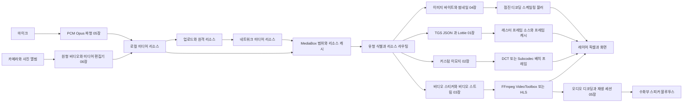

# 렌더링과 미디어

웹: /docs/media/ · Markdown: /docs/media.md

> 네트워크 바이트, 기기 캡처, 로컬 편집에서 출발해 Telegram 클라이언트가 이미지, 애니메이션, 비디오, 소리를 어떻게 만들고, 캐시하고, 디코딩하고, 보여 주는지 따라가요.

이 하위 문서는 하나의 질문에 끝까지 답해요. Telegram 미디어가 네트워크 리소스나 로컬 기기 입력에서 출발해 어떻게 화면의 픽셀이나 스피커의 소리가 될까요?

초점은 리소스 이후의 미디어 전용 경계예요. 다루는 내용은 다음과 같아요.

- 형식 식별
- 첫 프레임
- 프레임 소스
- 코덱
- 크기별 캐시
- 재생 클록
- 오디오 세션
- 카메라 캡처
- 내보내기

실패가 어느 계층에서 일어나는지, 그리고 캐시, 가시성, 하드웨어 성능이 CPU, GPU, 메모리, 네트워크 작업을 어떻게 제한하는지도 설명해요.

`MediaBox`의 부분 파일, 범위 맵, 다운로드 우선순위는 모든 읽기 경로가 함께 쓰는 전제예요. 이 하위 문서는 이미지, 애니메이션, 비디오, 오디오가 그 읽을 수 있는 바이트를 어떻게 쓰는지 다뤄요. [\[1\]](https://github.com/TelegramMessenger/Telegram-iOS/blob/f1dd7a2dbd02cbbf513e75d5695d8d36d1cf5838/submodules/Postbox/Sources/MediaBoxFileContextV2Impl.swift#L320-L386)

이 하위 문서와 《UI 기법 리포트》의 경계는 콘텐츠 파이프라인과 인터페이스 기법의 경계예요. 《iOS 렌더링 성능》과 《macOS 렌더링과 앱 계층》은 레이어, 아틀라스, 디스플레이 링크, 컨트롤 재사용을 설명해요. 여기서는 이런 장치가 구체적인 미디어 프레임을 받아 처리할 때만 다뤄요.

《시스템 설계》의 《미디어 리소스, 다운로드·업로드와 캐시》와는 서로 보완하는 관계예요.

- 시스템 설계: 리소스의 정체성, 범위 가져오기, 축출을 설명해요.
- 이 하위 문서: 같은 리소스가 도착한 뒤 썸네일, 프레임 캐시, `CVPixelBuffer`, `CGImage`, 오디오 출력, 전송 전의 새 파일로 어떻게 바뀌는지 설명해요.

읽는 순서는 이래요. 먼저 시스템 문서의 리소스 계층을 입력 계층으로 보세요. 이어서 이 하위 문서의 여섯 장을 미디어 유형과 제작 방향에 따라 깊이 읽으면 돼요.

## 전체 도표 [#전체-도표]

아래 도표는 “네트워크 리소스에서 화면 픽셀과 스피커까지”를 중심에 두고, 로컬 캡처와 편집이 만든 새 리소스를 같은 흐름으로 다시 이어요. 도표의 장 번호는 그 단계를 주로 맡는 연구 장을 가리켜요. 런타임에 모듈이 하나뿐이라는 뜻은 아니에요.

이 도표에는 헷갈리면 안 되는 캐시 계층이 둘 있어요.

- `MediaBox`: 원본 리소스, 부분 파일, 읽을 수 있는 범위를 보관해요.
- 파생 캐시: 이미지 썸네일, Lottie 비트맵, DCT 애니메이션, 비디오 스티커 프레임, 편집기 출력이 여기에 들어가요. 표시 크기, 픽셀 형식, 전송 정책에 맞춰 만든 파생 데이터예요.

파생 캐시가 무효화되면 클라이언트는 원본 리소스로 돌아가 프레임을 다시 만들 수 있어야 해요. 캐시 파일을 미디어 정확성의 유일한 근거로 삼으면 안 돼요. [\[1\]](https://github.com/TelegramMessenger/Telegram-iOS/blob/f1dd7a2dbd02cbbf513e75d5695d8d36d1cf5838/submodules/Postbox/Sources/MediaBoxFileContextV2Impl.swift#L320-L386)[\[2\]](https://github.com/TelegramMessenger/Telegram-iOS/blob/f1dd7a2dbd02cbbf513e75d5695d8d36d1cf5838/submodules/LottieBinding/Sources/MakeLottieInstance.swift#L7-L71)[\[3\]](https://github.com/TelegramMessenger/Telegram-iOS/blob/f1dd7a2dbd02cbbf513e75d5695d8d36d1cf5838/submodules/AnimatedStickerNode/Sources/AnimatedStickerNode.swift#L93-L130)

## 장 안내 [#장-안내]

번호 순서대로 읽기를 권해요. 각 장의 역할은 이래요.

1. 01장: “애니메이션은 하나의 뷰가 아니다”라는 프레임 소스 모델을 먼저 세워요.
2. 02장: 이 모델을 채팅에서 대량으로 반복해 나오는 이모지로 넓혀요.
3. 03장: 비디오와 범위 재생으로 들어가요.
4. 04장: 정지 이미지의 첫 프레임과 크기 선택으로 돌아와요.
5. 05장: 소리로 넘어가요.
6. 06장: 마지막으로 기기 입력과 편집기 출력에서 거꾸로 리소스가 만들어지는 쪽을 이해해요.

### 01 《Lottie 애니메이션 파이프라인》 [#01-lottie-애니메이션-파이프라인]

이 장은 `.tgs`나 JSON에서 `LottieInstance`, 프레임별 래스터화, 디스플레이 타이머, 프레임 캐시까지 따라가며 애니메이션 스티커의 가장 작은 닫힌 고리를 세워요.

- iOS는 `rlottie`와 `tlottie`를 `makeLottieInstance`에 모아 두고, 바인딩 계층에서 크기, 프레임 레이트, 길이를 한꺼번에 제한해요. 그래서 노드는 어느 렌더링 백엔드에도 직접 기대지 않아요. [\[2\]](https://github.com/TelegramMessenger/Telegram-iOS/blob/f1dd7a2dbd02cbbf513e75d5695d8d36d1cf5838/submodules/LottieBinding/Sources/MakeLottieInstance.swift#L7-L71)
- 미리 만든 YUVA 프레임 스트림, 직접 Lottie 프레임, Metal DCT 캐시를 구분해요.
- 캐시 적중이 줄이는 건 반복되는 래스터화이지, 화면 표시에 필요한 픽셀 메모리가 아니라는 점도 설명해요.

02장이 “프레임, 클록, 가시성, 크기별 캐시”라는 문제를 다시 쓰면서 최적화 단위를 스티커 하나에서 이모지 타깃 묶음으로 바꿔요. 그러니 이 장을 먼저 읽고 02장을 읽어야 해요.

### 02 《커스텀 이모지와 애니메이션 캐시》 [#02-커스텀-이모지와-애니메이션-캐시]

이 장은 `AnimationCache`가 Lottie, 비디오 스티커, 정지 스티커를 어떻게 다시 쓸 수 있는 파생 프레임으로 바꾸는지 살펴보고, DCT와 Subcodec 두 구현을 각각 따라가요.

- 현재 계정을 조립하는 지점에서 `DCTAnimationCacheImpl`과 `DCTMultiAnimationRendererImpl`을 만들어요. 같은 리소스, 같은 크기의 타깃은 각자 디코딩하지 않고 애니메이션 컨텍스트 하나를 함께 쓸 수 있어요. [\[4\]](https://github.com/TelegramMessenger/Telegram-iOS/blob/f1dd7a2dbd02cbbf513e75d5695d8d36d1cf5838/submodules/TelegramUI/Components/DCTAnimationCacheImpl/Sources/DCTAnimationCacheImpl.swift#L1286-L1423)
- 동기 첫 프레임, 썸네일 플레이스홀더, 제한된 백그라운드 큐, 시간이나 용량 기준 정리가 채팅 스크롤을 위해 어떻게 함께 작동하는지도 설명해요.

이 장을 읽고 03장을 읽으면 두 가지 비디오 의미론을 분명히 구분할 수 있어요.

- 비디오 스티커가 스티커 프레임으로 미리 처리되는 경우
- 일반 비디오가 타임라인과 바이트 범위로 재생되는 경우

### 03 《비디오 스티커, 비디오 디코딩, 스트리밍》 [#03-비디오-스티커-비디오-디코딩-스트리밍]

이 장은 비디오를 세 경로로 나눠요.

- **비디오 스티커**: 항상 소프트웨어 프레임 소스를 거쳐요. 스케일링과 캐시가 가능한 ARGB 또는 YUVA 프레임을 내보내고 프레임 레이트를 30으로 제한해요. 작은 범용 플레이어가 아니에요. [\[5\]](https://github.com/TelegramMessenger/Telegram-iOS/blob/f1dd7a2dbd02cbbf513e75d5695d8d36d1cf5838/submodules/AnimatedStickerNode/Sources/VideoStickerFrameSource.swift#L304-L448)
- **일반 파일 재생**: 범위 가져오기, 읽을 수 있는 범위, 디코더 선택을 나눠요.
- **HLS**: 한 걸음 더 나아가 클라이언트 안에서 매니페스트를 만들고 세그먼트 요청을 Telegram 리소스로 다시 이어요.

이 장은 02장 뒤에 읽어야 해요. 캐시 프레임 최적화의 경계를 설명하고, 04장의 점진 이미지와 05장의 재생 세션에 타임라인과 버퍼링의 맥락을 주기 때문이에요.

### 04 《이미지 코덱과 썸네일》 [#04-이미지-코덱과-썸네일]

이 장은 업로드 전의 스케일링과 JPEG 인코딩, 그리고 수신 후의 미니 썸네일, 점진 JPEG, 블러 플레이스홀더, 크기별 캐시, 백그라운드 그리기를 다뤄요.

- `PhotoResources`는 타깃 크기에 따라 점진 바이트 접두부를 고를 수 있어요. 메인 이미지가 아직 완전하지 않으면 증분 디코딩과 블러 썸네일을 쓰고, 완전한 이미지가 도착하면 같은 그리기 결과 안에서 덮어써요. [\[6\]](https://github.com/TelegramMessenger/Telegram-iOS/blob/f1dd7a2dbd02cbbf513e75d5695d8d36d1cf5838/submodules/PhotoResources/Sources/PhotoResources.swift#L30-L148)
- `TransformImageNode`는 픽셀 변환을 동시성 큐에서 하고 레이어 콘텐츠는 메인 스레드에서 제출해요. 그래서 리소스 읽기, 디코딩, 뷰 업데이트의 소유권이 나뉘어요. [\[7\]](https://github.com/TelegramMessenger/Telegram-iOS/blob/f1dd7a2dbd02cbbf513e75d5695d8d36d1cf5838/submodules/Display/Source/TransformImageNode.swift#L73-L150)

비디오 장 뒤에 읽기를 권해요. 비디오 장이 “먼저 그릴 수 있게, 나중에 선명하게”라는 첫 프레임 전략을 가장 분명하게 보여 주기 때문이에요. 그다음 오디오 장을 읽으면 같은 “첫 사용 우선” 사상이 파형과 세션 상태로 어떻게 구현되는지 볼 수 있어요.

### 05 《음성 메시지와 오디오 시스템》 [#05-음성-메시지와-오디오-시스템]

이 장은 마이크, `RemoteIO`, PCM, `TGOggOpusWriter`, 파형 속성, 플레이어를 따라 음성 메시지가 만들어지고 쓰이는 과정을 추적해요.

- 녹음기는 먼저 `ManagedAudioSession`을 얻고, 48 kHz 모노 PCM으로 작업하며, 60밀리초 패킷 단위로 인코딩 경로에 넘겨요. [\[8\]](https://github.com/TelegramMessenger/Telegram-iOS/blob/f1dd7a2dbd02cbbf513e75d5695d8d36d1cf5838/submodules/TelegramUI/Sources/ManagedAudioRecorder.swift#L375-L620)
- 파형은 Ogg 파일을 다시 분석해 만든 캐시가 아니에요. 녹음하는 동안 만든 5비트 양자화 메타데이터이고, 채팅 목록이 이를 직접 읽어 진행 표시를 그려요. [\[9\]](https://github.com/TelegramMessenger/Telegram-iOS/blob/f1dd7a2dbd02cbbf513e75d5695d8d36d1cf5838/submodules/AudioWaveform/Sources/AudioWaveform.swift#L28-L80)
- 통화, 녹음, 재생, 블루투스, 근접 센서가 왜 컨트롤마다 기기를 직접 차지하지 않고 세션 중재를 거쳐야 하는지도 설명해요.

소리 출력은 레이어에서 끝나지 않아요. 핵심 제약은 하나뿐인 오디오 라우트와 복구할 수 있는 재생 상태예요. 그래서 이 장은 이미지와 비디오를 읽은 뒤에 들어가야 해요.

### 06 《카메라, 원형 비디오, 미디어 편집기》 [#06-카메라-원형-비디오-미디어-편집기]

이 장은 만드는 쪽에서 전체를 마무리해요. 카메라 구성, 멀티 카메라 입력, 원형 비디오의 정사각형 H.264 인코딩, 타임스탬프 단조성, 실시간 업로드를 추적해요. 미디어 편집기가 미리보기에서 내보내기까지 거치는 두 렌더링 경로도 따라가요. [\[10\]](https://github.com/TelegramMessenger/Telegram-iOS/blob/f1dd7a2dbd02cbbf513e75d5695d8d36d1cf5838/submodules/Camera/CameraLegacy/Sources/CameraOutput.swift#L271-L570)

- 원형 비디오는 현재의 구 카메라 경로에서 400×400의 정사각형 프레임과 MP4를 내보내요. 원형 크롭은 처리 계층에서 일어나요. 둥근 모서리 뷰가 인코딩 작업을 대신하는 게 아니에요. [\[10\]](https://github.com/TelegramMessenger/Telegram-iOS/blob/f1dd7a2dbd02cbbf513e75d5695d8d36d1cf5838/submodules/Camera/CameraLegacy/Sources/CameraOutput.swift#L271-L570)
- 편집기 미리보기는 Metal 텍스처와 제한된 진행 중 프레임으로 동작해요.
- 내보내기는 reader, composer, writer와 따로 도는 오디오·비디오 백프레셔로 새 파일을 만들어요. [\[11\]](https://github.com/TelegramMessenger/Telegram-iOS/blob/f1dd7a2dbd02cbbf513e75d5695d8d36d1cf5838/submodules/TelegramUI/Components/MediaEditor/Sources/MediaEditorRenderer.swift#L47-L349)[\[12\]](https://github.com/TelegramMessenger/Telegram-iOS/blob/f1dd7a2dbd02cbbf513e75d5695d8d36d1cf5838/submodules/TelegramUI/Components/MediaEditor/Sources/MediaEditorVideoExport.swift#L11-L260)

이 장을 마지막에 읽으면 앞의 다섯 장에서 본 디코딩, 캐시, 픽셀 형식을 거꾸로 캡처, 합성, 인코딩, 업로드 전 파일 생성에 대응시킬 수 있어요.

## 전체를 관통하는 설계 트레이드오프 [#전체를-관통하는-설계-트레이드오프]

### 원본 리소스는 공유하고 파생 픽셀은 용도별로 분리 [#원본-리소스는-공유하고-파생-픽셀은-용도별로-분리]

`MediaBoxFileContextV2Impl`은 범위 집합으로 같은 리소스의 읽을 수 있는 부분을 나타내요. 여러 독자가 부분 파일 하나에 우선순위가 다른 범위 요청을 낼 수 있어요. [\[1\]](https://github.com/TelegramMessenger/Telegram-iOS/blob/f1dd7a2dbd02cbbf513e75d5695d8d36d1cf5838/submodules/Postbox/Sources/MediaBoxFileContextV2Impl.swift#L320-L386)

이것으로 네트워크 바이트를 함께 쓰는 문제는 풀려요. 하지만 “같은 미디어가 40포인트 텍스트 첨부와 320포인트 말풍선에서 갖는 픽셀 표현” 문제는 풀리지 않아요. 그래서 아래 세 캐시는 모두 일부러 크기에 묶인 파생 데이터 계층을 한 겹 더 만들어요. [\[3\]](https://github.com/TelegramMessenger/Telegram-iOS/blob/f1dd7a2dbd02cbbf513e75d5695d8d36d1cf5838/submodules/AnimatedStickerNode/Sources/AnimatedStickerNode.swift#L93-L130)[\[4\]](https://github.com/TelegramMessenger/Telegram-iOS/blob/f1dd7a2dbd02cbbf513e75d5695d8d36d1cf5838/submodules/TelegramUI/Components/DCTAnimationCacheImpl/Sources/DCTAnimationCacheImpl.swift#L1286-L1423)[\[6\]](https://github.com/TelegramMessenger/Telegram-iOS/blob/f1dd7a2dbd02cbbf513e75d5695d8d36d1cf5838/submodules/PhotoResources/Sources/PhotoResources.swift#L30-L148)

- 01장: Lottie 프레임 캐시
- 02장: 소스 식별자와 가로세로를 키로 삼는 DCT 캐시
- 04장: 너비와 종횡비로 고르는 이미지 캐시

대가는 디스크에 표시 결과가 여러 벌 있다는 점이에요. 얻는 건 비용이 큰 디코딩이나 래스터화를 모든 뷰 인스턴스에 시키지 않아도 된다는 점이에요.

### 처음 쓸 수 있는 상태가 처음 완전한 상태보다 먼저 [#처음-쓸-수-있는-상태가-처음-완전한-상태보다-먼저]

먼저 쓸 수 있는 상태를 보여 주는 장치는 장마다 달라요.

- 04장: 먼저 `immediateThumbnailData`나 점진 바이트로 블러 결과를 그린 뒤 완전한 이미지로 덮어써요.
- 02장: 완전한 애니메이션과 첫 프레임 캐시를 나눠요. 그래서 채팅 첨부가 먼저 이미지 한 장을 보여 주고 나중에 연속 재생을 시작할 수 있어요. [\[4\]](https://github.com/TelegramMessenger/Telegram-iOS/blob/f1dd7a2dbd02cbbf513e75d5695d8d36d1cf5838/submodules/TelegramUI/Components/DCTAnimationCacheImpl/Sources/DCTAnimationCacheImpl.swift#L1286-L1423)[\[6\]](https://github.com/TelegramMessenger/Telegram-iOS/blob/f1dd7a2dbd02cbbf513e75d5695d8d36d1cf5838/submodules/PhotoResources/Sources/PhotoResources.swift#L30-L148)
- 03장: 범위 플레이어는 필요한 구간을 완전히 읽을 수 있을 때만 데이터를 디코더에 넘겨요. HLS는 다시 매니페스트, 부분 범위, `SourceBuffer`를 따로 떨어진 단계로 나눠요. [\[5\]](https://github.com/TelegramMessenger/Telegram-iOS/blob/f1dd7a2dbd02cbbf513e75d5695d8d36d1cf5838/submodules/AnimatedStickerNode/Sources/VideoStickerFrameSource.swift#L304-L448)[\[13\]](https://github.com/TelegramMessenger/Telegram-iOS/blob/f1dd7a2dbd02cbbf513e75d5695d8d36d1cf5838/submodules/TelegramUniversalVideoContent/Sources/HLSVideoJSNativeContentNode.swift#L700-L823)

이 설계는 “첫 표시가 반드시 선명하거나 끊김 없이 재생된다”는 단순한 약속을 포기해요. 그 대신 네트워크 공백, 완전한 파일, 값비싼 디코딩이 함께 UI 첫 프레임을 막는 일을 피해요.

### 가시성, 백프레셔, 취소로 작업량을 먼저 제한 [#가시성-백프레셔-취소로-작업량을-먼저-제한]

작업량을 제한하는 방법은 장마다 달라요.

- 01장: 애니메이션 노드는 논리적으로 보이고 계층도 표시될 때만 재생해요. 단일 프레임 큐로 프리페치 깊이도 제한해요. [\[3\]](https://github.com/TelegramMessenger/Telegram-iOS/blob/f1dd7a2dbd02cbbf513e75d5695d8d36d1cf5838/submodules/AnimatedStickerNode/Sources/AnimatedStickerNode.swift#L93-L130)
- 02장: 같은 크기, 같은 미디어의 타깃을 합친 다음 타이머 하나와 백그라운드 큐 두 개로 프레임 작업을 돌려요. 재생할 타깃이 없으면 타이머를 멈춰요. [\[4\]](https://github.com/TelegramMessenger/Telegram-iOS/blob/f1dd7a2dbd02cbbf513e75d5695d8d36d1cf5838/submodules/TelegramUI/Components/DCTAnimationCacheImpl/Sources/DCTAnimationCacheImpl.swift#L1286-L1423)
- 03장: 초대형 비디오 프레임에 400만 픽셀의 상한을 두고, 픽셀 풀에 압박이 걸리면 프레임을 버리는 것을 허용해요.
- 06장: 편집기는 값이 3인 semaphore로 진행 중인 렌더링을 제한해요. 표시 타깃이 있는 미리보기는 최대 0.1초까지만 기다리게 해요. [\[11\]](https://github.com/TelegramMessenger/Telegram-iOS/blob/f1dd7a2dbd02cbbf513e75d5695d8d36d1cf5838/submodules/TelegramUI/Components/MediaEditor/Sources/MediaEditorRenderer.swift#L47-L349)[\[14\]](https://github.com/TelegramMessenger/Telegram-iOS/blob/f1dd7a2dbd02cbbf513e75d5695d8d36d1cf5838/submodules/MediaPlayer/Sources/FFMpegMediaVideoFrameDecoder.swift#L99-L130)

이런 선택은 미디어 프레임을 건너뛸 수 있다고 인정해요. 하지만 화면 밖 애니메이션, 느린 디코딩, 느린 GPU가 메모리와 지연을 끝없이 쌓게 두지는 않아요.

### 인코더가 있다고 해서 제품 경로가 켜진 것은 아님 [#인코더가-있다고-해서-제품-경로가-켜진-것은-아님]

장마다 확인한 내용은 이래요.

- 01장: `LottieBinding`은 두 백엔드를 격리하지만, 런타임에 무엇을 고를지는 여전히 계정 설정과 서버 스위치가 정해요.
- 03장: FFmpeg 빌드가 libvpx, dav1d, VideoToolbox를 연결한다는 점을 확인했어요. 비디오 스티커, 일반 비디오 패스스루, HLS 품질 선별이 각각 독립된 조건을 가진다는 점도 확인했어요. [\[2\]](https://github.com/TelegramMessenger/Telegram-iOS/blob/f1dd7a2dbd02cbbf513e75d5695d8d36d1cf5838/submodules/LottieBinding/Sources/MakeLottieInstance.swift#L7-L71)[\[5\]](https://github.com/TelegramMessenger/Telegram-iOS/blob/f1dd7a2dbd02cbbf513e75d5695d8d36d1cf5838/submodules/AnimatedStickerNode/Sources/VideoStickerFrameSource.swift#L304-L448)[\[13\]](https://github.com/TelegramMessenger/Telegram-iOS/blob/f1dd7a2dbd02cbbf513e75d5695d8d36d1cf5838/submodules/TelegramUniversalVideoContent/Sources/HLSVideoJSNativeContentNode.swift#L700-L823)
- 04장: JPEG XL 인터페이스가 `USE_JPEGXL` 조건으로 제어된다는 걸 보여 줘요. 현재의 Bazel 의존성만으로는 이것이 기본 업로드 형식이라고 증명할 수 없어요.
- 06장: 일반 비디오, 스티커, 원형 비디오에 따라 HEVC, H.264, VP9와 서로 다른 writer를 골라요. [\[12\]](https://github.com/TelegramMessenger/Telegram-iOS/blob/f1dd7a2dbd02cbbf513e75d5695d8d36d1cf5838/submodules/TelegramUI/Components/MediaEditor/Sources/MediaEditorVideoExport.swift#L11-L260)

그러니 문제를 진단하거나 호환성 결론을 낼 때는 미디어 유형, 호출 정책, 기기 성능, 빌드 스위치, 원격 구성을 함께 기록해야 해요. 정적 라이브러리가 링크됐는지만 봐서는 안 돼요.

### 미리보기와 최종 파일은 의미론은 같이 쓰고 실행 경로는 따로 [#미리보기와-최종-파일은-의미론은-같이-쓰고-실행-경로는-따로]

06장의 `MediaEditorRenderer`는 Metal 커맨드 버퍼 안에서 메인 입력, 추가 입력, 편집 pass를 합쳐 인터랙티브 미리보기에 써요. 내보내기 쪽은 타임스탬프에 따라 오디오와 비디오를 읽고, composer를 호출하고, writer가 준비되길 기다려요. 읽기, 쓰기, 취소가 실패하면 대상 파일을 지워요. [\[11\]](https://github.com/TelegramMessenger/Telegram-iOS/blob/f1dd7a2dbd02cbbf513e75d5695d8d36d1cf5838/submodules/TelegramUI/Components/MediaEditor/Sources/MediaEditorRenderer.swift#L47-L349)[\[12\]](https://github.com/TelegramMessenger/Telegram-iOS/blob/f1dd7a2dbd02cbbf513e75d5695d8d36d1cf5838/submodules/TelegramUI/Components/MediaEditor/Sources/MediaEditorVideoExport.swift#L11-L260)

01장의 직접 Lottie 프레임과 02장의 DCT 프레임 캐시에도 같은 원칙이 보여요. 표시 프레임은 캐시에서 빠르게 가져올 수 있지만, 캐시가 원본 JSON이나 미디어 파일의 진실 값을 대신할 수는 없어요.

이렇게 나누면 미리보기와 내보내기가 일관된지 검증하는 테스트 비용이 늘어요. 하지만 실시간 인터랙션은 매끄러움을, 오프라인 내보내기는 완전성, 복구 가능성, 전송 가능성을 먼저 챙길 수 있어요.

### 플랫폼 간에는 목표를 공유하되 미디어 스택은 억지로 공유하지 않기 [#플랫폼-간에는-목표를-공유하되-미디어-스택은-억지로-공유하지-않기]

두 플랫폼은 구현이 달라요.

- Lottie: iOS는 `LottieBinding`으로 백엔드를 고를 수 있어요. macOS에서 확인한 플레이어는 `RLottieBridge`로 래스터화하고, LZFSE 프레임 캐시와 공유 플레이어 컨텍스트로 AppKit 뷰를 뒷받침해요. [\[15\]](https://github.com/overtake/TelegramSwift/blob/579cebbf0c01fd41b712eff3647fa7f69db9665d/packages/TelegramMedia/Sources/LottiePlayer.swift#L1236-L1313)
- 오디오 라우팅: iOS는 `ManagedAudioSession`과 근접 센서에 기대요. macOS는 HALOutput, 기기 UID, 기본 출력 기기를 다뤄요.

두 플랫폼은 미디어 프로토콜과 일부 핵심 개념을 함께 쓰지만, UIKit과 AppKit에 각각 맞는 클록, 큐, 캐시 정리, 기기 인터페이스를 따로 골라요. 크로스 플랫폼 구현은 리소스 정체성, 미디어 의미론, 테스트 샘플을 공유해야 해요. 바이너리 캐시, 오디오 라우팅, 레이어 표시가 그대로 서로 호환된다고 가정하면 안 돼요.

## 장 지도 [#chapter-map]

**애니메이션**

- [01 Lottie 애니메이션 파이프라인](/docs/media/01-lottie-pipeline/): Telegram iOS와 macOS 클라이언트가 Lottie 애니메이션 스티커와 애니메이션 이모지를 디코딩, 렌더링, 캐시, 스케줄링하고 전력 소모를 제어하는 방식.
- [02 커스텀 이모지와 애니메이션 캐시](/docs/media/02-emoji-animation-cache/): Telegram iOS와 macOS 클라이언트의 커스텀 이모지, 소형 애니메이션 렌더링, 프레임 캐시, 배치 처리, 디스크 축출 메커니즘을 살펴봐요.

**비디오와 이미지**

- [03 비디오 스티커, 비디오 디코딩, 스트리밍](/docs/media/03-video-stickers-codecs/): Telegram iOS와 macOS 클라이언트의 비디오 스티커, FFmpeg 디코딩, AV1 연동, 재생 중 다운로드, HLS 세그먼트 재생 경로를 추적해요.
- [04 이미지 코덱과 썸네일](/docs/media/04-image-pipeline/): Telegram iOS와 macOS 클라이언트의 이미지 업로드 압축, 미니 썸네일, 점진 표시, 백그라운드 그리기, 이미지 캐시를 살펴봐요.

**오디오와 캡처**

- [05 음성 메시지와 오디오 시스템](/docs/media/05-audio-voice/): iOS와 macOS 소스에서 음성 메시지의 캡처, Ogg Opus 인코딩, 파형, 재생, 세션 중재, 라우팅, 통화 노이즈 억제를 추적해요.
- [06 카메라, 원형 비디오, 미디어 편집기](/docs/media/06-camera-editor/): iOS와 macOS 클라이언트가 카메라 캡처, 원형 비디오 녹화에서 미디어 편집, 내보내기, 전송 전 트랜스코딩에 이르는 구현 경계를 추적해요.

## 참고 [#references]

- \[1\] [MediaBox 범위 요청 병합](https://github.com/TelegramMessenger/Telegram-iOS/blob/f1dd7a2dbd02cbbf513e75d5695d8d36d1cf5838/submodules/Postbox/Sources/MediaBoxFileContextV2Impl.swift#L320-L386)
- \[2\] [Lottie 백엔드 생성과 제품 제한](https://github.com/TelegramMessenger/Telegram-iOS/blob/f1dd7a2dbd02cbbf513e75d5695d8d36d1cf5838/submodules/LottieBinding/Sources/MakeLottieInstance.swift#L7-L71)
- \[3\] [단일 프레임 큐](https://github.com/TelegramMessenger/Telegram-iOS/blob/f1dd7a2dbd02cbbf513e75d5695d8d36d1cf5838/submodules/AnimatedStickerNode/Sources/AnimatedStickerNode.swift#L93-L130)
- \[4\] [DCT 애니메이션 캐시 요청 병합](https://github.com/TelegramMessenger/Telegram-iOS/blob/f1dd7a2dbd02cbbf513e75d5695d8d36d1cf5838/submodules/TelegramUI/Components/DCTAnimationCacheImpl/Sources/DCTAnimationCacheImpl.swift#L1286-L1423)
- \[5\] [비디오 스티커 프레임 소스와 캐시](https://github.com/TelegramMessenger/Telegram-iOS/blob/f1dd7a2dbd02cbbf513e75d5695d8d36d1cf5838/submodules/AnimatedStickerNode/Sources/VideoStickerFrameSource.swift#L304-L448)
- \[6\] [이미지 표현과 점진 리소스 선택](https://github.com/TelegramMessenger/Telegram-iOS/blob/f1dd7a2dbd02cbbf513e75d5695d8d36d1cf5838/submodules/PhotoResources/Sources/PhotoResources.swift#L30-L148)
- \[7\] [백그라운드 이미지 변환과 메인 스레드 제출](https://github.com/TelegramMessenger/Telegram-iOS/blob/f1dd7a2dbd02cbbf513e75d5695d8d36d1cf5838/submodules/Display/Source/TransformImageNode.swift#L73-L150)
- \[8\] [음성 녹음 세션과 PCM 인코딩 패킷](https://github.com/TelegramMessenger/Telegram-iOS/blob/f1dd7a2dbd02cbbf513e75d5695d8d36d1cf5838/submodules/TelegramUI/Sources/ManagedAudioRecorder.swift#L375-L620)
- \[9\] [5비트 양자화 파형](https://github.com/TelegramMessenger/Telegram-iOS/blob/f1dd7a2dbd02cbbf513e75d5695d8d36d1cf5838/submodules/AudioWaveform/Sources/AudioWaveform.swift#L28-L80)
- \[10\] [원형 비디오 녹화와 타임라인 처리](https://github.com/TelegramMessenger/Telegram-iOS/blob/f1dd7a2dbd02cbbf513e75d5695d8d36d1cf5838/submodules/Camera/CameraLegacy/Sources/CameraOutput.swift#L271-L570)
- \[11\] [미디어 편집기 미리보기 렌더러](https://github.com/TelegramMessenger/Telegram-iOS/blob/f1dd7a2dbd02cbbf513e75d5695d8d36d1cf5838/submodules/TelegramUI/Components/MediaEditor/Sources/MediaEditorRenderer.swift#L47-L349)
- \[12\] [미디어 편집기 내보내기 인터페이스와 구성](https://github.com/TelegramMessenger/Telegram-iOS/blob/f1dd7a2dbd02cbbf513e75d5695d8d36d1cf5838/submodules/TelegramUI/Components/MediaEditor/Sources/MediaEditorVideoExport.swift#L11-L260)
- \[13\] [HLS 로컬 범위 요청 라우팅](https://github.com/TelegramMessenger/Telegram-iOS/blob/f1dd7a2dbd02cbbf513e75d5695d8d36d1cf5838/submodules/TelegramUniversalVideoContent/Sources/HLSVideoJSNativeContentNode.swift#L700-L823)
- \[14\] [비디오 프레임 픽셀 상한](https://github.com/TelegramMessenger/Telegram-iOS/blob/f1dd7a2dbd02cbbf513e75d5695d8d36d1cf5838/submodules/MediaPlayer/Sources/FFMpegMediaVideoFrameDecoder.swift#L99-L130)
- \[15\] [macOS Lottie 렌더링과 캐시 읽기](https://github.com/overtake/TelegramSwift/blob/579cebbf0c01fd41b712eff3647fa7f69db9665d/packages/TelegramMedia/Sources/LottiePlayer.swift#L1236-L1313)
