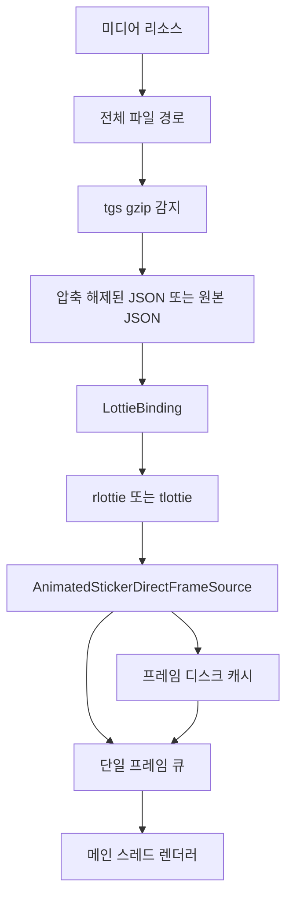
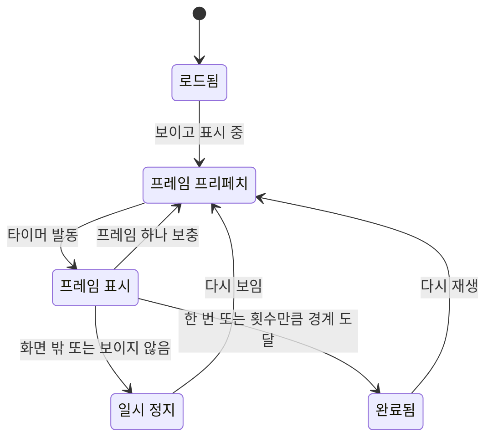
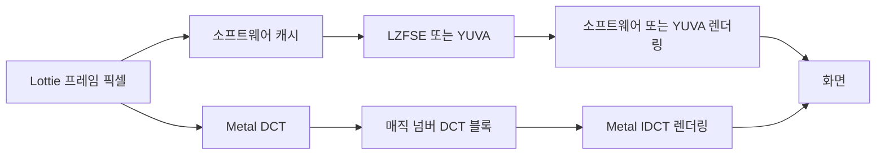
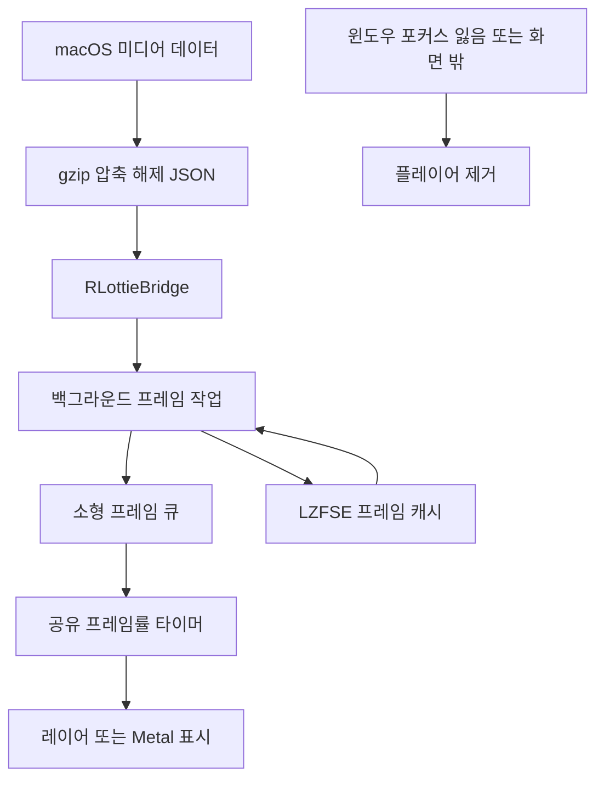

# Lottie 애니메이션 파이프라인

웹: /docs/media/01-lottie-pipeline/ · Markdown: /docs/media/01-lottie-pipeline.md

> Telegram iOS와 macOS 클라이언트가 Lottie 애니메이션 스티커와 애니메이션 이모지를 디코딩, 렌더링, 캐시, 스케줄링하고 전력 소모를 제어하는 방식.

> 렌더링과 미디어 · 애니메이션 · 01장 · 도표 4 · 코드 발췌 10 · 인용 35 · 소스 기준선: [TelegramMessenger/Telegram-iOS@f1dd7a2d](https://github.com/TelegramMessenger/Telegram-iOS/tree/f1dd7a2dbd02cbbf513e75d5695d8d36d1cf5838), [overtake/TelegramSwift@579cebbf](https://github.com/overtake/TelegramSwift/tree/579cebbf0c01fd41b712eff3647fa7f69db9665d)
>
> 핵심 소스 파일: [TelegramMessenger/Telegram-iOS/submodules/LottieBinding/Sources/MakeLottieInstance.swift](https://github.com/TelegramMessenger/Telegram-iOS/blob/f1dd7a2dbd02cbbf513e75d5695d8d36d1cf5838/submodules/LottieBinding/Sources/MakeLottieInstance.swift), [TelegramMessenger/Telegram-iOS/submodules/LottieBinding/Sources/LottieInstance.swift](https://github.com/TelegramMessenger/Telegram-iOS/blob/f1dd7a2dbd02cbbf513e75d5695d8d36d1cf5838/submodules/LottieBinding/Sources/LottieInstance.swift), [TelegramMessenger/Telegram-iOS/submodules/rlottie/RLottieInstance.mm](https://github.com/TelegramMessenger/Telegram-iOS/blob/f1dd7a2dbd02cbbf513e75d5695d8d36d1cf5838/submodules/rlottie/RLottieInstance.mm), [TelegramMessenger/Telegram-iOS/submodules/tlottie/TLottieAnimation.mm](https://github.com/TelegramMessenger/Telegram-iOS/blob/f1dd7a2dbd02cbbf513e75d5695d8d36d1cf5838/submodules/tlottie/TLottieAnimation.mm), [dkaraush/tlottie/include/tlottie.h](https://github.com/dkaraush/tlottie/blob/31f1b542f88e7b4be9a01e749920d857535fc715/include/tlottie.h), [TelegramMessenger/Telegram-iOS/submodules/AnimatedStickerNode/Sources/AnimatedStickerNode.swift](https://github.com/TelegramMessenger/Telegram-iOS/blob/f1dd7a2dbd02cbbf513e75d5695d8d36d1cf5838/submodules/AnimatedStickerNode/Sources/AnimatedStickerNode.swift), [TelegramMessenger/Telegram-iOS/submodules/AnimatedStickerNode/Sources/AnimatedStickerFrameSource.swift](https://github.com/TelegramMessenger/Telegram-iOS/blob/f1dd7a2dbd02cbbf513e75d5695d8d36d1cf5838/submodules/AnimatedStickerNode/Sources/AnimatedStickerFrameSource.swift), [TelegramMessenger/Telegram-iOS/submodules/AnimationCompression/Sources/AnimationCompressor.swift](https://github.com/TelegramMessenger/Telegram-iOS/blob/f1dd7a2dbd02cbbf513e75d5695d8d36d1cf5838/submodules/AnimationCompression/Sources/AnimationCompressor.swift), [TelegramMessenger/Telegram-iOS/submodules/GZip/Sources/GZip.m](https://github.com/TelegramMessenger/Telegram-iOS/blob/f1dd7a2dbd02cbbf513e75d5695d8d36d1cf5838/submodules/GZip/Sources/GZip.m), [overtake/TelegramSwift/packages/TelegramMedia/Sources/LottiePlayer.swift](https://github.com/overtake/TelegramSwift/blob/579cebbf0c01fd41b712eff3647fa7f69db9665d/packages/TelegramMedia/Sources/LottiePlayer.swift), [overtake/TelegramSwift/packages/TelegramMedia/Sources/LottieBufferCompressor.swift](https://github.com/overtake/TelegramSwift/blob/579cebbf0c01fd41b712eff3647fa7f69db9665d/packages/TelegramMedia/Sources/LottieBufferCompressor.swift), [overtake/TelegramSwift/Telegram-Mac/ChatMediaAnimatedStickerView.swift](https://github.com/overtake/TelegramSwift/blob/579cebbf0c01fd41b712eff3647fa7f69db9665d/Telegram-Mac/ChatMediaAnimatedStickerView.swift), [overtake/TelegramSwift/Telegram-Mac/InlineStickerItemLayer.swift](https://github.com/overtake/TelegramSwift/blob/579cebbf0c01fd41b712eff3647fa7f69db9665d/Telegram-Mac/InlineStickerItemLayer.swift), [overtake/TelegramSwift/submodules/RLottie_Xcode/Sources/RLottieBridge.mm](https://github.com/overtake/TelegramSwift/blob/579cebbf0c01fd41b712eff3647fa7f69db9665d/submodules/RLottie_Xcode/Sources/RLottieBridge.mm)
>
> 미검증 사항:
> - 계정 설정의 서버 측 스위치가 LottieRenderingSettings.backend로 해석되는 과정은 구체적인 매핑과 핫 업데이트 코드를 아직 확인하지 않았어요.
> - CompressedImageRenderer의 IDCT, 텍스처 해제, 메모리 최대 사용량 구현은 아직 한 줄씩 확인하지 않았어요.
> - iOS에서 쓸 수 있는 Metal 장치가 없을 때 하드웨어 프레임 캐시 생성이 실패한 이후의 전체 폴백 경로는 대상 기기의 런타임에서 검증해야 해요.
> - macOS의 temporaryLZ4라는 이름이 실제 LZFSE 호출과 맞지 않는데, 소스는 그 역사적 호환 사유를 설명하지 않아요.

## 문제와 제약 [#문제와-제약]

애니메이션 스티커는 `.tgs` 파일 하나를 뷰에 넘겨 재생하면 끝나는 게 아니에요. 클라이언트는 다음 단계를 취소할 수 있는 하나의 경로로 엮어야 해요.

- 다운로드 상태
- gzip 압축 해제
- JSON 파싱
- 프레임별 래스터화(벡터를 픽셀 이미지로 그리는 일)
- 프레임 표시
- 디스크 캐시

채팅 목록에는 여러 노드가 동시에 나타나기도 해요. 그래서 시스템은 입력 크기, 렌더링 프레임률, 버퍼 깊이, 화면 밖에서의 작업량을 제한해야 해요.

이 장은 벡터 Lottie 애니메이션 스티커와 애니메이션 이모지를 다뤄요. 비디오 스티커, WebP, WebM은 일부 컨테이너에서 스케줄러를 같이 쓰지만 이 글의 중심은 아니에요. 일반적인 UI 애니메이션 실무는 《iOS 레이아웃과 애니메이션》 장을 보세요. 이 장은 Lottie 미디어 파이프라인만 다뤄요.

iOS는 렌더러 선택을 스티커 노드에서 떼어 `LottieBinding`으로 옮겼어요. 이 Swift 타깃은 `RLottieBinding`과 `TLottieBinding`에 모두 기대요. [\[1\]](https://github.com/TelegramMessenger/Telegram-iOS/blob/f1dd7a2dbd02cbbf513e75d5695d8d36d1cf5838/submodules/LottieBinding/BUILD#L5-L16) 호출하는 쪽에는 통일된 `LottieInstance`만 보여요. 이 프로토콜은 프레임 수, 프레임률, 크기, 길이, 픽셀 버퍼에 쓰는 동기 렌더링 연산만 드러내요.

이 경계는 직접적인 효과가 두 가지 있어요.

- `AnimatedStickerNode`가 C++ 객체나 Rust C ABI를 알 필요가 없어요.
- 백엔드를 바꿔도 노드의 프레임 스케줄링과 캐시 형식은 달라지지 않아요.

그래도 백엔드 선택이 완전히 투명할 수는 없어요. 두 엔진은 파싱 모델, 내부 캐시, 행 stride(행 한 줄이 차지하는 바이트 수)를 처리하는 능력이 서로 다르기 때문이에요.

프로토콜은 `duration`을 따로 둬요. 호출하는 쪽이 프레임 수를 프레임률로 나눠서 길이를 구하도록 강제하지 않아요. [\[2\]](https://github.com/TelegramMessenger/Telegram-iOS/blob/f1dd7a2dbd02cbbf513e75d5695d8d36d1cf5838/submodules/LottieBinding/Sources/LottieInstance.swift#L15-L34) 호환성 때문에 생긴 세부 사항이에요. `rlottie`는 반올림하지 않은 프레임률에 해당하는 길이를 알려 줄 수 있고, 팩토리는 그 값을 곧바로 9초 제한에 적용해요.

그래서 호출하는 쪽은 길이를 직접 다시 계산하면 안 되고, 그 값으로 재생 범위를 고쳐서도 안 돼요.

팩토리는 인스턴스를 만든 뒤 제품 수준의 허용 규칙을 한꺼번에 적용해요. 다음 중 하나라도 해당하면 팩토리가 빈 값을 돌려줘요.

- 너비나 높이 중 하나라도 1536 포인트를 넘어요.
- 프레임률이 360을 넘어요.
- 길이가 9초를 넘어요.

제한이 특정 엔진 안이 아니라 바인딩 계층에 있어서, 백엔드를 바꿔도 어떤 스티커를 재생할 수 있는지는 달라지지 않아요.

```swift
private enum LottieInstanceLimits {
    static let maximumDimension: CGFloat = 1536.0
    static let maximumFrameRate: Int32 = 360
    static let maximumDuration: Double = 9.0

    static func permits(_ instance: LottieInstance) -> Bool {
        if instance.dimensions.width > self.maximumDimension
            || instance.dimensions.height > self.maximumDimension {
            return false
        }
        if instance.frameRate > self.maximumFrameRate {
            return false
        }
        if instance.duration > self.maximumDuration {
            return false
        }
        return true
    }
}

public func makeLottieInstance(
    data: Data,
    fitzModifier: LottieFitzModifier,
    colorReplacements: [AnyHashable: Any]?,
    cacheKey: String,
    settings: LottieRenderingSettings
) -> LottieInstance? {
    let instance: LottieInstance?
    switch settings.backend {
    case .rlottie:
        instance = RLottieInstance(
            data: data,
            fitzModifier: fitzModifier.rlottieValue,
            colorReplacements: colorReplacements,
            cacheKey: cacheKey
        )
    case .tlottie:
        instance = TLottieAnimation(
            data: data,
            fitzModifier: fitzModifier.tlottieValue,
            colorReplacements: colorReplacements
        )
    }
    guard let instance, LottieInstanceLimits.permits(instance) else {
        return nil
    }
    return instance
}
```
[\[3\]](https://github.com/TelegramMessenger/Telegram-iOS/blob/f1dd7a2dbd02cbbf513e75d5695d8d36d1cf5838/submodules/LottieBinding/Sources/MakeLottieInstance.swift#L7-L71)

`LottieRenderingSettings`는 두 백엔드를 명시적으로 나열해요. 어떤 백엔드를 쓸지는 이렇게 정해져요.

- 계정이 있는 설정: 서버 스위치가 다른 선택을 요구하지 않는 한 기본으로 `tlottie`가 돼요.
- 로그인 전 화면: 계정 설정이 없어서 `rlottie` 폴백 값을 써요. [\[4\]](https://github.com/TelegramMessenger/Telegram-iOS/blob/f1dd7a2dbd02cbbf513e75d5695d8d36d1cf5838/submodules/LottieSettings/Sources/LottieRenderingSettings.swift#L3-L21)

추론: Telegram은 `rlottie`를 호환 경로로 남겨 두고, 각 미디어 컴포넌트가 알아서 고르게 두지 않아요.

## 모듈과 데이터 구조 [#모듈과-데이터-구조]

### 두 엔진의 역할 분담 [#두-엔진의-역할-분담]

`TelegramMessenger/rlottie`는 C++ 렌더러예요. iOS의 `RLottieInstance`는 JSON 바이트, Fitzpatrick 수정자(이모지 피부색 수정자), 색 치환, `cacheKey`를 `rlottie::Animation::loadFromData`에 넘겨요. 이어서 `totalFrame`, `frameRate`, `duration`, 자연 크기를 읽고, `renderSync`로 호출하는 쪽의 `Surface`를 채워요. [\[5\]](https://github.com/TelegramMessenger/Telegram-iOS/blob/f1dd7a2dbd02cbbf513e75d5695d8d36d1cf5838/submodules/rlottie/RLottieInstance.mm#L13-L76) `cacheKey`는 `rlottie`가 파싱한 모델의 캐시 키예요.

`dkaraush/tlottie`는 Rust로 작성한 CPU 래스터라이저예요. C ABI를 공개하고, 생성 인터페이스는 JSON, Fitzpatrick, 레이어 색 치환, 색 치환, 픽셀 채널 순서를 받아요. 인터페이스 선언을 보면 생성할 때 JSON을 파싱하고 실패하면 널 포인터를 돌려줘요. 프레임 렌더링은 premultiplied(알파를 미리 곱한) RGBA8 또는 Alpha8을 출력해요. [\[6\]](https://github.com/dkaraush/tlottie/blob/31f1b542f88e7b4be9a01e749920d857535fc715/include/tlottie.h#L48-L129)

iOS 래퍼 계층은 생성할 때 BGRA를 골라서, 리틀 엔디언 `DrawingContext`의 premultiplied 첫 바이트 비트맵 레이아웃에 맞춰요.

```objc
_instance = tlottie_new_with_options(
    (const uint8_t *)data.bytes,
    (size_t)data.length,
    modifier,
    nullptr,
    0,
    replacements.empty() ? nullptr : replacements.data(),
    replacements.size(),
    TLOTTIE_CHANNEL_BGRA);
if (_instance == nullptr) {
    return nil;
}

int32_t frameCount = (int32_t)tlottie_frame_count(_instance);
_frameCount = MAX(1, frameCount);

float rawFrameRate = tlottie_frame_rate(_instance);
_frameRate = MAX(1, (int32_t)rawFrameRate);
```
[\[7\]](https://github.com/TelegramMessenger/Telegram-iOS/blob/f1dd7a2dbd02cbbf513e75d5695d8d36d1cf5838/submodules/tlottie/TLottieAnimation.mm#L14-L113)

두 엔진 모두 전달받은 프레임 버퍼에 동기적으로만 쓰도록 제약돼 있어요. 두 엔진의 행 stride 처리는 달라요.

- `rlottie`는 행 stride를 기본으로 받아들여요.
- `tlottie_render`는 연속된 픽셀 행만 받아요.

래퍼 계층은 정렬된 `bytesPerRow`를 만나면 먼저 재사용할 수 있는 `_scratch`에 렌더링한 뒤 행 단위로 복사해요. 덕분에 노드 계층이 백엔드마다 비트맵 레이아웃 두 가지를 따로 유지할 필요가 없어요. [\[7\]](https://github.com/TelegramMessenger/Telegram-iOS/blob/f1dd7a2dbd02cbbf513e75d5695d8d36d1cf5838/submodules/tlottie/TLottieAnimation.mm#L14-L113)

여기서 말하는 백엔드 분담은 스티커마다 이중으로 렌더링한다는 뜻이 아니에요. 팩토리는 백엔드를 하나만 인스턴스화해요. 색 치환과 Fitzpatrick는 모두 인스턴스를 만들기 전에 백엔드 매개변수로 바뀌어요.

추론: 이렇게 하면 같은 스티커의 캐시 키, 노드 스케줄링, 표시 정책이 안정적으로 유지되고, 서버 스위치로 하위 구현을 어디까지 이전할지 조절할 수 있어요.

`tlottie`는 리소스 제한도 파서와 렌더러에 써 넣었어요. 기본값은 이래요.

- 입력: 16 MiB
- 중첩 깊이: 128
- 레이어: 2304
- 프레임당 렌더링 메모리: 36 MiB [\[8\]](https://github.com/dkaraush/tlottie/blob/31f1b542f88e7b4be9a01e749920d857535fc715/src/composition/limits.rs#L1-L147)

이 제한들은 엔진 수준의 방어선이에요. 바인딩 계층의 1536, 360, 9초 제한은 스티커 제품 차원에서 더 좁게 친 방어선이에요.

### 입력 소스와 tgs 디코딩 [#입력-소스와-tgs-디코딩]

`TelegramAnimatedStickerNode`는 미디어 리소스를 `AnimatedStickerNodeSource`에 맞추는 일만 맡아요.

- 로컬 소스: 앱 번들 안의 `.tgs`를 먼저 찾고 그다음 `.json`을 찾아요.
- 원격 소스: 미리 만들어 둔 캐시 경로와 완전한 원본 파일 경로를 각각 제공해요. 직접 경로는 미디어 다운로드가 끝났을 때만 돌려줘요. [\[9\]](https://github.com/TelegramMessenger/Telegram-iOS/blob/f1dd7a2dbd02cbbf513e75d5695d8d36d1cf5838/submodules/TelegramAnimatedStickerNode/Sources/TelegramAnimatedStickerNode.swift#L11-L89)

`.tgs`는 여기서 gzip으로 압축됐을 수 있는 Lottie JSON 바이트로 다뤄요. `TGGUnzipData`는 gzip 또는 zlib 헤더의 두 바이트를 먼저 검사한 뒤 `inflateInit2`와 `inflate`로 압축을 풀어요. 루프 안에서 출력 총 길이를 검사하고, 호출하는 쪽이 준 상한을 넘으면 빈 값을 돌려줘요.

```objc
NSData * _Nullable TGGUnzipData(NSData *data, uint sizeLimit)
{
    if (data.length == 0 || !TGIsGzippedData(data)) {
        return nil;
    }

    z_stream stream;
    stream.zalloc = Z_NULL;
    stream.zfree = Z_NULL;
    stream.avail_in = (uint)data.length;
    stream.next_in = (Bytef *)data.bytes;
    stream.total_out = 0;
    stream.avail_out = 0;

    NSMutableData *output = nil;
    if (inflateInit2(&stream, 47) == Z_OK) {
        int status = Z_OK;
        output = [NSMutableData dataWithCapacity:data.length * 2];
        while (status == Z_OK) {
            if (sizeLimit > 0 && stream.total_out > sizeLimit) {
                return nil;
            }

            if (stream.total_out >= output.length) {
                output.length = output.length + data.length / 2;
            }
            stream.next_out = (uint8_t *)output.mutableBytes + stream.total_out;
            stream.avail_out = (uInt)(output.length - stream.total_out);
            status = inflate(&stream, Z_SYNC_FLUSH);
        }
        if (inflateEnd(&stream) == Z_OK) {
            if (status == Z_STREAM_END) {
                output.length = stream.total_out;
            } else if (sizeLimit > 0 && output.length > sizeLimit) {
                return nil;
            }
        }
    }

    return output;
}
```
[\[10\]](https://github.com/TelegramMessenger/Telegram-iOS/blob/f1dd7a2dbd02cbbf513e75d5695d8d36d1cf5838/submodules/GZip/Sources/GZip.m#L45-L84)

직접 Lottie 프레임 소스(JSON에서 프레임을 직접 래스터화하는 소스)는 이 압축 해제 호출의 상한으로 8 MiB를 써요. 압축 해제에 실패하면 원본 바이트를 그대로 두고 `makeLottieInstance`에 계속 넘겨요. 그래서 압축되지 않은 JSON도 통과할 수 있어요.

추론: 손상된 gzip이나 상한을 넘는 gzip은 보통 엔진을 만드는 단계에서 결국 실패해요. 앱 번들 컴포넌트도 `.json`을 직접 읽거나, `.tgs`에는 5 MiB 상한을 적용한 뒤 애니메이션 컴포넌트에 넘겨요. [\[11\]](https://github.com/TelegramMessenger/Telegram-iOS/blob/f1dd7a2dbd02cbbf513e75d5695d8d36d1cf5838/submodules/TelegramUI/Components/LottieComponent/Sources/LottieComponent.swift#L71-L79)

```swift
public init?(queue: Queue, data: Data, width: Int, height: Int, cachePathPrefix: String?, useMetalCache: Bool = false, fitzModifier: EmojiFitzModifier?, lottieSettings: LottieRenderingSettings) {
    self.queue = queue
    self.data = data
    self.width = width
    self.height = height
    self.bytesPerRow = DeviceGraphicsContextSettings.shared.bytesPerRow(forWidth: Int(width))
    self.currentFrame = 0
    let decompressedData = TGGUnzipData(data, 8 * 1024 * 1024) ?? data

    guard let animation = makeLottieInstance(data: decompressedData, fitzModifier: fitzModifier?.lottieFitzModifier ?? .none, colorReplacements: nil, cacheKey: "", settings: lottieSettings) else {
        print("Could not load sticker data")
        return nil
    }
    self.animation = animation
    let frameCount = max(1, Int(animation.frameCount))
    self.frameCount = frameCount
    self.frameRate = max(1, Int(animation.frameRate))

    self.cache = cachePathPrefix.flatMap { cachePathPrefix in
        AnimatedStickerDirectFrameSourceCache(queue: queue, pathPrefix: cachePathPrefix, width: width, height: height, frameCount: frameCount, fitzModifier: fitzModifier, useHardware: useMetalCache)
    }
}
```
[\[12\]](https://github.com/TelegramMessenger/Telegram-iOS/blob/f1dd7a2dbd02cbbf513e75d5695d8d36d1cf5838/submodules/AnimatedStickerNode/Sources/AnimatedStickerFrameSource.swift#L582-L603)

### 프레임 소스와 프레임 큐 [#프레임-소스와-프레임-큐]

iOS에는 주요 프레임 소스가 두 가지 있어요.

- `AnimatedStickerDirectFrameSource`: `LottieInstance`를 들고 원본 JSON을 인덱스별로 래스터화해요.
- `AnimatedStickerCachedFrameSource`: 미디어 캐시 서비스가 앞서 기록해 둔 프레임 스트림을 읽어요.

둘 다 `takeFrame`, 점프, 프레임 메타데이터에 대한 프로토콜을 따라요.

직접 프레임 소스는 프레임별 디스크 캐시를 먼저 조회해요.

- 캐시에 있으면 압축된 프레임을 돌려줘요.
- 없으면 `DeviceGraphicsContextSettings`의 정렬된 행 stride로 ARGB 데이터를 할당하고, 백엔드를 동기적으로 호출해 렌더링한 뒤, 그 프레임을 비동기로 캐시에 커밋해요.

`currentFrame`은 호출될 때마다 증가하고 `frameCount`로 나머지를 구해서, 루프가 표시 계층의 콜백에 기대지 않아요. [\[13\]](https://github.com/TelegramMessenger/Telegram-iOS/blob/f1dd7a2dbd02cbbf513e75d5695d8d36d1cf5838/submodules/AnimatedStickerNode/Sources/AnimatedStickerFrameSource.swift#L609-L641)

노드는 많은 프레임을 메모리에 쌓아 두지 않아요. `AnimatedStickerFrameQueue`에는 `length` 필드가 있지만, 현재 구현은 `take`나 `generateFramesIfNeeded`에서 이 필드를 쓰지 않아요. 재생 경로는 이 큐를 만들 때 여전히 1을 넘겨요.

프레임 하나를 소비하면 노드가 `generateFramesIfNeeded`를 호출해 한 프레임만 채워요. 다시 말해 이 버전은 실제로 프리페치 프레임 하나만 유지하고, 애니메이션 전체의 비트맵 배열은 두지 않아요.

```swift
public final class AnimatedStickerFrameQueue {
    private let queue: Queue
    private let length: Int
    private let source: AnimatedStickerFrameSource
    private var frames: [AnimatedStickerFrame] = []

    public func take(draw: Bool) -> AnimatedStickerFrame? {
        if self.frames.isEmpty {
            if let frame = self.source.takeFrame(draw: draw) {
                self.frames.append(frame)
            }
        }
        if !self.frames.isEmpty {
            let frame = self.frames.removeFirst()
            return frame
        } else {
            return nil
        }
    }

    public func generateFramesIfNeeded() {
        if self.frames.isEmpty {
            if let frame = self.source.takeFrame(draw: true) {
                self.frames.append(frame)
            }
        }
    }
}
```
[\[14\]](https://github.com/TelegramMessenger/Telegram-iOS/blob/f1dd7a2dbd02cbbf513e75d5695d8d36d1cf5838/submodules/AnimatedStickerNode/Sources/AnimatedStickerNode.swift#L93-L130)

### 메모리 경계와 객체 소유권 [#메모리-경계와-객체-소유권]

캐시를 쓰는 재생기 `AnimatedStickerCachedFrameSource`는 버퍼 세 개를 초기화할 때 한 번만 만들고, 타이머 이벤트마다 새로 할당하지 않고 계속 재사용해요. [\[17\]](https://github.com/TelegramMessenger/Telegram-iOS/blob/f1dd7a2dbd02cbbf513e75d5695d8d36d1cf5838/submodules/AnimatedStickerNode/Sources/AnimatedStickerFrameSource.swift#L50-L240)

- `scratchBuffer`: LZFSE 디코더가 쓰는 작업 공간이에요. 크기는 디코더가 정해요.
- `decodeBuffer`: 이번에 압축을 푼 차분 바이트(이전 프레임과 달라진 부분)를 담아요. 크기는 `bytesPerRow × 높이`예요.
- `frameBuffer`: 차분을 XOR로 적용해 복원한 이전 프레임 상태를 담아요. 크기는 `bytesPerRow × 높이`예요.

직접 프레임 소스는 메모리 모델이 달라요. 가지고 있는 것은 압축된 입력 `Data`, `LottieInstance` 하나, 이번 프레임의 출력 `Data`예요. `takeFrame`은 그릴 때만 출력 버퍼를 할당하고, 길이는 `정렬된 행 stride × 높이`예요.

프레임을 비공개 캐시에 쓴 뒤에도 노드는 그 프레임을 렌더러에 그대로 넘기고, 프레임마다 소스 객체에 저장하지 않아요. [\[13\]](https://github.com/TelegramMessenger/Telegram-iOS/blob/f1dd7a2dbd02cbbf513e75d5695d8d36d1cf5838/submodules/AnimatedStickerNode/Sources/AnimatedStickerFrameSource.swift#L609-L641) 그래서 메모리 최대 사용량은 주로 지금 그리는 스티커의 크기, 현재 프레임, 캐시 인코딩 작업 영역이 좌우해요.

비공개 캐시는 LZFSE 경로를 위한 디코딩 버퍼도 할당해요. YUVA 길이는 너비 × 높이 × 2에 절반 해상도 alpha 평면을 더해서 계산해요. [\[18\]](https://github.com/TelegramMessenger/Telegram-iOS/blob/f1dd7a2dbd02cbbf513e75d5695d8d36d1cf5838/submodules/AnimatedStickerNode/Sources/AnimatedStickerFrameSource.swift#L256-L354)

그래서 캐시 적중이 곧 메모리 0을 뜻하지는 않아요. 캐시가 덜어 주는 건 JSON 레이어 평가와 CPU 래스터화일 뿐이에요. 프레임을 표시하는 데 필요한 픽셀 저장 공간까지 덜어 주지는 않아요.

`AnimationCompressor`는 입력 텍스처와 압축 텍스처 세트를 재사용해요. 이미지 너비나 높이가 바뀔 때만 텍스처를 다시 만들어요. [\[20\]](https://github.com/TelegramMessenger/Telegram-iOS/blob/f1dd7a2dbd02cbbf513e75d5695d8d36d1cf5838/submodules/AnimationCompression/Sources/AnimationCompressor.swift#L213-L377) 압축 평면 네 개 중 두 개는 절반 해상도 평면이에요.

추론: 이 형식은 상주 GPU 텍스처를 더 크게 쓰는 대신, 같은 프레임을 반복해서 표시할 때 CPU의 압축·압축 해제 작업을 줄여요. 이 절충은 채팅에서 반복해 나타나는 같은 크기의 애니메이션에는 알맞지만, 모든 크기마다 텍스처를 무제한으로 유지하는 데는 맞지 않아요.

객체 소유권과 스레드 소유권은 서로 묶여 있어요. `DefaultAnimatedStickerNodeImpl`은 `Atomic`으로 `Timer`와 `QueueLocalObject` 핸들을 보관하는데, 프레임 소스의 소멸자는 assertion으로 자기 `Queue`에서 일어나라고 요구해요. [\[12\]](https://github.com/TelegramMessenger/Telegram-iOS/blob/f1dd7a2dbd02cbbf513e75d5695d8d36d1cf5838/submodules/AnimatedStickerNode/Sources/AnimatedStickerFrameSource.swift#L582-L603)

노드가 소멸할 때는 두 리소스 구독을 처리하고 타이머를 무효화해요. 이 순서는 새 프레임 이벤트를 먼저 막고 그다음 큐 로컬 객체를 해제해서, UI 노드가 떠날 때 댕글링 콜백이 생길 위험을 줄여요. [\[15\]](https://github.com/TelegramMessenger/Telegram-iOS/blob/f1dd7a2dbd02cbbf513e75d5695d8d36d1cf5838/submodules/AnimatedStickerNode/Sources/AnimatedStickerNode.swift#L511-L699)

## 핵심 흐름 [#핵심-흐름]

### iOS: 바이트에서 레이어까지 [#ios-바이트에서-레이어까지]

아래 도표는 직접 렌더링 경로를 보여 줘요. 리소스 계층과 미리 만들어 둔 캐시 경로는 따로 있어요. 노드를 만들 때 `.cached` 또는 `.direct`를 고를 수 있어요. `.direct`는 JSON에서 프레임을 동적으로 만들고, 프레임마다 자체 `.stickerframecachev3` 파일을 채울 수 있어요.



노드는 자신의 `sharedQueue`에서 프레임 소스와 프레임 큐를 만들어요. 재생은 이 순서로 진행돼요.

1. 큐에서 `take`를 호출해요.
2. 프레임을 얻으면 메인 큐로 넘어가 `AnimationRenderer`가 UIKit 또는 Metal 레이어에 기록하게 해요.
3. 메인 스레드는 프레임 인덱스, 상태 신호, 루프 횟수도 갱신해요.
4. 이후 프리페치는 프레임 큐가 속한 큐로 돌아가 실행돼요.

```swift
let frameQueue = QueueLocalObject<AnimatedStickerFrameQueue>(queue: queue, generate: {
    return AnimatedStickerFrameQueue(queue: queue, length: 1, source: frameSource)
})
timerHolder.swap(nil)?.invalidate()

let duration: Double = frameSource.frameRate > 0 ? Double(frameSource.frameCount) / Double(frameSource.frameRate) : 0
let frameRate = frameSource.frameRate

let timerEvent: () -> Void = {
    let frame = frameQueue.syncWith { frameQueue in
        return frameQueue.take(draw: true)
    }
    if let frame = frame {
        Queue.mainQueue().async {
            guard let strongSelf = self else {
                return
            }

            strongSelf.renderer?.renderer.render(queue: strongSelf.queue, width: frame.width, height: frame.height, bytesPerRow: frame.bytesPerRow, data: frame.data, type: frame.type, mulAlpha: frame.multiplyAlpha, completion: {
                guard let strongSelf = self else {
                    return
                }
                if !strongSelf.reportedStarted {
                    strongSelf.reportedStarted = true
                    strongSelf.started()
                }
            }, averageColor: strongSelf.frameColorUpdated == nil ? nil : { color in
                guard let strongSelf = self else {
                    return
                }
                strongSelf.frameColorUpdated?(color)
            })

            strongSelf.frameUpdated(frame.index, frame.totalFrames)
            strongSelf.currentFrameIndex = frame.index
            strongSelf.currentFrameCount = frame.totalFrames
            strongSelf.currentFrameRate = frameRate
            // ...
        }
    }
    frameQueue.with { frameQueue in
        frameQueue.generateFramesIfNeeded()
    }
}
```
[\[15\]](https://github.com/TelegramMessenger/Telegram-iOS/blob/f1dd7a2dbd02cbbf513e75d5695d8d36d1cf5838/submodules/AnimatedStickerNode/Sources/AnimatedStickerNode.swift#L511-L699)

`SwiftSignalKit.Timer`의 주기는 프레임률이 정해요. 타이머는 같은 백그라운드 큐에서 프레임 생성을 실행하고, 표시 커밋은 명시적으로 메인 큐로 돌아가요. `QueueLocalObject`는 `AnimatedStickerFrameSource`와 큐의 가변 상태를 그 큐 안에 가둬요. 소멸할 때도 현재 큐가 맞는지 assertion을 걸어서, 타이머 이벤트 두 개가 동시에 `currentFrame`을 고쳐 쓰는 일을 막아요.

### 프레임률, 클록, 표시 백프레셔 [#프레임률-클록-표시-백프레셔]

iOS는 타이머를 만들기 전에 `1.0 / Double(frameRate)`를 먼저 계산해요. 프레임률이 0 이하면 현재 분기는 재생 타이머를 설치하지 않아요. 새로 `play`를 호출하면 먼저 이전 타이머를 무효화한 뒤 새 객체로 교체해요. [\[15\]](https://github.com/TelegramMessenger/Telegram-iOS/blob/f1dd7a2dbd02cbbf513e75d5695d8d36d1cf5838/submodules/AnimatedStickerNode/Sources/AnimatedStickerNode.swift#L511-L699)

이렇게 하면 재생 함수를 연속으로 호출해도 독립된 프레임 클록이 두 개 남지 않아요. `pause`는 현재 타이머를 꺼내 무효화하기만 하면 되기 때문에, 일시 정지가 가벼운 연산이 되는 것도 보장돼요.

소스 프레임률은 시간 기준이면서 상태 신호의 시간 기준이기도 해요. 노드는 두 값을 이렇게 계산해요.

- 전체 길이: 프레임 수를 프레임률로 나눠요.
- `AnimatedStickerStatus.timestamp`: 프레임 인덱스를 프레임률로 나눠요.

이 상태 값은 시스템 디스플레이 주사율을 읽지 않아요. 그래서 60 Hz 화면이라고 해서 30 fps JSON이 저절로 서로 다른 프레임 60개가 되지는 않아요. 기껏해야 레이어 합성의 갱신 기회가 바뀔 뿐, 벡터 타임라인의 샘플링 밀도를 공짜로 높일 수는 없어요. [\[15\]](https://github.com/TelegramMessenger/Telegram-iOS/blob/f1dd7a2dbd02cbbf513e75d5695d8d36d1cf5838/submodules/AnimatedStickerNode/Sources/AnimatedStickerNode.swift#L511-L699)

표시 경로에도 백프레셔(처리가 밀릴 때 새 입력을 제한하는 장치)가 있어요. 백그라운드 콜백은 길이가 1인 큐에서 먼저 프레임을 얻고, 이어서 메인 큐로 비동기로 넘겨요. 다음 프레임 프리페치는 같은 콜백의 끝에서 일어나요.

추론: 메인 큐가 바쁠 때 프레임 데이터는 커밋을 기다리며 쌓일 수 있어요. 하지만 백그라운드 소스는 큐 정책 때문에 애니메이션 전체를 미리 쌓아 두지는 않아요. 프레임 누락이나 중복 표시가 실제로 어떻게 보이는지는 `AnimationRenderer`와 시스템 컴포지터에 달려 있어요. 이 장에서는 기기 런타임에서 측정하지 않았어요.

한 번의 재생이 멈추는 로직은 메인 스레드가 마지막 프레임을 얻은 뒤에 일어나요. `still`, `once`, 지정한 루프 횟수, 가장 가까운 루프에서 멈추기는 모두 `stop`을 트리거해요. `stop`은 타이머를 무효화해요. 이어서 노드가 완료 콜백과 최종 타임스탬프가 담긴 상태 신호를 보내요. [\[15\]](https://github.com/TelegramMessenger/Telegram-iOS/blob/f1dd7a2dbd02cbbf513e75d5695d8d36d1cf5838/submodules/AnimatedStickerNode/Sources/AnimatedStickerNode.swift#L511-L699)

그러니까 정지는 프레임 소스에서 마지막 프레임을 지우는 게 아니에요. 이미 표시한 내용은 남겨 두고 앞으로의 작업만 멈추는 거예요.

`visibility`의 기본값은 `false`예요. 계층 이벤트 노드는 트리를 떠날 때도 메인 큐로 미뤄서 `isInHierarchy`를 검사해요. 일시적인 재마운트 때문에 노드가 화면 밖으로 잘못 판정되는 것을 막으려는 거예요. [\[32\]](https://github.com/TelegramMessenger/Telegram-iOS/blob/f1dd7a2dbd02cbbf513e75d5695d8d36d1cf5838/submodules/AnimatedStickerNode/Sources/AnimatedStickerNode.swift#L14-L304)

여기에서 가시성 검사 두 겹의 역할 분담이 드러나요.

- 호스트 가시성: 목록 가상화에 써요.
- 계층 상태: 뷰 트리 변화에서 생기는 일시적 이벤트에 맞서는 데 써요.

### 가시성, 일시 정지, 재생 모드 [#가시성-일시-정지-재생-모드]

`DefaultAnimatedStickerNodeImpl`은 `visibility`와 `isDisplaying`을 따로 보관해요.

- `visibility`: 호스트가 논리적 가시성을 알려 주는 값이에요.
- `isDisplaying`: 계층 이벤트 노드가 뷰 트리에 들어가거나 나올 때 갱신해요.

둘 다 참이거나 호출하는 쪽이 `overrideVisibility`를 명시적으로 설정해야만 실제로 재생해요. 조건이 꺼지면 노드는 타이머를 무효화하기만 해요.

```swift
private func updateIsPlaying() {
    if !self.autoplay {
        let isPlaying = self.visibility && (self.isDisplaying || self.overrideVisibility)
        if self.isPlaying != isPlaying {
            self.isPlaying = isPlaying
            if isPlaying {
                self.play()
            } else{
                self.pause()
            }

            self.isPlayingChanged(isPlaying)
        }
    }
    if self.automaticallyLoadLastFrame {
        if self.isDisplaying {
            self.seekTo(.end)
        }
    } else {
        let canDisplayFirstFrame = self.automaticallyLoadFirstFrame && self.isDisplaying
        if self.canDisplayFirstFrame != canDisplayFirstFrame {
            self.canDisplayFirstFrame = canDisplayFirstFrame
            if canDisplayFirstFrame {
                self.play(firstFrame: true)
            }
        }
    }
}
```
[\[16\]](https://github.com/TelegramMessenger/Telegram-iOS/blob/f1dd7a2dbd02cbbf513e75d5695d8d36d1cf5838/submodules/AnimatedStickerNode/Sources/AnimatedStickerNode.swift#L421-L448)

이 정책은 CPU, GPU, I/O를 한꺼번에 제어해요. 화면 밖 노드는 이렇게 동작해요.

- 타이머를 더 이상 트리거하지 않아요.
- Lottie 래스터화를 호출하지 않아요.
- 캐시 미스 때문에 캐시를 더 기록하지도 않아요.

첫 프레임과 마지막 프레임 미리 보기는 예외인데, 이들은 `automaticallyLoadFirstFrame`이나 `automaticallyLoadLastFrame`으로 명시적으로 요청해요.

재생 모드는 마지막 프레임에서 판정해요. `.still`, `.once`, 횟수 지정 루프, `stopAtNearestLoop`는 모두 루프 경계에서 멈춰요. 멈추는 방식은 둘로 나뉘어요.

- `pause`: 타이머만 멈추기 때문에 프레임 소스와 현재 이미지가 그대로 남아요.
- `stop`: 재생 설정까지 철회하고, `playToCompletionOnStop`이 참이면 시작 프레임으로 되돌아가 탐색해요.

타임스탬프 점프는 프레임 소스에서 프레임을 연속으로 꺼내며 목표까지 진행하고, 마지막 프레임만 그리도록 요구해요. 이건 전체 이력 프레임을 저장하지 않아도 되는 메모리 경계를 얻는 대신 연산을 쓰는 방식이에요. [\[15\]](https://github.com/TelegramMessenger/Telegram-iOS/blob/f1dd7a2dbd02cbbf513e75d5695d8d36d1cf5838/submodules/AnimatedStickerNode/Sources/AnimatedStickerNode.swift#L511-L699)



### 캐시 프레임의 두 가지 형식 [#캐시-프레임의-두-가지-형식]

앱에는 의미가 다른 캐시 계층이 둘 있어요. 먼저 `AnimatedStickerCachedFrameSource`는 외부에서 미리 만들어 둔 YUVA 프레임 스트림을 읽어요.

- 파일 헤더는 차례로 프레임률, 프레임 수, 너비, 높이, 행당 바이트 수이고 각각 4바이트예요.
- 프레임마다 먼저 4바이트 길이를 읽고 LZFSE(Apple의 압축 알고리즘)로 압축을 풀어요.
- 압축 해제 결과는 완전한 이미지가 아니라 이전 프레임과의 XOR 차분이에요.
- 리더는 이를 `frameBuffer`에 다시 XOR하고, 완성된 프레임을 복사해서 돌려줘요.

```swift
var frameLength: Int32 = 0
memcpy(&frameLength, bytes.advanced(by: self.offset), 4)

if self.offset + 4 + Int(frameLength) > dataLength {
    return
}

self.offset += 4

if draw {
    self.scratchBuffer.withUnsafeMutableBytes { scratchBuffer -> Void in
        guard let scratchBytes = scratchBuffer.baseAddress?.assumingMemoryBound(to: UInt8.self) else {
            return
        }

        self.decodeBuffer.withUnsafeMutableBytes { decodeBuffer -> Void in
            guard let decodeBytes = decodeBuffer.baseAddress?.assumingMemoryBound(to: UInt8.self) else {
                return
            }

            self.frameBuffer.withUnsafeMutableBytes { frameBuffer -> Void in
                guard let frameBytes = frameBuffer.baseAddress?.assumingMemoryBound(to: UInt8.self) else {
                    return
                }

                compression_decode_buffer(decodeBytes, decodeBufferLength, bytes.advanced(by: self.offset), Int(frameLength), UnsafeMutableRawPointer(scratchBytes), COMPRESSION_LZFSE)

                var lhs = UnsafeMutableRawPointer(frameBytes).assumingMemoryBound(to: UInt64.self)
                var rhs = UnsafeRawPointer(decodeBytes).assumingMemoryBound(to: UInt64.self)
                for _ in 0 ..< decodeBufferLength / 8 {
                    lhs.pointee = lhs.pointee ^ rhs.pointee
                    lhs = lhs.advanced(by: 1)
                    rhs = rhs.advanced(by: 1)
                }
                // ...
            }
        }
    }
}
```
[\[17\]](https://github.com/TelegramMessenger/Telegram-iOS/blob/f1dd7a2dbd02cbbf513e75d5695d8d36d1cf5838/submodules/AnimatedStickerNode/Sources/AnimatedStickerFrameSource.swift#L50-L240)

직접 프레임 소스의 비공개 캐시는 구조가 달라요. 먼저 프레임 번호 순서로 배열한 오프셋과 길이의 표를 써요. 프레임 블록은 파일 끝에 덧붙여요. 범위를 읽을 때 오프셋이나 길이가 음수이거나 둘의 합이 200 MiB를 넘으면 파일이 손상됐다고 판정하고 표를 다시 만들어요. 캐시 미스는 다시 래스터화하는 것으로만 폴백해서, 캐시가 재생의 유일한 의존 대상이 되지는 않아요. [\[18\]](https://github.com/TelegramMessenger/Telegram-iOS/blob/f1dd7a2dbd02cbbf513e75d5695d8d36d1cf5838/submodules/AnimatedStickerNode/Sources/AnimatedStickerFrameSource.swift#L256-L354)

캐시 데이터를 만드는 방식은 둘이에요.

- 소프트웨어 캐시: `compressFrame`으로 데이터를 만들어요.
- 하드웨어 캐시: `AnimationCompression`을 써요. 너비와 높이가 8의 배수이고 입력이 BGRA8 텍스처여야 해요.

하드웨어 캐시에서 Metal의 `dctKernel`은 색 평면 4개에 대해 각각 부동소수점 DCT 계수(이미지를 주파수 성분으로 바꾼 값)를 만들고, 평면마다 `writeDCTBlocks`로 패킹해요. 출력 맨 앞에는 매직 넘버 `0x543ee445`, 평면 수, 크기를 써요. 프레임 소스는 이 매직 넘버를 읽으면 CPU LZFSE 압축 해제를 하지 않고 유형을 `.dct`로 표시해요. [\[19\]](https://github.com/TelegramMessenger/Telegram-iOS/blob/f1dd7a2dbd02cbbf513e75d5695d8d36d1cf5838/submodules/AnimatedStickerNode/Sources/AnimatedStickerFrameSource.swift#L498-L560)

```swift
buffer.writeInt32(0x543ee445)
buffer.writeInt32(4)
buffer.writeInt32(Int32(compressedTextures.textures[0].width))
buffer.writeInt32(Int32(compressedTextures.textures[0].height))

for i in 0 ..< 4 {
    let region = MTLRegion(origin: MTLOrigin(x: 0, y: 0, z: 0), size: MTLSize(width: compressedTextures.textures[i].width, height: compressedTextures.textures[i].height, depth: 1))
    let bytesPerRow = 4 * compressedTextures.textures[i].width

    buffer.writeInt32(Int32(compressedTextures.textures[i].width))
    buffer.writeInt32(Int32(compressedTextures.textures[i].height))
    buffer.writeInt32(Int32(bytesPerRow))

    var textureBytes = Data(count: bytesPerRow * compressedTextures.textures[i].height)
    textureBytes.withUnsafeMutableBytes { bytes in
        compressedTextures.textures[i].texture.getBytes(bytes.baseAddress!, bytesPerRow: bytesPerRow, bytesPerImage: bytesPerRow * compressedTextures.textures[i].height, from: region, mipmapLevel: 0, slice: 0)

        let huffmanData = writeDCTBlocks(Int32(compressedTextures.textures[i].width), Int32(compressedTextures.textures[i].height), bytes.baseAddress!.assumingMemoryBound(to: Float32.self))!
        buffer.writeInt32(Int32(huffmanData.count))
        buffer.write(huffmanData)
    }
}
```
[\[20\]](https://github.com/TelegramMessenger/Telegram-iOS/blob/f1dd7a2dbd02cbbf513e75d5695d8d36d1cf5838/submodules/AnimationCompression/Sources/AnimationCompressor.swift#L213-L377)

`CompressedAnimationRenderer`는 프레임 유형에 따라 호출하는 함수가 달라요.

- `.dct`: `CompressedImageRenderer.renderIdct`
- 일반 ARGB: `renderRgb`
- 미리 만들어 둔 캐시의 YUVA: `renderYuva` [\[21\]](https://github.com/TelegramMessenger/Telegram-iOS/blob/f1dd7a2dbd02cbbf513e75d5695d8d36d1cf5838/submodules/AnimatedStickerNode/Sources/CompressedAnimationRenderer.swift#L38-L79)

그래서 DCT는 네트워크 형식도, Lottie JSON의 압축 형식도 아니에요. 직접 래스터화한 뒤 반복 표시 비용을 낮추려고 만든 기기 측 프레임 캐시 형식이에요.

### 캐시 형식의 생명 주기 [#캐시-형식의-생명-주기]

두 종류의 캐시는 무효화 키가 달라요.

- 미리 만들어 둔 YUVA 프레임 스트림: 미디어 리소스 캐시의 일부이고, 프레임 헤더가 크기, 프레임률, 총 프레임 수를 직접 갖고 있어요.
- 직접 프레임의 비공개 캐시: 파일 이름에 경로 접두어, 너비와 높이, 선택적인 Fitzpatrick 접미어, 형식 버전 `stickerframecachev3`이 들어가고, Metal 모드에서는 `-mtl`이 붙어요. [\[18\]](https://github.com/TelegramMessenger/Telegram-iOS/blob/f1dd7a2dbd02cbbf513e75d5695d8d36d1cf5838/submodules/AnimatedStickerNode/Sources/AnimatedStickerFrameSource.swift#L256-L354)

그래서 같은 파일이라도 표시 크기, 피부색 수정자, 소프트웨어·하드웨어 경로가 다르면 서로의 프레임 블록을 잘못 읽지 않아요.

비공개 캐시의 헤더는 프레임 번호마다 32비트 정수 두 개를 미리 잡아 둬요. 쓸 때는 새 블록을 파일 끝에 먼저 덧붙인 뒤 그 프레임의 오프셋과 길이를 되돌아가 기록해요. 읽을 때는 이 표를 먼저 조회한 다음 지정한 범위를 읽어요. [\[18\]](https://github.com/TelegramMessenger/Telegram-iOS/blob/f1dd7a2dbd02cbbf513e75d5695d8d36d1cf5838/submodules/AnimatedStickerNode/Sources/AnimatedStickerFrameSource.swift#L256-L354)

추론: 이렇게 덧붙여 쓰기 때문에 압축 시간이 긴 프레임이 다른 프레임의 순차 생성을 막지 않아요. 이미 만들어진 아무 프레임에나 무작위로 적중할 수도 있어요.

하드웨어 압축은 Metal 커맨드 버퍼가 끝난 뒤의 텍스처 읽기와 바이너리 쓰기를 완료 콜백 안에서 해요. 끝나면 메인 큐로 돌아가 `completion`을 호출하고, 프레임 소스는 파일 쓰기를 자기 큐로 되돌려요. [\[20\]](https://github.com/TelegramMessenger/Telegram-iOS/blob/f1dd7a2dbd02cbbf513e75d5695d8d36d1cf5838/submodules/AnimationCompression/Sources/AnimationCompressor.swift#L213-L377)

이 경로는 스레드 인계가 분명해요. GPU 완료 콜백이 `ManagedFile`을 직접 고칠 수 없어서, 캐시 인덱스는 계속 프레임 소스 큐가 직렬로 관리해요.

캐시는 정확성의 전제 조건이 아니에요. 캐시가 없거나 쓸 수 없을 때의 동작은 이래요.

- 직접 소스가 압축된 프레임을 읽는 데 실패해도 `animation.renderFrame`을 호출해요.
- DCT 블록이 없거나 디스크 인덱스가 미스되면 ARGB 프레임을 돌려주고 캐시 채우기를 시도해요. [\[13\]](https://github.com/TelegramMessenger/Telegram-iOS/blob/f1dd7a2dbd02cbbf513e75d5695d8d36d1cf5838/submodules/AnimatedStickerNode/Sources/AnimatedStickerFrameSource.swift#L609-L641)[\[19\]](https://github.com/TelegramMessenger/Telegram-iOS/blob/f1dd7a2dbd02cbbf513e75d5695d8d36d1cf5838/submodules/AnimatedStickerNode/Sources/AnimatedStickerFrameSource.swift#L498-L560)

그래서 콜드 캐시나 정리 뒤의 첫 재생은 렌더링 비용만 늘릴 뿐, 애니메이션 타임라인을 바꾸지 않아야 해요.

미리 만들어 둔 YUVA의 차분 체인에는 다른 제약이 있어요. 모든 프레임이 직전의 완전한 `frameBuffer`에 기대요. 그래서 순차 재생은 아주 저렴하지만, 임의 점프는 현재 인덱스에서 프레임을 하나씩 진행해야 해요. 노드의 타임스탬프 점프가 바로 `take`를 연속으로 호출하고 목표 프레임만 그리게 하는 방식이에요. [\[15\]](https://github.com/TelegramMessenger/Telegram-iOS/blob/f1dd7a2dbd02cbbf513e75d5695d8d36d1cf5838/submodules/AnimatedStickerNode/Sources/AnimatedStickerNode.swift#L511-L699)[\[17\]](https://github.com/TelegramMessenger/Telegram-iOS/blob/f1dd7a2dbd02cbbf513e75d5695d8d36d1cf5838/submodules/AnimatedStickerNode/Sources/AnimatedStickerFrameSource.swift#L50-L240)

이 경로가 임의 프레임 인덱스를 상수 시간에 디코딩하는 것보다 저장 공간과 네트워크 캐시 절약을 우선하는 이유가 여기에 있어요.



## 경계 사례와 실패 처리 [#경계-사례와-실패-처리]

| 상황 | iOS의 소스 동작 | 결과 |
| --- | --- | --- |
| gzip이 아니거나 빈 입력 | `TGGUnzipData`가 빈 값을 반환 | 직접 경로가 원본 JSON을 계속 시도 |
| gzip 팽창이 상한 초과 | 압축 해제 함수가 빈 값을 반환 | 팩토리 또는 엔진 생성 실패 |
| JSON 파싱 불가 | 백엔드 생성이 빈 인스턴스를 반환 | 프레임 소스 초기화가 빈 값을 반환 |
| 제품 제한 초과 | `makeLottieInstance`가 거부 | 스티커 재생 소스를 만들지 않음 |
| 외부 프레임 스트림이 아직 불완전 | 길이나 프레임 데이터가 부족하면 빈 프레임을 반환 | 현재 상태를 유지하고 업데이트를 기다림 |
| 비공개 프레임 캐시 손상 | 파일과 프레임 표를 재설정 | 다음에 다시 렌더링하거나 다시 기록 |
| 노드가 화면 밖 | 타이머 무효화 | 새 프레임 계산과 표시 중단 |

실패 경로가 이전 프레임을 새 프레임으로 착각하면 안 돼요. 외부 YUVA 캐시는 오프셋과 프레임 길이가 모두 현재 데이터 길이 안에 들어와 있을 때만 디코딩해요. 스트림이 아직 불완전하면 리더는 불완전한 블록으로 나아가지 않아요. 데이터가 완전하고 끝까지 읽었을 때에야 인덱스, 오프셋, XOR 기준 프레임을 함께 시작 지점으로 재설정해요. [\[17\]](https://github.com/TelegramMessenger/Telegram-iOS/blob/f1dd7a2dbd02cbbf513e75d5695d8d36d1cf5838/submodules/AnimatedStickerNode/Sources/AnimatedStickerFrameSource.swift#L50-L240)

프레임 캐시에는 이상값에 대한 독립된 경계도 있어요. 비공개 캐시의 범위 표는 음수 오프셋, 음수 길이, 200 MiB를 넘는 조합을 거부해요. 이 검사는 손상된 인덱스가 파일 읽기를 초대형 할당으로 바꾸는 것을 막아요. 오래된 파일의 내용을 믿지 않고, 비운 뒤 고정 길이 표를 다시 초기화해요. [\[18\]](https://github.com/TelegramMessenger/Telegram-iOS/blob/f1dd7a2dbd02cbbf513e75d5695d8d36d1cf5838/submodules/AnimatedStickerNode/Sources/AnimatedStickerFrameSource.swift#L256-L354)

`tlottie`의 C API는 빈 인스턴스로 생성 실패를 나타내요. Rust 계층은 잘못된 JSON, 잘못된 Lottie, 리소스 제한, 빈 컴포지션을 서로 다른 오류 타입으로 구분하지만, Objective-C 래퍼는 오류 원인을 노드까지 올려 보내지 않아요. [\[6\]](https://github.com/dkaraush/tlottie/blob/31f1b542f88e7b4be9a01e749920d857535fc715/include/tlottie.h#L48-L129)

그래서 UI 계층은 지금으로서는 이를 “스티커를 불러올 수 없음”으로만 볼 수 있어요. 사용자 경험 측면에서 조용히 성능이 떨어지는 것일 뿐, 크래시 복구 메커니즘은 아니에요.

`tlottie`의 Rust 예외 경계는 조심해서 다뤄야 해요. 현재 iOS 빌드 파일은 `panic=abort`를 쓰고, Rust panic이 C ABI를 넘어갈 수 없다고 명시해요. [\[22\]](https://github.com/TelegramMessenger/Telegram-iOS/blob/f1dd7a2dbd02cbbf513e75d5695d8d36d1cf5838/submodules/tlottie/BUILD#L5-L37) 소스의 일반적인 파싱 오류는 `Err`로 설계돼 있지만, 진짜 Rust 결함은 여전히 프로세스를 종료시킬 수 있어요. 입력 제한이 모든 구현 결함을 대신해 준다고 여기면 안 돼요.

### 성능 저하의 범위 [#성능-저하의-범위]

실패 지점은 서로 독립된 네 곳이에요.

- 입력 압축 해제
- 백엔드 생성
- 프레임 캐시
- 표시기

앞의 두 실패는 프레임 소스가 나타나는 것을 막아요. 뒤의 두 실패는 다시 래스터화하거나 소프트웨어 표시로 폴백할 수 있어요. `DefaultAnimatedStickerNodeImpl`의 렌더러 풀은 지원하는 시스템 버전에서는 `CompressedAnimationRenderer`를 우선 쓰고, 그렇지 않으면 `SoftwareAnimationRenderer`를 써요. [\[32\]](https://github.com/TelegramMessenger/Telegram-iOS/blob/f1dd7a2dbd02cbbf513e75d5695d8d36d1cf5838/submodules/AnimatedStickerNode/Sources/AnimatedStickerNode.swift#L14-L304) 이 선택은 표시 백엔드와 Lottie JSON 백엔드가 서로 직교하는 선택이라는 걸 보여 줘요.

앱은 다 받지 못한 원격 원본 파일을 직접 프레임 소스에 넘기지 않아요. 리소스 어댑터는 `resourceData.complete`일 때만 경로를 돌려줘요. [\[9\]](https://github.com/TelegramMessenger/Telegram-iOS/blob/f1dd7a2dbd02cbbf513e75d5695d8d36d1cf5838/submodules/TelegramAnimatedStickerNode/Sources/TelegramAnimatedStickerNode.swift#L11-L89) 반대로 미리 만들어 둔 캐시 모드는 `complete`가 거짓인 프레임 스트림을 받을 수 있고, `updateData`로 현재 데이터를 교체해요.

추론: 이렇게 하면 채팅을 스크롤할 때 서버가 미리 만들어 둔 첫 프레임 묶음을 더 쉽게 먼저 보여 주면서도, 전체 JSON 다운로드 이후의 직접 경로를 그대로 유지할 수 있어요.

`TGGUnzipData`는 gzip이 아닌 입력과 압축 해제 실패를 모두 빈 값으로 표현해요. 호출하는 쪽은 널 병합으로 비압축 JSON을 그대로 전달해요. 이런 API로는 호출하는 쪽이 “파일이 원래 gzip이 아님”과 “gzip이 손상됨”을 구별할 수 없어요. Lottie 스티커는 뒤따르는 파서가 두 번째 검증을 맡아요. [\[10\]](https://github.com/TelegramMessenger/Telegram-iOS/blob/f1dd7a2dbd02cbbf513e75d5695d8d36d1cf5838/submodules/GZip/Sources/GZip.m#L45-L84)[\[12\]](https://github.com/TelegramMessenger/Telegram-iOS/blob/f1dd7a2dbd02cbbf513e75d5695d8d36d1cf5838/submodules/AnimatedStickerNode/Sources/AnimatedStickerFrameSource.swift#L582-L603)

상위 계층에서 진단, 재시도, 보안 감사가 필요하다면, 옵셔널 값만 검사하지 말고 이 경계에 오류 타입을 추가해야 해요.

`tlottie` 자체는 입력 과대, 중첩 과다, 레이어 과다, 렌더링 작업 과다, 렌더링 메모리 과다를 구분할 수 있어요. [\[8\]](https://github.com/dkaraush/tlottie/blob/31f1b542f88e7b4be9a01e749920d857535fc715/src/composition/limits.rs#L1-L147) 하지만 iOS 브리지는 빈 인스턴스만 보고 생성 실패를 판단해요.

추론: 서버 측 스위치는 전역 폴백을 주지만, 개별 스티커는 UI 계층에서 로드 실패로만 나타날 뿐 오류 범주에 따라 다른 표시 정책을 고를 수는 없어요.

## iOS와 macOS 비교 [#ios와-macos-비교]

macOS 클라이언트는 iOS 노드를 그대로 옮겨 온 게 아니에요. `overtake/TelegramSwift`에 있고 `RLottie_Xcode`의 `RLottieBridge`를 써요. 앱이 시작될 때 전역 `makeRLottie` 클로저를 이 브리지에 연결하고 Lottie 캐시 정리기를 시작해요. [\[23\]](https://github.com/overtake/TelegramSwift/blob/579cebbf0c01fd41b712eff3647fa7f69db9665d/Telegram-Mac/AppDelegate.swift#L367-L375) 브리지는 `rlottie::Animation::loadFromData`로 JSON을 불러오고, 호출마다 `renderSync`로 픽셀 표면에 기록해요. [\[24\]](https://github.com/overtake/TelegramSwift/blob/579cebbf0c01fd41b712eff3647fa7f69db9665d/submodules/RLottie_Xcode/Sources/RLottieBridge.mm#L17-L62)

macOS의 `LottieAnimation.initialize`도 8 MiB 상한의 `TGGUnzipData`를 먼저 시도해요. 그다음은 캐시 상태에 따라 갈라져요.

- 임시 캐시가 이미 완전하면 캐시 프레임만으로 `LottieRenderer`를 구성할 수 있어요.
- 그렇지 않으면 UTF-8 JSON으로 변환하고, 색 또는 Fitzpatrick 처리를 적용하고, `RLottieBridge`를 만들어서, 브리지가 알려 준 프레임률과 범위로 캐시를 초기화해요. [\[25\]](https://github.com/overtake/TelegramSwift/blob/579cebbf0c01fd41b712eff3647fa7f69db9665d/packages/TelegramMedia/Sources/LottiePlayer.swift#L1437-L1477)

이 구현에는 `TLottieBinding`, `TLottieAnimation`, `LottieRenderingSettings`가 없어요. 이 장에서 확인한 macOS 소스에서는 `tlottie`를 지원하지 않아요.

macOS의 `LottieRenderer`는 먼저 `TRLotFileSupplyment`에 해당 프레임을 요청해요. 캐시가 주지 못할 때에야 행 stride가 정렬된 `Data` 블록을 할당해 브리지를 호출해요. 실제 프레임률을 애니메이션의 `maximumFps`로 잘라 내고, 하한은 24예요. [\[26\]](https://github.com/overtake/TelegramSwift/blob/579cebbf0c01fd41b712eff3647fa7f69db9665d/packages/TelegramMedia/Sources/LottiePlayer.swift#L1236-L1313)

```swift
var fps: Int {
    return max(min(Int(bridge?.fps() ?? fileSupplyment?.fps ?? 60), self.animation.maximumFps), 24)
}

func render(at frame: Int32, frames: [RenderedFrame], previousFrame: RenderedFrame?) -> RenderedFrame? {
    let s:(w: Int, h: Int) = (w: Int(animation.size.width) * animation.backingScale, h: Int(animation.size.height) * animation.backingScale)

    var data: Data?

    if let fileSupplyment = fileSupplyment {
        let previous = frame == startFrame ? nil : frames.last ?? previousFrame
        if let frame = fileSupplyment.readFrame(previous: previous?.data, frame: Int(frame)) {
            data = frame
        }
    }
    if frame > endFrame {
        return nil
    }
    if data == nil {
        func renderFrame(s: (w: Int, h: Int), bridge: R_LottieBridge?, frame: Int32) -> Data? {
            let bytesPerRow = DeviceGraphicsContextSettings.shared.bytesPerRow(forWidth: s.w)
            let bufferSize = s.h * bytesPerRow

            var data = Data(count: bufferSize)

            let result = data.withUnsafeMutableBytes { (frameData: UnsafeMutableRawBufferPointer) -> Bool in
                guard let baseAddress = frameData.baseAddress else { return false }
                let frameDataPointer = baseAddress.assumingMemoryBound(to: UInt8.self)

                bridge?.renderFrame(with: frame, into: frameDataPointer, width: Int32(s.w), height: Int32(s.h), bytesPerRow: Int32(bytesPerRow))
                return true
            }

            return result ? data : nil
        }

        data = renderFrame(s: s, bridge: bridge, frame: frame)
    }
    // ...
```
[\[26\]](https://github.com/overtake/TelegramSwift/blob/579cebbf0c01fd41b712eff3647fa7f69db9665d/packages/TelegramMedia/Sources/LottiePlayer.swift#L1236-L1313)

macOS는 `PlayerRenderer`로 렌더링과 표시를 분리해요. `RendererState.frames`라는 작은 큐를 유지해요.

- 백그라운드 `ThreadPoolTask`는 큐가 상한보다 적을 때 프레임을 만들어요.
- 표시 경로는 큐의 맨 앞 프레임을 꺼내고, 큐가 곧 빌 것 같으면 다음 묶음을 요청해요.
- 메인 스레드에서 실행될 때는 렌더링 프레임을 최대 두 개까지만 유지하고, 그 밖의 경우에는 `maximum_rendered_frames`를 써요.
- 재생 범위 상한은 180프레임으로 잘려요. [\[27\]](https://github.com/overtake/TelegramSwift/blob/579cebbf0c01fd41b712eff3647fa7f69db9665d/packages/TelegramMedia/Sources/LottiePlayer.swift#L505-L850)

macOS에는 플레이어마다 독점하는 프레임 타이머가 없어요. 주기와 큐가 같은 플레이어들은 `RenderFpsLoops`로 `SwiftSignalKit.Timer` 하나를 공유해요. 토큰이 제거된 뒤 마지막 콜백이 해당 루프를 없애요. 이 설계는 여러 애니메이션 이모지가 각자 큐를 깨우는 횟수를 줄여요. [\[28\]](https://github.com/overtake/TelegramSwift/blob/579cebbf0c01fd41b712eff3647fa7f69db9665d/packages/TelegramMedia/Sources/LottiePlayer.swift#L130-L266)

`TRLotFileSupplyment`는 LZFSE로 래스터화한 프레임을 저장해요. 인덱스 매핑에는 오프셋, 길이, 종료 표시, 프레임률, 프레임 범위가 담겨 있어요. 애니메이션이 루프를 한 바퀴 마친 뒤에야 리더가 캐시를 읽어도 된다고 판단해요.

`enableDifference`는 현재 `false`예요. 그래서 코드에 이전 프레임과의 XOR 차분 분기가 남아 있어도, 정상적인 쓰기와 읽기는 모두 단일 프레임 LZFSE 압축이에요. [\[29\]](https://github.com/overtake/TelegramSwift/blob/579cebbf0c01fd41b712eff3647fa7f69db9665d/packages/TelegramMedia/Sources/LottieBufferCompressor.swift#L17-L29)

채팅 말풍선은 윈도우 포커스, `visibleRect`, 동적 콘텐츠 잠금, 스티커 존재 여부를 보고 재생을 받아들일지 정해요. 조건이 맞아도 일반 애니메이션은 여전히 0.25초 지연된 뒤에 플레이어를 설정해요. 200 포인트 미만의 비애니메이션 이모지는 상한이 30 fps이고, 그 밖의 경로는 60 fps예요. [\[30\]](https://github.com/overtake/TelegramSwift/blob/579cebbf0c01fd41b712eff3647fa7f69db9665d/Telegram-Mac/ChatMediaAnimatedStickerView.swift#L70-L99)

인라인 이모지는 키 윈도우와 비어 있지 않은 가시 사각형을 추가로 요구해요. 둘 중 하나라도 없으면 `isPlayable`을 거짓으로 만들고 공유 재생 컨텍스트를 없애요. [\[31\]](https://github.com/overtake/TelegramSwift/blob/579cebbf0c01fd41b712eff3647fa7f69db9665d/Telegram-Mac/InlineStickerItemLayer.swift#L280-L323)

macOS의 캐시 정리에는 독립된 수명 메커니즘이 있어요. 캐시 파일 이름에 `liveTime`이 들어가요. 정리기는 전용 LZFSE 큐에서 먼저 바로 실행하고, 이후 30분마다 실행해요. 파일 수정 시각에 수명을 더해서 삭제할지 판단해요. [\[33\]](https://github.com/overtake/TelegramSwift/blob/579cebbf0c01fd41b712eff3647fa7f69db9665d/packages/TelegramMedia/Sources/LottieBufferCompressor.swift#L398-L444)

그래서 캐시 용량은 “적중했는가”뿐 아니라, 캐시의 용도인 썸네일, 채팅, 효과별 수명 등급으로도 조절해요.

`RendererState`는 루프를 한 바퀴 마친 뒤에만 `markFinished`를 호출해요. `TRLotFileSupplyment.readFrame`도 먼저 `isFinished`를 검사해요. 이 두 조건이 함께 작동해서, 재생 중인 첫 바퀴가 일부 프레임만 기록된 캐시 파일을 읽지 않도록 보장해요. [\[27\]](https://github.com/overtake/TelegramSwift/blob/579cebbf0c01fd41b712eff3647fa7f69db9665d/packages/TelegramMedia/Sources/LottiePlayer.swift#L505-L850)[\[34\]](https://github.com/overtake/TelegramSwift/blob/579cebbf0c01fd41b712eff3647fa7f69db9665d/packages/TelegramMedia/Sources/LottieBufferCompressor.swift#L53-L390)

iOS의 미리 만들어 둔 스트림은 조금씩 디코딩하지만, macOS의 로컬 프레임 캐시는 “완전한 한 바퀴”를 읽기 문턱으로 삼아요.

인라인 스티커는 `MultiTargetAnimationContext`를 공유할 수 있어요. 같은 캐시 키와 고유 식별자가 적중하면 새 타깃은 표시 핸들러만 추가하고 `AnimationPlayerContext`를 다시 만들지 않아요. 프레임이 하나 렌더링되면 핸들러가 메인 스레드에서 모든 타깃을 순회하며 같은 이미지를 설정해요. [\[31\]](https://github.com/overtake/TelegramSwift/blob/579cebbf0c01fd41b712eff3647fa7f69db9665d/Telegram-Mac/InlineStickerItemLayer.swift#L280-L323)

추론: 이게 macOS가 같은 커스텀 이모지를 여러 뷰에서 반복 래스터화하는 비용을 낮추는 핵심 메커니즘이에요. 여러 타깃이 같은 프레임 클록에서 동기화되는 결과도 생겨요.

`LottiePlayerView.updateVisible`은 가시 사각형이 비어 있으면 현재 애니메이션을 `temporary`에만 저장해요. 다시 보일 때에야 그 애니메이션을 다시 설정해요. [\[35\]](https://github.com/overtake/TelegramSwift/blob/579cebbf0c01fd41b712eff3647fa7f69db9665d/packages/TelegramMedia/Sources/LottiePlayer.swift#L1845-L1875) 이 계층은 채팅 뷰의 조건 판단과 서로 보완해요. `updateVisible`은 범용 플레이어 뷰에 맞고, 채팅 뷰의 판단은 윈도우 포커스, 동적 콘텐츠 잠금, 비즈니스 스로틀링을 더해요.



| 항목 | iOS | macOS |
| --- | --- | --- |
| 엔진 선택 | `LottieBinding`이 `rlottie` 또는 `tlottie`를 선택 가능 | `RLottieBridge`가 `rlottie`로 고정 |
| 리소스 입력 | 직접 JSON과 미리 생성된 YUVA 캐시 | JSON과 래스터화된 LZFSE 캐시 |
| 기본 프리페치 | 단일 프레임 큐 | 소형 큐와 스레드 풀 작업 |
| 프레임률 정책 | 소스 프레임률이 타이머를 구동 | 24부터 `maximumFps`까지, 같은 주기 타이머를 공유 |
| 화면 밖 제어 | `visibility`와 계층 표시 상태 | `visibleRect`와 윈도우 포커스, 동적 잠금 |
| 하드웨어 캐시 | 선택적 Metal DCT와 IDCT | 이 장에서 확인한 경로는 LZFSE 비트맵 캐시를 사용 |

## 설계 절충 [#설계-절충]

첫 번째 절충은 렌더러를 바꿀 수 있는 정도와 진단 능력이에요. `LottieBinding`이 백엔드를 고정된 프로토콜로 좁혀서, 앱은 `tlottie`로 단계적으로 이전할 수도 있고 서버가 `rlottie`로 폴백시킬 수도 있어요. 대가는 노드가 선택적 인스턴스만 받기 때문에, 파싱 실패, 리소스 초과, 렌더링 실패의 세부 원인을 UI에 전달할 수 없다는 점이에요.

두 번째 절충은 즉시 계산과 캐시 비용이에요. iOS의 직접 프레임 소스는 첫 프레임 지연을 단일 프레임 래스터화 비용 수준으로 줄여요. 비공개 DCT 또는 미리 만들어 둔 YUVA 캐시에 적중하면 표시 측의 CPU 재계산이 줄어들어요. 대가는 첫 바퀴에는 여전히 백엔드 래스터화, 압축, 디스크 쓰기가 일어난다는 점이에요. macOS는 한 바퀴를 모두 마친 뒤에야 프레임 캐시를 안정적인 읽기 소스로 삼아서, 아직 다 쓰지 않은 시퀀스를 읽는 일을 피해요.

세 번째 절충은 부드러움과 배터리예요.

- iOS의 단일 프레임 버퍼는 픽셀 메모리를 엄격하게 제한하지만, 복잡한 프레임이 타이머가 만료되기 전에 만들어지지 못하면 제때 표시되지 못할 수 있어요.
- macOS의 백그라운드 큐와 다중 프레임 프리페치는 부드러움 쪽으로 더 기울어 있지만, 깨어나는 횟수를 스레드 풀 제한과 공유 타이머로 제어해야 해요.

두 플랫폼 모두 alpha를 낮추거나 레이어를 숨기는 데서 그치지 않고, 가시성으로 먼저 작업을 꺼요.

네 번째 절충은 형식 전용 최적화예요. LZFSE에 차분을 더한 방식은 YUVA 시퀀스와 일반 비트맵 캐시에 알맞아요. DCT 형식은 IDCT의 일부를 Metal 경로에 맡길 수 있지만, 대가로 비공개 바이너리 형식, 매직 넘버 식별, GPU 가용성 의존이 늘어나요. DCT 캐시는 JSON 원본 파일과 분리돼 있어서 백엔드를 바꿔도 최종 표시 프레임을 재사용할 수 있어요. 다만 색, 크기, Fitzpatrick, 하드웨어 플래그는 캐시 식별자에 들어가야 해요.

## 열린 문제 [#열린-문제]

- 계정 설정의 서버 측 스위치가 `LottieRenderingSettings.backend`로 해석되는 과정에 대해, 이 장에서는 구체적인 설정 매핑과 핫 업데이트 코드를 추적하지 못했어요.
- `CompressedImageRenderer`의 IDCT, 텍스처 해제, 메모리 최대 사용량 구현은 이 장에서 다루지 않은 의존성에 있고, 아직 한 줄씩 확인하지 않았어요.
- iOS에서 쓸 수 있는 Metal 장치가 없을 때 하드웨어 프레임 캐시 생성이 실패한 이후의 전체 폴백 경로는 대상 기기의 런타임에서 검증해야 해요.
- macOS의 `temporaryLZ4`라는 이름이 실제 코드의 LZFSE 호출과 맞지 않아요. 이 이름이 역사적 호환 때문인지는 소스에 설명이 없어요.

## 참고 [#references]

- \[1\] [LottieBinding 빌드 의존성](https://github.com/TelegramMessenger/Telegram-iOS/blob/f1dd7a2dbd02cbbf513e75d5695d8d36d1cf5838/submodules/LottieBinding/BUILD#L5-L16)
- \[2\] [통합 Lottie 인스턴스 프로토콜](https://github.com/TelegramMessenger/Telegram-iOS/blob/f1dd7a2dbd02cbbf513e75d5695d8d36d1cf5838/submodules/LottieBinding/Sources/LottieInstance.swift#L15-L34)
- \[3\] [백엔드 생성과 제품 제한](https://github.com/TelegramMessenger/Telegram-iOS/blob/f1dd7a2dbd02cbbf513e75d5695d8d36d1cf5838/submodules/LottieBinding/Sources/MakeLottieInstance.swift#L7-L71)
- \[4\] [백엔드 설정과 폴백](https://github.com/TelegramMessenger/Telegram-iOS/blob/f1dd7a2dbd02cbbf513e75d5695d8d36d1cf5838/submodules/LottieSettings/Sources/LottieRenderingSettings.swift#L3-L21)
- \[5\] [rlottie Objective-C++ 브리지](https://github.com/TelegramMessenger/Telegram-iOS/blob/f1dd7a2dbd02cbbf513e75d5695d8d36d1cf5838/submodules/rlottie/RLottieInstance.mm#L13-L76)
- \[6\] [tlottie C API](https://github.com/dkaraush/tlottie/blob/31f1b542f88e7b4be9a01e749920d857535fc715/include/tlottie.h#L48-L129)
- \[7\] [tlottie iOS 브리지와 행 stride 적응](https://github.com/TelegramMessenger/Telegram-iOS/blob/f1dd7a2dbd02cbbf513e75d5695d8d36d1cf5838/submodules/tlottie/TLottieAnimation.mm#L14-L113)
- \[8\] [tlottie 리소스 제한](https://github.com/dkaraush/tlottie/blob/31f1b542f88e7b4be9a01e749920d857535fc715/src/composition/limits.rs#L1-L147)
- \[9\] [애니메이션 스티커 로컬 및 원격 소스](https://github.com/TelegramMessenger/Telegram-iOS/blob/f1dd7a2dbd02cbbf513e75d5695d8d36d1cf5838/submodules/TelegramAnimatedStickerNode/Sources/TelegramAnimatedStickerNode.swift#L11-L89)
- \[10\] [출력 상한이 있는 gzip 압축 해제](https://github.com/TelegramMessenger/Telegram-iOS/blob/f1dd7a2dbd02cbbf513e75d5695d8d36d1cf5838/submodules/GZip/Sources/GZip.m#L45-L84)
- \[11\] [번들 내 json과 tgs 로딩](https://github.com/TelegramMessenger/Telegram-iOS/blob/f1dd7a2dbd02cbbf513e75d5695d8d36d1cf5838/submodules/TelegramUI/Components/LottieComponent/Sources/LottieComponent.swift#L71-L79)
- \[12\] [직접 프레임 소스 초기화](https://github.com/TelegramMessenger/Telegram-iOS/blob/f1dd7a2dbd02cbbf513e75d5695d8d36d1cf5838/submodules/AnimatedStickerNode/Sources/AnimatedStickerFrameSource.swift#L582-L603)
- \[13\] [직접 프레임 소스 렌더링과 캐시](https://github.com/TelegramMessenger/Telegram-iOS/blob/f1dd7a2dbd02cbbf513e75d5695d8d36d1cf5838/submodules/AnimatedStickerNode/Sources/AnimatedStickerFrameSource.swift#L609-L641)
- \[14\] [단일 프레임 큐](https://github.com/TelegramMessenger/Telegram-iOS/blob/f1dd7a2dbd02cbbf513e75d5695d8d36d1cf5838/submodules/AnimatedStickerNode/Sources/AnimatedStickerNode.swift#L93-L130)
- \[15\] [iOS 프레임 스케줄링](https://github.com/TelegramMessenger/Telegram-iOS/blob/f1dd7a2dbd02cbbf513e75d5695d8d36d1cf5838/submodules/AnimatedStickerNode/Sources/AnimatedStickerNode.swift#L511-L699)
- \[16\] [가시성 재생 제어](https://github.com/TelegramMessenger/Telegram-iOS/blob/f1dd7a2dbd02cbbf513e75d5695d8d36d1cf5838/submodules/AnimatedStickerNode/Sources/AnimatedStickerNode.swift#L421-L448)
- \[17\] [미리 생성된 프레임 스트림의 LZFSE 차분 디코딩](https://github.com/TelegramMessenger/Telegram-iOS/blob/f1dd7a2dbd02cbbf513e75d5695d8d36d1cf5838/submodules/AnimatedStickerNode/Sources/AnimatedStickerFrameSource.swift#L50-L240)
- \[18\] [직접 프레임 캐시 인덱스와 손상 검사](https://github.com/TelegramMessenger/Telegram-iOS/blob/f1dd7a2dbd02cbbf513e75d5695d8d36d1cf5838/submodules/AnimatedStickerNode/Sources/AnimatedStickerFrameSource.swift#L256-L354)
- \[19\] [캐시 프레임 형식 분기](https://github.com/TelegramMessenger/Telegram-iOS/blob/f1dd7a2dbd02cbbf513e75d5695d8d36d1cf5838/submodules/AnimatedStickerNode/Sources/AnimatedStickerFrameSource.swift#L498-L560)
- \[20\] [Metal DCT 압축 형식](https://github.com/TelegramMessenger/Telegram-iOS/blob/f1dd7a2dbd02cbbf513e75d5695d8d36d1cf5838/submodules/AnimationCompression/Sources/AnimationCompressor.swift#L213-L377)
- \[21\] [압축 프레임의 Metal 표시](https://github.com/TelegramMessenger/Telegram-iOS/blob/f1dd7a2dbd02cbbf513e75d5695d8d36d1cf5838/submodules/AnimatedStickerNode/Sources/CompressedAnimationRenderer.swift#L38-L79)
- \[22\] [tlottie Rust 빌드 예외 경계](https://github.com/TelegramMessenger/Telegram-iOS/blob/f1dd7a2dbd02cbbf513e75d5695d8d36d1cf5838/submodules/tlottie/BUILD#L5-L37)
- \[23\] [macOS Lottie 초기화](https://github.com/overtake/TelegramSwift/blob/579cebbf0c01fd41b712eff3647fa7f69db9665d/Telegram-Mac/AppDelegate.swift#L367-L375)
- \[24\] [macOS rlottie 브리지](https://github.com/overtake/TelegramSwift/blob/579cebbf0c01fd41b712eff3647fa7f69db9665d/submodules/RLottie_Xcode/Sources/RLottieBridge.mm#L17-L62)
- \[25\] [macOS Lottie 압축 해제와 초기화](https://github.com/overtake/TelegramSwift/blob/579cebbf0c01fd41b712eff3647fa7f69db9665d/packages/TelegramMedia/Sources/LottiePlayer.swift#L1437-L1477)
- \[26\] [macOS Lottie 렌더러](https://github.com/overtake/TelegramSwift/blob/579cebbf0c01fd41b712eff3647fa7f69db9665d/packages/TelegramMedia/Sources/LottiePlayer.swift#L1236-L1313)
- \[27\] [macOS 프리페치와 재생 스케줄링](https://github.com/overtake/TelegramSwift/blob/579cebbf0c01fd41b712eff3647fa7f69db9665d/packages/TelegramMedia/Sources/LottiePlayer.swift#L505-L850)
- \[28\] [macOS 공유 프레임률 타이머](https://github.com/overtake/TelegramSwift/blob/579cebbf0c01fd41b712eff3647fa7f69db9665d/packages/TelegramMedia/Sources/LottiePlayer.swift#L130-L266)
- \[29\] [macOS 캐시 설정](https://github.com/overtake/TelegramSwift/blob/579cebbf0c01fd41b712eff3647fa7f69db9665d/packages/TelegramMedia/Sources/LottieBufferCompressor.swift#L17-L29)
- \[30\] [macOS 채팅 스티커 가시성 제어](https://github.com/overtake/TelegramSwift/blob/579cebbf0c01fd41b712eff3647fa7f69db9665d/Telegram-Mac/ChatMediaAnimatedStickerView.swift#L70-L99)
- \[31\] [macOS 인라인 스티커 재생 가능성](https://github.com/overtake/TelegramSwift/blob/579cebbf0c01fd41b712eff3647fa7f69db9665d/Telegram-Mac/InlineStickerItemLayer.swift#L280-L323)
- \[32\] [iOS 계층 이벤트와 렌더러 풀](https://github.com/TelegramMessenger/Telegram-iOS/blob/f1dd7a2dbd02cbbf513e75d5695d8d36d1cf5838/submodules/AnimatedStickerNode/Sources/AnimatedStickerNode.swift#L14-L304)
- \[33\] [macOS Lottie 캐시 정리](https://github.com/overtake/TelegramSwift/blob/579cebbf0c01fd41b712eff3647fa7f69db9665d/packages/TelegramMedia/Sources/LottieBufferCompressor.swift#L398-L444)
- \[34\] [macOS LZFSE 프레임 캐시 읽기·쓰기](https://github.com/overtake/TelegramSwift/blob/579cebbf0c01fd41b712eff3647fa7f69db9665d/packages/TelegramMedia/Sources/LottieBufferCompressor.swift#L53-L390)
- \[35\] [macOS 플레이어 가시성](https://github.com/overtake/TelegramSwift/blob/579cebbf0c01fd41b712eff3647fa7f69db9665d/packages/TelegramMedia/Sources/LottiePlayer.swift#L1845-L1875)
