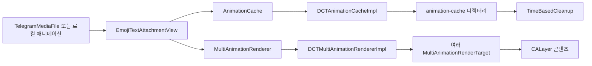
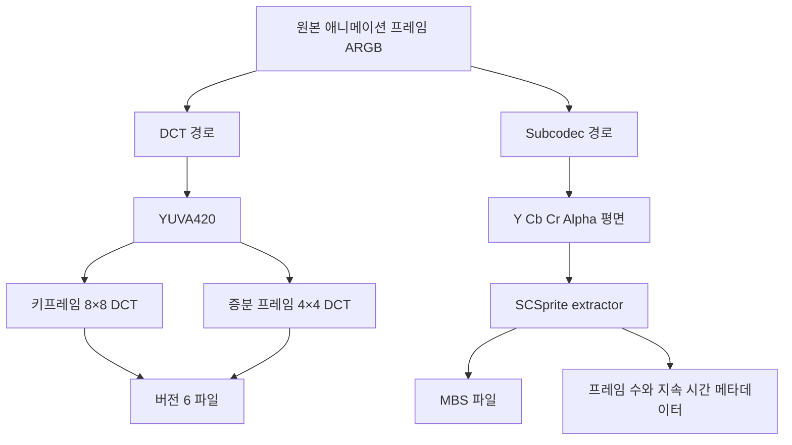
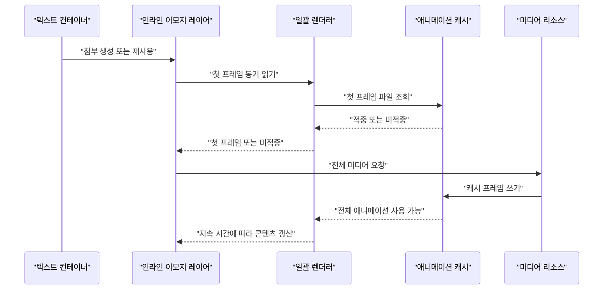
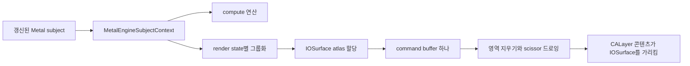

# 커스텀 이모지와 애니메이션 캐시

웹: /docs/media/02-emoji-animation-cache/ · Markdown: /docs/media/02-emoji-animation-cache.md

> Telegram iOS와 macOS 클라이언트의 커스텀 이모지, 소형 애니메이션 렌더링, 프레임 캐시, 일괄 처리, 디스크 축출 메커니즘을 살펴봐요.

> 렌더링과 미디어 · 애니메이션 · 02장 · 도표 4 · 코드 발췌 10 · 인용 45 · 소스 기준선: [TelegramMessenger/Telegram-iOS@f1dd7a2d](https://github.com/TelegramMessenger/Telegram-iOS/tree/f1dd7a2dbd02cbbf513e75d5695d8d36d1cf5838), [overtake/TelegramSwift@579cebbf](https://github.com/overtake/TelegramSwift/tree/579cebbf0c01fd41b712eff3647fa7f69db9665d)
>
> 핵심 소스 파일: [TelegramMessenger/Telegram-iOS/submodules/TelegramUI/Components/AnimationCache/Sources/AnimationCache.swift](https://github.com/TelegramMessenger/Telegram-iOS/blob/f1dd7a2dbd02cbbf513e75d5695d8d36d1cf5838/submodules/TelegramUI/Components/AnimationCache/Sources/AnimationCache.swift), [TelegramMessenger/Telegram-iOS/submodules/TelegramUI/Components/DCTAnimationCacheImpl/Sources/DCTAnimationCacheImpl.swift](https://github.com/TelegramMessenger/Telegram-iOS/blob/f1dd7a2dbd02cbbf513e75d5695d8d36d1cf5838/submodules/TelegramUI/Components/DCTAnimationCacheImpl/Sources/DCTAnimationCacheImpl.swift), [TelegramMessenger/Telegram-iOS/submodules/TelegramUI/Components/SubcodecAnimationCacheImpl/Sources/SubcodecAnimationCacheImpl.swift](https://github.com/TelegramMessenger/Telegram-iOS/blob/f1dd7a2dbd02cbbf513e75d5695d8d36d1cf5838/submodules/TelegramUI/Components/SubcodecAnimationCacheImpl/Sources/SubcodecAnimationCacheImpl.swift), [TelegramMessenger/Telegram-iOS/submodules/TelegramUI/Components/DCTMultiAnimationRendererImpl/Sources/DCTMultiAnimationRendererImpl.swift](https://github.com/TelegramMessenger/Telegram-iOS/blob/f1dd7a2dbd02cbbf513e75d5695d8d36d1cf5838/submodules/TelegramUI/Components/DCTMultiAnimationRendererImpl/Sources/DCTMultiAnimationRendererImpl.swift), [TelegramMessenger/Telegram-iOS/submodules/TelegramUI/Components/SubcodecMultiAnimationRendererImpl/Sources/SubcodecMultiAnimationRendererImpl.swift](https://github.com/TelegramMessenger/Telegram-iOS/blob/f1dd7a2dbd02cbbf513e75d5695d8d36d1cf5838/submodules/TelegramUI/Components/SubcodecMultiAnimationRendererImpl/Sources/SubcodecMultiAnimationRendererImpl.swift), [TelegramMessenger/Telegram-iOS/submodules/TelegramUI/Components/EmojiTextAttachmentView/Sources/EmojiTextAttachmentView.swift](https://github.com/TelegramMessenger/Telegram-iOS/blob/f1dd7a2dbd02cbbf513e75d5695d8d36d1cf5838/submodules/TelegramUI/Components/EmojiTextAttachmentView/Sources/EmojiTextAttachmentView.swift), [TelegramMessenger/Telegram-iOS/submodules/MetalEngine/Sources/MetalEngine.swift](https://github.com/TelegramMessenger/Telegram-iOS/blob/f1dd7a2dbd02cbbf513e75d5695d8d36d1cf5838/submodules/MetalEngine/Sources/MetalEngine.swift), [TelegramMessenger/Telegram-iOS/submodules/Postbox/Sources/MediaBox.swift](https://github.com/TelegramMessenger/Telegram-iOS/blob/f1dd7a2dbd02cbbf513e75d5695d8d36d1cf5838/submodules/Postbox/Sources/MediaBox.swift), [TelegramMessenger/Telegram-iOS/submodules/Postbox/Sources/TimeBasedCleanup.swift](https://github.com/TelegramMessenger/Telegram-iOS/blob/f1dd7a2dbd02cbbf513e75d5695d8d36d1cf5838/submodules/Postbox/Sources/TimeBasedCleanup.swift), [overtake/TelegramSwift/Telegram-Mac/InlineStickerItemLayer.swift](https://github.com/overtake/TelegramSwift/blob/579cebbf0c01fd41b712eff3647fa7f69db9665d/Telegram-Mac/InlineStickerItemLayer.swift), [overtake/TelegramSwift/packages/TelegramMedia/Sources/LottieBufferCompressor.swift](https://github.com/overtake/TelegramSwift/blob/579cebbf0c01fd41b712eff3647fa7f69db9665d/packages/TelegramMedia/Sources/LottieBufferCompressor.swift), [overtake/TelegramSwift/packages/TelegramMedia/Sources/LottiePlayer.swift](https://github.com/overtake/TelegramSwift/blob/579cebbf0c01fd41b712eff3647fa7f69db9665d/packages/TelegramMedia/Sources/LottiePlayer.swift)
>
> 미검증 사항:
> - 현재 Bazel 설정이나 비 Swift 조건부 타깃이 특정 제품 변형에서 SubcodecAnimationCacheImpl과 SubcodecMultiAnimationRendererImpl을 조립하는지 여부.
> - SCSprite가 생성하는 MBS 코드 스트림의 완전한 사양, 버전 호환 규칙, 투명 채널 인코딩 세부 사항. 해당 커밋은 호출 측과 최소한의 헤더 검사만 보여 줘요.
> - cacheLottieAnimation과 cacheVideoAnimation이 구체적으로 어떤 프레임에서 insertKeyframe을 요청하는지, 그리고 애니메이션 길이에 따라 전략을 조정하는지 여부.
> - cacheStorageBox 대장에 .mbs.meta 크기에 단독으로 의존하는 다른 진단 경로나 UI 읽기 경로가 있는지 여부. 현재 쓰기 콜백은 MBS 주 파일만 등록해요.

## 문제와 제약 [#문제와-제약]

커스텀 이모지는 일반 텍스트 글리프가 아니에요. 다음 중 하나일 수 있어요.

- 정적 스티커
- TGS Lottie(벡터 애니메이션 파일)
- 투명 채널이 있는 비디오 스티커
- 비디오 이모지

채팅 목록과 서식 있는 텍스트에 인스턴스가 한꺼번에 많이 나타날 때, 클라이언트가 뷰마다 따로 디코딩하고 따로 타이밍을 잡으면 문제가 생겨요.

- 미디어를 중복해서 읽어요.
- 래스터화(벡터나 비디오를 픽셀 이미지로 바꾸는 일)를 중복해요.
- 메인 스레드에서 레이어 갱신이 대량으로 일어나요.

iOS는 이렇게 풀어요. 원본 애니메이션을 크기에 종속된 프레임 캐시로 미리 래스터화하고, 공유 렌더러가 같은 애니메이션의 여러 타깃을 합쳐서 스케줄링해요. [\[1\]](https://github.com/TelegramMessenger/Telegram-iOS/blob/f1dd7a2dbd02cbbf513e75d5695d8d36d1cf5838/submodules/TelegramUI/Components/AnimationCache/Sources/AnimationCache.swift#L5-L72)[\[2\]](https://github.com/TelegramMessenger/Telegram-iOS/blob/f1dd7a2dbd02cbbf513e75d5695d8d36d1cf5838/submodules/TelegramUI/Components/AnimationCache/Sources/AnimationCache.swift#L96-L134)

이 글은 애니메이션 프레임의 파생 캐시만 다뤄요. 원본 스티커 파일은 여전히 `MediaBox`가 관리해요.

앞서 “08장 렌더링과 성능”에서 DCT(프레임을 주파수 계수로 바꿔 압축하는 방식)와 subcodec(MBS 파일을 만드는 또 하나의 캐시 백엔드)의 개요를 소개했어요. 이 글은 다음을 보충해요.

- 파일 형식
- 객체 수명 주기
- 캐시 축출
- macOS의 대응 구현

연구는 과제에 명시된 커밋에 고정했어요. 추론이라고 분명히 표시한 문장을 빼면 모든 결론은 로컬 소스에서 나왔어요.

이 글은 두 용어를 구분해서 써요. 둘을 헷갈리면 안 돼요.

- 캐시 적중: 애니메이션 캐시가 인코딩된 프레임을 읽는 것
- 원본 미디어 적중: `MediaBox`가 완전한 스티커 파일을 읽는 것

애니메이션 시스템에는 핵심 제약이 네 가지 있어요.

- 같은 미디어라도 표시 크기가 다르면 캐시를 따로 두어야 해요. 축소된 픽셀 데이터를 원본 크기로 재사용할 수 없어요.
- 첫 프레임을 가장 먼저 쓸 수 있어야 해요. 스크롤 중에는 뷰가 캐시된 첫 프레임이나 썸네일을 먼저 보여 준 뒤 전체 재생에 합류해야 해요.
- 보이지 않거나 반복 횟수에 도달한 타깃이 프레임 예산을 쓰면 안 돼요.
- 디스크 캐시는 계정 단위의 보존 기간과 총 용량을 받아들여야 해요. 끝없이 커지면 안 돼요.

`AnimationCache`는 호출하는 계층과 캐시 구현 계층을 나누는 좁은 인터페이스예요.

- 프레임은 RGBA 또는 4평면 YUVA(밝기 Y, 색차 U·V, 투명도 A를 따로 담는 형식)로 표현해요.
- 호출자는 소스 식별자, 타깃 크기, 채움 콜백 하나만 제출해요.
- 채움 콜백은 캐시 파일 경로가 아니라 `AnimationCacheItemWriter`를 받아요.

그래서 호출하는 계층은 DCT 파일이나 MBS 파일이 어떻게 놓이는지 알 필요가 없어요. [\[1\]](https://github.com/TelegramMessenger/Telegram-iOS/blob/f1dd7a2dbd02cbbf513e75d5695d8d36d1cf5838/submodules/TelegramUI/Components/AnimationCache/Sources/AnimationCache.swift#L5-L72)

```swift
public protocol AnimationCacheItemWriter: AnyObject {
    var queue: Queue { get }
    var isCancelled: Bool { get }

    func add(with drawingBlock: (AnimationCacheItemDrawingSurface) -> Double?, proposedWidth: Int, proposedHeight: Int, insertKeyframe: Bool)
    func finish()
}

public protocol AnimationCache: AnyObject {
    func get(sourceId: String, size: CGSize, fetch: @escaping (AnimationCacheFetchOptions) -> Disposable) -> Signal<AnimationCacheItemResult, NoError>
    func getFirstFrameSynchronously(sourceId: String, size: CGSize) -> AnimationCacheItem?
    func getFirstFrame(queue: Queue, sourceId: String, size: CGSize, fetch: ((AnimationCacheFetchOptions) -> Disposable)?, completion: @escaping (AnimationCacheItemResult) -> Void) -> Disposable
}
```
[\[2\]](https://github.com/TelegramMessenger/Telegram-iOS/blob/f1dd7a2dbd02cbbf513e75d5695d8d36d1cf5838/submodules/TelegramUI/Components/AnimationCache/Sources/AnimationCache.swift#L96-L134)

`AnimationCacheItem`은 세 동작을 드러내요.

- 프레임 수
- 지속 시간이나 프레임 수에 따른 진행
- 리셋

`AnimationCacheItemResult`의 `isFinal`은 대기 중인 빈 결과와 최종 성공 또는 실패 결과를 구분해요. 이 인터페이스 덕분에 캐시 구현은 첫 프레임과 전체 애니메이션에 서로 다른 파일과 서로 다른 생성 경로를 쓸 수 있어요. [\[1\]](https://github.com/TelegramMessenger/Telegram-iOS/blob/f1dd7a2dbd02cbbf513e75d5695d8d36d1cf5838/submodules/TelegramUI/Components/AnimationCache/Sources/AnimationCache.swift#L5-L72)[\[2\]](https://github.com/TelegramMessenger/Telegram-iOS/blob/f1dd7a2dbd02cbbf513e75d5695d8d36d1cf5838/submodules/TelegramUI/Components/AnimationCache/Sources/AnimationCache.swift#L96-L134)

## 모듈과 데이터 구조 [#모듈과-데이터-구조]

### iOS 런타임 조립 [#ios-런타임-조립]

지금 iOS 정식 계정 컨텍스트에서 시스템은 `DCTAnimationCacheImpl`과 `DCTMultiAnimationRendererImpl`을 만들어요.

- 캐시 루트 디렉터리: 계정 `MediaBox` 루트 디렉터리 아래의 `animation-cache`예요.
- 임시 출력: `TempBox`에서 가져와요.
- 등록: 쓰기가 끝나면 콜백이 절대 경로와 크기를 `cacheStorageBox`에 등록해요.
- `compressedEmojiCache` 설정: DCT 렌더러의 `useYuvA`에만 대입돼요. Subcodec 백엔드를 고르는 스위치가 아니에요. [\[3\]](https://github.com/TelegramMessenger/Telegram-iOS/blob/f1dd7a2dbd02cbbf513e75d5695d8d36d1cf5838/submodules/TelegramUI/Sources/AccountContext.swift#L386-L397)

```swift
let cacheStorageBox = self.account.postbox.mediaBox.cacheStorageBox
self.animationCache = DCTAnimationCacheImpl(basePath: self.account.postbox.mediaBox.basePath + "/animation-cache", allocateTempFile: {
    return TempBox.shared.tempFile(fileName: "file").path
}, updateStorageStats: { path, size in
    if let pathData = path.data(using: .utf8) {
        cacheStorageBox.update(id: pathData, size: size)
    }
})
self.animationRenderer = DCTMultiAnimationRendererImpl()
(self.animationRenderer as? DCTMultiAnimationRendererImpl)?.useYuvA = sharedContext.immediateExperimentalUISettings.compressedEmojiCache
```
[\[3\]](https://github.com/TelegramMessenger/Telegram-iOS/blob/f1dd7a2dbd02cbbf513e75d5695d8d36d1cf5838/submodules/TelegramUI/Sources/AccountContext.swift#L386-L397)

소스 확인: 같은 조립이 공유 확장 컨텍스트에도 있어요. [\[4\]](https://github.com/TelegramMessenger/Telegram-iOS/blob/f1dd7a2dbd02cbbf513e75d5695d8d36d1cf5838/submodules/TelegramUI/Components/ShareExtensionContext/Sources/ShareExtensionContext.swift#L109-L123)

소스 확인: 이번에 점검한 iOS Swift 소스에서 정식 계정이 만드는 쪽은 DCT 쌍이에요. `SubcodecAnimationCacheImpl`이나 `SubcodecMultiAnimationRendererImpl`을 만드는 호출은 발견되지 않았어요. 그러니까 Subcodec은 커밋 안에 완전한 구현이 있지만 이 계정 계층의 기본 백엔드는 아니에요.

추론: 교체를 준비 중이거나 실험 중인 경로이지, 활성화된 정식 경로가 아니에요. 이 추론이 Bazel 조건부 타깃이 없다는 증거는 아니에요.



`AnimationCacheAnimationType`은 파일 종류를 이렇게 매핑해요.

- 비디오 스티커와 비디오 이모지: VP9 힌트가 붙은 비디오
- 애니메이션 스티커: Lottie
- 그 밖의 파일: 정지 이미지

채움 콜백은 한편으로 로컬 전체 파일 경로를 구독하고, 다른 한편으로 `fetchedMediaResource`로 리소스 다운로드를 시작해요. 이어서 타입에 따라 `cacheVideoAnimation`, `cacheLottieAnimation`, `cacheStillSticker`를 호출해요. 각 함수는 인터페이스가 건네준 writer에 프레임을 써요. [\[5\]](https://github.com/TelegramMessenger/Telegram-iOS/blob/f1dd7a2dbd02cbbf513e75d5695d8d36d1cf5838/submodules/TelegramUI/Components/EmojiTextAttachmentView/Sources/EmojiTextAttachmentView.swift#L89-L151)

### 캐시 키, 디렉터리, 동시성 수렴 [#캐시-키-디렉터리-동시성-수렴]

DCT와 Subcodec은 모두 파일 이름과 디렉터리를 같은 규칙으로 정해요.

- 주 이름: UTF8 `sourceId`의 MD5에, 정수 너비와 높이를 `해시_너비x높이` 형태로 덧붙여요.
- 디렉터리: MD5의 앞 16진수 두 글자를 써요.

이렇게 하면 한 리소스의 픽셀 크기별 파일이 서로 덮어쓰지 않고, 대량의 파일이 256개의 1단계 디렉터리로 분산돼요. 여기서 MD5는 경로 해시와 팬아웃(여러 디렉터리로 나눠 담기) 용도예요. 무결성 인증이 아니에요. [\[6\]](https://github.com/TelegramMessenger/Telegram-iOS/blob/f1dd7a2dbd02cbbf513e75d5695d8d36d1cf5838/submodules/TelegramUI/Components/DCTAnimationCacheImpl/Sources/DCTAnimationCacheImpl.swift#L38-L60)[\[7\]](https://github.com/TelegramMessenger/Telegram-iOS/blob/f1dd7a2dbd02cbbf513e75d5695d8d36d1cf5838/submodules/TelegramUI/Components/SubcodecAnimationCacheImpl/Sources/SubcodecAnimationCacheImpl.swift#L9-L39)

DCT의 메모리 중복 제거 키는 소스 식별자와 너비·높이예요. 요청이 들어오면 이렇게 처리해요.

- 요청이 완전한 파일에 적중하면 바로 반환해요.
- 적중하지 못하면 첫 구독자가 `ItemContext`를 만들고, 순환하는 백그라운드 큐를 고르고, 채움을 시작해요.
- 이후 같은 키의 요청은 `subscribers`에 합류하기만 해요.
- 마지막 구독자가 해제되면 캐시는 writer를 취소하고 하위 fetch도 취소해요.

기기의 프로세서가 두 개를 넘으면 채움 큐가 3개이고, 그렇지 않으면 2개예요. 이런 구조로 디코딩 동시성을 제한하는 동시에 같은 이모지가 여러 번 중복 렌더링되는 것을 막아요. [\[8\]](https://github.com/TelegramMessenger/Telegram-iOS/blob/f1dd7a2dbd02cbbf513e75d5695d8d36d1cf5838/submodules/TelegramUI/Components/DCTAnimationCacheImpl/Sources/DCTAnimationCacheImpl.swift#L1286-L1423)

```swift
let key = ItemKey(id: sourceId, width: Int(size.width), height: Int(size.height))

let itemContext: ItemContext
var beginFetch = false
if let current = self.itemContexts[key] {
    itemContext = current
} else {
    itemContext = ItemContext()
    self.itemContexts[key] = itemContext
    beginFetch = true
}

let index = itemContext.subscribers.add(updateResult)

if beginFetch {
    let fetchQueueIndex = self.nextFetchQueueIndex
    self.nextFetchQueueIndex += 1
    guard let writer = AnimationCacheItemWriterImpl(queue: self.fetchQueues[fetchQueueIndex % self.fetchQueues.count], allocateTempFile: self.allocateTempFile, completion: { [weak self, weak itemContext] result in
        // ...
    }) else {
        return EmptyDisposable
    }
}
```
[\[8\]](https://github.com/TelegramMessenger/Telegram-iOS/blob/f1dd7a2dbd02cbbf513e75d5695d8d36d1cf5838/submodules/TelegramUI/Components/DCTAnimationCacheImpl/Sources/DCTAnimationCacheImpl.swift#L1286-L1423)

DCT는 전체 애니메이션과 첫 프레임에 각각 파일을 하나씩 둬요.

- 전체 파일은 주 이름을 써요.
- 첫 프레임은 주 이름에 `-f`를 붙여요.

첫 프레임 요청은 동기와 비동기 경로가 달라요.

- 동기 첫 프레임 요청: 먼저 `-f`를 찾고, 그다음으로 같은 소스에서 더 큰 크기의 첫 프레임을 찾아 축소한 뒤 요청 크기로 다시 써요.
- 비동기 첫 프레임: 적중하지 못하면 writer가 프레임 하나만 만들게 해요. 이때 채움 옵션의 `firstFrameOnly`가 참이 돼요. [\[9\]](https://github.com/TelegramMessenger/Telegram-iOS/blob/f1dd7a2dbd02cbbf513e75d5695d8d36d1cf5838/submodules/TelegramUI/Components/DCTAnimationCacheImpl/Sources/DCTAnimationCacheImpl.swift#L1426-L1503)

첫 프레임 파일을 따로 두는 이 구성은 채팅 셀이 화면에 들어오는 시점과 전체 애니메이션 생성을 분리해요. 전체 파일이 완성되면 DCT 구현은 전체 애니메이션에서 첫 프레임을 읽어 `-f` 파일을 만들어 디스크에 저장해요.

추론: 나중에 처음 표시할 때 디코딩량을 프레임 한 장으로 제한하려는 것이며, 애니메이션 전체의 접근자를 열고 구성하는 일을 피하려는 것이에요. [\[8\]](https://github.com/TelegramMessenger/Telegram-iOS/blob/f1dd7a2dbd02cbbf513e75d5695d8d36d1cf5838/submodules/TelegramUI/Components/DCTAnimationCacheImpl/Sources/DCTAnimationCacheImpl.swift#L1286-L1423)[\[9\]](https://github.com/TelegramMessenger/Telegram-iOS/blob/f1dd7a2dbd02cbbf513e75d5695d8d36d1cf5838/submodules/TelegramUI/Components/DCTAnimationCacheImpl/Sources/DCTAnimationCacheImpl.swift#L1426-L1503)

### DCT 형식과 인코딩 방법 [#dct-형식과-인코딩-방법]

DCT writer는 이렇게 인코딩해요.

- 요청 크기를 16픽셀 단위로 올림해요.
- ARGB 캔버스를 YUVA420으로 바꿔요.
- 첫 프레임이나 강제 키프레임(이전 프레임에 기대지 않는 프레임)은 8×8 DCT를 써요.
- 증분 프레임(이전 프레임과의 차이만 담은 프레임)은 먼저 이전 프레임의 계수를 빼고 4×4 DCT를 써요.
- 양자화(계수를 거칠게 반올림해 크기를 줄이는 단계) 품질은 휘도 70, 색차 88, 증분 22로 고정되어 있어요. [\[10\]](https://github.com/TelegramMessenger/Telegram-iOS/blob/f1dd7a2dbd02cbbf513e75d5695d8d36d1cf5838/submodules/TelegramUI/Components/DCTAnimationCacheImpl/Sources/DCTAnimationCacheImpl.swift#L150-L208)[\[11\]](https://github.com/TelegramMessenger/Telegram-iOS/blob/f1dd7a2dbd02cbbf513e75d5695d8d36d1cf5838/submodules/TelegramUI/Components/DCTAnimationCacheImpl/Sources/DCTAnimationCacheImpl.swift#L370-L500)

파일 헤더는 로컬 비공개 형식 버전 6이에요. 헤더는 이 순서로 저장돼요.

1. 버전
2. 너비
3. 높이
4. 휘도 양자화 표의 길이와 데이터
5. 색차 양자화 표의 길이와 데이터
6. 증분 양자화 표의 길이와 데이터
7. 압축 프레임 영역의 길이

프레임 영역은 쓸 때 `CompressedFileWriter`의 스트리밍 압축을 거쳐요. 압축을 푼 각 프레임에는 순서대로 다음이 들어 있어요.

1. 총 길이
2. 프레임 타입
3. Y·U·V·A 네 평면의 길이
4. 네 평면의 계수 데이터

끝부분에는 프레임 수와 프레임마다 `Float32` 지속 시간 하나씩이 저장돼요. [\[11\]](https://github.com/TelegramMessenger/Telegram-iOS/blob/f1dd7a2dbd02cbbf513e75d5695d8d36d1cf5838/submodules/TelegramUI/Components/DCTAnimationCacheImpl/Sources/DCTAnimationCacheImpl.swift#L370-L500)[\[12\]](https://github.com/TelegramMessenger/Telegram-iOS/blob/f1dd7a2dbd02cbbf513e75d5695d8d36d1cf5838/submodules/TelegramUI/Components/DCTAnimationCacheImpl/Sources/DCTAnimationCacheImpl.swift#L1035-L1135)

```swift
if isFirstFrame {
    file.write(6 as UInt32)
    file.write(UInt32(dctCoefficients.yPlane.width))
    file.write(UInt32(dctCoefficients.yPlane.height))

    let lumaDctTable = dctData.lumaTable.serializedData()
    file.write(UInt32(lumaDctTable.count))
    let _ = file.write(lumaDctTable)

    let chromaDctTable = dctData.chromaTable.serializedData()
    file.write(UInt32(chromaDctTable.count))
    let _ = file.write(chromaDctTable)

    let deltaDctTable = dctData.deltaTable.serializedData()
    file.write(UInt32(deltaDctTable.count))
    let _ = file.write(deltaDctTable)
}
```
[\[11\]](https://github.com/TelegramMessenger/Telegram-iOS/blob/f1dd7a2dbd02cbbf513e75d5695d8d36d1cf5838/submodules/TelegramUI/Components/DCTAnimationCacheImpl/Sources/DCTAnimationCacheImpl.swift#L370-L500)

읽는 쪽은 메모리 매핑(파일을 메모리에 직접 대응시켜 읽는 방식)으로 파일을 열어요. 검사와 복원은 이 순서로 해요.

1. 데이터 길이와 형식 버전을 검사해요.
2. 구간별로 표 길이가 범위를 넘지 않는지 검사해요.
3. 콘텐츠 길이, 프레임 수, 프레임별 지속 시간을 읽어요.
4. 세 개의 양자화 표로 `DctData`를 재구성해요.

평면을 읽을 때는 평면 길이가 20 MiB를 넘지 않도록 제한하고, 평면 길이가 기대하는 버퍼와 일치하기를 요구해요. 손상된 파일은 UI로 예외를 전파하지 않아요. 읽기 함수가 실패를 반환하면 호출자는 재획득이나 자리 표시 경로로 넘어가요. [\[12\]](https://github.com/TelegramMessenger/Telegram-iOS/blob/f1dd7a2dbd02cbbf513e75d5695d8d36d1cf5838/submodules/TelegramUI/Components/DCTAnimationCacheImpl/Sources/DCTAnimationCacheImpl.swift#L1035-L1135)[\[13\]](https://github.com/TelegramMessenger/Telegram-iOS/blob/f1dd7a2dbd02cbbf513e75d5695d8d36d1cf5838/submodules/TelegramUI/Components/DCTAnimationCacheImpl/Sources/DCTAnimationCacheImpl.swift#L670-L815)

DCT의 장점과 단점은 이래요.

- 장점: CPU 쪽에서 프레임 단위로 디코딩할 수 있고, 이 형식을 지원하는 렌더링 타깃에는 YUVA를 돌려줄 수 있어요.
- 단점: 크기마다 독립된 전체 애니메이션과 독립된 첫 프레임을 저장해야 해요.

키프레임으로 증분 체인의 길이를 제한할 수 있지만, 소스는 고정된 키프레임 간격을 주지 않아요. 간격은 상위의 `cacheLottieAnimation` 같은 채움 함수가 `insertKeyframe`으로 넘기기 때문이에요.

### Subcodec 형식과 인코딩 방법 [#subcodec-형식과-인코딩-방법]

`SubcodecAnimationCacheImpl`은 같은 `AnimationCache` 프로토콜을 구현하지만 파일이 두 개예요. 주 파일 이름은 `.mbs`이고 부수 메타데이터 파일은 `.mbs.meta`예요. writer는 이렇게 동작해요.

- 너비와 높이를 16으로 정렬해요.
- 첫 프레임에서 `SCSprite` extractor를 만들고, 최대 변 길이를 sprite 크기로, 양자화 파라미터를 26으로 써요.
- 매 프레임을 먼저 ARGB에서 Y, Cb, Cr, Alpha 네 평면으로 변환한 뒤 extractor에 넘겨요.
- 끝날 때 메타데이터를 기록해요. 형식은 `UInt32` 프레임 수 하나에 이어서 프레임마다 `Float32` 지속 시간 하나씩이에요. [\[7\]](https://github.com/TelegramMessenger/Telegram-iOS/blob/f1dd7a2dbd02cbbf513e75d5695d8d36d1cf5838/submodules/TelegramUI/Components/SubcodecAnimationCacheImpl/Sources/SubcodecAnimationCacheImpl.swift#L9-L39)[\[14\]](https://github.com/TelegramMessenger/Telegram-iOS/blob/f1dd7a2dbd02cbbf513e75d5695d8d36d1cf5838/submodules/TelegramUI/Components/SubcodecAnimationCacheImpl/Sources/SubcodecAnimationCacheImpl.swift#L134-L285)

```swift
let width = roundUp(proposedWidth, multiple: 16)
let height = roundUp(proposedHeight, multiple: 16)

if self.spriteExtractor == nil {
    self.spriteWidth = width
    self.spriteHeight = height
    let spriteSize = max(width, height)
    do {
        self.spriteExtractor = try SCSprite.extractor(withSpriteSize: Int32(spriteSize), qp: 26, outputPath: self.mbsOutputPath)
    } catch {
        self.isFailed = true
        return
    }
}

let planes = convertARGBToYUVA420(
    argb: buffer,
    width: width,
    height: height,
    bytesPerRow: bytesPerRow
)
```
[\[14\]](https://github.com/TelegramMessenger/Telegram-iOS/blob/f1dd7a2dbd02cbbf513e75d5695d8d36d1cf5838/submodules/TelegramUI/Components/SubcodecAnimationCacheImpl/Sources/SubcodecAnimationCacheImpl.swift#L134-L285)

MBS 첫 프레임 디코더는 14바이트 미만의 데이터를 거부하고, 앞 4바이트가 `MBS6`이기를 요구해요. 이후 이 순서로 진행해요.

1. 헤더에서 높이와 양자화 파라미터를 읽어요.
2. slot이 하나뿐인 `SCMuxSurface`를 만들어요.
3. MBS를 surface에 추가해요.
4. 프레임 하나를 진행시켜요.
5. `SCVideoToolboxDecoder`로 출력 스트림을 디코딩해요.
6. 색상 영역과 Alpha 영역에서 premultiplied(알파를 미리 곱한) BGRA를 복원해요.

이 경로를 보면 MBS 본체는 일반적인 프레임별 RGBA 파일이 아니라 sprite surface가 출력한 디코딩 가능한 스트림이에요. [\[15\]](https://github.com/TelegramMessenger/Telegram-iOS/blob/f1dd7a2dbd02cbbf513e75d5695d8d36d1cf5838/submodules/TelegramUI/Components/SubcodecAnimationCacheImpl/Sources/SubcodecAnimationCacheImpl.swift#L288-L462)

전체 애니메이션의 일반 `get`은 MBS에 적중한 뒤 첫 프레임 하나만 디코딩하고, 어떻게 진행시켜도 그 첫 프레임을 반환하는 `AnimationCacheItem`을 구성해요. 이 동작은 프로토콜 호환을 위한 폴백이지 전체 애니메이션 재생이 아니에요.

Subcodec 전용 renderer는 이 `AnimationCacheItem`을 거치지 않아요. `fetchIfNeeded`를 호출해 MBS 경로와 metadata를 얻은 다음 sprite를 공유 surface에 곧바로 넣어요. [\[16\]](https://github.com/TelegramMessenger/Telegram-iOS/blob/f1dd7a2dbd02cbbf513e75d5695d8d36d1cf5838/submodules/TelegramUI/Components/SubcodecAnimationCacheImpl/Sources/SubcodecAnimationCacheImpl.swift#L464-L640)[\[17\]](https://github.com/TelegramMessenger/Telegram-iOS/blob/f1dd7a2dbd02cbbf513e75d5695d8d36d1cf5838/submodules/TelegramUI/Components/SubcodecAnimationCacheImpl/Sources/SubcodecAnimationCacheImpl.swift#L640-L800)

눈에 띄는 구현 세부 사항이 하나 있어요.

- 쓰기가 끝난 뒤 Subcodec은 `updateStorageStats`로 MBS 주 파일의 크기만 등록해요. `.mbs.meta` 파일은 이 콜백에서 따로 등록되지 않아요.
- 반면 뒤에서 다룰 디렉터리 스캔은 두 파일을 모두 물리 크기에 합산해요.

소스 확인: 이 차이는 통계 대장의 단위와 실제 디스크 스캔의 단위가 맞지 않는 부분이에요. [\[16\]](https://github.com/TelegramMessenger/Telegram-iOS/blob/f1dd7a2dbd02cbbf513e75d5695d8d36d1cf5838/submodules/TelegramUI/Components/SubcodecAnimationCacheImpl/Sources/SubcodecAnimationCacheImpl.swift#L464-L640)[\[18\]](https://github.com/TelegramMessenger/Telegram-iOS/blob/f1dd7a2dbd02cbbf513e75d5695d8d36d1cf5838/submodules/Postbox/Sources/MediaBox.swift#L185-L222)



## 핵심 흐름 [#핵심-흐름]

### 첫 프레임, 다운로드, 자리 표시 [#첫-프레임-다운로드-자리-표시]

`InlineStickerItemLayer`는 만들 때 point size(화면 좌표 단위의 크기)에 화면 스케일을 곱하는데, 최대 스케일 값은 2예요. 그래서 캐시 키는 픽셀 크기로 구분되지만, 고밀도 화면에서 인라인 텍스트를 위해 2배를 넘는 캐시를 쓰는 일은 피해요. [\[19\]](https://github.com/TelegramMessenger/Telegram-iOS/blob/f1dd7a2dbd02cbbf513e75d5695d8d36d1cf5838/submodules/TelegramUI/Components/EmojiTextAttachmentView/Sources/EmojiTextAttachmentView.swift#L457-L551)

파일이 있는 이모지는 동기 로딩이 허용되면 이 layer가 먼저 동기 첫 프레임을 요청해요.

- 적중하면 곧바로 콘텐츠로 설정해요.
- 적중하지 못하면 immediate thumbnail로 자리 표시 이미지를 만들고, 그래도 전체 애니메이션 로딩은 시작해요. [\[20\]](https://github.com/TelegramMessenger/Telegram-iOS/blob/f1dd7a2dbd02cbbf513e75d5695d8d36d1cf5838/submodules/TelegramUI/Components/EmojiTextAttachmentView/Sources/EmojiTextAttachmentView.swift#L781-L909)

비동기 첫 프레임 경로는 이렇게 흘러가요.

- renderer가 프레임을 얻지 못하면 인터랙션 우선순위의 첫 프레임 큐에서 썸네일을 만들고 메인 스레드로 돌아와 layer를 갱신해요.
- 첫 프레임이 나중에 성공하면 썸네일 경쟁을 취소하고 전체 애니메이션을 시작해요.

전체 로딩은 파일 종류에 따라 달라요.

- 애니메이션 스티커, 비디오 스티커, 비디오 이모지: 미디어 리소스 ID를 `itemId`로 써요.
- 정적 스티커: writer를 거치지만 정적 이미지 렌더링 함수로 바뀌어요. [\[20\]](https://github.com/TelegramMessenger/Telegram-iOS/blob/f1dd7a2dbd02cbbf513e75d5695d8d36d1cf5838/submodules/TelegramUI/Components/EmojiTextAttachmentView/Sources/EmojiTextAttachmentView.swift#L781-L909)

```swift
if attemptSynchronousLoad {
    if !arguments.renderer.loadFirstFrameSynchronously(target: self, cache: arguments.cache, itemId: file.resource.id.stringRepresentation, size: arguments.pixelSize) {
        if let image = generateStickerPlaceholderImage(data: file.immediateThumbnailData, size: arguments.pointSize, imageSize: file.dimensions?.cgSize ?? CGSize(width: 512.0, height: 512.0), backgroundColor: nil, foregroundColor: arguments.placeholderColor) {
            self.contents = image.cgImage
            self.isDisplayingPlaceholder = true
            self.updateTintColor()
        }
    } else {
        self.updateTintColor()
    }

    self.loadAnimation()
}
```
[\[20\]](https://github.com/TelegramMessenger/Telegram-iOS/blob/f1dd7a2dbd02cbbf513e75d5695d8d36d1cf5838/submodules/TelegramUI/Components/EmojiTextAttachmentView/Sources/EmojiTextAttachmentView.swift#L781-L909)

텍스트 컨테이너는 파일 ID와 그 ID가 텍스트에서 몇 번째로 나타나는지를 합쳐 `InlineStickerItemLayer.Key`를 만들어요. 레이아웃을 갱신할 때 이렇게 해요.

- 아직 유효한 `UIView`를 재사용해요.
- 글자 색과 frame을 갱신해요.
- 무효가 된 항목을 제거해요.

덕분에 서식 있는 텍스트를 다시 배치할 때마다 모든 첨부 뷰를 새로 만들지 않아요.

각 `EmojiTextAttachmentView`는 보이는 상태로 재생할 수 있는지를 content layer에 전달해요. 초기값은 절전 설정 `loopEmoji`에서 와요. [\[21\]](https://github.com/TelegramMessenger/Telegram-iOS/blob/f1dd7a2dbd02cbbf513e75d5695d8d36d1cf5838/submodules/TelegramUI/Components/EmojiTextAttachmentView/Sources/EmojiTextAttachmentView.swift#L963-L1094)

재생 조건은 두 곳에서 따로 확인해요. 이중 방어선이에요.

- `InlineStickerItemLayer`: layer가 계층에 들어와 있고 보이는지 요구하고 반복 횟수를 검사해요.
- 렌더러: 연결된 targets의 `shouldBeAnimating`도 훑어요.

어느 한 조건이라도 깨지면 다음 프레임 작업을 만들지 않아요. [\[22\]](https://github.com/TelegramMessenger/Telegram-iOS/blob/f1dd7a2dbd02cbbf513e75d5695d8d36d1cf5838/submodules/TelegramUI/Components/EmojiTextAttachmentView/Sources/EmojiTextAttachmentView.swift#L632-L653)[\[23\]](https://github.com/TelegramMessenger/Telegram-iOS/blob/f1dd7a2dbd02cbbf513e75d5695d8d36d1cf5838/submodules/TelegramUI/Components/DCTMultiAnimationRendererImpl/Sources/DCTMultiAnimationRendererImpl.swift#L657-L745)



### DCT 다중 타깃 일괄 렌더링 [#dct-다중-타깃-일괄-렌더링]

DCT renderer의 `GroupContext`는 미디어 ID, 너비·높이, 선택적 고유 ID를 renderer 수준의 키로 써요. 고유 ID에 따라 공유 여부가 갈려요.

- 일반 항목: 고유 ID가 0이라서, 같은 크기의 여러 타깃이 `ItemAnimationContext` 하나, 디코딩 상태 하나, 프레임 한 벌을 공유해요.
- `unique`가 참인 항목: 증가하는 ID를 할당해서 그 인스턴스가 독립적으로 재생되게 해요. 같은 이모지를 서로 다른 위상으로 재생하는 장면에 유용해요. [\[23\]](https://github.com/TelegramMessenger/Telegram-iOS/blob/f1dd7a2dbd02cbbf513e75d5695d8d36d1cf5838/submodules/TelegramUI/Components/DCTMultiAnimationRendererImpl/Sources/DCTMultiAnimationRendererImpl.swift#L657-L745)

```swift
var uniqueId = 0
if unique {
    uniqueId = self.nextUniqueId
    self.nextUniqueId += 1
}

let itemKey = ItemKey(id: itemId, width: Int(size.width), height: Int(size.height), uniqueId: uniqueId)
let itemContext: ItemAnimationContext
if let current = self.itemContexts[itemKey] {
    itemContext = current
} else {
    let queueAffinity = self.nextQueueAffinity
    self.nextQueueAffinity += 1
    itemContext = ItemAnimationContext(cache: cache, queueAffinity: queueAffinity, itemId: itemId, size: size, useYuvA: useYuvA, fetch: fetch, stateUpdated: {
        // ...
    })
    self.itemContexts[itemKey] = itemContext
}
```
[\[23\]](https://github.com/TelegramMessenger/Telegram-iOS/blob/f1dd7a2dbd02cbbf513e75d5695d8d36d1cf5838/submodules/TelegramUI/Components/DCTMultiAnimationRendererImpl/Sources/DCTMultiAnimationRendererImpl.swift#L657-L745)

`ItemAnimationContext`는 캐시 항목을 받은 뒤 적어도 하나의 target이 재생해야 할 때만 진행해요.

- 현재 프레임의 남은 지속 시간으로 몇 프레임을, 혹은 얼마만큼의 시간을 진행해야 하는지 계산해요.
- 읽기 작업에는 `queueAffinity`가 붙고, 렌더러는 짝수와 홀수 affinity로 고정된 두 큐에 나눠요.
- 완료 클로저는 메인 스레드로 돌아와 모든 targets를 갱신해요.

소스 확인: 이 구조는 이모지마다 스레드를 만드는 방식이 아니라, 상한이 있는 두 큐 방식의 프레임 준비 모델이에요. [\[24\]](https://github.com/TelegramMessenger/Telegram-iOS/blob/f1dd7a2dbd02cbbf513e75d5695d8d36d1cf5838/submodules/TelegramUI/Components/DCTMultiAnimationRendererImpl/Sources/DCTMultiAnimationRendererImpl.swift#L531-L655)[\[25\]](https://github.com/TelegramMessenger/Telegram-iOS/blob/f1dd7a2dbd02cbbf513e75d5695d8d36d1cf5838/submodules/TelegramUI/Components/DCTMultiAnimationRendererImpl/Sources/DCTMultiAnimationRendererImpl.swift#L860-L1045)

타이머는 `frameSkip`을 써요. 간격은 조건에 따라 달라요.

- 저전력 모드가 아니고 프로세서가 두 개를 넘으면: 1/60초예요.
- 그렇지 않으면: 2/60초예요.

재생할 항목이 하나도 없으면 타이머는 무효화돼요. 이 메커니즘은 저전력과 저코어 기기의 갱신 빈도를 약 30 Hz로 낮춰요. [\[25\]](https://github.com/TelegramMessenger/Telegram-iOS/blob/f1dd7a2dbd02cbbf513e75d5695d8d36d1cf5838/submodules/TelegramUI/Components/DCTMultiAnimationRendererImpl/Sources/DCTMultiAnimationRendererImpl.swift#L860-L1045)

### Subcodec 다중 애니메이션 일괄 렌더링 [#subcodec-다중-애니메이션-일괄-렌더링]

`SubcodecMultiAnimationRendererImpl`이 묶는 단위는 개별 애니메이션 접근자가 아니라, 올림한 너비·높이로 나눈 `SurfaceGroup`이에요. 그룹은 이렇게 커져요.

- 한 그룹은 처음에 64개 slot(sprite 하나가 들어가는 칸)을 가지고, 가득 차면 2배로 늘어나 최대 882개가 돼요.
- 늘리기 전에 디코딩된 프레임이 없으면 먼저 프레임 하나를 진행하고 디코딩해요.
- 그 디코딩된 프레임을 입력으로 `resize`를 호출한 뒤 각 sprite의 재생 인덱스, 남은 지속 시간, 타깃 집합을 옮겨요. [\[26\]](https://github.com/TelegramMessenger/Telegram-iOS/blob/f1dd7a2dbd02cbbf513e75d5695d8d36d1cf5838/submodules/TelegramUI/Components/SubcodecMultiAnimationRendererImpl/Sources/SubcodecMultiAnimationRendererImpl.swift#L48-L205)

tick(타이머가 한 번 울리는 주기)마다 그룹 안에서 이렇게 진행해요.

1. 재생할 수 있는 sprite만 진행해요.
2. 하나 이상이 진행되면 `SCMuxSurface`가 NAL 데이터 한 벌을 만들어요.
3. `SCVideoToolboxDecoder`가 이 공유 스트림 한 벌을 한 번 디코딩해요.
4. 각 sprite가 자신의 color rect와 alpha rect로 디코딩된 프레임에서 이미지를 추출해 각자의 target에 밀어 넣어요.

추론: 같은 크기의 작은 이모지가 충분히 많을 때, 먼저 합성하고 나중에 한 번 디코딩하는 이 구조는 독립 비디오 디코딩 횟수를 줄일 수 있어요. 대가는 모든 sprite가 같은 크기 집합에 맞아야 한다는 점이고, 마지막에 항목별로 BGRA를 추출하는 일은 여전히 CPU에서 실행돼요. [\[27\]](https://github.com/TelegramMessenger/Telegram-iOS/blob/f1dd7a2dbd02cbbf513e75d5695d8d36d1cf5838/submodules/TelegramUI/Components/SubcodecMultiAnimationRendererImpl/Sources/SubcodecMultiAnimationRendererImpl.swift#L206-L302)

```swift
fetchDisposable.set(subcodecCache.fetchIfNeeded(sourceId: itemId, size: size, fetch: fetch, completion: { [weak self, weak target] mbsPath in
    Queue.mainQueue().async {
        guard let strongSelf = self, let target = target, let mbsPath = mbsPath else {
            return
        }

        guard let metadata = subcodecCache.loadMetadata(sourceId: itemId, size: size) else {
            return
        }

        let surfaceGroup: SurfaceGroup
        if let existing = strongSelf.surfaceGroups[sizeKey] {
            surfaceGroup = existing
        } else {
            surfaceGroup = SurfaceGroup(spriteWidth: spriteWidth, spriteHeight: spriteHeight)
            strongSelf.surfaceGroups[sizeKey] = surfaceGroup
        }

        guard let spriteContext = surfaceGroup.addSprite(mbsPath: mbsPath, metadata: metadata) else {
            return
        }
```
[\[28\]](https://github.com/TelegramMessenger/Telegram-iOS/blob/f1dd7a2dbd02cbbf513e75d5695d8d36d1cf5838/submodules/TelegramUI/Components/SubcodecMultiAnimationRendererImpl/Sources/SubcodecMultiAnimationRendererImpl.swift#L390-L525)

Subcodec renderer도 같은 60 Hz 또는 30 Hz 타이머 전략을 써요. 다만 전달된 cache의 실제 타입이 `SubcodecAnimationCacheImpl`이어야 해요. 잘못된 구현을 넘기면 `add`가 곧바로 빈 disposable을 반환해요. 이 런타임 타입 제약을 보면, 두 구현이 공개 프로토콜을 공유하더라도 마음대로 섞어 쓸 수 있는 백엔드는 아니에요. [\[28\]](https://github.com/TelegramMessenger/Telegram-iOS/blob/f1dd7a2dbd02cbbf513e75d5695d8d36d1cf5838/submodules/TelegramUI/Components/SubcodecMultiAnimationRendererImpl/Sources/SubcodecMultiAnimationRendererImpl.swift#L390-L525)

### MetalEngine의 위치 [#metalengine의-위치]

`DCTMultiAnimationRendererImpl` 자체는 주로 `CGImage`나 `CVPixelBuffer`를 target layer로 출력해요. `MetalEngine`을 직접 호출하지 않아요.

다른 렌더링 subject가 MetalEngine을 쓸 때, MetalEngine은 또 다른 범용 GPU 병합 계층을 제공해요.

- `IOSurface`를 공유 텍스처 저장소로 써요.
- shelf pack으로 여러 layer를 atlas(여러 이미지를 담는 큰 텍스처)에 할당해요.
- allocation마다 phase 두 개를 남겨요.

phase가 둘이면 다른 슬롯에 오프스크린으로 쓴 뒤 `contentsRect`를 전환할 수 있어서, 지금 표시 중인 영역에 쓰는 일을 피해요. [\[29\]](https://github.com/TelegramMessenger/Telegram-iOS/blob/f1dd7a2dbd02cbbf513e75d5695d8d36d1cf5838/submodules/MetalEngine/Sources/MetalEngine.swift#L524-L680)[\[30\]](https://github.com/TelegramMessenger/Telegram-iOS/blob/f1dd7a2dbd02cbbf513e75d5695d8d36d1cf5838/submodules/MetalEngine/Sources/MetalEngine.swift#L875-L1042)

한 번의 `display`에서 MetalEngine은 이 순서로 일해요.

1. 갱신된 subjects를 모아요.
2. command buffer 하나를 만들어요.
3. compute operations를 실행해요.
4. render state별로 layer operations를 묶어요.
5. 각 surface에서 관련된 모든 영역을 먼저 지우고, 맞는 pipeline과 scissor rect를 설정한 뒤 마지막으로 buffer를 제출해요.

빈 allocation은 이후의 display에서 해제되고, 빈 surface는 map에서 제거돼요. [\[31\]](https://github.com/TelegramMessenger/Telegram-iOS/blob/f1dd7a2dbd02cbbf513e75d5695d8d36d1cf5838/submodules/MetalEngine/Sources/MetalEngine.swift#L1073-L1243)



그러니까 MetalEngine은 클라이언트의 범용 레이어 일괄 처리 및 surface 할당 시설이에요. DCT나 Subcodec이 반드시 거치는 캐시 인코더는 아니에요.

소스 확인: 지금 DCT와 Subcodec 렌더러는 각자 Timer, CPU 디코딩, target 콘텐츠 갱신을 써요.

추론: 이모지 첨부가 이 renderer들에만 기대면 MetalEngine은 주 프레임 진행 경로에 참여하지 않아요.

## 경계 사례와 실패 처리 [#경계-사례와-실패-처리]

DCT writer는 다음 경우에 실패로 표시해요.

- 초기 크기 이후에 프레임 크기가 바뀐 것을 발견할 때
- 너비나 높이가 0일 때

다음 경우에는 사용할 수 있는 item을 전달하지 않아요.

- 파일을 만들 수 없을 때
- 압축기 flush가 실패할 때
- 임시 파일 이동이 실패할 때
- 다시 읽기가 실패할 때

전체 캐시 경로에서 실패하면 구독자 모두가 명시적인 실패 콜백을 받는 것은 아니에요. 실패가 일어난 지점에 따라 달라요. 첫 프레임 비동기 경로는 디렉터리 생성, 이동, 다시 읽기 실패를 모두 `item nil`과 `isFinal true`로 마쳐요. 그래서 호출 계층은 썸네일이나 빈 상태를 유지해야 해요. [\[8\]](https://github.com/TelegramMessenger/Telegram-iOS/blob/f1dd7a2dbd02cbbf513e75d5695d8d36d1cf5838/submodules/TelegramUI/Components/DCTAnimationCacheImpl/Sources/DCTAnimationCacheImpl.swift#L1286-L1423)[\[9\]](https://github.com/TelegramMessenger/Telegram-iOS/blob/f1dd7a2dbd02cbbf513e75d5695d8d36d1cf5838/submodules/TelegramUI/Components/DCTAnimationCacheImpl/Sources/DCTAnimationCacheImpl.swift#L1426-L1503)[\[11\]](https://github.com/TelegramMessenger/Telegram-iOS/blob/f1dd7a2dbd02cbbf513e75d5695d8d36d1cf5838/submodules/TelegramUI/Components/DCTAnimationCacheImpl/Sources/DCTAnimationCacheImpl.swift#L370-L500)

Subcodec은 다음 경우 모두 `isFailed`를 설정해요.

- 크기가 0일 때
- extractor 생성 실패
- 프레임 크기 불일치
- 프레임 추가 실패
- finalize 실패
- 메타데이터 쓰기 실패

실패하면 임시 MBS와 metadata를 함께 지워요.

읽을 때는 MBS magic, 최소 헤더 길이, 콘텐츠 변 길이, 디코더 생성, 스트림 디코딩이 모두 guard로 nil을 반환하며 빠져나가요. metadata는 최소 4바이트인지, 정확한 최소 길이인지 검사해요. 손상된 캐시를 고치려 하지 않고 이후 요청이 다시 쓰게 해요. [\[14\]](https://github.com/TelegramMessenger/Telegram-iOS/blob/f1dd7a2dbd02cbbf513e75d5695d8d36d1cf5838/submodules/TelegramUI/Components/SubcodecAnimationCacheImpl/Sources/SubcodecAnimationCacheImpl.swift#L134-L285)[\[15\]](https://github.com/TelegramMessenger/Telegram-iOS/blob/f1dd7a2dbd02cbbf513e75d5695d8d36d1cf5838/submodules/TelegramUI/Components/SubcodecAnimationCacheImpl/Sources/SubcodecAnimationCacheImpl.swift#L288-L462)[\[16\]](https://github.com/TelegramMessenger/Telegram-iOS/blob/f1dd7a2dbd02cbbf513e75d5695d8d36d1cf5838/submodules/TelegramUI/Components/SubcodecAnimationCacheImpl/Sources/SubcodecAnimationCacheImpl.swift#L464-L640)

중단과 정리는 이렇게 처리해요.

- 미디어가 없으면 채움 콜백은 `directDataPath`를 기다리기만 해요.
- Lottie 데이터를 읽지 못하면 writer를 명시적으로 `finish`해요.
- 뷰가 소멸하거나, 텍스트 레이아웃에서 빠지거나, 마지막 캐시 구독자가 취소하면 disposable(구독을 끊는 핸들)이 다운로드와 쓰기를 취소해요.
- DCT renderer도 target이 소멸할 때 callbacks와 target 참조를 제거해요.

덕분에 스크롤로 화면 밖으로 나간 요소가 구독이나 재생을 계속 붙들고 있지 않아요. [\[5\]](https://github.com/TelegramMessenger/Telegram-iOS/blob/f1dd7a2dbd02cbbf513e75d5695d8d36d1cf5838/submodules/TelegramUI/Components/EmojiTextAttachmentView/Sources/EmojiTextAttachmentView.swift#L89-L151)[\[8\]](https://github.com/TelegramMessenger/Telegram-iOS/blob/f1dd7a2dbd02cbbf513e75d5695d8d36d1cf5838/submodules/TelegramUI/Components/DCTAnimationCacheImpl/Sources/DCTAnimationCacheImpl.swift#L1286-L1423)[\[20\]](https://github.com/TelegramMessenger/Telegram-iOS/blob/f1dd7a2dbd02cbbf513e75d5695d8d36d1cf5838/submodules/TelegramUI/Components/EmojiTextAttachmentView/Sources/EmojiTextAttachmentView.swift#L781-L909)[\[23\]](https://github.com/TelegramMessenger/Telegram-iOS/blob/f1dd7a2dbd02cbbf513e75d5695d8d36d1cf5838/submodules/TelegramUI/Components/DCTMultiAnimationRendererImpl/Sources/DCTMultiAnimationRendererImpl.swift#L657-L745)

캐시 총량을 축출하는 기준은 애니메이션 리소스 ID가 아니에요. `MediaBox`가 `TimeBasedCleanup`(시간과 용량 기준으로 캐시 파일을 지우는 정리기)을 구성할 때 `cache`와 `animation-cache`를 general paths에 넣어요. 계정을 만들 때 `CacheStorageSettings`를 읽어 다음 값을 `MediaBox`에 넘겨요.

- 기본 보존 시간
- 1시간짜리 단기 캐시 기간
- 기본 GiB 상한 [\[18\]](https://github.com/TelegramMessenger/Telegram-iOS/blob/f1dd7a2dbd02cbbf513e75d5695d8d36d1cf5838/submodules/Postbox/Sources/MediaBox.swift#L185-L222)[\[32\]](https://github.com/TelegramMessenger/Telegram-iOS/blob/f1dd7a2dbd02cbbf513e75d5695d8d36d1cf5838/submodules/TelegramCore/Sources/Account/Account.swift#L1558-L1567)

기본 설정값은 이래요.

- 총 용량과 개인 채팅 보존 기간: `Int32.max`
- 그룹 기본값: 31일
- 채널 기본값: 7일
- 스토리 기본값: 2일

그런데 대화별 리소스를 자동으로 축출할 때는 `storageBox` 리소스 매핑을 거치고, 애니메이션 파생 파일은 `TimeBasedCleanup`의 general path 스캔을 거쳐요. 그래서 애니메이션 캐시의 수명은 주로 계정 공통 기한과 총 GiB 상한이 정해요. 원본 미디어가 속한 채팅 유형에서 기한이 바로 나오지는 않아요. [\[33\]](https://github.com/TelegramMessenger/Telegram-iOS/blob/f1dd7a2dbd02cbbf513e75d5695d8d36d1cf5838/submodules/TelegramCore/Sources/SyncCore/SyncCore_CacheStorageSettings.swift#L4-L92)[\[34\]](https://github.com/TelegramMessenger/Telegram-iOS/blob/f1dd7a2dbd02cbbf513e75d5695d8d36d1cf5838/submodules/TelegramCore/Sources/Utils/AutomaticCacheEviction.swift#L89-L257)

`TimeBasedCleanup`의 총 용량 스캔은 general paths, short lived paths, 미디어 루트 디렉터리를 집계해요. 상한을 넘으면 이렇게 진행해요.

- 임시 스캔 데이터베이스가 파일 수정 시각이 오래된 것부터 새것 순으로 접근하며 하나씩 `unlink`해요.
- 남은 크기가 바이트 상한 이하가 될 때까지 계속해요.
- 캐시 경로를 지운 뒤에는 `cacheStorageBox`에서 해당 대장 항목도 지워요.

소스 확인: 이 축출은 수정 시각 기준의 oldest first 방식에 가까워요. “애니메이션이 적중할 때마다 갱신되는” 엄밀한 LRU(가장 오래 쓰지 않은 것부터 지우는 방식)는 아니에요. `touch`는 최대 10초 뒤에 `utime`을 실행하지만, DCT와 Subcodec의 적중 읽기 코드는 `touch`를 직접 호출하지 않아요. [\[18\]](https://github.com/TelegramMessenger/Telegram-iOS/blob/f1dd7a2dbd02cbbf513e75d5695d8d36d1cf5838/submodules/Postbox/Sources/MediaBox.swift#L185-L222)[\[35\]](https://github.com/TelegramMessenger/Telegram-iOS/blob/f1dd7a2dbd02cbbf513e75d5695d8d36d1cf5838/submodules/Postbox/Sources/TimeBasedCleanup.swift#L333-L635)

```swift
if totalLimitSize > bytesLimit && !isCancelled() {
    var remainingSize = Int64(totalLimitSize)
    var unlinkedResourceIdSet = Set<Data>()
    tempDatabase.topByAccessTime { size, filePaths in
        if isCancelled() {
            return false
        }
        remainingSize -= size

        for filePath in filePaths {
            unlink(filePath)
            removedGeneralLimitCount += 1
            // ...
        }

        if remainingSize <= Int64(bytesLimit) {
            return false
        }

        return true
    }
}
```
[\[35\]](https://github.com/TelegramMessenger/Telegram-iOS/blob/f1dd7a2dbd02cbbf513e75d5695d8d36d1cf5838/submodules/Postbox/Sources/TimeBasedCleanup.swift#L333-L635)

대장 등록과 파일 시스템 스캔의 역할을 구분해야 해요.

- 대장 등록: DCT와 Subcodec은 쓰기가 끝나면 `cacheStorageBox.update`를 호출해요. 이렇게 하면 저장 공간 사용 화면과 정리 뒤의 인덱스가 일치해요.
- 파일 시스템 스캔: 총 크기를 실제로 정해요. 이 대장의 수치 합산이 아니에요.

그래서 오래된 대장 항목이 없어도 용량 스캔은 실제 파일을 찾아낼 수 있어요. 반대로 인덱스가 정확하다고 해서 스캔이 물리 파일을 지우는 것을 막지도 못해요. [\[3\]](https://github.com/TelegramMessenger/Telegram-iOS/blob/f1dd7a2dbd02cbbf513e75d5695d8d36d1cf5838/submodules/TelegramUI/Sources/AccountContext.swift#L386-L397)[\[16\]](https://github.com/TelegramMessenger/Telegram-iOS/blob/f1dd7a2dbd02cbbf513e75d5695d8d36d1cf5838/submodules/TelegramUI/Components/SubcodecAnimationCacheImpl/Sources/SubcodecAnimationCacheImpl.swift#L464-L640)[\[18\]](https://github.com/TelegramMessenger/Telegram-iOS/blob/f1dd7a2dbd02cbbf513e75d5695d8d36d1cf5838/submodules/Postbox/Sources/MediaBox.swift#L185-L222)[\[35\]](https://github.com/TelegramMessenger/Telegram-iOS/blob/f1dd7a2dbd02cbbf513e75d5695d8d36d1cf5838/submodules/Postbox/Sources/TimeBasedCleanup.swift#L333-L635)

## iOS와 macOS 비교 [#ios와-macos-비교]

macOS 클라이언트는 다른 애니메이션 스택을 써요. 과제에 지정된 `TelegramSwift` 코드에는 `DCTAnimationCacheImpl`, `SubcodecAnimationCacheImpl`, `SubcodecMultiAnimationRendererImpl`과 같은 이름의 구현이 없어요.

그곳의 `InlineStickerItemLayer`는 전체 미디어를 읽은 뒤 `LottieAnimation`을 만들어요.

- 기본 캐시 목적지는 `temporaryLZ4(.effect)`이고, 동적 색상이 있으면 `.none`으로 바뀌어요.
- 이 호출은 `metalSupport: false`를 명시적으로 넘겨요. [\[36\]](https://github.com/overtake/TelegramSwift/blob/579cebbf0c01fd41b712eff3647fa7f69db9665d/Telegram-Mac/InlineStickerItemLayer.swift#L683-L728)

macOS의 `LottieAnimation`은 lottie, webp, webm을 지원해요. Lottie만 `supportsMetal`을 인스턴스 스위치로 켤 수 있는데, 인라인 스티커는 지금 false를 넘겨요.

임시 캐시 목적지는 초기화할 때 `TRLotFileSupplyment`를 만들어요. Lottie 전체 캐시가 완료되면 캐시 데이터로 곧바로 renderer를 구성해요. WebM은 너비가 40을 넘을 때만 `TRLotFileSupplyment`를 만들어요. [\[37\]](https://github.com/overtake/TelegramSwift/blob/579cebbf0c01fd41b712eff3647fa7f69db9665d/packages/TelegramMedia/Sources/LottiePlayer.swift#L1321-L1511)

디스크 캐시는 앱 group 컨테이너의 `trlottie-animations`에 있어요. 애니메이션마다 파일이 두 개예요.

- map 파일: 프레임 번호에서 파일 오프셋, 압축 길이, 완료 표시로 가는 매핑이 담기고, fps와 시작 프레임, 끝 프레임도 저장돼요.
- data 파일: 프레임마다 LZFSE로 압축한 RGBA buffer를 이어 붙여 저장해요.

파일 이름에는 형식 버전 68, `lzfse` 표시, 압축하지 않은 프레임 buffer 크기, live time(항목의 유효 기간)이 들어 있어요. [\[38\]](https://github.com/overtake/TelegramSwift/blob/579cebbf0c01fd41b712eff3647fa7f69db9665d/packages/TelegramMedia/Sources/LottieBufferCompressor.swift#L17-L183)[\[39\]](https://github.com/overtake/TelegramSwift/blob/579cebbf0c01fd41b712eff3647fa7f69db9665d/packages/TelegramMedia/Sources/LottieBufferCompressor.swift#L248-L390)

```swift
static func mapPath(_ animation: LottieAnimation, bufferSize: Int) -> String {

    let path = TRLotData.directory + animation.cacheKey

    return path + "-v\(version)-lzfse-bs\(bufferSize)-lt\(animation.liveTime)-map"
}

static func dataPath(_ animation: LottieAnimation, bufferSize: Int) -> String {
    let path = TRLotData.directory + animation.cacheKey

    return path + "-v\(version)-lzfse-bs\(bufferSize)-lt\(animation.liveTime)-data"
}
```
[\[38\]](https://github.com/overtake/TelegramSwift/blob/579cebbf0c01fd41b712eff3647fa7f69db9665d/packages/TelegramMedia/Sources/LottieBufferCompressor.swift#L17-L183)

API 이름은 `temporaryLZ4`이지만 소스가 실제로 호출하는 것은 `COMPRESSION_LZFSE`예요. 이름과 실제 알고리즘이 다르다는 점은 소스로 확인한 사실이에요. 그러니 API 이름만 보고 LZ4 형식이라고 부르면 안 돼요.

- 쓸 때: `enableDifference` 상수는 false라서 지금 코드는 프레임마다 전체 buffer를 압축하고, 이전 프레임과의 XOR 차분은 쓰지 않아요.
- 읽을 때: 애니메이션이 완료로 표시되어 있어야 하고, 그다음 map 오프셋에 따라 읽어 LZFSE로 압축을 풀어요. [\[39\]](https://github.com/overtake/TelegramSwift/blob/579cebbf0c01fd41b712eff3647fa7f69db9665d/packages/TelegramMedia/Sources/LottieBufferCompressor.swift#L248-L390)

macOS에서 인라인 인스턴스를 공유하는 방식도 달라요. `MultiTargetContextCache`는 `LottieAnimationEntryKey`와 unique 값을 key로 써요.

- 적중하면 handlers만 추가해요. 하나의 `AnimationPlayerContext`의 frame callback이 메인 스레드에서 모든 handlers에 브로드캐스트해요.
- 마지막 handler가 제거될 때에야 정적 cache에서 컨텍스트를 지워요.
- 윈도우가 key인지, 가시 영역이 0이 아닌지가 `isPlayable`을 정해요.

이 구조로 가시성에 따른 일시 정지와 같은 애니메이션의 재사용은 구현하지만, iOS Subcodec의 sprite mux는 없어요. [\[40\]](https://github.com/overtake/TelegramSwift/blob/579cebbf0c01fd41b712eff3647fa7f69db9665d/Telegram-Mac/InlineStickerItemLayer.swift#L134-L250)[\[41\]](https://github.com/overtake/TelegramSwift/blob/579cebbf0c01fd41b712eff3647fa7f69db9665d/Telegram-Mac/InlineStickerItemLayer.swift#L253-L324)

macOS 캐시 정리기는 앱이 시작할 때 호출돼요. 정리기는 바로 실행되고 그 뒤로 30분마다 실행돼요.

- 파일 이름에서 live time을 파싱해서, 수정 시각에 live time을 더한 값이 이미 지났으면 지워요.
- 파싱할 수 없는 항목도 지워요.

이 코드에는 iOS처럼 미디어 루트 디렉터리를 가로지르는 GiB 용량 스캔이 없어요. 그래서 macOS의 임시 Lottie 캐시는 항목별 live time으로 축출돼요. 계정 수준의 크기 상한으로는 축출되지 않아요. [\[42\]](https://github.com/overtake/TelegramSwift/blob/579cebbf0c01fd41b712eff3647fa7f69db9665d/packages/TelegramMedia/Sources/LottieBufferCompressor.swift#L398-L444)[\[43\]](https://github.com/overtake/TelegramSwift/blob/579cebbf0c01fd41b712eff3647fa7f69db9665d/Telegram-Mac/AppDelegate.swift#L367-L374)

## 설계 트레이드오프 [#설계-트레이드오프]

DCT 경로는 범용성을 우선해서 최적화했어요. 그래서 이런 점을 얻어요.

- 같은 인터페이스로 정적, Lottie, 비디오 입력을 받을 수 있어요.
- 전체 재생과 독립된 첫 프레임을 지원해요.
- 캐시 키에 따라 디코딩 작업을 공유해요.
- YUVA 출력을 고를 수 있어요.

대가는 항목마다 따로 압축을 풀고 픽셀을 준비한다는 점이에요. 중복을 줄이려고 다음을 써요.

- 전체 항목과 첫 프레임 항목의 이중 캐시
- 구독자 병합
- 3개 이하의 쓰기 큐
- 2개의 프레임 작업 큐

Subcodec 경로는 같은 크기의 작은 애니메이션이 대량으로 있는 경우를 우선해서 최적화했어요. 많은 sprite를 하나의 surface에 넣고 한꺼번에 인코딩하고 디코딩하면, 비디오 파이프라인 작업을 타깃마다 한 번에서 크기 그룹마다 한 번으로 줄일 수 있어요.

대가는 구현이 더 취약하다는 점이에요.

- MBS와 metadata가 반드시 함께 있어야 해요.
- slot 용량은 882로 제한돼요.
- 크기가 다르면 합칠 수 없어요.
- 그룹을 확장하려면 surface를 재구성하기 위해 이미 디코딩된 화면이 한 장 필요해요.

지금의 정식 iOS 조립은 이 경로를 고르지 않았어요. 그러니 이 잠재적 이점을 현재 제품의 기본 동작이라고 서술하면 안 돼요.

MetalEngine의 트레이드오프는 위의 두 인코딩 형식과 직교해요(서로 독립이에요). MetalEngine은 이것들을 최적화해요.

- 다수의 GPU layer에 대한 atlas 할당
- 이중 phase 전환
- 단일 command buffer 제출

DCT의 프레임 진행 제어와 Subcodec의 mux 디코딩은 각자 따로 있고, MetalEngine이 참여하지 않아도 동작해요. 이 범용 시설을 애니메이션 캐시와 분리해 두면 GPU atlas를 디스크 프레임 캐시로 오해하는 일을 피할 수 있어요.

macOS는 이 세 가지를 택했어요.

- 프레임별 LZFSE 캐시
- 공유 `AnimationPlayerContext`
- live time 정리

구현이 비교적 직접적이고 AppKit 컨트롤과 기존 Lottie player에 잘 맞아요. iOS와 비교하면 macOS의 현재 구현에는 DCT MBS 백엔드의 파일 프로토콜과 계정 수준의 용량 스캔이 보이지 않아요.

플랫폼에 걸친 기능을 설계할 때는 다음 가정을 하면 안 돼요.

- 두 플랫폼의 캐시 파일을 공유할 수 있다는 가정
- 두 플랫폼이 색상 교체에 같은 캐시 전략을 쓴다는 가정

### 순차 접근, 형식 선택, 크기 재사용 [#순차-접근-형식-선택-크기-재사용]

DCT의 전체 캐시는 임의 접근 비디오 인덱스가 아니에요. `AnimationCacheItemAccessor`는 이런 상태를 유지해요.

- 현재 프레임
- 현재 YUVA surface
- 현재 계수
- 스트리밍 `DecompressedData` reader

진행은 이렇게 해요.

- 반복 경계까지 진행하면 reader를 비우고 0번 프레임부터 다시 압축을 풀어요.
- 키프레임은 8×8 역변환을 쓰고 현재 계수를 갱신해요.
- 증분 프레임은 4×4 역변환을 현재 계수에 더한 뒤 YUVA를 복원해요.
- `reset`은 현재 프레임만 비우고, 다음 진행 때 처음부터 다시 읽어요. [\[13\]](https://github.com/TelegramMessenger/Telegram-iOS/blob/f1dd7a2dbd02cbbf513e75d5695d8d36d1cf5838/submodules/TelegramUI/Components/DCTAnimationCacheImpl/Sources/DCTAnimationCacheImpl.swift#L670-L815)

이 접근자 구조를 보면 DCT는 상태가 작은 순차 재생 모델을 택했어요. 다음 화면이 보통 현재 화면과 바로 이어지기 때문에 채팅 이모지의 정상적인 반복에 잘 맞아요. 아무 프레임 번호로 빠르게 점프하는 공개 인터페이스는 제공하지 않아요.

추론: 제품이 먼 프레임으로 자주 임의 드래그해야 한다면, 지금의 증분 체인은 독립된 프레임 인덱스를 유지하는 방식보다 비싸요. 이 추론은 여기 있는 접근자에만 해당하고 외부 비디오 플레이어와는 관계없어요.

접근자는 renderer의 `requestedFormat`에 따라 마지막 단계를 정해요.

- RGBA를 요청하면: 32바이트 행 정렬의 `ImageARGB`를 새로 만들어 YUVA를 ARGB로 변환하고 데이터를 전달해요.
- YUVA를 요청하면: 네 평면과 각자의 bytes per row(한 줄의 바이트 수)를 그대로 전달해요.

계정 계층의 `compressedEmojiCache`는 DCT renderer가 YUVA를 요청하는지에만 영향을 줘요. [\[3\]](https://github.com/TelegramMessenger/Telegram-iOS/blob/f1dd7a2dbd02cbbf513e75d5695d8d36d1cf5838/submodules/TelegramUI/Sources/AccountContext.swift#L386-L397)[\[13\]](https://github.com/TelegramMessenger/Telegram-iOS/blob/f1dd7a2dbd02cbbf513e75d5695d8d36d1cf5838/submodules/TelegramUI/Components/DCTAnimationCacheImpl/Sources/DCTAnimationCacheImpl.swift#L670-L815)[\[24\]](https://github.com/TelegramMessenger/Telegram-iOS/blob/f1dd7a2dbd02cbbf513e75d5695d8d36d1cf5838/submodules/TelegramUI/Components/DCTMultiAnimationRendererImpl/Sources/DCTMultiAnimationRendererImpl.swift#L531-L655)

이 읽기 형식 선택을 보면 캐시 인코딩과 그리기 형식이 분리되어 있다는 것도 알 수 있어요. DCT 디스크 파일은 언제나 같은 종류의 양자화 계수 스트림이에요. 호출자는 읽는 시점에 RGBA나 YUVA를 고를 수 있어요. 소스에는 이 스위치가 writer의 버전, 디렉터리, 파일 이름을 바꾼다는 내용이 없어요. 그러니 이 스위치는 읽기 출력 형식의 선택이지, 두 벌의 디스크 캐시가 함께 있는 것이 아니에요.

크기 적응은 DCT 첫 프레임 경로에만 있어요. 더 작은 크기의 첫 프레임을 요청했는데 적중하지 못하면 코드는 이렇게 해요.

1. 같은 hash 디렉터리를 열거해서 너비와 높이가 모두 요청보다 큰 후보만 받아들여요.
2. 후보를 너비 오름차순으로 정렬해 첫 번째를 골라요.
3. 프레임마다 YUVA를 읽어 네 평면을 축소해요.
4. 강제 키프레임으로 새 DCT 파일을 써요.

전체 애니메이션의 정상적인 `get`은 이 로직을 거치지 않아요. [\[9\]](https://github.com/TelegramMessenger/Telegram-iOS/blob/f1dd7a2dbd02cbbf513e75d5695d8d36d1cf5838/submodules/TelegramUI/Components/DCTAnimationCacheImpl/Sources/DCTAnimationCacheImpl.swift#L1426-L1503)[\[44\]](https://github.com/TelegramMessenger/Telegram-iOS/blob/f1dd7a2dbd02cbbf513e75d5695d8d36d1cf5838/submodules/TelegramUI/Components/DCTAnimationCacheImpl/Sources/DCTAnimationCacheImpl.swift#L1139-L1284)

이 크기 적응 규칙에는 엔지니어링상의 의미가 두 가지 있어요.

- 이미 있는 큰 이미지로 더 작은 텍스트 첨부의 첫 프레임을 빠르게 채울 수 있어서, 원본 Lottie나 비디오에서 다시 만들 확률이 줄어요.
- 축소 결과가 독립된 `-f` 파일이 되므로 이후 요청은 축소를 되풀이할 필요가 없어요.

추론: 이 전략은 첫 프레임 파일을 추가로 두는 대신 스크롤 중의 응답 속도를 얻어요. 해상도가 높은 전체 애니메이션을 작은 크기의 모든 재생에 실시간으로 축소해 주려는 시도는 하지 않아요.

### 수명 주기와 백프레셔 세부 사항 [#수명-주기와-백프레셔-세부-사항]

캐시의 취소 단위는 구독자 집합이에요. DCT와 Subcodec 모두 마지막 구독자가 제거될 때 writer와 하위 fetch의 disposable을 `dispose`해요.

완료 클로저는 `itemContext`가 여전히 그 key의 현재 객체인지 먼저 검사한 뒤에야 임시 파일을 옮기고 브로드캐스트해요. 그래서 오래된 요청이 취소된 뒤 비동기로 끝나더라도 같은 키의 새 요청을 덮어쓰지 않아요. 이 검사는 다운로드를 아끼는 데 그치지 않아요. 경쟁 상태로 디스크에 잘못 기록되는 일을 막는 핵심이에요. [\[8\]](https://github.com/TelegramMessenger/Telegram-iOS/blob/f1dd7a2dbd02cbbf513e75d5695d8d36d1cf5838/submodules/TelegramUI/Components/DCTAnimationCacheImpl/Sources/DCTAnimationCacheImpl.swift#L1286-L1423)[\[16\]](https://github.com/TelegramMessenger/Telegram-iOS/blob/f1dd7a2dbd02cbbf513e75d5695d8d36d1cf5838/submodules/TelegramUI/Components/SubcodecAnimationCacheImpl/Sources/SubcodecAnimationCacheImpl.swift#L464-L640)

DCT는 쓰기를 마칠 때 임시 파일을 만든 뒤 옮기는 방식을 써요. 순서는 이래요.

1. 먼저 대상을 지워요.
2. 임시 애니메이션을 대상 경로로 옮겨요.
3. 마지막에야 저장 통계를 갱신하고 첫 프레임을 만들어요.

Subcodec도 MBS와 metadata에 대해 먼저 오래된 대상 두 개를 지운 뒤, 새 파일 두 개를 각각 옮겨요. 두 파일을 원자적으로(전부 되거나 전혀 안 되게) 커밋하지는 않아요.

추론: 두 번의 이동 사이에 프로세스가 종료되면 다음 읽기는 metadata가 없으므로 미적중으로 보고 다시 만들어요. 불완전한 쌍의 파일을 쓰려 하지는 않아요. [\[8\]](https://github.com/TelegramMessenger/Telegram-iOS/blob/f1dd7a2dbd02cbbf513e75d5695d8d36d1cf5838/submodules/TelegramUI/Components/DCTAnimationCacheImpl/Sources/DCTAnimationCacheImpl.swift#L1286-L1423)[\[16\]](https://github.com/TelegramMessenger/Telegram-iOS/blob/f1dd7a2dbd02cbbf513e75d5695d8d36d1cf5838/submodules/TelegramUI/Components/SubcodecAnimationCacheImpl/Sources/SubcodecAnimationCacheImpl.swift#L464-L640)

Subcodec의 그룹 확장은 DCT의 target 병합보다 복잡해요. `tryGrow`는 64, 128, 256 등의 slot 용량으로 키우며 고정 상한 882까지 가요. 이렇게 진행해요.

- 가장 최근에 디코딩한 프레임을 보관해요.
- `surface.resize`를 호출한 뒤 반환된 regions로 slot에서 sprite context로 가는 매핑을 재구성해요.
- 옮겨 간 context에 재생 인덱스, 남은 지속 시간, 모든 weak 타깃 참조를 복사해요. [\[26\]](https://github.com/TelegramMessenger/Telegram-iOS/blob/f1dd7a2dbd02cbbf513e75d5695d8d36d1cf5838/submodules/TelegramUI/Components/SubcodecMultiAnimationRendererImpl/Sources/SubcodecMultiAnimationRendererImpl.swift#L48-L205)

추론: 이 확장은 이모지 수가 잠깐 치솟을 때 독립된 디코더를 많이 만드는 일을 피하지만, 크기 그룹 하나의 최대 메모리와 재배치 비용을 한곳에 집중시키기도 해요.

DCT의 공유 단위는 같은 item과 크기의 targets만 합치므로, 서로 다른 이모지 두 개가 같은 DCT 디코딩 상태에 들어가는 일은 없어요. 두 가지 “일괄 처리”는 서로 다른 중복의 차원을 최적화해요.

Timer 콜백과 백그라운드 작업에도 분명한 순서가 있어요. DCT는 이렇게 진행해요.

1. 메인 스레드에서 재생할 수 있는 item의 작업을 꺼내요.
2. affinity에 따라 작업을 두 그룹으로 나눠요.
3. 두 큐가 각자 작업을 실행하고, completion map에 두 번째로 쓰는 큐가 메인 스레드에서 모든 완료 클로저를 실행하도록 예약해요.

그래서 같은 tick의 layer 콘텐츠 전환은 양쪽 결과를 모두 모은 뒤에 일어나요. [\[25\]](https://github.com/TelegramMessenger/Telegram-iOS/blob/f1dd7a2dbd02cbbf513e75d5695d8d36d1cf5838/submodules/TelegramUI/Components/DCTMultiAnimationRendererImpl/Sources/DCTMultiAnimationRendererImpl.swift#L860-L1045)[\[45\]](https://github.com/TelegramMessenger/Telegram-iOS/blob/f1dd7a2dbd02cbbf513e75d5695d8d36d1cf5838/submodules/TelegramUI/Components/DCTMultiAnimationRendererImpl/Sources/DCTMultiAnimationRendererImpl.swift#L1026-L1077) 이렇게 하면 한 tick 안에서 일부 첨부는 먼저 갱신되고 나머지는 나중에 갱신될 가능성이 줄어요. 다만 tick을 넘나드는 프레임 정밀 동기화를 약속하지는 않아요.

### 용량 설정과 관측 가능성의 경계 [#용량-설정과-관측-가능성의-경계]

계정이 캐시 설정을 읽을 때는 `take(1)`을 써요. 이 초기화 구독 구간에서 `MediaBox.setMaxStoreTimes`는 그 시점의 설정 스냅샷 한 번만 받아요. [\[32\]](https://github.com/TelegramMessenger/Telegram-iOS/blob/f1dd7a2dbd02cbbf513e75d5695d8d36d1cf5838/submodules/TelegramCore/Sources/Account/Account.swift#L1558-L1567) 소스는 이 구독 구간에서 이후의 설정 변경을 구독하지 않아요.

추론: 설정 화면이 런타임에 용량 수정을 허용한다면, 이 파일 밖의 관리 로직이 새 설정을 다시 적용하거나 계정 컨텍스트를 다시 만들어야 해요. 이 코드 구간 자체는 변경을 계속 전파하지 않아요.

정리기는 먼저 일반 디렉터리와 단기 디렉터리의 기한으로 스캔하고, 총 용량 조건에 도달하면 크기 맵을 만들어요. 스캔 경로에는 `animation-cache`가 포함되므로 다음 파일이 모두 물리 삭제 범위에 들어가요.

- DCT 전체 파일
- DCT 첫 프레임
- Subcodec의 두 파일

여기서 `cacheStorageBox.remove`는 삭제 뒤의 인덱스 동기화예요. 파일 순서를 정하는 유일한 데이터베이스는 아니에요. [\[18\]](https://github.com/TelegramMessenger/Telegram-iOS/blob/f1dd7a2dbd02cbbf513e75d5695d8d36d1cf5838/submodules/Postbox/Sources/MediaBox.swift#L185-L222)[\[35\]](https://github.com/TelegramMessenger/Telegram-iOS/blob/f1dd7a2dbd02cbbf513e75d5695d8d36d1cf5838/submodules/Postbox/Sources/TimeBasedCleanup.swift#L333-L635)

파일 적중이 축출 시각을 갱신하는지는 신중하게 서술해야 해요. `TimeBasedCleanup.touch`는 경로를 집합에 넣고 10초 뒤에 일괄적으로 `utime`을 호출해요. DCT와 Subcodec cache의 적중 코드는 이 함수를 직접 호출하지 않아요. 한편 DCT가 첫 프레임을 만들거나, 크기를 적응시키거나, 다시 쓰면 파일이 바뀌어요.

그러니 이렇게 구분해야 해요.

- “생성하면 수정 시각이 갱신된다”: 소스로 확인할 수 있어요.
- “읽을 때마다 수정 시각이 갱신된다”: 이 파일들만으로는 확인할 수 없어요. [\[8\]](https://github.com/TelegramMessenger/Telegram-iOS/blob/f1dd7a2dbd02cbbf513e75d5695d8d36d1cf5838/submodules/TelegramUI/Components/DCTAnimationCacheImpl/Sources/DCTAnimationCacheImpl.swift#L1286-L1423)[\[9\]](https://github.com/TelegramMessenger/Telegram-iOS/blob/f1dd7a2dbd02cbbf513e75d5695d8d36d1cf5838/submodules/TelegramUI/Components/DCTAnimationCacheImpl/Sources/DCTAnimationCacheImpl.swift#L1426-L1503)[\[35\]](https://github.com/TelegramMessenger/Telegram-iOS/blob/f1dd7a2dbd02cbbf513e75d5695d8d36d1cf5838/submodules/Postbox/Sources/TimeBasedCleanup.swift#L333-L635)[\[44\]](https://github.com/TelegramMessenger/Telegram-iOS/blob/f1dd7a2dbd02cbbf513e75d5695d8d36d1cf5838/submodules/TelegramUI/Components/DCTAnimationCacheImpl/Sources/DCTAnimationCacheImpl.swift#L1139-L1284)

macOS의 임시 cache는 완료의 의미가 달라요. `TRLotData`는 `isFinished`가 참일 때만 단일 프레임을 읽어요.

- 이 플래그를 설정하면 map의 모든 frame descriptor의 `finished` 필드를 같은 값으로 바꾸고 저장해요.
- map은 `PropertyListEncoder`로 인코딩한 뒤 `NSKeyedArchiver`로 써요.
- data 파일에서 읽은 길이가 부족하면 코드는 그 프레임의 매핑을 제거하고 실패해요. 잘린 화면을 반환하지는 않아요. [\[38\]](https://github.com/overtake/TelegramSwift/blob/579cebbf0c01fd41b712eff3647fa7f69db9665d/packages/TelegramMedia/Sources/LottieBufferCompressor.swift#L17-L183)

그래서 macOS의 애니메이션 캐시는 중단된 빌드 중에도 무결성 관문 역할을 해요. 완료된 프레임 데이터를 덧붙이지만, 미완성 애니메이션을 읽을 수 있는 캐시로 취급하지는 않아요. iOS DCT의 첫 프레임 우선 파일과 달리, 여기 macOS의 `readFrame`은 supplyment 전체가 완료로 표시되어 있어야 해요. 추론: 이 때문에 전체 재생 캐시 쪽에 치우치고, 즉각적인 미리보기는 컨트롤 자체의 preview와 리소스 획득 경로에 맡겨요.

## open_questions [#open_questions]

- 현재 Bazel 설정이나 비 Swift 조건부 타깃이 특정 제품 변형에서 `SubcodecAnimationCacheImpl`과 `SubcodecMultiAnimationRendererImpl`을 조립하는지 여부.
- `SCSprite`가 생성하는 MBS 코드 스트림의 완전한 사양, 버전 호환 규칙, 투명 채널 인코딩 세부 사항. 해당 커밋은 호출 측과 최소한의 헤더 검사만 보여 줘요.
- `cacheLottieAnimation`과 `cacheVideoAnimation`이 구체적으로 어떤 프레임에서 `insertKeyframe`을 요청하는지, 그리고 애니메이션 길이에 따라 전략을 조정하는지 여부.
- `cacheStorageBox` 대장에 `.mbs.meta` 크기에 단독으로 의존하는 다른 진단 경로나 UI 읽기 경로가 있는지 여부. 현재 쓰기 콜백은 MBS 주 파일만 등록해요.

## 참고 [#references]

- \[1\] [애니메이션 프레임 모델](https://github.com/TelegramMessenger/Telegram-iOS/blob/f1dd7a2dbd02cbbf513e75d5695d8d36d1cf5838/submodules/TelegramUI/Components/AnimationCache/Sources/AnimationCache.swift#L5-L72)
- \[2\] [애니메이션 캐시 인터페이스](https://github.com/TelegramMessenger/Telegram-iOS/blob/f1dd7a2dbd02cbbf513e75d5695d8d36d1cf5838/submodules/TelegramUI/Components/AnimationCache/Sources/AnimationCache.swift#L96-L134)
- \[3\] [iOS 계정 애니메이션 조립](https://github.com/TelegramMessenger/Telegram-iOS/blob/f1dd7a2dbd02cbbf513e75d5695d8d36d1cf5838/submodules/TelegramUI/Sources/AccountContext.swift#L386-L397)
- \[4\] [공유 확장 애니메이션 조립](https://github.com/TelegramMessenger/Telegram-iOS/blob/f1dd7a2dbd02cbbf513e75d5695d8d36d1cf5838/submodules/TelegramUI/Components/ShareExtensionContext/Sources/ShareExtensionContext.swift#L109-L123)
- \[5\] [애니메이션 미디어 획득과 래스터화](https://github.com/TelegramMessenger/Telegram-iOS/blob/f1dd7a2dbd02cbbf513e75d5695d8d36d1cf5838/submodules/TelegramUI/Components/EmojiTextAttachmentView/Sources/EmojiTextAttachmentView.swift#L89-L151)
- \[6\] [DCT 캐시 파일 이름 규칙](https://github.com/TelegramMessenger/Telegram-iOS/blob/f1dd7a2dbd02cbbf513e75d5695d8d36d1cf5838/submodules/TelegramUI/Components/DCTAnimationCacheImpl/Sources/DCTAnimationCacheImpl.swift#L38-L60)
- \[7\] [Subcodec 캐시 이름 규칙](https://github.com/TelegramMessenger/Telegram-iOS/blob/f1dd7a2dbd02cbbf513e75d5695d8d36d1cf5838/submodules/TelegramUI/Components/SubcodecAnimationCacheImpl/Sources/SubcodecAnimationCacheImpl.swift#L9-L39)
- \[8\] [DCT 요청 중복 제거와 쓰기](https://github.com/TelegramMessenger/Telegram-iOS/blob/f1dd7a2dbd02cbbf513e75d5695d8d36d1cf5838/submodules/TelegramUI/Components/DCTAnimationCacheImpl/Sources/DCTAnimationCacheImpl.swift#L1286-L1423)
- \[9\] [DCT 첫 프레임 캐시](https://github.com/TelegramMessenger/Telegram-iOS/blob/f1dd7a2dbd02cbbf513e75d5695d8d36d1cf5838/submodules/TelegramUI/Components/DCTAnimationCacheImpl/Sources/DCTAnimationCacheImpl.swift#L1426-L1503)
- \[10\] [DCT writer 설정](https://github.com/TelegramMessenger/Telegram-iOS/blob/f1dd7a2dbd02cbbf513e75d5695d8d36d1cf5838/submodules/TelegramUI/Components/DCTAnimationCacheImpl/Sources/DCTAnimationCacheImpl.swift#L150-L208)
- \[11\] [DCT 파일 쓰기 형식](https://github.com/TelegramMessenger/Telegram-iOS/blob/f1dd7a2dbd02cbbf513e75d5695d8d36d1cf5838/submodules/TelegramUI/Components/DCTAnimationCacheImpl/Sources/DCTAnimationCacheImpl.swift#L370-L500)
- \[12\] [DCT 파일 읽기 형식](https://github.com/TelegramMessenger/Telegram-iOS/blob/f1dd7a2dbd02cbbf513e75d5695d8d36d1cf5838/submodules/TelegramUI/Components/DCTAnimationCacheImpl/Sources/DCTAnimationCacheImpl.swift#L1035-L1135)
- \[13\] [DCT 프레임 디코딩 검증](https://github.com/TelegramMessenger/Telegram-iOS/blob/f1dd7a2dbd02cbbf513e75d5695d8d36d1cf5838/submodules/TelegramUI/Components/DCTAnimationCacheImpl/Sources/DCTAnimationCacheImpl.swift#L670-L815)
- \[14\] [Subcodec 쓰기와 메타데이터](https://github.com/TelegramMessenger/Telegram-iOS/blob/f1dd7a2dbd02cbbf513e75d5695d8d36d1cf5838/submodules/TelegramUI/Components/SubcodecAnimationCacheImpl/Sources/SubcodecAnimationCacheImpl.swift#L134-L285)
- \[15\] [MBS 첫 프레임 읽기](https://github.com/TelegramMessenger/Telegram-iOS/blob/f1dd7a2dbd02cbbf513e75d5695d8d36d1cf5838/submodules/TelegramUI/Components/SubcodecAnimationCacheImpl/Sources/SubcodecAnimationCacheImpl.swift#L288-L462)
- \[16\] [Subcodec 캐시 중복 제거와 디스크 저장](https://github.com/TelegramMessenger/Telegram-iOS/blob/f1dd7a2dbd02cbbf513e75d5695d8d36d1cf5838/submodules/TelegramUI/Components/SubcodecAnimationCacheImpl/Sources/SubcodecAnimationCacheImpl.swift#L464-L640)
- \[17\] [Subcodec 첫 프레임과 전용 경로](https://github.com/TelegramMessenger/Telegram-iOS/blob/f1dd7a2dbd02cbbf513e75d5695d8d36d1cf5838/submodules/TelegramUI/Components/SubcodecAnimationCacheImpl/Sources/SubcodecAnimationCacheImpl.swift#L640-L800)
- \[18\] [MediaBox 캐시 디렉터리와 정리기](https://github.com/TelegramMessenger/Telegram-iOS/blob/f1dd7a2dbd02cbbf513e75d5695d8d36d1cf5838/submodules/Postbox/Sources/MediaBox.swift#L185-L222)
- \[19\] [인라인 레이어 크기와 수명 주기](https://github.com/TelegramMessenger/Telegram-iOS/blob/f1dd7a2dbd02cbbf513e75d5695d8d36d1cf5838/submodules/TelegramUI/Components/EmojiTextAttachmentView/Sources/EmojiTextAttachmentView.swift#L457-L551)
- \[20\] [첫 프레임 폴백과 전체 애니메이션](https://github.com/TelegramMessenger/Telegram-iOS/blob/f1dd7a2dbd02cbbf513e75d5695d8d36d1cf5838/submodules/TelegramUI/Components/EmojiTextAttachmentView/Sources/EmojiTextAttachmentView.swift#L781-L909)
- \[21\] [이모지 첨부 컨테이너 재사용](https://github.com/TelegramMessenger/Telegram-iOS/blob/f1dd7a2dbd02cbbf513e75d5695d8d36d1cf5838/submodules/TelegramUI/Components/EmojiTextAttachmentView/Sources/EmojiTextAttachmentView.swift#L963-L1094)
- \[22\] [인라인 재생 조건](https://github.com/TelegramMessenger/Telegram-iOS/blob/f1dd7a2dbd02cbbf513e75d5695d8d36d1cf5838/submodules/TelegramUI/Components/EmojiTextAttachmentView/Sources/EmojiTextAttachmentView.swift#L632-L653)
- \[23\] [DCT 다중 타깃 공유](https://github.com/TelegramMessenger/Telegram-iOS/blob/f1dd7a2dbd02cbbf513e75d5695d8d36d1cf5838/submodules/TelegramUI/Components/DCTMultiAnimationRendererImpl/Sources/DCTMultiAnimationRendererImpl.swift#L657-L745)
- \[24\] [DCT 프레임 작업 생성](https://github.com/TelegramMessenger/Telegram-iOS/blob/f1dd7a2dbd02cbbf513e75d5695d8d36d1cf5838/submodules/TelegramUI/Components/DCTMultiAnimationRendererImpl/Sources/DCTMultiAnimationRendererImpl.swift#L531-L655)
- \[25\] [DCT 클록과 이중 큐](https://github.com/TelegramMessenger/Telegram-iOS/blob/f1dd7a2dbd02cbbf513e75d5695d8d36d1cf5838/submodules/TelegramUI/Components/DCTMultiAnimationRendererImpl/Sources/DCTMultiAnimationRendererImpl.swift#L860-L1045)
- \[26\] [Subcodec surface slot 관리](https://github.com/TelegramMessenger/Telegram-iOS/blob/f1dd7a2dbd02cbbf513e75d5695d8d36d1cf5838/submodules/TelegramUI/Components/SubcodecMultiAnimationRendererImpl/Sources/SubcodecMultiAnimationRendererImpl.swift#L48-L205)
- \[27\] [Subcodec 합성 프레임 진행](https://github.com/TelegramMessenger/Telegram-iOS/blob/f1dd7a2dbd02cbbf513e75d5695d8d36d1cf5838/submodules/TelegramUI/Components/SubcodecMultiAnimationRendererImpl/Sources/SubcodecMultiAnimationRendererImpl.swift#L206-L302)
- \[28\] [Subcodec 렌더러 연결](https://github.com/TelegramMessenger/Telegram-iOS/blob/f1dd7a2dbd02cbbf513e75d5695d8d36d1cf5838/submodules/TelegramUI/Components/SubcodecMultiAnimationRendererImpl/Sources/SubcodecMultiAnimationRendererImpl.swift#L390-L525)
- \[29\] [Metal surface atlas](https://github.com/TelegramMessenger/Telegram-iOS/blob/f1dd7a2dbd02cbbf513e75d5695d8d36d1cf5838/submodules/MetalEngine/Sources/MetalEngine.swift#L524-L680)
- \[30\] [Metal allocation 수명 주기](https://github.com/TelegramMessenger/Telegram-iOS/blob/f1dd7a2dbd02cbbf513e75d5695d8d36d1cf5838/submodules/MetalEngine/Sources/MetalEngine.swift#L875-L1042)
- \[31\] [Metal command buffer 일괄 처리](https://github.com/TelegramMessenger/Telegram-iOS/blob/f1dd7a2dbd02cbbf513e75d5695d8d36d1cf5838/submodules/MetalEngine/Sources/MetalEngine.swift#L1073-L1243)
- \[32\] [계정 캐시 설정 조립](https://github.com/TelegramMessenger/Telegram-iOS/blob/f1dd7a2dbd02cbbf513e75d5695d8d36d1cf5838/submodules/TelegramCore/Sources/Account/Account.swift#L1558-L1567)
- \[33\] [기본 캐시 기한과 상한](https://github.com/TelegramMessenger/Telegram-iOS/blob/f1dd7a2dbd02cbbf513e75d5695d8d36d1cf5838/submodules/TelegramCore/Sources/SyncCore/SyncCore_CacheStorageSettings.swift#L4-L92)
- \[34\] [대화별 리소스 자동 축출](https://github.com/TelegramMessenger/Telegram-iOS/blob/f1dd7a2dbd02cbbf513e75d5695d8d36d1cf5838/submodules/TelegramCore/Sources/Utils/AutomaticCacheEviction.swift#L89-L257)
- \[35\] [시간 및 용량 기준 캐시 축출](https://github.com/TelegramMessenger/Telegram-iOS/blob/f1dd7a2dbd02cbbf513e75d5695d8d36d1cf5838/submodules/Postbox/Sources/TimeBasedCleanup.swift#L333-L635)
- \[36\] [macOS 인라인 스티커 조립](https://github.com/overtake/TelegramSwift/blob/579cebbf0c01fd41b712eff3647fa7f69db9665d/Telegram-Mac/InlineStickerItemLayer.swift#L683-L728)
- \[37\] [macOS Lottie 캐시 생성](https://github.com/overtake/TelegramSwift/blob/579cebbf0c01fd41b712eff3647fa7f69db9665d/packages/TelegramMedia/Sources/LottiePlayer.swift#L1321-L1511)
- \[38\] [macOS Lottie 캐시 파일](https://github.com/overtake/TelegramSwift/blob/579cebbf0c01fd41b712eff3647fa7f69db9665d/packages/TelegramMedia/Sources/LottieBufferCompressor.swift#L17-L183)
- \[39\] [macOS LZFSE 프레임 압축](https://github.com/overtake/TelegramSwift/blob/579cebbf0c01fd41b712eff3647fa7f69db9665d/packages/TelegramMedia/Sources/LottieBufferCompressor.swift#L248-L390)
- \[40\] [macOS 다중 타깃 컨텍스트](https://github.com/overtake/TelegramSwift/blob/579cebbf0c01fd41b712eff3647fa7f69db9665d/Telegram-Mac/InlineStickerItemLayer.swift#L134-L250)
- \[41\] [macOS 가시성 재생 제어](https://github.com/overtake/TelegramSwift/blob/579cebbf0c01fd41b712eff3647fa7f69db9665d/Telegram-Mac/InlineStickerItemLayer.swift#L253-L324)
- \[42\] [macOS Lottie 정기 정리](https://github.com/overtake/TelegramSwift/blob/579cebbf0c01fd41b712eff3647fa7f69db9665d/packages/TelegramMedia/Sources/LottieBufferCompressor.swift#L398-L444)
- \[43\] [macOS 시작 시 정리기](https://github.com/overtake/TelegramSwift/blob/579cebbf0c01fd41b712eff3647fa7f69db9665d/Telegram-Mac/AppDelegate.swift#L367-L374)
- \[44\] [DCT 고해상도 첫 프레임 적응](https://github.com/TelegramMessenger/Telegram-iOS/blob/f1dd7a2dbd02cbbf513e75d5695d8d36d1cf5838/submodules/TelegramUI/Components/DCTAnimationCacheImpl/Sources/DCTAnimationCacheImpl.swift#L1139-L1284)
- \[45\] [DCT 이중 큐 완료 스케줄링](https://github.com/TelegramMessenger/Telegram-iOS/blob/f1dd7a2dbd02cbbf513e75d5695d8d36d1cf5838/submodules/TelegramUI/Components/DCTMultiAnimationRendererImpl/Sources/DCTMultiAnimationRendererImpl.swift#L1026-L1077)
