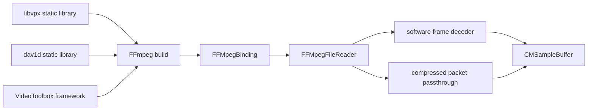
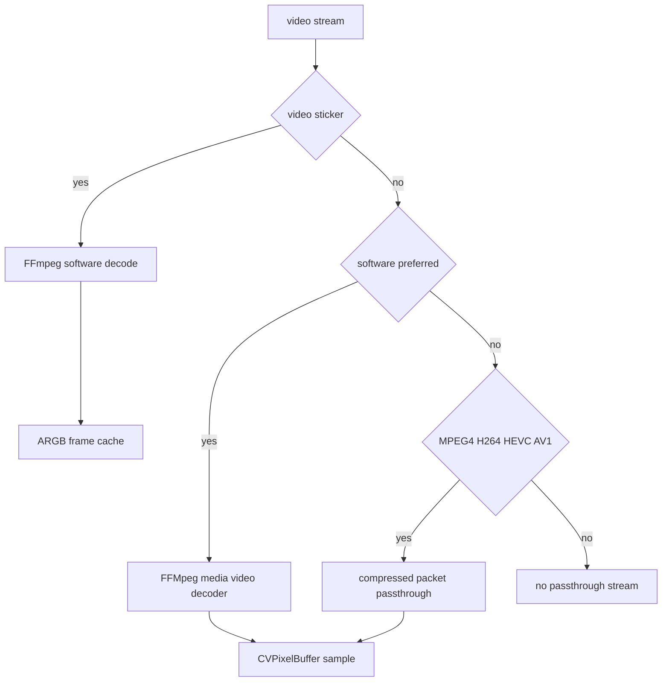
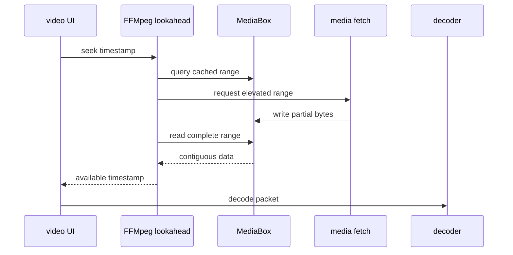
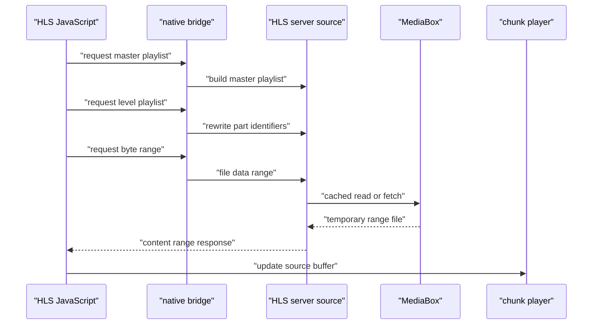

# 비디오 스티커, 비디오 디코딩과 스트리밍

웹: /docs/media/03-video-stickers-codecs/ · Markdown: /docs/media/03-video-stickers-codecs.md

> Telegram iOS와 macOS 클라이언트의 비디오 스티커, FFmpeg 디코딩, AV1 연동, 재생하면서 내려받기, HLS 세그먼트 재생 경로를 추적해요.

> 렌더링과 미디어 · 비디오와 이미지 · 03장 · 도표 4 · 코드 발췌 10 · 인용 39 · 소스 기준선: [TelegramMessenger/Telegram-iOS@f1dd7a2d](https://github.com/TelegramMessenger/Telegram-iOS/tree/f1dd7a2dbd02cbbf513e75d5695d8d36d1cf5838), [overtake/TelegramSwift@579cebbf](https://github.com/overtake/TelegramSwift/tree/579cebbf0c01fd41b712eff3647fa7f69db9665d)
>
> 핵심 소스 파일: [TelegramMessenger/Telegram-iOS/submodules/AnimatedStickerNode/Sources/DirectAnimatedStickerNode.swift](https://github.com/TelegramMessenger/Telegram-iOS/blob/f1dd7a2dbd02cbbf513e75d5695d8d36d1cf5838/submodules/AnimatedStickerNode/Sources/DirectAnimatedStickerNode.swift), [TelegramMessenger/Telegram-iOS/submodules/AnimatedStickerNode/Sources/VideoStickerFrameSource.swift](https://github.com/TelegramMessenger/Telegram-iOS/blob/f1dd7a2dbd02cbbf513e75d5695d8d36d1cf5838/submodules/AnimatedStickerNode/Sources/VideoStickerFrameSource.swift), [TelegramMessenger/Telegram-iOS/submodules/MediaPlayer/Sources/SoftwareVideoSource.swift](https://github.com/TelegramMessenger/Telegram-iOS/blob/f1dd7a2dbd02cbbf513e75d5695d8d36d1cf5838/submodules/MediaPlayer/Sources/SoftwareVideoSource.swift), [TelegramMessenger/Telegram-iOS/submodules/MediaPlayer/Sources/FFMpegFileReader.swift](https://github.com/TelegramMessenger/Telegram-iOS/blob/f1dd7a2dbd02cbbf513e75d5695d8d36d1cf5838/submodules/MediaPlayer/Sources/FFMpegFileReader.swift), [TelegramMessenger/Telegram-iOS/submodules/MediaPlayer/Sources/FFMpegMediaFrameSourceContext.swift](https://github.com/TelegramMessenger/Telegram-iOS/blob/f1dd7a2dbd02cbbf513e75d5695d8d36d1cf5838/submodules/MediaPlayer/Sources/FFMpegMediaFrameSourceContext.swift), [TelegramMessenger/Telegram-iOS/submodules/MediaPlayer/Sources/FFMpegMediaVideoFrameDecoder.swift](https://github.com/TelegramMessenger/Telegram-iOS/blob/f1dd7a2dbd02cbbf513e75d5695d8d36d1cf5838/submodules/MediaPlayer/Sources/FFMpegMediaVideoFrameDecoder.swift), [TelegramMessenger/Telegram-iOS/submodules/MediaPlayer/Sources/ChunkMediaPlayerDirectFetchSourceImpl.swift](https://github.com/TelegramMessenger/Telegram-iOS/blob/f1dd7a2dbd02cbbf513e75d5695d8d36d1cf5838/submodules/MediaPlayer/Sources/ChunkMediaPlayerDirectFetchSourceImpl.swift), [TelegramMessenger/Telegram-iOS/submodules/MediaPlayer/Sources/TimeBasedVideoPreload.swift](https://github.com/TelegramMessenger/Telegram-iOS/blob/f1dd7a2dbd02cbbf513e75d5695d8d36d1cf5838/submodules/MediaPlayer/Sources/TimeBasedVideoPreload.swift), [TelegramMessenger/Telegram-iOS/submodules/TelegramUniversalVideoContent/Sources/NativeVideoContent.swift](https://github.com/TelegramMessenger/Telegram-iOS/blob/f1dd7a2dbd02cbbf513e75d5695d8d36d1cf5838/submodules/TelegramUniversalVideoContent/Sources/NativeVideoContent.swift), [TelegramMessenger/Telegram-iOS/submodules/TelegramUniversalVideoContent/Sources/HLSVideoContent.swift](https://github.com/TelegramMessenger/Telegram-iOS/blob/f1dd7a2dbd02cbbf513e75d5695d8d36d1cf5838/submodules/TelegramUniversalVideoContent/Sources/HLSVideoContent.swift), [TelegramMessenger/Telegram-iOS/submodules/TelegramUniversalVideoContent/Sources/HLSVideoJSNativeContentNode.swift](https://github.com/TelegramMessenger/Telegram-iOS/blob/f1dd7a2dbd02cbbf513e75d5695d8d36d1cf5838/submodules/TelegramUniversalVideoContent/Sources/HLSVideoJSNativeContentNode.swift), [TelegramMessenger/Telegram-iOS/submodules/TelegramUniversalVideoContent/Sources/UniversalVideoContentManager.swift](https://github.com/TelegramMessenger/Telegram-iOS/blob/f1dd7a2dbd02cbbf513e75d5695d8d36d1cf5838/submodules/TelegramUniversalVideoContent/Sources/UniversalVideoContentManager.swift), [TelegramMessenger/Telegram-iOS/submodules/ffmpeg/Sources/FFMpeg/build-ffmpeg-bazel.sh](https://github.com/TelegramMessenger/Telegram-iOS/blob/f1dd7a2dbd02cbbf513e75d5695d8d36d1cf5838/submodules/ffmpeg/Sources/FFMpeg/build-ffmpeg-bazel.sh), [TelegramMessenger/Telegram-iOS/submodules/FFMpegBinding/Sources/FFMpegAVCodecContext.m](https://github.com/TelegramMessenger/Telegram-iOS/blob/f1dd7a2dbd02cbbf513e75d5695d8d36d1cf5838/submodules/FFMpegBinding/Sources/FFMpegAVCodecContext.m), [overtake/TelegramSwift/Telegram-Mac/SVideoController.swift](https://github.com/overtake/TelegramSwift/blob/579cebbf0c01fd41b712eff3647fa7f69db9665d/Telegram-Mac/SVideoController.swift), [overtake/TelegramSwift/packages/TelegramMedia/Sources/HLSVideoJSNativeContentView.swift](https://github.com/overtake/TelegramSwift/blob/579cebbf0c01fd41b712eff3647fa7f69db9665d/packages/TelegramMedia/Sources/HLSVideoJSNativeContentView.swift), [overtake/TelegramSwift/Telegram-Mac/VideoStickerContentView.swift](https://github.com/overtake/TelegramSwift/blob/579cebbf0c01fd41b712eff3647fa7f69db9665d/Telegram-Mac/VideoStickerContentView.swift)
>
> 미검증 사항:
> - HLSCodecConfiguration이 iOS에서 하드웨어 AV1과 소프트웨어 AV1 지원을 어떻게 탐지하는지는 아직 한 줄씩 확인하지 못했어요.
> - FFMpegMediaPassthroughVideoFrameDecoder의 최종 디코더 생성과 AV1 폴백 규칙은 이 장에서 아직 대조하지 못했어요.
> - libvpx와 dav1d의 본체는 체크아웃되지 않아서 구체적인 버전, 최적화 경로, 보안 수정은 확인할 수 없어요.
> - macOS HLS 품질 선별은 AV1을 제외하지만, HLS가 아닌 로컬 파일이 FFmpeg dav1d를 거쳐 실제로 재생되는지는 런타임 검증을 하지 않았어요.
> - VideoStickerFrameSourceCache의 compressFrame 내부 YUVA 표현과 실제 캐시 압축률은 이 장에서 아직 한 줄씩 확인하지 못했어요.

## 문제와 제약 [#문제와-제약]

비디오 미디어는 클라이언트에서 경로가 하나가 아니에요. 요구가 세 가지이고, 소스는 이를 각각 다른 구성 요소에 나누어 담았어요.

- 비디오 스티커: 작은 크기, 투명도, 루프 첫 프레임을 추구해요. 스티커 프레임 소스가 맡아요.
- 채팅 비디오: 최대한 빨리 재생할 수 있고, 드래그할 수 있고, 복구할 수 있어야 해요. 범용 플레이어가 맡아요.
- HLS(재생 목록과 조각 파일로 나눠 스트리밍하는 방식): 여기에 더해 다중 비트레이트 파일, 재생 목록, 부분 바이트 범위 사이의 일관성도 유지해야 해요. HLS 콘텐츠 노드가 맡아요.

이 문서는 주어진 체크아웃에 있는 연동 코드만 확인해요. `libvpx`(VP8·VP9 코덱 라이브러리)와 `dav1d`(AV1 디코더 라이브러리)의 본체는 이번 분석 범위에 없어요. 그래서 이 문서는 두 라이브러리의 내부 알고리즘, 성능, 취약점 처리를 설명하지 않아요. 이 문서의 AV1 결론은 빌드 옵션, 기능 선별, 호출 측 분기에만 해당해요.

이 장과 관련된 기존 장은 두 가지예요.

- 「미디어 리소스, 다운로드 업로드와 캐시」: `MediaBox`의 범용 부분 파일 의미 체계를 설명해요.
- 「iOS 렌더링 성능」: 범용 애니메이션 렌더링과 표시 레이어 재사용을 설명해요.

이 장은 그 기능들이 비디오 읽기, 디코딩, HLS 스케줄링에서 어떻게 호출되는지만 추적해요.

이 장에서 쓰는 용어는 이래요.

- “소프트웨어 디코딩”: FFmpeg가 평면을 내보낸 뒤 `FFMpegMediaVideoFrameDecoder`가 `CVPixelBuffer`를 채우는 경로를 가리켜요.
- “하드웨어 경로”: `VideoToolbox`(Apple의 하드웨어 비디오 코덱 프레임워크) 장치나 네이티브 압축 패킷 디코더가 참여하는 경로를 가리켜요.

이 두 경로는 “`AVPlayer`를 쓰는가”와 같지 않아요. HLS 노드는 JavaScript 쪽 SourceBuffer(웹 플레이어가 미디어 조각을 쌓는 버퍼) 조각을 `ChunkMediaPlayerV2`에 넘기는데, 이건 세 번째 조립 방식이에요.

## 모듈과 데이터 구조 [#모듈과-데이터-구조]

### 정적 라이브러리에서 Swift까지의 코덱 경계 [#정적-라이브러리에서-swift까지의-코덱-경계]

iOS의 Bazel(빌드 도구) 빌드는 먼저 `libvpx`의 헤더 파일과 정적 라이브러리를 `vpx` 타깃으로 내보내요. 빌드 규칙에는 iOS, 시뮬레이터, macOS arm64, Linux의 아키텍처 분기도 나열되어 있어요. [\[1\]](https://github.com/TelegramMessenger/Telegram-iOS/blob/f1dd7a2dbd02cbbf513e75d5695d8d36d1cf5838/third-party/libvpx/BUILD#L24-L128)

`build-libvpx-bazel.sh`는 이렇게 설정해요.

- 끄는 것: 문서, 예제, 후처리, 고비트 심도 VP9, 단위 테스트
- 유지하는 것: 실시간 모드, 다중 해상도 인코딩

산출물이 전체 도구 모음이 아니라 클라이언트에 넣을 용도에 맞게 줄어 있다는 뜻이에요. [\[2\]](https://github.com/TelegramMessenger/Telegram-iOS/blob/f1dd7a2dbd02cbbf513e75d5695d8d36d1cf5838/third-party/libvpx/build-libvpx-bazel.sh#L16-L89)

`dav1d` 연동도 비슷하지만 빌더는 Meson과 Ninja를 써요. 규칙은 생성된 헤더와 `libdav1d.a`를 Bazel 타깃에 공개해요. [\[3\]](https://github.com/TelegramMessenger/Telegram-iOS/blob/f1dd7a2dbd02cbbf513e75d5695d8d36d1cf5838/third-party/dav1d/BUILD#L30-L136) arm64 macOS 분기에서 스크립트는 Meson cross file을 명시적으로 만들고 최소 시스템 버전을 macOS 14.0으로 설정해요. [\[4\]](https://github.com/TelegramMessenger/Telegram-iOS/blob/f1dd7a2dbd02cbbf513e75d5695d8d36d1cf5838/third-party/dav1d/build-dav1d-bazel.sh#L9-L78) 이 빌드 구성은 빌드 타깃이 있다는 것만 증명해요. 특정 릴리스 산출물에 어떤 아키텍처 슬라이스가 실제로 들어 있는지는 증명하지 못해요.

FFmpeg 빌드 규칙은 VPX와 dav1d의 헤더와 정적 라이브러리를 임시 FFmpeg 소스 디렉터리에 복사해요. 그런 다음 `ffmpeg` 타깃이 이 두 라이브러리와 `VideoToolbox` 프레임워크에 동시에 기대요. [\[5\]](https://github.com/TelegramMessenger/Telegram-iOS/blob/f1dd7a2dbd02cbbf513e75d5695d8d36d1cf5838/submodules/ffmpeg/BUILD#L185-L335)

설정 스크립트는 아래를 켜요.

- `libvpx`
- `libdav1d`
- `libvpx_vp9` 디코더
- `libdav1d` 디코더
- `av1` 디코더

Darwin 분기는 H264, HEVC, AV1의 VideoToolbox 하드웨어 가속기도 요청해요. [\[6\]](https://github.com/TelegramMessenger/Telegram-iOS/blob/f1dd7a2dbd02cbbf513e75d5695d8d36d1cf5838/submodules/ffmpeg/Sources/FFMpeg/build-ffmpeg-bazel.sh#L36-L216)

```bash
CONFIGURE_FLAGS="--enable-cross-compile --disable-programs \
                 --disable-armv5te --disable-armv6 --disable-armv6t2 \
                 --disable-doc --enable-pic --disable-all --disable-everything \
                 --enable-avcodec  \
                 --enable-swresample \
                 --enable-avformat \
                 --disable-xlib \
                 --enable-libopus \
                 --enable-libvpx \
                 --enable-libdav1d \
                 --enable-bsf=aac_adtstoasc,vp9_superframe,h264_mp4toannexb \
                 --enable-decoder=h264,libvpx_vp9,hevc,libopus,flac,pcm_s16le,pcm_s24le,pcm_f32le,libdav1d,av1,mp3 \
                 --enable-demuxer=aac,mov,m4v,mp3,ogg,libopus,flac,wav,aiff,matroska,mpegts, \
                 --enable-parser=aac,h264,mp3,libopus \
                 --enable-protocol=file \
                 --enable-muxer=mp4,matroska,ogg,mpegts \
                 "
```
[\[6\]](https://github.com/TelegramMessenger/Telegram-iOS/blob/f1dd7a2dbd02cbbf513e75d5695d8d36d1cf5838/submodules/ffmpeg/Sources/FFMpeg/build-ffmpeg-bazel.sh#L36-L216)

`FFMpegBinding`은 위 C API의 Objective C 경계예요. `FFMpegAVFormatContext`가 하는 일은 두 가지예요.

- H264, HEVC, MPEG4, VP9, VP8, AV1의 FFmpeg codec id를 Swift에 공개해요.
- 커스텀 I/O 콜백을 `AVFormatContext`에 장착하고 빠른 seek와 내부 버퍼 없음 플래그를 켜요. [\[7\]](https://github.com/TelegramMessenger/Telegram-iOS/blob/f1dd7a2dbd02cbbf513e75d5695d8d36d1cf5838/submodules/FFMpegBinding/Sources/FFMpegAVFormatContext.m#L11-L220)

덕분에 상위 플레이어는 네트워크 바이트를 완전한 파일인 것처럼 꾸미지 않고도 FFmpeg가 디먹싱하게 할 수 있어요.

`FFMpegAVCodecContext`는 아래를 해요.

- `max_pixels`를 400만 픽셀로 설정해요.
- 하드웨어 가속이 요구되면 `AV_HWDEVICE_TYPE_VIDEOTOOLBOX`를 만들고 FFmpeg가 `AV_PIX_FMT_VIDEOTOOLBOX`를 우선하게 해요. [\[8\]](https://github.com/TelegramMessenger/Telegram-iOS/blob/f1dd7a2dbd02cbbf513e75d5695d8d36d1cf5838/submodules/FFMpegBinding/Sources/FFMpegAVCodecContext.m#L9-L89)

덕분에 리소스 경계가 분명해져요. 지나치게 큰 프레임과 만들 수 없는 하드웨어 장치가 제한 없는 디코딩으로 슬쩍 흘러들 수 없어요.

```objc
- (void)setupHardwareAccelerationIfPossible {
    av_hwdevice_ctx_create(&_impl->hw_device_ctx, AV_HWDEVICE_TYPE_VIDEOTOOLBOX, nil, nil, 0);
    _impl->get_format = getPreferredPixelFormat;
}

- (void)setSkipLoopFilterToAll {
    _impl->skip_loop_filter = AVDISCARD_ALL;
}
```
[\[8\]](https://github.com/TelegramMessenger/Telegram-iOS/blob/f1dd7a2dbd02cbbf513e75d5695d8d36d1cf5838/submodules/FFMpegBinding/Sources/FFMpegAVCodecContext.m#L9-L89)

아래 도표는 빌드 산출물과 런타임 경계를 보여 줘요. 도표의 FFmpeg는 외부 VPX와 dav1d를 호출할 수도 있고, 지원할 수 있는 비디오를 VideoToolbox에 넘길 수도 있어요. 소스가 확인한 건 연동 관계예요. 서드파티 라이브러리 내부 호출 스택을 확인한 건 아니에요.



### 비디오 스티커의 프레임 소스와 로컬 캐시 [#비디오-스티커의-프레임-소스와-로컬-캐시]

`DirectAnimatedStickerNode.setup`은 `AnimatedStickerNodeSource`에서 로컬 경로를 얻어요. 분기는 이래요.

- `source.isVideo`가 참이기만 하면: `makeVideoStickerDirectFrameSource`를 호출하며 `hintVP9: true`를 고정으로 넘겨요.
- 비디오가 아닌 분기: 압축을 풀고 Lottie(벡터 애니메이션 형식) 인스턴스를 만들려고 시도해요. [\[9\]](https://github.com/TelegramMessenger/Telegram-iOS/blob/f1dd7a2dbd02cbbf513e75d5695d8d36d1cf5838/submodules/AnimatedStickerNode/Sources/DirectAnimatedStickerNode.swift#L102-L137)

이로써 비디오 스티커 진입점이 그 비디오 스트림을 VP9로 힌트한다는 게 확인돼요. 이 호출 지점 자체는 MIME 문자열로 WebM 컨테이너를 확인하지 않아요. 그러니 “WebM”은 이 장에 주어진 연구 범위의 미디어 명칭일 뿐이에요. 이 함수가 컨테이너를 검증한다고 오해하면 안 돼요.

`VideoStickerDirectFrameSource`에는 첫 프레임 출처가 세 가지 있어요.

- 완성된 프레임 캐시를 읽어요.
- 전체 파일을 WebP 정적 이미지로 다뤄요.
- `FFMpegFileReader`를 만들되 `passthroughDecoder`와 하드웨어 가속을 명시적으로 끄고 프레임 레이트 상한을 30으로 잘라요.

그래서 비디오 스티커는 범용 비디오의 압축 패킷 직통 경로를 타지 않아요. [\[38\]](https://github.com/TelegramMessenger/Telegram-iOS/blob/f1dd7a2dbd02cbbf513e75d5695d8d36d1cf5838/submodules/AnimatedStickerNode/Sources/VideoStickerFrameSource.swift#L304-L352)

```swift
let source = FFMpegFileReader(
    source: .file(path),
    passthroughDecoder: false,
    useHardwareAcceleration: false,
    selectedStream: .mediaType(.video),
    seek: nil,
    maxReadablePts: nil
)
if let source {
    self.source = source
    self.frameRate = min(30, source.frameRate())
    self.duration = source.duration().seconds
}
```
[\[38\]](https://github.com/TelegramMessenger/Telegram-iOS/blob/f1dd7a2dbd02cbbf513e75d5695d8d36d1cf5838/submodules/AnimatedStickerNode/Sources/VideoStickerFrameSource.swift#L304-L352)

프레임 캐시는 이렇게 구성돼요.

- 파일 이름에는 크기와 버전 번호가 들어가며 현재 버전은 3이에요.
- 캐시가 미리 확보하는 인덱스 용량은 `30 * 10`, 즉 최대 300프레임이에요.
- 인덱스에는 프레임 레이트, 총 프레임 수, 프레임별 오프셋과 길이가 들어 있어요.
- 음수, 범위 초과, 100 MiB보다 큰 프레임 구간을 읽으면 코드는 캐시가 손상됐다고 보고 인덱스 표를 다시 만들어요. [\[10\]](https://github.com/TelegramMessenger/Telegram-iOS/blob/f1dd7a2dbd02cbbf513e75d5695d8d36d1cf5838/submodules/AnimatedStickerNode/Sources/VideoStickerFrameSource.swift#L15-L68)

이 인덱스 용량은 원본 비디오 길이를 제한하는 게 아니에요. 이 캐시 형식이 안정적으로 저장할 수 있는 프레임 수를 제한해요.

프레임 소스의 시간 인덱스와 표시 요청도 따로 저장돼요.

- `currentFrame`은 `takeFrame`을 호출할 때마다 먼저 루프를 반영한 `frameIndex`를 계산한 뒤 곧바로 올려요.
- `draw`가 참일 때만 실제로 정적 이미지, 캐시, 디코더에 접근해요.
- `skipToFrameIndex`는 현재 인덱스만 바꾸고 동기 seek는 하지 않아요. [\[11\]](https://github.com/TelegramMessenger/Telegram-iOS/blob/f1dd7a2dbd02cbbf513e75d5695d8d36d1cf5838/submodules/AnimatedStickerNode/Sources/VideoStickerFrameSource.swift#L359-L448)

그래서 호출하는 쪽은 보이지 않는 동안 논리 프레임을 진행시키거나, 다시 보일 때 목표 프레임으로 바로 건너뛸 수 있어요. 이 설계가 빠르게 스크롤하는 동안의 쓸모없는 픽셀 복사를 줄인다는 건 추론이에요.

스티커 프레임의 반환값은 `index`, `isLastFrame`, `totalFrames`, `multiplyAlpha`를 담아요.

- WebP와 새로 디코딩한 ARGB 프레임: `multiplyAlpha: true`로 설정돼요.
- 캐시 적중으로 반환된 YUVA(밝기·색차·투명도 평면) 프레임: 이 표시가 없어요. [\[11\]](https://github.com/TelegramMessenger/Telegram-iOS/blob/f1dd7a2dbd02cbbf513e75d5695d8d36d1cf5838/submodules/AnimatedStickerNode/Sources/VideoStickerFrameSource.swift#L359-L448)

alpha를 어떻게 해석할지는 원본 codec만으로 정해지지 않는다는 뜻이에요. 프레임 유형과 캐시 변환을 거쳤는지에도 달려 있어요. 캐시의 하부 평면 배치는 `compressFrame`을 읽어야 완전히 확인할 수 있어요.

프레임을 가져올 때 동작은 캐시 적중 여부에 따라 달라요.

- 적중: 프레임 소스는 먼저 캐시에서 YUVA 데이터를 꺼내요.
- 미적중: `FFMpegFileReader.readFrame`에 ARGB 출력을 요구하고, `CVPixelBuffer`를 잠근 뒤 `vImageScale_ARGB8888`로 스티커 크기에 맞게 줄이거나 늘려요. 이어서 비동기로 이 프레임을 압축해 저장해요.
- 스트림 끝: 모든 프레임이 연속으로 저장된 경우에 한해 총 프레임 수를 기록하고, 새 리더를 만들어 루프를 시작해요. [\[11\]](https://github.com/TelegramMessenger/Telegram-iOS/blob/f1dd7a2dbd02cbbf513e75d5695d8d36d1cf5838/submodules/AnimatedStickerNode/Sources/VideoStickerFrameSource.swift#L359-L448)

그래서 첫 번째 루프의 CPU 비용에는 디코딩, 크기 조정, 캐시 쓰기가 들어가요. 이후 루프는 이미 압축된 프레임만 읽으면 돼요. 이 캐시의 이점은 소스로 확인돼요. 구체적인 압축률은 스티커 내용에 따라 다르고 미검증이에요.

```swift
} else if useCache, let cache = self.cache,
          let yuvData = cache.readUncompressedYuvaFrame(index: frameIndex) {
    return AnimatedStickerFrame(data: yuvData, type: .yuva,
        width: self.width, height: self.height, bytesPerRow: self.width * 2,
        index: frameIndex, isLastFrame: frameIndex == self.frameCount - 1,
        totalFrames: self.frameCount)
} else if let source = self.source {
    let frameAndLoop = source.readFrame(argb: true)
    switch frameAndLoop {
    case let .frame(frame):
        var frameData = Data(count: self.bytesPerRow * self.height)
        // ... 원본 픽셀 버퍼를 잠그고 vImage로 축소한다.
        self.cache?.storeUncompressedRgbFrame(index: frameIndex, rgbData: frameData)
        return AnimatedStickerFrame(data: frameData, type: .argb,
            width: self.width, height: self.height, bytesPerRow: self.bytesPerRow,
            index: frameIndex, isLastFrame: frameIndex == self.frameCount - 1,
            totalFrames: self.frameCount, multiplyAlpha: true)
```
[\[11\]](https://github.com/TelegramMessenger/Telegram-iOS/blob/f1dd7a2dbd02cbbf513e75d5695d8d36d1cf5838/submodules/AnimatedStickerNode/Sources/VideoStickerFrameSource.swift#L359-L448)

이 경로는 비디오 스티커가 하드웨어 디코딩을 끄고 ARGB를 요구하는 이유도 설명해 줘요. 스티커 대상은 CPU 쪽에서 크기를 조정하고, 캐시하고, alpha를 실을 수 있는 픽셀이 필요해요. 하부 시스템이 일반 비디오를 디코딩할 수 있더라도, 압축 패킷이나 네이티브 비디오 서피스를 그대로 들고 있으면 프레임 캐시 인터페이스를 맞출 수 없어요. 이 인과 관계는 호출 매개변수와 이후의 픽셀 접근에서 도출한 추론이에요.

## 디코딩 경로와 선택 조건 [#디코딩-경로와-선택-조건]

### 하나의 불리언 스위치가 아닌 세 가지 선택 [#하나의-불리언-스위치가-아닌-세-가지-선택]

`FFMpegFileReader`의 `passthroughDecoder` 분기(압축 패킷을 디코딩하지 않고 그대로 넘기는 직통 경로)는 MPEG4, H264, HEVC, AV1에 대해서만 `FFMpegMediaPassthroughVideoFrameDecoder`를 구성해요. 이 디코더는 너비, 높이, extradata를 가져요.

이 스위치를 끄고 나서야 리더는 FFmpeg codec을 찾아요. FFmpeg 디코딩 분기는 이렇게 동작해요.

- 호출하는 쪽이 하드웨어 가속을 요구하면 하드웨어를 선호하는 codec을 고르고 `setupHardwareAccelerationIfPossible`을 호출해요.
- 선택 사항인 `skipLoopFilter`도 이 FFmpeg 디코딩 분기에서만 설정돼요. [\[12\]](https://github.com/TelegramMessenger/Telegram-iOS/blob/f1dd7a2dbd02cbbf513e75d5695d8d36d1cf5838/submodules/MediaPlayer/Sources/FFMpegFileReader.swift#L332-L383)

`SoftwareVideoSource`는 이 리더를 직접 쓰는 또 하나의 사용처예요.

- 로컬 파일 디스크립터를 열고 64 KiB의 `FFMpegAVIOContext`를 만들어요.
- `hintVP9`가 참이면 format context가 VP9 codec id를 쓰도록 강제해요.
- 입력 열기와 stream info 찾기 중 한 단계라도 실패하면 `readingError`를 참으로 둬요. [\[39\]](https://github.com/TelegramMessenger/Telegram-iOS/blob/f1dd7a2dbd02cbbf513e75d5695d8d36d1cf5838/submodules/MediaPlayer/Sources/SoftwareVideoSource.swift#L60-L160)

VP9 힌트가 컨테이너 탐지보다 먼저 일어난다는 뜻이에요. 탐지 결과에 따라 나중에 붙이는 표시 레이블이 아니에요.

stream을 고를 때 이 소스는 attached picture를 건너뛰고 video stream만 처리해요. 그리고 stream의 아래 값을 저장해요.

- 프레임 레이트
- timebase
- 시작 시각(없으면 0으로 만들어요)
- 길이
- 회전 각도
- 너비와 높이
- extradata

이 데이터 계약 덕분에 상위 계층은 프레임 번호가 아니라 미디어 시간으로 seek를 요청할 수 있어요. [\[39\]](https://github.com/TelegramMessenger/Telegram-iOS/blob/f1dd7a2dbd02cbbf513e75d5695d8d36d1cf5838/submodules/MediaPlayer/Sources/SoftwareVideoSource.swift#L60-L160) 같은 리더를 스티커뿐 아니라 비디오 미리보기와 재생에도 쓸 수 있게 한다는 건 추론이에요.

일반 `FFMpegMediaFrameSourceContext`는 더 높은 계층의 다른 선택을 써요.

- `preferSoftwareDecoding`이 참이면: 항상 하드웨어를 선호하지 않는 FFmpeg codec으로 `FFMpegMediaVideoFrameDecoder`를 만들어요.
- 거짓이면: MPEG4, H264, HEVC, AV1에 대해서만 압축 패킷 직통 디코더를 만들어요. [\[13\]](https://github.com/TelegramMessenger/Telegram-iOS/blob/f1dd7a2dbd02cbbf513e75d5695d8d36d1cf5838/submodules/MediaPlayer/Sources/FFMpegMediaFrameSourceContext.swift#L460-L556)

이 컨텍스트에서 “소프트웨어 우선이 아님”은 먼저 압축 프레임을 후단에 넘긴다는 뜻이에요. 이 파일이 곧바로 VideoToolbox 장치를 만든다는 뜻은 아니에요.

이로부터 선택 조건을 세 계층으로 나눌 수 있어요.

- 콘텐츠 목표: 비디오 스티커는 ARGB와 프레임 캐시가 필요해서 소프트웨어 출력을 강제해요.
- codec 능력: 직통은 네 가지 codec(MPEG4, H264, HEVC, AV1)만 나열하고 VP9는 그 목록에 없어요.
- 호출하는 쪽의 정책: `FFMpegFileReader`는 하드웨어 불리언을 명시적으로 받고, `FFMpegMediaFrameSourceContext`는 소프트웨어 우선 불리언을 명시적으로 받아요. 둘 다 파일 확장자로 암묵적으로 추측하지 않아요.

`NativeVideoContentNode`는 플레이어 계층에서도 legacy `MediaPlayer`와 `ChunkMediaPlayerV2` 중 하나를 골라요.

- 기본값은 원격 app configuration 키 `ios_video_legacyplayer_v2`로 덮어쓸 수 있어요.
- 소스에서는 AV1이 초기 legacy 조건을 일부러 발동하지 않게 했지만, 이 설정은 여전히 변수를 덮어쓸 수 있어요.
- 마지막으로 legacy 경로는 `preferSoftwareDecoding: false`를 넘기고, 새 경로는 direct fetch source를 써요. [\[14\]](https://github.com/TelegramMessenger/Telegram-iOS/blob/f1dd7a2dbd02cbbf513e75d5695d8d36d1cf5838/submodules/TelegramUniversalVideoContent/Sources/NativeVideoContent.swift#L490-L550)

그래서 AV1의 최종 디코더는 파일 속성만으로 추론하면 안 돼요. 플레이어 버전 스위치의 영향도 받아요.

### 소프트웨어 출력과 VideoToolbox 출력이 합쳐지는 지점 [#소프트웨어-출력과-videotoolbox-출력이-합쳐지는-지점]

`FFMpegMediaVideoFrameDecoder`는 프레임을 꺼낼 때마다 픽셀 수를 다시 검사해요. 너비 × 높이가 400만을 넘으면 디코더를 오류 상태로 두고 출력을 중단해요. [\[15\]](https://github.com/TelegramMessenger/Telegram-iOS/blob/f1dd7a2dbd02cbbf513e75d5695d8d36d1cf5838/submodules/MediaPlayer/Sources/FFMpegMediaVideoFrameDecoder.swift#L99-L130) 바인딩 계층의 `max_pixels`와 함께 이중 제한이 돼요. UI에 구체적인 오류 안내를 주는 호출 체인은 여기에 나타나 있지 않아요. 그래서 사용자에게 보이는 실패 형태는 미검증이에요.

FFmpeg가 `videoToolbox` 네이티브 픽셀 형식을 반환하면 디코더는 `frame.data[3]`에서 `CVPixelBuffer`를 꺼내요. 그리고 `CMVideoFormatDescription`과 `CMSampleBuffer`를 만든 뒤 표시 시각과 함께 반환해요. 픽셀을 Swift 평면으로 다시 복사하지 않아요. [\[16\]](https://github.com/TelegramMessenger/Telegram-iOS/blob/f1dd7a2dbd02cbbf513e75d5695d8d36d1cf5838/submodules/MediaPlayer/Sources/FFMpegMediaVideoFrameDecoder.swift#L471-L671) 이 부분이 VideoToolbox 출력이 표시 레이어로 곧바로 들어갈 수 있게 하는 핵심 연결 지점이에요.

프레임이 VideoToolbox 서피스가 아닐 때 디코더는 평면과 행 stride를 검증해요.

- 일반 YUV 대상: 2평면 NV12예요.
- YUVA 대상: 3평면 형식이고 필요하면 alpha를 Y 평면에 미리 곱해요.

풀 임계값 때문에 실패하면 현재 프레임을 버릴 수도 있어요. [\[16\]](https://github.com/TelegramMessenger/Telegram-iOS/blob/f1dd7a2dbd02cbbf513e75d5695d8d36d1cf5838/submodules/MediaPlayer/Sources/FFMpegMediaVideoFrameDecoder.swift#L471-L671) 가득 찬 픽셀 버퍼 풀을 기다리는 일은 피하지만, 높은 부하에서 프레임이 건너뛰어지는 대가를 치러요.

하드웨어 경로도 무조건 성공하지는 않아요. `setupHardwareAccelerationIfPossible`은 이 바인딩 코드에서 성공 상태를 보고하지 않아요. 이후 프레임을 꺼내는 코드는 여전히 native pixel format에 따라 분기해요. VideoToolbox 픽셀 형식이 없으면 코드는 소프트웨어 평면 복사 로직으로 들어가요. [\[8\]](https://github.com/TelegramMessenger/Telegram-iOS/blob/f1dd7a2dbd02cbbf513e75d5695d8d36d1cf5838/submodules/FFMpegBinding/Sources/FFMpegAVCodecContext.m#L9-L89) [\[16\]](https://github.com/TelegramMessenger/Telegram-iOS/blob/f1dd7a2dbd02cbbf513e75d5695d8d36d1cf5838/submodules/MediaPlayer/Sources/FFMpegMediaVideoFrameDecoder.swift#L471-L671) 그래서 호출하는 쪽이 하드웨어 가속을 요청한다는 건 선호를 나타낼 뿐이에요. 모든 비디오, 모든 장치, 모든 시점에 제로 카피 서피스가 만들어진다는 보장이 아니에요.

```swift
if frame.nativePixelFormat() == FFMpegAVFrameNativePixelFormat.videoToolbox {
    guard let pixelBufferRef = frame.data[3] else {
        return nil
    }
    let unmanagedPixelBuffer = Unmanaged<CVPixelBuffer>.fromOpaque(
        UnsafeRawPointer(pixelBufferRef)
    )
    let pixelBuffer = unmanagedPixelBuffer.takeUnretainedValue()
    var formatRef: CMVideoFormatDescription?
    let formatStatus = CMVideoFormatDescriptionCreateForImageBuffer(
        allocator: kCFAllocatorDefault, imageBuffer: pixelBuffer,
        formatDescriptionOut: &formatRef
    )
    guard let format = formatRef, formatStatus == 0 else {
        return nil
    }
    // ... 같은 pixelBuffer로 CMSampleBuffer를 만든다.
    return MediaTrackFrame(type: .video, sampleBuffer: sampleBuffer!,
        resetDecoder: resetDecoder, decoded: true)
}
```
[\[16\]](https://github.com/TelegramMessenger/Telegram-iOS/blob/f1dd7a2dbd02cbbf513e75d5695d8d36d1cf5838/submodules/MediaPlayer/Sources/FFMpegMediaVideoFrameDecoder.swift#L471-L671)

아래 분기 도표는 선택 조건을 최종 객체와 대응시켜요. 모든 codec의 호환성 선언이 아니에요. 현재 함수에서 보이는 분기만 나타내요.



## 재생하면서 내려받기와 프리페치 [#재생하면서-내려받기와-프리페치]

### 완전한 범위만 읽는 커스텀 I/O [#완전한-범위만-읽는-커스텀-io]

`FFMpegMediaFrameSourceContext`는 패킷 읽기 요청을 현재 오프셋에서 시작하는 바이트 범위로 바꿔요. 스트리밍 모드는 `MediaBox.resourceData`의 complete 모드를 호출하고 요청 범위를 완전히 읽을 수 있을 때까지 기다려요. 완전한 데이터를 얻지 못하면 콜백은 읽기 오류를 참으로 설정하고 FFmpeg의 EOF 상수를 반환해요. [\[17\]](https://github.com/TelegramMessenger/Telegram-iOS/blob/f1dd7a2dbd02cbbf513e75d5695d8d36d1cf5838/submodules/MediaPlayer/Sources/FFMpegMediaFrameSourceContext.swift#L61-L285) 이렇게 해서 희소 파일의 구멍(아직 받지 못한 구간)을 미디어 바이트로 잘못 보는 일을 막아요.

```swift
if streamable {
    let data: Signal<(Data, Bool), NoError>
    data = postbox.mediaBox.resourceData(
        resourceReference.resource,
        size: resourceSize,
        in: requestRange,
        mode: .complete
    )
    // ... 전체 범위를 기다린다.
    let disposable = data.start(next: { result in
        let (data, isComplete) = result
        if data.count == readCount || isComplete {
            fetchedData = data
            completedRequest = true
            semaphore.signal()
        }
    })
    semaphore.wait()
}
```
[\[17\]](https://github.com/TelegramMessenger/Telegram-iOS/blob/f1dd7a2dbd02cbbf513e75d5695d8d36d1cf5838/submodules/MediaPlayer/Sources/FFMpegMediaFrameSourceContext.swift#L61-L285)

seek 콜백이 읽기 오프셋을 바꾼 뒤의 동작은 이래요.

- 스트리밍이고 임시 파일이 없으면: 새 오프셋부터 파일 끝까지의 elevated(높은) 우선순위 fetch를 등록해요.
- 비스트리밍 읽기: 자동 가져오기가 허용되고 아직 요청되지 않았을 때만 전체 파일 fetch를 등록해요. [\[17\]](https://github.com/TelegramMessenger/Telegram-iOS/blob/f1dd7a2dbd02cbbf513e75d5695d8d36d1cf5838/submodules/MediaPlayer/Sources/FFMpegMediaFrameSourceContext.swift#L61-L285)

초기화에 성공하면 스트리밍 분기는 전체 범위 가져오기도 default 우선순위로 등록해요. 소스가 확인하는 건 이것이 두 계층의 요청이라는 점이에요. elevated 범위는 현재 위치를 보장하고, default 범위는 백그라운드에서 시청을 완전한 캐시로 바꾼다는 건 추론이에요.

읽기 콜백은 마지막 요청 위치와 이미 읽은 개수도 유지해요.

- 연속 읽기: FFmpeg가 연속으로 읽을 때는 지난 오프셋에서 바로 이어 읽을 수 있어요.
- seek나 역방향 읽기: 범위 요청을 다시 만들어요. [\[17\]](https://github.com/TelegramMessenger/Telegram-iOS/blob/f1dd7a2dbd02cbbf513e75d5695d8d36d1cf5838/submodules/MediaPlayer/Sources/FFMpegMediaFrameSourceContext.swift#L61-L285)

덕분에 순차 디먹싱은 요청 전환을 적게 유지하고, 점프할 때 새 위치를 기준으로 우선순위를 다시 세우는 능력도 남아요. 소스는 네트워크 계층이 인접한 요청을 합치는지 알려 주지 않아요. 그래서 이 계층의 중복 제거 전략은 미검증이에요.

`maximumFetchSize`는 `TimeBasedVideoPreload`가 만든 프리페치(재생 전에 미리 가져오기) 프레임 소스에만 작용해요. 일반 재생의 전역 다운로드 한도가 아니에요. 프리페치 코드는 source 상태가 바뀌면 이전 프리페치 요청을 취소한 뒤, 이미 읽을 수 있는 duration에 따라 완료 여부를 정해요. [\[20\]](https://github.com/TelegramMessenger/Telegram-iOS/blob/f1dd7a2dbd02cbbf513e75d5695d8d36d1cf5838/submodules/MediaPlayer/Sources/TimeBasedVideoPreload.swift#L12-L43) 그래서 2 MiB + 128 KiB는 미리보기 예산이에요. 사용자가 실제로 재생할 때 그만큼만 가져올 수 있다는 뜻으로 해석하면 안 돼요.

`ChunkMediaPlayerDirectFetchSourceImpl`의 lookahead(앞으로 읽을 구간을 미리 가져오는 동작)는 더 보수적이에요. 읽기 헤드는 매번 이렇게 움직여요.

1. 먼저 뒤따르는 512 KiB가 캐시에 있는지 검사해요.
2. 없으면 연속 요청을 최소한 현재 오프셋부터 2 MiB 뒤까지로 넓혀요.
3. 이전 요청을 해제한 뒤 다시 등록해요. [\[18\]](https://github.com/TelegramMessenger/Telegram-iOS/blob/f1dd7a2dbd02cbbf513e75d5695d8d36d1cf5838/submodules/MediaPlayer/Sources/ChunkMediaPlayerDirectFetchSourceImpl.swift#L187-L212)

이 수치들은 시간이 아니라 바이트로 계산해서, 고비트레이트 비디오는 실제 재생 시간이 더 짧아져요.

seek 후 lookahead는 이렇게 움직여요.

- 10초 단위로 미디어 타임라인을 읽고 elevated `fetchedMediaResource`로 범위를 제출해요.
- `MediaBox`에서 데이터를 가져올 때도 complete 결과를 요구하고, `internal_resourceDataIsCached`로 중복 등록을 피해요. [\[19\]](https://github.com/TelegramMessenger/Telegram-iOS/blob/f1dd7a2dbd02cbbf513e75d5695d8d36d1cf5838/submodules/MediaPlayer/Sources/ChunkMediaPlayerDirectFetchSourceImpl.swift#L620-L655)

아래 세 가지는 세 개의 클로저로 나뉘어 있어요.

- 해석된 읽기 범위
- 네트워크 요청
- 캐시됨 판정

플레이어는 네트워크 요청이 하나 있다고 해서 데이터를 FFmpeg가 이미 쓸 수 있다고 가정하지 않아요.

```swift
self.lookahead = FFMpegLookahead(
    seekToTimestamp: position,
    lookaheadDuration: 10.0,
    updateState: updateState,
    fetchInRange: { range in
        return fetchedMediaResource(
            mediaBox: resource.postbox.mediaBox,
            userLocation: resource.userLocation,
            userContentType: resource.userContentType,
            reference: resource.reference,
            range: (range, .elevated),
            statsCategory: resource.statsCategory,
            preferBackgroundReferenceRevalidation: true
        ).startStrict()
    },
    getDataInRange: { range, completion in
        return resource.postbox.mediaBox.resourceData(
            resource.reference.resource, size: resourceSize,
            in: range, mode: .complete
        ).start(next: { result, isComplete in
            completion(isComplete ? result : nil)
        })
    }
)
```
[\[19\]](https://github.com/TelegramMessenger/Telegram-iOS/blob/f1dd7a2dbd02cbbf513e75d5695d8d36d1cf5838/submodules/MediaPlayer/Sources/ChunkMediaPlayerDirectFetchSourceImpl.swift#L620-L655)

독립적인 `preloadVideoResource`는 아직 플레이어를 열지 않은 일반 비디오에 쓰여요.

- 총 가져오기 상한을 2 MiB에 128 KiB를 더한 값으로 둬요.
- 시간 0으로 seek한 뒤 `ensureHasFrames`로 미리 읽을 수 있는 프레임을 판단해요.

이 함수는 “고정된 초 수에 해당하는 고정 바이트”를 내려받지 않아요. 호출하는 쪽이 준 초 수와 비디오 버퍼에 보이는 duration 중 더 작은 값을 기준으로 해요. [\[20\]](https://github.com/TelegramMessenger/Telegram-iOS/blob/f1dd7a2dbd02cbbf513e75d5695d8d36d1cf5838/submodules/MediaPlayer/Sources/TimeBasedVideoPreload.swift#L12-L43) 이것도 프리페치와 재생이 분리되어 있다는 증거예요.

```swift
let maximumFetchSize = 2 * 1024 * 1024 + 128 * 1024
let sourceImpl = FFMpegMediaFrameSource(
    queue: queue,
    postbox: postbox,
    userLocation: userLocation,
    userContentType: userContentType,
    resourceReference: resourceReference,
    tempFilePath: nil,
    limitedFileRange: nil,
    streamable: true,
    isSeekable: true,
    video: true,
    preferSoftwareDecoding: false,
    fetchAutomatically: true,
    maximumFetchSize: maximumFetchSize
)
```
[\[20\]](https://github.com/TelegramMessenger/Telegram-iOS/blob/f1dd7a2dbd02cbbf513e75d5695d8d36d1cf5838/submodules/MediaPlayer/Sources/TimeBasedVideoPreload.swift#L12-L43)

`UniversalVideoContentManager`는 같은 `UniversalVideoContent`가 여러 화면 인스턴스에서 동시에 노드 하나를 여러 위치에 넣는 것을 막아요.

- holder는 우선순위와 구독 id로 정렬돼요.
- `update`는 정렬된 마지막 구독자만 active로 유지하고 나머지 active 구독자는 `nil`을 받아요. [\[21\]](https://github.com/TelegramMessenger/Telegram-iOS/blob/f1dd7a2dbd02cbbf513e75d5695d8d36d1cf5838/submodules/TelegramUniversalVideoContent/Sources/UniversalVideoContentManager.swift#L22-L139)

채팅 인라인, 전체 화면, 오버레이가 같은 콘텐츠 노드를 두고 다투는 문제를 풀어요. 같은 디코더를 공유하는 세부 사항까지 보장하지는 않아요. 노드 내부의 리소스 소유권은 구체적인 콘텐츠 클래스에 따라 달라서예요.

아래 도표는 일반 비디오가 드래그부터 버퍼링 상태에 이르기까지 재생하면서 내려받는 흐름을 요약해요.



## HLS와 TelegramUniversalVideoContent [#hls와-telegramuniversalvideocontent]

### 시스템 플레이어의 원격 URL이 아닌 HLS [#시스템-플레이어의-원격-url이-아닌-hls]

`NativeVideoContent.isHLSVideo`는 alternative representations를 훑어요. MIME이 `application/x-mpegurl`인 항목이 발견되기만 하면 파일을 HLS 비디오로 식별해요. [\[22\]](https://github.com/TelegramMessenger/Telegram-iOS/blob/f1dd7a2dbd02cbbf513e75d5695d8d36d1cf5838/submodules/TelegramUniversalVideoContent/Sources/NativeVideoContent.swift#L62-L81) 이 판정은 비디오 확장자와 무관해요. 상위 계층은 이를 근거로 HLS 콘텐츠 노드를 고를 수 있고, 일반 파일은 네이티브 direct fetch 플레이어로 가요.

iOS의 `HLSQualitySet`은 먼저 대체 표현의 비디오 속성을 훑어요.

- H264, H265, AVC, HEVC: 항상 선택할 수 있어요.
- AV1 또는 AV01: `HLSCodecConfiguration`이 하드웨어 AV1 또는 소프트웨어 AV1 지원을 보고할 때만 품질 집합에 들어갈 수 있어요. [\[23\]](https://github.com/TelegramMessenger/Telegram-iOS/blob/f1dd7a2dbd02cbbf513e75d5695d8d36d1cf5838/submodules/TelegramUniversalVideoContent/Sources/HLSVideoContent.swift#L51-L170)

이후 코드는 더 짧은 변을 품질 키로 삼고, 같은 품질의 `.m3u8` alternative를 그 미디어 file id와 짝지어요. 완전한 일대일 짝이 없으면 초기화는 실패해요.

품질 집합에는 storyboard(미리보기 썸네일 묶음)와 storyboard map도 담겨요. map 파일 이름이 `mtproto:`로 시작하면 코드는 썸네일 file id를 꺼내고, 품질 키와 storyboard 파일을 기준으로 매칭해요. [\[23\]](https://github.com/TelegramMessenger/Telegram-iOS/blob/f1dd7a2dbd02cbbf513e75d5695d8d36d1cf5838/submodules/TelegramUniversalVideoContent/Sources/HLSVideoContent.swift#L51-L170) 덕분에 미리보기 썸네일이 재생할 수 있는 품질에 따라 바뀔 수 있어요. 비디오 품질과 썸네일 매핑 중 하나가 없을 때 다른 형식으로 자동으로 채우지는 않아요. 완전한 마스터 목록 품질 집합만 `HLSQualitySet` 전체를 드러내요.

여기서 “소프트웨어 AV1 지원”은 능력 입력이에요. `HLSQualitySet` 내부의 탐지가 아니에요. FFmpeg에 dav1d가 연동되어 있다고 해서 이 불리언이 모든 기기에서 참이라고 자동으로 증명되지는 않아요. `HLSCodecConfiguration`을 만드는 지점, 실제 빌드 flavor, 실기기 로그에서 추가로 검증해야 해요.

미리보기 품질 선택은 600 이상 중 가장 작은 품질을 우선해요. 그런 항목이 없으면 가장 작은 항목을 골라요. [\[23\]](https://github.com/TelegramMessenger/Telegram-iOS/blob/f1dd7a2dbd02cbbf513e75d5695d8d36d1cf5838/submodules/TelegramUniversalVideoContent/Sources/HLSVideoContent.swift#L51-L170)

실제 HLS 노드는 JavaScript 쪽이 쓸 수 있는 level(품질 단계)을 보고하기를 기다린 뒤, 이 순서로 골라요.

1. 이미 완전히 캐시된 가장 높은 품질을 우선 매칭해요.
2. 그렇지 않으면 가장 작은 품질을 매칭해요.
3. 둘 다 실패한 뒤에야 높이가 가장 큰 level을 골라요. [\[24\]](https://github.com/TelegramMessenger/Telegram-iOS/blob/f1dd7a2dbd02cbbf513e75d5695d8d36d1cf5838/submodules/TelegramUniversalVideoContent/Sources/HLSVideoJSNativeContentNode.swift#L1243-L1298)

그래서 첫 프레임 전략이 “언제나 가장 낮은 비트레이트”는 아니에요. 오프라인으로 캐시된 고품질 리소스가 초기 선택을 바꿀 수 있어요.

### 목록 재작성과 부분 세그먼트 읽기 [#목록-재작성과-부분-세그먼트-읽기]

`HLSServerSource`는 두 가지 목록을 다뤄요.

- 마스터 목록: 메모리에서 합성해요. 품질마다 추정 대역폭과 해상도가 붙은 level 주소를 기록해요.
- 개별 level 목록: 먼저 그 목록 파일을 내려받은 다음, 안에 있는 `mtproto:` 파일 식별자를 `partfile` 형태의 로컬 서비스 경로로 고쳐 써요. [\[25\]](https://github.com/TelegramMessenger/Telegram-iOS/blob/f1dd7a2dbd02cbbf513e75d5695d8d36d1cf5838/submodules/TelegramUniversalVideoContent/Sources/HLSVideoContent.swift#L367-L421)

이 서버는 공용 네트워크 HLS URL에 대한 투명 프록시가 아니에요. Telegram 리소스 식별자를 WebView가 요청할 수 있는 파일 이름으로 바꿔요.

공유 HLS JS 컨텍스트는 요청 경로를 해석해요.

- `master.m3u8`: 합성한 마스터 목록을 반환해요.
- `hls_level` 주소: 고쳐 쓴 level 목록을 반환해요.
- `partfile` 주소: 반드시 HTTP Range를 가져야 하고, 그렇지 않으면 bad request를 반환해요. 유효한 range는 `fileData`로 전달되고, 성공하면 `Content-Range`가 붙은 데이터를 돌려보내요. [\[26\]](https://github.com/TelegramMessenger/Telegram-iOS/blob/f1dd7a2dbd02cbbf513e75d5695d8d36d1cf5838/submodules/TelegramUniversalVideoContent/Sources/HLSVideoJSNativeContentNode.swift#L700-L823)

```swift
} else if filePath.hasPrefix("partfile") && filePath.hasSuffix(".mp4") {
    let fileId = String(filePath[filePath.index(filePath.startIndex,
        offsetBy: "partfile".count) ..< filePath.index(filePath.endIndex,
        offsetBy: -".mp4".count)])
    guard let fileIdValue = Int64(fileId) else {
        SharedHLSVideoJSContext.sendErrorAndClose(
            id: id, error: .notFound, completion: completion)
        return
    }
    guard let requestRange else {
        SharedHLSVideoJSContext.sendErrorAndClose(
            id: id, error: .badRequest, completion: completion)
        return
    }
    let _ = (source.fileData(id: fileIdValue,
        range: requestRange.lowerBound ..< requestRange.upperBound + 1)
    |> deliverOn(.mainQueue())
    |> take(1)).start(next: { result in
        if let (tempFile, tempFileRange, totalSize) = result {
            SharedHLSVideoJSContext.sendResponseFileAndClose(
                id: id, file: tempFile, fileRange: tempFileRange,
                range: requestRange, totalSize: totalSize, completion: completion)
        } else {
            SharedHLSVideoJSContext.sendErrorAndClose(
                id: id, error: .internalServerError, completion: completion)
        }
    })
}
```
[\[26\]](https://github.com/TelegramMessenger/Telegram-iOS/blob/f1dd7a2dbd02cbbf513e75d5695d8d36d1cf5838/submodules/TelegramUniversalVideoContent/Sources/HLSVideoJSNativeContentNode.swift#L700-L823)

`fileData`는 먼저 캐시에서 정확한 범위를 찾아요.

- 캐시에 적중하면: 데이터를 임시 파일에 복사하고 즉시 반환해요.
- 미적중이면: 임시 완전 파일, 부분 파일, meta 파일을 만들고 `isRandomAccessAllowed: true`를 설정한 뒤, `MediaBoxFileContextV2Impl`이 요청된 구간을 가져오게 해요.

iOS의 HLS JS 경로는 성공 후 범위를 `MediaBox`에도 다시 써요. [\[27\]](https://github.com/TelegramMessenger/Telegram-iOS/blob/f1dd7a2dbd02cbbf513e75d5695d8d36d1cf5838/submodules/TelegramUniversalVideoContent/Sources/HLSVideoJSNativeContentNode.swift#L207-L324) 덕분에 다음에 같은 byte range는 캐시로 가요. 하지만 품질 파일 전체의 다운로드 완료를 요구하지는 않아요.

캐시 적중이라도 원본 파일 디스크립터를 WebView에 그대로 넘기지는 않아요. 코드는 128 KiB 임시 버퍼로 조각조각 새 `TempBoxFile`에 복사한 다음, 그 파일과 유효 범위를 반환해요. [\[27\]](https://github.com/TelegramMessenger/Telegram-iOS/blob/f1dd7a2dbd02cbbf513e75d5695d8d36d1cf5838/submodules/TelegramUniversalVideoContent/Sources/HLSVideoJSNativeContentNode.swift#L207-L324) 미적중 경로도 마찬가지로 임시 파일을 거쳐 반환돼요. 이렇게 하면 브리지 계층이 response data와 range 헤더를 일관되게 만들 수 있어요. 대신 로컬 복사가 한 번 늘어나요. 이 복사를 WebKit의 인터페이스 제한 때문에 택했는지는 추론이에요. 소스에는 이유가 적혀 있지 않아요.

HLS에는 첫 세그먼트 프리페치도 두 종류 있어요.

- 공개된 `minimizedHLSQualityPreloadData`(화면 프리페치용): 목록을 내려받고, 정수 `EXTINF`와 `EXT-X-BYTERANGE`를 해석하고, 호출하는 쪽이 준 `prefixSeconds`를 누적한 뒤 0부터 최대 상한까지의 파일 범위를 반환해요. 개수가 맞지 않거나, 파일을 읽을 수 없거나, UTF8 변환에 실패하면 nil을 반환해요. [\[28\]](https://github.com/TelegramMessenger/Telegram-iOS/blob/f1dd7a2dbd02cbbf513e75d5695d8d36d1cf5838/submodules/TelegramUniversalVideoContent/Sources/HLSVideoContent.swift#L173-L265)
- `HLSJSServerSource.fileData` 자체(단일 세그먼트 공급용): 같은 종류의 필드를 따로 해석하고 10초 접두부를 고정으로 계산해요.

이 이중 전략이 더 앞쪽 바이트로 첫 SourceBuffer 요청의 대기를 줄인다는 건 추론이에요.

HLS 콘텐츠 노드는 SourceBuffer의 길이나 items 업데이트를 받으면 이렇게 처리해요.

- `ChunkMediaPlayerPartsState`를 다시 설정해요.
- 초 단위 buffer range를 앞뒤로 각각 0.2초 넓힌 뒤 밀리초 `RangeSet`으로 바꿔 UI에 표시해요. [\[29\]](https://github.com/TelegramMessenger/Telegram-iOS/blob/f1dd7a2dbd02cbbf513e75d5695d8d36d1cf5838/submodules/TelegramUniversalVideoContent/Sources/HLSVideoJSNativeContentNode.swift#L1321-L1426)

그래서 재생 컨트롤이 보여 주는 건 원본 파일의 다운로드된 바이트 범위가 아니라 SourceBuffer 타임라인이에요.

이 상태 회신에는 스로틀링 조건이 있어요. 노드는 native player 상태를 `isPlaying`, `isWaiting`, `currentTime`으로 바꿔요. 아래 조건이 모두 맞으면 노드는 JavaScript 브리지에 더 이상 업데이트를 보내지 않아요.

- 재생 상태가 바뀌지 않았어요.
- 대기 상태가 바뀌지 않았어요.
- seek id가 바뀌지 않았어요.
- 현재 시간 차이가 0.2초 미만이에요. [\[29\]](https://github.com/TelegramMessenger/Telegram-iOS/blob/f1dd7a2dbd02cbbf513e75d5695d8d36d1cf5838/submodules/TelegramUniversalVideoContent/Sources/HLSVideoJSNativeContentNode.swift#L1321-L1426)

고빈도 플레이어 콜백이 JavaScript 경계를 넘는 횟수를 제한해요. UI 쪽 시간 표시가 매 프레임 갱신되지는 않는다는 뜻이기도 해요.

같은 브리지는 반대 방향으로 JavaScript의 seek, 재생, 일시 정지, 재생 속도 명령을 받아요. native 노드는 각 명령에 대해 아래를 호출해요.

- seek: `ChunkMediaPlayerV2.seek`
- 재생: `play`
- 일시 정지: `pause`
- 재생 속도: `setBaseRate` [\[24\]](https://github.com/TelegramMessenger/Telegram-iOS/blob/f1dd7a2dbd02cbbf513e75d5695d8d36d1cf5838/submodules/TelegramUniversalVideoContent/Sources/HLSVideoJSNativeContentNode.swift#L1243-L1298) [\[29\]](https://github.com/TelegramMessenger/Telegram-iOS/blob/f1dd7a2dbd02cbbf513e75d5695d8d36d1cf5838/submodules/TelegramUniversalVideoContent/Sources/HLSVideoJSNativeContentNode.swift#L1321-L1426)

그래서 목록 선택과 바이트 범위 공급은 JavaScript 쪽에 있고, 오디오 세션, 표시 노드, 실제 미디어 클록은 여전히 네이티브 쪽에 있어요. 양쪽은 완전한 플레이어를 WebView로 옮기는 대신 SourceBuffer items와 소수의 상태 필드로 조율해요.

테스트 관점에서 HLS에는 관측할 수 있는 단계가 적어도 네 가지 있어요.

1. `HLSQualitySet`이 같은 키의 미디어와 재생 목록을 성공적으로 만들었는가
2. 로컬 서버가 유효한 Range를 받았는가
3. `fileData`가 캐시나 네트워크에서 완전한 임시 범위를 반환했는가
4. SourceBuffer 업데이트 후 `bufferingStatus`가 목표 시간을 덮는가 [\[23\]](https://github.com/TelegramMessenger/Telegram-iOS/blob/f1dd7a2dbd02cbbf513e75d5695d8d36d1cf5838/submodules/TelegramUniversalVideoContent/Sources/HLSVideoContent.swift#L51-L170) [\[26\]](https://github.com/TelegramMessenger/Telegram-iOS/blob/f1dd7a2dbd02cbbf513e75d5695d8d36d1cf5838/submodules/TelegramUniversalVideoContent/Sources/HLSVideoJSNativeContentNode.swift#L700-L823) [\[27\]](https://github.com/TelegramMessenger/Telegram-iOS/blob/f1dd7a2dbd02cbbf513e75d5695d8d36d1cf5838/submodules/TelegramUniversalVideoContent/Sources/HLSVideoJSNativeContentNode.swift#L207-L324) [\[29\]](https://github.com/TelegramMessenger/Telegram-iOS/blob/f1dd7a2dbd02cbbf513e75d5695d8d36d1cf5838/submodules/TelegramUniversalVideoContent/Sources/HLSVideoJSNativeContentNode.swift#L1321-L1426)

이 단계들은 서로 다른 실패 원인에 대응해요. 따로 기록하면 codec 미지원, 목록 짝짓기 실패, 네트워크 범위 실패를 하나의 “재생 실패”로 잘못 뭉뚱그리는 일을 피할 수 있어요.



## iOS와 macOS 비교 [#ios와-macos-비교]


### macOS의 비디오 진입점과 프리페치 길이 [#macos의-비디오-진입점과-프리페치-길이]

TelegramSwift의 `SVideoController.makePlayer`는 먼저 `isHLSVideo`를 호출해요.

- HLS 파일: `HLSVideoJSNativeContentView`를 써요.
- 다른 파일: `NativeMediaPlayer`를 써요. [\[30\]](https://github.com/overtake/TelegramSwift/blob/579cebbf0c01fd41b712eff3647fa7f69db9665d/Telegram-Mac/SVideoController.swift#L20-L27)

`viewDidLoad`에서의 프리페치는 이래요.

- HLS: 최소 품질의 10초 접두부와 목록을 프리페치해요.
- 일반 비디오: 공유 `preloadVideoResource`를 호출하되 3초만 넘겨요. [\[31\]](https://github.com/overtake/TelegramSwift/blob/579cebbf0c01fd41b712eff3647fa7f69db9665d/Telegram-Mac/SVideoController.swift#L437-L453)

데스크톱이 목록의 가시성과 일반 컨테이너의 첫 프레임 비용을 구분한다는 걸 확인해 줘요.

```swift
if isHLSVideo(file: reference.media) {
    let fetchSignal = HLSVideoContent.minimizedHLSQualityPreloadData(
        postbox: account.postbox,
        file: reference,
        userLocation: .other,
        prefixSeconds: 10,
        autofetchPlaylist: true,
        initialQuality: FastSettings.videoQuality
    )
    // ... 반환된 file과 range로 대화형 가져오기를 시작한다.
} else {
    let preload = preloadVideoResource(
        postbox: account.postbox,
        userLocation: .other,
        userContentType: .init(file: reference.media),
        resourceReference: reference.resourceReference(reference.media.resource),
        duration: 3.0
    )
    partDisposable.set(preload.start())
}
```
[\[31\]](https://github.com/overtake/TelegramSwift/blob/579cebbf0c01fd41b712eff3647fa7f69db9665d/Telegram-Mac/SVideoController.swift#L437-L453)

macOS의 `HLSQualitySet`은 H264, H265, AVC, HEVC만 받아요. 이후에 “현재 codec이 AV1인가”를 검사하는 남겨진 분기가 있지만, 진입 술어는 AV1 alternative를 후보 집합에 넣지 않아요. [\[32\]](https://github.com/overtake/TelegramSwift/blob/579cebbf0c01fd41b712eff3647fa7f69db9665d/packages/TelegramMedia/Sources/HLSVideoJSNativeContentView.swift#L319-L419) 그래서 소스는 데스크톱 HLS 품질 선별이 현재 AV1을 받아들이지 않는다는 걸 증명해요. FFmpeg 빌드에 dav1d가 있다는 사실로부터 “macOS HLS가 이미 AV1을 지원한다”고 거꾸로 추론할 수는 없어요.

데스크톱 HLS의 브리지는 iOS와 구조가 같아요. master, level, `partfile`을 로컬 응답으로 라우팅하고 byte range를 `fileData`에 보내요. [\[33\]](https://github.com/overtake/TelegramSwift/blob/579cebbf0c01fd41b712eff3647fa7f69db9665d/packages/TelegramMedia/Sources/HLSVideoJSNativeContentView.swift#L780-L918) 데스크톱 구현의 `fileData`는 먼저 캐시를 읽고, 그렇지 않으면 부분 `MediaBoxFileContextV2Impl`을 만들어요. 이 동작은 iOS의 임시 세그먼트 읽기와 같아요. 모든 데스크톱 릴리스 빌드가 같은 JavaScript 리소스를 포함하는지는 미검증이에요.

데스크톱 빌드 스크립트도 `libvpx`와 `libdav1d`를 연결해요. FFmpeg 설정은 둘을 켜고 AV1 VideoToolbox 하드웨어 가속기를 요청해요. [\[34\]](https://github.com/overtake/TelegramSwift/blob/579cebbf0c01fd41b712eff3647fa7f69db9665d/core-xprojects/ffmpeg/ffmpeg/build.sh#L24-L159)

- 독립된 `libvpx` 스크립트: VP8, VP9, WebM I/O를 명시적으로 켜고 arm64와 x86 64용 정적 라이브러리를 병합해요.
- `dav1d` 스크립트: arm64와 x86 64를 각각 컴파일한 다음 lipo로 universal static library를 만들어요. [\[35\]](https://github.com/overtake/TelegramSwift/blob/579cebbf0c01fd41b712eff3647fa7f69db9665d/core-xprojects/libvpx/libvpx/build.sh#L30-L119) [\[36\]](https://github.com/overtake/TelegramSwift/blob/579cebbf0c01fd41b712eff3647fa7f69db9665d/core-xprojects/dav1d/dav1d/build.sh#L14-L50)

데스크톱 저장소에 그 컴파일 연동이 있다는 것만 확인해 줘요. HLS 선별 이외의 AV1 재생 성공 조건은 확인해 주지 않아요.

데스크톱 비디오 스티커 UI에도 다른 리소스 게이팅이 있어요. `VideoStickerContentView`는 아래 조건이 모두 맞을 때만 `player.ticking`을 참으로 둬요.

- 윈도우가 key(입력 포커스를 가진 활성 윈도우)예요.
- 뷰가 보여요.
- 동적 콘텐츠가 잠겨 있지 않아요.

윈도우 포커스와 스크롤 클리핑 영역의 변화를 감시해요. [\[37\]](https://github.com/overtake/TelegramSwift/blob/579cebbf0c01fd41b712eff3647fa7f69db9665d/Telegram-Mac/VideoStickerContentView.swift#L61-L115) 이 동작은 화면 밖의 채팅 스티커가 애니메이션을 계속 진행시키는 것을 막아요. 이 파일은 플레이어 하부가 소프트웨어 디코딩을 쓰는지 하드웨어 디코딩을 쓰는지 공개하지 않아요. 그래서 이 UI 계층만으로 데스크톱 비디오 스티커의 실제 codec 백엔드를 단정할 수 없어요.

`VideoStickerContentView`는 미디어를 업데이트할 때 이렇게 처리해요.

1. 먼저 의미가 바뀌었는지를 저장해요.
2. message 또는 standalone `FileMediaReference`를 만들어요.
3. 플레이어가 아직 렌더링하지 않았을 때는 바로 쓸 수 있는 썸네일로 shimmer 플레이스홀더를 만들고 `chatMessageSticker` 시그널을 구독해요.
4. 이미지를 받은 뒤에야 플레이스홀더를 없애요. [\[37\]](https://github.com/overtake/TelegramSwift/blob/579cebbf0c01fd41b712eff3647fa7f69db9665d/Telegram-Mac/VideoStickerContentView.swift#L61-L115)

아래 세 가지는 독립된 상태로 나뉘어 있어요.

- 네트워크로 가져올 수 있는지
- 정적 미리보기
- 비디오 ticking

윈도우가 다시 key가 되어도 미디어 파일을 다시 요청할 필요가 없고, 클록이 진행되는지만 바뀌어요.

## 경계 사례와 실패 처리 [#경계-사례와-실패-처리]

비디오 스티커 캐시는 손상과 불완전한 상태를 이렇게 다뤄요.

- 손상된 인덱스를 만나면 잘라내고 다시 초기화해요.
- 첫 디코딩에서 완전한 연속 프레임이 없으면 총 프레임 수를 기록하지 않아요.
- 스트림 끝에서 `storedFrames`가 현재 프레임 번호와 다르면 코드는 “Missed a frame”만 기록하고 캐시 완료를 선언하지 않아요. [\[10\]](https://github.com/TelegramMessenger/Telegram-iOS/blob/f1dd7a2dbd02cbbf513e75d5695d8d36d1cf5838/submodules/AnimatedStickerNode/Sources/VideoStickerFrameSource.swift#L15-L68)

부분 캐시가 이후 루프에서 완전한 애니메이션으로 취급되는 것을 막아요.

`FFMpegFileReader`는 입력을 열 수 없거나 stream info를 찾을 수 없으면 곧바로 읽기 오류를 설정하고 nil을 반환해요. 스티커 프레임 소스는 기본 30 fps와 길이 0을 유지하지만 쓸 수 있는 source는 없어요. `takeFrame`은 waiting이나 error 상태에서 nil을 반환해요. [\[10\]](https://github.com/TelegramMessenger/Telegram-iOS/blob/f1dd7a2dbd02cbbf513e75d5695d8d36d1cf5838/submodules/AnimatedStickerNode/Sources/VideoStickerFrameSource.swift#L15-L68) 상위 계층은 미리보기나 플레이스홀더를 보여 주거나 타이머를 멈춰야 해요. 이 프레임 소스 자체는 재시도 전략을 구현하지 않아요.

일반 스트리밍 읽기는 범위가 완전하지 않으면 EOF를 반환해요. 더 엄격한 대가로 네트워크 지연은 버퍼링으로 나타나요. FFmpeg가 0으로 채워진 데이터나 오래된 데이터를 파싱하려 시도하게 두지 않아요. [\[17\]](https://github.com/TelegramMessenger/Telegram-iOS/blob/f1dd7a2dbd02cbbf513e75d5695d8d36d1cf5838/submodules/MediaPlayer/Sources/FFMpegMediaFrameSourceContext.swift#L61-L285) `ChunkMediaPlayerDirectFetchSourceImpl`은 lookahead id도 사용해요. 새 seek 때문에 밀려난 상태 업데이트를 버리고, 이전 위치가 새 위치의 재생 가능 시간을 덮어쓰는 일을 막아요. [\[19\]](https://github.com/TelegramMessenger/Telegram-iOS/blob/f1dd7a2dbd02cbbf513e75d5695d8d36d1cf5838/submodules/MediaPlayer/Sources/ChunkMediaPlayerDirectFetchSourceImpl.swift#L620-L655)

HLS 요청은 아래 경우에 HTTP 스타일 오류를 반환해요.

- Range가 없어요.
- file id를 해석할 수 없어요.
- 대응하는 source가 없어요.

`fileData`는 미디어 size나 `MediaBox.fetchResource`가 없으면 빈 결과를 반환해요. 취소할 때는 아래를 해요.

- fetch와 data 구독을 dispose해요.
- 임시 file context의 전체 범위 fetch를 취소해요.
- 임시 파일도 지워요. [\[26\]](https://github.com/TelegramMessenger/Telegram-iOS/blob/f1dd7a2dbd02cbbf513e75d5695d8d36d1cf5838/submodules/TelegramUniversalVideoContent/Sources/HLSVideoJSNativeContentNode.swift#L700-L823) [\[27\]](https://github.com/TelegramMessenger/Telegram-iOS/blob/f1dd7a2dbd02cbbf513e75d5695d8d36d1cf5838/submodules/TelegramUniversalVideoContent/Sources/HLSVideoJSNativeContentNode.swift#L207-L324)

덕분에 요청 수명 주기가 WebView abort에 맞춰 끝나고, 통제되지 않는 범위 가져오기가 남지 않아요.

디코딩 리소스에서는 400만 픽셀 제한과 픽셀 풀 임계값이 메모리와 실시간성을 먼저 지켜요.

- 제한 때문에 초대형 프레임은 실패해요.
- 풀이 가득 차면 프레임을 버려요.

두 경우 모두 시청의 연속성을 낮출 수 있어요. 하지만 비정상적인 크기나 표시 단의 지연이 리소스를 끝없이 차지하는 건 막아요. [\[8\]](https://github.com/TelegramMessenger/Telegram-iOS/blob/f1dd7a2dbd02cbbf513e75d5695d8d36d1cf5838/submodules/FFMpegBinding/Sources/FFMpegAVCodecContext.m#L9-L89) [\[15\]](https://github.com/TelegramMessenger/Telegram-iOS/blob/f1dd7a2dbd02cbbf513e75d5695d8d36d1cf5838/submodules/MediaPlayer/Sources/FFMpegMediaVideoFrameDecoder.swift#L99-L130) [\[16\]](https://github.com/TelegramMessenger/Telegram-iOS/blob/f1dd7a2dbd02cbbf513e75d5695d8d36d1cf5838/submodules/MediaPlayer/Sources/FFMpegMediaVideoFrameDecoder.swift#L471-L671)

## 설계 트레이드오프 [#설계-트레이드오프]

첫 번째 트레이드오프는 VP9 비디오 스티커를 작은 범용 플레이어가 아니라 캐시할 수 있는 프레임 시퀀스로 다루는 거예요.

- 이점: 투명도 처리, 크기 조정, 루프 타이밍이 모두 스티커 프레임워크의 통제 아래 있어요.
- 비용: 첫 루프에 CPU 픽셀 경로가 필요해요.

소스는 30 fps 상한, 300프레임 캐시 용량, 손상 시 재구축으로 이 비용을 통제해요. [\[10\]](https://github.com/TelegramMessenger/Telegram-iOS/blob/f1dd7a2dbd02cbbf513e75d5695d8d36d1cf5838/submodules/AnimatedStickerNode/Sources/VideoStickerFrameSource.swift#L15-L68) [\[11\]](https://github.com/TelegramMessenger/Telegram-iOS/blob/f1dd7a2dbd02cbbf513e75d5695d8d36d1cf5838/submodules/AnimatedStickerNode/Sources/VideoStickerFrameSource.swift#L359-L448)

두 번째 트레이드오프는 codec 지원, 하드웨어 가용성, 플레이어 버전을 독립된 결정으로 나눈 거예요. FFmpeg 빌드에는 dav1d와 VideoToolbox 연동이 함께 들어갈 수 있어요. 런타임에서는 여전히 아래에 따라 서로 다른 경로를 골라요.

- `preferSoftwareDecoding`
- `passthroughDecoder`
- codec id
- HLS capability
- remote configuration [\[6\]](https://github.com/TelegramMessenger/Telegram-iOS/blob/f1dd7a2dbd02cbbf513e75d5695d8d36d1cf5838/submodules/ffmpeg/Sources/FFMpeg/build-ffmpeg-bazel.sh#L36-L216) [\[12\]](https://github.com/TelegramMessenger/Telegram-iOS/blob/f1dd7a2dbd02cbbf513e75d5695d8d36d1cf5838/submodules/MediaPlayer/Sources/FFMpegFileReader.swift#L332-L383) [\[13\]](https://github.com/TelegramMessenger/Telegram-iOS/blob/f1dd7a2dbd02cbbf513e75d5695d8d36d1cf5838/submodules/MediaPlayer/Sources/FFMpegMediaFrameSourceContext.swift#L460-L556) [\[14\]](https://github.com/TelegramMessenger/Telegram-iOS/blob/f1dd7a2dbd02cbbf513e75d5695d8d36d1cf5838/submodules/TelegramUniversalVideoContent/Sources/NativeVideoContent.swift#L490-L550)

이렇게 나누면 단일 백엔드의 호환성 위험은 낮추지만 테스트 매트릭스는 늘어나요.

세 번째 트레이드오프는 재생 가능 조건을 “다운로드 시작”이 아니라 “읽을 수 있는 범위”로 삼은 거예요. 일반 스트리밍 읽기, lookahead, HLS 세그먼트는 모두 필요한 범위가 완전해진 뒤에야 다음 계층에 넘겨요. [\[17\]](https://github.com/TelegramMessenger/Telegram-iOS/blob/f1dd7a2dbd02cbbf513e75d5695d8d36d1cf5838/submodules/MediaPlayer/Sources/FFMpegMediaFrameSourceContext.swift#L61-L285) [\[19\]](https://github.com/TelegramMessenger/Telegram-iOS/blob/f1dd7a2dbd02cbbf513e75d5695d8d36d1cf5838/submodules/MediaPlayer/Sources/ChunkMediaPlayerDirectFetchSourceImpl.swift#L620-L655) [\[27\]](https://github.com/TelegramMessenger/Telegram-iOS/blob/f1dd7a2dbd02cbbf513e75d5695d8d36d1cf5838/submodules/TelegramUniversalVideoContent/Sources/HLSVideoJSNativeContentNode.swift#L207-L324) 이 정확성 우선 전략이 원격의 키프레임이 멀리 있거나 비트레이트가 매우 높을 때 seek 후 버퍼링 시간을 늘린다는 건 추론이에요.

네 번째 트레이드오프는 HLS가 재생 목록을 클라이언트 로컬 브리지 형태로 다시 구성하게 한 거예요. 이렇게 하면 WebView와 JavaScript 플레이어는 평범한 master, level, range 요청을 봐요. 하부에는 여전히 Telegram 리소스 참조, 캐시, 검증이 남아 있어요. 대가로 브리지는 아래를 유지해야 해요.

- 요청 취소
- 임시 파일
- 목록 재작성
- SourceBuffer와 네이티브 플레이어 상태의 동기화 [\[25\]](https://github.com/TelegramMessenger/Telegram-iOS/blob/f1dd7a2dbd02cbbf513e75d5695d8d36d1cf5838/submodules/TelegramUniversalVideoContent/Sources/HLSVideoContent.swift#L367-L421) [\[26\]](https://github.com/TelegramMessenger/Telegram-iOS/blob/f1dd7a2dbd02cbbf513e75d5695d8d36d1cf5838/submodules/TelegramUniversalVideoContent/Sources/HLSVideoJSNativeContentNode.swift#L700-L823) [\[29\]](https://github.com/TelegramMessenger/Telegram-iOS/blob/f1dd7a2dbd02cbbf513e75d5695d8d36d1cf5838/submodules/TelegramUniversalVideoContent/Sources/HLSVideoJSNativeContentNode.swift#L1321-L1426)

다섯 번째 트레이드오프는 설정 스위치로 플레이어 마이그레이션을 제어하는 거예요. 일반 네이티브 비디오의 legacy와 direct fetch 선택은 app configuration을 읽어요. 미디어 데이터 리더도 `ios_video_v2_reader2`를 읽어 V2 reader를 켤지 정해요. [\[14\]](https://github.com/TelegramMessenger/Telegram-iOS/blob/f1dd7a2dbd02cbbf513e75d5695d8d36d1cf5838/submodules/TelegramUniversalVideoContent/Sources/NativeVideoContent.swift#L490-L550)

- 이점: 서버 측은 기기나 미디어에 회귀가 생겼을 때 클라이언트 재배포를 기다리지 않고 경로를 바꿀 수 있어요.
- 대가: 같은 미디어가 설정 스냅샷에 따라 다른 구현을 탈 수 있어요.

문제를 조사할 때는 아래를 기록해야 해요.

- app configuration
- codec 속성
- HLS 여부
- 캐시 적중 여부

크로스 플랫폼에서는 라이브러리가 있다는 것과 기능이 열려 있다는 것을 헷갈리면 안 돼요.

- iOS HLS 품질 집합: AV1 지원을 능력 설정으로 명시적으로 밖에 내놓아요.
- macOS HLS 품질 집합: 선별 함수 안에서 AV1을 제외해요.
- 양쪽 FFmpeg: 모두 dav1d 연동을 빌드할 수 있지만, HLS 진입의 후보 집합은 이미 달라요. [\[6\]](https://github.com/TelegramMessenger/Telegram-iOS/blob/f1dd7a2dbd02cbbf513e75d5695d8d36d1cf5838/submodules/ffmpeg/Sources/FFMpeg/build-ffmpeg-bazel.sh#L36-L216) [\[23\]](https://github.com/TelegramMessenger/Telegram-iOS/blob/f1dd7a2dbd02cbbf513e75d5695d8d36d1cf5838/submodules/TelegramUniversalVideoContent/Sources/HLSVideoContent.swift#L51-L170) [\[32\]](https://github.com/overtake/TelegramSwift/blob/579cebbf0c01fd41b712eff3647fa7f69db9665d/packages/TelegramMedia/Sources/HLSVideoJSNativeContentView.swift#L319-L419)

그래서 제품 능력은 정적 라이브러리가 링크되어 있다는 사실이 아니라, 실제 콘텐츠 선택, 첫 세그먼트 요청, 디코딩 결과로 검증한 뒤 선언해야 해요.

## 미해결 기술 문제 [#미해결-기술-문제]

- `HLSCodecConfiguration`이 iOS에서 하드웨어 AV1과 소프트웨어 AV1 지원을 어떻게 탐지하는지는 아직 한 줄씩 확인하지 못했어요.
- `FFMpegMediaPassthroughVideoFrameDecoder`의 최종 디코더 생성과 AV1 폴백 규칙은 이 장에서 아직 대조하지 못했어요.
- `libvpx`와 `dav1d`의 본체는 체크아웃되지 않아서 구체적인 버전, 최적화 경로, 보안 수정은 확인할 수 없어요.
- macOS HLS 품질 선별은 AV1을 제외하지만, HLS가 아닌 로컬 파일이 FFmpeg dav1d를 거쳐 실제로 재생되는지는 런타임 검증을 하지 않았어요.
- `VideoStickerFrameSourceCache`의 `compressFrame` 내부 YUVA 표현과 실제 캐시 압축률은 이 장에서 아직 한 줄씩 확인하지 못했어요.

## 참고 자료 [#references]

- \[1\] [libvpx Bazel 내보내기](https://github.com/TelegramMessenger/Telegram-iOS/blob/f1dd7a2dbd02cbbf513e75d5695d8d36d1cf5838/third-party/libvpx/BUILD#L24-L128)
- \[2\] [libvpx 빌드 옵션](https://github.com/TelegramMessenger/Telegram-iOS/blob/f1dd7a2dbd02cbbf513e75d5695d8d36d1cf5838/third-party/libvpx/build-libvpx-bazel.sh#L16-L89)
- \[3\] [dav1d Bazel 내보내기](https://github.com/TelegramMessenger/Telegram-iOS/blob/f1dd7a2dbd02cbbf513e75d5695d8d36d1cf5838/third-party/dav1d/BUILD#L30-L136)
- \[4\] [dav1d Meson 빌드](https://github.com/TelegramMessenger/Telegram-iOS/blob/f1dd7a2dbd02cbbf513e75d5695d8d36d1cf5838/third-party/dav1d/build-dav1d-bazel.sh#L9-L78)
- \[5\] [FFmpeg 외부 라이브러리 연동](https://github.com/TelegramMessenger/Telegram-iOS/blob/f1dd7a2dbd02cbbf513e75d5695d8d36d1cf5838/submodules/ffmpeg/BUILD#L185-L335)
- \[6\] [FFmpeg 디코딩 설정](https://github.com/TelegramMessenger/Telegram-iOS/blob/f1dd7a2dbd02cbbf513e75d5695d8d36d1cf5838/submodules/ffmpeg/Sources/FFMpeg/build-ffmpeg-bazel.sh#L36-L216)
- \[7\] [FFmpeg 포맷 컨텍스트 바인딩](https://github.com/TelegramMessenger/Telegram-iOS/blob/f1dd7a2dbd02cbbf513e75d5695d8d36d1cf5838/submodules/FFMpegBinding/Sources/FFMpegAVFormatContext.m#L11-L220)
- \[8\] [FFmpeg 코덱 컨텍스트 바인딩](https://github.com/TelegramMessenger/Telegram-iOS/blob/f1dd7a2dbd02cbbf513e75d5695d8d36d1cf5838/submodules/FFMpegBinding/Sources/FFMpegAVCodecContext.m#L9-L89)
- \[9\] [비디오 스티커 프레임 소스 진입점](https://github.com/TelegramMessenger/Telegram-iOS/blob/f1dd7a2dbd02cbbf513e75d5695d8d36d1cf5838/submodules/AnimatedStickerNode/Sources/DirectAnimatedStickerNode.swift#L102-L137)
- \[10\] [비디오 스티커 캐시와 디코딩 초기화](https://github.com/TelegramMessenger/Telegram-iOS/blob/f1dd7a2dbd02cbbf513e75d5695d8d36d1cf5838/submodules/AnimatedStickerNode/Sources/VideoStickerFrameSource.swift#L15-L68)
- \[11\] [비디오 스티커 프레임별 출력](https://github.com/TelegramMessenger/Telegram-iOS/blob/f1dd7a2dbd02cbbf513e75d5695d8d36d1cf5838/submodules/AnimatedStickerNode/Sources/VideoStickerFrameSource.swift#L359-L448)
- \[12\] [파일 리더의 디코딩 선택](https://github.com/TelegramMessenger/Telegram-iOS/blob/f1dd7a2dbd02cbbf513e75d5695d8d36d1cf5838/submodules/MediaPlayer/Sources/FFMpegFileReader.swift#L332-L383)
- \[13\] [스트리밍 프레임 소스의 디코딩 선택](https://github.com/TelegramMessenger/Telegram-iOS/blob/f1dd7a2dbd02cbbf513e75d5695d8d36d1cf5838/submodules/MediaPlayer/Sources/FFMpegMediaFrameSourceContext.swift#L460-L556)
- \[14\] [네이티브 비디오 플레이어 선택](https://github.com/TelegramMessenger/Telegram-iOS/blob/f1dd7a2dbd02cbbf513e75d5695d8d36d1cf5838/submodules/TelegramUniversalVideoContent/Sources/NativeVideoContent.swift#L490-L550)
- \[15\] [비디오 프레임 픽셀 상한](https://github.com/TelegramMessenger/Telegram-iOS/blob/f1dd7a2dbd02cbbf513e75d5695d8d36d1cf5838/submodules/MediaPlayer/Sources/FFMpegMediaVideoFrameDecoder.swift#L99-L130)
- \[16\] [비디오 프레임 픽셀 버퍼 변환](https://github.com/TelegramMessenger/Telegram-iOS/blob/f1dd7a2dbd02cbbf513e75d5695d8d36d1cf5838/submodules/MediaPlayer/Sources/FFMpegMediaVideoFrameDecoder.swift#L471-L671)
- \[17\] [스트리밍 읽기 콜백과 범위 가져오기](https://github.com/TelegramMessenger/Telegram-iOS/blob/f1dd7a2dbd02cbbf513e75d5695d8d36d1cf5838/submodules/MediaPlayer/Sources/FFMpegMediaFrameSourceContext.swift#L61-L285)
- \[18\] [읽기 오프셋 프리페치 윈도우](https://github.com/TelegramMessenger/Telegram-iOS/blob/f1dd7a2dbd02cbbf513e75d5695d8d36d1cf5838/submodules/MediaPlayer/Sources/ChunkMediaPlayerDirectFetchSourceImpl.swift#L187-L212)
- \[19\] [플레이어 lookahead 데이터 소스](https://github.com/TelegramMessenger/Telegram-iOS/blob/f1dd7a2dbd02cbbf513e75d5695d8d36d1cf5838/submodules/MediaPlayer/Sources/ChunkMediaPlayerDirectFetchSourceImpl.swift#L620-L655)
- \[20\] [시간 기반 비디오 프리페치](https://github.com/TelegramMessenger/Telegram-iOS/blob/f1dd7a2dbd02cbbf513e75d5695d8d36d1cf5838/submodules/MediaPlayer/Sources/TimeBasedVideoPreload.swift#L12-L43)
- \[21\] [범용 비디오 콘텐츠 구독 관리](https://github.com/TelegramMessenger/Telegram-iOS/blob/f1dd7a2dbd02cbbf513e75d5695d8d36d1cf5838/submodules/TelegramUniversalVideoContent/Sources/UniversalVideoContentManager.swift#L22-L139)
- \[22\] [HLS와 AV1 콘텐츠 식별](https://github.com/TelegramMessenger/Telegram-iOS/blob/f1dd7a2dbd02cbbf513e75d5695d8d36d1cf5838/submodules/TelegramUniversalVideoContent/Sources/NativeVideoContent.swift#L62-L81)
- \[23\] [HLS 품질 집합과 최소 품질](https://github.com/TelegramMessenger/Telegram-iOS/blob/f1dd7a2dbd02cbbf513e75d5695d8d36d1cf5838/submodules/TelegramUniversalVideoContent/Sources/HLSVideoContent.swift#L51-L170)
- \[24\] [HLS 초기 품질 선택](https://github.com/TelegramMessenger/Telegram-iOS/blob/f1dd7a2dbd02cbbf513e75d5695d8d36d1cf5838/submodules/TelegramUniversalVideoContent/Sources/HLSVideoJSNativeContentNode.swift#L1243-L1298)
- \[25\] [HLS 목록 합성과 재작성](https://github.com/TelegramMessenger/Telegram-iOS/blob/f1dd7a2dbd02cbbf513e75d5695d8d36d1cf5838/submodules/TelegramUniversalVideoContent/Sources/HLSVideoContent.swift#L367-L421)
- \[26\] [HLS 로컬 요청 라우팅](https://github.com/TelegramMessenger/Telegram-iOS/blob/f1dd7a2dbd02cbbf513e75d5695d8d36d1cf5838/submodules/TelegramUniversalVideoContent/Sources/HLSVideoJSNativeContentNode.swift#L700-L823)
- \[27\] [HLS 범위 가져오기와 캐시 재기록](https://github.com/TelegramMessenger/Telegram-iOS/blob/f1dd7a2dbd02cbbf513e75d5695d8d36d1cf5838/submodules/TelegramUniversalVideoContent/Sources/HLSVideoJSNativeContentNode.swift#L207-L324)
- \[28\] [HLS 접두부 프리페치 범위](https://github.com/TelegramMessenger/Telegram-iOS/blob/f1dd7a2dbd02cbbf513e75d5695d8d36d1cf5838/submodules/TelegramUniversalVideoContent/Sources/HLSVideoContent.swift#L173-L265)
- \[29\] [HLS 버퍼 상태 브리지](https://github.com/TelegramMessenger/Telegram-iOS/blob/f1dd7a2dbd02cbbf513e75d5695d8d36d1cf5838/submodules/TelegramUniversalVideoContent/Sources/HLSVideoJSNativeContentNode.swift#L1321-L1426)
- \[30\] [macOS 플레이어 분기](https://github.com/overtake/TelegramSwift/blob/579cebbf0c01fd41b712eff3647fa7f69db9665d/Telegram-Mac/SVideoController.swift#L20-L27)
- \[31\] [macOS 비디오 프리페치](https://github.com/overtake/TelegramSwift/blob/579cebbf0c01fd41b712eff3647fa7f69db9665d/Telegram-Mac/SVideoController.swift#L437-L453)
- \[32\] [macOS HLS 품질 선별](https://github.com/overtake/TelegramSwift/blob/579cebbf0c01fd41b712eff3647fa7f69db9665d/packages/TelegramMedia/Sources/HLSVideoJSNativeContentView.swift#L319-L419)
- \[33\] [macOS HLS 로컬 요청 라우팅](https://github.com/overtake/TelegramSwift/blob/579cebbf0c01fd41b712eff3647fa7f69db9665d/packages/TelegramMedia/Sources/HLSVideoJSNativeContentView.swift#L780-L918)
- \[34\] [macOS FFmpeg 빌드 설정](https://github.com/overtake/TelegramSwift/blob/579cebbf0c01fd41b712eff3647fa7f69db9665d/core-xprojects/ffmpeg/ffmpeg/build.sh#L24-L159)
- \[35\] [macOS libvpx 빌드](https://github.com/overtake/TelegramSwift/blob/579cebbf0c01fd41b712eff3647fa7f69db9665d/core-xprojects/libvpx/libvpx/build.sh#L30-L119)
- \[36\] [macOS dav1d 빌드](https://github.com/overtake/TelegramSwift/blob/579cebbf0c01fd41b712eff3647fa7f69db9665d/core-xprojects/dav1d/dav1d/build.sh#L14-L50)
- \[37\] [macOS 비디오 스티커 가시성 게이팅](https://github.com/overtake/TelegramSwift/blob/579cebbf0c01fd41b712eff3647fa7f69db9665d/Telegram-Mac/VideoStickerContentView.swift#L61-L115)
- \[38\] [비디오 스티커 프레임 소스 초기화](https://github.com/TelegramMessenger/Telegram-iOS/blob/f1dd7a2dbd02cbbf513e75d5695d8d36d1cf5838/submodules/AnimatedStickerNode/Sources/VideoStickerFrameSource.swift#L304-L352)
- \[39\] [소프트웨어 비디오 소스의 입력과 스트림 정보](https://github.com/TelegramMessenger/Telegram-iOS/blob/f1dd7a2dbd02cbbf513e75d5695d8d36d1cf5838/submodules/MediaPlayer/Sources/SoftwareVideoSource.swift#L60-L160)
