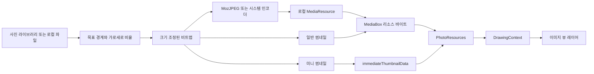
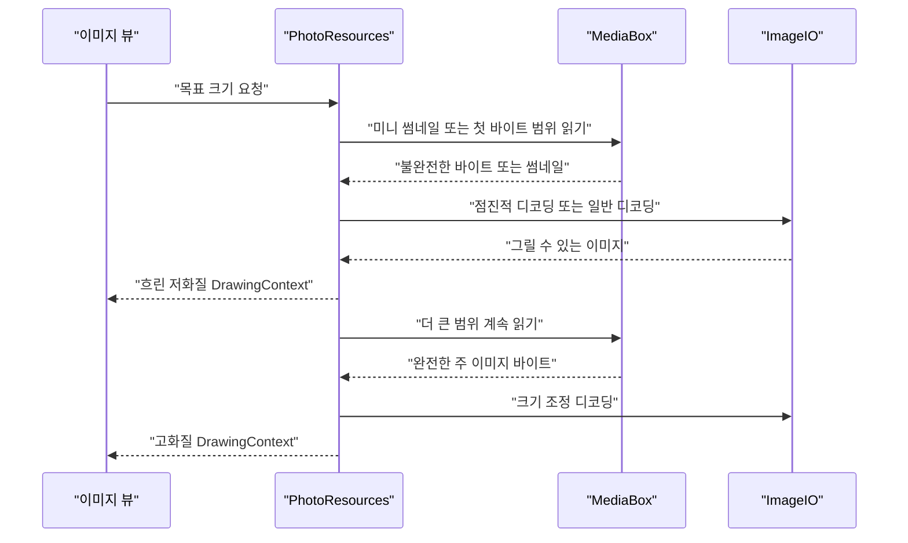
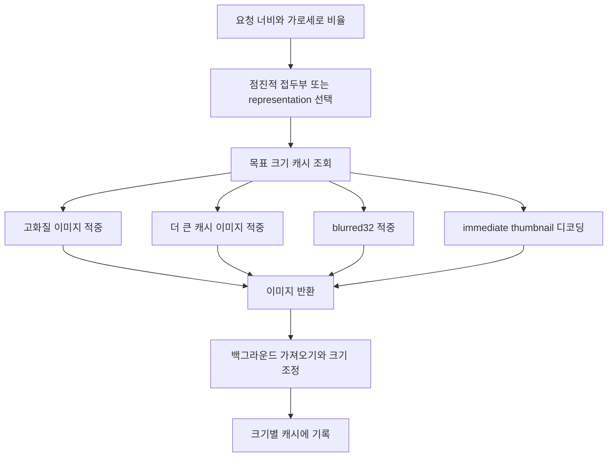

# 이미지 코덱과 썸네일

웹: /docs/media/04-image-pipeline/ · Markdown: /docs/media/04-image-pipeline.md

> Telegram iOS와 macOS 클라이언트의 이미지 업로드 압축, 미니 썸네일, 점진적 표시, 백그라운드 그리기, 이미지 캐시에 대한 연구.

> 렌더링과 미디어 · 비디오와 이미지 · 04장 · 도표 3 · 코드 발췌 10 · 인용 27 · 소스 기준선: [TelegramMessenger/Telegram-iOS@f1dd7a2d](https://github.com/TelegramMessenger/Telegram-iOS/tree/f1dd7a2dbd02cbbf513e75d5695d8d36d1cf5838), [overtake/TelegramSwift@579cebbf](https://github.com/overtake/TelegramSwift/tree/579cebbf0c01fd41b712eff3647fa7f69db9665d)
>
> 핵심 소스 파일: [TelegramMessenger/Telegram-iOS/submodules/ImageCompression/Sources/ImageCompression.swift](https://github.com/TelegramMessenger/Telegram-iOS/blob/f1dd7a2dbd02cbbf513e75d5695d8d36d1cf5838/submodules/ImageCompression/Sources/ImageCompression.swift), [TelegramMessenger/Telegram-iOS/submodules/MozjpegBinding/Sources/MozjpegBinding.mm](https://github.com/TelegramMessenger/Telegram-iOS/blob/f1dd7a2dbd02cbbf513e75d5695d8d36d1cf5838/submodules/MozjpegBinding/Sources/MozjpegBinding.mm), [TelegramMessenger/Telegram-iOS/submodules/TinyThumbnail/Sources/TinyThumbnail.swift](https://github.com/TelegramMessenger/Telegram-iOS/blob/f1dd7a2dbd02cbbf513e75d5695d8d36d1cf5838/submodules/TinyThumbnail/Sources/TinyThumbnail.swift), [TelegramMessenger/Telegram-iOS/submodules/PhotoResources/Sources/PhotoResources.swift](https://github.com/TelegramMessenger/Telegram-iOS/blob/f1dd7a2dbd02cbbf513e75d5695d8d36d1cf5838/submodules/PhotoResources/Sources/PhotoResources.swift), [TelegramMessenger/Telegram-iOS/submodules/Display/Source/TransformImageNode.swift](https://github.com/TelegramMessenger/Telegram-iOS/blob/f1dd7a2dbd02cbbf513e75d5695d8d36d1cf5838/submodules/Display/Source/TransformImageNode.swift), [TelegramMessenger/Telegram-iOS/submodules/DirectMediaImageCache/Sources/DirectMediaImageCache.swift](https://github.com/TelegramMessenger/Telegram-iOS/blob/f1dd7a2dbd02cbbf513e75d5695d8d36d1cf5838/submodules/DirectMediaImageCache/Sources/DirectMediaImageCache.swift), [TelegramMessenger/Telegram-iOS/submodules/LocalMediaResources/Sources/FetchPhotoLibraryImageResource.swift](https://github.com/TelegramMessenger/Telegram-iOS/blob/f1dd7a2dbd02cbbf513e75d5695d8d36d1cf5838/submodules/LocalMediaResources/Sources/FetchPhotoLibraryImageResource.swift), [TelegramMessenger/Telegram-iOS/submodules/WebPBinding/Sources/UIImage+WebP.m](https://github.com/TelegramMessenger/Telegram-iOS/blob/f1dd7a2dbd02cbbf513e75d5695d8d36d1cf5838/submodules/WebPBinding/Sources/UIImage+WebP.m), [overtake/TelegramSwift/Telegram-Mac/SenderController.swift](https://github.com/overtake/TelegramSwift/blob/579cebbf0c01fd41b712eff3647fa7f69db9665d/Telegram-Mac/SenderController.swift), [overtake/TelegramSwift/Telegram-Mac/MediaUtils.swift](https://github.com/overtake/TelegramSwift/blob/579cebbf0c01fd41b712eff3647fa7f69db9665d/Telegram-Mac/MediaUtils.swift), [overtake/TelegramSwift/Telegram-Mac/PhotoCache.swift](https://github.com/overtake/TelegramSwift/blob/579cebbf0c01fd41b712eff3647fa7f69db9665d/Telegram-Mac/PhotoCache.swift), [overtake/TelegramSwift/Telegram-Mac/FetchCachedRepresentations.swift](https://github.com/overtake/TelegramSwift/blob/579cebbf0c01fd41b712eff3647fa7f69db9665d/Telegram-Mac/FetchCachedRepresentations.swift), [overtake/TelegramSwift/Telegram-Mac/ImageCompression.swift](https://github.com/overtake/TelegramSwift/blob/579cebbf0c01fd41b712eff3647fa7f69db9665d/Telegram-Mac/ImageCompression.swift), [overtake/TelegramSwift/packages/TGUIKit/Sources/TransformImageView.swift](https://github.com/overtake/TelegramSwift/blob/579cebbf0c01fd41b712eff3647fa7f69db9665d/packages/TGUIKit/Sources/TransformImageView.swift)
>
> 미검증 사항:
> - 서버가 progressiveSizes와 immediateThumbnailData를 만드는 정확한 규칙은 무엇인가요?
> - 미니 썸네일의 고정 JPEG 템플릿이 버전이 달라져도 프로토콜에서 바뀌지 않는다고 보장할 수 있나요?
> - macOS FastSettings.photoDimension의 실제 기본값과 사용자 설정 범위는 무엇인가요?
> - macOS가 단일 스레드 TransformImageView 스레드 풀을 쓸 때, 병렬 디코딩을 제한하는 화면 수준 스케줄러가 따로 있나요?

## 문제와 제약 [#문제와-제약]

이 장은 이미지 자체의 인코딩, 디코딩, 표시 경로를 다뤄요. 범위는 로컬 사진이 업로드 리소스로 들어오는 시점부터 픽셀이 뷰에 제출되는 시점까지예요. 10장 「미디어 리소스와 캐시」에서 다룬 범용 리소스 상태 머신, 다운로드, 정리 메커니즘은 되풀이하지 않아요. 필요할 때만 이미지가 그 계층을 어떻게 쓰는지 설명해요.

이미지 파이프라인은 세 가지 제약을 동시에 마주해요.

- **업로드 비용**: 클라이언트는 긴 변을 제한하고, 크기를 줄인 뒤 손실 인코딩을 해야 해요.
- **첫 프레임 시간**: 목록은 전체 파일을 다운로드하고 전체를 디코딩할 때까지 기다릴 수 없어요.
- **메모리**: 디코딩된 RGBA 비트맵은 보통 압축 바이트보다 크기 때문에, 표시 크기가 리소스 선택, 디코딩, 캐시 키에 관여해야 해요.

소스를 보면 iOS는 이미지 작업을 다음 모듈로 나눠요.

- `ImageCompression`
- `MozjpegBinding`
- `TinyThumbnail`
- `PhotoResources`: 리소스 데이터를 그리기 클로저에 맞춰 주는 어댑터 계층이에요.
- `DirectMediaImageCache`

`TransformImageNode`는 `PhotoResources`가 맞춰 준 그리기 클로저를 백그라운드에서 실행하고, 결과를 메인 스레드 레이어에 넘겨요. [\[1\]](https://github.com/TelegramMessenger/Telegram-iOS/blob/f1dd7a2dbd02cbbf513e75d5695d8d36d1cf5838/submodules/ImageCompression/Sources/ImageCompression.swift#L21-L105)[\[7\]](https://github.com/TelegramMessenger/Telegram-iOS/blob/f1dd7a2dbd02cbbf513e75d5695d8d36d1cf5838/submodules/PhotoResources/Sources/PhotoResources.swift#L30-L55)[\[10\]](https://github.com/TelegramMessenger/Telegram-iOS/blob/f1dd7a2dbd02cbbf513e75d5695d8d36d1cf5838/submodules/Display/Source/TransformImageNode.swift#L73-L150)

소스를 보면 macOS는 iOS의 화면 계층을 직접 재사용하지 않아요. `Telegram-Mac/MediaUtils.swift`가 `ImageDataTransformation`을 만들어요. `TransformImageView`는 단일 스레드 풀에서 변환을 실행한 뒤 메인 스레드로 돌아와 `CALayer.contents`에 써요. [\[19\]](https://github.com/overtake/TelegramSwift/blob/579cebbf0c01fd41b712eff3647fa7f69db9665d/Telegram-Mac/MediaUtils.swift#L25-L183)[\[21\]](https://github.com/overtake/TelegramSwift/blob/579cebbf0c01fd41b712eff3647fa7f69db9665d/packages/TGUIKit/Sources/TransformImageView.swift#L13-L14)

### 연구 기준 [#연구-기준]

이 문서는 썸네일을 세 가지로 나눠요.

- **미니 썸네일**: 미디어 메타데이터 안의 `immediateThumbnailData`예요.
- **일반 썸네일**: 가장 작은 `TelegramMediaImageRepresentation`이나 로컬에서 만든 리소스예요.
- **표시 썸네일**: 컨트롤 크기에 맞춰 만든 비트맵이나 캐시 표현이에요.

셋은 데이터 형식과 수명이 서로 달라요.

이 문서는 두 표현을 이렇게 구분해요.

- “소스 확인”: 고정 커밋의 코드가 그 동작을 명시적으로 나타낸다는 뜻일 뿐이에요.
- “추론”: 코드가 말하지 않은 동기를 설명할 때만 써요.

서버 구현은 로컬 체크아웃 범위에 없어요. 그래서 이 장에서 서버가 반드시 어떻게 트랜스코딩한다고 결론 내릴 수는 없어요.

## 모듈과 데이터 구조 [#모듈과-데이터-구조]

### 이미지 표현과 크기 결정 [#이미지-표현과-크기-결정]

`TelegramMediaImage` 하나에는 여러 representation(같은 이미지의 크기별 표현)이 있어요. iOS의 `largestRepresentationForPhoto`는 이렇게 골라요.

- progressive sizes(앞쪽 바이트만 받아도 그릴 수 있는 점진적 구간의 경계)가 있는 표현을 먼저 골라요.
- 없으면 `1280` × `1280`이라는 표시 목표에 맞춰 표현을 골라요.

점진적 바이트 경계가 여러 개 있는 표현이면 `representationFetchRangeForDisplayAtSize`가 `100`, `400`, `600`, 그리고 그보다 큰 차원에 따라 파일 접두부(파일의 앞부분)를 골라요. [\[7\]](https://github.com/TelegramMessenger/Telegram-iOS/blob/f1dd7a2dbd02cbbf513e75d5695d8d36d1cf5838/submodules/PhotoResources/Sources/PhotoResources.swift#L30-L55)

원본 이미지 해상도를 기준으로 바로 내려받는 방식이 아니에요. 클라이언트는 먼저 컨트롤이 기대하는 크기에 맞춰 필요한 바이트 접두부를 골라요. representation의 크기를 보고 리소스를 고르는 건 이미지에 점진적 경계가 없을 때뿐이에요. 그래서 스크롤 목록의 64픽셀 칸이 전체 파일을 요청하지 않아도 돼요.

`PhotoResources.chatMessagePhotoDatas`의 출력에는 네 가지 개념이 들어 있어요.

1. 썸네일 바이트
2. 주 이미지나 점진적 접두부 바이트
3. `none`, `blurred`, `medium`, `full`이라는 품질 등급
4. 주 이미지가 완전한지 여부

그리기 코드는 이 값을 보고 먼저 흐린 이미지를 그릴지, 쓸 수 있는 주 이미지를 덧그릴지 정해요. [\[8\]](https://github.com/TelegramMessenger/Telegram-iOS/blob/f1dd7a2dbd02cbbf513e75d5695d8d36d1cf5838/submodules/PhotoResources/Sources/PhotoResources.swift#L62-L148)[\[9\]](https://github.com/TelegramMessenger/Telegram-iOS/blob/f1dd7a2dbd02cbbf513e75d5695d8d36d1cf5838/submodules/PhotoResources/Sources/PhotoResources.swift#L868-L1061)



도표 1은 이미지 데이터와 표시 데이터가 갈라지는 지점을 보여 줘요. 일반 썸네일은 저장할 수 있는 리소스예요. 미니 썸네일은 미디어 객체와 함께 바로 쓸 수 있어요. 최종 그리기 코드는 썸네일과 주 이미지를 함께 받아요. 그래서 주 이미지가 끝나기를 기다렸다가 뷰를 만들 필요가 없어요.

### 업로드 압축의 크기와 품질 전략 [#업로드-압축의-크기와-품질-전략]

iOS 앨범 선택기는 이렇게 처리해요.

- 일반 이미지의 최대 변을 `1280`으로 제한하고, 고화질을 강제하면 `2560`으로 바꿔요.
- 먼저 `aspectFittedOrSmaller`로 비율을 유지하며 크기를 조정한 다음 `compressImageToJPEG`를 호출해요. 호출 인자는 `0.6`이에요.
- 같은 분기에서 320 × 320 미리보기용으로 품질 `0.4`의 JPEG도 만들어요. [\[4\]](https://github.com/TelegramMessenger/Telegram-iOS/blob/f1dd7a2dbd02cbbf513e75d5695d8d36d1cf5838/submodules/LegacyMediaPickerUI/Sources/LegacyMediaPickers.swift#L392-L420)

사진 라이브러리 리소스 취득기도 같은 두 가지 목표 상한을 써요. 명시적인 너비와 높이가 없으면 일반 모드는 `1280`, 고화질 모드는 `2560`이에요. 처리 순서는 이래요.

1. `1.0` 이하의 배율을 계산해요.
2. 정수로 맞춰 리샘플링해요.
3. `0.6`으로 JPEG 압축을 호출해요. [\[3\]](https://github.com/TelegramMessenger/Telegram-iOS/blob/f1dd7a2dbd02cbbf513e75d5695d8d36d1cf5838/submodules/LocalMediaResources/Sources/FetchPhotoLibraryImageResource.swift#L105-L235)

```swift
let maxSize = item.forceHd ? CGSize(width: 2560.0, height: 2560.0) : CGSize(width: 1280.0, height: 1280.0)
let scaledSize = image.size.aspectFittedOrSmaller(maxSize)

if let scaledImage = TGScaleImageToPixelSize(image, scaledSize) {
    let tempFile = EngineTempBox.shared.tempFile(fileName: "file")
    defer {
        EngineTempBox.shared.dispose(tempFile)
    }
    if let scaledImageData = compressImageToJPEG(scaledImage, quality: 0.6, tempFilePath: tempFile.path) {
        let _ = try? scaledImageData.write(to: URL(fileURLWithPath: tempFilePath))

        let resource = LocalFileReferenceMediaResource(localFilePath: tempFilePath, randomId: randomId)
        representations.append(TelegramMediaImageRepresentation(dimensions: PixelDimensions(scaledSize), resource: resource, progressiveSizes: [], immediateThumbnailData: nil, hasVideo: false, isPersonal: false))
```
[\[4\]](https://github.com/TelegramMessenger/Telegram-iOS/blob/f1dd7a2dbd02cbbf513e75d5695d8d36d1cf5838/submodules/LegacyMediaPickerUI/Sources/LegacyMediaPickers.swift#L392-L420)

위의 품질 매개변수는 MozJPEG(JPEG 인코더 라이브러리)의 실제 압축 품질이 아니에요. 현재 iOS 바인딩에서 `compressImageToJPEG`는 이렇게 동작해요.

1. 먼저 `compressJPEGData`를 호출해요. MozJPEG 경로는 품질을 `72`로 고정하고, 최적화된 허프만 인코딩과 점진적 스캔을 켜요.
2. 이 호출이 실패한 뒤에야 Swift가 전달받은 품질로 `CGImageDestination`을 호출해요.

그래서 일반 앨범 업로드의 `0.6`은 MozJPEG 주 경로가 아니라 폴백(대체 경로) 인코더에 쓰이는 경우가 많아요. 이 결론은 소스로 확인했어요. [\[1\]](https://github.com/TelegramMessenger/Telegram-iOS/blob/f1dd7a2dbd02cbbf513e75d5695d8d36d1cf5838/submodules/ImageCompression/Sources/ImageCompression.swift#L21-L105)[\[2\]](https://github.com/TelegramMessenger/Telegram-iOS/blob/f1dd7a2dbd02cbbf513e75d5695d8d36d1cf5838/submodules/MozjpegBinding/Sources/MozjpegBinding.mm#L425-L509)

```objc
struct jpeg_compress_struct cinfo;
struct jpeg_error_mgr jerr;
cinfo.err = jpeg_std_error(&jerr);
jpeg_create_compress(&cinfo);

jpeg_stdio_dest(&cinfo, outfile);

cinfo.image_width = (uint32_t)width;
cinfo.image_height = (uint32_t)height;
cinfo.input_components = 3;
cinfo.in_color_space = JCS_RGB;
jpeg_c_set_int_param(&cinfo, JINT_COMPRESS_PROFILE, JCP_FASTEST);
jpeg_set_defaults(&cinfo);
cinfo.arith_code = FALSE;
cinfo.dct_method = JDCT_ISLOW;
cinfo.optimize_coding = TRUE;
jpeg_set_quality(&cinfo, 72, 1);
jpeg_simple_progression(&cinfo);
jpeg_start_compress(&cinfo, 1);
```
[\[2\]](https://github.com/TelegramMessenger/Telegram-iOS/blob/f1dd7a2dbd02cbbf513e75d5695d8d36d1cf5838/submodules/MozjpegBinding/Sources/MozjpegBinding.mm#L425-L509)

바인딩은 이렇게 인코딩해요.

1. UIKit 이미지를 32비트 RGB 비트맵에 그려요.
2. 픽셀마다 RGB 세 채널을 추출해요.
3. 출력은 임시 파일에 쓰고, 다시 `NSData`로 읽은 뒤 임시 파일을 삭제해요. [\[2\]](https://github.com/TelegramMessenger/Telegram-iOS/blob/f1dd7a2dbd02cbbf513e75d5695d8d36d1cf5838/submodules/MozjpegBinding/Sources/MozjpegBinding.mm#L425-L509)

이 경로를 쓰면 라이브러리 인터페이스에서 출력 버퍼를 관리하지 않아도 되지만, 임시 파일 읽기와 쓰기가 한 번씩 생겨요. 추론하면, 이 경로는 통제된 전송 준비 작업에 더 알맞고 메인 스레드 스크롤 경로에는 두면 안 돼요.

이미지 첨부의 후처리도 표시용 파생 이미지를 만들어요.

- 원본 이미지를 파일로 보낼 때: iOS는 전체 리소스를 읽어 `320` × `320`으로 미리보기를 만들고, JPEG 품질 `0.6`으로 로컬 미리보기 리소스에 저장해요.
- 이미 있는 `TelegramMediaImage`일 때: 가장 작은 표현이 너무 클 때 `320` 이하의 썸네일을 만들어 `compressImageToJPEG`를 거쳐 저장해요. [\[25\]](https://github.com/TelegramMessenger/Telegram-iOS/blob/f1dd7a2dbd02cbbf513e75d5695d8d36d1cf5838/submodules/TelegramUI/Sources/TransformOutgoingMessageMedia.swift#L54-L189)

### JPEG XL, HEIC, WebP의 실제 위치 [#jpeg-xl-heic-webp의-실제-위치]

이 커밋에서 JPEG XL은 코드가 있어도 기본 업로드 형식으로는 쓸 수 없어요.

- `ImageCompression`은 JPEG XL의 압축과 압축 해제 래퍼를 선언해요.
- 사진 라이브러리 리소스 취득기에도 `.jxl` 분기가 있어서, 호출자가 준 품질이나 기본값 `75`를 래퍼에 전달해요. [\[1\]](https://github.com/TelegramMessenger/Telegram-iOS/blob/f1dd7a2dbd02cbbf513e75d5695d8d36d1cf5838/submodules/ImageCompression/Sources/ImageCompression.swift#L21-L105)[\[3\]](https://github.com/TelegramMessenger/Telegram-iOS/blob/f1dd7a2dbd02cbbf513e75d5695d8d36d1cf5838/submodules/LocalMediaResources/Sources/FetchPhotoLibraryImageResource.swift#L105-L235)
- 하지만 이 커밋의 `MozjpegBinding` Bazel 타깃은 MozJPEG에만 의존해요. `libjxl` 의존 행은 주석 처리되어 있어요.
- JPEG XL 구현도 `USE_JPEGXL` 조건부 컴파일로 감싸여 있어요. 그래서 이 Bazel 타깃에서 JPEG XL 인터페이스는 빈 값을 반환하는 분기로 떨어지고, 기본 업로드 형식으로 쓸 수 없어요. [\[15\]](https://github.com/TelegramMessenger/Telegram-iOS/blob/f1dd7a2dbd02cbbf513e75d5695d8d36d1cf5838/submodules/MozjpegBinding/BUILD#L4-L25)

여기서는 “코드가 남아 있음”과 “현재 활성화됨”을 구분해야 해요.

- 소스를 보면 JPEG XL 인코더 코드는 이미지를 RGB로 바꾼 뒤 distance와 effort(JPEG XL 인코더 설정값)를 `8`로 설정해요.
- 동시에 기본 빌드 선언이 이 코드를 연결하지 않았다는 것도 확인돼요.

추론하면 예약됐거나 실험적인 경로예요. Bazel이 아닌 릴리스 설정이 `USE_JPEGXL`을 주입하는지는 로컬 소스로 검증할 수 없어서 확인 필요 문제에 올려 뒀어요.

HEIC는 별도의 시스템 인코딩 인터페이스예요. `compressImage`는 `AVFileType.heic`와 전달받은 손실 품질을 써요. 현재의 앨범 전송 코드 조각은 이 인터페이스를 호출하지 않아요. 그래서 이 커밋의 기본 사진 업로드 형식이라고 설명할 수 없어요. [\[1\]](https://github.com/TelegramMessenger/Telegram-iOS/blob/f1dd7a2dbd02cbbf513e75d5695d8d36d1cf5838/submodules/ImageCompression/Sources/ImageCompression.swift#L21-L105)

WebP는 위치가 달라요. `WebPBinding`은 `third-party/webp`를 명시적으로 링크해요.

- 디코딩할 때 바인딩은 먼저 `WebPGetInfo`로 너비와 높이를 읽고, `WebPDecodeBGRAInto`로 정렬된 BGRA 버퍼에 쓴 뒤 `UIImage`를 만들어요.
- 인코딩할 때 바인딩은 RGBA를 가져와 libwebp의 `WebPEncode`를 호출해요.

정적 WebP의 픽셀 변환을 지원할 뿐, JPEG를 대신하는 업로드 주 경로는 아니에요. [\[14\]](https://github.com/TelegramMessenger/Telegram-iOS/blob/f1dd7a2dbd02cbbf513e75d5695d8d36d1cf5838/submodules/WebPBinding/Sources/UIImage+WebP.m#L8-L154)[\[16\]](https://github.com/TelegramMessenger/Telegram-iOS/blob/f1dd7a2dbd02cbbf513e75d5695d8d36d1cf5838/submodules/TelegramUI/Sources/ConvertToWebP.swift#L15-L29)

```objc
int width = 0, height = 0;
if (!WebPGetInfo([imgData bytes], [imgData length], &width, &height)) {
    NSMutableDictionary *errorDetail = [NSMutableDictionary dictionary];
    [errorDetail setValue:@"Header formatting error." forKey:NSLocalizedDescriptionKey];
    return nil;
}

const struct { int width, height; } targetContextSize = { width, height};

size_t targetBytesPerRow = ((4 * (int)targetContextSize.width) + 31) & (~31);

void *targetMemory = malloc((int)(targetBytesPerRow * targetContextSize.height));
```
[\[14\]](https://github.com/TelegramMessenger/Telegram-iOS/blob/f1dd7a2dbd02cbbf513e75d5695d8d36d1cf5838/submodules/WebPBinding/Sources/UIImage+WebP.m#L8-L154)

`convertToWebP`는 먼저 목표 크기로 크기를 조정한 다음, 품질 × `100`을 바인딩에 전달할 수 있어요. 이 래퍼는 동시 기본 큐에서 실행돼요. [\[16\]](https://github.com/TelegramMessenger/Telegram-iOS/blob/f1dd7a2dbd02cbbf513e75d5695d8d36d1cf5838/submodules/TelegramUI/Sources/ConvertToWebP.swift#L15-L29)

확인된 또 하나의 용도는 스티커 캐시 표현이에요. 캐시 생성기는 이렇게 동작해요.

1. 먼저 WebP 디코딩을 시도하고, 실패하면 PNG를 시도해요.
2. 그다음 색상과 alpha를 분리해 두 개의 JPEG 조각으로 써요. [\[13\]](https://github.com/TelegramMessenger/Telegram-iOS/blob/f1dd7a2dbd02cbbf513e75d5695d8d36d1cf5838/submodules/TelegramUI/Sources/FetchCachedRepresentations.swift#L251-L372)

### 미니 썸네일의 제거와 복원 [#미니-썸네일의-제거와-복원]

미니 썸네일은 완전한 JPEG가 아니에요. 크기와 인코딩 설정은 이래요.

- iOS의 일반 이미지 목표는 `40` × `40`이에요.
- 아바타는 `8` × `8`에서 시작해 매번 1씩 키워요. 압축 데이터가 32바이트에 이르거나 인코딩에 실패할 때까지 계속해요.
- 인코더는 품질을 `20`으로 고정하고 엔트로피 인코딩은 최적화하지 않아요. [\[1\]](https://github.com/TelegramMessenger/Telegram-iOS/blob/f1dd7a2dbd02cbbf513e75d5695d8d36d1cf5838/submodules/ImageCompression/Sources/ImageCompression.swift#L21-L105)[\[5\]](https://github.com/TelegramMessenger/Telegram-iOS/blob/f1dd7a2dbd02cbbf513e75d5695d8d36d1cf5838/submodules/MozjpegBinding/Sources/MozjpegBinding.mm#L621-L727)

인코더는 출력이 고정 템플릿의 머리와 꼬리에 일치할 때만 전송 형태로 압축해요. 압축은 이렇게 해요.

1. 너비와 높이 위치를 0으로 지워요.
2. 버전 `1`, 높이, 너비, 중간 이미지 데이터를 이 순서로 써요.

고정 JPEG 머리와 꼬리는 더 이상 매번 싣지 않아요. 이 설계는 소스로 확인했어요. [\[5\]](https://github.com/TelegramMessenger/Telegram-iOS/blob/f1dd7a2dbd02cbbf513e75d5695d8d36d1cf5838/submodules/MozjpegBinding/Sources/MozjpegBinding.mm#L621-L727)

```objc
if (outBuffer[164] == height && outBuffer[166] == width && headerPattern != nil && footerPattern != nil) {
    outBuffer[164] = 0;
    outBuffer[166] = 0;
    
    if (memcmp(headerPattern.bytes, outBuffer, headerPattern.length) == 0) {
        if (memcmp(footerPattern.bytes, outBuffer + outSize - footerPattern.length, footerPattern.length) == 0) {
            serializedData = [[NSMutableData alloc] init];
            uint8_t version = 1;
            [serializedData appendBytes:&version length:1];
            uint8_t outWidth = (uint8_t)width;
            uint8_t outHeight = (uint8_t)height;
            [serializedData appendBytes:&outHeight length:1];
            [serializedData appendBytes:&outWidth length:1];
            unsigned long contentSize = outSize - headerPattern.length - footerPattern.length;
            [serializedData appendBytes:outBuffer + headerPattern.length length:contentSize];
```
[\[5\]](https://github.com/TelegramMessenger/Telegram-iOS/blob/f1dd7a2dbd02cbbf513e75d5695d8d36d1cf5838/submodules/MozjpegBinding/Sources/MozjpegBinding.mm#L621-L727)

디코더는 이렇게 복원해요.

1. 3바이트 미만의 데이터와 `1`이 아닌 버전을 거부해요.
2. 고정 머리와 고정 꼬리를 붙여요.
3. 저장된 너비와 높이를 결과 데이터의 `164`번째와 `166`번째 바이트에 되돌려 써요.

이렇게 해야 출력이 ImageIO(Apple의 이미지 입출력 프레임워크)나 `UIImage`에 넘길 수 있는 완전한 JPEG가 돼요. [\[6\]](https://github.com/TelegramMessenger/Telegram-iOS/blob/f1dd7a2dbd02cbbf513e75d5695d8d36d1cf5838/submodules/TinyThumbnail/Sources/TinyThumbnail.swift#L6-L35)

```swift
var version: UInt8 = 0
data.copyBytes(to: &version, count: 1)
if version != 1 {
    return nil
}
var width: UInt8 = 0
var height: UInt8 = 0
data.copyBytes(to: &width, from: 1 ..< 2)
data.copyBytes(to: &height, from: 2 ..< 3)

var resultData = Data()
resultData.append(tinyThumbnailHeaderPattern)
resultData.append(data.subdata(in: 3 ..< data.count))
resultData.append(tinyThumbnailFooterPattern)
resultData.withUnsafeMutableBytes { buffer -> Void in
    guard let resultBytes = buffer.baseAddress?.assumingMemoryBound(to: UInt8.self) else {
        return
    }
    resultBytes[164] = width
    resultBytes[166] = height
}
```
[\[6\]](https://github.com/TelegramMessenger/Telegram-iOS/blob/f1dd7a2dbd02cbbf513e75d5695d8d36d1cf5838/submodules/TinyThumbnail/Sources/TinyThumbnail.swift#L6-L35)

이 형식은 템플릿에 엄격하게 의존해요. 인코딩 쪽은 머리, 꼬리, 크기 필드를 검사해요. 디코딩 쪽도 버전 `1`만 받아요. 그래서 다음 중 하나를 바꾸면 압축 형태가 무효가 되어 빈 데이터가 반환돼요.

- JPEG 매개변수
- 라이브러리 출력
- 고정 머리 구조

호출자는 빈 데이터를 미니 썸네일이 없는 것으로 취급해야 해요. 손상된 바이트를 일반 JPEG 디코더에 넘기면 안 돼요.

## 핵심 흐름 [#핵심-흐름]

### 점진적 리소스, 흐린 플레이스홀더, 고화질 덮어쓰기 [#점진적-리소스-흐린-플레이스홀더-고화질-덮어쓰기]

점진적 이미지 분기는 먼저 후보 소스 여러 개를 구성해요.

1. decoded mini thumbnail을 맨 앞에 끼워 넣을 수 있어요.
2. 표시 너비에 따라 progressive byte range를 하나 이상 골라요. 각 range는 `mode: .incremental`로 `MediaBox`에서 읽고, 불완전한 데이터 알림도 허용해요.
3. 결과는 쓸 수 있는 가장 큰 소스부터 앞쪽으로 찾아가요.

그래서 쓸 수 있는 더 큰 접두부가 미니 썸네일보다 우선해요. [\[8\]](https://github.com/TelegramMessenger/Telegram-iOS/blob/f1dd7a2dbd02cbbf513e75d5695d8d36d1cf5838/submodules/PhotoResources/Sources/PhotoResources.swift#L62-L148)

```swift
if let miniThumbnail = photoReference.media.immediateThumbnailData.flatMap(decodeTinyThumbnail) {
    sources.insert(.miniThumbnail(data: miniThumbnail), at: 0)
}

return Signal { subscriber in
    let signals: [Signal<(SizeSource, Data?), NoError>] = sources.map { source -> Signal<(SizeSource, Data?), NoError> in
        switch source {
        case let .miniThumbnail(data):
            return .single((source, data))
        case let .image(size):
            return mediaBox.resourceData(progressiveRepresentation.resource, size: Int64(progressiveRepresentation.progressiveSizes.last!), in: 0 ..< size, mode: .incremental, notifyAboutIncomplete: true, attemptSynchronously: synchronousLoad)
            |> map { (data, _) -> (SizeSource, Data?) in
                return (source, data)
            }
        }
    }
```
[\[8\]](https://github.com/TelegramMessenger/Telegram-iOS/blob/f1dd7a2dbd02cbbf513e75d5695d8d36d1cf5838/submodules/PhotoResources/Sources/PhotoResources.swift#L62-L148)

렌더링 단계는 데이터가 완전하기를 요구하지 않아요. `fullSizeComplete` 값에 따라 이렇게 나뉘어요.

- 참이면 `PhotoResources`는 `CGImageSourceCreateWithData`로 첫 이미지를 만들어요.
- 거짓이면 `CGImageSourceCreateIncremental`을 만들고, 도착한 데이터로 갱신한 뒤 지금 디코딩할 수 있는 이미지를 만들어 봐요.

두 분기 모두 `kCGImageSourceShouldCache`를 거짓으로 설정해요. ImageIO가 원본 데이터에 대해 통제되지 않는 캐시를 따로 만드는 것을 피하기 위해서예요. [\[9\]](https://github.com/TelegramMessenger/Telegram-iOS/blob/f1dd7a2dbd02cbbf513e75d5695d8d36d1cf5838/submodules/PhotoResources/Sources/PhotoResources.swift#L868-L1061)

흐린 플레이스홀더(주 이미지가 오기 전에 먼저 보여 주는 흐린 이미지)는 이렇게 만들어요.

1. 미니 썸네일이나 작은 일반 썸네일은 먼저 90 × 90에 가까운 컨텍스트로 크기를 줄인 뒤 `telegramFastBlurMore`를 실행해요.
2. 화면이 더 커야 하면 코드는 흐린 비트맵을 최소 150픽셀 부근까지 키우고 `imageFastBlur`를 한 번 실행해요.
3. 주 이미지를 쓸 수 있게 되면 중간 보간으로 같은 `DrawingContext` 위에 그려요.

그래서 흐린 플레이스홀더는 독립된 뷰가 아니라 같은 그리기 결과 안의 아래층이에요. [\[9\]](https://github.com/TelegramMessenger/Telegram-iOS/blob/f1dd7a2dbd02cbbf513e75d5695d8d36d1cf5838/submodules/PhotoResources/Sources/PhotoResources.swift#L868-L1061)



도표 2는 품질이 갱신되는 순서를 설명해요. 네트워크 계층의 단방향 콜백이 아니에요. `combineLatest`는 서로 다른 범위가 갱신될 때마다 지금 가장 좋은 데이터를 다시 내놓아요. 주 이미지가 아직 완전하지 않아도 점진적 JPEG에서 쓸 수 있는 스캔이 화면을 바꿀 수 있어요.

점진적 표시는 JPEG의 스캔 구조에 의존해요.

- `extractImageExtraScans`는 마커 바이트 시퀀스를 찾아 추가 스캔 위치를 반환하는 데 쓰여요.
- 업로드 쪽 MozJPEG는 `jpeg_simple_progression`을 켜요.

소스로 확인한 것은 이 둘이 모두 존재한다는 점이에요. 그래서 클라이언트와 리소스 표현이 이미지 전체가 먼저 도착하기를 요구하지 않고 점진적 JPEG의 바이트 접두부를 활용할 수 있다는 것은 추론이에요. [\[1\]](https://github.com/TelegramMessenger/Telegram-iOS/blob/f1dd7a2dbd02cbbf513e75d5695d8d36d1cf5838/submodules/ImageCompression/Sources/ImageCompression.swift#L21-L105)[\[2\]](https://github.com/TelegramMessenger/Telegram-iOS/blob/f1dd7a2dbd02cbbf513e75d5695d8d36d1cf5838/submodules/MozjpegBinding/Sources/MozjpegBinding.mm#L425-L509)

### 백그라운드 디코딩과 레이어 제출 [#백그라운드-디코딩과-레이어-제출]

`TransformImageNode.setSignal`은 시그널을 현재 `TransformImageArguments`와 결합해요. 그다음 흐름은 이래요.

1. 비동기 요청은 `deliverOn`으로 `Queue.concurrentDefaultQueue`에 넘어가요.
2. 클로저에서 `DrawingContext`와 `UIImage`가 만들어져요.
3. 시그널이 `deliverOnMainQueue`로 `image.cgImage`를 `contents`에 써요.

선택적인 표시 체인 스케줄러가 이번 프레임에서 언제 적용할지를 다시 정해요. [\[10\]](https://github.com/TelegramMessenger/Telegram-iOS/blob/f1dd7a2dbd02cbbf513e75d5695d8d36d1cf5838/submodules/Display/Source/TransformImageNode.swift#L73-L150)

```swift
let resultData: Signal<((TransformImageArguments) -> DrawingContext?, TransformImageArguments), NoError>
if attemptSynchronously {
    resultData = data
} else {
    resultData = data
    |> deliverOn(Queue.concurrentDefaultQueue())
}

let result = resultData
|> mapToThrottled { transform, arguments -> Signal<((TransformImageArguments) -> DrawingContext?, TransformImageArguments, UIImage?)?, NoError> in
    return deferred {
        if let context = transform(arguments) {
            return .single((transform, arguments, context.generateImage()))
        } else {
            return .single(nil)
        }
    }
}

self.disposable.set((result |> deliverOnMainQueue).start(next: { [weak self] next in
```
[\[10\]](https://github.com/TelegramMessenger/Telegram-iOS/blob/f1dd7a2dbd02cbbf513e75d5695d8d36d1cf5838/submodules/Display/Source/TransformImageNode.swift#L73-L150)

백그라운드와 메인 스레드 사이의 이 경계는 중요해요. `PhotoResources`의 blur, 크기 조정, 점진적 디코딩, 둥근 모서리 그리기는 픽셀 수준 연산을 일으킬 수 있어요. 이 연산들은 변환 클로저 안에서 일어나요. 메인 스레드는 이미 만들어진 `UIImage`만 받아 레이어를 갱신해요. `MetaDisposable`은 이전 구독을 교체해서, 재사용된 셀이 오래된 이미지를 새 메시지에 적용하는 일을 피해요. [\[10\]](https://github.com/TelegramMessenger/Telegram-iOS/blob/f1dd7a2dbd02cbbf513e75d5695d8d36d1cf5838/submodules/Display/Source/TransformImageNode.swift#L73-L150)

직접 미디어 캐시도 같은 원칙(무거운 픽셀 작업은 백그라운드 큐에서 하는 것)을 따라요. 비동기 `getImage`는 먼저 쓸 수 있는 흐린 이미지와 `loadSignal`을 반환해요. 동기 캐시 조회, 리소스 취득, 크기 조정, 디스크 기록이라는 전체 작업은 `concurrentDefaultQueue`에 올려요. 리소스나 컨텍스트가 없거나 캐시 쓰기에 실패하면 빈 값을 보내고 완료해요. [\[11\]](https://github.com/TelegramMessenger/Telegram-iOS/blob/f1dd7a2dbd02cbbf513e75d5695d8d36d1cf5838/submodules/DirectMediaImageCache/Sources/DirectMediaImageCache.swift#L53-L219)[\[12\]](https://github.com/TelegramMessenger/Telegram-iOS/blob/f1dd7a2dbd02cbbf513e75d5695d8d36d1cf5838/submodules/DirectMediaImageCache/Sources/DirectMediaImageCache.swift#L260-L344)

### 컨트롤 크기가 리소스와 캐시를 고르는 방식 [#컨트롤-크기가-리소스와-캐시를-고르는-방식]

`DirectMediaImageCache.getProgressiveSize`는 표시 너비에 따라 이렇게 골라요.

- 표시 너비가 `64` 이하: progressive size 배열의 `0`번째 항목을 가져와요.
- `160` 이하: `2`번째 항목을 가져와요.
- `400` 이하: `4`번째 항목을 가져와요.
- 그보다 큰 크기: 완전한 리소스를 요청해요.

progressive sizes가 없으면 representation 너비로 정렬하고, 요청 너비 ÷ `1.2` 이상인 표현을 골라요. [\[12\]](https://github.com/TelegramMessenger/Telegram-iOS/blob/f1dd7a2dbd02cbbf513e75d5695d8d36d1cf5838/submodules/DirectMediaImageCache/Sources/DirectMediaImageCache.swift#L260-L344)

```swift
if progressiveSizes.count > 0 && width <= 64 {
    selectedSize = Int64(progressiveSizes[0])
} else if progressiveSizes.count > 2 && width <= 160 {
    selectedSize = Int64(progressiveSizes[2])
} else if progressiveSizes.count > 4 && width <= 400 {
    selectedSize = Int64(progressiveSizes[4])
} else {
    selectedSize = Int64.max
}
return (mediaReference.resourceReference(representation.resource), selectedSize)
```
[\[12\]](https://github.com/TelegramMessenger/Telegram-iOS/blob/f1dd7a2dbd02cbbf513e75d5695d8d36d1cf5838/submodules/DirectMediaImageCache/Sources/DirectMediaImageCache.swift#L260-L344)

캐시 키에는 리소스 식별자, 정사각형 목표 너비, 가로세로 비율이 들어가요. 표현 이름은 `blurred32`, `shm`에 너비를 붙인 것, 또는 `shm`에 너비와 가로세로 비율을 붙인 것이에요. 조회는 이 순서로 시도해요.

1. 필요한 크기
2. 더 큰 후보 크기
3. `blurred32`나 즉시 썸네일로 만든 흐린 이미지 [\[11\]](https://github.com/TelegramMessenger/Telegram-iOS/blob/f1dd7a2dbd02cbbf513e75d5695d8d36d1cf5838/submodules/DirectMediaImageCache/Sources/DirectMediaImageCache.swift#L53-L219)[\[12\]](https://github.com/TelegramMessenger/Telegram-iOS/blob/f1dd7a2dbd02cbbf513e75d5695d8d36d1cf5838/submodules/DirectMediaImageCache/Sources/DirectMediaImageCache.swift#L260-L344)

작은 표시 캐시는 저장 형식도 다르게 써요.

- 목표 너비와 높이가 모두 `70` 이하이면: iOS는 사용자 정의 `0xcaf2` 헤더, 너비와 높이, RGB565(픽셀 하나를 2바이트로 저장하는 색 형식) 픽셀을 써요.
- 더 큰 결과만: 품질 `0.7`로 JPEG를 써요.

읽을 때는 이 순서로 시도해요.

1. 두 사용자 정의 헤더를 먼저 알아보고 vImage로 BGRA로 되돌려요.
2. 둘 다 맞지 않으면 MozJPEG 디코딩을 우선해요.
3. 마지막에야 `UIImage`에 넘겨요. [\[11\]](https://github.com/TelegramMessenger/Telegram-iOS/blob/f1dd7a2dbd02cbbf513e75d5695d8d36d1cf5838/submodules/DirectMediaImageCache/Sources/DirectMediaImageCache.swift#L53-L219)

이 저장 형식들을 보면 이 캐시는 단순한 “파일 캐시”만이 아니에요. 형식을 고르는 것만으로 작은 아바타와 작은 목록 칸의 디스크 바이트와 디코딩 비용도 줄여요. 추론하면 RGB565의 2바이트 픽셀 형식은 작은 이미지에 더 이득이고, 더 큰 이미지는 전체 캐시 공간을 통제하려고 JPEG가 필요해요.

### 데이터 소유권과 비점진적 폴백 [#데이터-소유권과-비점진적-폴백]

이미지 경로에는 동시에 존재할 수 있는 바이트가 적어도 세 벌 있어요.

1. `MediaBox`가 관리하는 원본 리소스나 이미 내려받은 접두부
2. `cachedResourceRepresentation`이 만든 크기 조정 JPEG 같은 파생 리소스
3. `PhotoResources`나 뷰 클로저가 임시로 쥐고 있는 `Data`, `CGImage`, `DrawingContext`

이 세 벌은 크기, 완전성, 축출(캐시에서 항목을 내보내는 일) 정책이 달라서 같은 캐시 적중으로 취급할 수 없어요.

progressive sizes가 있는 사진이라면 리소스 선택기는 각 구간의 바이트 양이 지닌 의미를 알아요. 일반적인 다중 표현 사진에는 스캔 단위로 잘라 내는 이런 능력이 없어요. 비점진적 분기는 이렇게 동작해요.

1. 목표 크기에 맞는 표현과 가장 큰 표현이 이미 완전한지 조회해요.
2. 둘 중 하나라도 완전하면 파일 내용을 그대로 읽어 주 이미지로 써요.
3. 둘 다 완전하지 않으면 즉시 썸네일을 먼저 시도해요.
4. 즉시 썸네일이 없으면 가장 작은 표현의 취득을 시작하는 동시에, 선택된 목표 표현의 주 이미지 데이터 스트림을 만들어요. [\[26\]](https://github.com/TelegramMessenger/Telegram-iOS/blob/f1dd7a2dbd02cbbf513e75d5695d8d36d1cf5838/submodules/PhotoResources/Sources/PhotoResources.swift#L151-L270)

이 비점진적 폴백에는 중요한 제품 의미가 있어요.

- 작은 representation은 첫 프레임의 출처일 뿐, 반드시 최종 표시의 출처는 아니에요.
- 가장 큰 표현은 가용성과 선명도를 위한 보험이지만, 모든 셀이 그 표현을 프리페치한다는 뜻은 아니에요.
- `autoFetchFullSize`는 완전한 표현의 취득을 먼저 시작할지 제어해요.
- `tryAdditionalRepresentations`는 이미 있는 중간 표현을 `medium` 품질 결과로 반환하도록 허용해요. [\[8\]](https://github.com/TelegramMessenger/Telegram-iOS/blob/f1dd7a2dbd02cbbf513e75d5695d8d36d1cf5838/submodules/PhotoResources/Sources/PhotoResources.swift#L62-L148)[\[26\]](https://github.com/TelegramMessenger/Telegram-iOS/blob/f1dd7a2dbd02cbbf513e75d5695d8d36d1cf5838/submodules/PhotoResources/Sources/PhotoResources.swift#L151-L270)

호출자가 `forceThumbnail`을 참으로 설정하면, 사진 경로는 로컬에 완전한 이미지가 있다는 이유로 곧바로 전체 이미지를 그리면 안 돼요. 이 조건은 일부러 저화질 상태를 유지해야 하는 화면에 쓰여요.

소스를 보면 일반 분기의 완전한 이미지 지름길은 `forceThumbnail`의 제약을 받아요. 끝 단계에서는 이미 풀어 둔 즉시 썸네일로 폴백할 수 있어요. [\[26\]](https://github.com/TelegramMessenger/Telegram-iOS/blob/f1dd7a2dbd02cbbf513e75d5695d8d36d1cf5838/submodules/PhotoResources/Sources/PhotoResources.swift#L151-L270)

추론하면 이 조건은 민감한 콘텐츠, 미디어 미리보기, 전환 상태가 완전한 픽셀을 너무 일찍 보여 주는 것을 막을 수 있어요.

리소스 시그널의 완료 의미도 구분해야 해요.

- `MediaResourceData.complete`: 그 리소스를 완전히 읽었다는 뜻이에요. 파생 이미지가 이미 캐시에 쓰였다거나 뷰가 이미 레이어에 제출했다는 뜻은 아니에요.
- `fullSizeComplete`: `PhotoResources`가 그리기 클로저에 넘기는 품질 플래그일 뿐이에요. macOS는 이 플래그를 `DrawingContext`의 고화질 상태까지 이어서 기록해요. iOS의 범용 이미지 노드는 새 시그널 값으로 이전 레이어 내용을 교체해요. [\[9\]](https://github.com/TelegramMessenger/Telegram-iOS/blob/f1dd7a2dbd02cbbf513e75d5695d8d36d1cf5838/submodules/PhotoResources/Sources/PhotoResources.swift#L868-L1061)[\[10\]](https://github.com/TelegramMessenger/Telegram-iOS/blob/f1dd7a2dbd02cbbf513e75d5695d8d36d1cf5838/submodules/Display/Source/TransformImageNode.swift#L73-L150)[\[20\]](https://github.com/overtake/TelegramSwift/blob/579cebbf0c01fd41b712eff3647fa7f69db9665d/Telegram-Mac/MediaUtils.swift#L543-L692)

### 표현 캐시와 비트맵 캐시의 경계 [#표현-캐시와-비트맵-캐시의-경계]

`CachedScaledImageRepresentation`은 리소스 쪽의 파생 표현이에요. 원본 리소스와 목표 size로, 재사용할 수 있는 크기 조정 결과를 나타내요. iOS 구현은 원본 리소스가 완전해야 생성기로 들어가요. 생성기는 이 순서로 처리해요.

1. `fill`이나 `aspectFit`에 따라 크기를 계산해요.
2. 새 이미지를 그려요.
3. 품질 `0.5`로 JPEG 임시 경로에 출력해요. [\[13\]](https://github.com/TelegramMessenger/Telegram-iOS/blob/f1dd7a2dbd02cbbf513e75d5695d8d36d1cf5838/submodules/TelegramUI/Sources/FetchCachedRepresentations.swift#L251-L372)

그래서 이 계층은 180이나 160픽셀 같은 안정적인 미리보기 크기에 알맞고, 말풍선마다 정확하게 잘라 내는 일에는 맞지 않아요.

직접 미디어 캐시는 컨트롤의 시각 매개변수를 입력으로 삼아요. 키에는 이미지 리소스뿐 아니라 요청 너비와 가로세로 비율의 구분도 들어가요. 로더는 데이터를 읽은 뒤 목표 너비에 따라 높이를 계산하고, `aspectFilled`로 잘라 특정 키에 다시 써요. 더 큰 크기의 캐시로 더 작은 요청을 임시로 채울 수 있지만, 새 목표 크기를 위한 전용 결과는 여전히 비동기로 만들어요. [\[11\]](https://github.com/TelegramMessenger/Telegram-iOS/blob/f1dd7a2dbd02cbbf513e75d5695d8d36d1cf5838/submodules/DirectMediaImageCache/Sources/DirectMediaImageCache.swift#L53-L219)[\[12\]](https://github.com/TelegramMessenger/Telegram-iOS/blob/f1dd7a2dbd02cbbf513e75d5695d8d36d1cf5838/submodules/DirectMediaImageCache/Sources/DirectMediaImageCache.swift#L260-L344)

두 캐시 계층은 합치면 안 돼요.

- 리소스 쪽 표현: 여러 표시 장면에서 재사용할 수 있고, 둥근 모서리, 꼬리, 화면 색상 구성을 포함하지 않아요.
- 비트맵 캐시: 결과 픽셀을 포함해서 컨트롤에 더 가깝고 적중 속도가 더 빠르지만, 레이아웃, scale, 잘라내기의 영향을 받아요.

macOS의 `PhotoCacheKeyEntry`는 `TransformImageArguments`, 비율, 위치 플래그를 미디어 키의 일부로 명시해요. [\[22\]](https://github.com/overtake/TelegramSwift/blob/579cebbf0c01fd41b712eff3647fa7f69db9665d/Telegram-Mac/PhotoCache.swift#L337-L500)

macOS 메모리 캐시에는 품질 분할도 있어요. `cachedMedia`는 `photosCache`에서 완전한 이미지를 먼저 가져오고, 없을 때만 `photoThumbsCache`에서 저화질 이미지를 가져와요. `cacheMedia`는 `TransformImageResult.highQuality`에 따라 결과를 서로 다른 캐시에 넣어요. 이렇게 하면 저화질 결과가 먼저 자리를 차지하면서도, 나중에 고화질 결과가 덮어쓰는 것을 막지 않아요. [\[22\]](https://github.com/overtake/TelegramSwift/blob/579cebbf0c01fd41b712eff3647fa7f69db9665d/Telegram-Mac/PhotoCache.swift#L337-L500)

캐시 항목 수는 바이트 단위로 정확한 예산이 아니에요. macOS의 `PhotoCache`는 RGBA 추정 size를 계산하지만, 현재 구현은 `memoryLimit`을 `NSCache.countLimit`에만 설정해요. `freeMemoryIfNeeded`는 비어 있어요. 소스를 보면 기본 사진, 썸네일, 아바타 캐시는 각각 200개 항목이고 이모지 캐시는 10000개 항목이에요. [\[22\]](https://github.com/overtake/TelegramSwift/blob/579cebbf0c01fd41b712eff3647fa7f69db9665d/Telegram-Mac/PhotoCache.swift#L337-L500) 추론하면 시스템 메모리가 모자랄 때의 축출은 프로젝트 내부의 픽셀 총량 알고리즘이 아니라 주로 `NSCache`에 맡겨져 있어요.

품질 플래그는 인코딩 품질 수치가 아니에요. iOS의 `ChatMessagePhotoQuality`는 출처를 `none`, `blurred`, `medium`, `full`로 크게 나눠요. 현재 결과를 표시에 쓸 수 있는지를 나타낼 뿐, JPEG 양자화 매개변수를 나타내지 않아요. 이미지가 어떤 고정 해상도에서 왔는지도 보장하지 않아요. macOS의 `TransformImageResult.highQuality`는 이미지가 고화질 메모리 분할로 들어갈지 썸네일 분할로 들어갈지를 직접 정해요. [\[8\]](https://github.com/TelegramMessenger/Telegram-iOS/blob/f1dd7a2dbd02cbbf513e75d5695d8d36d1cf5838/submodules/PhotoResources/Sources/PhotoResources.swift#L62-L148)[\[22\]](https://github.com/overtake/TelegramSwift/blob/579cebbf0c01fd41b712eff3647fa7f69db9665d/Telegram-Mac/PhotoCache.swift#L337-L500)

그래서 구현자는 `0.6`, `72`, `0.7`, `highQuality`를 같은 설정 항목에 넣으면 안 돼요.

- `0.6`과 `72`: 인코더 품질 매개변수나 상수예요.
- `0.7`: 직접 미디어의 더 큰 캐시에서 JPEG를 쓸 때의 매개변수예요.
- `highQuality`: 표시 결과의 상태예요.

이들은 순서대로 각각 업로드 용량, 파생 캐시 용량, 뷰 교체 전략을 제어해요. [\[2\]](https://github.com/TelegramMessenger/Telegram-iOS/blob/f1dd7a2dbd02cbbf513e75d5695d8d36d1cf5838/submodules/MozjpegBinding/Sources/MozjpegBinding.mm#L425-L509)[\[11\]](https://github.com/TelegramMessenger/Telegram-iOS/blob/f1dd7a2dbd02cbbf513e75d5695d8d36d1cf5838/submodules/DirectMediaImageCache/Sources/DirectMediaImageCache.swift#L53-L219)[\[22\]](https://github.com/overtake/TelegramSwift/blob/579cebbf0c01fd41b712eff3647fa7f69db9665d/Telegram-Mac/PhotoCache.swift#L337-L500)

크기에도 세 가지 좌표계가 있어요.

- 원본 이미지 크기는 UIKit scale을 동반할 수 있어요.
- 리소스 representation에는 프로토콜 계층의 `PixelDimensions`가 있어요.
- 그리기 코드는 다시 `TransformImageArguments`의 image size, bounding size, 표시 scale로 `DrawingContext`를 계산해요.

macOS는 완전한 이미지를 디코딩할 때 맞춰진 픽셀 크기를 ImageIO에 직접 넘겨요. 그래서 고밀도 화면이라는 이유만으로 원본의 초대형 이미지를 통째로 펼치는 일을 피해요. [\[20\]](https://github.com/overtake/TelegramSwift/blob/579cebbf0c01fd41b712eff3647fa7f69db9665d/Telegram-Mac/MediaUtils.swift#L543-L692)

### 취소, 재사용, 경쟁 결과 [#취소-재사용-경쟁-결과]

이미지 뷰는 목록을 재사용하면서 미디어를 자주 바꿔요. iOS `TransformImageNode.reset`은 현재 구독, 변환, 매개변수, 레이어 내용을 정리해요. 새 `setSignal`은 같은 `MetaDisposable`에 구독을 저장해요. 그래서 나중에 도착한 이전 요청이 계속 유효한 구독으로 남지 않아요. [\[10\]](https://github.com/TelegramMessenger/Telegram-iOS/blob/f1dd7a2dbd02cbbf513e75d5695d8d36d1cf5838/submodules/Display/Source/TransformImageNode.swift#L73-L150)

이 방식은 네트워크 요청 자체를 전역으로 취소해 주지는 않아요. 하지만 현재 노드가 이미 교체된 작업의 결과를 계속 적용하는 것은 막을 수 있어요.

`DirectMediaImageCache`는 네트워크 취득과 데이터 구독 모두에 `ActionDisposable`을 반환해요. 호출자가 signal을 해제하면 캐시 클래스는 취득과 읽기 구독을 함께 dispose해요. 또 `continueInBackground`를 거짓으로 명시해요. [\[12\]](https://github.com/TelegramMessenger/Telegram-iOS/blob/f1dd7a2dbd02cbbf513e75d5695d8d36d1cf5838/submodules/DirectMediaImageCache/Sources/DirectMediaImageCache.swift#L260-L344) 이 설정은 이미 화면 밖으로 나간 컨트롤 때문에 이 전용 즉시 썸네일 로딩이 백그라운드 전송 작업으로 계속 남아서는 안 된다는 뜻이에요.

macOS의 `TransformImageView`도 `MetaDisposable`로 변환 구독을 하나 저장해요. `clear`, `dispose`, 소멸 시점에 구독을 취소해요. 그리기는 단일 스레드 풀 하나에서 이루어지므로, 빠르게 여러 번 새로 고치면 대기열에 쌓여요. 추론하면 데스크톱은 직렬 풀로 대형 `DrawingContext` 여러 개를 동시에 할당하는 위험을 낮추는 대신 병렬 디코딩 처리량을 희생해요. [\[21\]](https://github.com/overtake/TelegramSwift/blob/579cebbf0c01fd41b712eff3647fa7f69db9665d/packages/TGUIKit/Sources/TransformImageView.swift#L13-L14)



도표 3은 두 가지 목표를 강조해요.

- 캐시 적중은 즉시 그릴 수 있음을 먼저 보장해요.
- 백그라운드 로딩은 최종 픽셀 품질을 이어서 보장해요.

직접 캐시는 작은 컨트롤 하나 때문에 원본 전체 크기를 무조건 디코딩하지 않아요.

## 경계 사례와 실패 처리 [#경계-사례와-실패-처리]

### 인코딩과 리소스 실패 [#인코딩과-리소스-실패]

`compressImageToJPEG`는 주 인코딩이 실패하면 시스템 `CGImageDestination`을 시도해요. 다음 경우에는 빈 값을 반환해요.

- 시스템 목적지 생성에 실패했을 때
- `cgImage`가 없을 때
- 최종 데이터가 비어 있을 때 [\[1\]](https://github.com/TelegramMessenger/Telegram-iOS/blob/f1dd7a2dbd02cbbf513e75d5695d8d36d1cf5838/submodules/ImageCompression/Sources/ImageCompression.swift#L21-L105)

MozJPEG 바인딩도 임시 파일을 열 수 없으면 즉시 빈 값을 반환해요. [\[2\]](https://github.com/TelegramMessenger/Telegram-iOS/blob/f1dd7a2dbd02cbbf513e75d5695d8d36d1cf5838/submodules/MozjpegBinding/Sources/MozjpegBinding.mm#L425-L509) 그래서 호출 계층은 “썸네일 없음”이나 “파일로 전송”이라는 강등 경로를 남겨 둬야 해요.

사진 라이브러리 요청에는 별도의 취소 처리가 있어요.

- 요청 식별자는 원자 컨테이너에 저장돼요.
- 구독이 취소되면 무효로 표시하고 `PHImageManager.cancelImageRequest`를 호출해요.
- 자산이 없으면 `.reset`을 보내요.
- 디코딩 과정에서는 PhotoKit이 내놓는 degraded 이미지도 건너뛰고 최종 이미지만 처리해요. [\[3\]](https://github.com/TelegramMessenger/Telegram-iOS/blob/f1dd7a2dbd02cbbf513e75d5695d8d36d1cf5838/submodules/LocalMediaResources/Sources/FetchPhotoLibraryImageResource.swift#L105-L235)

점진적 데이터에는 일시적으로 디코딩할 수 있는 내용이 전혀 없을 수 있어요. 이때 처리는 이래요.

- `chatMessagePhotoDatas`는 쓸 수 있는 데이터를 찾지 못하면 빈 썸네일과 빈 주 이미지를 보내고 품질은 `blurred`로 둬요.
- 즉시 썸네일만 있으면 끝 단계 분기는 그것을 그대로 반환해요.
- representation도 즉시 썸네일도 없으면 시그널은 결과를 내지 않은 채로 있어요.

화면 코드는 빈 색상 배경을 그릴 수 있어야 해요. [\[8\]](https://github.com/TelegramMessenger/Telegram-iOS/blob/f1dd7a2dbd02cbbf513e75d5695d8d36d1cf5838/submodules/PhotoResources/Sources/PhotoResources.swift#L62-L148)

미니 썸네일의 호환성 실패가 주 리소스를 가려서는 안 돼요. 디코더는 짧은 데이터와 알 수 없는 버전을 거부해요. 주 표시 체인은 디코딩 결과를 옵셔널 값으로 취급해요. 그 값이 비어 있어도 일반 최소 representation은 여전히 가져올 수 있어요. [\[6\]](https://github.com/TelegramMessenger/Telegram-iOS/blob/f1dd7a2dbd02cbbf513e75d5695d8d36d1cf5838/submodules/TinyThumbnail/Sources/TinyThumbnail.swift#L6-L35)[\[8\]](https://github.com/TelegramMessenger/Telegram-iOS/blob/f1dd7a2dbd02cbbf513e75d5695d8d36d1cf5838/submodules/PhotoResources/Sources/PhotoResources.swift#L62-L148)

### 표시, 방향, 메모리 위험 [#표시-방향-메모리-위험]

완전한 이미지와 점진적 이미지 모두 `kCGImageSourceShouldCache`를 거짓으로 해서 만들어요. 완전한 이미지는 macOS가 `kCGImageSourceThumbnailMaxPixelSize`도 실제 맞춰진 크기에 표시 배율을 곱한 값으로 설정한 다음 썸네일을 만들어요. 전체 크기 이미지를 먼저 디코딩하지 않아요. [\[20\]](https://github.com/overtake/TelegramSwift/blob/579cebbf0c01fd41b712eff3647fa7f69db9665d/Telegram-Mac/MediaUtils.swift#L543-L692) 이렇게 하면 초대형 원본 이미지가 스크롤 목록에서 일으키는 메모리 피크를 직접 억제해요.

방향을 다루는 코드는 다음과 같아요.

- iOS 그리기 코드는 `imageOrientationFromSource`를 읽은 뒤 `drawImage`로 방향을 적용해요.
- 앨범 선택기는 `TGScaleImageToPixelSize`를 써요.
- macOS 전송 컨트롤러는 `kCGImageSourceCreateThumbnailWithTransform`을 설정해요.

이 구현들은 서로 다른 진입점에서 카메라 EXIF 방향을 유지해요. [\[4\]](https://github.com/TelegramMessenger/Telegram-iOS/blob/f1dd7a2dbd02cbbf513e75d5695d8d36d1cf5838/submodules/LegacyMediaPickerUI/Sources/LegacyMediaPickers.swift#L392-L420)[\[9\]](https://github.com/TelegramMessenger/Telegram-iOS/blob/f1dd7a2dbd02cbbf513e75d5695d8d36d1cf5838/submodules/PhotoResources/Sources/PhotoResources.swift#L868-L1061)[\[17\]](https://github.com/overtake/TelegramSwift/blob/579cebbf0c01fd41b712eff3647fa7f69db9665d/Telegram-Mac/SenderController.swift#L327-L361)

리소스 읽기에 실패하면 파생 캐시 생성기는 보통 `.done`을 보내지 않고 빈 완료 시그널을 내요. iOS의 크기 조정 캐시는 완전한 리소스를 요구해요. 다음 경우에는 시그널이 곧바로 완료돼요.

- 파일을 읽을 수 없을 때
- 이미지를 만들 수 없을 때
- JPEG 목적지를 완료할 수 없을 때 [\[13\]](https://github.com/TelegramMessenger/Telegram-iOS/blob/f1dd7a2dbd02cbbf513e75d5695d8d36d1cf5838/submodules/TelegramUI/Sources/FetchCachedRepresentations.swift#L251-L372)

호출자는 결과가 없다는 사실을 영구적인 디코딩 형식 오류로 잘못 판단하면 안 돼요.

## iOS와 macOS 비교 [#ios와-macos-비교]

### 업로드와 인코딩 [#업로드와-인코딩]

iOS의 일반 앨범 경로는 `LegacyMediaPickers`와 `LocalMediaResources`가 움직여요.

- 둘 다 1280이나 2560 상한을 써요.
- 일반 JPEG 호출은 `0.6`을 전달해요.
- 핵심 MozJPEG 경로는 품질을 `72`로 고정하고 점진적 스캔을 켜요. [\[2\]](https://github.com/TelegramMessenger/Telegram-iOS/blob/f1dd7a2dbd02cbbf513e75d5695d8d36d1cf5838/submodules/MozjpegBinding/Sources/MozjpegBinding.mm#L425-L509)[\[3\]](https://github.com/TelegramMessenger/Telegram-iOS/blob/f1dd7a2dbd02cbbf513e75d5695d8d36d1cf5838/submodules/LocalMediaResources/Sources/FetchPhotoLibraryImageResource.swift#L105-L235)[\[4\]](https://github.com/TelegramMessenger/Telegram-iOS/blob/f1dd7a2dbd02cbbf513e75d5695d8d36d1cf5838/submodules/LegacyMediaPickerUI/Sources/LegacyMediaPickers.swift#L392-L420)

macOS의 `SenderController`는 GIF가 아닌 `image` MIME 유형에 대해 변환이 포함된 ImageIO 썸네일을 만들어요. 최대 픽셀은 `FastSettings.photoDimension`에서 가져와요. 그다음에는 이미지에 따라 갈라져요.

- 극단적인 가로세로 비율이거나 높이가 `40` 미만인 이미지는 파일 미디어로 방향을 바꿔요.
- 그 밖의 이미지는 데스크톱 MozJPEG 래퍼를 거쳐 품질 `0.75`로 JPEG로 압축하고 `TelegramMediaImage`를 만들어요. [\[17\]](https://github.com/overtake/TelegramSwift/blob/579cebbf0c01fd41b712eff3647fa7f69db9665d/Telegram-Mac/SenderController.swift#L327-L361)

```swift
} else if mimeType.hasPrefix("image/") && !mimeType.hasSuffix("gif"), let imageData = try? Data(contentsOf: URL(fileURLWithPath: path)) {
    
    let dimension: CGFloat = FastSettings.photoDimension
   
    let options = NSMutableDictionary()
    options.setValue(true as NSNumber, forKey: kCGImageSourceCreateThumbnailWithTransform as String)
    options.setValue(dimension as NSNumber, forKey: kCGImageSourceThumbnailMaxPixelSize as String)
    options.setValue(true as NSNumber, forKey: kCGImageSourceCreateThumbnailFromImageAlways as String)

    
    if let imageSource = CGImageSourceCreateWithData(imageData as CFData, nil) {
        
        let image = CGImageSourceCreateThumbnailAtIndex(imageSource, 0, options)
        
        if let image = image {
           
            let size = image.size
            
            if size.width / 10 > size.height || size.height < 40 {
                makeFileMedia(true)
            } else {
                let data = compressImageToJPEG(image, quality: 0.75)
```
[\[17\]](https://github.com/overtake/TelegramSwift/blob/579cebbf0c01fd41b712eff3647fa7f69db9665d/Telegram-Mac/SenderController.swift#L327-L361)

macOS의 `ImageCompression`도 같은 종류의 stripped thumbnail 인코딩과 복원 규칙을 유지해요. `compressJPEGData`를 호출할 때 부동소수점 품질에 `100`을 곱하고, 실패한 뒤에야 `CGImageDestination`으로 가요. 이 계층에는 JPEG XL 래퍼가 없어요. [\[18\]](https://github.com/overtake/TelegramSwift/blob/579cebbf0c01fd41b712eff3647fa7f69db9665d/Telegram-Mac/ImageCompression.swift#L16-L80) 그래서 이 고정 커밋에서 macOS에 JPEG XL 이미지 전송 경로가 있다고는 확인할 수 없어요.

macOS의 WebP는 iOS의 `WebPBinding` 모듈이 아니에요. `TelegramMedia` Swift Package가 `libwebp`에 명시적으로 의존해요. 캐시 생성기는 `convertFromWebP`나 `WebPImageDecoder`로 스티커와 관련 파생 표현을 디코딩해요. [\[22\]](https://github.com/overtake/TelegramSwift/blob/579cebbf0c01fd41b712eff3647fa7f69db9665d/Telegram-Mac/PhotoCache.swift#L337-L500)[\[24\]](https://github.com/overtake/TelegramSwift/blob/579cebbf0c01fd41b712eff3647fa7f69db9665d/packages/TelegramMedia/Package.swift#L15-L55) 전송 쪽에서는 `image/webp`를 일반 사진으로 다시 인코딩하지 않고 곧바로 `TelegramMediaFile`로 구성해요. [\[17\]](https://github.com/overtake/TelegramSwift/blob/579cebbf0c01fd41b712eff3647fa7f69db9665d/Telegram-Mac/SenderController.swift#L327-L361)

### 데이터 선택, 렌더링, 캐시 [#데이터-선택-렌더링-캐시]

macOS의 `MediaUtils`에도 `progressiveRangeMap`이 있어요. 이미 풀어 둔 미니 썸네일을 먼저 추가하고, 목표 크기에 따라 증분 range를 구독하고, 가장 큰 representation의 완전한 리소스를 덧붙일 수 있어요. 자동 취득은 작은 접두부나 필요한 가장 큰 접두부를 골라요. [\[19\]](https://github.com/overtake/TelegramSwift/blob/579cebbf0c01fd41b712eff3647fa7f69db9665d/Telegram-Mac/MediaUtils.swift#L25-L183)

macOS `chatMessagePhoto`는 완전한 데이터에 ImageIO thumbnail 디코딩을 써요. `kCGImageSourceThumbnailMaxPixelSize`를 맞춰진 그리기 크기에 컨텍스트 scale을 곱한 값으로 설정해요. 불완전한 데이터에는 `CGImageSourceCreateIncremental`을 써요. 썸네일은 약 90픽셀로 줄여 흐리게 처리한 뒤, 완전한 이미지와 차례로 그려요. [\[20\]](https://github.com/overtake/TelegramSwift/blob/579cebbf0c01fd41b712eff3647fa7f69db9665d/Telegram-Mac/MediaUtils.swift#L543-L692)

데스크톱의 `TransformImageView`는 스레드 수가 `1`인 `ThreadPool`을 만들어요. 비동기 변환은 이 풀에서 실행돼요. `TransformImageResult`를 만든 뒤 `deliverOnMainQueue`로 레이어에 써요. 첫 이미지에는 0.2초 투명도 애니메이션을, 이후 이미지에는 contents 애니메이션을 줄 수 있어요. [\[21\]](https://github.com/overtake/TelegramSwift/blob/579cebbf0c01fd41b712eff3647fa7f69db9665d/packages/TGUIKit/Sources/TransformImageView.swift#L13-L14)

```swift
if !synchronousLoad {
    combine = combine |> deliverOn(threadPool)
}

let result = combine |> map { data, arguments -> TransformImageResult in
    let context = data.execute(arguments, data.data)
    let image = context?.generateImage()
    return TransformImageResult(image, context?.isHighQuality ?? false, isProtected ? image?.cmSampleBuffer : nil)
} |> deliverOnMainQueue

self.disposable.set(result.start(next: { [weak self] result in
    if let strongSelf = self  {
        if strongSelf.image == nil && strongSelf.animatesAlphaOnFirstTransition {
            strongSelf.layer?.animateAlpha(from: 0, to: 1, duration: 0.2)
        }
        self?.sampleBuffer = result.sampleBuffer
        self?.image = result.image
        if !strongSelf.first && animate {
            self?.layer?.animateContents()
        }
        strongSelf.first = false
        cacheImage(result)
    }
}))
```
[\[27\]](https://github.com/overtake/TelegramSwift/blob/579cebbf0c01fd41b712eff3647fa7f69db9665d/packages/TGUIKit/Sources/TransformImageView.swift#L192-L217)

macOS 메모리 캐시는 `NSCache`로 `CGImage`와 선택적 `CMSampleBuffer`를 보관해요. 키에는 미디어, 변환 매개변수, 표시 비율, 위치 플래그가 들어가요.

- 읽을 때: 먼저 `photosCache`를 찾고, 없으면 `photoThumbsCache`를 찾아요.
- 쓸 때: `highQuality`가 거짓이면 썸네일 캐시로, 참이면 전체 품질 캐시로 들어가요.

기본 사진 캐시와 썸네일 캐시는 모두 200개 항목으로 설정돼요. [\[22\]](https://github.com/overtake/TelegramSwift/blob/579cebbf0c01fd41b712eff3647fa7f69db9665d/Telegram-Mac/PhotoCache.swift#L337-L500)

데스크톱의 디스크 파생 이미지도 독립된 `cacheThreadPool`에서 실행돼요. `CachedScaledImageRepresentation`은 리소스 파일로 `NSImage`를 만들고, 목표 size에 맞춰 `CGImage`로 그린 다음, JPEG 품질 `0.5`로 임시 경로에 써요. [\[23\]](https://github.com/overtake/TelegramSwift/blob/579cebbf0c01fd41b712eff3647fa7f69db9665d/Telegram-Mac/FetchCachedRepresentations.swift#L499-L535) iOS의 `70`픽셀 RGB565 특화 캐시와는 달라요.

## 설계 트레이드오프 [#설계-트레이드오프]

### 확인된 트레이드오프 [#확인된-트레이드오프]

첫째, **업로드 크기와 표시 크기는 독립적이에요.** 업로드 경로는 1280이나 2560으로 네트워크와 저장 공간을 제한해요. 표시 경로는 실제 컨트롤 너비로 점진적 바이트 범위와 캐시 크기를 정해요. 업로드 크기와 표시 크기를 섞으면 목록이 썸네일 하나를 위해 업로드 수준의 원본 이미지를 디코딩하게 돼요. [\[3\]](https://github.com/TelegramMessenger/Telegram-iOS/blob/f1dd7a2dbd02cbbf513e75d5695d8d36d1cf5838/submodules/LocalMediaResources/Sources/FetchPhotoLibraryImageResource.swift#L105-L235)[\[4\]](https://github.com/TelegramMessenger/Telegram-iOS/blob/f1dd7a2dbd02cbbf513e75d5695d8d36d1cf5838/submodules/LegacyMediaPickerUI/Sources/LegacyMediaPickers.swift#L392-L420)[\[12\]](https://github.com/TelegramMessenger/Telegram-iOS/blob/f1dd7a2dbd02cbbf513e75d5695d8d36d1cf5838/submodules/DirectMediaImageCache/Sources/DirectMediaImageCache.swift#L260-L344)

둘째, **미니 썸네일은 강한 형식 제약을 받아들이는 대신 용량을 줄여요.** 고정 JPEG 머리와 꼬리, 크기 슬롯 덕분에 메타데이터에는 버전, 너비와 높이, 중간 바이트만 저장돼요. 그 대가로 인코더 출력은 템플릿과 일치해야 하고, 버전을 올릴 때도 명시적으로 처리해야 해요. [\[5\]](https://github.com/TelegramMessenger/Telegram-iOS/blob/f1dd7a2dbd02cbbf513e75d5695d8d36d1cf5838/submodules/MozjpegBinding/Sources/MozjpegBinding.mm#L621-L727)[\[6\]](https://github.com/TelegramMessenger/Telegram-iOS/blob/f1dd7a2dbd02cbbf513e75d5695d8d36d1cf5838/submodules/TinyThumbnail/Sources/TinyThumbnail.swift#L6-L35)

셋째, **흐린 플레이스홀더는 세부 복원보다 레이아웃 안정과 첫 프레임을 우선해요.** 작은 이미지를 목표 화면에 맞게 잘라 채운 뒤 여러 번 흐리게 해요. 주 이미지가 도착해도 레이아웃은 바뀌지 않고 픽셀 레이어만 교체돼요. [\[9\]](https://github.com/TelegramMessenger/Telegram-iOS/blob/f1dd7a2dbd02cbbf513e75d5695d8d36d1cf5838/submodules/PhotoResources/Sources/PhotoResources.swift#L868-L1061)[\[20\]](https://github.com/overtake/TelegramSwift/blob/579cebbf0c01fd41b712eff3647fa7f69db9665d/Telegram-Mac/MediaUtils.swift#L543-L692)

넷째, **ImageIO의 자동 캐시는 일부러 꺼 뒀어요.** 클라이언트는 메모리 통제권을 크기별 이미지 캐시로 넘겨요. iOS는 더 나아가 작은 이미지에 RGB565를 써요. macOS는 고화질과 저화질 캐시 분할을 써요. [\[9\]](https://github.com/TelegramMessenger/Telegram-iOS/blob/f1dd7a2dbd02cbbf513e75d5695d8d36d1cf5838/submodules/PhotoResources/Sources/PhotoResources.swift#L868-L1061)[\[11\]](https://github.com/TelegramMessenger/Telegram-iOS/blob/f1dd7a2dbd02cbbf513e75d5695d8d36d1cf5838/submodules/DirectMediaImageCache/Sources/DirectMediaImageCache.swift#L53-L219)[\[22\]](https://github.com/overtake/TelegramSwift/blob/579cebbf0c01fd41b712eff3647fa7f69db9665d/Telegram-Mac/PhotoCache.swift#L337-L500)

다섯째, **디코딩과 픽셀 그리기는 메인 스레드에서 하지 않아요.** iOS는 동시 기본 큐를 허용해요. macOS는 단일 스레드 풀로 범용 뷰 변환을 직렬화해요. 추론하면 iOS와 macOS의 큐 선택은 각자의 화면 프레임워크와 리소스 경쟁 전략을 반영한 것이지, 이미지 인코딩 능력의 차이를 반영한 것이 아니에요. [\[10\]](https://github.com/TelegramMessenger/Telegram-iOS/blob/f1dd7a2dbd02cbbf513e75d5695d8d36d1cf5838/submodules/Display/Source/TransformImageNode.swift#L73-L150)[\[21\]](https://github.com/overtake/TelegramSwift/blob/579cebbf0c01fd41b712eff3647fa7f69db9665d/packages/TGUIKit/Sources/TransformImageView.swift#L13-L14)

여섯째, **형식 지원은 컨테이너, 픽셀 변환, 미디어 분류를 구분해야 해요.** iOS의 WebP 바인딩은 픽셀을 만들거나 읽을 수 있지만, 전송 컨트롤러는 여전히 그 형식을 파일로 취급할 수 있어요. macOS는 `image/webp`에 대해 파일 미디어를 명시적으로 구성해요. JPEG XL은 인터페이스와 구현 초안이 있지만 현재 Bazel 의존성은 없어요. “코드가 보인다”를 곧바로 “사용자가 보낼 수 있다”와 같게 취급하면 호환성을 잘못 판단하게 돼요. [\[14\]](https://github.com/TelegramMessenger/Telegram-iOS/blob/f1dd7a2dbd02cbbf513e75d5695d8d36d1cf5838/submodules/WebPBinding/Sources/UIImage+WebP.m#L8-L154)[\[15\]](https://github.com/TelegramMessenger/Telegram-iOS/blob/f1dd7a2dbd02cbbf513e75d5695d8d36d1cf5838/submodules/MozjpegBinding/BUILD#L4-L25)[\[17\]](https://github.com/overtake/TelegramSwift/blob/579cebbf0c01fd41b712eff3647fa7f69db9665d/Telegram-Mac/SenderController.swift#L327-L361)

### 구현자를 위한 시사점 [#구현자를-위한-시사점]

새 이미지 형식을 추가하려면 먼저 그 형식이 어느 계층으로 들어가는지 정의해야 해요. 계층마다 필요한 것이 달라요.

- 첨부 형식: 업로드 리소스, 미리보기, 전송 전략이 있어야 해요.
- 스티커나 캐시 형식: 바이트에서 `CGImage`나 `UIImage`로 가는 안전한 디코더가 있어야 해요.
- 썸네일 전용: 완전한 주 리소스가 없어도 그릴 수 있는 결과를 만들어 낼 수 있는지 확인해야 해요.

품질을 조정하려면 Swift 호출 매개변수만 바꾸면 안 돼요. 현재 iOS MozJPEG 주 경로는 `72`로 고정되어 있어요. 호출 지점마다 전달하는 `0.6`, `0.7`, `0.84`는 대부분 시스템 폴백에만 영향을 줘요. 다음을 함께 점검해야 해요.

- 바인딩 상수
- 호출 지점
- 서버나 프로토콜이 형식에 요구하는 사항
- 작은 이미지 캐시 품질

`TransformImageArguments`나 캐시 키를 수정하려면 목표 크기, scale, 미러링, 레이아웃 위치를 완전한 조합으로 고려해야 해요. 그렇지 않으면 같은 미디어가 잘못 잘렸거나 잘못된 픽셀 밀도의 비트맵에 재사용될 수 있어요. macOS의 키 코드는 이미 transform, scale, 선택적 position flags를 해시에 포함해요. [\[22\]](https://github.com/overtake/TelegramSwift/blob/579cebbf0c01fd41b712eff3647fa7f69db9665d/Telegram-Mac/PhotoCache.swift#L337-L500)

## 확인 필요 문제 [#확인-필요-문제]

- Bazel이 아닌 iOS 릴리스 빌드가 `USE_JPEGXL`을 추가로 정의하고 libjxl을 링크하나요?
- 서버가 `progressiveSizes`와 `immediateThumbnailData`를 만드는 정확한 규칙은 무엇인가요?
- 미니 썸네일의 고정 JPEG 템플릿이 버전이 달라져도 프로토콜에서 바뀌지 않는다고 보장할 수 있나요?
- macOS `FastSettings.photoDimension`의 실제 기본값과 사용자 설정 범위는 무엇인가요?
- macOS가 단일 스레드 `TransformImageView` 스레드 풀을 쓸 때, 병렬 디코딩을 제한하는 화면 수준 스케줄러가 따로 있나요?

## 참고 자료 [#references]

- \[1\] [iOS 이미지 압축 인터페이스와 미니 썸네일 진입점](https://github.com/TelegramMessenger/Telegram-iOS/blob/f1dd7a2dbd02cbbf513e75d5695d8d36d1cf5838/submodules/ImageCompression/Sources/ImageCompression.swift#L21-L105)
- \[2\] [iOS MozJPEG JPEG 인코딩 구현](https://github.com/TelegramMessenger/Telegram-iOS/blob/f1dd7a2dbd02cbbf513e75d5695d8d36d1cf5838/submodules/MozjpegBinding/Sources/MozjpegBinding.mm#L425-L509)
- \[3\] [사진 라이브러리 크기 조정과 리소스 인코딩](https://github.com/TelegramMessenger/Telegram-iOS/blob/f1dd7a2dbd02cbbf513e75d5695d8d36d1cf5838/submodules/LocalMediaResources/Sources/FetchPhotoLibraryImageResource.swift#L105-L235)
- \[4\] [구형 미디어 선택기의 이미지 전송 압축](https://github.com/TelegramMessenger/Telegram-iOS/blob/f1dd7a2dbd02cbbf513e75d5695d8d36d1cf5838/submodules/LegacyMediaPickerUI/Sources/LegacyMediaPickers.swift#L392-L420)
- \[5\] [미니 썸네일 인코딩과 제거](https://github.com/TelegramMessenger/Telegram-iOS/blob/f1dd7a2dbd02cbbf513e75d5695d8d36d1cf5838/submodules/MozjpegBinding/Sources/MozjpegBinding.mm#L621-L727)
- \[6\] [미니 썸네일 JPEG 재구성](https://github.com/TelegramMessenger/Telegram-iOS/blob/f1dd7a2dbd02cbbf513e75d5695d8d36d1cf5838/submodules/TinyThumbnail/Sources/TinyThumbnail.swift#L6-L35)
- \[7\] [이미지 표현과 점진적 범위 선택](https://github.com/TelegramMessenger/Telegram-iOS/blob/f1dd7a2dbd02cbbf513e75d5695d8d36d1cf5838/submodules/PhotoResources/Sources/PhotoResources.swift#L30-L55)
- \[8\] [점진적 사진 데이터 소스와 가져오기](https://github.com/TelegramMessenger/Telegram-iOS/blob/f1dd7a2dbd02cbbf513e75d5695d8d36d1cf5838/submodules/PhotoResources/Sources/PhotoResources.swift#L62-L148)
- \[9\] [이미지 점진적 디코딩과 블러 그리기](https://github.com/TelegramMessenger/Telegram-iOS/blob/f1dd7a2dbd02cbbf513e75d5695d8d36d1cf5838/submodules/PhotoResources/Sources/PhotoResources.swift#L868-L1061)
- \[10\] [iOS 백그라운드 변환과 메인 스레드 제출](https://github.com/TelegramMessenger/Telegram-iOS/blob/f1dd7a2dbd02cbbf513e75d5695d8d36d1cf5838/submodules/Display/Source/TransformImageNode.swift#L73-L150)
- \[11\] [iOS 직접 이미지 캐시 형식과 흐린 이미지](https://github.com/TelegramMessenger/Telegram-iOS/blob/f1dd7a2dbd02cbbf513e75d5695d8d36d1cf5838/submodules/DirectMediaImageCache/Sources/DirectMediaImageCache.swift#L53-L219)
- \[12\] [표시 너비에서 리소스 접두부로의 매핑](https://github.com/TelegramMessenger/Telegram-iOS/blob/f1dd7a2dbd02cbbf513e75d5695d8d36d1cf5838/submodules/DirectMediaImageCache/Sources/DirectMediaImageCache.swift#L260-L344)
- \[13\] [iOS WebP 스티커와 크기 조정 캐시 표현](https://github.com/TelegramMessenger/Telegram-iOS/blob/f1dd7a2dbd02cbbf513e75d5695d8d36d1cf5838/submodules/TelegramUI/Sources/FetchCachedRepresentations.swift#L251-L372)
- \[14\] [iOS libwebp 인코딩과 디코딩 바인딩](https://github.com/TelegramMessenger/Telegram-iOS/blob/f1dd7a2dbd02cbbf513e75d5695d8d36d1cf5838/submodules/WebPBinding/Sources/UIImage+WebP.m#L8-L154)
- \[15\] [MozJPEG 바인딩의 빌드 의존성](https://github.com/TelegramMessenger/Telegram-iOS/blob/f1dd7a2dbd02cbbf513e75d5695d8d36d1cf5838/submodules/MozjpegBinding/BUILD#L4-L25)
- \[16\] [iOS WebP 변환 래퍼](https://github.com/TelegramMessenger/Telegram-iOS/blob/f1dd7a2dbd02cbbf513e75d5695d8d36d1cf5838/submodules/TelegramUI/Sources/ConvertToWebP.swift#L15-L29)
- \[17\] [macOS 이미지 전송 분류와 JPEG 압축](https://github.com/overtake/TelegramSwift/blob/579cebbf0c01fd41b712eff3647fa7f69db9665d/Telegram-Mac/SenderController.swift#L327-L361)
- \[18\] [macOS JPEG와 미니 썸네일 인터페이스](https://github.com/overtake/TelegramSwift/blob/579cebbf0c01fd41b712eff3647fa7f69db9665d/Telegram-Mac/ImageCompression.swift#L16-L80)
- \[19\] [macOS 점진적 사진 리소스 선택](https://github.com/overtake/TelegramSwift/blob/579cebbf0c01fd41b712eff3647fa7f69db9665d/Telegram-Mac/MediaUtils.swift#L25-L183)
- \[20\] [macOS 사진 디코딩과 블러 그리기](https://github.com/overtake/TelegramSwift/blob/579cebbf0c01fd41b712eff3647fa7f69db9665d/Telegram-Mac/MediaUtils.swift#L543-L692)
- \[21\] [macOS 이미지 변환 스레드 풀](https://github.com/overtake/TelegramSwift/blob/579cebbf0c01fd41b712eff3647fa7f69db9665d/packages/TGUIKit/Sources/TransformImageView.swift#L13-L14)
- \[22\] [macOS 이미지 메모리 캐시 분할](https://github.com/overtake/TelegramSwift/blob/579cebbf0c01fd41b712eff3647fa7f69db9665d/Telegram-Mac/PhotoCache.swift#L337-L500)
- \[23\] [macOS 크기 조정 이미지 캐시 생성](https://github.com/overtake/TelegramSwift/blob/579cebbf0c01fd41b712eff3647fa7f69db9665d/Telegram-Mac/FetchCachedRepresentations.swift#L499-L535)
- \[24\] [macOS TelegramMedia의 libwebp 의존성](https://github.com/overtake/TelegramSwift/blob/579cebbf0c01fd41b712eff3647fa7f69db9665d/packages/TelegramMedia/Package.swift#L15-L55)
- \[25\] [iOS 전송 미디어 미리보기 생성](https://github.com/TelegramMessenger/Telegram-iOS/blob/f1dd7a2dbd02cbbf513e75d5695d8d36d1cf5838/submodules/TelegramUI/Sources/TransformOutgoingMessageMedia.swift#L54-L189)
- \[26\] [비점진적 사진 썸네일과 완전한 이미지 폴백](https://github.com/TelegramMessenger/Telegram-iOS/blob/f1dd7a2dbd02cbbf513e75d5695d8d36d1cf5838/submodules/PhotoResources/Sources/PhotoResources.swift#L151-L270)
- \[27\] [macOS 백그라운드 이미지 변환과 메인 스레드 레이어 갱신](https://github.com/overtake/TelegramSwift/blob/579cebbf0c01fd41b712eff3647fa7f69db9665d/packages/TGUIKit/Sources/TransformImageView.swift#L192-L217)
