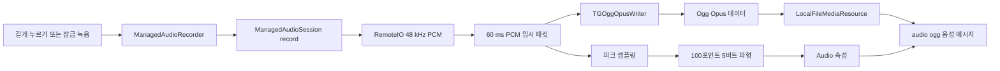
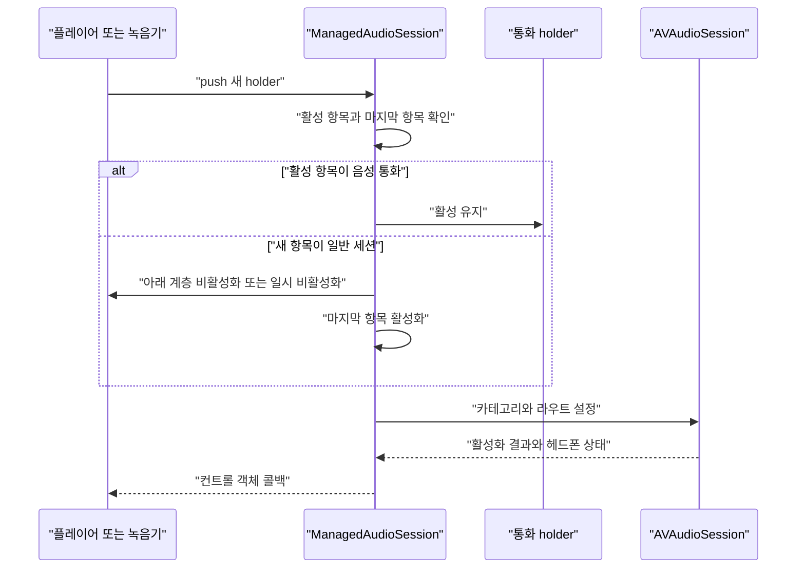
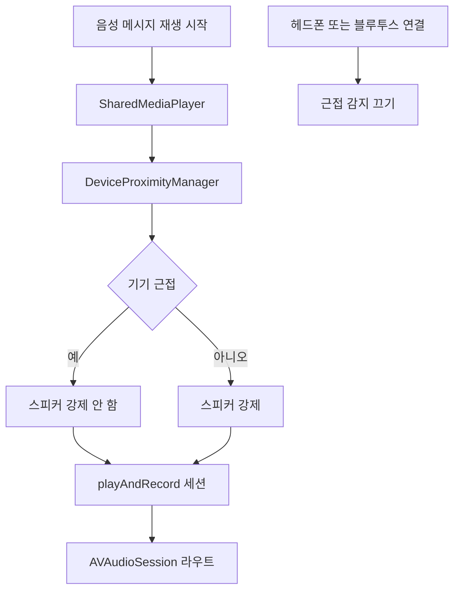

# 음성 메시지와 오디오 시스템

웹: /docs/media/05-audio-voice/ · Markdown: /docs/media/05-audio-voice.md

> iOS와 macOS 소스에서 음성 메시지의 캡처, Ogg Opus 인코딩, 파형, 재생, 세션 중재, 라우팅, 통화 노이즈 억제를 추적해요.

> 렌더링과 미디어 · 오디오와 캡처 · 05장 · 도표 3 · 코드 발췌 8 · 인용 25 · 소스 기준선: [TelegramMessenger/Telegram-iOS@f1dd7a2d](https://github.com/TelegramMessenger/Telegram-iOS/tree/f1dd7a2dbd02cbbf513e75d5695d8d36d1cf5838), [overtake/TelegramSwift@579cebbf](https://github.com/overtake/TelegramSwift/tree/579cebbf0c01fd41b712eff3647fa7f69db9665d)
>
> 핵심 소스 파일: [TelegramMessenger/Telegram-iOS/submodules/TelegramUI/Sources/ManagedAudioRecorder.swift](https://github.com/TelegramMessenger/Telegram-iOS/blob/f1dd7a2dbd02cbbf513e75d5695d8d36d1cf5838/submodules/TelegramUI/Sources/ManagedAudioRecorder.swift), [TelegramMessenger/Telegram-iOS/submodules/TelegramUI/Sources/Chat/ChatControllerMediaRecording.swift](https://github.com/TelegramMessenger/Telegram-iOS/blob/f1dd7a2dbd02cbbf513e75d5695d8d36d1cf5838/submodules/TelegramUI/Sources/Chat/ChatControllerMediaRecording.swift), [TelegramMessenger/Telegram-iOS/submodules/OpusBinding/Sources/opusenc/opusenc.m](https://github.com/TelegramMessenger/Telegram-iOS/blob/f1dd7a2dbd02cbbf513e75d5695d8d36d1cf5838/submodules/OpusBinding/Sources/opusenc/opusenc.m), [TelegramMessenger/Telegram-iOS/submodules/OpusBinding/Sources/OggOpusReader.m](https://github.com/TelegramMessenger/Telegram-iOS/blob/f1dd7a2dbd02cbbf513e75d5695d8d36d1cf5838/submodules/OpusBinding/Sources/OggOpusReader.m), [TelegramMessenger/Telegram-iOS/submodules/AudioWaveform/Sources/AudioWaveform.swift](https://github.com/TelegramMessenger/Telegram-iOS/blob/f1dd7a2dbd02cbbf513e75d5695d8d36d1cf5838/submodules/AudioWaveform/Sources/AudioWaveform.swift), [TelegramMessenger/Telegram-iOS/submodules/TelegramAudio/Sources/ManagedAudioSession.swift](https://github.com/TelegramMessenger/Telegram-iOS/blob/f1dd7a2dbd02cbbf513e75d5695d8d36d1cf5838/submodules/TelegramAudio/Sources/ManagedAudioSession.swift), [TelegramMessenger/Telegram-iOS/submodules/MediaPlayer/Sources/MediaPlayer.swift](https://github.com/TelegramMessenger/Telegram-iOS/blob/f1dd7a2dbd02cbbf513e75d5695d8d36d1cf5838/submodules/MediaPlayer/Sources/MediaPlayer.swift), [TelegramMessenger/Telegram-iOS/submodules/MediaPlayer/Sources/MediaPlayerAudioRenderer.swift](https://github.com/TelegramMessenger/Telegram-iOS/blob/f1dd7a2dbd02cbbf513e75d5695d8d36d1cf5838/submodules/MediaPlayer/Sources/MediaPlayerAudioRenderer.swift), [TelegramMessenger/Telegram-iOS/submodules/TelegramUI/Sources/SharedMediaPlayer.swift](https://github.com/TelegramMessenger/Telegram-iOS/blob/f1dd7a2dbd02cbbf513e75d5695d8d36d1cf5838/submodules/TelegramUI/Sources/SharedMediaPlayer.swift), [TelegramMessenger/Telegram-iOS/submodules/DeviceProximity/Sources/DeviceProximityManager.m](https://github.com/TelegramMessenger/Telegram-iOS/blob/f1dd7a2dbd02cbbf513e75d5695d8d36d1cf5838/submodules/DeviceProximity/Sources/DeviceProximityManager.m), [TelegramMessenger/tgcalls/tgcalls/group/GroupAudioCapturePostProcessor.cpp](https://github.com/TelegramMessenger/tgcalls/blob/a024eaabf13c189d9577a14fb244bd242825ac96/tgcalls/group/GroupAudioCapturePostProcessor.cpp), [overtake/TelegramSwift/packages/TelegramMedia/Sources/AudioRecorder.swift](https://github.com/overtake/TelegramSwift/blob/579cebbf0c01fd41b712eff3647fa7f69db9665d/packages/TelegramMedia/Sources/AudioRecorder.swift), [overtake/TelegramSwift/packages/TelegramMedia/Sources/MediaPlayerAudioRenderer.swift](https://github.com/overtake/TelegramSwift/blob/579cebbf0c01fd41b712eff3647fa7f69db9665d/packages/TelegramMedia/Sources/MediaPlayerAudioRenderer.swift), [overtake/TelegramSwift/Telegram-Mac/DevicesContext.swift](https://github.com/overtake/TelegramSwift/blob/579cebbf0c01fd41b712eff3647fa7f69db9665d/Telegram-Mac/DevicesContext.swift), [overtake/TelegramSwift/Telegram-Mac/AudioPlayerController.swift](https://github.com/overtake/TelegramSwift/blob/579cebbf0c01fd41b712eff3647fa7f69db9665d/Telegram-Mac/AudioPlayerController.swift), [overtake/TelegramSwift/Telegram-Mac/PCallSession.swift](https://github.com/overtake/TelegramSwift/blob/579cebbf0c01fd41b712eff3647fa7f69db9665d/Telegram-Mac/PCallSession.swift)
>
> 미검증 사항:
> - iOS 녹음 Audio Unit과 60밀리초 인코딩 패킷 사이의 전체 샘플링 레이트 환산 관계.
> - 트리밍 시 FFMpegOpusTrimmer가 실패한 뒤의 화면 오류, 초안 보존, 복구 정책.
> - 비디오 메시지 녹화, 영상 통화, 음성 통화가 동시에 있을 때의 전체 제품 우선순위 행렬.
> - macOS 음성 메시지 전송 화면의 녹음 진입점이 모든 빌드 구성에서 TelegramMedia의 AudioRecorder에 직접 연결되는지 여부.
> - macOS ManagedAudioSession에서 주석 처리된 AVAudioSession 호출이 과거의 잔재인지, 조건부 빌드 산물인지, 의도적으로 비활성화한 경로인지 여부.

## 문제와 제약 [#문제와-제약]

Telegram의 음성 메시지는 단독 녹음 컨트롤이 아니에요. 입력 화면, 오디오 세션(앱이 소리 입출력을 쓰는 방식을 시스템과 조율하는 단위), Audio Unit(저수준 오디오 입출력 모듈), 인코더, 미디어 저장소, 메시지 속성, 공유 플레이어를 가로지르는 파이프라인이에요.

이 파이프라인은 또한 음악, 비디오, 수신 전화, 그룹 통화와 하나뿐인 iOS 오디오 라우트(소리가 나가고 들어오는 경로)를 공유해야 해요. 따라서 정확성이란 재생 가능한 파일을 만들어 냈다는 뜻만이 아니에요. 아래 상황 이후에 시스템이 일관된 상태로 돌아올 수 있다는 뜻이기도 해요.

- 라우트 변경
- 권한 거부
- 버퍼 부족
- 녹음 일시정지
- 세션 선점

이 글은 고정 커밋의 iOS 클라이언트를 중심으로 해요. 음성 메시지는 `Audio` 속성을 가지고 `isVoice`가 참인 `audio/ogg` 파일(Ogg는 오디오 컨테이너 형식이고, 안의 음성은 Opus 코덱으로 압축해요)로 정의해요.

채팅 컨트롤러는 전송할 때 압축 데이터를 `LocalFileMediaResource`에 저장하고 길이와 파형 속성을 기록해요. [\[3\]](https://github.com/TelegramMessenger/Telegram-iOS/blob/f1dd7a2dbd02cbbf513e75d5695d8d36d1cf5838/submodules/TelegramUI/Sources/Chat/ChatControllerMediaRecording.swift#L280-L403) 이로써 파형은 Ogg 파일을 다시 분석해 얻은 파생 캐시가 아니라, 녹음 중에 동기적으로 생성되어 메시지 메타데이터와 함께 제출되는 독립적인 비트열임을 알 수 있어요.

이 글은 아래 내용을 다루지 않아요.

- 미디어 다운로드, 리소스 캐시, 메시지 데이터베이스의 일반 메커니즘: 시스템 설계의 「미디어 캐시」 장을 참고해요.
- 종단 간 통화 협상: 「통화」 장을 참고해요.

여기서는 이들이 녹음 및 출력 장치를 두고 경합할 때의 오디오 경계만 분석해요.

소스 확인의 범위는 두 층이에요.

- 첫째 층: iOS의 `ManagedAudioRecorder`, `ManagedAudioSessionImpl`, `MediaPlayer`, tgcalls(Telegram의 통화 라이브러리)
- 둘째 층: TelegramSwift의 macOS 적응

본문의 “추론”은 이 구현들에서 얻은 설계 의도만을 뜻하며, 프로토콜이나 제품 동작의 보증을 뜻하지 않아요.

## 모듈과 데이터 구조 [#모듈과-데이터-구조]

### 음성 메시지의 객체 경계 [#음성-메시지의-객체-경계]

녹음 계층의 진입점은 `ManagedAudioRecorder`이에요. 내부에는 이런 것들이 있어요.

- 직렬 `Queue` 하나
- `ManagedAudioRecorderContext` 하나
- `TGOggOpusWriter`
- 메모리 상의 `TGDataItem`
- PCM(압축하지 않은 샘플 데이터)을 임시 보관하는 `audioBuffer`
- 오디오 유닛 핸들

녹음 상태와 마이크 레벨은 `ValuePromise`를 통해 외부로 내보내요. 오디오 콜백은 렌더링하고 PCM을 넘기기만 해요. 실제 인코딩은 녹음 큐에서 실행하므로, 실시간 콜백 안에서 Ogg 쓰기와 화면 업데이트를 수행하는 일을 피해요. [\[1\]](https://github.com/TelegramMessenger/Telegram-iOS/blob/f1dd7a2dbd02cbbf513e75d5695d8d36d1cf5838/submodules/TelegramUI/Sources/ManagedAudioRecorder.swift#L17-L27)

`ManagedAudioSessionType`은 시스템 오디오 상황을 이렇게 분류해요.

- `ambient`
- `play`
- `playWithPossiblePortOverride`
- `record`
- `voiceCall`
- `videoCall`

음성 메시지 녹음은 `voiceMessageRecording`이 `record`로 구성해요. 그중 `withOthers`는 “녹음 시 음악 일시정지” 설정의 반전값이에요. [\[8\]](https://github.com/TelegramMessenger/Telegram-iOS/blob/f1dd7a2dbd02cbbf513e75d5695d8d36d1cf5838/submodules/TelegramAudio/Sources/ManagedAudioSession.swift#L30-L211) 이로써 “다른 앱을 중단할 것인가”가 녹음기 안의 임시 판단이 아니라 세션의 속성이 돼요.

`ManagedAudioSessionImpl`은 `HolderRecord`로 각 요청자(holder)를 저장해요. 레코드에는 이런 항목이 들어 있어요. [\[8\]](https://github.com/TelegramMessenger/Telegram-iOS/blob/f1dd7a2dbd02cbbf513e75d5695d8d36d1cf5838/submodules/TelegramAudio/Sources/ManagedAudioSession.swift#L30-L211)

- 세션 유형
- 출력 모드
- 활성화 콜백
- 비동기 비활성화 콜백
- 헤드폰 상태 콜백
- 사용 가능한 출력 콜백
- 일회성 표시
- 활성 상태

요청이 해제된 뒤 다음 활성화 대상을 정하는 것은 요청자가 아니라 중재자(`ManagedAudioSessionImpl`)예요. 이것이 세션 상호 배제 정책의 핵심이에요.

플레이어 쪽의 `MediaPlayer`는 프레임 디코딩, 타임라인, 버퍼링, 상태를 맡아요. 오디오 경로는 `MediaPlayerAudioRenderer`가 Audio Unit 그래프를 만들어요.

음성 메시지 플레이어는 `SharedMediaPlayer`가 만들며, `playAndRecord` 모드로 공유 세션에 접속하여 근접(기기를 귀에 가까이 댄 상태) 재생 시 수화부(전화를 귀에 댈 때 쓰는 작은 스피커)와 스피커를 전환할 수 있게 해요. [\[16\]](https://github.com/TelegramMessenger/Telegram-iOS/blob/f1dd7a2dbd02cbbf513e75d5695d8d36d1cf5838/submodules/TelegramUI/Sources/SharedMediaPlayer.swift#L183-L292)

### 녹음 PCM, Opus, Ogg [#녹음-pcm-opus-ogg]

iOS 녹음의 원본 형식은 모노, 16비트, 부호 있음, 패킹된 선형 PCM이에요. 녹음기는 샘플링 레이트를 48 kHz로 고정하고, 이 형식을 RemoteIO(iOS의 오디오 입출력 Audio Unit)의 입력 스코프와 출력 스코프에 모두 설정해요. [\[1\]](https://github.com/TelegramMessenger/Telegram-iOS/blob/f1dd7a2dbd02cbbf513e75d5695d8d36d1cf5838/submodules/TelegramUI/Sources/ManagedAudioRecorder.swift#L17-L27)

```swift
private func audioRecorderNativeStreamDescription(sampleRate: Float64) -> AudioStreamBasicDescription {
    var canonicalBasicStreamDescription = AudioStreamBasicDescription()
    canonicalBasicStreamDescription.mSampleRate = sampleRate
    canonicalBasicStreamDescription.mFormatID = kAudioFormatLinearPCM
    canonicalBasicStreamDescription.mFormatFlags = kAudioFormatFlagIsSignedInteger | kAudioFormatFlagIsPacked
    canonicalBasicStreamDescription.mFramesPerPacket = 1
    canonicalBasicStreamDescription.mChannelsPerFrame = 1
    canonicalBasicStreamDescription.mBitsPerChannel = 16
    canonicalBasicStreamDescription.mBytesPerPacket = 2
    canonicalBasicStreamDescription.mBytesPerFrame = 2
    return canonicalBasicStreamDescription
}
```
[\[1\]](https://github.com/TelegramMessenger/Telegram-iOS/blob/f1dd7a2dbd02cbbf513e75d5695d8d36d1cf5838/submodules/TelegramUI/Sources/ManagedAudioRecorder.swift#L17-L27)

위 발췌에 나오는 타입 이름은 소스에서 온 거예요. 이 설정 때문에 이후의 모든 샘플은 2바이트를 차지해요.

녹음기는 PCM을 60밀리초의 인코딩 패킷으로 이어 붙여요. 패킷 크기는 이렇게 계산해서 1,920바이트예요. [\[2\]](https://github.com/TelegramMessenger/Telegram-iOS/blob/f1dd7a2dbd02cbbf513e75d5695d8d36d1cf5838/submodules/TelegramUI/Sources/ManagedAudioRecorder.swift#L375-L620)

패킷 크기 = 초당 16,000샘플 × 패킷당 60밀리초 × 샘플당 2바이트 = 1,920바이트

이 1,920바이트가 코드가 실제로 채택한 패킹 양이에요. 입력 48 kHz와의 관계는 Audio Unit과 인코더 설정이 함께 유지하며, 이 한 줄의 패킷 크기만으로 샘플링 레이트 변환의 세부 사항을 추론할 수는 없어요.

`TGOggOpusWriter`의 기본값은 이래요.

- 비트레이트 30 kbit/s
- 48 kHz 인코딩 레이트
- 960샘플 프레임
- 가변 비트레이트(VBR)

모노 `OPUS_APPLICATION_AUDIO` 인코더를 만들고, Opus 헤더와 주석을 Ogg 스트림에 써요. [\[4\]](https://github.com/TelegramMessenger/Telegram-iOS/blob/f1dd7a2dbd02cbbf513e75d5695d8d36d1cf5838/submodules/OpusBinding/Sources/opusenc/opusenc.m#L119-L337)

```objc
bitrate = 30 * 1024;
rate = 48000;
coding_rate = 48000;
frame_size = 960;
with_cvbr = 1;
max_ogg_delay = 48000;

header.channels = 1;
header.channel_mapping = 0;
header.input_sample_rate = rate;

_encoder = opus_encoder_create(coding_rate, 1, OPUS_APPLICATION_AUDIO, &result);
if (result != OPUS_OK)
{
    NSLog(@"Error cannot create encoder: %s", opus_strerror(result));
    return false;
}

result = opus_encoder_ctl(_encoder, OPUS_SET_BITRATE(bitrate));
```
[\[4\]](https://github.com/TelegramMessenger/Telegram-iOS/blob/f1dd7a2dbd02cbbf513e75d5695d8d36d1cf5838/submodules/OpusBinding/Sources/opusenc/opusenc.m#L119-L337)

실제로 프레임을 쓸 때 인코더는 이렇게 움직여요.

1. 한 프레임에 모자란 꼬리 PCM을 0으로 채워요.
2. `opus_encode`를 호출해요.
3. 얻은 packet(압축된 오디오 한 조각)을 Ogg 스트림에 넣어요.

인코딩이 실패하면 `false`를 반환해요. Ogg 페이지 쓰기가 불완전한 경우에도 `false`를 반환해요. 그래서 녹음의 완료 결과는 이를 근거로 실패할 수 있으며 불완전한 내용을 제출하지 않아요. [\[5\]](https://github.com/TelegramMessenger/Telegram-iOS/blob/f1dd7a2dbd02cbbf513e75d5695d8d36d1cf5838/submodules/OpusBinding/Sources/opusenc/opusenc.m#L516-L673)

```objc
if (nb_samples < cur_frame_size)
{
    paddedFrameBytes = malloc(cur_frame_size * 2);
    freePaddedFrameBytes = true;

    memcpy(paddedFrameBytes, framePcmBytes, frameByteCount);
    memset(paddedFrameBytes + nb_samples * 2, 0, cur_frame_size * 2 - nb_samples * 2);
}

nbBytes = opus_encode(_encoder, (opus_int16 *)paddedFrameBytes, cur_frame_size, _packet, max_frame_bytes / 10);
if (freePaddedFrameBytes)
{
    free(paddedFrameBytes);
    paddedFrameBytes = NULL;
}

if (nbBytes < 0)
{
    NSLog(@"Encoding failed: %s. Aborting.", opus_strerror(nbBytes));
    return false;
}
```
[\[5\]](https://github.com/TelegramMessenger/Telegram-iOS/blob/f1dd7a2dbd02cbbf513e75d5695d8d36d1cf5838/submodules/OpusBinding/Sources/opusenc/opusenc.m#L516-L673)

읽기 쪽은 `opusfile`을 사용해요.

- `OggOpusReader`는 `op_open_file`로 경로를 열어요. 실패하면 생성자는 빈 값을 반환해요.
- `op_read`는 PCM 읽기 인터페이스로 노출돼요.
- 또 다른 프레임 추출 인터페이스는 `OpusHead`와 `OpusTags`를 건너뛰고, `opus_packet_get_nb_samples`로 packet 길이를 검증하며, 유효하지 않은 packet은 건너뛰어요. [\[6\]](https://github.com/TelegramMessenger/Telegram-iOS/blob/f1dd7a2dbd02cbbf513e75d5695d8d36d1cf5838/submodules/OpusBinding/Sources/OggOpusReader.m#L42-L160)

따라서 디코딩 재생과 프레임 추출 전송은 같은 API가 아니지만, 모두 같은 Ogg Opus 컨테이너 제약에 의존해요.

### PCM 썸네일이 아닌 파형 데이터 [#pcm-썸네일이-아닌-파형-데이터]

파형은 이렇게 만들어요. [\[7\]](https://github.com/TelegramMessenger/Telegram-iOS/blob/f1dd7a2dbd02cbbf513e75d5695d8d36d1cf5838/submodules/AudioWaveform/Sources/AudioWaveform.swift#L28-L80)

1. 녹음기가 샘플 100개마다 절대 피크(진폭의 최댓값)를 집계해요.
2. 끝날 때 녹음 전체를 `Int16` 슬롯 100개로 스케일링해요.
3. `AudioWaveform.makeBitstream`이 피크 기준으로 0~31로 정규화하고 샘플당 5비트로 패킹해요.

역직렬화도 5비트씩 펼쳐요.

100포인트 파형에는 100포인트 × 5비트로 최대 500비트, 즉 63바이트가 필요해요. 이 작은 크기가 메시지 속성으로 전송하기에 알맞고 화면에서 즉시 그릴 수 있는 이유 중 하나예요.

```swift
public func makeBitstream() -> Data {
    let numSamples = self.samples.count / 2
    let bitstreamLength = (numSamples * 5) / 8 + (((numSamples * 5) % 8) == 0 ? 0 : 1)
    var result = Data()
    result.count = bitstreamLength + 4

    let maxSample: Int32 = self.peak

    self.samples.withUnsafeBytes { rawSamples -> Void in
        let samples = rawSamples.baseAddress!.assumingMemoryBound(to: Int16.self)

        result.withUnsafeMutableBytes { rawBytes -> Void in
            let bytes = rawBytes.baseAddress!.assumingMemoryBound(to: Int16.self)

            for i in 0 ..< numSamples {
                let value: Int32 = min(Int32(31), abs(Int32(samples[i])) * 31 / maxSample)
                setBits(data: bytes, bitOffset: i * 5, numBits: 5, value: value & Int32(31))
            }
        }
    }

    result.count = bitstreamLength
    return result
}
```
[\[7\]](https://github.com/TelegramMessenger/Telegram-iOS/blob/f1dd7a2dbd02cbbf513e75d5695d8d36d1cf5838/submodules/AudioWaveform/Sources/AudioWaveform.swift#L28-L80)

채팅 컨트롤러는 길이가 0.5초 미만인 녹음을 거부해요. 적격한 녹음의 압축 바이트는 먼저 로컬 리소스에 들어가고, 이어서 `TelegramMediaFile`이 만들어져요. 이 객체는 MIME 타입 `audio/ogg`를 지정하고 `Audio` 속성을 추가해요. 속성에는 `isVoice`, 정수 초 단위 길이, 파형 바이트가 기록돼요. [\[3\]](https://github.com/TelegramMessenger/Telegram-iOS/blob/f1dd7a2dbd02cbbf513e75d5695d8d36d1cf5838/submodules/TelegramUI/Sources/Chat/ChatControllerMediaRecording.swift#L280-L403)

0.5초 길이 경계는 지나치게 짧은 빈 메시지가 업로드 큐에 들어가는 것도 막아요.

## 핵심 흐름 [#핵심-흐름]

### 녹음, 일시정지, 미리듣기, 전송 [#녹음-일시정지-미리듣기-전송]

녹음 시작은 마이크를 곧바로 켜는 것이 아니에요. `ManagedAudioRecorderContext.start`는 이 순서로 움직여요.

1. 공유 세션에 `voiceMessageRecording`을 밀어 넣어요.
2. 세션 활성화 콜백이 도착하고 녹음기가 아직 일시정지 상태가 아닐 때에만 RemoteIO를 만들고 Audio Unit을 시작해요.

세션이 비활성화되면 콜백은 `hasAudioSession`을 비우고 Audio Unit을 멈추며 상태를 `stopped`로 둬요. [\[2\]](https://github.com/TelegramMessenger/Telegram-iOS/blob/f1dd7a2dbd02cbbf513e75d5695d8d36d1cf5838/submodules/TelegramUI/Sources/ManagedAudioRecorder.swift#L375-L620)

```swift
self.audioSessionDisposable = self.mediaManager.audioSession.push(audioSessionType: .voiceMessageRecording(beginWithTone: self.beginWithTone, pauseMusicOnRecording: self.pauseMusicOnRecording), activate: { [weak self] state in
    queue.async {
        if let strongSelf = self, !strongSelf.paused {
            strongSelf.hasAudioSession = true
            strongSelf.setupAudioUnit()
            strongSelf.audioSessionAcquired(headset: state.isHeadsetConnected)
        }
    }
}, deactivate: { [weak self] _ in
    return Signal { subscriber in
        queue.async {
            if let strongSelf = self {
                strongSelf.hasAudioSession = false
                strongSelf.stop()
                strongSelf.recordingState.set(.stopped)
                subscriber.putCompletion()
            }
        }
        return EmptyDisposable
    }
})
```
[\[2\]](https://github.com/TelegramMessenger/Telegram-iOS/blob/f1dd7a2dbd02cbbf513e75d5695d8d36d1cf5838/submodules/TelegramUI/Sources/ManagedAudioRecorder.swift#L375-L620)

시작 효과음이 켜져 있는지에 따라 녹음기가 샘플을 처리하기 시작하는 때가 달라요.

- 켜져 있으면: 먼저 커스텀 세션이 제어하는 `MediaPlayerAudioRenderer`를 만들어 효과음을 재생하고, `processSamples`를 거짓으로 유지해요. 효과음이 끝에 도달한 뒤에야 샘플이 인코딩에 들어가도록 허용해요.
- 없으면: 샘플을 즉시 처리해요. [\[2\]](https://github.com/TelegramMessenger/Telegram-iOS/blob/f1dd7a2dbd02cbbf513e75d5695d8d36d1cf5838/submodules/TelegramUI/Sources/ManagedAudioRecorder.swift#L375-L620)

추론: 이 순서는 기기 자신의 효과음이 음성 메시지에 녹음되는 것을 피하면서, 헤드폰 환경에서도 시작 피드백을 받을 수 있게 해요.



일시정지 시 녹음기는 Ogg 라이터의 `pause`를 호출하고 인코더 상태를 JSON으로 저장해요.

재개 전에 사용자가 트리밍 범위(잘라 낼 구간)를 지정했다면, 코드는 이렇게 처리해요. [\[2\]](https://github.com/TelegramMessenger/Telegram-iOS/blob/f1dd7a2dbd02cbbf513e75d5695d8d36d1cf5838/submodules/TelegramUI/Sources/ManagedAudioRecorder.swift#L375-L620)

1. 현재 Ogg를 임시 파일에 써요.
2. `FFMpegOpusTrimmer`로 지정한 시간 구간을 잘라 내요.
3. `beginAppend`로 새 스트림을 이어 붙여요.

이 지점은 화면의 파형에서 구간을 숨기기만 하는 것이 아니라, 파일 수준에서 명확히 잘라 내는 곳이에요.

전송, 미리듣기, 삭제 동작은 이렇게 달라요.

- 전송: `takenRecordedData`에 최종 결과를 요청해요. 정상 전송은 현재 메시지 전환 애니메이션이 만들어지기 전에 리소스를 캐시하고, 이후 `Audio` 속성이 달린 로컬 미디어 메시지를 구성해요. [\[3\]](https://github.com/TelegramMessenger/Telegram-iOS/blob/f1dd7a2dbd02cbbf513e75d5695d8d36d1cf5838/submodules/TelegramUI/Sources/Chat/ChatControllerMediaRecording.swift#L280-L403)
- 미리듣기: 미디어 초안을 남겨요. 여기에는 리소스, 크기, 길이, 디코딩된 파형, 트리밍 범위, 복구 데이터가 저장돼요. [\[3\]](https://github.com/TelegramMessenger/Telegram-iOS/blob/f1dd7a2dbd02cbbf513e75d5695d8d36d1cf5838/submodules/TelegramUI/Sources/Chat/ChatControllerMediaRecording.swift#L280-L403)
- 삭제: 녹음기와 초안을 지워요. 빈 오디오 메시지를 구성할 필요가 없어요.

### 세션 중재와 중단 규칙 [#세션-중재와-중단-규칙]

세션 중재자는 holders 배열(세션을 요청한 holder들의 목록)을 후입(나중에 들어온 것 먼저) 순서로 보고 활성 레코드를 골라요. 보통은 새로 들어온 마지막 항목이 이전 활성 항목을 대체해요.

그러나 `voiceCall`에는 전용 예외가 있어요. 녹음이나 다른 holder가 그 위에 쌓여도 통화 holder는 비활성화되지 않아요. 주석은 일시적인 비활성화가 `PresentationCall`의 제어권을 잃게 하고 통화 오디오 장치를 해체시킨다고 명시해요. [\[9\]](https://github.com/TelegramMessenger/Telegram-iOS/blob/f1dd7a2dbd02cbbf513e75d5695d8d36d1cf5838/submodules/TelegramAudio/Sources/ManagedAudioSession.swift#L765-L877)

```swift
if activeIndex != self.holders.count - 1 {
    if self.holders[activeIndex].audioSessionType == .voiceCall {
        deactivate = false
    } else if lastIsRecordWithOthers {
        deactivate = true
        temporary = true
    } else {
        deactivate = true
    }
}

if deactivate {
    self.holders[activeIndex].active = false
    let id = self.holders[activeIndex].id
    self.holders[activeIndex].deactivatingDisposable = (self.holders[activeIndex].deactivate(temporary)
    |> deliverOn(self.queue)).start(completed: { [weak self] in
        guard let strongSelf = self else {
            return
        }
        // ...
        strongSelf.updateHolders()
    })
}
```
[\[9\]](https://github.com/TelegramMessenger/Telegram-iOS/blob/f1dd7a2dbd02cbbf513e75d5695d8d36d1cf5838/submodules/TelegramAudio/Sources/ManagedAudioSession.swift#L765-L877)

통화가 아닌 holder의 중단에는 두 가지 의미가 있어요.

- 일반 녹음과 재생: 아래 계층(먼저 들어온 항목)의 holder를 비활성화해요.
- `record`이면서 `withOthers`가 참이면: 아래 계층의 비통화 holder가 일시적으로 비활성화돼요.

비활성화 콜백은 `temporary`를 받으며, 복구 가능한 상태를 유지할지 결정할 수 있어요. 추론: 이로써 “외부 음악을 멈추지 않는다”는 선호가 “여러 Telegram 출력 그래프가 제약 없이 동시에 재생된다”는 뜻이 되지 않으며, 상위 레코드가 복구 가능한 방식으로 앱 세션을 독점하게 돼요.

holder 목록이 비면 모드에 따라 네이티브 세션을 이렇게 비활성화해요. [\[9\]](https://github.com/TelegramMessenger/Telegram-iOS/blob/f1dd7a2dbd02cbbf513e75d5695d8d36d1cf5838/submodules/TelegramAudio/Sources/ManagedAudioSession.swift#L765-L877)

- `voiceCall`과 `record`: 즉시
- 다른 모드: 1초 지연 후

이 1초 창은 연속 재생 사이에 `AVAudioSession`을 반복해서 활성화하는 비용을 낮춰요. 코드는 이 수치의 성능상 근거를 제시하지 않으므로, 이를 시스템 요구 사항으로 해석해서는 안 돼요.

시스템 수준의 중단은 `dropAll`을 호출해요. `dropAll`의 규칙은 `voiceCall`을 제외한 활성 holder를 비활성화하는 거예요. [\[9\]](https://github.com/TelegramMessenger/Telegram-iOS/blob/f1dd7a2dbd02cbbf513e75d5695d8d36d1cf5838/submodules/TelegramAudio/Sources/ManagedAudioSession.swift#L765-L877) 이 방식은 새 holder를 능동적으로 밀어 넣는 것과 달라요. 통화 객체 자신은 여전히 CallKit이나 WebRTC의 수명 주기를 처리해야 해요.



그룹 통화는 `SharedCallAudioContext`를 통해 세션을 신청해요.

- 기본으로 `voiceCall`을 신청해요.
- 라이브 방송을 수신만 하고 마이크가 필요 없을 때는 믹싱 가능한 `play`를 신청해요.

이 컨텍스트는 활성화 전에 스피커가 필요하면 먼저 `.system`을 쓰고, 활성화가 실제 헤드폰 상태를 보고한 뒤에 스피커 사용 여부를 정해요. 소스 주석은 스피커를 곧바로 선점해 설정하면 구축 중인 블루투스 라우트가 깨진다고 설명해요. [\[13\]](https://github.com/TelegramMessenger/Telegram-iOS/blob/f1dd7a2dbd02cbbf513e75d5695d8d36d1cf5838/submodules/TelegramCallsUI/Sources/SharedCallAudioContext.swift#L150-L265)

이 호출 체인은 “통화, 비디오, 녹음 사이의 우선순위”가 단일한 열거형 순서가 아님을 보여 줘요. 확인된 규칙은 다음과 같아요.

- 호출자는 세션 유형으로 필요를 선언해요.
- holder는 후입 우선이에요.
- 음성 통화는 앱 내 세션이 해체할 수 없어요.
- 네이티브 카테고리는 `voiceChat` 또는 `videoChat`으로 통화 유형을 구분해요. [\[8\]](https://github.com/TelegramMessenger/Telegram-iOS/blob/f1dd7a2dbd02cbbf513e75d5695d8d36d1cf5838/submodules/TelegramAudio/Sources/ManagedAudioSession.swift#L30-L211)[\[9\]](https://github.com/TelegramMessenger/Telegram-iOS/blob/f1dd7a2dbd02cbbf513e75d5695d8d36d1cf5838/submodules/TelegramAudio/Sources/ManagedAudioSession.swift#L765-L877)[\[10\]](https://github.com/TelegramMessenger/Telegram-iOS/blob/f1dd7a2dbd02cbbf513e75d5695d8d36d1cf5838/submodules/TelegramAudio/Sources/ManagedAudioSession.swift#L880-L1023)

비디오 메시지 녹화와 진행 중인 영상 통화의 전체 동시성 행렬에 대해서는, 소스가 테이블 기반의 규범을 제공하지 않아요. 이 글 끝의 검증 대기 문제를 참고해요.

### 블루투스, 수화부, 스피커, 근접 [#블루투스-수화부-스피커-근접]

iOS 세션은 헤드폰, 블루투스 A2DP(음악 재생용), 블루투스 HFP(통화용), 블루투스 LE를 모두 “연결된 헤드폰”으로 간주해요. 사용 가능한 출력 중 블루투스 포트는 `bluetooth`로, 유선 헤드폰은 `wired`로 표시돼요. [\[8\]](https://github.com/TelegramMessenger/Telegram-iOS/blob/f1dd7a2dbd02cbbf513e75d5695d8d36d1cf5838/submodules/TelegramAudio/Sources/ManagedAudioSession.swift#L30-L211)[\[10\]](https://github.com/TelegramMessenger/Telegram-iOS/blob/f1dd7a2dbd02cbbf513e75d5695d8d36d1cf5838/submodules/TelegramAudio/Sources/ManagedAudioSession.swift#L880-L1023)

블루투스 구성은 세션 유형마다 달라요. [\[10\]](https://github.com/TelegramMessenger/Telegram-iOS/blob/f1dd7a2dbd02cbbf513e75d5695d8d36d1cf5838/submodules/TelegramAudio/Sources/ManagedAudioSession.swift#L880-L1023)

- `voiceCall`과 `videoCall`: 블루투스 통화 기능과 A2DP를 함께 신청하고 다른 오디오와의 혼합을 허용해요.
- 일반 녹음: 블루투스 통화 기능을 신청해요. 비디오 녹음에서만 A2DP를 추가로 신청해요.

출력 모드는 세 가지예요.

- `.system`: 시스템을 따라요.
- `.speakerIfNoHeadphones`: 스피커 포트를 강제하지 않고 시스템이 경로를 처리하게 해요.
- `.custom`: 내장, 스피커, 헤드폰, 지정 포트를 선택할 수 있어요.

포트를 지정하면 코드는 스피커 오버라이드를 취소하고 UID(장치 고유 식별자)로 선호 입력을 설정해요. [\[11\]](https://github.com/TelegramMessenger/Telegram-iOS/blob/f1dd7a2dbd02cbbf513e75d5695d8d36d1cf5838/submodules/TelegramAudio/Sources/ManagedAudioSession.swift#L1096-L1217) 이 동작은 라우트 선택이 스피커만 바꾸는 것이 아니라 출력과 마이크에 동시에 영향을 주는 이유를 설명해요.

음성 메시지 플레이어는 근접 센서로 `forceAudioToSpeaker`를 결정해요. 근접 제어를 켜면 값이 이렇게 바뀌어요.

- 기기에 가까워질 때: 거짓
- 멀어질 때: 참

플레이어는 생성 시 `playAndRecord`를 참으로 두고 이 표시를 오디오 렌더러에 넘겨요. [\[16\]](https://github.com/TelegramMessenger/Telegram-iOS/blob/f1dd7a2dbd02cbbf513e75d5695d8d36d1cf5838/submodules/TelegramUI/Sources/SharedMediaPlayer.swift#L183-L292)

`MediaManager`는 헤드폰이 연결되어 있으면 근접 센서를 전역으로 꺼서, 헤드폰 재생 시 화면이 꺼지거나 잘못 전환되는 것을 피해요. [\[16\]](https://github.com/TelegramMessenger/Telegram-iOS/blob/f1dd7a2dbd02cbbf513e75d5695d8d36d1cf5838/submodules/TelegramUI/Sources/SharedMediaPlayer.swift#L183-L292)

`DeviceProximityManager`는 참조 카운트 방식의 구독 센터예요.

- 첫 구독자가 나타나면 `proximityMonitoringEnabled`를 켜요.
- 마지막 구독자가 제거되고 현재 근접 상태가 아니면 꺼요.
- `UIDeviceProximityStateDidChangeNotification`에서 상태를 브로드캐스트해요. [\[17\]](https://github.com/TelegramMessenger/Telegram-iOS/blob/f1dd7a2dbd02cbbf513e75d5695d8d36d1cf5838/submodules/DeviceProximity/Sources/DeviceProximityManager.m#L15-L112)

`RaiseToListenActivator`(손목을 들어 청취하는 제스처)는 이렇게 움직여요. [\[18\]](https://github.com/TelegramMessenger/Telegram-iOS/blob/f1dd7a2dbd02cbbf513e75d5695d8d36d1cf5838/submodules/RaiseToListen/Impl/Sources/RaiseToListenActivator.m#L145-L229)

- 제스처가 켜진 뒤 구독을 등록해요.
- 거리 센서가 가까워지면 활성화해요.
- 멀어지면 구독과 활성 상태를 철회해요.



### 재생, 버퍼링, 배속 [#재생-버퍼링-배속]

`MediaPlayer`는 tick(주기적인 갱신 시점)마다 오디오와 비디오 buffer의 상태를 확인하고, 둘 중 더 나쁜 상태로 유효 속도(실제로 적용되는 재생 속도)를 결정해요.

- buffer가 `full`이거나 유한한 `finished`일 때 플레이어가 재생 상태이면: 유효 속도는 `baseRate`예요.
- buffering 중이면: 속도는 0이며 0.3초 후에 다시 확인해요. [\[15\]](https://github.com/TelegramMessenger/Telegram-iOS/blob/f1dd7a2dbd02cbbf513e75d5695d8d36d1cf5838/submodules/MediaPlayer/Sources/MediaPlayer.swift#L840-L1056)

이로써 프레임이 모자랄 때 타임라인이 계속 앞으로 가지 않도록 보장해요.

오디오 렌더러의 실제 배속에는 `kTimePitchParam_Rate`를 써요. iOS 그래프는 converter → time pitch → mixer → equalizer → 출력 노드가 직렬로 연결돼요. 출력 노드는 음성 처리 모드에서는 VoiceProcessingIO를, 그 밖의 경우에는 RemoteIO를 써요.

플레이어는 `baseRate`를 time pitch 유닛에 쓰고, ring buffer(순환 버퍼)의 수위에 따라 더 많은 디코딩 프레임을 요청해요. [\[14\]](https://github.com/TelegramMessenger/Telegram-iOS/blob/f1dd7a2dbd02cbbf513e75d5695d8d36d1cf5838/submodules/MediaPlayer/Sources/MediaPlayerAudioRenderer.swift#L239-L474)

```swift
fileprivate func setBaseRate(_ baseRate: Double) {
    if let timePitchAudioUnit = self.timePitchAudioUnit, !self.baseRate.isEqual(to: baseRate) {
        self.baseRate = baseRate
        AudioUnitSetParameter(timePitchAudioUnit, kTimePitchParam_Rate, kAudioUnitScope_Global, 0, Float32(baseRate), 0)
        self.bufferContext.with { context in
            if case .playing = context.state {
                context.state = .playing(rate: baseRate, didSetRate: false)
            }
        }
    }
}
```
[\[14\]](https://github.com/TelegramMessenger/Telegram-iOS/blob/f1dd7a2dbd02cbbf513e75d5695d8d36d1cf5838/submodules/MediaPlayer/Sources/MediaPlayerAudioRenderer.swift#L239-L474)

공유 플레이어가 `.setBaseRate`를 받으면 현재 audio player 또는 즉시 비디오 노드를 함께 갱신해요. 음성과 음악은 초기 전략이 달라요. [\[16\]](https://github.com/TelegramMessenger/Telegram-iOS/blob/f1dd7a2dbd02cbbf513e75d5695d8d36d1cf5838/submodules/TelegramUI/Sources/SharedMediaPlayer.swift#L183-L292)

- 음악: 1.0부터 시작하도록 강제해요.
- 음성: 저장된 음성 재생 속도를 써요.

이 계층 구조 덕분에 화면 선호도, 디코딩 타임라인, 하드웨어 배속 매개변수가 같은 `baseRate` 값을 유지해요.

재생이 끝나면 `MediaPlayer`는 `actionAtEnd`에 따라 네 가지 중 하나를 해요. [\[15\]](https://github.com/TelegramMessenger/Telegram-iOS/blob/f1dd7a2dbd02cbbf513e75d5695d8d36d1cf5838/submodules/MediaPlayer/Sources/MediaPlayer.swift#L840-L1056)

- 반복
- 정지
- 콜백 실행
- 반복하되 소리 끄기

플레이어가 비일시적 오디오 세션을 잃으면 `audioPaused`를 호출하고 출력 그래프를 멈춰요. [\[14\]](https://github.com/TelegramMessenger/Telegram-iOS/blob/f1dd7a2dbd02cbbf513e75d5695d8d36d1cf5838/submodules/MediaPlayer/Sources/MediaPlayerAudioRenderer.swift#L239-L474) 이는 낡은 출력 그래프가 더 높은 우선순위의 기능에 선점된 뒤에도 장치를 계속 붙들고 있는 일을 막아요.

### 상태 전파, 리소스 수명 주기, 복구 가능성 [#상태-전파-리소스-수명-주기-복구-가능성]

녹음 화면과 인코더는 변경 가능한 PCM 버퍼를 공유하지 않아요. 화면이 소비하는 것은 녹음기가 내보내는 상태, 마이크 레벨, 미리듣기 상태, 최종 `RecordedAudioData`이에요.

이 네 종류의 출력은 빈도가 서로 달라요.

- PCM 콜백은 고빈도로 발생할 수 있어요.
- 마이크 레벨은 누적 피크가 임계값에 도달한 뒤에야 갱신돼요.
- 녹음 상태는 인코더의 `encodedDuration`을 시간 기준으로 삼아요.
- 최종 데이터는 정지 또는 미리듣기 시에만 요청해요.

이런 계층 구조 덕분에 입력 패널은 Ogg 페이지를 추적할 필요가 없고, Audio Unit 콜백이 올 때마다 뷰를 다시 만들지도 않아요. [\[2\]](https://github.com/TelegramMessenger/Telegram-iOS/blob/f1dd7a2dbd02cbbf513e75d5695d8d36d1cf5838/submodules/TelegramUI/Sources/ManagedAudioRecorder.swift#L375-L620)

파형에는 두 가지 표현이 있고, 저장되는 위치마다 형태가 달라요.

- 녹음기 내부: 먼저 피크 압축을 거친 샘플을 저장해요.
- 최종 결과: 5비트 bitstream으로 저장해요.
- 화면에서 읽을 때: `AudioWaveform`이 bitstream으로부터 표시용 샘플을 구성해요.
- 전송 전 초안: `AudioWaveform` 객체와 원본 Ogg 리소스가 저장돼요.
- 이미 전송된 메시지: 미디어 `Audio` 속성 안의 파형 데이터가 저장돼요. [\[3\]](https://github.com/TelegramMessenger/Telegram-iOS/blob/f1dd7a2dbd02cbbf513e75d5695d8d36d1cf5838/submodules/TelegramUI/Sources/Chat/ChatControllerMediaRecording.swift#L280-L403)[\[7\]](https://github.com/TelegramMessenger/Telegram-iOS/blob/f1dd7a2dbd02cbbf513e75d5695d8d36d1cf5838/submodules/AudioWaveform/Sources/AudioWaveform.swift#L28-L80)

따라서 미리듣기, 채팅 목록, 수신 측 메시지는 같은 디코딩 모델을 쓸 수 있지만, 각 계층이 보유하는 데이터의 형태는 달라요.

재생 상태도 두 번의 변환을 거쳐요.

1. `MediaPlayer`가 프레임 버퍼, 시간 기준, 유효 속도로부터 `MediaPlayerStatus`를 만들어요.
2. `SharedMediaPlayer`가 이 상태를 공유 재생 목록에 투영해요.

이 상태를 받는 쪽은 이렇게 움직여요.

- 채팅 셀: 현재 메시지가 목록의 재생 항목과 같은지에 따라 파형의 전경 클리핑 너비와 시간 텍스트를 갱신해요.
- macOS의 `ChatVoiceContentView`: 재생 진행도에 따라 전경 파형을 잘라 내며, 드래그 중에는 일시정지하고 seek한 뒤 놓으면 재개해요. [\[15\]](https://github.com/TelegramMessenger/Telegram-iOS/blob/f1dd7a2dbd02cbbf513e75d5695d8d36d1cf5838/submodules/MediaPlayer/Sources/MediaPlayer.swift#L840-L1056)[\[16\]](https://github.com/TelegramMessenger/Telegram-iOS/blob/f1dd7a2dbd02cbbf513e75d5695d8d36d1cf5838/submodules/TelegramUI/Sources/SharedMediaPlayer.swift#L183-L292)[\[23\]](https://github.com/overtake/TelegramSwift/blob/579cebbf0c01fd41b712eff3647fa7f69db9665d/Telegram-Mac/AudioPlayerController.swift#L1109-L1149)

추론: 오디오 바이트가 아니라 상태 객체가 UI와 플레이어 사이의 안정적인 경계가 되기 때문에, 같은 음성 메시지가 채팅 말풍선, 미니 플레이어, 재생 목록에서 일관되게 표시될 수 있어요.

리소스의 소유권은 정지 동작에서 이전돼요.

- 녹음 중: `TGDataItem`이 아직 전송되지 않은 Ogg 바이트를 보유해요.
- 미리듣기나 전송 시: 채팅 컨트롤러가 바이트를 `LocalFileMediaResource`에 써요. 메시지는 리소스 ID, 크기, 길이, 파형만 참조해요.

그러면 입력 패널은 녹음기를 정리할 수 있고, 리소스 저장소와 전송 큐는 계속 파일을 보유해요. [\[3\]](https://github.com/TelegramMessenger/Telegram-iOS/blob/f1dd7a2dbd02cbbf513e75d5695d8d36d1cf5838/submodules/TelegramUI/Sources/Chat/ChatControllerMediaRecording.swift#L280-L403) 이로써 전송 애니메이션과 네트워크 업로드가 계속 살아 있는 Audio Unit에 의존하지 않아요.

세션 컨트롤 객체도 명시적인 수명 주기를 따라요.

1. 렌더러가 시작되면 `ManagedAudioSession`에 holder를 push해요.
2. 이 holder가 `ManagedAudioSessionControl`을 얻은 뒤에야 `setup`과 `activate`를 실행해요.

비활성화 콜백은 일시적 비활성화인지 여부의 플래그를 받아요.

- 일반적인 세션 상실: 플레이어를 일시정지하고 출력 그래프를 닫아요.
- 일시적 비활성화: 호출자가 재생 상태를 유지하도록 허용해요. [\[9\]](https://github.com/TelegramMessenger/Telegram-iOS/blob/f1dd7a2dbd02cbbf513e75d5695d8d36d1cf5838/submodules/TelegramAudio/Sources/ManagedAudioSession.swift#L765-L877)[\[14\]](https://github.com/TelegramMessenger/Telegram-iOS/blob/f1dd7a2dbd02cbbf513e75d5695d8d36d1cf5838/submodules/MediaPlayer/Sources/MediaPlayerAudioRenderer.swift#L239-L474)

이 설계는 리소스 해제와 세션 전환의 결합을 피해요. 예컨대 재생을 일시정지한다고 해서 디코더를 반드시 삭제하거나 이미 버퍼링한 프레임을 버리지는 않아요.

라우트 변경은 단일한 “헤드폰 뽑힘” 이벤트가 아니에요. 세션은 현재 route, 사용 가능한 입력과 출력을 유지해요. 활성화할 때는 이 순서로 해요. [\[10\]](https://github.com/TelegramMessenger/Telegram-iOS/blob/f1dd7a2dbd02cbbf513e75d5695d8d36d1cf5838/submodules/TelegramAudio/Sources/ManagedAudioSession.swift#L880-L1023)[\[11\]](https://github.com/TelegramMessenger/Telegram-iOS/blob/f1dd7a2dbd02cbbf513e75d5695d8d36d1cf5838/submodules/TelegramAudio/Sources/ManagedAudioSession.swift#L1096-L1217)

1. 카테고리를 설정해요.
2. AVAudioSession을 활성화해요.
3. 출력 모드를 설정해요.
4. 마지막으로 현재 라우트 정보를 갱신해요.

`SharedCallAudioContext`는 스피커의 최종 결정을 일부러 활성화 이후로 미뤄요. 현재 세션 카테고리에서 블루투스나 유선 포트가 실제로 구축되었는지 먼저 알아야 하기 때문이에요. [\[13\]](https://github.com/TelegramMessenger/Telegram-iOS/blob/f1dd7a2dbd02cbbf513e75d5695d8d36d1cf5838/submodules/TelegramCallsUI/Sources/SharedCallAudioContext.swift#L150-L265) 이는 신뢰할 수 있는 라우트 복구가 연결 이벤트에 대한 선험적 판단만이 아니라, 나중에 나오는 시스템 결과를 기준으로 해야 함을 보여 줘요.

세션이 무효화되면 앱이 설정했던 선호 입력도 지워요. 다음 활성화 때 현재 사용 가능한 포트에 따라 내장 입력이나 지정 포트를 선택해요. [\[10\]](https://github.com/TelegramMessenger/Telegram-iOS/blob/f1dd7a2dbd02cbbf513e75d5695d8d36d1cf5838/submodules/TelegramAudio/Sources/ManagedAudioSession.swift#L880-L1023)[\[11\]](https://github.com/TelegramMessenger/Telegram-iOS/blob/f1dd7a2dbd02cbbf513e75d5695d8d36d1cf5838/submodules/TelegramAudio/Sources/ManagedAudioSession.swift#L1096-L1217) 이 순서는 이미 제거된 블루투스 장치 UID가 다음 녹음이나 통화에 남는 것을 피해요. 소스가 보장하는 것은 정리와 재설정을 시도한다는 점뿐이며, 외부 장치가 즉시 다시 연결될 수 있다는 보장은 없어요.

플레이어의 버퍼링 전략도 상태 일관성에 기여해요.

- 오디오와 비디오 buffer 중 하나라도 buffering 중이면 `MediaPlayer`는 유효 재생 속도를 0으로 둬요.
- buffer가 충분해지면 `baseRate`에 따라 다음 tick을 예약해요.
- 오디오 렌더러의 ring buffer는 수위가 낮을 때에만 더 많은 프레임을 요청해요. [\[14\]](https://github.com/TelegramMessenger/Telegram-iOS/blob/f1dd7a2dbd02cbbf513e75d5695d8d36d1cf5838/submodules/MediaPlayer/Sources/MediaPlayerAudioRenderer.swift#L239-L474)[\[15\]](https://github.com/TelegramMessenger/Telegram-iOS/blob/f1dd7a2dbd02cbbf513e75d5695d8d36d1cf5838/submodules/MediaPlayer/Sources/MediaPlayer.swift#L840-L1056)

추론: 이 이중 제어(`MediaPlayer`와 렌더러 ring buffer)는 한 층에서는 디코딩 공급 과잉을 막고, 다른 층에서는 화면 타임라인이 아직 출력되지 않은 미디어를 앞지르는 것을 막아요. 상태가 잠깐 buffering으로 보고될 수 있는 이유, 그리고 playing 상태를 잘못 유지하지 않는 이유도 설명해 줘요.

음성 메시지의 경우 출력 대상이 음량 체감에도 영향을 줘요. iOS 오디오 렌더러는 오디오 또는 비디오 메시지이면서 앰비언트 모드가 아닐 때, 스피커 강제 여부에 따라 이퀄라이저 전역 게인을 조정해요. [\[14\]](https://github.com/TelegramMessenger/Telegram-iOS/blob/f1dd7a2dbd02cbbf513e75d5695d8d36d1cf5838/submodules/MediaPlayer/Sources/MediaPlayerAudioRenderer.swift#L239-L474)

이 조정은 파일 자체의 음량을 바꾸는 것이 아니에요. 출력 그래프의 끝에서 일어나므로 업로드되는 Ogg 데이터와 파형 메타데이터에는 영향을 주지 않아요. 추론: 이 설계는 수화부와 스피커의 음향 보정을 기기 측에 한정하고, 기기 간 차이가 메시지 내용으로 새어 나가지 않게 해요.

## rnnoise의 실제 위치 [#rnnoise의-실제-위치]

소스 확인: rnnoise(신경망 기반 노이즈 억제 라이브러리)는 음성 메시지 녹음기, `TGOggOpusWriter`, `AudioWaveform` 경로에 없어요. tgcalls의 그룹 통화 캡처 측 후처리기에 있어요. 이 후처리기는 이렇게 동작해요.

- 기본적으로 `USE_RNNOISE`가 켜져 있어요.
- `DenoiseState`를 만들어요.
- 모노 버퍼만 처리해요. [\[12\]](https://github.com/TelegramMessenger/tgcalls/blob/a024eaabf13c189d9577a14fb244bd242825ac96/tgcalls/group/GroupAudioCapturePostProcessor.cpp#L41-L131)

rnnoise 프레임 크기를 충족하는 버퍼는 이렇게 처리해요.

1. 먼저 원본 피크를 계산해요.
2. 피크가 0.01 이상이면 `rnnoise_process_frame`을 호출하여 VAD(음성 구간 감지) 확률과 처리된 샘플을 얻어요.
3. `NoiseSuppressionConfiguration.isEnabled`가 참일 때에만 처리된 샘플을 WebRTC buffer로 복사해요.

VAD는 구성이 있으면 항상 갱신되며, 최근 8개 확률의 이동 평균이 0.8을 넘어야 발화로 간주해요. [\[12\]](https://github.com/TelegramMessenger/tgcalls/blob/a024eaabf13c189d9577a14fb244bd242825ac96/tgcalls/group/GroupAudioCapturePostProcessor.cpp#L41-L131)

```cpp
if (_noiseSuppressionConfiguration) {
    float vadProbability = 0.0f;
    if (sourcePeak >= 0.01f) {
        vadProbability = rnnoise_process_frame(_denoiseState, _frameSamples.data(), buffer->channels()[0]);
        if (_noiseSuppressionConfiguration->isEnabled) {
            memcpy(buffer->channels()[0], _frameSamples.data(), _frameSamples.size() * sizeof(float));
        }
    }

    bool vadStatus = _history.update(vadProbability);

    _peakCount += peakCount;
    if (_peak < peak) {
        _peak = peak;
    }
}
```
[\[12\]](https://github.com/TelegramMessenger/tgcalls/blob/a024eaabf13c189d9577a14fb244bd242825ac96/tgcalls/group/GroupAudioCapturePostProcessor.cpp#L41-L131)

따라서 음성 메시지 Ogg 파일이 이 rnnoise 후처리기를 거친다는 소스상의 증거는 없어요. 반대로 그룹 통화의 사용자 인터페이스는 노이즈 억제 구성을 전환할 수 있으며, 캡처 후처리기는 그 결과를 송신 측 오디오에 적용해요. 추론: 두 경로를 분리하면 오프라인 음성 메시지의 인코딩 비용과 실시간 통화의 저지연 요구가 서로 묶이는 것을 피할 수 있어요.

## 경계 사례와 실패 처리 [#경계-사례와-실패-처리]

### 권한, 시작, 장치 실패 [#권한-시작-장치-실패]

채팅 녹음 진입점은 현재 미디어 입력 설정의 `pauseMusicOnRecording`을 녹음기에 전달해요. 녹음기는 세션이 활성화된 뒤에야 RemoteIO를 시작해요. [\[2\]](https://github.com/TelegramMessenger/Telegram-iOS/blob/f1dd7a2dbd02cbbf513e75d5695d8d36d1cf5838/submodules/TelegramUI/Sources/ManagedAudioRecorder.swift#L375-L620)[\[3\]](https://github.com/TelegramMessenger/Telegram-iOS/blob/f1dd7a2dbd02cbbf513e75d5695d8d36d1cf5838/submodules/TelegramUI/Sources/Chat/ChatControllerMediaRecording.swift#L280-L403)

마이크 권한은 더 상위의 장치 권한 흐름이 처리해요. 이 글에서는 `ManagedAudioRecorderContext` 내부에서 권한 호출을 찾지 못했으므로, 이 컨텍스트가 화면 계층의 권한 검사를 대체할 수는 없어요.

Audio Unit 생성의 각 단계는 `guard`를 사용해요. 아래 중 하나가 있으면 이미 만든 유닛을 해제하고 곧바로 반환해요. [\[2\]](https://github.com/TelegramMessenger/Telegram-iOS/blob/f1dd7a2dbd02cbbf513e75d5695d8d36d1cf5838/submodules/TelegramUI/Sources/ManagedAudioRecorder.swift#L375-L620)

- 컴포넌트를 찾지 못함
- 생성 실패
- 입력 활성화 실패
- 형식 설정 실패
- 콜백 설정 실패
- 초기화 실패

이 분기들은 현재 구축을 멈출 뿐이며 녹음 상태에 전용 오류 열거형을 기록하지 않아요. 추론: 호출자는 시작되지 않은 상태나 바깥쪽 권한 안내를 통해 실패 원인을 구분해야 해요.

실시간 콜백 `AudioUnitRender`가 실패하면 할당된 buffer를 해제하고 로그를 남겨요. 성공한 buffer는 비동기로 녹음 큐에 보내지며, 컨텍스트가 이미 소멸했다면 buffer도 해제해요. [\[2\]](https://github.com/TelegramMessenger/Telegram-iOS/blob/f1dd7a2dbd02cbbf513e75d5695d8d36d1cf5838/submodules/TelegramUI/Sources/ManagedAudioRecorder.swift#L375-L620) 이는 콜백 스레드가 이미 해제된 녹음기를 붙들고 있는 일을 막아요.

### 불완전한 데이터, 너무 짧은 메시지, 복구 [#불완전한-데이터-너무-짧은-메시지-복구]

Ogg 초기화 실패, 인코딩 실패, 페이지 쓰기 실패는 모두 실패를 반환해요. [\[4\]](https://github.com/TelegramMessenger/Telegram-iOS/blob/f1dd7a2dbd02cbbf513e75d5695d8d36d1cf5838/submodules/OpusBinding/Sources/opusenc/opusenc.m#L119-L337)[\[5\]](https://github.com/TelegramMessenger/Telegram-iOS/blob/f1dd7a2dbd02cbbf513e75d5695d8d36d1cf5838/submodules/OpusBinding/Sources/opusenc/opusenc.m#L516-L673) `takenRecordedData`는 마지막 프레임 쓰기가 성공한 뒤에만 결과를 낼 수 있어요. 채팅 계층은 그래도 0.5초 미만의 결과를 거부해요. [\[3\]](https://github.com/TelegramMessenger/Telegram-iOS/blob/f1dd7a2dbd02cbbf513e75d5695d8d36d1cf5838/submodules/TelegramUI/Sources/Chat/ChatControllerMediaRecording.swift#L280-L403) 두 검사는 각각 컨테이너 유효성과 제품 수준의 최소 길이를 담당해요.

일시정지 시 인코더 상태는 JSON으로 직렬화돼요. 복구 데이터를 역직렬화할 수 없거나 Ogg writer가 복구되지 못하면, 녹음기는 오류를 기록하고 이 컨텍스트의 구성을 계속하지 않아요. [\[2\]](https://github.com/TelegramMessenger/Telegram-iOS/blob/f1dd7a2dbd02cbbf513e75d5695d8d36d1cf5838/submodules/TelegramUI/Sources/ManagedAudioRecorder.swift#L375-L620) 트리밍 후 복구에서는 임시 파일 쓰기와 읽기에 실패할 수 있는 연산을 써요. 소스는 이 실패를 사용자에게 보이는 오류로 되돌려 주지 않아요. 검증 대기 문제를 참고해요.

### 장치 변경과 세션 해제 [#장치-변경과-세션-해제]

`applyNone`은 이렇게 움직여요.

- AVAudioSession 활성화를 취소해요.
- 출력 오버라이드를 지워요.
- 선호 입력을 지워요.

첫 번째 실패 후 2초를 동기적으로 기다렸다가 한 번 재시도하며, 두 번째 실패는 로그만 남겨요. [\[10\]](https://github.com/TelegramMessenger/Telegram-iOS/blob/f1dd7a2dbd02cbbf513e75d5695d8d36d1cf5838/submodules/TelegramAudio/Sources/ManagedAudioSession.swift#L880-L1023) 이 재시도는 세션 큐에서 직접 일어나므로 이후의 holder 갱신을 지연시킬 수 있지만, 소스에는 이보다 세밀한 복구 전략이 없어요.

라우트가 바뀌면 세션은 헤드폰 상태와 사용 가능한 출력을 다시 식별해요. 출력 전환 로직은 통화에서 스피커를 선택할 때 내장 마이크를 우선 지정하고, 지정 포트를 선택하면 선호 입력을 바꿔요. [\[11\]](https://github.com/TelegramMessenger/Telegram-iOS/blob/f1dd7a2dbd02cbbf513e75d5695d8d36d1cf5838/submodules/TelegramAudio/Sources/ManagedAudioSession.swift#L1096-L1217) 이는 블루투스와 유선 장치의 변화를 하나의 통합된 출력 모델로 흡수하며, 음성 메시지 플레이어가 스스로 처리하게 하지 않아요.

## iOS와 macOS 비교 [#ios와-macos-비교]

### 공통 부분 [#공통-부분]

TelegramSwift의 `TelegramMedia` 패키지는 `OpusBinding`, `TelegramVoip`, `TgVoipWebrtc`에 의존해요. [\[19\]](https://github.com/overtake/TelegramSwift/blob/579cebbf0c01fd41b712eff3647fa7f69db9665d/packages/TelegramMedia/Package.swift#L6-L56)

macOS의 `AudioRecorder`도 `TGOggOpusWriter`, 피크 데이터, 오디오 유닛을 보유해요. 장치 쪽은 이렇게 해요.

- 기본 입력 장치에서 사용 가능한 공칭 샘플링 레이트를 열거하여 48 kHz를 우선 선택해요.
- 녹음을 위해 HALOutput(macOS의 오디오 하드웨어 입출력 Audio Unit)의 입력 장치를 설정해요. [\[20\]](https://github.com/overtake/TelegramSwift/blob/579cebbf0c01fd41b712eff3647fa7f69db9665d/packages/TelegramMedia/Sources/AudioRecorder.swift#L269-L745)

따라서 인코더와 파형 데이터 모델은 공통의 출처를 가지지만, 장치 캡처 API는 달라요.

macOS 녹음기는 샘플 처리에서 100샘플씩 피크를 누적하고, 끝날 때 마찬가지로 100포인트로 스케일링하여 `AudioWaveform`의 5비트 압축을 호출해요. 인코딩 결과, 길이, 파형, 사전 업로드 식별자, 파일 경로를 `RecordedAudioData`로 묶어요. [\[20\]](https://github.com/overtake/TelegramSwift/blob/579cebbf0c01fd41b712eff3647fa7f69db9665d/packages/TelegramMedia/Sources/AudioRecorder.swift#L269-L745) 이 구현이 macOS가 프로토콜 수준의 파형 형식을 재사용한다는 소스상의 증거예요.

데스크톱의 `APChatVoiceController`는 비스트리밍 음성 목록을 사용해요. 그 상위의 `AudioPlayerController`는 음성 또는 음악용 `MediaPlayer`를 만들고, `status`를 구독하며, 상태 업데이트를 메시지 항목에 반영해요. 음성 재생이 시작되면 컨트롤러는 메시지를 소비됨으로 표시해요. [\[23\]](https://github.com/overtake/TelegramSwift/blob/579cebbf0c01fd41b712eff3647fa7f69db9665d/Telegram-Mac/AudioPlayerController.swift#L1109-L1149)

### macOS의 출력과 장치 선택 [#macos의-출력과-장치-선택]

macOS 플레이어는 iOS의 RemoteIO가 아니라 HALOutput을 써요. 재생 그래프는 converter, AUiPodTimeOther time pitch, HALOutput의 직렬 연결이에요. `kTimePitchParam_Rate`가 `baseRate`를 받으므로, 데스크톱에서도 배속은 디코딩 프레임의 타임스탬프를 바꾸는 것이 아니라 Audio Unit 매개변수예요. [\[21\]](https://github.com/overtake/TelegramSwift/blob/579cebbf0c01fd41b712eff3647fa7f69db9665d/packages/TelegramMedia/Sources/MediaPlayerAudioRenderer.swift#L252-L854)

macOS 플레이어는 생성 시 클록을 이 순서로 골라요.

1. 시스템 기본 출력 `AudioDeviceID`로 `CMAudioDeviceClock`을 만들어요.
2. 실패하면 범용 오디오 장치 클록으로 폴백해요.
3. 그것도 실패하면 호스트 클록으로 폴백해요.

기본 출력 장치 변경 리스너도 등록하며, 알림이 도착하면 렌더링 컨텍스트를 다시 만들어요. [\[21\]](https://github.com/overtake/TelegramSwift/blob/579cebbf0c01fd41b712eff3647fa7f69db9665d/packages/TelegramMedia/Sources/MediaPlayerAudioRenderer.swift#L252-L854) 따라서 데스크톱 플레이어의 타임라인은 가능한 한 실제 출력 장치의 클록을 따라요.

`DevicesContext`는 `AVCaptureDevice` 오디오 입력과, 출력 stream을 가진 `AudioDeviceID`를 각각 열거해요. 입력, 출력, 장치 연결의 변화를 감시하여 현재 마이크와 출력 UID를 갱신해요. [\[22\]](https://github.com/overtake/TelegramSwift/blob/579cebbf0c01fd41b712eff3647fa7f69db9665d/Telegram-Mac/DevicesContext.swift#L41-L226)

일대일 통화와 그룹 통화는 네이티브 통화 컨텍스트를 만들 때 이 UID들을 tgcalls에 전달해요. 그룹 통화는 장치가 바뀌면 `switchAudioInput`과 `switchAudioOutput`을 호출해요. [\[24\]](https://github.com/overtake/TelegramSwift/blob/579cebbf0c01fd41b712eff3647fa7f69db9665d/Telegram-Mac/PCallSession.swift#L1014-L1049)

데스크톱에서 출력 장치를 선택할 때는 `kAudioHardwarePropertyDefaultOutputDevice`를 시스템 객체에 써요. [\[22\]](https://github.com/overtake/TelegramSwift/blob/579cebbf0c01fd41b712eff3647fa7f69db9665d/Telegram-Mac/DevicesContext.swift#L41-L226) 이는 iOS의 `AVAudioSession.overrideOutputAudioPort`와 본질적으로 달라요. macOS는 전체 시스템 장치 목록과 UID를 대상으로 하고, iOS는 현재 세션의 포트, 카테고리, 선호 입력을 대상으로 해요.

### macOS에 없는 모바일 의미론 [#macos에-없는-모바일-의미론]

TelegramSwift의 `Telegram-Mac`과 `packages` 경로에는 `DeviceProximityManager`, `RaiseToListen`, `UIDevice.proximityState`, `proximityMonitoringEnabled`에 대한 호출이 없어요. 소스로 확인되는 데스크톱 구현은 장치 목록, 오디오 장치 감시, 플레이어 재구성이에요. [\[21\]](https://github.com/overtake/TelegramSwift/blob/579cebbf0c01fd41b712eff3647fa7f69db9665d/packages/TelegramMedia/Sources/MediaPlayerAudioRenderer.swift#L252-L854)[\[22\]](https://github.com/overtake/TelegramSwift/blob/579cebbf0c01fd41b712eff3647fa7f69db9665d/Telegram-Mac/DevicesContext.swift#L41-L226) 따라서 iOS의 “수화부에 가까이 대기”와 “손목을 들어 청취” 상호작용을 macOS 기능으로 이식할 수 있다고 볼 수 없어요.

TelegramSwift에는 여전히 `ManagedAudioSession` 타입이 있지만, 그 안의 실제 `AVAudioSession` 설정과 활성화 호출은 주석 처리되어 있어요. 데스크톱 재생 경로는 HALOutput 그래프를 직접 시작해요. [\[21\]](https://github.com/overtake/TelegramSwift/blob/579cebbf0c01fd41b712eff3647fa7f69db9665d/packages/TelegramMedia/Sources/MediaPlayerAudioRenderer.swift#L252-L854)[\[25\]](https://github.com/overtake/TelegramSwift/blob/579cebbf0c01fd41b712eff3647fa7f69db9665d/packages/TelegramMedia/Sources/ManagedAudioSession.swift#L280-L459) 소스 확인: 데스크톱에는 iOS `ManagedAudioSessionImpl`이 구현하는 AVAudioSession 카테고리 중재가 없어요. 추론: macOS의 로컬 장치 선택과 tgcalls의 입출력 UID 전환이 주된 장치 제어 책임을 맡아요.

| 주제 | iOS | macOS |
| --- | --- | --- |
| 입력 하드웨어 | RemoteIO, 48 kHz 모노 PCM | HALOutput, 기본 입력과 사용 가능한 샘플링 레이트 선택 |
| 컨테이너와 인코딩 | Ogg와 OpusBinding | Ogg와 OpusBinding |
| 파형 | 100포인트, 5비트 패킹 | 100포인트, 5비트 패킹 |
| 재생 그래프 | converter, time pitch, mixer, EQ, RemoteIO 또는 VoiceProcessingIO | converter, time pitch, HALOutput |
| 세션 중재 | `ManagedAudioSessionImpl` holder 큐 | 활성 AVAudioSession 중재에 해당하는 것이 보이지 않음 |
| 라우트 모델 | 세션 포트, 블루투스 카테고리, 선호 입력 | `AudioDeviceID`, UID, 기본 출력 장치 |
| 근접 | `DeviceProximityManager` | 대응하는 구현이 보이지 않음 |

## 설계 상의 절충 [#설계-상의-절충]

첫 번째 절충은 메시지 인코딩과 실시간 통화 후처리의 분리예요. 음성 메시지 경로는 PCM에서 곧바로 Opus Ogg로 들어가며, 파형은 독립적으로 생성해요. 그룹 통화에서만 WebRTC 캡처 후에 rnnoise를 써요. [\[2\]](https://github.com/TelegramMessenger/Telegram-iOS/blob/f1dd7a2dbd02cbbf513e75d5695d8d36d1cf5838/submodules/TelegramUI/Sources/ManagedAudioRecorder.swift#L375-L620)[\[5\]](https://github.com/TelegramMessenger/Telegram-iOS/blob/f1dd7a2dbd02cbbf513e75d5695d8d36d1cf5838/submodules/OpusBinding/Sources/opusenc/opusenc.m#L516-L673)[\[12\]](https://github.com/TelegramMessenger/tgcalls/blob/a024eaabf13c189d9577a14fb244bd242825ac96/tgcalls/group/GroupAudioCapturePostProcessor.cpp#L41-L131) 이 분리 덕분에 메시지 파일은 예측 가능해지고, 실시간 노이즈 억제는 통화 설정에 따라 켜고 끌 수 있어요.

두 번째 절충은 중앙 집중식 세션 중재예요. 개별 플레이어나 녹음기가 `AVAudioSession`을 직접 독점하지 않고, 의도를 `ManagedAudioSessionImpl`에 넘겨요. 이렇게 하면 통화 유지, 일반 재생, 믹싱 가능한 녹음, 시스템 중단 사이에서 일관된 규칙을 집행할 수 있어요. [\[9\]](https://github.com/TelegramMessenger/Telegram-iOS/blob/f1dd7a2dbd02cbbf513e75d5695d8d36d1cf5838/submodules/TelegramAudio/Sources/ManagedAudioSession.swift#L765-L877)[\[10\]](https://github.com/TelegramMessenger/Telegram-iOS/blob/f1dd7a2dbd02cbbf513e75d5695d8d36d1cf5838/submodules/TelegramAudio/Sources/ManagedAudioSession.swift#L880-L1023) 대가는 비동기 활성화 순서가 복잡하다는 것이며, 호출자는 “요청했지만 아직 세션을 얻지 못한” 상태를 처리해야 해요.

세 번째 절충은 작은 파형 메타데이터예요. 5비트 양자화와 100포인트 고정 길이는 정밀한 진폭을 희생하지만, 메시지 속성의 크기를 크게 낮추고 목록 셀이 Ogg를 디코딩하지 않고도 그릴 수 있게 해요. [\[7\]](https://github.com/TelegramMessenger/Telegram-iOS/blob/f1dd7a2dbd02cbbf513e75d5695d8d36d1cf5838/submodules/AudioWaveform/Sources/AudioWaveform.swift#L28-L80)[\[23\]](https://github.com/overtake/TelegramSwift/blob/579cebbf0c01fd41b712eff3647fa7f69db9665d/Telegram-Mac/AudioPlayerController.swift#L1109-L1149) 추론: 이는 스크롤 목록의 첫 렌더링 지연에도 유리해요.

네 번째 절충은 배속을 time pitch 하드웨어 유닛이 맡게 하는 거예요. `MediaPlayer`는 버퍼링 시간, 상태 보고, 출력 그래프가 모두 같은 `baseRate`를 중심으로 돌아가게 해요. [\[14\]](https://github.com/TelegramMessenger/Telegram-iOS/blob/f1dd7a2dbd02cbbf513e75d5695d8d36d1cf5838/submodules/MediaPlayer/Sources/MediaPlayerAudioRenderer.swift#L239-L474)[\[15\]](https://github.com/TelegramMessenger/Telegram-iOS/blob/f1dd7a2dbd02cbbf513e75d5695d8d36d1cf5838/submodules/MediaPlayer/Sources/MediaPlayer.swift#L840-L1056) 이 방식은 화면 진행도와 실제 오디오 리듬이 어긋나는 것을 막지만, 버퍼가 부족할 때 출력 속도를 0으로 만들어야 해요.

다섯 번째 절충은 플랫폼 네이티브화예요. iOS는 AVAudioSession을 통해 블루투스, 수화부, 스피커, 근접 센서를 관리해야 해요. macOS는 열거 가능한 여러 장치와 기본 장치 클록을 마주해요. [\[10\]](https://github.com/TelegramMessenger/Telegram-iOS/blob/f1dd7a2dbd02cbbf513e75d5695d8d36d1cf5838/submodules/TelegramAudio/Sources/ManagedAudioSession.swift#L880-L1023)[\[21\]](https://github.com/overtake/TelegramSwift/blob/579cebbf0c01fd41b712eff3647fa7f69db9665d/packages/TelegramMedia/Sources/MediaPlayerAudioRenderer.swift#L252-L854)[\[22\]](https://github.com/overtake/TelegramSwift/blob/579cebbf0c01fd41b712eff3647fa7f69db9665d/Telegram-Mac/DevicesContext.swift#L41-L226) 두 플랫폼은 파일 형식과 플레이어 추상화를 공유하지만, 모바일의 라우트 정책까지 억지로 공유해서는 안 돼요.

## 검증 대기 문제 [#검증-대기-문제]

- iOS 녹음 Audio Unit과 60밀리초 인코딩 패킷 사이의 전체 샘플링 레이트 환산 관계. 특히 패킷 크기를 왜 초당 16,000샘플로 계산하는지.
- 트리밍 시 `FFMpegOpusTrimmer`가 실패한 뒤, 화면 계층이 오류를 표시하는지, 원래 초안을 보존하는지, 아니면 트리밍 결과를 조용히 버리는지.
- 비디오 메시지 녹화, 영상 통화, 음성 통화가 동시에 있을 때, holder 큐가 제품 수준에서 기대하는 전체 우선순위 행렬.
- macOS 음성 메시지 전송 화면의 녹음 진입점이 모든 빌드 구성에서 `TelegramMedia`의 `AudioRecorder`와 직접 연결되는지 여부.
- macOS `ManagedAudioSession`에서 주석 처리된 AVAudioSession 호출이 과거의 잔재인지, 조건부 빌드 산물인지, 의도적으로 비활성화한 코드 경로인지 여부.

## 참고 [#references]

- \[1\] [iOS 녹음 PCM 형식](https://github.com/TelegramMessenger/Telegram-iOS/blob/f1dd7a2dbd02cbbf513e75d5695d8d36d1cf5838/submodules/TelegramUI/Sources/ManagedAudioRecorder.swift#L17-L27)
- \[2\] [iOS 녹음 세션과 인코딩 파이프라인](https://github.com/TelegramMessenger/Telegram-iOS/blob/f1dd7a2dbd02cbbf513e75d5695d8d36d1cf5838/submodules/TelegramUI/Sources/ManagedAudioRecorder.swift#L375-L620)
- \[3\] [음성 메시지 초안과 전송](https://github.com/TelegramMessenger/Telegram-iOS/blob/f1dd7a2dbd02cbbf513e75d5695d8d36d1cf5838/submodules/TelegramUI/Sources/Chat/ChatControllerMediaRecording.swift#L280-L403)
- \[4\] [Opus Ogg 인코더 초기화](https://github.com/TelegramMessenger/Telegram-iOS/blob/f1dd7a2dbd02cbbf513e75d5695d8d36d1cf5838/submodules/OpusBinding/Sources/opusenc/opusenc.m#L119-L337)
- \[5\] [Opus 프레임 인코딩과 Ogg 쓰기](https://github.com/TelegramMessenger/Telegram-iOS/blob/f1dd7a2dbd02cbbf513e75d5695d8d36d1cf5838/submodules/OpusBinding/Sources/opusenc/opusenc.m#L516-L673)
- \[6\] [opusfile 읽기와 Ogg 프레임 추출](https://github.com/TelegramMessenger/Telegram-iOS/blob/f1dd7a2dbd02cbbf513e75d5695d8d36d1cf5838/submodules/OpusBinding/Sources/OggOpusReader.m#L42-L160)
- \[7\] [5비트 파형 인코딩](https://github.com/TelegramMessenger/Telegram-iOS/blob/f1dd7a2dbd02cbbf513e75d5695d8d36d1cf5838/submodules/AudioWaveform/Sources/AudioWaveform.swift#L28-L80)
- \[8\] [세션 유형과 출력 모델](https://github.com/TelegramMessenger/Telegram-iOS/blob/f1dd7a2dbd02cbbf513e75d5695d8d36d1cf5838/submodules/TelegramAudio/Sources/ManagedAudioSession.swift#L30-L211)
- \[9\] [holder 중재와 지연 비활성화](https://github.com/TelegramMessenger/Telegram-iOS/blob/f1dd7a2dbd02cbbf513e75d5695d8d36d1cf5838/submodules/TelegramAudio/Sources/ManagedAudioSession.swift#L765-L877)
- \[10\] [세션 카테고리와 블루투스 옵션](https://github.com/TelegramMessenger/Telegram-iOS/blob/f1dd7a2dbd02cbbf513e75d5695d8d36d1cf5838/submodules/TelegramAudio/Sources/ManagedAudioSession.swift#L880-L1023)
- \[11\] [출력 포트와 선호 입력](https://github.com/TelegramMessenger/Telegram-iOS/blob/f1dd7a2dbd02cbbf513e75d5695d8d36d1cf5838/submodules/TelegramAudio/Sources/ManagedAudioSession.swift#L1096-L1217)
- \[12\] [RNNoise 그룹 통화 캡처 후처리](https://github.com/TelegramMessenger/tgcalls/blob/a024eaabf13c189d9577a14fb244bd242825ac96/tgcalls/group/GroupAudioCapturePostProcessor.cpp#L41-L131)
- \[13\] [통화 세션과 블루투스 라우트](https://github.com/TelegramMessenger/Telegram-iOS/blob/f1dd7a2dbd02cbbf513e75d5695d8d36d1cf5838/submodules/TelegramCallsUI/Sources/SharedCallAudioContext.swift#L150-L265)
- \[14\] [iOS 플레이어 세션과 배속](https://github.com/TelegramMessenger/Telegram-iOS/blob/f1dd7a2dbd02cbbf513e75d5695d8d36d1cf5838/submodules/MediaPlayer/Sources/MediaPlayerAudioRenderer.swift#L239-L474)
- \[15\] [iOS 버퍼링 상태와 재생 속도](https://github.com/TelegramMessenger/Telegram-iOS/blob/f1dd7a2dbd02cbbf513e75d5695d8d36d1cf5838/submodules/MediaPlayer/Sources/MediaPlayer.swift#L840-L1056)
- \[16\] [음성 플레이어 생성과 근접 모드](https://github.com/TelegramMessenger/Telegram-iOS/blob/f1dd7a2dbd02cbbf513e75d5695d8d36d1cf5838/submodules/TelegramUI/Sources/SharedMediaPlayer.swift#L183-L292)
- \[17\] [근접 센서 구독 관리](https://github.com/TelegramMessenger/Telegram-iOS/blob/f1dd7a2dbd02cbbf513e75d5695d8d36d1cf5838/submodules/DeviceProximity/Sources/DeviceProximityManager.m#L15-L112)
- \[18\] [손목 들어 청취의 근접 상태 전환](https://github.com/TelegramMessenger/Telegram-iOS/blob/f1dd7a2dbd02cbbf513e75d5695d8d36d1cf5838/submodules/RaiseToListen/Impl/Sources/RaiseToListenActivator.m#L145-L229)
- \[19\] [macOS 미디어 패키지 의존성](https://github.com/overtake/TelegramSwift/blob/579cebbf0c01fd41b712eff3647fa7f69db9665d/packages/TelegramMedia/Package.swift#L6-L56)
- \[20\] [macOS 녹음과 파형](https://github.com/overtake/TelegramSwift/blob/579cebbf0c01fd41b712eff3647fa7f69db9665d/packages/TelegramMedia/Sources/AudioRecorder.swift#L269-L745)
- \[21\] [macOS HALOutput 플레이어와 장치 클록](https://github.com/overtake/TelegramSwift/blob/579cebbf0c01fd41b712eff3647fa7f69db9665d/packages/TelegramMedia/Sources/MediaPlayerAudioRenderer.swift#L252-L854)
- \[22\] [macOS 입출력 장치 감시](https://github.com/overtake/TelegramSwift/blob/579cebbf0c01fd41b712eff3647fa7f69db9665d/Telegram-Mac/DevicesContext.swift#L41-L226)
- \[23\] [macOS 오디오와 음성 재생 제어](https://github.com/overtake/TelegramSwift/blob/579cebbf0c01fd41b712eff3647fa7f69db9665d/Telegram-Mac/AudioPlayerController.swift#L1109-L1149)
- \[24\] [macOS 통화 장치 UID 전달](https://github.com/overtake/TelegramSwift/blob/579cebbf0c01fd41b712eff3647fa7f69db9665d/Telegram-Mac/PCallSession.swift#L1014-L1049)
- \[25\] [macOS 세션 중재 스텁](https://github.com/overtake/TelegramSwift/blob/579cebbf0c01fd41b712eff3647fa7f69db9665d/packages/TelegramMedia/Sources/ManagedAudioSession.swift#L280-L459)
