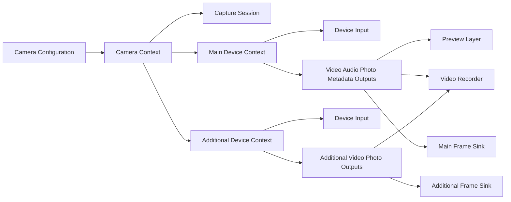
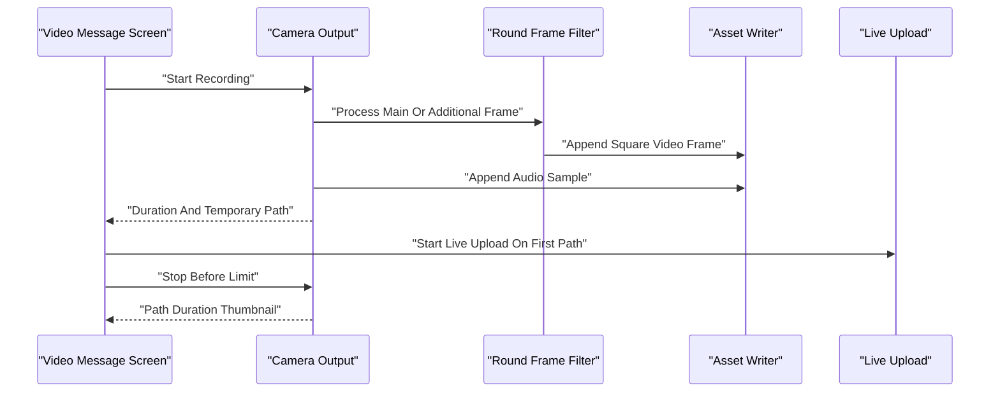
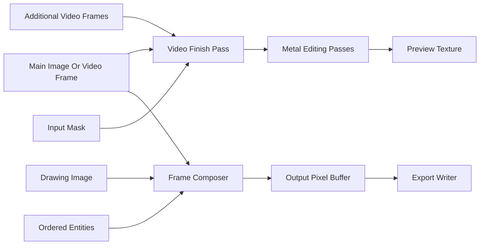
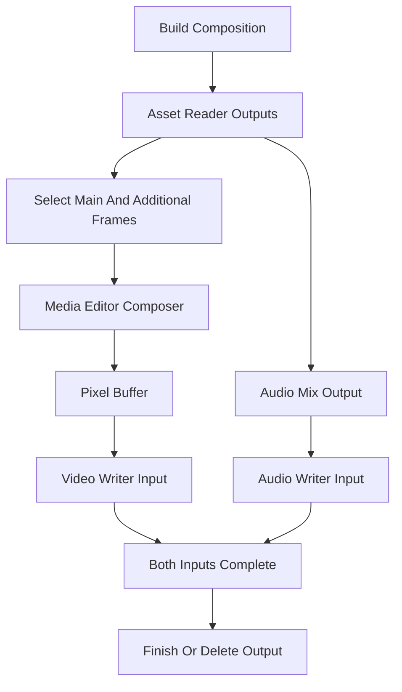

# 카메라, 원형 비디오, 미디어 에디터

웹: /docs/media/06-camera-editor/ · Markdown: /docs/media/06-camera-editor.md

> iOS와 macOS 클라이언트가 카메라 캡처, 원형 비디오 녹화부터 미디어 편집, 내보내기, 전송 전 트랜스코딩까지 어디까지 구현했는지 그 경계를 따라가 봐요.

> 렌더링과 미디어 · 오디오와 캡처 · 06장 · 도표 4 · 코드 발췌 10 · 인용 30 · 소스 기준선: [TelegramMessenger/Telegram-iOS@f1dd7a2d](https://github.com/TelegramMessenger/Telegram-iOS/tree/f1dd7a2dbd02cbbf513e75d5695d8d36d1cf5838), [overtake/TelegramSwift@579cebbf](https://github.com/overtake/TelegramSwift/tree/579cebbf0c01fd41b712eff3647fa7f69db9665d)
>
> 핵심 소스 파일: [TelegramMessenger/Telegram-iOS/submodules/Camera/Sources/Camera.swift](https://github.com/TelegramMessenger/Telegram-iOS/blob/f1dd7a2dbd02cbbf513e75d5695d8d36d1cf5838/submodules/Camera/Sources/Camera.swift), [TelegramMessenger/Telegram-iOS/submodules/Camera/CameraLegacy/Sources/LegacyCamera.swift](https://github.com/TelegramMessenger/Telegram-iOS/blob/f1dd7a2dbd02cbbf513e75d5695d8d36d1cf5838/submodules/Camera/CameraLegacy/Sources/LegacyCamera.swift), [TelegramMessenger/Telegram-iOS/submodules/Camera/CameraLegacy/Sources/CameraOutput.swift](https://github.com/TelegramMessenger/Telegram-iOS/blob/f1dd7a2dbd02cbbf513e75d5695d8d36d1cf5838/submodules/Camera/CameraLegacy/Sources/CameraOutput.swift), [TelegramMessenger/Telegram-iOS/submodules/Camera/CameraNeo/Sources/VideoRecorder.swift](https://github.com/TelegramMessenger/Telegram-iOS/blob/f1dd7a2dbd02cbbf513e75d5695d8d36d1cf5838/submodules/Camera/CameraNeo/Sources/VideoRecorder.swift), [TelegramMessenger/Telegram-iOS/submodules/TelegramUI/Components/VideoMessageCameraScreen/Sources/VideoMessageCameraScreen.swift](https://github.com/TelegramMessenger/Telegram-iOS/blob/f1dd7a2dbd02cbbf513e75d5695d8d36d1cf5838/submodules/TelegramUI/Components/VideoMessageCameraScreen/Sources/VideoMessageCameraScreen.swift), [TelegramMessenger/Telegram-iOS/submodules/TelegramUI/Components/MediaEditor/Sources/MediaEditorRenderer.swift](https://github.com/TelegramMessenger/Telegram-iOS/blob/f1dd7a2dbd02cbbf513e75d5695d8d36d1cf5838/submodules/TelegramUI/Components/MediaEditor/Sources/MediaEditorRenderer.swift), [TelegramMessenger/Telegram-iOS/submodules/TelegramUI/Components/MediaEditor/Sources/MediaEditorRenderChain.swift](https://github.com/TelegramMessenger/Telegram-iOS/blob/f1dd7a2dbd02cbbf513e75d5695d8d36d1cf5838/submodules/TelegramUI/Components/MediaEditor/Sources/MediaEditorRenderChain.swift), [TelegramMessenger/Telegram-iOS/submodules/TelegramUI/Components/MediaEditor/Sources/MediaEditorComposerEntity.swift](https://github.com/TelegramMessenger/Telegram-iOS/blob/f1dd7a2dbd02cbbf513e75d5695d8d36d1cf5838/submodules/TelegramUI/Components/MediaEditor/Sources/MediaEditorComposerEntity.swift), [TelegramMessenger/Telegram-iOS/submodules/TelegramUI/Components/MediaEditor/Sources/MediaEditorVideoExport.swift](https://github.com/TelegramMessenger/Telegram-iOS/blob/f1dd7a2dbd02cbbf513e75d5695d8d36d1cf5838/submodules/TelegramUI/Components/MediaEditor/Sources/MediaEditorVideoExport.swift), [TelegramMessenger/Telegram-iOS/submodules/TelegramUI/Components/MediaEditor/Sources/MediaEditorValues.swift](https://github.com/TelegramMessenger/Telegram-iOS/blob/f1dd7a2dbd02cbbf513e75d5695d8d36d1cf5838/submodules/TelegramUI/Components/MediaEditor/Sources/MediaEditorValues.swift), [TelegramMessenger/Telegram-iOS/submodules/DrawingUI/Sources/DrawingMetalView.swift](https://github.com/TelegramMessenger/Telegram-iOS/blob/f1dd7a2dbd02cbbf513e75d5695d8d36d1cf5838/submodules/DrawingUI/Sources/DrawingMetalView.swift), [TelegramMessenger/Telegram-iOS/submodules/LegacyComponents/Sources/TGMediaVideoConverter.m](https://github.com/TelegramMessenger/Telegram-iOS/blob/f1dd7a2dbd02cbbf513e75d5695d8d36d1cf5838/submodules/LegacyComponents/Sources/TGMediaVideoConverter.m), [overtake/TelegramSwift/Telegram-Mac/VideoRecorderPipeline.swift](https://github.com/overtake/TelegramSwift/blob/579cebbf0c01fd41b712eff3647fa7f69db9665d/Telegram-Mac/VideoRecorderPipeline.swift), [overtake/TelegramSwift/Telegram-Mac/VideoMessageConfig.swift](https://github.com/overtake/TelegramSwift/blob/579cebbf0c01fd41b712eff3647fa7f69db9665d/Telegram-Mac/VideoMessageConfig.swift), [overtake/TelegramSwift/packages/TGVideoCameraMovie/Sources/TGVideoCameraMovieRecorder.m](https://github.com/overtake/TelegramSwift/blob/579cebbf0c01fd41b712eff3647fa7f69db9665d/packages/TGVideoCameraMovie/Sources/TGVideoCameraMovieRecorder.m), [overtake/TelegramSwift/Telegram-Mac/InstantVideoPIP.swift](https://github.com/overtake/TelegramSwift/blob/579cebbf0c01fd41b712eff3647fa7f69db9665d/Telegram-Mac/InstantVideoPIP.swift), [overtake/Telegram-iOS/submodules/Camera/Sources/Camera.swift](https://github.com/overtake/Telegram-iOS/blob/a24bbe45f9861f736a79916a50898512f751e0dc/submodules/Camera/Sources/Camera.swift)
>
> 미검증 사항:
> - CameraNeo와 CameraLegacy가 현재 제품 진입점에서 어떤 조건으로 선택되는지는 조립 계층과 실제 빌드 설정에서 더 확인해야 해요.
> - CameraRoundLegacyVideoFilter의 원형 alpha가 최종 MP4까지 유지되는지, 아니면 미리 보기와 중간 픽셀 처리에만 쓰이는지는 내보낸 파일의 실제 픽셀 형식으로 검증해야 해요.
> - VideoMessageCameraScreen은 세그먼트를 이어 붙일 때 삽입 오류를 무시해요. 호출하는 쪽이 세그먼트 수나 길이 차이를 따로 검사하는지는 미검증이에요.
> - composerEntitiesForDrawingEntity에서 DrawingWeatherEntity를 일찍 반환하는 부분을 다른 내보내기 구현이 보완하는지는 미검증이에요.
> - macOS의 VideoMessageConfig 매개변수가 항상 최신 app configuration에서 오는지, 아니면 캐시나 버전 게이팅이 있는지는 미검증이에요.
> - macOS의 일반 비디오 편집이 이 장에서 찾지 못한 별도 target에서 제공되는지는 미검증이에요.

## 문제와 제약 [#문제와-제약]

카메라, 원형 비디오, 미디어 에디터는 같은 미디어 결과를 다루지만 서로 완전히 다른 세 가지 시간 제약 아래에 있어요.

- 카메라: 장치 프레임을 연속으로 받아야 하고, 전·후면 카메라를 전환하는 동안에도 타임라인을 유지해야 해요.
- 원형 비디오: 원형으로 보이는 경험을 업로드할 수 있는 정사각형 인코딩 파일로 바꿔야 해요.
- 에디터: 사용자가 상호작용하는 미리 보기를 반복해서 내보낼 수 있는 픽셀과 오디오 타임라인으로 바꿔야 해요.

소스는 이 세 작업을 컨트롤러 하나에 몰아넣지 않고 `Camera`, `VideoMessageCameraScreen`, `MediaEditor`, `DrawingUI`, `LegacyComponents`로 나누어 써요.

이 글에서 쓰는 말은 이래요.

- “원형 비디오”: 즉석 비디오 메시지를 녹화하고 인코딩하는 경로예요. 원형은 캡처할 때의 크롭과 UI 마스크가 가진 의미일 뿐, 컨테이너가 원형 픽셀을 저장해야 한다는 뜻은 아니에요.
- “주 입력”: 원본 비디오나 이미지예요.
- “추가 입력”: 듀얼 카메라(전·후면을 함께 쓰는 촬영)나 콜라주에서 두 번째 이후의 비디오 입력이에요.
- “엔티티”: 텍스트, 스티커, 도형, 위치 카드처럼 위에 덧입힐 수 있는 콘텐츠예요.

미디어 리소스를 어떻게 업로드, 분할, 캐시하는지는 《미디어 리소스, 다운로드·업로드와 캐시》에서 이미 설명했어요. 이 글은 업로드가 일어나기 전의 로컬 파일 생성, 편집, 인코딩만 따라가요. 아래 결론은 모두 주어진 고정 커밋의 소스에서 나왔어요. 추론은 문장 안에서 “추론”이라고 분명히 표시해요.

### 유지해야 할 네 가지 불변식 [#유지해야-할-네-가지-불변식]

첫째, 캡처 설정을 특정 화면이 따로 저장해서는 안 돼요. 설정과 인터페이스를 두 타입이 한곳에서 맡아요.

- `Camera.Configuration`은 프리셋, 위치, 듀얼 카메라 스위치, 오디오, 사진, 메타데이터, 광각 선호, 프레임률 선호, 볼륨 보고, 원형 비디오 플래그를 한꺼번에 구현에 전달해요.
- `CameraProtocol`은 시작, 정지, 촬영, 녹화, 포커스, 줌, 토치, 주·추가 프레임 출력, 상태 스트림을 안정적인 인터페이스로 내놓아요. [\[1\]](https://github.com/TelegramMessenger/Telegram-iOS/blob/f1dd7a2dbd02cbbf513e75d5695d8d36d1cf5838/submodules/Camera/Sources/Camera.swift#L34-L113)

둘째, 원형 비디오에는 단조 증가하는 미디어 시간(뒤로 가지 않고 늘어나기만 하는 시간)이 필요해요. 듀얼 카메라와 전·후면 전환이 일어나면 서로 다른 입력의 프레임이 뒤섞여 도착해요. 구현은 정사각형으로 크롭하는 일과 더 오래된 프레임이 writer(인코딩한 프레임을 파일에 쓰는 객체)로 거꾸로 들어가는 일을 모두 막아야 해요.

셋째, 미리 보기와 내보내기는 편집의 의미를 공유해야 하지만 같은 렌더 클래스를 공유할 필요는 없어요.

- 미리 보기는 Metal 프레임 렌더러를 타요.
- 내보내기는 컴포저와 writer를 타요.
- 둘 다 `MediaEditorValues`와 엔티티 모델을 써요.

넷째, 실패한 결과가 성공처럼 보이는 미디어를 만들어서는 안 돼요.

- 카메라는 오디오 설정이 비어 있을 때 오디오가 포함된 녹화를 시작해서는 안 돼요.
- 내보내기는 reader(원본에서 프레임을 읽는 객체)나 writer가 취소되거나 실패하면 출력 파일을 삭제해요.
- 데스크톱은 유효한 녹화가 0.5초 미만이면 완료된 미디어를 콜백으로 돌려주지 않고 레코더를 곧바로 처분해요. [\[3\]](https://github.com/TelegramMessenger/Telegram-iOS/blob/f1dd7a2dbd02cbbf513e75d5695d8d36d1cf5838/submodules/Camera/CameraLegacy/Sources/CameraOutput.swift#L52-L185) [\[19\]](https://github.com/TelegramMessenger/Telegram-iOS/blob/f1dd7a2dbd02cbbf513e75d5695d8d36d1cf5838/submodules/TelegramUI/Components/MediaEditor/Sources/MediaEditorVideoExport.swift#L700-L870) [\[24\]](https://github.com/overtake/TelegramSwift/blob/579cebbf0c01fd41b712eff3647fa7f69db9665d/Telegram-Mac/VideoRecorderPipeline.swift#L215-L360)

## 카메라 모듈과 캡처 데이터 구조 [#카메라-모듈과-캡처-데이터-구조]

### 공개 계약과 기능 선택 [#공개-계약과-기능-선택]

`Camera`는 단순한 `AVCaptureSession` 래퍼가 아니에요.

- 장치 위치를 `AVCaptureDevice.Position`으로 정의해요.
- 세션 프리셋을 `AVCaptureSession.Preset`으로 정의해요.
- `CameraVideoOutput`으로 모든 `CMSampleBuffer`와 미러 플래그를 호출하는 쪽에 넘겨요.

덕분에 스토리 카메라, 원형 비디오, 카메라 화면이 캡처 계층을 재사용하면서도 서로 다른 미리 보기와 후처리를 쓸 수 있어요. [\[1\]](https://github.com/TelegramMessenger/Telegram-iOS/blob/f1dd7a2dbd02cbbf513e75d5695d8d36d1cf5838/submodules/Camera/Sources/Camera.swift#L34-L113)

```swift
public struct Configuration {
    public let preset: Preset
    public let position: Position
    public let isDualEnabled: Bool
    public let audio: Bool
    public let photo: Bool
    public let metadata: Bool
    public let preferWide: Bool
    public let preferLowerFramerate: Bool
    public let reportAudioLevel: Bool
    public let isRoundVideo: Bool

    public init(
        preset: Preset,
        position: Position,
        isDualEnabled: Bool = false,
        audio: Bool,
        photo: Bool,
        metadata: Bool,
        preferWide: Bool = false,
        preferLowerFramerate: Bool = false,
        reportAudioLevel: Bool = false,
        isRoundVideo: Bool = false
    ) {
        self.preset = preset
        self.position = position
        self.isDualEnabled = isDualEnabled
        self.audio = audio
        self.photo = photo
        self.metadata = metadata
        self.preferWide = preferWide
        self.preferLowerFramerate = preferLowerFramerate
        self.reportAudioLevel = reportAudioLevel
        self.isRoundVideo = isRoundVideo
    }
}
```
[\[1\]](https://github.com/TelegramMessenger/Telegram-iOS/blob/f1dd7a2dbd02cbbf513e75d5695d8d36d1cf5838/submodules/Camera/Sources/Camera.swift#L34-L113)

현재 iOS 트리는 `CameraLegacy`와 `CameraNeo` 두 구현을 함께 유지해요. 이 중 `CameraLegacy`의 `CameraSession`은 세션을 이렇게 만들어요.

- iOS 13 이상이고 기능 감지에 성공하면 `AVCaptureMultiCamSession`(여러 카메라를 동시에 쓰는 세션)을 만들어요.
- 그렇지 않으면 일반 `AVCaptureSession`을 만들어요.

둘 다 `.inputPriority`로 설정해요. 따라서 듀얼 카메라는 “일반 세션에 input 두 개를 추가하면 된다”는 낙관적인 가정이 아니에요. 세션 종류를 시스템 기능이 먼저 정하는 분기예요. [\[2\]](https://github.com/TelegramMessenger/Telegram-iOS/blob/f1dd7a2dbd02cbbf513e75d5695d8d36d1cf5838/submodules/Camera/CameraLegacy/Sources/LegacyCamera.swift#L10-L112)

```swift
init(forRoundVideo: Bool) {
    if #available(iOS 13.0, *), legacyIsDualCameraSupported(forRoundVideo: forRoundVideo) {
        self.multiSession = AVCaptureMultiCamSession()
        self.singleSession = nil
        self.hasMultiCam = true
    } else {
        self.singleSession = AVCaptureSession()
        self.multiSession = nil
        self.hasMultiCam = false
    }
    self.session.sessionPreset = .inputPriority
}
```
[\[2\]](https://github.com/TelegramMessenger/Telegram-iOS/blob/f1dd7a2dbd02cbbf513e75d5695d8d36d1cf5838/submodules/Camera/CameraLegacy/Sources/LegacyCamera.swift#L10-L112)

각 `CameraDeviceContext`는 장치 선택기, input, output을 하나씩 가져요. 먼저 주 경로인지 추가 경로인지, 광각 선호, 원형 비디오 플래그에 따라 최대 크기를 고른 뒤 장치 format, input, output을 설정해요. 최대 크기는 이래요.

- 원형 비디오 전용 주 경로: 최대 캡처 크기는 640×480이에요.
- 추가 경로나 광각 선호: 1920×1440을 요청할 수 있어요.
- 일반 주 경로: 1920×1080을 요청할 수 있어요.

이 크기는 캡처 상한일 뿐 최종 인코딩 해상도와 같지 않아요. [\[2\]](https://github.com/TelegramMessenger/Telegram-iOS/blob/f1dd7a2dbd02cbbf513e75d5695d8d36d1cf5838/submodules/Camera/CameraLegacy/Sources/LegacyCamera.swift#L10-L112)

`CameraOutput`은 `AVCapturePhotoOutput`, `AVCaptureVideoDataOutput`, `AVCaptureAudioDataOutput`, `AVCaptureMetadataOutput`을 함께 가지고 있어요. 비디오 픽셀 형식은 이렇게 골라요.

- 원형이 아닌 비디오: 기본적으로 전체 범위 bi-planar YUV를 요청해요.
- 원형 비디오: 32비트 BGRA를 요청해서, 뒤따르는 Core Image 원형 프레임 필터가 픽셀 버퍼에 바로 쓸 수 있게 해요.

`alwaysDiscardsLateVideoFrames`를 false로 설정하면 캡처 출력이 늦게 도착한 프레임을 스스로 버리지 않아요. [\[3\]](https://github.com/TelegramMessenger/Telegram-iOS/blob/f1dd7a2dbd02cbbf513e75d5695d8d36d1cf5838/submodules/Camera/CameraLegacy/Sources/CameraOutput.swift#L52-L185)

멀티캠 세션은 일반적인 자동 연결에 기댈 수 없어요. 그래서 설정할 때 연결을 직접 만들어요.

1. `addOutputWithNoConnections`로 비디오와 사진 출력을 먼저 추가해요.
2. 지정한 입력 포트에서 미리 보기 연결, 비디오 연결, 사진 연결을 만들고 하나씩 `canAddConnection`을 검사해요.
3. QR 메타데이터도 사용할 수 있는 유형에 QR이 있을 때만 켜요.

이렇게 명시적으로 연결하면 output 하나가 어느 전·후면 카메라 장치에 속하는지 확정돼요. 그래서 멀티캠 세션이 포트 귀속을 잘못 추론하는 일을 피해요. [\[3\]](https://github.com/TelegramMessenger/Telegram-iOS/blob/f1dd7a2dbd02cbbf513e75d5695d8d36d1cf5838/submodules/Camera/CameraLegacy/Sources/CameraOutput.swift#L52-L185)



### 전·후면 전환과 듀얼 카메라의 상태 차이 [#전후면-전환과-듀얼-카메라의-상태-차이]

단일 카메라 전환은 이 순서로 해요.

1. session을 멈춰요.
2. 이전 input과 output을 무효화해요.
3. 목표 위치를 반전해요.
4. 다시 설정한 뒤 session을 시작해요.

동시에 `.position` 모드 변경을 내보내고, 0.5초 뒤 `.none`으로 돌아가요. 원형 비디오는 이 경로에서 오디오 전환을 빼고 위치 변경을 기록해요. 이는 오디오의 연속성과 비디오 위치의 의미를 나눠서 처리한다는 뜻이에요. [\[4\]](https://github.com/TelegramMessenger/Telegram-iOS/blob/f1dd7a2dbd02cbbf513e75d5695d8d36d1cf5838/submodules/Camera/CameraLegacy/Sources/LegacyCamera.swift#L250-L375)

듀얼 카메라 전환은 하드웨어를 다시 설정하지 않아요. `togglePosition`은 `positionValue`만 바꾸고, 위치 스트림을 발행하고, 주 output에 위치 변경을 표시하게 해요.

듀얼 카메라를 켤 때는 이렇게 해요.

- session을 먼저 멈춘 뒤 후면 주 컨텍스트와 전면 추가 컨텍스트를 만들어요.
- 오디오와 메타데이터는 주 경로에만 설정해요.
- 두 경로의 sample buffer는 각자의 sink(프레임을 받는 곳)를 거쳐 위로 전달되고, 연결 포트에서 실제 전면 카메라 위치를 읽어 미러 플래그로 써요. [\[2\]](https://github.com/TelegramMessenger/Telegram-iOS/blob/f1dd7a2dbd02cbbf513e75d5695d8d36d1cf5838/submodules/Camera/CameraLegacy/Sources/LegacyCamera.swift#L10-L112) [\[4\]](https://github.com/TelegramMessenger/Telegram-iOS/blob/f1dd7a2dbd02cbbf513e75d5695d8d36d1cf5838/submodules/Camera/CameraLegacy/Sources/LegacyCamera.swift#L250-L375)

두 전환 방식이 무엇을 맞바꾸는지는 분명해요.

- 단일 카메라: 장치를 동시에 돌리는 부담을 줄이지만 재시작이 한 번 일어나요.
- 듀얼 카메라: 더 부드러운 위치 전환과 병렬 출력을 허용하지만, 시스템의 멀티캠 지원이 필요하고 상위 계층이 프레임 스트림 두 개를 처리해야 해요.

미리 보기 스냅샷은 전환용 자리 표시물이고 녹화 파일의 일부가 아니에요. 백그라운드 큐에서 Core Image로 블러 처리한 뒤 저장하고, 경로마다 갱신 시간 임계값은 2.5초예요. [\[2\]](https://github.com/TelegramMessenger/Telegram-iOS/blob/f1dd7a2dbd02cbbf513e75d5695d8d36d1cf5838/submodules/Camera/CameraLegacy/Sources/LegacyCamera.swift#L10-L112)

### 카메라 시작과 실패 경계 [#카메라-시작과-실패-경계]

`CameraContext`는 `AVCaptureSessionRuntimeError`를 수신해요. output을 session에 추가할 수 없으면 로그만 남기고 나머지 output 설정을 이어 가요. 사진, 비디오, 오디오, 메타데이터는 선택 기능이라서 output 하나가 실패해도 미리 보기가 반드시 실패하는 것은 아니에요.

다만 녹화를 시작할 때는 두 경우에 메서드가 오류를 반환해요.

- 오디오를 요청했는데 AVFoundation이 사용할 수 있는 오디오 출력 설정을 주지 않으면 `audioInitializationError`를 반환해요.
- `VideoRecorder`를 만들 수 없으면 `videoRecorderInitializationError`를 반환해요. [\[2\]](https://github.com/TelegramMessenger/Telegram-iOS/blob/f1dd7a2dbd02cbbf513e75d5695d8d36d1cf5838/submodules/Camera/CameraLegacy/Sources/LegacyCamera.swift#L10-L112) [\[3\]](https://github.com/TelegramMessenger/Telegram-iOS/blob/f1dd7a2dbd02cbbf513e75d5695d8d36d1cf5838/submodules/Camera/CameraLegacy/Sources/CameraOutput.swift#L52-L185)

그래서 호출하는 쪽은 “미리 보기를 얻었다”를 “전송할 수 있는 오디오·비디오를 만들 수 있다”로 여겨서는 안 돼요. 카메라 화면은 권한, 장치, 오디오, writer 오류를 각각 보여 줘야 해요. 지금 코드에서 오류가 녹화 신호로 전달된다는 것은 확인돼요. 그 오류가 모든 UI 문구에 어떻게 매핑되는지는 이 글에서 검증하지 않았어요.

## 원형 비디오의 녹화, 합성, 인코딩 [#원형-비디오의-녹화-합성-인코딩]

### 정사각형 인코딩, 원형 크롭, 카메라 전환 [#정사각형-인코딩-원형-크롭-카메라-전환]

새 iOS 캡처 경로에서 원형 비디오는 이렇게 만들어요.

- `videoMessageDimensions`는 400×400이에요. 원형 비디오 녹화는 출력 크기를 이 상수로 두고 녹화 방향을 가로 오른쪽으로 강제해요.
- `CameraRoundLegacyVideoFilter`는 캡처 방향, 주·추가 출처, 전환 비율에 따라 정사각형 BGRA 프레임을 만들어요.
- 필터는 스스로 원형 mask(원 밖을 가리는 영역)를 만들지만 출력 파일은 정사각형 픽셀 버퍼를 유지해요.

그래서 “원형 메시지”가 원형으로 표시되면서도 표준 MP4 writer로 처리될 수 있어요. [\[5\]](https://github.com/TelegramMessenger/Telegram-iOS/blob/f1dd7a2dbd02cbbf513e75d5695d8d36d1cf5838/submodules/Camera/CameraLegacy/Sources/CameraRoundVideoFilter.swift#L16-L16) [\[6\]](https://github.com/TelegramMessenger/Telegram-iOS/blob/f1dd7a2dbd02cbbf513e75d5695d8d36d1cf5838/submodules/Camera/CameraLegacy/Sources/CameraOutput.swift#L271-L570)

원형 녹화용 `CameraLegacy` 설정은 H.264, 초당 1,000,000비트, High Auto Level, CABAC이에요. 녹화 흐름은 이래요.

1. 현재 output에서 권장 오디오 설정을 가져와 임시 MP4를 만들어요.
2. writer를 시작해요.
3. 0.09초 주기로 현재 길이와 파일 경로를 내보내요.

이 경로 덕분에 UI가 진행 중인 타이머를 보여 줄 수 있고, 실시간 업로드가 커지고 있는 파일을 볼 수 있어요. [\[6\]](https://github.com/TelegramMessenger/Telegram-iOS/blob/f1dd7a2dbd02cbbf513e75d5695d8d36d1cf5838/submodules/Camera/CameraLegacy/Sources/CameraOutput.swift#L271-L570)

```swift
if case .roundVideo = mode {
    dimensions = videoMessageDimensions.cgSize
    orientation = .landscapeRight

    let compressionProperties: [String: Any] = [
        AVVideoAverageBitRateKey: 1000 * 1000,
        AVVideoProfileLevelKey: AVVideoProfileLevelH264HighAutoLevel,
        AVVideoH264EntropyModeKey: AVVideoH264EntropyModeCABAC
    ]
    videoSettings = [
        AVVideoCodecKey: AVVideoCodecType.h264,
        AVVideoCompressionPropertiesKey: compressionProperties,
        AVVideoWidthKey: Int(dimensions.width),
        AVVideoHeightKey: Int(dimensions.height)
    ]
}
```
[\[6\]](https://github.com/TelegramMessenger/Telegram-iOS/blob/f1dd7a2dbd02cbbf513e75d5695d8d36d1cf5838/submodules/Camera/CameraLegacy/Sources/CameraOutput.swift#L271-L570)

`CameraNeo`의 원형 writer는 더 새로운 별도 구현이에요.

- MP4와 H.264를 출력하지만 비디오 평균 비트레이트는 초당 1,200,000비트예요.
- `expectsMediaDataInRealTime`을 true로 두고, BGRA, Metal 호환, IOSurface 기반 픽셀 풀에 대한 `AVAssetWriterInputPixelBufferAdaptor`를 만들어요.
- 가능하면 AAC 오디오 input도 만들어요.

두 경로의 비트레이트가 다르므로, `CameraLegacy` 경로의 1,000,000을 모든 iOS 원형 비디오의 전역 상수로 여겨서는 안 돼요. [\[7\]](https://github.com/TelegramMessenger/Telegram-iOS/blob/f1dd7a2dbd02cbbf513e75d5695d8d36d1cf5838/submodules/Camera/CameraNeo/Sources/VideoRecorder.swift#L450-L529)

카메라를 전환할 때 원형 비디오가 어려운 이유는 화면 출처만 바꾸면 되는 일이 아니기 때문이에요. `processVideoRecording`은 이렇게 처리해요.

- 독점이 아닌 듀얼 카메라에서 0.2초 안에 전환 비율을 계산해요. 주 경로, 추가 경로, 또는 두 경로의 전환 프레임이 원형 필터에 들어가도록 허용해요.
- 처리한 프레임의 표시 시간이 이미 기록한 마지막 시간보다 이르면 기록하지 않아요.
- 독점 경로는 크로스 페이드 때 오디오 sample의 시간 오프셋도 보정해요.

이렇게 하면 비디오 타임라인이 거꾸로 가는 일을 피하면서 오디오 샘플의 연속적인 시간 관계를 유지해요. [\[6\]](https://github.com/TelegramMessenger/Telegram-iOS/blob/f1dd7a2dbd02cbbf513e75d5695d8d36d1cf5838/submodules/Camera/CameraLegacy/Sources/CameraOutput.swift#L271-L570)

### UI, 실시간 업로드, 세그먼트 이어 녹화 [#ui-실시간-업로드-세그먼트-이어-녹화]

`VideoMessageCameraScreen`은 이렇게 동작해요.

- 시작할 때 지금 녹화 중이 아닌지 먼저 검사하고, 0.5초 간격으로 연속 동작도 막아요.
- 이미 있는 미리 보기 composition의 길이를 `initialDuration`으로 삼아요.
- 첫 녹화에서 `CameraRecordingData.filePath`를 받으면 `setupLiveUpload`를 불러요.
- 총 길이가 59.5초를 넘으면 60초를 넘길 때까지 기다리지 않고 정지를 트리거해요. 이 임계값은 writer를 마무리하고 UI를 갱신할 여유를 줘요. [\[8\]](https://github.com/TelegramMessenger/Telegram-iOS/blob/f1dd7a2dbd02cbbf513e75d5695d8d36d1cf5838/submodules/TelegramUI/Components/VideoMessageCameraScreen/Sources/VideoMessageCameraScreen.swift#L404-L490)

```swift
self.resultDisposable.set((camera.startRecording()
|> deliverOnMainQueue).startStrict(next: { [weak self] recordingData in
    let duration = initialDuration + recordingData.duration
    if let self, let controller = self.getController() {
        controller.updateCameraState({ $0.updatedDuration(duration) }, transition: .easeInOut(duration: 0.1))
        if isFirstRecording {
            controller.node.setupLiveUpload(filePath: recordingData.filePath)
        }
        if duration > 59.5 {
            controller.onStop()
        }
    }
}, error: { [weak self] _ in
    if let self, let controller = self.getController() {
        controller.completion(nil, nil, nil, nil)
    }
}))
```
[\[8\]](https://github.com/TelegramMessenger/Telegram-iOS/blob/f1dd7a2dbd02cbbf513e75d5695d8d36d1cf5838/submodules/TelegramUI/Components/VideoMessageCameraScreen/Sources/VideoMessageCameraScreen.swift#L404-L490)

정지하면 UI는 `VideoCaptureResult`에서 경로, 픽셀 크기, 길이, 썸네일을 뽑아 `CaptureResult.Video`로 감싸요.

사용자가 녹화를 재개하면 비공개 `composition` 함수가 기존 결과를 순회하며 각 세그먼트(녹화를 멈췄다 다시 시작할 때마다 나뉘는 조각)의 실제 asset duration에 따라 차례로 `AVMutableComposition`에 삽입해요. 이 함수의 `catch`는 비어 있어요. 그래서 손상됐거나 삽입할 수 없는 세그먼트 하나는 무시되고, 함수는 나머지 세그먼트로 만든 composition을 그대로 반환해요. 호출하는 쪽은 “함수가 composition을 반환했다”는 사실만으로 모든 세그먼트가 보존됐다고 판단해서는 안 돼요. [\[9\]](https://github.com/TelegramMessenger/Telegram-iOS/blob/f1dd7a2dbd02cbbf513e75d5695d8d36d1cf5838/submodules/TelegramUI/Components/VideoMessageCameraScreen/Sources/VideoMessageCameraScreen.swift#L2203-L2224)



### 구 변환기와 원형 비디오 프리셋 [#구-변환기와-원형-비디오-프리셋]

`LegacyComponents`의 `TGMediaVideoConverter`는 지금도 전송 전 트랜스코딩(전송에 맞게 다시 인코딩하기)의 중요한 경로예요. 흐름은 이래요.

1. 크롭, 방향 변환, 선택적 오버레이를 `AVMutableVideoComposition`에 넣어요. 엔티티 렌더러가 없으면 오버레이를 Core Animation video composition tool에 추가해요.
2. NV12 비디오 reader output과 AVAssetWriter input으로 트랜스코딩해요.
3. 프리셋이 허용하고 소스에 오디오 트랙이 있을 때만 오디오 프로세서를 추가해요. [\[21\]](https://github.com/TelegramMessenger/Telegram-iOS/blob/f1dd7a2dbd02cbbf513e75d5695d8d36d1cf5838/submodules/LegacyComponents/Sources/TGMediaVideoConverter.m#L480-L650)

이 변환기의 구 `VideoMessage` 프리셋은 이래요.

- 최대 크기: 384×384
- 비디오 비트레이트: 1,000 Kbps
- 오디오 비트레이트: 64 Kbps

일반 압축 프리셋은 480, 640, 848, 1280에서 1920까지예요. `keepAudioForPreset`은 애니메이션과 각 profile 프리셋에 대해 아니오를 반환해요. 요즘 카메라 녹화는 400×400을 쓰고 구 변환 프리셋은 384×384를 써요. 이건 구현 분기 두 개에 대한 소스상의 사실이므로, 같은 제품 매개변수로 합쳐서는 안 돼요. [\[22\]](https://github.com/TelegramMessenger/Telegram-iOS/blob/f1dd7a2dbd02cbbf513e75d5695d8d36d1cf5838/submodules/LegacyComponents/Sources/TGMediaVideoConverter.m#L1267-L1478)

구 변환기는 H.264에 대해 다음을 기록해요.

- 평균 비트레이트
- clean aperture
- 픽셀 종횡비
- 예상 프레임률
- High Auto Level
- CABAC

코드에 HEVC 분기가 남아 있기는 하지만, 이 구간의 구현은 `useH265`를 false로 초기화해요. 그래서 이를 근거로 이 구 변환기가 지금 실제로 HEVC를 고른다고 주장할 수 없어요. [\[22\]](https://github.com/TelegramMessenger/Telegram-iOS/blob/f1dd7a2dbd02cbbf513e75d5695d8d36d1cf5838/submodules/LegacyComponents/Sources/TGMediaVideoConverter.m#L1267-L1478)

## MediaEditor의 렌더링과 엔티티 합성 [#mediaeditor의-렌더링과-엔티티-합성]

### 입력 모델과 이중 경로 렌더링 [#입력-모델과-이중-경로-렌더링]

`MediaEditor.Subject`는 다음을 나타낼 수 있어요.

- 정적 이미지
- 파일 경로 비디오
- 비디오 콜라주
- Photos 에셋
- 초안
- 메시지
- 선물
- 스티커

에디터는 AVPlayer와 추가 플레이어를 가지고 있어서 주 비디오, 추가 비디오, 오디오 트랙을 미리 볼 수 있어요. 또한 `MediaEditorRenderer`, `MediaEditorRenderChain`, 히스토그램 pass(렌더링을 이루는 처리 단계 하나)도 가지고 있어요. `values`가 바뀌면 `updateRenderChain`을 부르고 구독자에게 새 값을 발행해요. [\[10\]](https://github.com/TelegramMessenger/Telegram-iOS/blob/f1dd7a2dbd02cbbf513e75d5695d8d36d1cf5838/submodules/TelegramUI/Components/MediaEditor/Sources/MediaEditor.swift#L118-L260)

미리 보기 렌더러에는 입력 형태가 세 가지 있어요.

- Metal 텍스처
- 방향이 있는 `VideoPixelBuffer`
- CIImage

렌더러는 `CVMetalTextureCache`, 에디터 bundle 안의 Metal library, 커맨드 큐를 만들어요. 주 비디오와 추가 비디오마다 `VideoInputPass`가 있어요. `VideoFinishPass`는 주 입력, 마스크, 추가 입력을 받아 합성 텍스처를 만들고, 이를 편집 pass 목록에 넘겨요. [\[10\]](https://github.com/TelegramMessenger/Telegram-iOS/blob/f1dd7a2dbd02cbbf513e75d5695d8d36d1cf5838/submodules/TelegramUI/Components/MediaEditor/Sources/MediaEditor.swift#L118-L260) [\[11\]](https://github.com/TelegramMessenger/Telegram-iOS/blob/f1dd7a2dbd02cbbf513e75d5695d8d36d1cf5838/submodules/TelegramUI/Components/MediaEditor/Sources/MediaEditorRenderer.swift#L47-L349)

```swift
func renderFrame() {
    guard let device = self.effectiveDevice,
          let commandQueue = self.commandQueue,
          let textureCache = self.textureCache,
          let commandBuffer = commandQueue.makeCommandBuffer(),
          var texture = self.combinedTextureFromCurrentInputs(device: device, commandBuffer: commandBuffer, textureCache: textureCache)
    else {
        self.didRenderFrame()
        return
    }

    if !self.skipEditingPasses {
        for renderPass in self.renderPasses {
            if let nextTexture = renderPass.process(input: texture, device: device, commandBuffer: commandBuffer) {
                texture = nextTexture
            }
        }
    }
    self.resultTexture = texture

    commandBuffer.commit()
}
```
[\[11\]](https://github.com/TelegramMessenger/Telegram-iOS/blob/f1dd7a2dbd02cbbf513e75d5695d8d36d1cf5838/submodules/TelegramUI/Components/MediaEditor/Sources/MediaEditorRenderer.swift#L47-L349)

렌더러는 초기값이 3인 semaphore(동시에 처리할 프레임 수를 제한하는 장치)로 프레임 처리를 제한해요.

- 표시 target이 있으면 `willRenderFrame`이 최대 0.1초까지 기다려요.
- 표시 target이 없으면 슬롯이 생길 때까지 기다려요.

덕분에 인터랙티브 미리 보기는 주 화면이 무한정 멈추는 것을 피하고, 오프라인 작업은 정말 끝날 때까지 기다릴 수 있어요. 추론: 미리 보기의 부드러움을 우선하고 표시 프레임을 건너뛰어도 되는 백프레셔(처리가 밀릴 때 흐름을 조절하는 방식) 정책이에요. [\[11\]](https://github.com/TelegramMessenger/Telegram-iOS/blob/f1dd7a2dbd02cbbf513e75d5695d8d36d1cf5838/submodules/TelegramUI/Components/MediaEditor/Sources/MediaEditorRenderer.swift#L47-L349)

편집 pass는 아래 순서로 고정되어 있어요. 아무 순서로나 쓸 수 있는 필터 목록이 아니에요.

1. 향상
2. 선명화
3. 블러
4. 조정
5. 스티커 외곽선

각 pass가 하는 일은 이래요.

- 향상 pass는 밝기와 국소 LUT(색을 바꾸는 룩업 테이블)를 계산해요.
- 조정 pass는 노출, 대비, 채도, 따뜻한 색, 페이드, 하이라이트, 그림자, 비네트, 그레인, 색조, 곡선을 받아 처리해요.
- 블러는 모드, 강도, 크기, 위치, 감쇠, 회전도 저장해요. [\[12\]](https://github.com/TelegramMessenger/Telegram-iOS/blob/f1dd7a2dbd02cbbf513e75d5695d8d36d1cf5838/submodules/TelegramUI/Components/MediaEditor/Sources/MediaEditorRenderChain.swift#L4-L153)

```swift
let enhancePass = EnhanceRenderPass()
let sharpenPass = SharpenRenderPass()
let blurPass = BlurRenderPass()
let adjustmentsPass = AdjustmentsRenderPass()
let stickerOutlinePass = StickerOutlineRenderPass()

var renderPasses: [RenderPass] {
    return [
        self.enhancePass,
        self.sharpenPass,
        self.blurPass,
        self.adjustmentsPass,
        self.stickerOutlinePass
    ]
}
```
[\[12\]](https://github.com/TelegramMessenger/Telegram-iOS/blob/f1dd7a2dbd02cbbf513e75d5695d8d36d1cf5838/submodules/TelegramUI/Components/MediaEditor/Sources/MediaEditorRenderChain.swift#L4-L153)

짚어 둘 만한 소스 관찰이 하나 있어요. `.highlightsTint` 분기는 색상을 `shadowsTintColor`에 쓰면서 강도는 `highlightsTintIntensity`에 써요. 소스는 이것이 의도적인 색상 값 공유인지 필드를 잘못 쓴 것인지 설명하지 않아요. 이 글은 필드를 기록하는 부분만 확인했고, 실제 시각 결과는 추론하지 않아요. [\[12\]](https://github.com/TelegramMessenger/Telegram-iOS/blob/f1dd7a2dbd02cbbf513e75d5695d8d36d1cf5838/submodules/TelegramUI/Components/MediaEditor/Sources/MediaEditorRenderChain.swift#L4-L153)

### DrawingUI와 엔티티의 내보내기 의미 [#drawingui와-엔티티의-내보내기-의미]

`DrawingUI`의 `DrawingMetalView`는 일시 정지할 수 있는 `MTKView`(Metal로 그리는 뷰)예요.

- `DrawingUIBundle` 안의 Metal library를 불러와요.
- BGRA8 drawable, 투명 클리어, 60 fps 선호를 써요.
- 독립된 오프스크린 `Drawable` 텍스처를 유지해요.
- 표시할 때는 오프스크린 텍스처를 fragment texture로 삼아 꼭짓점 네 개의 triangle strip을 그린 뒤 현재 drawable을 커밋하고 표시해요.

브러시 결과는 GPU 텍스처에 남겨 두었다가 필요할 때 CGImage로 바꿀 수 있어요. [\[13\]](https://github.com/TelegramMessenger/Telegram-iOS/blob/f1dd7a2dbd02cbbf513e75d5695d8d36d1cf5838/submodules/DrawingUI/Sources/DrawingMetalView.swift#L10-L229)

펜 도구는 처음부터 끝까지 고해상도로 세그먼트마다 다시 그리지 않아요. `PenTool.RenderView`는 이렇게 처리해요.

- 먼저 그리기 뷰를 원래 크기의 3분의 1로 줄여요.
- 512개를 넘은 안정된 segment 부분을 `accumulationImage`로 래스터화해요.
- 활성 segment는 여전히 독립된 뷰에서 다시 그려요.

추론: 이렇게 나눠서 합치면 긴 획을 다시 그리는 비용이 최근 segment와 캐시 레이어 하나 사이로 한정돼요. [\[14\]](https://github.com/TelegramMessenger/Telegram-iOS/blob/f1dd7a2dbd02cbbf513e75d5695d8d36d1cf5838/submodules/DrawingUI/Sources/DrawingPenTool.swift#L8-L225)

에디터 내보내기는 상호작용할 수 있는 UIView 레이어를 곧바로 화면 녹화하지 않아요. `composerEntitiesForDrawingEntity`가 먼저 `DrawingEntity`를 컴포저(프레임을 합성하는 쪽)가 프레임마다 이미지를 가져올 수 있는 엔티티로 바꿔요. 종류별로 이렇게 바꿔요.

- 파일 스티커, 이미지 스티커, 애니메이션 이미지, 비디오 스티커: `MediaEditorComposerStickerEntity`가 돼요.
- 말풍선, 도형, 벡터 그리기: 정적 CIImage 엔티티가 돼요.
- 텍스트, 위치, 링크, 날씨 카드: 먼저 회전과 텍스트 스케일에 따라 래스터화한 뒤 그 하위 엔티티를 처리해요. [\[15\]](https://github.com/TelegramMessenger/Telegram-iOS/blob/f1dd7a2dbd02cbbf513e75d5695d8d36d1cf5838/submodules/TelegramUI/Components/MediaEditor/Sources/MediaEditorComposerEntity.swift#L73-L138)

```swift
if entity is DrawingWeatherEntity {
    return []
} else if let entity = entity as? DrawingStickerEntity {
    if case let .file(_, type) = entity.content, case .reaction = type {
        return []
    } else {
        let content: MediaEditorComposerStickerEntity.Content
        var scale = entity.scale
        switch entity.content {
        case let .file(file, _):
            content = .file(file.media)
        case let .image(image, _):
            content = .image(image)
        case let .animatedImage(data, _):
            if let animatedImage = UIImage.animatedImageFromData(data: data) {
                content = .animatedImage(animatedImage.images, animatedImage.duration)
                scale *= 1.0
            } else {
                return []
            }
        case let .video(file):
            content = .video(file)
        case .dualVideoReference:
            return []
        case .message, .gift:
            // ...
        }
        return [MediaEditorComposerStickerEntity(postbox: postbox, content: content, position: entity.position, scale: scale, rotation: entity.rotation, baseSize: entity.baseSize, mirrored: entity.mirrored, colorSpace: colorSpace, tintColor: tintColor, isStatic: entity.isExplicitlyStatic)]
    }
}
```
[\[15\]](https://github.com/TelegramMessenger/Telegram-iOS/blob/f1dd7a2dbd02cbbf513e75d5695d8d36d1cf5838/submodules/TelegramUI/Components/MediaEditor/Sources/MediaEditorComposerEntity.swift#L73-L138)

여기에는 분명한 내보내기 경계가 있어요. 이 함수는 다음 엔티티에 대해 빈 배열을 반환해요.

- `DrawingWeatherEntity`: 함수 앞부분에서 반환해요.
- 리액션 스티커
- `dualVideoReference`

함수 뒤쪽에 날씨 엔티티를 렌더링하는 분기가 있기는 하지만, 앞의 조기 반환 때문에 현재 제어 흐름에서는 도달할 수 없어요. 그래서 미리 보기에서 보이는 모든 엔티티를 이 함수로 내보낼 수 있다고 가정해서는 안 돼요. 구체적인 날씨 효과를 다른 내보내기 경로가 보충하는지는 미검증이에요. [\[15\]](https://github.com/TelegramMessenger/Telegram-iOS/blob/f1dd7a2dbd02cbbf513e75d5695d8d36d1cf5838/submodules/TelegramUI/Components/MediaEditor/Sources/MediaEditorComposerEntity.swift#L73-L138)

`makeEditorImageFrameComposition`은 이 순서로 합성해요.

1. 투명 배경인지 검은 배경인지 정해요.
2. 주 이미지를 스토리, 스티커, 아바타, 커버, 일반 크롭 규칙에 따라 캔버스에 놓아요.
3. 이미 있는 drawing image를 주 이미지 위에 덮어요.
4. 각 엔티티의 현재 시각 CIImage를 비동기로 얻어 원래 엔티티 인덱스로 정렬하고 한 장씩 composited over해요.
5. 크롭, 회전, 선택적 mask를 처리해요.

그래서 엔티티 순서는 콜백이 끝나는 순서가 아니라 원래 배열 순서예요. [\[16\]](https://github.com/TelegramMessenger/Telegram-iOS/blob/f1dd7a2dbd02cbbf513e75d5695d8d36d1cf5838/submodules/TelegramUI/Components/MediaEditor/Sources/MediaEditorComposer.swift#L289-L390)



### 스티커 외곽선과 색 처리의 절충 [#스티커-외곽선과-색-처리의-절충]

스티커 외곽선 pass는 Core Image의 `CIBlendWithMask`, `CIMorphologyMaximum`, `CIColorMatrix`, `CISourceAtopCompositing`을 써요. 처리 순서는 이래요.

1. 입력 텍스처에서 가장자리 영역을 만들어요.
2. 외곽선 너비만큼 팽창시켜요.
3. 흰색 형상을 원래 alpha와 합성해요.

이 pass는 조정 뒤에 있으므로, 이미 색 조정을 거친 텍스처를 입력으로 받아 써요. [\[12\]](https://github.com/TelegramMessenger/Telegram-iOS/blob/f1dd7a2dbd02cbbf513e75d5695d8d36d1cf5838/submodules/TelegramUI/Components/MediaEditor/Sources/MediaEditorRenderChain.swift#L4-L153) [\[17\]](https://github.com/TelegramMessenger/Telegram-iOS/blob/f1dd7a2dbd02cbbf513e75d5695d8d36d1cf5838/submodules/TelegramUI/Components/MediaEditor/Sources/StickerOutlineRenderPass.swift#L13-L110)

미디어 에디터의 그래픽은 Metal과 Core Image를 섞어 쓰는 혼합 스택이에요.

- Metal: 비디오 프레임 변환, 국소 향상, 흔한 픽셀 조정을 처리해요.
- Core Image: 엔티티의 텍스트 래스터화, alpha mask, 일부 스티커 윤곽을 처리해요.

소스는 “모든 효과를 Metal로 구현한다”를 목표로 삼지 않았어요. 덕분에 CIImage와 스티커 리소스를 재사용할 수 있지만, 서로 다른 색 공간과 텍스처 생명 주기 사이를 조율하는 비용도 늘어나요.

## 내보내기, 트랜스코딩, 매개변수 선택 [#내보내기-트랜스코딩-매개변수-선택]

### 편집 값에서 인코딩 설정으로 [#편집-값에서-인코딩-설정으로]

`recommendedVideoExportConfiguration`은 편집 값, 길이, 소스 프레임률, 콘텐츠 범주를 비디오와 오디오 settings로 바꿔요. 출력 너비는 먼저 품질 프리셋이 정해요. 품질 프리셋이 없으면 이래요.

- 아바타: 800×800으로 고정돼요.
- 스티커: 512×512로 고정돼요.
- 일반 세로 비디오: 기본적으로 720×1280 또는 풀 HD 1080×1920이에요.

목표 크롭 너비는 16의 배수로 내림해요. 코드는 계산한 높이까지 16의 배수로 강제하지는 않아요. 높이를 맞추는 구문이 주석 처리되어 있으므로 이를 근거로 높이와 너비가 반드시 모두 정렬된다고 주장할 수 없어요. [\[18\]](https://github.com/TelegramMessenger/Telegram-iOS/blob/f1dd7a2dbd02cbbf513e75d5695d8d36d1cf5838/submodules/TelegramUI/Components/MediaEditor/Sources/MediaEditorValues.swift#L1911-L2049)

코덱과 오디오는 이렇게 골라요.

- 일반 비디오: `hasHEVCHardwareEncoder`로 HEVC를 우선 골라요. 품질 프리셋을 지정하거나 아바타이면 HEVC를 꺼요.
- 스티커: 문자열 `VP9`를 쓰고 FFmpeg writer를 타요.
- H.264: High Auto Level과 CABAC을 써요.
- 오디오: 스티커와 아바타는 오디오를 쓰지 않아요. 일반 오디오는 44,100 Hz AAC이고 기본은 스테레오이며, 비트레이트는 품질 프리셋 또는 기본값에서 나와요. [\[18\]](https://github.com/TelegramMessenger/Telegram-iOS/blob/f1dd7a2dbd02cbbf513e75d5695d8d36d1cf5838/submodules/TelegramUI/Components/MediaEditor/Sources/MediaEditorValues.swift#L1911-L2049)

```swift
if useVP9 {
    codecType = "VP9"
    compressionProperties = [:]
} else if useHEVC {
    codecType = AVVideoCodecType.hevc
    compressionProperties = [
        AVVideoAverageBitRateKey: videoBitrate * 1000,
        AVVideoProfileLevelKey: kVTProfileLevel_HEVC_Main_AutoLevel
    ]
} else {
    codecType = AVVideoCodecType.h264
    compressionProperties = [
        AVVideoAverageBitRateKey: videoBitrate * 1000,
        AVVideoProfileLevelKey: AVVideoProfileLevelH264HighAutoLevel,
        AVVideoH264EntropyModeKey: AVVideoH264EntropyModeCABAC
    ]
}

let videoSettings: [String: Any] = [
    AVVideoCodecKey: codecType,
    AVVideoCompressionPropertiesKey: compressionProperties,
    AVVideoWidthKey: width,
    AVVideoHeightKey: height
]
```
[\[18\]](https://github.com/TelegramMessenger/Telegram-iOS/blob/f1dd7a2dbd02cbbf513e75d5695d8d36d1cf5838/submodules/TelegramUI/Components/MediaEditor/Sources/MediaEditorValues.swift#L1911-L2049)

기본 비트레이트는 길이에 따라서도 달라져요.

- 일반 비디오: 10초 미만이면 5,800 Kbps, 20초 미만이면 5,500 Kbps, 30초 미만이면 5,000 Kbps이고, 그 밖의 기본값은 3,700 Kbps예요.
- 아바타: 길이가 더 길어질수록 1,100 Kbps까지 단계적으로 내려가요.
- 이미지 내보내기: 5,000 Kbps를 써요.

여기 나온 수치는 현재 함수의 기본 정책이고 Telegram 프로토콜의 비트레이트 제한이 아니에요. [\[18\]](https://github.com/TelegramMessenger/Telegram-iOS/blob/f1dd7a2dbd02cbbf513e75d5695d8d36d1cf5838/submodules/TelegramUI/Components/MediaEditor/Sources/MediaEditorValues.swift#L1911-L2049)

### Reader, 컴포저, writer의 백프레셔 [#reader-컴포저-writer의-백프레셔]

내보내기는 reader와 composition을 이렇게 준비해요.

1. trim range와 offset에 따라 주 비디오, 추가 비디오, 외부 오디오를 composition에 삽입해요.
2. AVAssetReader 비디오 출력에는 전체 범위 bi-planar YUV를 요청하고, Metal 호환과 Rec.709 색 속성을 선언해요.
3. 추가 비디오마다 독립된 reader output과 위치, 스케일, 오프셋, 회전, 시작 시간을 둬요.
4. 주 소스와 추가 소스의 프레임률로 source frame rate를 정한 뒤, 합성 프레임률은 30의 배수로 반올림해요. [\[19\]](https://github.com/TelegramMessenger/Telegram-iOS/blob/f1dd7a2dbd02cbbf513e75d5695d8d36d1cf5838/submodules/TelegramUI/Components/MediaEditor/Sources/MediaEditorVideoExport.swift#L700-L870)

writer는 콘텐츠 종류에 따라 골라요.

- 일반 비디오: `MediaEditorVideoAVAssetWriter`를 골라요.
- 스티커: `MediaEditorVideoFFMpegWriter`를 골라요.

AVAssetWriter는 이렇게 설정해요.

- MP4로 출력하고, 기본적으로 `shouldOptimizeForNetworkUse`가 켜져요.
- 예상 소스 프레임률을 압축 속성에 기록해요.
- 필요하면 preferred transform에 따라 너비와 높이를 맞바꿔요.
- BGRA pixel buffer adaptor를 만들어요.

여기서 말하는 네트워크 최적화는 컨테이너 쓰기 옵션이고, 이후의 MTProto 업로드 정책과는 달라요. [\[19\]](https://github.com/TelegramMessenger/Telegram-iOS/blob/f1dd7a2dbd02cbbf513e75d5695d8d36d1cf5838/submodules/TelegramUI/Components/MediaEditor/Sources/MediaEditorVideoExport.swift#L700-L870) [\[20\]](https://github.com/TelegramMessenger/Telegram-iOS/blob/f1dd7a2dbd02cbbf513e75d5695d8d36d1cf5838/submodules/TelegramUI/Components/MediaEditor/Sources/MediaEditorVideoExport.swift#L1060-L1327)

```swift
if self.configuration.isSticker {
    self.writer = MediaEditorVideoFFMpegWriter()
} else {
    self.writer = MediaEditorVideoAVAssetWriter()
}

// ...

let outputSettings: [String: Any]  = [
    kCVPixelBufferPixelFormatTypeKey as String: kCVPixelFormatType_420YpCbCr8BiPlanarFullRange,
    kCVPixelBufferMetalCompatibilityKey as String: true,
    AVVideoColorPropertiesKey: colorProperties
]
```
[\[19\]](https://github.com/TelegramMessenger/Telegram-iOS/blob/f1dd7a2dbd02cbbf513e75d5695d8d36d1cf5838/submodules/TelegramUI/Components/MediaEditor/Sources/MediaEditorVideoExport.swift#L700-L870)

프레임 단위로 인코딩할 때 내보내기 객체는 이렇게 해요.

1. 사용할 수 있는 주·추가 프레임을 읽어요.
2. composer를 불러 output pixel buffer를 만들어요.
3. output timestamp로 writer에 추가해요.

`composerSemaphore`는 현재 프레임의 합성 콜백이 끝난 뒤에야 계속 진행하게 해요. 오디오는 독립된 `requestAudioDataWhenReady` 콜백에서 진행돼요. 비디오와 오디오가 각각 끝나야 `finish`로 들어가요. 독립된 백프레셔 입력 두 개가 종료 지점 하나로 합쳐지는 구조예요. [\[20\]](https://github.com/TelegramMessenger/Telegram-iOS/blob/f1dd7a2dbd02cbbf513e75d5695d8d36d1cf5838/submodules/TelegramUI/Components/MediaEditor/Sources/MediaEditorVideoExport.swift#L1060-L1327)



`start`, `finish`, 일시 정지는 실패와 취소를 이렇게 처리해요.

- `start`: 먼저 writer가 쓰기를 시작할 수 있는지, 그다음 reader가 읽기를 시작할 수 있는지 검사해요. 어느 쪽이든 실패하면 `.writing` 또는 `.reading` 오류를 발행해요.
- `finish`: reader와 writer의 취소 상태를 검사해요. 취소됐으면 대상 파일을 삭제하고 `.cancelled`를 발행해요. writer가 실패하거나 reader가 실패했을 때도 대상 파일을 똑같이 삭제해요. `finishWriting`이 성공적으로 끝난 뒤에야 `.completed`를 발행해요.
- 일시 정지: `DispatchGroup`으로 인코딩 루프를 막고, 일시 정지된 작업을 취소하기 전에 먼저 재개해서 group이 영원히 기다리는 일을 피해요. [\[20\]](https://github.com/TelegramMessenger/Telegram-iOS/blob/f1dd7a2dbd02cbbf513e75d5695d8d36d1cf5838/submodules/TelegramUI/Components/MediaEditor/Sources/MediaEditorVideoExport.swift#L1060-L1327)

구 `TGMediaVideoConverter`와 새 `MediaEditorVideoExport`는 역할이 겹치지만 같지 않아요.

- 구 변환기: `TGMediaVideoEditAdjustments`, 프리셋, AVFoundation reader writer를 중심으로 만들어졌어요.
- 새 내보내기 객체: `MediaEditorValues`, 다중 입력, 실시간 엔티티, 교체할 수 있는 writer를 중심으로 만들어졌어요.

새 코드와 구 코드가 함께 있으므로, 호출하는 쪽은 미디어 진입점에 따라 골라야 해요. 모든 전송 비디오가 같은 비트레이트와 필터 체계를 거친다고 가정해서는 안 돼요.

## 경계 사례와 실패 처리 [#경계-사례와-실패-처리]

### 캡처 측 [#캡처-측]

캡처 측에서 이런 경계 사례를 다뤄요.

- 듀얼 카메라 기능이 없으면 `CameraSession`은 단일 세션으로 폴백해요. 단일 카메라 전환은 입력과 출력을 멈추고 다시 만들어야 해요.
- 원형 비디오는 듀얼 카메라일 때 두 경로의 프레임을 시간순으로 정렬해요.
- 원형 필터가 format description이나 픽셀 버퍼를 만들지 못하면 현재 분기는 그 프레임 처리를 건너뛰어요.
- 독점 원형 경로는 처리에 실패하면 원본 sample buffer를 레코더에 넘겨요. 완전히 멈추는 일을 피하는 폴백이지만, 그 프레임이 정사각형 크롭 의미를 채우지 못하게 만들 수 있어요. [\[2\]](https://github.com/TelegramMessenger/Telegram-iOS/blob/f1dd7a2dbd02cbbf513e75d5695d8d36d1cf5838/submodules/Camera/CameraLegacy/Sources/LegacyCamera.swift#L10-L112) [\[6\]](https://github.com/TelegramMessenger/Telegram-iOS/blob/f1dd7a2dbd02cbbf513e75d5695d8d36d1cf5838/submodules/Camera/CameraLegacy/Sources/CameraOutput.swift#L271-L570)

카메라 사진 경로는 이래요.

- 전면 카메라가 플래시를 꺼요.
- iOS 13 이상에서 사진 우선순위는 `.balanced`와 `.speed` 중에서 골라요.
- 메타데이터는 QR만 켜요.

이를 보면 Camera의 기능 범위가 원형 비디오보다 넓다는 것을 알 수 있어요. 다만 원형 녹화는 비디오와 선택적 오디오 경로만 써요. [\[3\]](https://github.com/TelegramMessenger/Telegram-iOS/blob/f1dd7a2dbd02cbbf513e75d5695d8d36d1cf5838/submodules/Camera/CameraLegacy/Sources/CameraOutput.swift#L52-L185)

### 편집과 내보내기 측 [#편집과-내보내기-측]

에디터 renderer는 device, command queue, texture cache, command buffer, 합쳐진 텍스처 중 하나라도 없으면 `didRenderFrame`을 부른 뒤 반환해요. 이렇게 하면 조기 종료 때문에 semaphore가 바닥나는 일이 없어요.

엔티티를 변환할 때 다음은 모두 빈 엔티티 목록이 될 수 있어요.

- 디코딩할 수 없는 애니메이션 이미지
- 리액션 스티커
- 날씨 엔티티
- 이중 비디오 참조

내보내는 쪽이 사용자에게 “미리 보기가 곧 내보내기”임을 보장하려면 내보내기 전에 이런 엔티티 유형을 검사해야 해요. 현재 코드는 이 함수에서 엔티티 폐기 보고서를 출력하지 않아요. [\[11\]](https://github.com/TelegramMessenger/Telegram-iOS/blob/f1dd7a2dbd02cbbf513e75d5695d8d36d1cf5838/submodules/TelegramUI/Components/MediaEditor/Sources/MediaEditorRenderer.swift#L47-L349) [\[15\]](https://github.com/TelegramMessenger/Telegram-iOS/blob/f1dd7a2dbd02cbbf513e75d5695d8d36d1cf5838/submodules/TelegramUI/Components/MediaEditor/Sources/MediaEditorComposerEntity.swift#L73-L138)

출력 인코딩에도 명시적인 실패 범주가 있어요.

- track 없음
- 비디오 출력을 추가할 수 없음
- 오디오 출력을 추가할 수 없음
- 쓰기 오류
- 읽기 오류
- 잘못된 상태
- 취소

reader output을 추가할 수 없으면 코드는 실패 상태를 설정하지만 이후의 초기화 로직은 계속 실행돼요. 추론: 상위 계층에서 `status`를 구독하는 쪽은 `.completed`만 기다리지 말고 처음 나온 실패 상태를 종료 신호로 다뤄야 해요. [\[17\]](https://github.com/TelegramMessenger/Telegram-iOS/blob/f1dd7a2dbd02cbbf513e75d5695d8d36d1cf5838/submodules/TelegramUI/Components/MediaEditor/Sources/StickerOutlineRenderPass.swift#L13-L110) [\[19\]](https://github.com/TelegramMessenger/Telegram-iOS/blob/f1dd7a2dbd02cbbf513e75d5695d8d36d1cf5838/submodules/TelegramUI/Components/MediaEditor/Sources/MediaEditorVideoExport.swift#L700-L870)

### 매개변수 선택의 제품적 의미 [#매개변수-선택의-제품적-의미]

크기, 비트레이트, 프레임률, 오디오 채널, codec은 모두 정책 입력이에요.

- 카메라 원형 비디오: 자신의 녹화 경로에서 값이 고정되어 있고, 데스크톱은 app configuration으로 덮어쓸 수 있어요.
- 에디터: 품질 프리셋, 길이, 아바타나 스티커의 성격에 따라 정해요.

이 매개변수를 전부 하나의 전역 인코딩 상수로 내려 버리면 기존 진입점 사이의 차이가 무너져요.

더 구체적으로, 미디어 종류마다 우선하는 것이 달라요.

- 실시간 원형 비디오: 낮은 지연, 안정적인 정사각형 프레임, 실시간 쓰기를 우선해요.
- 일반 비디오 편집: 다중 입력, 크롭, 오디오 트랙, 복잡한 엔티티를 보존하는 것을 우선해요.
- 스티커: VP9와 오디오 없음을 우선해요.

이들은 writer, 픽셀 형식, 정확성 조건이 서로 달라요. 추론: 모든 미디어에 H.264 매개변수 집합 하나를 강제하는 것보다 유지보수가 쉽고, 미디어 유형별로 따로 발전시킬 수도 있어요.

## iOS와 macOS 비교 [#ios와-macos-비교]

### macOS가 구현한 카메라와 원형 비디오 [#macos가-구현한-카메라와-원형-비디오]

macOS 클라이언트는 원형 비디오를 재생만 하는 것이 아니에요. `VideoRecorderPipeline`이 직접 `AVCaptureSession`, 비디오와 오디오 output, `TGVideoCameraGLRenderer`, `TGVideoCameraMovieRecorder`를 가지고 있어요. 초기화할 때는 이렇게 해요.

- session을 1280×720으로 우선 설정하고, 안 되면 medium을 써요.
- 연결되어 있고 suspended되지 않은 장치 중에서 front 또는 unspecified 비디오 장치를 우선 고르고, 사용할 수 있는 오디오 장치를 하나 골라요.
- 비디오 output의 형식은 BGRA이고, 버퍼의 너비와 높이는 500으로 설정해요. [\[23\]](https://github.com/overtake/TelegramSwift/blob/579cebbf0c01fd41b712eff3647fa7f69db9665d/Telegram-Mac/VideoRecorderPipeline.swift#L91-L155)

```swift
recorder = TGVideoCameraMovieRecorder(url: url, delegate: self, callbackQueue: VideoRecorderPipeline.queue.queue)

renderer.orientation = .portrait
renderer.mirror = true

if session.canSetSessionPreset(.hd1280x720) {
    session.sessionPreset = .hd1280x720
} else {
    session.sessionPreset = .medium
}

// ...

videoOutput.alwaysDiscardsLateVideoFrames = false

videoOutput.videoSettings = [kCVPixelBufferPixelFormatTypeKey as String: kCVPixelFormatType_32BGRA, kCVPixelBufferIOSurfacePropertiesKey as String: [:], kCVPixelBufferWidthKey as String: 500, kCVPixelBufferHeightKey as String: 500]

videoOutput.setSampleBufferDelegate(self, queue: VideoRecorderPipeline.queue.queue)
session.addOutput(videoOutput)
```
[\[23\]](https://github.com/overtake/TelegramSwift/blob/579cebbf0c01fd41b712eff3647fa7f69db9665d/Telegram-Mac/VideoRecorderPipeline.swift#L91-L155)

데스크톱 렌더러의 `prepareForInputWithFormatDescription`은 입력 너비와 높이 중 작은 값을 한 변으로 하는 정사각형을 출력 크기로 정하고, 방향과 미러에 따라 텍스처 좌표를 재배치해요. 녹화 파이프라인은 첫 유효 비디오 format을 얻으면 렌더러를 준비하고, 그다음 오디오 format을 기다려요.

녹화를 시작하면 이렇게 해요.

1. `VideoMessageConfig`의 비디오·오디오 비트레이트로 비디오 메시지 프리셋 settings를 구성해요.
2. 레코더에 track 두 개를 등록해요.
3. `prepareToRecord`를 불러요. [\[24\]](https://github.com/overtake/TelegramSwift/blob/579cebbf0c01fd41b712eff3647fa7f69db9665d/Telegram-Mac/VideoRecorderPipeline.swift#L215-L360) [\[25\]](https://github.com/overtake/TelegramSwift/blob/579cebbf0c01fd41b712eff3647fa7f69db9665d/packages/TGVideoCameraMovie/Sources/TGVideoCameraMovieRecorder.m#L26-L89)

데스크톱은 녹화 길이가 0.5초 이상일 때만 `finishRecording`을 불러요. 그렇지 않으면 pipeline을 처분해요.

최대 메시지 길이 상수는 60초예요. 완료 콜백은 다음을 보고해요.

- 경로
- 올림한 초 수
- 실시간 업로드 식별자
- 썸네일

데스크톱에는 iOS 같은 59.5초 UI 임계값이 없고, 파이프라인에 60초 상수가 저장되어 있어요. 이 상수로 실제 자동 정지가 일어나는 호출 위치가 전부 어디인지는 이 글에서 검증하지 않았어요. [\[24\]](https://github.com/overtake/TelegramSwift/blob/579cebbf0c01fd41b712eff3647fa7f69db9665d/Telegram-Mac/VideoRecorderPipeline.swift#L215-L360)

`VideoMessageConfig`의 기본값은 이래요.

- 비디오 비트레이트: 1,000 Kbps
- 오디오 비트레이트: 64 Kbps
- 지름: 384
- 파일 크기 제한: 12 MiB

app configuration의 `round_video_encoding`에서 `video_bitrate`, `audio_bitrate`, `max_size`, `diameter`를 읽고, 빠진 필드는 기본값으로 폴백해요. 그래서 데스크톱의 원형 비디오 매개변수는 바뀌지 않는 로컬 상수가 아니에요. [\[26\]](https://github.com/overtake/TelegramSwift/blob/579cebbf0c01fd41b712eff3647fa7f69db9665d/Telegram-Mac/VideoMessageConfig.swift#L14-L41)

데스크톱 녹화 미리 보기 `VideoRecorderModalView`는 `AVCaptureVideoPreviewLayer`를 써요. 컨테이너 레이어의 모서리 반경을 컨테이너 너비의 절반으로 두고, 전면 카메라 미리 보기에는 미러를 켜요.

여기서 말하는 원형은 AppKit 미리 보기의 외형이에요. 인코딩되는 정사각형은 렌더러와 비디오 프리셋에서 나오며, AVCapture 비디오 레이어를 파일에 곧바로 기록하는 것이 아니에요. [\[27\]](https://github.com/overtake/TelegramSwift/blob/579cebbf0c01fd41b712eff3647fa7f69db9665d/Telegram-Mac/VideoRecorderModalView.swift#L13-L94) [\[25\]](https://github.com/overtake/TelegramSwift/blob/579cebbf0c01fd41b712eff3647fa7f69db9665d/packages/TGVideoCameraMovie/Sources/TGVideoCameraMovieRecorder.m#L26-L89)

### macOS 재생, 화면 속 화면, 에디터 경계 [#macos-재생-화면-속-화면-에디터-경계]

`InstantVideoPIP`은 다운로드가 끝난 뒤의 재생 표현이고 녹화나 내보내기 경로가 아니에요.

- 미디어 파일의 완전한 resource data로 `AVGifData`를 만들어 `GIFPlayerView`에 넘기고, 이 뷰를 채팅 윈도우에 넣어요.
- 메시지가 `isInstantVideo`인지에 따라 플로팅 윈도우를 표시하거나 숨겨요.
- 드래그한 뒤 네 모서리에 스냅하는 것을 지원해요. [\[28\]](https://github.com/overtake/TelegramSwift/blob/579cebbf0c01fd41b712eff3647fa7f69db9665d/Telegram-Mac/InstantVideoPIP.swift#L159-L301)

macOS는 원형 비디오 녹화와 재생에 자체 AppKit, OpenGL, AVFoundation 계층을 쓰고 이 장의 iOS MediaEditor 모듈을 직접 호출하지 않는다는 것을 확인할 수 있어요. 근거는 이래요.

- 데스크톱 패키지 `TelegramMedia`의 manifest는 공유하는 TelegramCore, Postbox, MediaPlayer, TGUIKit, CallVideoLayer에 의존해요.
- 이 manifest는 iOS의 `MediaEditor`, `DrawingUI`, `Camera`를 이 target의 의존성으로 나열하지 않아요.
- 로컬 `Telegram-Mac` 녹화 파이프라인과 종합하면 위 결론이 나와요. [\[23\]](https://github.com/overtake/TelegramSwift/blob/579cebbf0c01fd41b712eff3647fa7f69db9665d/Telegram-Mac/VideoRecorderPipeline.swift#L91-L155) [\[24\]](https://github.com/overtake/TelegramSwift/blob/579cebbf0c01fd41b712eff3647fa7f69db9665d/Telegram-Mac/VideoRecorderPipeline.swift#L215-L360) [\[28\]](https://github.com/overtake/TelegramSwift/blob/579cebbf0c01fd41b712eff3647fa7f69db9665d/Telegram-Mac/InstantVideoPIP.swift#L159-L301) [\[29\]](https://github.com/overtake/TelegramSwift/blob/579cebbf0c01fd41b712eff3647fa7f69db9665d/packages/TelegramMedia/Package.swift#L6-L57)

위 결론이 “macOS에는 미디어 편집 기능이 전혀 없다”는 증명은 아니에요. 증명하는 건 두 가지뿐이에요.

- 지금 읽은 `TelegramMedia` target의 의존성 그래프에 이 iOS 모듈들이 없어요.
- 확인된 데스크톱 원형 비디오 경로가 `VideoRecorderPipeline`과 `TGVideoCameraMovie`로 구현되어 있어요.

데스크톱 프로젝트 전체에 이름이 알려지지 않은 일반 비디오 편집 진입점이 따로 있는지는 미검증이에요.

fork에 있는 멀티캠 기능을 macOS 클라이언트의 것으로 곧바로 돌려서는 안 돼요. macOS fork의 `submodules/telegram-ios/submodules/Camera/Sources/Camera.swift`는 여전히 UIKit을 import하고 내부에서 iOS 13의 `AVCaptureMultiCamSession`도 써요. 이것은 TelegramSwift가 기록하고 재사용하는 iOS fork 소스이고 macOS AppKit의 카메라 구현이 아니에요. [\[30\]](https://github.com/overtake/Telegram-iOS/blob/a24bbe45f9861f736a79916a50898512f751e0dc/submodules/Camera/Sources/Camera.swift#L1-L110)

## 설계 절충 [#설계-절충]

첫 번째 절충은 인터페이스를 앞에서 통일하고 장치 기능의 선택은 뒤로 미루는 거예요. `Camera.Configuration`으로 호출하는 쪽이 요구 사항을 선언해요. 구현은 그에 따라 다음을 골라요.

- 일반 세션인지 멀티캠 세션인지
- YUV인지 BGRA인지
- output이 한 경로인지 두 경로인지

이렇게 하면 UI가 API를 공유할 수 있지만, 하위 계층은 더 많은 모드 조합을 유지해야 해요.

두 번째 절충은 원형 비디오를 정사각형 인코딩 프레임으로 바꾸는 거예요. 덕분에 표준 H.264 MP4 writer, 썸네일, 업로더를 재사용할 수 있어요. 대가는 원형 크롭, 미러, 방향, 전환 연출을 모두 프레임 처리 계층에서 구현해야 하고, 둥근 모서리 뷰에만 맡길 수 없다는 점이에요. iOS와 macOS 모두 이 절충을 보여 줘요.

- iOS: Core Image 원형 필터를 써요.
- macOS: OpenGL 텍스처 좌표와 정사각형 출력을 써요. [\[6\]](https://github.com/TelegramMessenger/Telegram-iOS/blob/f1dd7a2dbd02cbbf513e75d5695d8d36d1cf5838/submodules/Camera/CameraLegacy/Sources/CameraOutput.swift#L271-L570) [\[25\]](https://github.com/overtake/TelegramSwift/blob/579cebbf0c01fd41b712eff3647fa7f69db9665d/packages/TGVideoCameraMovie/Sources/TGVideoCameraMovieRecorder.m#L26-L89)

세 번째 절충은 미리 보기 renderer와 내보내기 composer를 분리하는 거예요.

- 미리 보기: Metal command buffer와 제한된 in flight 프레임(동시에 처리 중인 프레임)으로 빠르게 갱신할 수 있어요.
- 내보내기: 모든 CIImage 엔티티를 기다리고, 여러 오디오 트랙을 섞고, timestamp를 엄격하게 기록할 수 있어요.

대가는 두 경로가 같은 편집 값 집합으로 의미를 표현해야 한다는 점이에요. 그렇지 않으면 미리 보기와 내보내기가 달라질 수 있어요. 소스는 `MediaEditorValues`, 엔티티 위치·스케일·회전, 같은 종류의 크롭 규칙으로 이 위험을 낮추지만, 이 장에서는 픽셀 단위로 일치하는지 보는 테스트가 있는지 확인하지 못했어요.

네 번째 절충은 codec 선택을 미디어 종류와 하드웨어 기능에 두는 거예요.

- 일반 편집 비디오: HEVC 또는 H.264를 고를 수 있어요.
- 스티커: VP9와 FFmpeg를 택해요.
- 원형 비디오: 실시간 H.264를 써요.
- 구 변환기: H.264 프리셋을 유지해요.

이런 다중 writer 아키텍처는 테스트 매트릭스를 키우지만, 각 미디어가 맞지 않는 codec, 오디오, 지연 요구 때문에 비용을 치르는 일을 피해요.

## 열린 기술 문제 [#열린-기술-문제]

- `CameraNeo`와 `CameraLegacy`가 현재 제품 진입점에서 어떤 조건으로 선택되는지는 조립 계층과 실제 빌드 설정에서 더 확인해야 해요.
- `CameraRoundLegacyVideoFilter`의 원형 alpha가 최종 MP4까지 유지되는지, 아니면 미리 보기와 중간 픽셀 처리에만 쓰이는지는 내보낸 파일의 실제 픽셀 형식으로 검증해야 해요.
- `VideoMessageCameraScreen`은 세그먼트를 이어 붙일 때 삽입 오류를 무시해요. 호출하는 쪽이 세그먼트 수나 길이 차이를 따로 검사하는지는 미검증이에요.
- `composerEntitiesForDrawingEntity`에서 `DrawingWeatherEntity`를 일찍 반환하는 부분을 다른 내보내기 구현이 보완하는지는 미검증이에요.
- macOS의 `VideoMessageConfig.videoBitrate`, `audioBitrate`, `diameter`와 파일 크기 제한이 항상 최신 app configuration에서 오는지, 아니면 캐시와 버전 게이팅이 있는지는 미검증이에요.
- macOS의 일반 비디오 편집이 이 장에서 찾지 못한 별도 target에서 제공되는지는 미검증이에요.

## 참고 [#references]

- \[1\] [Camera public configuration and protocol](https://github.com/TelegramMessenger/Telegram-iOS/blob/f1dd7a2dbd02cbbf513e75d5695d8d36d1cf5838/submodules/Camera/Sources/Camera.swift#L34-L113)
- \[2\] [Legacy camera session and device context](https://github.com/TelegramMessenger/Telegram-iOS/blob/f1dd7a2dbd02cbbf513e75d5695d8d36d1cf5838/submodules/Camera/CameraLegacy/Sources/LegacyCamera.swift#L10-L112)
- \[3\] [Camera outputs and multi camera connections](https://github.com/TelegramMessenger/Telegram-iOS/blob/f1dd7a2dbd02cbbf513e75d5695d8d36d1cf5838/submodules/Camera/CameraLegacy/Sources/CameraOutput.swift#L52-L185)
- \[4\] [Camera position and dual camera switching](https://github.com/TelegramMessenger/Telegram-iOS/blob/f1dd7a2dbd02cbbf513e75d5695d8d36d1cf5838/submodules/Camera/CameraLegacy/Sources/LegacyCamera.swift#L250-L375)
- \[5\] [Round video dimensions](https://github.com/TelegramMessenger/Telegram-iOS/blob/f1dd7a2dbd02cbbf513e75d5695d8d36d1cf5838/submodules/Camera/CameraLegacy/Sources/CameraRoundVideoFilter.swift#L16-L16)
- \[6\] [Round video recording and frame processing](https://github.com/TelegramMessenger/Telegram-iOS/blob/f1dd7a2dbd02cbbf513e75d5695d8d36d1cf5838/submodules/Camera/CameraLegacy/Sources/CameraOutput.swift#L271-L570)
- \[7\] [Neo round video asset writer](https://github.com/TelegramMessenger/Telegram-iOS/blob/f1dd7a2dbd02cbbf513e75d5695d8d36d1cf5838/submodules/Camera/CameraNeo/Sources/VideoRecorder.swift#L450-L529)
- \[8\] [Video message recording screen](https://github.com/TelegramMessenger/Telegram-iOS/blob/f1dd7a2dbd02cbbf513e75d5695d8d36d1cf5838/submodules/TelegramUI/Components/VideoMessageCameraScreen/Sources/VideoMessageCameraScreen.swift#L404-L490)
- \[9\] [Video message segment composition](https://github.com/TelegramMessenger/Telegram-iOS/blob/f1dd7a2dbd02cbbf513e75d5695d8d36d1cf5838/submodules/TelegramUI/Components/VideoMessageCameraScreen/Sources/VideoMessageCameraScreen.swift#L2203-L2224)
- \[10\] [Media editor subject and renderer ownership](https://github.com/TelegramMessenger/Telegram-iOS/blob/f1dd7a2dbd02cbbf513e75d5695d8d36d1cf5838/submodules/TelegramUI/Components/MediaEditor/Sources/MediaEditor.swift#L118-L260)
- \[11\] [Media editor Metal renderer](https://github.com/TelegramMessenger/Telegram-iOS/blob/f1dd7a2dbd02cbbf513e75d5695d8d36d1cf5838/submodules/TelegramUI/Components/MediaEditor/Sources/MediaEditorRenderer.swift#L47-L349)
- \[12\] [Media editor render chain](https://github.com/TelegramMessenger/Telegram-iOS/blob/f1dd7a2dbd02cbbf513e75d5695d8d36d1cf5838/submodules/TelegramUI/Components/MediaEditor/Sources/MediaEditorRenderChain.swift#L4-L153)
- \[13\] [Drawing Metal canvas](https://github.com/TelegramMessenger/Telegram-iOS/blob/f1dd7a2dbd02cbbf513e75d5695d8d36d1cf5838/submodules/DrawingUI/Sources/DrawingMetalView.swift#L10-L229)
- \[14\] [Drawing pen accumulation strategy](https://github.com/TelegramMessenger/Telegram-iOS/blob/f1dd7a2dbd02cbbf513e75d5695d8d36d1cf5838/submodules/DrawingUI/Sources/DrawingPenTool.swift#L8-L225)
- \[15\] [Drawing entity export conversion](https://github.com/TelegramMessenger/Telegram-iOS/blob/f1dd7a2dbd02cbbf513e75d5695d8d36d1cf5838/submodules/TelegramUI/Components/MediaEditor/Sources/MediaEditorComposerEntity.swift#L73-L138)
- \[16\] [Media editor frame composition](https://github.com/TelegramMessenger/Telegram-iOS/blob/f1dd7a2dbd02cbbf513e75d5695d8d36d1cf5838/submodules/TelegramUI/Components/MediaEditor/Sources/MediaEditorComposer.swift#L289-L390)
- \[17\] [Sticker outline Core Image pass](https://github.com/TelegramMessenger/Telegram-iOS/blob/f1dd7a2dbd02cbbf513e75d5695d8d36d1cf5838/submodules/TelegramUI/Components/MediaEditor/Sources/StickerOutlineRenderPass.swift#L13-L110)
- \[18\] [Recommended export configuration](https://github.com/TelegramMessenger/Telegram-iOS/blob/f1dd7a2dbd02cbbf513e75d5695d8d36d1cf5838/submodules/TelegramUI/Components/MediaEditor/Sources/MediaEditorValues.swift#L1911-L2049)
- \[19\] [Export reader and writer setup](https://github.com/TelegramMessenger/Telegram-iOS/blob/f1dd7a2dbd02cbbf513e75d5695d8d36d1cf5838/submodules/TelegramUI/Components/MediaEditor/Sources/MediaEditorVideoExport.swift#L700-L870)
- \[20\] [Export encoding and failure handling](https://github.com/TelegramMessenger/Telegram-iOS/blob/f1dd7a2dbd02cbbf513e75d5695d8d36d1cf5838/submodules/TelegramUI/Components/MediaEditor/Sources/MediaEditorVideoExport.swift#L1060-L1327)
- \[21\] [Legacy video conversion setup](https://github.com/TelegramMessenger/Telegram-iOS/blob/f1dd7a2dbd02cbbf513e75d5695d8d36d1cf5838/submodules/LegacyComponents/Sources/TGMediaVideoConverter.m#L480-L650)
- \[22\] [Legacy conversion preset settings](https://github.com/TelegramMessenger/Telegram-iOS/blob/f1dd7a2dbd02cbbf513e75d5695d8d36d1cf5838/submodules/LegacyComponents/Sources/TGMediaVideoConverter.m#L1267-L1478)
- \[23\] [macOS recorder pipeline initialization](https://github.com/overtake/TelegramSwift/blob/579cebbf0c01fd41b712eff3647fa7f69db9665d/Telegram-Mac/VideoRecorderPipeline.swift#L91-L155)
- \[24\] [macOS round video capture and completion](https://github.com/overtake/TelegramSwift/blob/579cebbf0c01fd41b712eff3647fa7f69db9665d/Telegram-Mac/VideoRecorderPipeline.swift#L215-L360)
- \[25\] [macOS video message encoder settings](https://github.com/overtake/TelegramSwift/blob/579cebbf0c01fd41b712eff3647fa7f69db9665d/packages/TGVideoCameraMovie/Sources/TGVideoCameraMovieRecorder.m#L26-L89)
- \[26\] [macOS round video configuration](https://github.com/overtake/TelegramSwift/blob/579cebbf0c01fd41b712eff3647fa7f69db9665d/Telegram-Mac/VideoMessageConfig.swift#L14-L41)
- \[27\] [macOS circular recorder preview](https://github.com/overtake/TelegramSwift/blob/579cebbf0c01fd41b712eff3647fa7f69db9665d/Telegram-Mac/VideoRecorderModalView.swift#L13-L94)
- \[28\] [macOS instant video picture in picture](https://github.com/overtake/TelegramSwift/blob/579cebbf0c01fd41b712eff3647fa7f69db9665d/Telegram-Mac/InstantVideoPIP.swift#L159-L301)
- \[29\] [macOS TelegramMedia package dependencies](https://github.com/overtake/TelegramSwift/blob/579cebbf0c01fd41b712eff3647fa7f69db9665d/packages/TelegramMedia/Package.swift#L6-L57)
- \[30\] [Fork camera iOS implementation](https://github.com/overtake/Telegram-iOS/blob/a24bbe45f9861f736a79916a50898512f751e0dc/submodules/Camera/Sources/Camera.swift#L1-L110)
