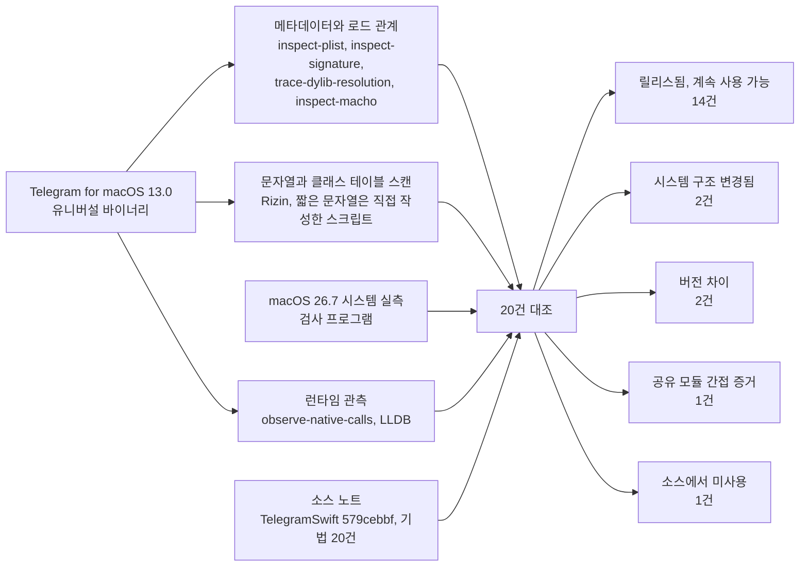
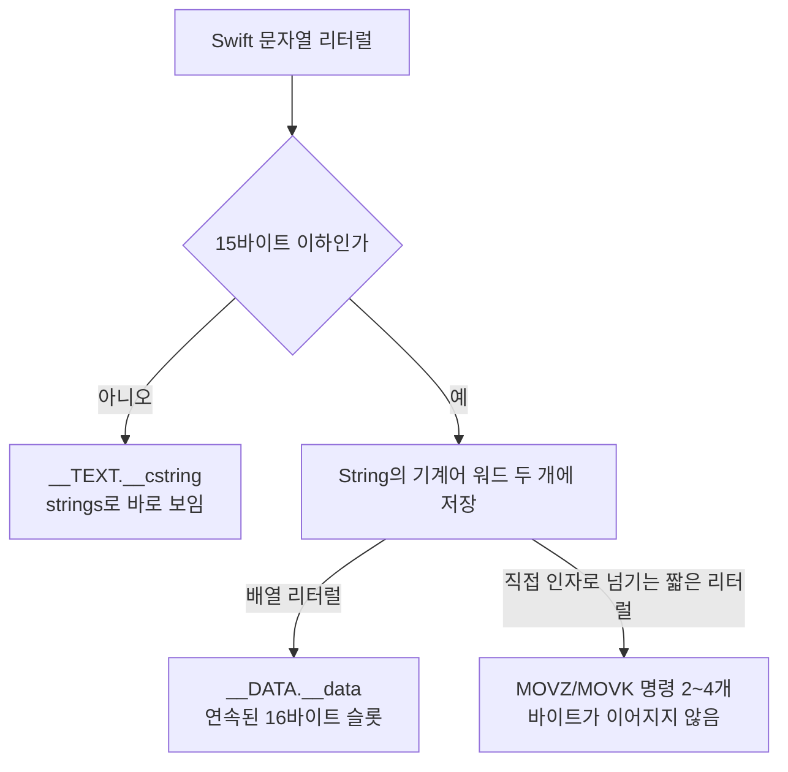

# REA 바이너리 검증

웹: /docs/rea/ · Markdown: /docs/rea.md

> REA로 공식 Telegram for macOS 13.0을 분석해서, 소스 노트의 비공개 API 및 시스템 통합 기법 20건을 대조해요.

> **결론**
>
> 대조한 20건 중 16건은 13.0 릴리스 빌드 바이너리에서 직접 증거가 나왔어요. 2건은 버전 차이예요. `HackUtils` 클래스가 사라졌고, iOS 쪽 `MetalEngine`의 메서드 교체가 macOS 버전에 들어왔어요. macOS 26.7에서는 비공개 경로 2건이 시스템 구조와 더는 맞지 않아요. 나머지 1건은 소스에 선언만 있고 한 번도 쓰이지 않은 클래스(`CAPortalLayer`)예요.

iOS 버전은 바이너리 검증을 하지 않았어요. App Store의 IPA는 FairPlay(Apple의 앱 암호화)로 암호화되어 있어서 복호화된 실행 파일을 합법적으로 얻을 수 없기 때문이에요.

macOS 바이너리는 `telegram-ios` 서브모듈의 공유 모듈(`MetalEngine`, `Postbox`, `TelegramCore`, `MtProtoKit`)을 정적으로 링크하고 있어요. 그래서 UI가 아닌 iOS 쪽 기법 일부는 간접적으로 검증됐어요.

아래 도표는 소스 노트 20건을 13.0 바이너리와 대조해 상태로 분류하는 전체 흐름을 보여 줘요.



## 검증 대상 [#target]

| 항목 | 값 |
| --- | --- |
| 바이너리 출처 | `https://telegram.org/dl/macos`가 `https://osx.telegram.org/updates/Telegram.dmg`로 리다이렉트됨(150,663,741바이트, SHA-256 `140622d3…891c17f8`) |
| 버전 | 13.0(`CFBundleVersion` 283305), `ru.keepcoder.Telegram`, SDK macOS 26.2, Xcode 26.2(17C52) |
| 주 실행 파일 | 유니버설 바이너리 x86_64 + arm64, 234,841,072바이트; arm64 슬라이스 109,257,712바이트 |
| 서명 | Developer ID Application: TELEGRAM MESSENGER LLP (6N38VWS5BX), hardened runtime(런타임 보호) 켜짐, App Sandbox 꺼짐 |
| 대조 소스 | TelegramSwift `579cebbf`(2025-07-29). 공식 업데이트 피드에는 12.6(2026-04)이 가장 오래된 버전으로 남아 있어서, 소스와 같은 버전의 바이너리는 없어요 |
| 분석 머신 | Manus 클라우드 머신, macOS 26.7(25G229), arm64 |
| 도구 | REA 6.7.0(`rea-agents`), 백엔드로 Rizin 0.9.1; Hopper, Ghidra, IDA는 설정하지 않음 |

## 방법 [#method]

분석은 다섯 단계로 했어요.

1. **메타데이터 읽기.** `rea inspect-plist`와 `rea inspect-signature`로 Info.plist, 서명, entitlements를 읽어요.
2. **로드 관계 해석.**
   - `rea trace-dylib-resolution --architecture arm64`로 실행 루트 4개, 이미지 6개, 로드 엣지 193개를 해석했어요.
   - `rea inspect-macho`로 load command 113개, 의존 라이브러리 95개, import 심볼 4,587개를 읽었어요.
3. **문자열과 클래스 테이블 스캔.** `rea execute-rizin-command`로 arm64 슬라이스에서 `iz`, `ic`, `iS`, `pd`를 실행했어요. 그래서 데이터 세그먼트 문자열 117,189개, ObjC 클래스 6,393개, 섹션 테이블, 부분 디스어셈블리를 뽑았어요.
4. **짧은 문자열 보충.** Rizin의 `izz`와 `/` 검색은 REA의 `-q -c` 모드에서 출력이 없었어요. 알려진 문자열로 대조해서 도구의 한계라는 걸 확인했어요. 그래서 짧은 문자열은 직접 작성한 스크립트로 찾았어요. 스크립트는 두 가지를 했어요.
   - `__TEXT.__text`의 arm64 `MOVZ/MOVK` 즉치값을 디코딩했어요.
   - Swift 작은 문자열의 메모리 레이아웃에 맞춰 파일 전체를 검색했어요.
5. **시스템 실측과 런타임 관측.** macOS 26.7에서 검사 프로그램을 컴파일해서, 비공개 클래스, selector, 뷰 트리가 아직 있는지 확인했어요. `rea observe-native-calls`는 LLDB 아래에서 ad-hoc으로 다시 서명한 사본을 40초 동안 실행하며, 중단점 8세트의 호출을 기록했어요.

`rea inspect-native-dispatch-metadata`는 결과가 없었어요. 이유는 입력 크기예요. REA는 이 명령의 입력 상한을 64 MiB로 두었는데, arm64 슬라이스는 104 MiB예요.

## 결과 [#results]

사이트에서 통계 카드를 클릭하면 해당 결과만 볼 수 있어요. 각 항목은 소스 노트의 항목으로 연결돼요.

| 상태 | 항목 수 |
| --- | --- |
| 릴리스됨 · 계속 사용 가능 | 14 |
| 시스템 구조 변경됨 | 2 |
| 버전 차이 | 2 |
| 공유 모듈 간접 증거 | 1 |
| 소스에서 미사용 | 1 |

| # | 대조 항목 | 13.0 바이너리 | macOS 26.7 | 결론 | 상태 | 관련 항목 |
| --- | --- | --- | --- | --- | --- | --- |
| 1 | 클래스명을 이어 붙여 `CAEmitterBehavior`를 호출해 보이지 않는 잉크 구현(13-1) | `"CA"`, `"Emitter"`, `"Behavior"`가 Swift 작은 문자열로 `__DATA.__data` 0x5e75208/18/28에 있음; `"behaviorWith"`, `"Type:"`는 0x5e751c0/d0에 있음. 완전한 이름 `CAEmitterBehavior`, `behaviorWithType`은 0회 나타남. `"simpleAttractor"`는 5곳, `"valueOverLife"`는 3곳의 `MOVZ/MOVK` 즉치값으로 컴파일됨. KVC 경로 `emitterBehaviors.fingerAttractor.*`, `randomAttractor0/1.*`는 평문으로 `__cstring`에 있음 | 클래스 존재; `+behaviorWithType:` 존재; 두 타입 모두 생성 가능 | 릴리스됨, 현재 시스템에서도 사용 가능 | 릴리스됨 · 계속 사용 가능 | [#13-01](/docs/macos/13-table-scroll-text/#t13-01) [#14-01](/docs/macos/14-private-system/#t14-01) |
| 2 | 비공개 KVC 키 `contentsMultiplyColor`로 레이어에 색 입히기(리포트에 수록되지 않음) | `__cstring` 0x104b6ef30 | `CALayer`가 getter와 setter에 응답 | 릴리스됨, 계속 사용 가능 | 릴리스됨 · 계속 사용 가능 | [#12-07](/docs/macos/12-tguikit-core/#t12-07) |
| 3 | `NSVisualEffectView` 내부 레이어와 필터 줄이기(12-2) | 화이트리스트 `["colorSaturate","gaussianBlur"]`가 작은 문자열로 `__DATA.__data` 0x5e75720/30에 있음, 표시 바이트 0xED/0xEC | 실제 레이어 트리: `kCUIVariantSidebarMaterial` › `Backdrop`(`CABackdropLayer`, 필터 `sdrNormalize`, `gaussianBlur`, `colorSaturate`), `fill`, `tone`, `Chameleon`(`CAChameleonLayer`) | 코드가 `backdrop`과 `Backdrop`을 모두 매칭하므로 구조는 여전히 들어맞아요. 새로 생긴 `sdrNormalize`도 삭제하는데, 그 영향은 미검증이에요 | 릴리스됨 · 계속 사용 가능 | [#12-02](/docs/macos/12-tguikit-core/#t12-02) |
| 4 | 공개되지 않은 대각선 리사이즈 커서(14-6) | 두 selector 모두 `__objc_methname`에 있음(0x1050992e1, 0x105099307) | LLDB가 AppKit에서 `+[NSCursor _windowResizeNorthWestSouthEastCursor]` 등 메서드 두 개를 해석함 | 릴리스됨, 계속 사용 가능 | 릴리스됨 · 계속 사용 가능 | [#14-07](/docs/macos/14-private-system/#t14-07) |
| 5 | `_shareServiceSelected:`로 시스템 서브메뉴를 식별해 삭제(14-5) | 이 selector가 `__cstring`과 `__objc_methname` 양쪽에 있음 | `NSTextView` 기본 메뉴에는 없고, 공유 항목은 `_performStandardShareMenuItem:`로 바뀜. 13.0 바이너리에는 새 selector가 없음 | 공유 항목 필터 조건이 26.7에서는 동작하지 않을 수 있어요(추론, Telegram 안에서 실측하지 않음) | 시스템 구조 변경됨 | [#14-06](/docs/macos/14-private-system/#t14-06) |
| 6 | `AVMovableView`를 파고들어 전체 화면 버튼 클릭(14-3) | `"AVMovableView"`가 즉치값 3곳(0x102517a20, 0x102518434, 0x1025185f8)으로 컴파일됨. 소스의 호출 지점 3곳과 일치 | 클래스 존재, `AVPlayerView` 뷰 트리에도 나타남 | 릴리스됨; 내부 버튼 경로는 미검증 | 릴리스됨 · 계속 사용 가능 | [#14-04](/docs/macos/14-private-system/#t14-04) |
| 7 | `NSTitlebarView` 서브뷰 재배치(14-4) | `"NSTitlebarView"`가 즉치값 1곳(0x1036c54f8)으로 컴파일됨; `NSTitlebarContainerView`는 `__cstring`에 있음 | 두 클래스 모두 타이틀바 뷰 트리에 있음 | 릴리스됨, 구조 여전히 존재 | 릴리스됨 · 계속 사용 가능 | [#14-05](/docs/macos/14-private-system/#t14-05) |
| 8 | MapKit 내부 `MKZoomSegmentedControl` 옮기기(14-7) | `__cstring` 0x104c3bd50 | 클래스는 있지만 `showsZoomControls = true`로 설정해도 `MKMapView` 뷰 트리에 없음 | 코드가 `if let`으로 보호되어 있어서 조용히 건너뛰어요(이번 테스트 조건에서) | 시스템 구조 변경됨 | [#14-08](/docs/macos/14-private-system/#t14-08) |
| 9 | 리소스 포크를 쓰고 Dock을 재시작해 아이콘을 영구히 바꾸기(14-2) | `com.apple.ResourceFork`, `com.apple.FinderInfo`, `/usr/bin/killall`, “Failed to run `killall Dock`”; `setxattr`, `getxattr`, `removexattr` import | 실행하지 않음(시스템 상태를 바꾸게 됨) | 릴리스됨. 샌드박스 없는 Developer ID 배포 덕분에 자기 bundle에 쓸 수 있어요 | 릴리스됨 · 계속 사용 가능 | [#14-03](/docs/macos/14-private-system/#t14-03) |
| 10 | 청취형 `CGEvent` tap으로 전역 푸시 투 토크 구현(14-1) | `CGEventTapCreate`, `CGEventTapEnable`, `IOHIDCheckAccess`, `IOHIDRequestAccess` import | LLDB가 중단점을 SkyLight의 `SLEventTapCreate`로 해석함; 시작 후 40초 안에는 호출되지 않음 | 릴리스됨; 기본적으로는 활성화되지 않음 | 릴리스됨 · 계속 사용 가능 | [#14-02](/docs/macos/14-private-system/#t14-02) |
| 11 | `IOHIDSystem`에서 유휴 시간을 읽고 `AppleSmartBattery` 비공개 키를 읽기(리포트에 수록되지 않음) | `IOHIDSystem`, `HIDIdleTime`, `AppleSmartBattery`; `IOServiceGetMatchingService`, `IORegistryEntryCreateCFProperty`, `IOPSCopyPowerSourcesInfo` import | 시작할 때 `IOServiceGetMatchingService`가 6회 호출되었고, 호출 스택에 Telegram 프레임은 없음 | 릴리스됨 | 릴리스됨 · 계속 사용 가능 | [#14-10](/docs/macos/14-private-system/#t14-10) [#14-14](/docs/macos/14-private-system/#t14-14) |
| 12 | 일반화된 `hw.model`을 위해 `system_profiler` 호출(리포트에 수록되지 않음) | `/usr/sbin/system_profiler` | 실행하지 않음 | 릴리스됨 | 릴리스됨 · 계속 사용 가능 | [#14-15](/docs/macos/14-private-system/#t14-15) |
| 13 | Carbon 키보드 레이아웃으로 물리 키 변환(리포트에 수록되지 않음) | `TISCopyCurrentKeyboardInputSource`, `TISCopyCurrentASCIICapableKeyboardLayoutInputSource`, `UCKeyTranslate` import | 실행하지 않음 | 릴리스됨 | 릴리스됨 · 계속 사용 가능 | [#14-11](/docs/macos/14-private-system/#t14-11) |
| 14 | `CVDisplayLink` 콜백을 메인 큐로 넘기고 디스플레이 링크 공유(리포트에 수록되지 않음) | `CVDisplayLinkCreateWithActiveCGDisplays`, `CVDisplayLinkSetOutputHandler` 등 9개 import | 시작 후 40초 안에는 호출되지 않음(로그인 화면, 원인 미검증) | 릴리스됨 | 릴리스됨 · 계속 사용 가능 | [#12-11](/docs/macos/12-tguikit-core/#t12-11) [#12-12](/docs/macos/12-tguikit-core/#t12-12) |
| 15 | XOR 프레임 차분 후 LZFSE로 스티커 압축(15-1) | `compression_encode_buffer`, `compression_decode_buffer` import | 실행하지 않음 | 릴리스됨 | 릴리스됨 · 계속 사용 가능 | [#15-01](/docs/macos/15-rendering-app/#t15-01) |
| 16 | vImage 축소와 블러(리포트에 수록되지 않음) | `vImage*` 함수 20개 import | 실행하지 않음 | 릴리스됨 | 릴리스됨 · 계속 사용 가능 | [#15-18](/docs/macos/15-rendering-app/#t15-18) |
| 17 | `FileManager` 메서드 교체로 `MTLBinaryArchive` 크래시 피하기(08-4, 공유 `MetalEngine`) | `_TtC11MetalEngine16FailedMoveErrors`; 완전한 selector 문자열 `replaceItemAtURL:withItemAtURL:backupItemName:options:resultingItemURL:error:`; `method_setImplementation` import | 시작 후 40초 안에는 `method_setImplementation`이 호출되지 않음 | 버전 차이: 2025-07의 TelegramSwift 소스에는 없었고 13.0에 들어왔어요 | 버전 차이 | [#08-05](/docs/ios/08-rendering-perf/#t08-05) |
| 18 | `HackUtils.findElements(byClass:)`로 비공개 뷰 찾기(14-3, 14-4, 14-7) | `HackUtils`는 0회 나타남; `ObjcUtils` 클래스가 있으며 `findElementsByClass:inView:`와 `:array:`가 있음 | `ObjcUtils` 메서드는 심볼이 제거되어 LLDB로 중단점을 걸 수 없음 | 버전 차이: 기능이 `ObjcUtils`로 합쳐졌을 수 있어요(미검증) | 버전 차이 | [#14-04](/docs/macos/14-private-system/#t14-04) [#14-05](/docs/macos/14-private-system/#t14-05) [#14-08](/docs/macos/14-private-system/#t14-08) |
| 19 | `CAPortalLayer`(소스에는 선언만 있고 `.m`은 비어 있음) | 0회 나타남 | 클래스가 QuartzCore에 있음 | 소스와 일치: 사용되지 않음 | 소스에서 미사용 |  |
| 20 | 이중 가상 매핑 링 버퍼(11-1, 공유 모듈) | `vm_allocate`, `vm_remap` import; `RingBuffer` 관련 문자열 4개 | 실행하지 않음 | 릴리스됨(간접) | 공유 모듈 간접 증거 | [#11-01](/docs/ios/11-core-nonui/#t11-01) |

## 핵심 발견 [#findings]

### 런타임 문자열로만 접근하는 비공개 클래스 [#runtime-strings]

`inspect-macho`는 import된 ObjC 클래스 315개를 나열해요. SDK의 공개 인터페이스 6,007개와 대조하면 SDK 헤더 파일에 없는 클래스가 26개 남아요. 이 클래스들은 WebKit, AuthenticationServices, JavaScriptCore, Sparkle, dispatch에서 왔고, 모두 공개 클래스이거나 서드파티 클래스예요. 따라서 릴리스 빌드의 정적 링크 계층에는 비공개 UI 클래스 참조가 전혀 없어요.

비공개 클래스는 `NSClassFromString`, KVC, selector 문자열로 런타임에만 얻어요. 이건 소스의 작성 방식과 일치해요.

### 문자열 이어 붙이기가 숨기는 것과 숨기지 못하는 것 [#small-strings]

Swift는 15바이트 이하의 문자열을 `String`의 기계어 워드 두 개에 그대로 저장해요. 두 번째 워드의 최상위 바이트는 `0xE0`과 길이를 비트 OR한 결과예요. 이 때문에 리터럴의 모양에 따라 컴파일 산출물이 세 가지로 나와요.

1. 배열 리터럴(예: `["CA", "Emitter", "Behavior"]`)은 `__DATA.__data`에서 연속된 16바이트 슬롯으로 저장돼요.
2. 직접 인자로 넘기는 짧은 리터럴(예: `"AVMovableView"`)은 `MOVZ/MOVK` 명령 2~4개로 컴파일되고, 바이트가 이어지지 않아요.
3. 15바이트를 넘는 리터럴(예: `emitterBehaviors.fingerAttractor.enabled`)은 `__TEXT.__cstring`에 들어가서 `strings`로 바로 보여요.

아래 도표는 Swift 문자열 리터럴이 컴파일되어 바이너리에 남는 위치를 보여 줘요.



그래서 `strings`와 Rizin의 `iz` 모두 `CAEmitterBehavior`와 `behaviorWithType:`을 찾지 못해요. 하지만 조각과 KVC 경로는 여전히 읽을 수 있어요.

클래스 이름을 조각으로 이어 붙이면 완전한 클래스명으로 하는 단순 스캔은 피할 수 있어요. 하지만 조금만 조합해서 검사하면 막지 못해요. 평문을 실제로 없앤 건 iOS 쪽의 XOR 난독화(`NativeTextChecking.swift`)예요. 다만 iOS 바이너리는 검증할 수 없어요.

### 릴리스 빌드와 소스 사이의 버전 드리프트 [#drift]

TelegramSwift `master`는 2025-07-29에 멈춰 있어요. TelegramSwift 공개 소스를 읽을 때는 릴리스 빌드보다 약 15개월 뒤처져 있다고 생각해야 해요. 13.0은 2026-10에 빌드되었고 더 새로운 `telegram-ios` 서브모듈을 썼어요. 증거는 두 가지예요.

1. `MetalEngine`의 `FileManager` 메서드 교체([#08-05](/docs/ios/08-rendering-perf/#t08-05))가 이미 macOS 바이너리에 들어 있어요. `FailedMoveErrors` 클래스와 완전한 selector 문자열도 함께 있어요.
2. 소스에 있던 `HackUtils` 클래스는 바이너리에서 사라졌고, 같은 이름의 기능은 `ObjcUtils`에서만 나타나요.

### 시스템에 따라 조용히 무력해지는 비공개 경로 [#silent-failure]

이 기법들은 시스템 내부 구조에 기대고 있어서 시스템 버전에 따라 달라져요. 실패하더라도 대부분 조용히 실패해요.

- `NSVisualEffectView`에 `sdrNormalize` 필터와 `CAChameleonLayer`가 새로 생겼어요. Telegram의 화이트리스트는 이들을 삭제해요. 코드가 대소문자 두 가지 레이어 이름을 모두 매칭하므로 구조상으로는 여전히 작동해요.
- 시스템 텍스트 메뉴의 공유 항목은 `_performStandardShareMenuItem:`로 바뀌었어요. Telegram은 `_shareServiceSelected:`만 비교하므로 공유 항목이 더는 삭제되지 않을 수 있어요.
- `MKZoomSegmentedControl`은 여전히 등록된 클래스지만 이번 테스트에서는 지도 뷰 트리에 나타나지 않았어요. Telegram의 `if let` 때문에 이 코드는 아무 일도 하지 않게 돼요.
- 비공개 커서, `CAEmitterBehavior`, `contentsMultiplyColor`, `NSTitlebarView`, `AVMovableView`는 26.7에서도 모두 있어요.

### 배포 방식이 정하는 기법의 범위 [#distribution]

공식 직접 설치 버전은 App Sandbox를 켜지 않지만 hardened runtime은 켜요. 그래서 다음을 할 수 있어요.

- 자기 bundle의 리소스 포크에 쓰고 `killall Dock`을 실행해요.
- IORegistry를 읽어요.
- 전역 `CGEvent` tap을 만들어요. 이때 사용자가 입력 모니터링 권한을 줘야 하고, 코드는 `IOHIDCheckAccess`와 `IOHIDRequestAccess`로 이를 확인해요.

이런 능력은 Mac App Store의 샌드박스 버전에서는 제한돼요. App Store 버전은 검증하지 않았어요.

## 런타임 관측 [#runtime]

hardened runtime 대상은 `get-task-allow`가 있어야만 LLDB로 디버깅할 수 있어요. 그래서 앱을 복사해 ad-hoc 서명으로 hardened runtime을 없애고 `get-task-allow`를 추가했어요. 원본 앱은 건드리지 않았어요.

| 항목 | 결과 |
| --- | --- |
| 실행 시간 | 40.4초, 로그인 화면에서 멈춤 |
| 중단점 | 8세트: `NSClassFromString`, `method_setImplementation`, `CVDisplayLinkCreateWithActiveCGDisplays`, `CGEventTapCreate`, `IOServiceGetMatchingService`, 비공개 커서 클래스 메서드 두 개, `+[ObjcUtils findElementsByClass:inView:]` |
| 해석됨 | 7세트. `ObjcUtils` 메서드는 릴리스 빌드에서 이 심볼이 제거되어 해석되지 않음 |
| 이벤트 | 257회: `NSClassFromString` 251회, `IOServiceGetMatchingService` 6회 |
| `NSClassFromString` 출처 | 88회는 AppKit이 `MainMenu.nib`를 디코딩하면서, 2회는 `NSApplicationMain`에서 발생했고, 나머지에는 Telegram 프레임이 없음 |

로그인 화면 단계에서는 Telegram 자체의 비공개 클래스 조회가 일어나지 않았어요.

비공개 경로는 spoiler, 비디오 갤러리, 지도, Passport 같은 구체적인 화면에 기대고 있어요. 이런 화면은 로그인한 뒤에 조작해야 해서 이번에는 다루지 못했어요.

## 한계 [#limits]

- 바이너리 버전(13.0, 2026-10)은 소스(2025-07)보다 약 15개월 새로워요. “릴리스됨”은 13.0에서 증거가 있다는 뜻이에요. 소스와 한 줄씩 일치한다는 뜻은 아니에요.
- 문자열과 import 테이블은 코드가 컴파일되어 들어갔다는 것만 보여 줘요. 런타임에 실행된다는 것은 증명하지 못해요. 런타임 관측은 시작과 로그인 화면만 다뤘어요.
- `inspect-macho`의 import 테이블은 `dyld_info` 텍스트 출력에서 나왔고, REA는 이를 완전하지 않다고 표시해요.
- 공유 메뉴의 “동작하지 않을 수 있음”과 지도 컨트롤의 “조용히 건너뜀”은 시스템 구조에 대한 독립 테스트에서 나왔어요. Telegram 화면 안에서 재현하지는 않았어요.
- Hopper, Ghidra, IDA가 없어서 함수 수준의 디컴파일과 교차 참조는 하지 않았어요.

## 재현 [#reproduce]

```sh title="macOS에서 재현(작업 디렉터리 rea-telegram/)"
npm install --global rea-agents          # REA 6.7.0
APP=Telegram.app; BIN=$APP/Contents/MacOS/Telegram
rea inspect-plist $APP --format json > out/plist.json
rea inspect-signature $APP --format json > out/signature.json
rea trace-dylib-resolution $APP --architecture arm64 --format json > out/dylib.json
rea inspect-macho $BIN --format json > out/macho.json
lipo -thin arm64 $BIN -output Telegram-arm64
python3 rz_probe.py $PWD/Telegram-arm64 out 'iz_all=iz' 'classes=ic' 'sections=iS'
python3 smallstr_scan.py Telegram-arm64 0x4000 0x4a7ae9c 0x100004000 AVMovab NSTitleb simpleAt
codesign --force --deep --sign - --entitlements dbg-ent.plist Telegram-dbg.app
rea observe-native-calls $PWD/Telegram-dbg.app observe-startup.json --format json > out/observe-startup.json
xcrun swiftc -O private_api_check.swift -o private_api_check && ./private_api_check
```

<Accordions>
<Accordion title="REA Evidence ID">

| 증거 | REA Evidence ID |
| --- | --- |
| `inspect_plist` | `ev_bfc915c3ff88b2882faddddd4683287ce09343e5dacbcbe5f0aeacbddabde63a` |
| `inspect_signature` | `ev_666be79866b28a489f6b9f8fbf54aa4e5be651fac1121235d5ea89ca1ee9fc84` |
| `trace_dylib_resolution` | `ev_3437e4a65b04c326106e0f62641a52c3b35885d9665c8fa5411a2c12b2f9efdc` |
| `inspect_macho` | `ev_037031c390323b76d10bfee18d872bf5f0271dc5fc3086248c367b302b860e04` |
| `execute_rizin_command iz` | `ev_06e97e866da117feb8a3f5edd297f66d98667e1487cc0a1f3739e6cecf128987` |
| `execute_rizin_command ic` | `ev_d93e1eb1fe7f572dbf3b0bbe2172c371d8b5a2579d5b6b99211914a0c44a0ce7` |
| `execute_rizin_command iS` | `ev_68d58259e34b4c2aac87eb9d75c3911b7e1b9e4bdbb0fdb7f1d6b5d6202f51a3` |
| `observe_native_calls` | `ev_f7ef3dd1a82c99edd14b04268841ad9476ae2f39ac173837ded17e961463cd78` |

</Accordion>
</Accordions>
