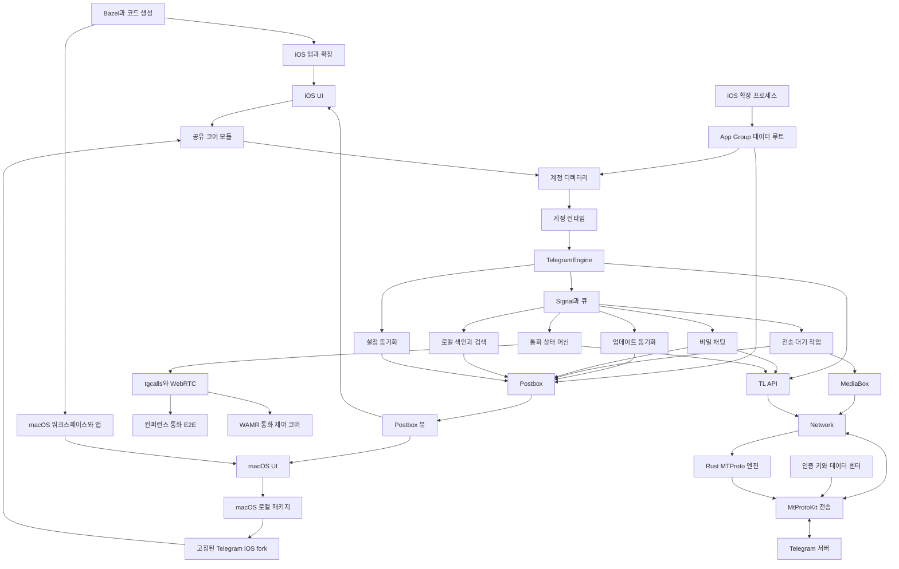
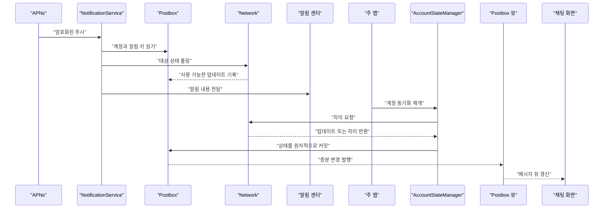
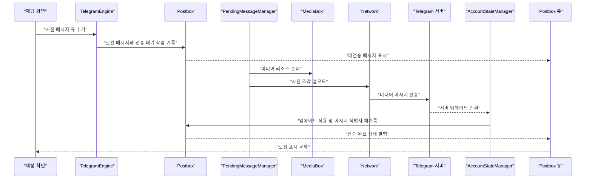

# 시스템 설계 개요

웹: /docs/system/ · Markdown: /docs/system.md

> Telegram iOS와 macOS 클라이언트의 계층, 데이터 흐름, 엔지니어링 체인, 복구 경계를 정리해요.

Telegram 클라이언트는 플랫폼 UI, 공유 도메인 코어, 전송, 저장의 네 계층으로 이루어져 있어요.

- 화면과 시스템 쪽: `TelegramUI`, iOS 확장, macOS AppKit 계층이 화면 표시와 시스템 연동을 맡아요.
- 코어, 전송, 저장 쪽: `TelegramCore`, `Postbox`, `TelegramApi`, `MtProtoKit`이 계정, 상태, 프로토콜, 네트워크를 담당해요.

계정마다 독립된 Postbox, 네트워크 객체, 백그라운드 작업을 가져요. 계정 디렉터리는 현재 계정과 계정 간 설정을 저장해요. [전체 아키텍처와 모듈 계층](/docs/system/01-architecture/) [다중 계정, 로그인, 구성 동기화](/docs/system/14-accounts-auth-config/)

Postbox(로컬 저장소 계층)는 로컬 상태를 기록하는 유일한 주체예요. 도메인 테이블, 작업 로그, 인덱스, 파생 뷰를 같은 직렬 큐의 SQLite 트랜잭션에 둬요.

기록이 커밋되면 변경이 뷰 증분(바뀐 부분만 담은 뷰 업데이트)으로 UI에 흘러가요. 네트워크와 백그라운드 작업은 UI 상태를 직접 고치지 않아요. 먼저 상태 관리자나 영속 작업에 들어간 뒤, 트랜잭션이 관찰할 수 있는 결과를 발행해요. [Postbox 스토리지 엔진](/docs/system/08-postbox-storage/) [Postbox 뷰와 메시지 이력 모델](/docs/system/09-postbox-views/)

데이터 흐름은 SwiftSignalKit의 `Signal`(구독해서 값을 받아 보는 비동기 스트림)이 중심이에요. 구독, 취소, 큐 전환, 공유 값 모두 분명한 객체가 있어요. `AccountStateManager`, 전송 관리자, 미디어 페처는 각자의 큐에서 비동기 이벤트를 모아요. 이 모델 덕분에 푸시, RPC, 디스크, UI가 비동기로 실행되는 중에도 상태 커밋은 복구할 수 있는 경계로 좁혀져요. [리액티브와 동시성 모델](/docs/system/02-reactive-concurrency/) [업데이트 동기화](/docs/system/06-update-sync/)

macOS는 `submodules/telegram-ios`의 공유 코어를 재사용해요. 이 서브모듈은 현재 체크아웃되어 있고 `a24bbe45f9861f736a79916a50898512f751e0dc`에 고정되어 있어요. `overtake/Telegram-iOS`의 fork이고, `TelegramCore`는 macOS Swift Package 형태로 데스크톱 앱에 제공돼요. [\[1\]](https://github.com/overtake/TelegramSwift/blob/579cebbf0c01fd41b712eff3647fa7f69db9665d/.gitmodules#L7-L15) [\[2\]](https://github.com/overtake/Telegram-iOS/blob/a24bbe45f9861f736a79916a50898512f751e0dc/submodules/TelegramCore/Package.swift#L6-L49)

20장에서 추가로 검증했어요. 이 고정 지점은 공통 병합 기준점과 비교해 파일 트리 내용 차이가 없지만, 이 사이트의 iOS 업스트림 고정 지점보다 앞서 있어요. 그래서 데스크톱이 공유 아키텍처를 쓴다고 해서 업스트림 이후에 추가된 모든 기능을 갖췄다는 뜻은 아니에요. [macOS fork의 출처와 차이](/docs/system/20-macos-fork/)

## 시스템 지도 [#시스템-지도]

아래 도표는 주요 하위 시스템을 하나의 상태 흐름 안에 배치해요. 실선은 호출 방향, 상태 흐름, 리소스 흐름을 뜻해요. 네트워크가 돌려준 업데이트도 결국 계정 상태 관리자와 Postbox를 거쳐 뷰 계층으로 돌아와요. 엔지니어링 체인은 검증된 생성물과 네이티브 라이브러리를 두 플랫폼의 앱 산출물로 조립해요.

이 도표에서 계정은 격리 단위예요. 한 계정의 `pts`(공개 업데이트의 순서 번호), 작업 로그, 미디어 캐시 참조, 인증 상태를 다른 계정이 공유하면 안 돼요. 계정 디렉터리, App Group, 플랫폼 확장은 또 다른 경계 집합이에요. 이 세 가지는 시작과 접근 권한을 해결할 뿐, 계정 내부의 트랜잭션과 큐 제약을 대신하지 못해요. [다중 계정, 로그인, 구성 동기화](/docs/system/14-accounts-auth-config/) [푸시, 확장 프로세스와 다중 프로세스 협업](/docs/system/12-push-extensions/)

Rust 엔진은 iOS 업스트림에서 교체할 수 있는 MTProto 데이터 평면(실제 데이터를 주고받는 부분)이에요.

- C FFI(언어 사이 함수 호출 인터페이스)로 `NetworkEngine`에 연결돼요.
- `MTContext`는 여전히 주소, 키, salt, 인증 토큰, 시간 차이를 보관해요.
- 엔진이 어떤 컨텍스트를 거부하면 코어는 `MtProtoKitEngine`으로 폴백할 수 있어요.

고정된 macOS fork에는 이 Rust와 WebProxy 경로가 없어요. [Rust MTProto 엔진](/docs/system/16-rust-mtproto-engine/) [\[3\]](https://github.com/overtake/Telegram-iOS/blob/a24bbe45f9861f736a79916a50898512f751e0dc/submodules/TelegramCore/BUILD#L3-L31) [\[4\]](https://github.com/TelegramMessenger/Telegram-iOS/blob/f1dd7a2dbd02cbbf513e75d5695d8d36d1cf5838/submodules/MTProtoRustEngine/Sources/MTProtoRustEngine/RustNetworkEngine.swift#L35-L54) [\[24\]](https://github.com/TelegramMessenger/Telegram-iOS/blob/f1dd7a2dbd02cbbf513e75d5695d8d36d1cf5838/submodules/TelegramCore/Sources/Network/Network.swift#L408-L449) [\[25\]](https://github.com/TelegramMessenger/Telegram-iOS/blob/f1dd7a2dbd02cbbf513e75d5695d8d36d1cf5838/submodules/MTProtoRustEngine/BUILD#L15-L41)

## 장 지도 [#장-지도]

### 아키텍처와 동시성 [#아키텍처와-동시성]

- [01장: 전체 아키텍처와 모듈 계층](/docs/system/01-architecture/)은 Bazel 모듈 경계, `Account` 런타임 루트, 플랫폼 프로세스 경계를 설명해요.
- [02장: 리액티브와 동시성 모델](/docs/system/02-reactive-concurrency/)은 `Signal`, `Disposable`, `Promise`와 큐 격리를 설명해요.

### 네트워크와 프로토콜 [#네트워크와-프로토콜]

- [03장: MTProto 전송 계층](/docs/system/03-mtproto-transport/)은 세션, 메시지 컨테이너, 확인 응답, 재전송, 연결 백오프를 설명해요.
- [04장: 인증 키와 다중 데이터 센터](/docs/system/04-auth-keys-datacenters/)는 영구 키, 임시 키, 인증 이전, 미디어 센터 선택을 설명해요.
- [05장: TL 직렬화와 API 호출 계층](/docs/system/05-tl-api-layer/)은 생성된 TL 타입이 `Network`와 도메인 모델에 들어오는 방식을 설명해요.
- [06장: 업데이트 동기화](/docs/system/06-update-sync/)는 `pts`, `qts`, `seq`, 공백, `getDifference`를 설명해요.
- [16장: Rust MTProto 엔진](/docs/system/16-rust-mtproto-engine/)은 Rust 데이터 평면, C FFI, Swift 래퍼, 활성화와 폴백 조건, 동시성 소유권, 오류 매핑을 설명해요.

고정된 macOS fork의 프로토콜 버전은 더 이전 거예요.

- TL layer(프로토콜 스키마 버전) 210과 `Api0`부터 `Api39`까지 40개의 생성 샤드(생성된 코드 조각)를 써요.
- 업스트림 iOS 체크아웃은 layer 230과 더 많은 샤드를 써요.
- fork의 전송 주 경로는 여전히 `MtProtoKit`이에요.

업스트림의 Rust나 WebProxy 전환을 데스크톱 fork의 기능으로 서술하면 안 돼요. [\[3\]](https://github.com/overtake/Telegram-iOS/blob/a24bbe45f9861f736a79916a50898512f751e0dc/submodules/TelegramCore/BUILD#L3-L31) [\[26\]](https://github.com/overtake/Telegram-iOS/blob/a24bbe45f9861f736a79916a50898512f751e0dc/submodules/TelegramCore/Sources/State/Serialization.swift#L211-L218) [\[27\]](https://github.com/TelegramMessenger/Telegram-iOS/blob/f1dd7a2dbd02cbbf513e75d5695d8d36d1cf5838/submodules/TelegramCore/Sources/State/Serialization.swift#L261-L264)

### 메시지 전송과 오프라인 작업 [#메시지-전송과-오프라인-작업]

- [07장: 메시지 전송 파이프라인과 오프라인 작업 큐](/docs/system/07-message-send-pipeline/)는 로컬 메시지, 업로드, RPC, 서버 확인이 어떻게 복구할 수 있는 큐를 이루는지 설명해요.

전송 파이프라인의 사전 업로드(녹화가 끝나기 전에 업로드를 시작하는 것)는 모든 녹음·녹화 경로에 공통된 특성이 아니에요. 경로마다 달라요.

- 음성 녹음: 정지한 뒤에야 완전한 로컬 리소스를 기록해요.
- 비밀 채팅이 아닌 곳의 조정되지 않은 원형 비디오: 같은 파일 식별자로 녹화하면서 업로드할 수 있어요.
- 클립 편집, 다중 세그먼트 이어 붙이기, 음성 녹음: 이 실시간 업로드 컨텍스트를 재사용하지 않아요. [\[21\]](https://github.com/TelegramMessenger/Telegram-iOS/blob/f1dd7a2dbd02cbbf513e75d5695d8d36d1cf5838/submodules/LegacyMediaPickerUI/Sources/LegacyLiveUploadInterface.swift#L45-L109)

### 저장과 검색 [#저장과-검색]

- [08장: Postbox 스토리지 엔진](/docs/system/08-postbox-storage/)은 단일 큐 트랜잭션, ValueBox, WAL(SQLite의 쓰기 선행 로그), 계정 데이터베이스 경계를 설명해요.
- [09장: Postbox 뷰와 메시지 이력 모델](/docs/system/09-postbox-views/)은 메시지 네임스페이스, hole, 증분 뷰, 부분 기록을 설명해요.
- [10장: 미디어 리소스, 다운로드/업로드, 캐시](/docs/system/10-media-cache/)는 리소스 식별자, 범위 읽기, 업로드, 캐시 축출을 설명해요.
- [19장: 검색과 로컬 인덱스](/docs/system/19-search-index/)은 FTS5 메시지 색인, peer와 메시지 검색, iOS와 macOS의 병합, 페이징, 중복 제거, 취소를 설명해요.

전문 검색 테이블은 Postbox의 FTS5(SQLite의 전문 검색 모듈) 가상 테이블이에요. peer 범위, 완전한 메시지 식별, 텍스트, 태그를 저장해요. 클라우드 검색에는 여전히 RPC가 필요해요. 비밀 채팅과 로컬에 이미 캐시된 콘텐츠는 이 색인으로 오프라인에서 검색할 수 있어요. [\[5\]](https://github.com/TelegramMessenger/Telegram-iOS/blob/f1dd7a2dbd02cbbf513e75d5695d8d36d1cf5838/submodules/Postbox/Sources/SqliteValueBox.swift#L914-L924)

기록 공백(hole, 아직 내려받지 못한 메시지 기록 구간)을 채우다 실패할 때의 경계는 이미 검증했어요.

- 첫 RPC 오류는 `maxRetries: 0` 때문에 곧바로 결과 없이 완료로 바뀌어요.
- 관리자는 대기 중인 항목을 정리하고 20초 동안 같은 hole을 억제하지만 hole 자체는 남겨요.
- 코드는 두 번째 RPC 재시도를 예약하지 않아요.
- 이후 hole 뷰가 바뀌거나, 서비스 주 인스턴스가 재구성되거나, 새 hole이 기록되어야 요청이 다시 트리거돼요. [\[18\]](https://github.com/TelegramMessenger/Telegram-iOS/blob/f1dd7a2dbd02cbbf513e75d5695d8d36d1cf5838/submodules/TelegramCore/Sources/State/Holes.swift#L966-L989)

캐시 용량은 기록하는 시점의 하드 쿼터가 아니에요. `TimeBasedCleanup`은 설정이 `MediaBox`에 들어간 뒤 10초 지연해 스캔을 한 번 실행해요.

1. 먼저 보존 기간에 따라 지워요.
2. 이어서 파일 수정 시각이 오래된 것부터 스캔된 논리 크기만큼 지워요.
3. 용량 값 아래로 내려갈 때까지 계속해요.

이 경로는 근사적인 최근 사용 축출이에요. 엄밀한 LRU(가장 오래 쓰지 않은 것부터 제거)나 LFU(가장 적게 쓴 것부터 제거)가 아니고, 활성 파일 컨텍스트를 명시적으로 보호하지도 않아요. [\[19\]](https://github.com/TelegramMessenger/Telegram-iOS/blob/f1dd7a2dbd02cbbf513e75d5695d8d36d1cf5838/submodules/Postbox/Sources/TimeBasedCleanup.swift#L367-L558)

### 보안과 프로세스 경계 [#보안과-프로세스-경계]

- [11장: 종단 간 암호화와 로컬 보안](/docs/system/11-secret-chats-security/)은 비밀 채팅의 세션 키, 메시지 암호화, PFS, 로컬 보호를 설명해요.
- [12장: 푸시, 확장 프로세스와 다중 프로세스 협업](/docs/system/12-push-extensions/)은 알림 서비스, App Group, WAL, 제한된 백그라운드 시간을 설명해요.

고정된 iOS 주 경로는 로컬 `SecretOutgoing` 작업 카운트가 100에 이르면 PFS(주기적으로 키를 바꿔 과거 대화를 보호하는 방식) 키 교체를 시작해요. 이 카운트에는 여러 종류의 로컬 발신 작업이 들어 있어요. 사용자 텍스트만 세는 게 아니에요.

이 경로에는 일주일 타이머 트리거가 없어요. 저장소 안의 TDLib에 있는 일주일 조건은 그 iOS 주 경로로 내보내지지 않은 다른 구현에 속해요. [\[20\]](https://github.com/TelegramMessenger/Telegram-iOS/blob/f1dd7a2dbd02cbbf513e75d5695d8d36d1cf5838/submodules/TelegramCore/Sources/SecretChats/SecretChatRekeySession.swift#L7-L29)

파일 리소스는 대체로 리소스 레코드에 기록된 데이터 센터를 기준으로 미리 라우팅돼요. 현재 고정 커밋에는 `FILE_MIGRATE_X`에 대한 범용 최후 대비책(폴백)이 없어요. 다운로드와 업로드 모두 이 RPC 오류에서 다음을 하지 않아요.

- 새 데이터 센터를 꺼내지 않아요.
- 인증을 이전하지 않아요.
- 새 데이터 센터에서 조각을 재전송하지 않아요.

CDN 리다이렉트는 다른 성공 응답 경로에 속해요. [\[17\]](https://github.com/TelegramMessenger/Telegram-iOS/blob/f1dd7a2dbd02cbbf513e75d5695d8d36d1cf5838/submodules/TelegramCore/Sources/Network/FetchV2.swift#L871-L1100)

### 통화 [#통화]

- [13장: 통화 시스템](/docs/system/13-calls/)은 1:1 통화 제어 평면, 그룹 통화 상태, DH 협상, 플랫폼 연동을 설명해요.
- [17장: tgcalls 통화 미디어 엔진](/docs/system/17-tgcalls-media-engine/)은 인스턴스 등록, 3스레드 모델, 시그널링, ICE, 오디오 장치, 비디오 협상, 그룹 통화 미디어 경로를 설명해요.
- [18장: 컨퍼런스 통화의 종단 간 암호화](/docs/system/18-conference-e2e/)는 구성원 상태 체인, 키 교체, 이모지 검증, 미디어 프레임 암호화를 설명해요.
- [29장: 통화 모듈의 WebAssembly 런타임](/docs/system/29-wamr-in-calls/)은 iOS WAMR 제어 코어의 빌드, ABI, 샌드박스, 리소스 경계를 설명해요.

통화의 제어 평면과 미디어 평면은 분리되어 있어요.

- `CallSessionManager`: 전화 상태, DH(키 협상), 시그널링을 보관해요.
- `tgcalls`: 협상이 끝난 키, 후보, 장치 객체를 받아 네트워크 및 미디어 스레드에서 전송을 구동해요.
- 컨퍼런스 통화의 종단 간 상태: 다시 TDLib 어댑터가 구성원, 블록, 검증, 프레임 암·복호화 능력을 가지고 있어요. [\[6\]](https://github.com/TelegramMessenger/tgcalls/blob/a024eaabf13c189d9577a14fb244bd242825ac96/tgcalls/Instance.h#L60-L289) [\[7\]](https://github.com/TelegramMessenger/Telegram-iOS/blob/f1dd7a2dbd02cbbf513e75d5695d8d36d1cf5838/submodules/TgVoipWebrtc/BUILD#L239-L305)

1:1 통화의 `keyVisualHash`는 이모지 4개로 검증해요. 클라이언트는 이렇게 계산해요.

1. 32바이트 값을 연속된 8바이트 구간 네 개로 나눠요.
2. 나눈 구간들에 대해 고정된 333항목 표에 대한 나머지를 취해요.

iOS와 macOS 고정 커밋은 같은 표 항목 순서, 분할 순서, 인덱스 공식을 써요. [\[22\]](https://github.com/TelegramMessenger/Telegram-iOS/blob/f1dd7a2dbd02cbbf513e75d5695d8d36d1cf5838/submodules/TelegramCallsUI/CallsEmoji/Sources/CallsEmoji.m#L6-L53) [\[28\]](https://github.com/overtake/TelegramSwift/blob/579cebbf0c01fd41b712eff3647fa7f69db9665d/packages/ObjcUtils/Sources/ObjcUtils/ObjcUtils.m#L650-L700)

고정된 macOS `tgcalls` 서브모듈은 체크아웃되어 있어요. 더 이전의 네이티브 구현 레지스트리를 써요. iOS의 현재 WAMR(WebAssembly Micro Runtime) 백엔드와 `18.0.0`, `19.0.0` 버전 선택 경로는 없어요.

iOS 프로덕션 빌드는 참조 통화 코어를 wasm으로 컴파일한 뒤 C++ 바이트 배열로 변환해 내장해요. WAMR은 인터프리터와 고속 인터프리터만 켜요. [\[7\]](https://github.com/TelegramMessenger/Telegram-iOS/blob/f1dd7a2dbd02cbbf513e75d5695d8d36d1cf5838/submodules/TgVoipWebrtc/BUILD#L239-L305) [\[29\]](https://github.com/TelegramMessenger/Telegram-iOS/blob/f1dd7a2dbd02cbbf513e75d5695d8d36d1cf5838/third-party/wamr/BUILD#L1-L77)

### 계정과 플랫폼 [#계정과-플랫폼]

- [14장: 다중 계정, 로그인, 구성 동기화](/docs/system/14-accounts-auth-config/)는 계정 디렉터리, 로그인 상태, 설정 폴링, 계정 전환을 설명해요.
- [15장: macOS 클라이언트의 시스템 계층](/docs/system/15-macos-system-layer/)은 AppKit, 알림, 화면 잠금, 업데이터, 데스크톱 런타임을 설명해요.
- [20장: macOS fork의 출처와 차이](/docs/system/20-macos-fork/)는 fork의 공통 기준점, 내용 차이 0, 업스트림 진화, 로컬 빌드 소비 관계를 설명해요.

계정 로그아웃은 이런 순서로 진행돼요.

1. 먼저 레코드에 `loggedOut` 표시를 기록해요.
2. 이어서 정리기가 원격 `auth.logOut`을 시도해요.
3. 이 요청이 실패해도 디렉터리 레코드를 지우고, 그 레코드에 해당하는 계정 루트 디렉터리 전체를 비동기로 지워요.

이 흐름은 로그아웃한 계정의 APS(Apple 푸시 서비스)나 VoIP 토큰을 명시적으로 등록 해제하지 않아요. Widget 설정도 여기서 지우지 않아요. [다중 계정, 로그인, 구성 동기화](/docs/system/14-accounts-auth-config/)

macOS의 알림과 Dock 배지는 이렇게 동작해요.

- 새 알림 API: 답장 동작만 등록해요. 답장은 페이로드에서 `accountId`를 얻어 올바른 계정의 로컬 전송 대기 큐에 메시지를 기록해요.
- 구 알림 API: 알림 닫기 읽음 경로는 알림이 담고 있는 계정 신원이 아니라 현재 주 UI 계정을 써요.
- Dock 배지: 기본적으로 현재 계정, 루트 채팅 그룹, 필터 카운트로 계산해서 음소거된 대화와 보관된 대화는 빠져요. [\[23\]](https://github.com/overtake/TelegramSwift/blob/579cebbf0c01fd41b712eff3647fa7f69db9665d/Telegram-Mac/UNUserNotifications.swift#L86-L285)

### 엔지니어링 [#엔지니어링]

- [21장: iOS 빌드 시스템: Bazel과 Make.py](/docs/system/21-ios-bazel-build/)는 설정 주입, Bazel, 서명, 확장 패키징, Xcode 프로젝트 생성, 캐시를 설명해요.
- [22장: 코드 생성: TL, 문자열, 직렬화](/docs/system/22-codegen/)는 SwiftTL, `PresentationStrings`, FlatBuffers, 생성물 커밋 정책을 설명해요.
- [23장: macOS 빌드, 패키징, 배포](/docs/system/23-macos-build-distribution/)는 Xcode 워크스페이스, Swift Package, 네이티브 라이브러리, 서명, 확장, 업데이트 채널을 설명해요.
- [30장: 서드파티 의존성 목록과 드문 용도](/docs/system/30-third-party-inventory/)는 iOS와 macOS의 의존성, 호출 엣지, 서브모듈, fork, 패치 경계를 감사해요.

빌드와 코드 생성은 이렇게 나뉘어요.

- `Make.py`: iOS 빌드 오케스트레이션의 진입점이에요.
- Bazel(빌드 시스템) 파일: 의존성, 리소스, 서명 입력, 산출물 경계를 기술해요.
- 코드 생성: 적어도 클라우드 TL, 문자열, FlatBuffers의 세 체인으로 나뉘어요. 이들은 입력과 커밋 정책이 달라서 같은 종류의 스키마 업데이트로 취급하면 안 돼요. [\[8\]](https://github.com/TelegramMessenger/Telegram-iOS/blob/f1dd7a2dbd02cbbf513e75d5695d8d36d1cf5838/build-system/Make/Make.py#L279-L442) [\[9\]](https://github.com/TelegramMessenger/Telegram-iOS/blob/f1dd7a2dbd02cbbf513e75d5695d8d36d1cf5838/build-system/SwiftTL/Sources/SwiftTL/main.swift#L23-L107)

TelegramSwift(macOS 클라이언트)는 Xcode 워크스페이스로 `Telegram.app`을 조립해요. 로컬 Swift 패키지와 네이티브 라이브러리가 다시 고정 fork의 `TelegramCore`, `Postbox`, `TelegramApi`, 미디어 컴포넌트에 링크돼요. 워크스페이스에는 Sparkle 같은 하위 프로젝트가 있지만, 고정된 연구용 체크아웃에서는 일부 서브모듈이 체크아웃되지 않았어요. 그래서 내부 구현과 실제 아카이브 결과는 따로 검증해야 해요. [\[10\]](https://github.com/overtake/TelegramSwift/blob/579cebbf0c01fd41b712eff3647fa7f69db9665d/Telegram-Mac.xcworkspace/contents.xcworkspacedata#L1-L16)

서드파티 디렉터리는 런타임 호출의 증거가 아니에요. Bazel 또는 Xcode 의존성 엣지(의존성 그래프에서 모듈을 잇는 연결)와 실제 import를 함께 대조해야 해요. 고정된 iOS 트리에서는 이렇게 쓰여요.

- `libprisma`: 코드 하이라이트
- `SwiftMath`: 인스턴트 페이지의 수식
- `rnnoise`: 그룹 오디오 처리
- WAMR: 통화 제어 코어

`Swift2D`와 `XMLCoder`는 이 고정 트리에 제품 소비자 엣지가 없어요. [\[16\]](https://github.com/TelegramMessenger/Telegram-iOS/blob/f1dd7a2dbd02cbbf513e75d5695d8d36d1cf5838/submodules/TextFormat/BUILD#L5-L26)

### 비즈니스 시스템 [#비즈니스-시스템]

- [24장: Stars, 선물, 결제](/docs/system/24-stars-payments/)는 Stars 잔액, 구독, 선물, 봇 결제, StoreKit 영수증, 캐시 갱신을 설명해요.
- [25장: Mini Apps와 봇 Web 뷰](/docs/system/25-mini-apps/)는 WebView URL, JavaScript 브리지, 테마, 권한, 저장소, 브라우저 경계를 설명해요.
- [26장: Stories의 데이터와 미디어 파이프라인](/docs/system/26-stories/)은 전용 레코드, 읽음 상한, 구독 페이징, 게시, 프리로드, 만료를 설명해요.
- [27장: 메시지 번역](/docs/system/27-translation/)은 번역 제공자, 언어 감지, 메시지 속성 캐시, 자동 번역, 권한을 설명해요.
- [28장: 지갑 모듈: TON 엔진, 백업, 플랫폼 경계](/docs/system/28-wallet/)는 지갑 빌드 체인, TON 엔진, 복구 문구 백업, macOS 기능 부재를 설명해요.

Stars 화면은 서버 권위 상태, 클라이언트 낙관적 상태(서버 확인 전에 먼저 반영하는 상태), 기기 캐시를 구분해요. `StarsContext`는 계정 상태 스트림 하나로 잔액, 거래, 구독을 모으고, 60초 정기 갱신 억제와 실패 후 재시도로 데이터를 수렴시켜요. [\[11\]](https://github.com/TelegramMessenger/Telegram-iOS/blob/f1dd7a2dbd02cbbf513e75d5695d8d36d1cf5838/submodules/TelegramCore/Sources/TelegramEngine/Payments/Stars.swift#L557-L662)

Mini App(봇이 여는 웹 앱)은 이렇게 동작해요.

- URL은 봇 WebView RPC가 반환해요.
- 웹 페이지는 이벤트 이름과 JSON 데이터로만 네이티브 기능을 요청할 수 있어요.
- 네이티브 컨트롤러가 항목마다 실행할지 정해요.
- 일반 WebView 세션은 60초 keepalive 요청으로 서버 쿼리 상태도 유지해요. [\[12\]](https://github.com/TelegramMessenger/Telegram-iOS/blob/f1dd7a2dbd02cbbf513e75d5695d8d36d1cf5838/submodules/TelegramCore/Sources/TelegramEngine/Messages/BotWebView.swift#L166-L252)

Stories는 독립된 `StoryId`, 항목 테이블, peer별 목록, 읽음 상한, 구독 구성원, 만료 투영을 써요. 일반 메시지 기록을 재사용하지 않아요. 번역은 대상 언어 번역문을 `TranslationMessageAttribute`에 기록해요. 그래서 렌더링 계층은 서버와 로컬 제공자를 구분하지 않고 영속화된 결과를 재사용할 수 있어요. [\[13\]](https://github.com/TelegramMessenger/Telegram-iOS/blob/f1dd7a2dbd02cbbf513e75d5695d8d36d1cf5838/submodules/TelegramCore/Sources/TelegramEngine/Messages/Stories.swift#L614-L804) [\[14\]](https://github.com/TelegramMessenger/Telegram-iOS/blob/f1dd7a2dbd02cbbf513e75d5695d8d36d1cf5838/submodules/TelegramCore/Sources/TelegramEngine/Messages/Translate.swift#L283-L479)

iOS 주 앱은 `WalletContext`, `WalletEngineFFI`, `WalletBackupCrypto`, Rust `wallet-engine`을 컴파일하고 링크해요. 원격 `wallet_available`이 여전히 진입을 제어해요. 고정된 macOS fork에는 이 Rust 지갑 컴파일 클로저(컴파일에 포함되는 모듈 집합)가 없어요. 그러니 이를 근거로 데스크톱이 복구 문구, 서명 전송, TON Connect를 지원한다고 추론할 수 없어요. [\[15\]](https://github.com/TelegramMessenger/Telegram-iOS/blob/f1dd7a2dbd02cbbf513e75d5695d8d36d1cf5838/submodules/WalletContext/BUILD#L1-L24) [\[30\]](https://github.com/overtake/TelegramSwift/blob/579cebbf0c01fd41b712eff3647fa7f69db9665d/Telegram.xcodeproj/project.pbxproj#L6985-L7030)

## 엔드투엔드 경로 [#엔드투엔드-경로]

### 백그라운드에서 새 메시지를 받음 [#백그라운드에서-새-메시지를-받음]

푸시는 메시지 데이터베이스의 권위 있는 사본이 아니에요. 알림 서비스는 짧은 시간 제한 안에서 페이로드를 검증하고, 필요하면 상태를 가져오거나 읽어요. 주 앱이 실행 기회를 얻으면 여전히 정상적인 업데이트 동기화로 연속 상태를 확인해요. 이렇게 해서 알림 표시, 백그라운드 처리, 포그라운드 채팅 뷰가 모두 같은 Postbox 사실 소스로 돌아와요.

1. APNs가 `NotificationService`를 깨워요. 확장은 App Group에서 임시 계정 관리자를 열고, 계정 전용 알림 비밀로 암호화된 페이로드를 검증해요. [푸시, 확장 프로세스와 다중 프로세스 협업](/docs/system/12-push-extensions/)
2. 확장은 peer 유형에 따라 채널 폴링 또는 차이 폴링을 한 번 수행해요. 기한 안에 알림에 필요한 메시지와 미디어만 가져와요. 시간이 초과되면 작업을 해제하고 이미 있는 내용으로 폴백해요. [푸시, 확장 프로세스와 다중 프로세스 협업](/docs/system/12-push-extensions/)
3. 확장이 기록한 상태는 공유 Postbox로 들어가요. SQLite WAL은 통제된 읽기·쓰기 공존을 허용하지만, 쓰기 가능한 트랜잭션은 여전히 단일 기록자 제약을 받아요. [Postbox 스토리지 엔진](/docs/system/08-postbox-storage/) [푸시, 확장 프로세스와 다중 프로세스 협업](/docs/system/12-push-extensions/)
4. 주 앱이 재개되면 `AccountStateManager`가 정상적인 업데이트 흐름을 이어 가요. 푸시, RPC 업데이트, 차이 결과를 같은 작업 큐에 넣고, 어떤 푸시가 완전한 연속 기록을 담고 있다고 믿지 않아요. [업데이트 동기화](/docs/system/06-update-sync/)
5. 관리자는 연속된 `pts`, `qts`, `seq`, `date`의 접두 구간만 커밋해요. 공백이 생기면 `getDifference`를 요청하고, 반복할 수 있는 트랜잭션으로 새 상태와 메시지를 Postbox에 기록해요. [업데이트 동기화](/docs/system/06-update-sync/)
6. `ViewTracker`는 커밋된 메시지 테이블과 인덱스로 증분 뷰를 계산해요. 채팅 화면이 이 뷰를 구독하기 때문에 영향받은 기록 창과 읽지 않음 정보만 갱신해요. [Postbox 뷰와 메시지 이력 모델](/docs/system/09-postbox-views/)

### 사용자가 사진을 보냄 [#사용자가-사진을-보냄]

전송 경로는 사용자 의도를 먼저 커밋하고 업로드와 RPC는 나중에 해요. 덕분에 UI는 로컬 메시지를 즉시 보여 줄 수 있어요. 업로드 도중 프로세스가 종료되어도 전송 대기 레코드는 데이터베이스에 남아요. 다시 시작한 관리자는 커밋된 작업에서 이어 갈 수 있어요. UI 상태에서 사용자가 무엇을 보내려 했는지 다시 추론할 필요가 없어요.

1. UI가 Engine으로 메시지를 큐에 넣어요. 코어는 메시지에 로컬 신원과 전송 난수를 만들고, `Unsent` 플래그가 붙은 메시지를 Postbox에 기록해요. [메시지 전송 파이프라인과 오프라인 작업 큐](/docs/system/07-message-send-pipeline/)
2. 같은 트랜잭션에서 전송 대기 작업을 기록해요. 그래서 UI는 메시지 기록 뷰에서 사진 자리 표시와 전송 상태를 즉시 보여 줄 수 있어요. 이 표시는 서버가 이미 메시지를 수락했다는 뜻이 아니에요. [메시지 전송 파이프라인과 오프라인 작업 큐](/docs/system/07-message-send-pipeline/) [Postbox 뷰와 메시지 이력 모델](/docs/system/09-postbox-views/)
3. `PendingMessageManager`가 작업을 관찰하고 콘텐츠 처리를 예약해요. 사진 리소스는 MediaBox가 추적하고, 업로더는 리소스 크기와 유형에 따라 조각 크기와 동시성을 골라요. [메시지 전송 파이프라인과 오프라인 작업 큐](/docs/system/07-message-send-pipeline/) [미디어 리소스, 다운로드/업로드, 캐시](/docs/system/10-media-cache/)
4. 업로드가 끝나면 코어가 생성된 TL 함수로 미디어 RPC를 보내요. `Network`는 요청 스케줄링을 맡고, MTProto는 세션, 확인 응답, 재전송, 데이터 센터 전송을 맡아요. [TL 직렬화와 API 호출 계층](/docs/system/05-tl-api-layer/) [MTProto 전송 계층](/docs/system/03-mtproto-transport/)
5. 서버 결과가 UI 객체를 직접 고쳐 쓰지는 않아요. 업데이트 처리가 로컬 메시지 식별자를 서버 메시지 식별자로 매핑하고, 다른 업데이트와 함께 Postbox 트랜잭션에서 적용해요. [메시지 전송 파이프라인과 오프라인 작업 큐](/docs/system/07-message-send-pipeline/) [업데이트 동기화](/docs/system/06-update-sync/)
6. 커밋 후의 기록 뷰가 로컬 레코드를 전송 완료된 메시지로 바꿔요. 네트워크가 실패해도 영속화된 작업이 재시도 의미를 유지해서, UI는 여전히 실패 또는 전송 대기 상태를 표시할 수 있어요. [Postbox 뷰와 메시지 이력 모델](/docs/system/09-postbox-views/) [리액티브와 동시성 모델](/docs/system/02-reactive-concurrency/)

## 장을 가로지르는 설계 원칙 [#장을-가로지르는-설계-원칙]

### 로컬 의도가 원격 확인보다 먼저 [#로컬-의도가-원격-확인보다-먼저]

Telegram은 복구할 수 있는 의도를 먼저 로컬에 기록한 뒤, 백그라운드 관리자가 네트워크 부수 효과를 실행하게 해요. 이 규칙을 따르는 곳은 이래요.

- 일반 메시지의 `Unsent` 레코드와 peer 작업 로그
- 비밀 채팅의 핸드셰이크, 암호화된 수신, 발신 서비스 동작: 독립된 작업 로그를 써요.
- 로그인 흐름: 인증 코드, 비밀번호, 가입 단계를 미인증 계정 상태로 저장해요.
- Stories의 게시 대기 항목과 지갑의 제출 대기 이체: 같은 선행 영속화 경계를 따라요.

이 선택은 크래시 복구를 UI 문제에서 저장 문제로 바꿔요. [메시지 전송 파이프라인과 오프라인 작업 큐](/docs/system/07-message-send-pipeline/) [종단 간 암호화와 로컬 보안](/docs/system/11-secret-chats-security/) [다중 계정, 로그인, 구성 동기화](/docs/system/14-accounts-auth-config/) [Stories의 데이터와 미디어 파이프라인](/docs/system/26-stories/) [지갑 모듈: TON 엔진, 백업, 플랫폼 경계](/docs/system/28-wallet/)

### 큐 격리와 단일 커밋 지점 [#큐-격리와-단일-커밋-지점]

비동기라고 해서 아무 스레드나 공유 상태를 고칠 수 있는 건 아니에요. 각 계층이 이렇게 지켜요.

- SwiftSignalKit: `Disposable`로 더 필요 없는 작업을 멈추고, `Queue`로 상태 객체에 대한 접근을 제한해요.
- Postbox: 자신의 직렬 큐에서 트랜잭션을 실행해요.
- `AccountStateManager`: 업데이트를 단일 처리 시퀀스에 편입해요.
- 확장 프로세스: 주 앱 메모리를 공유하지 않고 WAL과 짧은 트랜잭션에 기대요.

이 경계들이 재진입, 부분 커밋, 프로세스 간 쓰기 경합을 줄여요. [리액티브와 동시성 모델](/docs/system/02-reactive-concurrency/) [Postbox 스토리지 엔진](/docs/system/08-postbox-storage/) [푸시, 확장 프로세스와 다중 프로세스 협업](/docs/system/12-push-extensions/)

### 증분 투영으로 UI를 구동 [#증분-투영으로-ui를-구동]

메시지 테이블은 UI가 직접 스캔하는 원시 파일이 아니에요. Postbox는 채팅 목록, 읽지 않음 수, 기록 창, hole 인덱스 같은 뷰를 유지해요. 트랜잭션이 커밋되면 영향받은 부분을 구독자에게 밀어 줘요. 기록이 불완전하면 hole 뷰가 공백(hole) 채우기 네트워크 요청을 구동해요. Widget은 공유 데이터베이스를 오래 점유하지 않고 원자적 스냅샷을 받아요. 이 설계는 큰 기록과 많은 소비자의 갱신 비용을 낮추고, 소비자 유형마다 시의성 경계도 분명히 해요. [Postbox 뷰와 메시지 이력 모델](/docs/system/09-postbox-views/) [푸시, 확장 프로세스와 다중 프로세스 협업](/docs/system/12-push-extensions/)

Stories, 검색, 번역은 같은 원칙을 메시지 주 테이블 밖으로 넓혀요. Stories는 개별 항목, 목록, 읽음 상한, 구독 상태를 국소 투영으로 나눠요. 검색은 FTS 적중과 원격 결과를 신원에 따라 병합해요. 번역은 결과를 메시지 속성으로 저장하고, 표시할지는 현재 채팅의 번역 상태가 정해요. [Stories의 데이터와 미디어 파이프라인](/docs/system/26-stories/) [검색과 로컬 인덱스](/docs/system/19-search-index/) [메시지 번역](/docs/system/27-translation/)

### 네임스페이스와 단계를 가진 신원 [#네임스페이스와-단계를-가진-신원]

로컬 메시지 신원, 전송 난수, 서버 메시지 신원은 같은 값이 아니에요.

- `PeerId`, `MessageId`, `MessageIndex`: 네임스페이스와 정렬 필드로 출처와 위치를 표현해요.
- 공개 업데이트의 `pts`, 비밀 채팅의 `qts`, 바깥쪽 `seq`: 각자 서로 다른 연속성을 지켜요.
- 통화: 서버의 안정적인 ID와 로컬 UUID를 또 분리해요.

신원과 단계를 명시적으로 구분하면 재생, 순서 뒤바뀜, 멀티 디바이스 도착에 판단할 수 있는 의미를 줄 수 있어요. [Postbox 뷰와 메시지 이력 모델](/docs/system/09-postbox-views/) [메시지 전송 파이프라인과 오프라인 작업 큐](/docs/system/07-message-send-pipeline/) [업데이트 동기화](/docs/system/06-update-sync/) [통화 시스템](/docs/system/13-calls/)

### 체크포인트와 재생이 필요한 최종 일관성 [#체크포인트와-재생이-필요한-최종-일관성]

클라이언트는 푸시, 연결, 단발 RPC가 항상 완전하다고 가정하지 않아요. 계층마다 이렇게 대비해요.

- 업데이트 동기화: `getDifference`로 공백을 메워요.
- 전송 계층: 세션, 확인 응답, 재전송, 시간, salt를 유지해요.
- 설정과 순서 있는 집합: hash로 변화 없는 기록을 피하고, 주기적 갱신으로 누락된 이벤트를 처리해요.
- 미디어 리소스: 이미 받은 바이트 구간을 기록한 뒤 필요할 때 이어 받아요.

이들이 공유하는 원칙은 확인된 체크포인트를 저장하고 그 지점에서 복구하는 거예요. 마지막 콜백 결과만 남기는 게 아니에요. [업데이트 동기화](/docs/system/06-update-sync/) [MTProto 전송 계층](/docs/system/03-mtproto-transport/) [다중 계정, 로그인, 구성 동기화](/docs/system/14-accounts-auth-config/) [미디어 리소스, 다운로드/업로드, 캐시](/docs/system/10-media-cache/)

### 보안, 리소스, 시스템 권한의 계층화 [#보안-리소스-시스템-권한의-계층화]

데이터 센터 인증 키, 알림 암호화 비밀, 비밀 채팅 세션 키, 통화 키, 지갑 복구 문구는 서로 다른 계층에 있어요. SQLCipher(암호화된 SQLite), 논리 키체인, Keychain 자격 증명, AppLock도 같은 종류의 보호가 아니에요. 책임은 이렇게 나뉘어요.

- 미디어 캐시: 리소스 신원과 범위로 파일을 구성해요.
- 알림 서비스: 기한과 취소로 백그라운드 리소스를 통제해요.
- 통화: 제어 평면의 키 협상과 WebRTC 미디어 평면을 분리해요.
- Mini App: 이벤트 브리지로 웹 페이지가 계정과 시스템 기능에 접근하는 것을 제한해요.

이런 책임을 하나의 만능 보안 모듈이나 캐시 모듈로 뭉치면 각자의 교체, 무효화, 감사 조건이 가려져요. [인증 키와 다중 데이터 센터](/docs/system/04-auth-keys-datacenters/) [종단 간 암호화와 로컬 보안](/docs/system/11-secret-chats-security/) [미디어 리소스, 다운로드/업로드, 캐시](/docs/system/10-media-cache/) [통화 시스템](/docs/system/13-calls/) [Mini Apps와 봇 Web 뷰](/docs/system/25-mini-apps/) [지갑 모듈: TON 엔진, 백업, 플랫폼 경계](/docs/system/28-wallet/)

### 생성 계층과 도메인 계층의 격리 [#생성-계층과-도메인-계층의-격리]

TL 스키마(Telegram 프로토콜의 타입 정의)의 바이너리 세부 사항은 `TelegramApi`에 격리되어 있어요. 생성된 함수와 생성자가 직렬화, 응답 역직렬화, layer 호환을 맡아요. `Network`와 `NetworkEngine`은 이 타입들을 통합 요청 채널에 넣어요. 더 위 계층에서는 API 사용자, 메시지, 그룹 객체를 Postbox와 Engine 모델로 변환해요. UI는 TL 바이트를 조립할 필요가 없고, 특정 RPC의 생성자 이름에 직접 기대서도 안 돼요. [TL 직렬화와 API 호출 계층](/docs/system/05-tl-api-layer/)

이 경계는 오류 처리에도 똑같이 적용돼요. 전송 실패, RPC 오류, 마이그레이션, 재시도는 네트워크와 코어 계층에서 먼저 분류해요. 이후 도메인 작업이 로그를 남길지, 요청을 재구성할지, 완전한 차이 동기화를 요구할지 정해요. 예를 들면 이래요.

- 메시지 전송: 업로드, 요청, 업데이트 적용이 각각 책임을 가져요.
- 통화: 제어 평면이 키와 버전을 먼저 검증한 뒤 미디어 엔진에 넘겨요.

모듈 사이에 전달되는 건 마음대로 해석할 수 있는 바이트 스트림이 아니라, 소유자가 분명한 도메인 상태예요. [메시지 전송 파이프라인과 오프라인 작업 큐](/docs/system/07-message-send-pipeline/) [통화 시스템](/docs/system/13-calls/)

### 제한된 백그라운드 시간과 취소할 수 있는 작업 [#제한된-백그라운드-시간과-취소할-수-있는-작업]

백그라운드 작업에는 명확한 리소스 예산이 있어요.

- 알림 서비스: 연결, 폴링, 첨부 가져오기에 기한을 둬요. 기한이 되면 현재 처리기를 dispose하고, 이미 있는 내용이나 시스템 원본 내용을 전달해요.
- 주 앱의 `SharedWakeupManager`: 작업이 있는 계정에 대해서만 백그라운드 시간과 필요한 연결을 확보해요. 또 이미 시작된 트랜잭션이 끝나기를 기다린 뒤 백그라운드 작업을 종료해요. [푸시, 확장 프로세스와 다중 프로세스 협업](/docs/system/12-push-extensions/)

이런 구성에서는 모든 비동기 연산을 취소할 수 있어야 해요.

- `Signal` 구독과 `Disposable`: 상위 계층이 만료된 네트워크, 타이머, 미디어 작업을 멈출 수 있어요.
- `QueueLocalObject`: 큐에 묶인 객체가 해제될 때 내부 리소스를 멈추게 해요.
- 미디어 다운로드: 바이트 범위, 우선순위, 계속 조건을 분리해서 저장해요.
- 통화 미디어와 메시지 캐시: 각자 생명 주기를 가지고, UI의 생존 시간을 빌려 쓰지 않아요. [리액티브와 동시성 모델](/docs/system/02-reactive-concurrency/) [미디어 리소스, 다운로드/업로드, 캐시](/docs/system/10-media-cache/) [통화 시스템](/docs/system/13-calls/)

## 읽기 안내 [#읽기-안내]

- **오프라인 우선 채팅 앱을 만들려면** 먼저 [메시지 전송 파이프라인과 오프라인 작업 큐](/docs/system/07-message-send-pipeline/), [업데이트 동기화](/docs/system/06-update-sync/), [Postbox 스토리지 엔진](/docs/system/08-postbox-storage/)을 읽어요. 이어서 [Postbox 뷰와 메시지 이력 모델](/docs/system/09-postbox-views/)을 읽고, 커밋 증분이 UI에 도달하게 하는 방법을 파악해요.
- **자체 네트워크 스택을 구현하려면** [MTProto 전송 계층](/docs/system/03-mtproto-transport/)부터 시작해요. 그다음 [인증 키와 다중 데이터 센터](/docs/system/04-auth-keys-datacenters/)와 [TL 직렬화와 API 호출 계층](/docs/system/05-tl-api-layer/)을 읽고, 연결, 인증, 요청 구성을 분리해서 설계해요. 새 데이터 평면과 옛 데이터 평면을 비교해야 할 때는 [Rust MTProto 엔진](/docs/system/16-rust-mtproto-engine/)을 읽어요.
- **미디어 캐시와 백그라운드 전송을 설계하려면** [미디어 리소스, 다운로드/업로드, 캐시](/docs/system/10-media-cache/)를 읽어요. 아울러 [Postbox 스토리지 엔진](/docs/system/08-postbox-storage/)과 [푸시, 확장 프로세스와 다중 프로세스 협업](/docs/system/12-push-extensions/)을 보고, 리소스 범위, 트랜잭션, 시스템 기한의 경계를 분명히 해요.
- **로컬 검색이나 번역을 구현하려면** 먼저 [검색과 로컬 인덱스](/docs/system/19-search-index/)과 [메시지 번역](/docs/system/27-translation/)을 읽어요. 검색 장은 FTS, 원격 보완, 취소를 설명해요. 번역 장은 언어 감지, 결과 캐시, 권한 게이트를 설명해요.
- **다중 계정과 제한된 시스템 진입점을 지원하려면** [다중 계정, 로그인, 구성 동기화](/docs/system/14-accounts-auth-config/)부터 읽어요. 그다음 [푸시, 확장 프로세스와 다중 프로세스 협업](/docs/system/12-push-extensions/)과 [전체 아키텍처와 모듈 계층](/docs/system/01-architecture/)을 읽고, 디렉터리, 계정, 프로세스 경계를 구분해요.
- **실시간 통화나 종단 간 세션을 구현하려면** [통화 시스템](/docs/system/13-calls/)과 [종단 간 암호화와 로컬 보안](/docs/system/11-secret-chats-security/)을 함께 읽어요. 통화 시스템 장은 제어 평면과 미디어 평면을 설명해요. 종단 간 암호화 장은 영속화된 키 상태, 순서, 로컬 보호를 설명해요. 회의 시나리오에서는 [컨퍼런스 통화의 종단 간 암호화](/docs/system/18-conference-e2e/)와 [통화 모듈의 WebAssembly 런타임](/docs/system/29-wamr-in-calls/)을 더 읽어요.
- **제품 기능을 연동하려면** [Stars, 선물, 결제](/docs/system/24-stars-payments/), [Mini Apps와 봇 Web 뷰](/docs/system/25-mini-apps/), [Stories의 데이터와 미디어 파이프라인](/docs/system/26-stories/)부터 시작해요. 지갑 구현과 플랫폼 부재 경계는 [지갑 모듈: TON 엔진, 백업, 플랫폼 경계](/docs/system/28-wallet/)를 봐요.
- **빌드 산출물을 재현하거나 감사하려면** [iOS 빌드 시스템: Bazel과 Make.py](/docs/system/21-ios-bazel-build/), [코드 생성: TL, 문자열, 직렬화](/docs/system/22-codegen/), [macOS 빌드, 패키징, 배포](/docs/system/23-macos-build-distribution/), [서드파티 의존성 목록과 드문 용도](/docs/system/30-third-party-inventory/)를 조합해서 읽어요.

## 장 지도 [#chapter-map]

**기초와 동시성**

- [01 전체 아키텍처와 모듈 계층](/docs/system/01-architecture/): Bazel 의존성, 계정 경계, 프로세스 경계로 Telegram 클라이언트 아키텍처를 읽어요.
- [02 반응형과 동시성 모델](/docs/system/02-reactive-concurrency/): Telegram은 Signal, 명시적 취소, 큐 격리로 비동기 상태를 구성해요.

**네트워크와 프로토콜**

- [03 MTProto 전송 계층](/docs/system/03-mtproto-transport/): MtProtoKit이 세션을 유지하고, TCP 트래픽을 라우팅하며, 장애를 처리하는 방식.
- [04 인증 키와 다중 데이터 센터](/docs/system/04-auth-keys-datacenters/): Telegram 클라이언트가 인증 키를 만들고, 저장하고, 여러 데이터 센터에 걸쳐 쓰는 방식
- [05 TL 직렬화와 API 호출 계층](/docs/system/05-tl-api-layer/): Telegram 클라이언트에서 TL 함수부터 도메인 모델까지의 호출 경계를 추적해요
- [16 Rust MTProto 엔진](/docs/system/16-rust-mtproto-engine/): Rust MTProto 데이터 평면이 C FFI를 거쳐 TelegramCore에 연결되는 방식과, MtProtoKit과 공존하는 경계.

**동기화와 메시지**

- [06 업데이트 동기화: pts, qts, seq, getDifference](/docs/system/06-update-sync/): Telegram 클라이언트가 업데이트 공백을 감지하고 로컬 상태를 원자적으로 복구하는 방식
- [07 메시지 전송 파이프라인과 오프라인 작업 큐](/docs/system/07-message-send-pipeline/): Telegram이 로컬 의도를 복구할 수 있는 메시지와 백그라운드 작업으로 영속화하는 방식

**저장과 검색**

- [08 Postbox 저장 엔진](/docs/system/08-postbox-storage/): Telegram 클라이언트가 단일 큐 트랜잭션, 바이너리 키-값 테이블, SQLCipher로 로컬 상태 저장소를 구축하는 방식.
- [09 Postbox 뷰와 메시지 기록 모델](/docs/system/09-postbox-views/): Telegram이 듬성듬성한 메시지 기록을 색인하고 UI를 증분 방식으로 구동하는 방법을 설명해요
- [10 미디어 리소스, 다운로드·업로드와 캐시](/docs/system/10-media-cache/): Telegram 클라이언트의 리소스 식별자, 분할 전송, 캐시 축출까지의 구현을 추적해요
- [19 검색과 로컬 색인](/docs/system/19-search-index/): Postbox 전문 색인, 메시지와 peer 검색 API, iOS와 macOS의 검색 결과 병합, 페이징, 취소 메커니즘을 설명해요.

**보안과 시스템 통합**

- [11 종단 간 암호화와 로컬 보안](/docs/system/11-secret-chats-security/): 비밀 채팅의 키 상태, 메시지 암호화, 로컬 데이터 보호 설계.
- [12 푸시, 확장 프로세스, 멀티 프로세스 협업](/docs/system/12-push-extensions/): Telegram iOS가 제한된 확장 프로세스에서 푸시와 공유 상태를 안전하게 처리하는 방식

**통화**

- [13 통화 시스템](/docs/system/13-calls/): Telegram iOS와 macOS의 통화 상태 머신, 미디어 엔진, 회의 암호화 설계
- [17 tgcalls 통화 미디어 엔진](/docs/system/17-tgcalls-media-engine/): Telegram iOS와 macOS 클라이언트에서 tgcalls의 인스턴스, 스레드, 암호화 전송, 오디오·비디오, 그룹 통화 미디어 구현.
- [18 컨퍼런스 통화의 종단 간 암호화](/docs/system/18-conference-e2e/): Telegram 컨퍼런스 통화의 구성원 상태 체인, 키 교체, 이모지 검증, 미디어 프레임 암호화를 설명해요.
- [29 통화 모듈의 WebAssembly 런타임](/docs/system/29-wamr-in-calls/): Telegram iOS 통화 코어가 wasm 모듈을 어떻게 생성, 내장하고 WAMR로 실행하는지, 그리고 macOS 고정 버전이 이 경로에 연결되지 않은 이유를 추적해요.

**계정과 플랫폼**

- [14 다중 계정, 로그인, 설정 동기화](/docs/system/14-accounts-auth-config/): Telegram은 계정 디렉터리, 복구할 수 있는 상태, 해시 폴링으로 로컬과 서버 데이터를 조율해요.
- [15 macOS 클라이언트의 시스템 계층](/docs/system/15-macos-system-layer/): TelegramSwift가 공유 코어를 macOS 시스템 기능에 연결하는 방식을 설명해요.
- [20 macOS fork의 출처와 차이](/docs/system/20-macos-fork/): TelegramSwift가 쓰는 Telegram-iOS fork의 병합 기준점, 트리 차이, 업스트림 진화 규모, 로컬 빌드 소비 관계를 검증해요.

**엔지니어링**

- [21 iOS 빌드 시스템: Bazel과 Make.py](/docs/system/21-ios-bazel-build/): Telegram-iOS가 제품 설정, 서명 재료, Bazel 그래프, Xcode 프로젝트를 디버그와 릴리스가 가능한 iOS 빌드 흐름으로 연결하는 방식을 분석해요.
- [22 코드 생성: TL, 문자열, 직렬화](/docs/system/22-codegen/): Telegram iOS와 macOS 클라이언트가 프로토콜 타입, 현지화 인터페이스, FlatBuffers 직렬화 코드를 생성하는 방식을 추적해요.
- [23 macOS 빌드, 패키징, 배포](/docs/system/23-macos-build-distribution/): TelegramSwift의 Xcode 프로젝트, Swift Package, 네이티브 라이브러리, 서명, 업데이트, 채널 배포 설계.
- [30 서드파티 의존성 목록과 드문 용도](/docs/system/30-third-party-inventory/): Telegram iOS와 TelegramSwift의 서드파티 디렉터리, 서브모듈, 호출 엣지, 패치 경계, 드문 용도에 대한 감사.

**비즈니스 시스템**

- [24 Stars, 선물, 결제](/docs/system/24-stars-payments/): Telegram iOS와 macOS의 Stars 상태, 선물 모델, 봇 결제, StoreKit 영수증 귀속, 캐시 갱신 설계.
- [25 Mini Apps와 봇 웹 뷰](/docs/system/25-mini-apps/): Telegram iOS와 macOS가 봇 WebView URL을 얻고, JavaScript 이벤트 브리지를 세우고, 권한, 저장소, 네이티브 컨트롤을 제약하는 방식을 설명해요.
- [26 Stories의 데이터와 미디어 파이프라인](/docs/system/26-stories/): Telegram Stories가 Postbox 전용 상태, 구독 페이징, 미디어 게시에서 프리로드, 회수, macOS 구현에 이르는 전체 경로를 추적해요.
- [27 메시지 번역](/docs/system/27-translation/): Telegram iOS와 macOS의 번역 라우팅, 캐시, 언어 감지, 자동 번역, 권한 경계를 분석해요.
- [28 지갑 모듈](/docs/system/28-wallet/): Telegram iOS 지갑의 빌드 도달 가능성, TON 엔진 경계, 키 백업 암호화, macOS 대조.

**검증과 보충**

- [31 macOS fork 장별 검증(01–07장)](/docs/system/31-fork-verify-01-07/): 01장부터 07장까지가 overtake Telegram iOS fork에서 어떻게 구현되어 있고 버전 차이가 어떤지 검증해요.
- [32 macOS fork 장별 검증(08–15장)](/docs/system/32-fork-verify-08-15/): 08장부터 15장까지의 핵심 결론이 TelegramSwift 고정 fork에서 어떤 구현 상태인지 검증해요.
- [33 FILE_MIGRATE의 최후 대비책(폴백) 경로](/docs/system/33-file-migrate/): 고정 커밋의 파일 마이그레이션 오류는 범용 센터 교체나 새 DC에서의 재생을 트리거하지 않아요.
- [34 공백(hole) 채우기 실패 후의 재시도와 백오프](/docs/system/34-hole-retry/): 메시지 기록 공백(hole) 채우기가 실패한 뒤의 오류 경계, 백오프 매개변수, 재트리거 조건, 동시 중복 제거 범위를 검증해요.
- [35 미디어 캐시의 용량 상한과 축출 순서](/docs/system/35-cache-eviction/): iOS 미디어 캐시의 용량 설정, 지연 스캔, 수정 시각 정렬, 활성 리소스 보호 경계를 추적해요.
- [36 비밀 채팅의 자동 키 교체 트리거 지점](/docs/system/36-auto-pfs/): 고정된 iOS와 macOS fork의 자동 PFS 키 교체는 로컬 발신 작업 카운트가 트리거하고, 일주일 타이머는 트리거하지 않아요.
- [37 계정 로그아웃 cleanupAccount 정리 단계](/docs/system/37-cleanup-account/): iOS와 고정 macOS fork에서 계정을 로그아웃하거나 삭제할 때의 레코드, 파일, 논리 키체인, 푸시, 확장 데이터 처리를 한 줄씩 설명해요.
- [38 1:1 통화 키에서 이모지 4개로의 매핑](/docs/system/38-call-emoji/): 1:1 통화 시각 해시의 출처, 32바이트 분할, 333항목 이모지 표, iOS와 macOS 구현을 검증해요.
- [39 음성 녹음과 사전 업로드](/docs/system/39-audio-preupload/): 음성과 원형 비디오의 녹음·녹화 데이터 흐름, 사전 업로드 재사용, 취소 정리 경로를 구분해요.
- [40 macOS 알림 동작과 Dock 배지](/docs/system/40-mac-notification-badge/): TelegramSwift의 알림 답장과 읽음 환류, Dock 읽지 않음 공식, 앱 잠금 경계를 추적해요.

## 참고 [#references]

- \[1\] [TelegramSwift 서브모듈 출처](https://github.com/overtake/TelegramSwift/blob/579cebbf0c01fd41b712eff3647fa7f69db9665d/.gitmodules#L7-L15)
- \[2\] [고정 fork의 TelegramCore 패키지](https://github.com/overtake/Telegram-iOS/blob/a24bbe45f9861f736a79916a50898512f751e0dc/submodules/TelegramCore/Package.swift#L6-L49)
- \[3\] [fork 네트워크 의존성](https://github.com/overtake/Telegram-iOS/blob/a24bbe45f9861f736a79916a50898512f751e0dc/submodules/TelegramCore/BUILD#L3-L31)
- \[4\] [Rust 네트워크 엔진 팩토리](https://github.com/TelegramMessenger/Telegram-iOS/blob/f1dd7a2dbd02cbbf513e75d5695d8d36d1cf5838/submodules/MTProtoRustEngine/Sources/MTProtoRustEngine/RustNetworkEngine.swift#L35-L54)
- \[5\] [FTS5 가상 테이블 생성](https://github.com/TelegramMessenger/Telegram-iOS/blob/f1dd7a2dbd02cbbf513e75d5695d8d36d1cf5838/submodules/Postbox/Sources/SqliteValueBox.swift#L914-L924)
- \[6\] [tgcalls 1:1 통화 인스턴스 인터페이스](https://github.com/TelegramMessenger/tgcalls/blob/a024eaabf13c189d9577a14fb244bd242825ac96/tgcalls/Instance.h#L60-L289)
- \[7\] [iOS tgcalls와 WAMR 의존성](https://github.com/TelegramMessenger/Telegram-iOS/blob/f1dd7a2dbd02cbbf513e75d5695d8d36d1cf5838/submodules/TgVoipWebrtc/BUILD#L239-L305)
- \[8\] [iOS 빌드 명령](https://github.com/TelegramMessenger/Telegram-iOS/blob/f1dd7a2dbd02cbbf513e75d5695d8d36d1cf5838/build-system/Make/Make.py#L279-L442)
- \[9\] [SwiftTL 입력과 출력](https://github.com/TelegramMessenger/Telegram-iOS/blob/f1dd7a2dbd02cbbf513e75d5695d8d36d1cf5838/build-system/SwiftTL/Sources/SwiftTL/main.swift#L23-L107)
- \[10\] [macOS 워크스페이스 프로젝트](https://github.com/overtake/TelegramSwift/blob/579cebbf0c01fd41b712eff3647fa7f69db9665d/Telegram-Mac.xcworkspace/contents.xcworkspacedata#L1-L16)
- \[11\] [Stars 메모리 컨텍스트](https://github.com/TelegramMessenger/Telegram-iOS/blob/f1dd7a2dbd02cbbf513e75d5695d8d36d1cf5838/submodules/TelegramCore/Sources/TelegramEngine/Payments/Stars.swift#L557-L662)
- \[12\] [Mini App URL과 keepalive](https://github.com/TelegramMessenger/Telegram-iOS/blob/f1dd7a2dbd02cbbf513e75d5695d8d36d1cf5838/submodules/TelegramCore/Sources/TelegramEngine/Messages/BotWebView.swift#L166-L252)
- \[13\] [Story 저장 항목과 peer 상태](https://github.com/TelegramMessenger/Telegram-iOS/blob/f1dd7a2dbd02cbbf513e75d5695d8d36d1cf5838/submodules/TelegramCore/Sources/TelegramEngine/Messages/Stories.swift#L614-L804)
- \[14\] [일괄 번역과 캐시 기록 반영](https://github.com/TelegramMessenger/Telegram-iOS/blob/f1dd7a2dbd02cbbf513e75d5695d8d36d1cf5838/submodules/TelegramCore/Sources/TelegramEngine/Messages/Translate.swift#L283-L479)
- \[15\] [WalletContext 빌드 의존성](https://github.com/TelegramMessenger/Telegram-iOS/blob/f1dd7a2dbd02cbbf513e75d5695d8d36d1cf5838/submodules/WalletContext/BUILD#L1-L24)
- \[16\] [TextFormat의 libprisma 의존](https://github.com/TelegramMessenger/Telegram-iOS/blob/f1dd7a2dbd02cbbf513e75d5695d8d36d1cf5838/submodules/TextFormat/BUILD#L5-L26)
- \[17\] [파일 읽기와 실패 상태](https://github.com/TelegramMessenger/Telegram-iOS/blob/f1dd7a2dbd02cbbf513e75d5695d8d36d1cf5838/submodules/TelegramCore/Sources/Network/FetchV2.swift#L871-L1100)
- \[18\] [공백(hole) 채우기 오류 변환](https://github.com/TelegramMessenger/Telegram-iOS/blob/f1dd7a2dbd02cbbf513e75d5695d8d36d1cf5838/submodules/TelegramCore/Sources/State/Holes.swift#L966-L989)
- \[19\] [미디어 캐시 용량 스캔과 축출](https://github.com/TelegramMessenger/Telegram-iOS/blob/f1dd7a2dbd02cbbf513e75d5695d8d36d1cf5838/submodules/Postbox/Sources/TimeBasedCleanup.swift#L367-L558)
- \[20\] [iOS 자동 PFS 트리거](https://github.com/TelegramMessenger/Telegram-iOS/blob/f1dd7a2dbd02cbbf513e75d5695d8d36d1cf5838/submodules/TelegramCore/Sources/SecretChats/SecretChatRekeySession.swift#L7-L29)
- \[21\] [원형 비디오 실시간 사전 업로드](https://github.com/TelegramMessenger/Telegram-iOS/blob/f1dd7a2dbd02cbbf513e75d5695d8d36d1cf5838/submodules/LegacyMediaPickerUI/Sources/LegacyLiveUploadInterface.swift#L45-L109)
- \[22\] [iOS 1:1 통화 이모지 매핑](https://github.com/TelegramMessenger/Telegram-iOS/blob/f1dd7a2dbd02cbbf513e75d5695d8d36d1cf5838/submodules/TelegramCallsUI/CallsEmoji/Sources/CallsEmoji.m#L6-L53)
- \[23\] [macOS 알림 동작](https://github.com/overtake/TelegramSwift/blob/579cebbf0c01fd41b712eff3647fa7f69db9665d/Telegram-Mac/UNUserNotifications.swift#L86-L285)
- \[24\] [iOS 네트워크 엔진 선택](https://github.com/TelegramMessenger/Telegram-iOS/blob/f1dd7a2dbd02cbbf513e75d5695d8d36d1cf5838/submodules/TelegramCore/Sources/Network/Network.swift#L408-L449)
- \[25\] [Rust 엔진 Swift 래퍼 빌드 타깃](https://github.com/TelegramMessenger/Telegram-iOS/blob/f1dd7a2dbd02cbbf513e75d5695d8d36d1cf5838/submodules/MTProtoRustEngine/BUILD#L15-L41)
- \[26\] [fork TL layer 210](https://github.com/overtake/Telegram-iOS/blob/a24bbe45f9861f736a79916a50898512f751e0dc/submodules/TelegramCore/Sources/State/Serialization.swift#L211-L218)
- \[27\] [iOS 업스트림 TL layer 230](https://github.com/TelegramMessenger/Telegram-iOS/blob/f1dd7a2dbd02cbbf513e75d5695d8d36d1cf5838/submodules/TelegramCore/Sources/State/Serialization.swift#L261-L264)
- \[28\] [macOS 1:1 통화 이모지 매핑](https://github.com/overtake/TelegramSwift/blob/579cebbf0c01fd41b712eff3647fa7f69db9665d/packages/ObjcUtils/Sources/ObjcUtils/ObjcUtils.m#L650-L700)
- \[29\] [WAMR 인터프리터 빌드 설정](https://github.com/TelegramMessenger/Telegram-iOS/blob/f1dd7a2dbd02cbbf513e75d5695d8d36d1cf5838/third-party/wamr/BUILD#L1-L77)
- \[30\] [macOS 메인 타깃 패키지 의존성](https://github.com/overtake/TelegramSwift/blob/579cebbf0c01fd41b712eff3647fa7f69db9665d/Telegram.xcodeproj/project.pbxproj#L6985-L7030)
