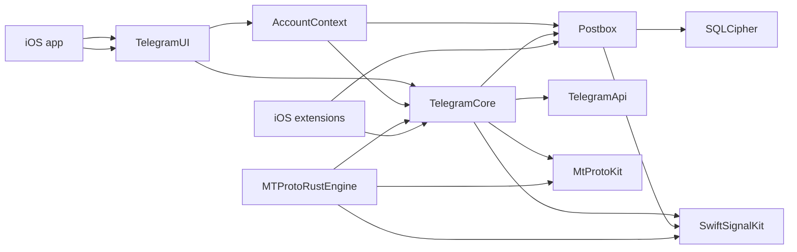
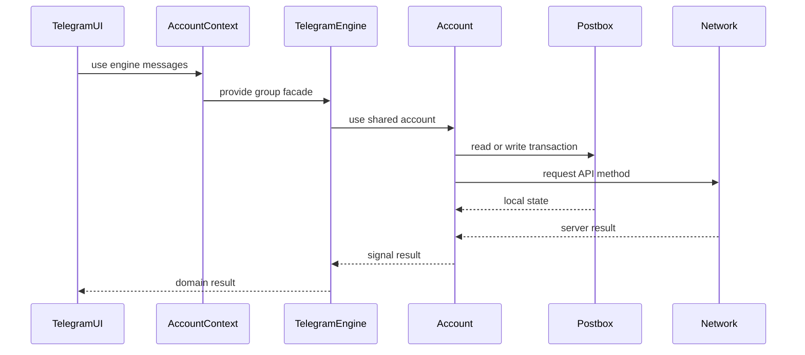
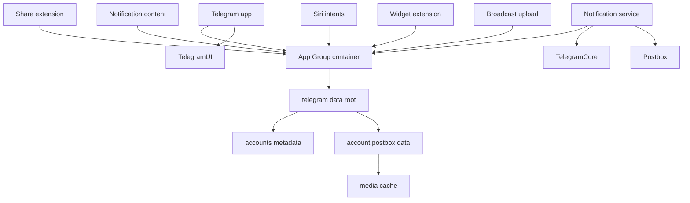

# 전체 아키텍처와 모듈 계층

웹: /docs/system/01-architecture/ · Markdown: /docs/system/01-architecture.md

> Bazel 의존성, 계정 경계, 프로세스 경계로 Telegram 클라이언트 아키텍처를 읽어요.

> 시스템 설계 · 기초와 동시성 · 01장 · 도표 3 · 코드 발췌 10 · 인용 38 · 소스 기준선: [TelegramMessenger/Telegram-iOS@f1dd7a2d](https://github.com/TelegramMessenger/Telegram-iOS/tree/f1dd7a2dbd02cbbf513e75d5695d8d36d1cf5838), [overtake/TelegramSwift@579cebbf](https://github.com/overtake/TelegramSwift/tree/579cebbf0c01fd41b712eff3647fa7f69db9665d)
>
> 관련 보충: [macOS fork 장별 검증 (01–07장)](/docs/system/31-fork-verify-01-07/)
>
> 핵심 소스 파일: [TelegramMessenger/Telegram-iOS/submodules/TelegramCore/BUILD](https://github.com/TelegramMessenger/Telegram-iOS/blob/f1dd7a2dbd02cbbf513e75d5695d8d36d1cf5838/submodules/TelegramCore/BUILD), [TelegramMessenger/Telegram-iOS/submodules/Postbox/BUILD](https://github.com/TelegramMessenger/Telegram-iOS/blob/f1dd7a2dbd02cbbf513e75d5695d8d36d1cf5838/submodules/Postbox/BUILD), [TelegramMessenger/Telegram-iOS/submodules/AccountContext/BUILD](https://github.com/TelegramMessenger/Telegram-iOS/blob/f1dd7a2dbd02cbbf513e75d5695d8d36d1cf5838/submodules/AccountContext/BUILD), [TelegramMessenger/Telegram-iOS/submodules/TelegramUI/BUILD](https://github.com/TelegramMessenger/Telegram-iOS/blob/f1dd7a2dbd02cbbf513e75d5695d8d36d1cf5838/submodules/TelegramUI/BUILD), [TelegramMessenger/Telegram-iOS/Telegram/BUILD](https://github.com/TelegramMessenger/Telegram-iOS/blob/f1dd7a2dbd02cbbf513e75d5695d8d36d1cf5838/Telegram/BUILD), [TelegramMessenger/Telegram-iOS/submodules/TelegramCore/Sources/TelegramEngine/TelegramEngine.swift](https://github.com/TelegramMessenger/Telegram-iOS/blob/f1dd7a2dbd02cbbf513e75d5695d8d36d1cf5838/submodules/TelegramCore/Sources/TelegramEngine/TelegramEngine.swift), [TelegramMessenger/Telegram-iOS/submodules/TelegramCore/Sources/Account/Account.swift](https://github.com/TelegramMessenger/Telegram-iOS/blob/f1dd7a2dbd02cbbf513e75d5695d8d36d1cf5838/submodules/TelegramCore/Sources/Account/Account.swift), [TelegramMessenger/Telegram-iOS/submodules/TelegramCore/Sources/Account/AccountManager.swift](https://github.com/TelegramMessenger/Telegram-iOS/blob/f1dd7a2dbd02cbbf513e75d5695d8d36d1cf5838/submodules/TelegramCore/Sources/Account/AccountManager.swift), [TelegramMessenger/Telegram-iOS/submodules/TelegramCore/Sources/AccountManager/AccountManagerImpl.swift](https://github.com/TelegramMessenger/Telegram-iOS/blob/f1dd7a2dbd02cbbf513e75d5695d8d36d1cf5838/submodules/TelegramCore/Sources/AccountManager/AccountManagerImpl.swift), [TelegramMessenger/Telegram-iOS/submodules/Postbox/Sources/Postbox.swift](https://github.com/TelegramMessenger/Telegram-iOS/blob/f1dd7a2dbd02cbbf513e75d5695d8d36d1cf5838/submodules/Postbox/Sources/Postbox.swift), [TelegramMessenger/Telegram-iOS/submodules/TelegramUI/Sources/SharedAccountContext.swift](https://github.com/TelegramMessenger/Telegram-iOS/blob/f1dd7a2dbd02cbbf513e75d5695d8d36d1cf5838/submodules/TelegramUI/Sources/SharedAccountContext.swift), [TelegramMessenger/Telegram-iOS/submodules/TelegramUI/Sources/AccountContext.swift](https://github.com/TelegramMessenger/Telegram-iOS/blob/f1dd7a2dbd02cbbf513e75d5695d8d36d1cf5838/submodules/TelegramUI/Sources/AccountContext.swift), [TelegramMessenger/Telegram-iOS/submodules/AccountContext/Sources/AccountContext.swift](https://github.com/TelegramMessenger/Telegram-iOS/blob/f1dd7a2dbd02cbbf513e75d5695d8d36d1cf5838/submodules/AccountContext/Sources/AccountContext.swift), [TelegramMessenger/Telegram-iOS/Telegram/NotificationService/Sources/NotificationService.swift](https://github.com/TelegramMessenger/Telegram-iOS/blob/f1dd7a2dbd02cbbf513e75d5695d8d36d1cf5838/Telegram/NotificationService/Sources/NotificationService.swift), [TelegramMessenger/Telegram-iOS/submodules/TelegramCore/Sources/Utils/Log.swift](https://github.com/TelegramMessenger/Telegram-iOS/blob/f1dd7a2dbd02cbbf513e75d5695d8d36d1cf5838/submodules/TelegramCore/Sources/Utils/Log.swift), [TelegramMessenger/Telegram-iOS/submodules/NetworkLogging/Sources/NetworkLogging.m](https://github.com/TelegramMessenger/Telegram-iOS/blob/f1dd7a2dbd02cbbf513e75d5695d8d36d1cf5838/submodules/NetworkLogging/Sources/NetworkLogging.m), [TelegramMessenger/Telegram-iOS/build-system/SwiftTL/Sources/SwiftTL/main.swift](https://github.com/TelegramMessenger/Telegram-iOS/blob/f1dd7a2dbd02cbbf513e75d5695d8d36d1cf5838/build-system/SwiftTL/Sources/SwiftTL/main.swift), [overtake/TelegramSwift/.gitmodules](https://github.com/overtake/TelegramSwift/blob/579cebbf0c01fd41b712eff3647fa7f69db9665d/.gitmodules), [overtake/TelegramSwift/Telegram-Mac/AccountContext.swift](https://github.com/overtake/TelegramSwift/blob/579cebbf0c01fd41b712eff3647fa7f69db9665d/Telegram-Mac/AccountContext.swift)
>
> 미검증 사항:
> - 업스트림과 macOS fork의 TL schema 입력 위치, SwiftTL 전체 재생성 명령, CI 호출은 아직 검증하지 못했어요. fork에서는 `.tl` 입력이나 target 내부의 생성 명령이 발견되지 않았어요.

Telegram 클라이언트는 프로토콜, 영속화, 제품 UI를 따로 빌드할 수 있는 모듈로 나눠요. 핵심 구성은 이래요.

- `Account`: 로그인한 계정별 런타임 경계예요.
- `TelegramCore`: 네트워크, 동기화, 로컬 상태를 하나로 조합해요.
- `TelegramEngine`: 이 기능들을 UI 지향의 도메인 진입점으로 정리해요.

덕분에 화면 계층은 보통 TL 요청(Telegram API 호출), 데이터베이스 트랜잭션, MTProto 세션의 세부 사항을 알 필요가 없어요. [\[1\]](https://github.com/TelegramMessenger/Telegram-iOS/blob/f1dd7a2dbd02cbbf513e75d5695d8d36d1cf5838/submodules/TelegramCore/BUILD#L5-L36) [\[5\]](https://github.com/TelegramMessenger/Telegram-iOS/blob/f1dd7a2dbd02cbbf513e75d5695d8d36d1cf5838/submodules/TelegramCore/Sources/TelegramEngine/TelegramEngine.swift#L5-L99)

## 디렉터리 구조와 다른 계층 [#디렉터리-구조와-다른-계층]

모듈화로 가장 먼저 풀려는 문제는 통신 프로토콜, 데이터베이스, 복잡한 화면이 서로 따로 바뀔 수 있게 하는 거예요. 채팅 컨트롤러가 TL 요청을 직접 보내고 데이터베이스까지 고친다면, 프로토콜이 조금만 바뀌어도 UI 전체가 영향을 받아요. Telegram의 Bazel(빌드 도구) target(빌드 단위)은 명시적인 `deps`(의존하는 target 목록)로 주요 컴파일 경계를 고정해요. 아래 도표에서 화살표는 왼쪽 target이 오른쪽 target에 직접 의존한다는 뜻이고, 런타임의 호출 방향이 아니에요. [\[1\]](https://github.com/TelegramMessenger/Telegram-iOS/blob/f1dd7a2dbd02cbbf513e75d5695d8d36d1cf5838/submodules/TelegramCore/BUILD#L5-L36) [\[2\]](https://github.com/TelegramMessenger/Telegram-iOS/blob/f1dd7a2dbd02cbbf513e75d5695d8d36d1cf5838/submodules/Postbox/BUILD#L5-L28) [\[3\]](https://github.com/TelegramMessenger/Telegram-iOS/blob/f1dd7a2dbd02cbbf513e75d5695d8d36d1cf5838/submodules/AccountContext/BUILD#L3-L36) [\[25\]](https://github.com/TelegramMessenger/Telegram-iOS/blob/f1dd7a2dbd02cbbf513e75d5695d8d36d1cf5838/submodules/TelegramUI/BUILD#L57-L87)

아래 도표는 이 핵심 의존성 하위 그래프를 보여 줘요. 애니메이션, 디스플레이, 오디오, VoIP 등 수많은 수평 모듈은 일부러 뺐어요.

`MTProtoRustEngine`의 방향도 눈여겨볼 만해요. 이 모듈은 `TelegramCore`, `MtProtoKit`, `SwiftSignalKit`에 의존해요. 그래서 네트워크 구현을 교체하거나 보완하는 상위 연결자이고, `TelegramCore`의 하위 의존성이 아니에요. [\[21\]](https://github.com/TelegramMessenger/Telegram-iOS/blob/f1dd7a2dbd02cbbf513e75d5695d8d36d1cf5838/submodules/MTProtoRustEngine/BUILD#L15-L32)



가장 아래의 두 모듈은 이래요.

- `MtProtoKit`: Objective-C 라이브러리예요. 프로젝트 내부 의존성으로는 `EncryptionProvider`만 선언하고, Foundation, Security, SystemConfiguration, CFNetwork, zlib을 링크해요. 전송의 기반을 맡아요.
- `TelegramApi`: 순수 Swift target이에요. Bazel이 `Sources` 아래의 파일을 그대로 하나의 라이브러리로 컴파일해요. 생성된 TL 타입과 직렬화 코드를 담아요.

둘 다 제품 정책을 하위 계층에 끌어들이지 않았어요. [\[24\]](https://github.com/TelegramMessenger/Telegram-iOS/blob/f1dd7a2dbd02cbbf513e75d5695d8d36d1cf5838/submodules/MtProtoKit/BUILD#L1-L36) [\[26\]](https://github.com/TelegramMessenger/Telegram-iOS/blob/f1dd7a2dbd02cbbf513e75d5695d8d36d1cf5838/submodules/TelegramApi/BUILD#L1-L11)

그 위의 의존 관계는 이래요.

- `SwiftSignalKit`은 또 다른 기초 의존성이에요.
- `Postbox`(로컬 저장소 계층): `SwiftSignalKit`과 SQLCipher, `ManagedFile`, 해시 및 범위 집합 도구에 의존해요.
- `TelegramCore`: `TelegramApi`, `MtProtoKit`, `Postbox`, `SwiftSignalKit`, `NetworkLogging`, 그리고 암호화와 도달 가능성 등의 모듈에 동시에 의존해요.

이 선언들을 보면 Core는 데이터베이스나 소켓의 구현 계층이 아니라 도메인 조립 계층이에요. [\[1\]](https://github.com/TelegramMessenger/Telegram-iOS/blob/f1dd7a2dbd02cbbf513e75d5695d8d36d1cf5838/submodules/TelegramCore/BUILD#L5-L36) [\[2\]](https://github.com/TelegramMessenger/Telegram-iOS/blob/f1dd7a2dbd02cbbf513e75d5695d8d36d1cf5838/submodules/Postbox/BUILD#L5-L28)

의존 체인은 위쪽으로 이렇게 이어져요.

- `AccountContext`: `TelegramCore`와 `Postbox`에 의존하고, 미디어 재생, 위치, 구매, 애니메이션 캐시, 표시 데이터도 끌어들여요.
- `TelegramUI`: `AccountContext`, `TelegramCore`, `Postbox`와 표시 컴포넌트에 의존해요.
- 메인 앱의 `Lib`: `TelegramUI`에만 직접 의존해요.

이 의존 체인 덕분에 앱 진입점은 아주 얇게 유지되고, UI 컴포넌트는 같은 계정 컨텍스트를 재사용할 수 있어요. [\[3\]](https://github.com/TelegramMessenger/Telegram-iOS/blob/f1dd7a2dbd02cbbf513e75d5695d8d36d1cf5838/submodules/AccountContext/BUILD#L3-L36) [\[25\]](https://github.com/TelegramMessenger/Telegram-iOS/blob/f1dd7a2dbd02cbbf513e75d5695d8d36d1cf5838/submodules/TelegramUI/BUILD#L57-L87) [\[27\]](https://github.com/TelegramMessenger/Telegram-iOS/blob/f1dd7a2dbd02cbbf513e75d5695d8d36d1cf5838/submodules/TelegramUI/BUILD#L66-L100)

`submodules/TelegramCore/BUILD` 5–36행 발췌.

```swift
swift_library(
    name = "TelegramCore",
    module_name = "TelegramCore",
    srcs = glob([
        "Sources/**/*.swift",
    ]),
    copts = [
        "-warnings-as-errors",
    ],
    deps = [
        "//submodules/TelegramApi:TelegramApi",
        "//submodules/MtProtoKit:MtProtoKit",
        // ...
        "//submodules/SSignalKit/SwiftSignalKit:SwiftSignalKit",
        "//submodules/Postbox:Postbox",
        // ...
        "//submodules/NetworkLogging:NetworkLogging",
        // ...
        "//submodules/TelegramCore/FlatBuffers",
        "//submodules/TelegramCore/FlatSerialization",
    ],
    visibility = [
        "//visibility:public",
    ],
)
```

엄격한 단방향 양파 아키텍처(계층 사이 의존이 한 방향으로만 흐르는 구조)는 아니에요. `TelegramUI`도 `TelegramCore`와 `Postbox`에 직접 의존해요. 그래서 이 프로젝트는 UI가 저장 모델을 읽는 것을 완전히 금지하지 않아요. `AccountContextImpl`도 원래의 `Account`를 `account`로 노출해요. 이런 선택은 수많은 UI 쿼리를 감싸는 비용을 낮추지만, 그 대가로 UI가 여전히 Engine을 우회할 수 있어요. 뒤에서 다룰 파사드(내부를 감싼 단순한 진입점) 계층은 관용적인 경계이지 강제된 격리벽이 아니에요. [\[10\]](https://github.com/TelegramMessenger/Telegram-iOS/blob/f1dd7a2dbd02cbbf513e75d5695d8d36d1cf5838/submodules/TelegramUI/Sources/AccountContext.swift#L318-L342) [\[27\]](https://github.com/TelegramMessenger/Telegram-iOS/blob/f1dd7a2dbd02cbbf513e75d5695d8d36d1cf5838/submodules/TelegramUI/BUILD#L66-L100)

프로토콜, 신뢰성 있는 전송, 인증의 세부 사항은 [MTProto 전송 계층](/docs/system/03-mtproto-transport/)과 [인증 키와 다중 데이터 센터](/docs/system/04-auth-keys-datacenters/)에서 다뤄요. TL 타입, 함수 객체, 바이트 인코딩의 생성 규칙은 [TL 직렬화와 API 호출 계층](/docs/system/05-tl-api-layer/)에서 다뤄요.

## 제품 코드를 위한 진입점, TelegramEngine [#제품-코드를-위한-진입점-telegramengine]

UI는 컨트롤러마다 `Postbox`, `Network`, 상태 머신을 조합하는 대신 채팅, 연락처, 메시지, 설정 같은 비즈니스 어휘로 코어를 호출해야 해요. `TelegramEngine`이 바로 이 문제를 풀어 주는 파사드 객체예요.

- `Account` 하나만 보유해요.
- 도메인별로 `Peers`, `Messages`, `Calls`, `Resources`, `Data`, `Notices` 등의 그룹 객체를 지연 생성해요(처음 쓸 때 만들어요).

모든 그룹이 같은 계정을 받으니까, 같은 UI 컨텍스트 안에서는 네트워크와 저장소의 신원이 일치해요. [\[5\]](https://github.com/TelegramMessenger/Telegram-iOS/blob/f1dd7a2dbd02cbbf513e75d5695d8d36d1cf5838/submodules/TelegramCore/Sources/TelegramEngine/TelegramEngine.swift#L5-L99)

`submodules/TelegramCore/Sources/TelegramEngine/TelegramEngine.swift` 5–18행 발췌.

```swift
public final class TelegramEngine {
    public let account: Account

    public init(account: Account) {
        self.account = account
    }

    public lazy var secureId: SecureId = {
        return SecureId(account: self.account)
    }()

    public lazy var payments: Payments = {
        return Payments(account: self.account)
    }()
}
```

`Messages`와 `Peers`도 위 코드와 같은 패턴을 따르는 프로퍼티예요. 호출하는 쪽은 `context.engine.messages`나 `context.engine.peers`를 쓰고 반환된 `Signal`(비동기 결과를 흘려보내는 스트림)을 구독할 수 있어요. 예를 들어 채팅 히스토리 노드는 `context.engine.messages.getMessagesLoadIfNecessary`를 호출하고, `context.engine.peers.resolvePeerByName`으로 이름을 해석해요. 여기서 공용어는 메시지와 사용자이고, `Api.functions`나 SQL 테이블이 아니에요. [\[5\]](https://github.com/TelegramMessenger/Telegram-iOS/blob/f1dd7a2dbd02cbbf513e75d5695d8d36d1cf5838/submodules/TelegramCore/Sources/TelegramEngine/TelegramEngine.swift#L5-L99) [\[28\]](https://github.com/TelegramMessenger/Telegram-iOS/blob/f1dd7a2dbd02cbbf513e75d5695d8d36d1cf5838/submodules/TelegramUI/Sources/ChatHistoryListNode.swift#L1294-L1298)

파사드의 두 번째 층은 비공개 구현 함수예요. 많은 Engine 그룹 메서드는 파라미터를 엔진 모델로 맞춘 뒤, 같은 파일이나 다른 Core 파일에 있는 `_internal_` 함수를 호출할 뿐이에요. `_internal_`이라는 이름은 구현 수준의 연산과 UI에 안정적인 그룹 진입점을 구분해 줘요. 이 이름은 Swift 접근 제어가 보장하는 것이 아니라 코드 구성 관례예요.

(추론) 이 덕분에 내부 함수는 Core 안에서 여러 흐름이 재사용할 수 있고, UI의 일반적인 호출은 `TelegramEngine` 네임스페이스에 모여요. [\[5\]](https://github.com/TelegramMessenger/Telegram-iOS/blob/f1dd7a2dbd02cbbf513e75d5695d8d36d1cf5838/submodules/TelegramCore/Sources/TelegramEngine/TelegramEngine.swift#L5-L99)

아래 도표는 UI 요청이 파사드로 들어가 로컬 트랜잭션과 네트워크를 각각 건드리는 전형적인 경로를 보여 줘요. 실제 메서드는 로컬 데이터만 읽을 수도, 네트워크 요청만 보낼 수도 있어요. 이 도표가 나타내는 것은 `Account`가 주는 의존성 주입(필요한 객체를 밖에서 넣어 주는 방식) 관계이고, 모든 호출이 모든 노드를 거친다는 뜻이 아니에요. [\[5\]](https://github.com/TelegramMessenger/Telegram-iOS/blob/f1dd7a2dbd02cbbf513e75d5695d8d36d1cf5838/submodules/TelegramCore/Sources/TelegramEngine/TelegramEngine.swift#L5-L99) [\[6\]](https://github.com/TelegramMessenger/Telegram-iOS/blob/f1dd7a2dbd02cbbf513e75d5695d8d36d1cf5838/submodules/TelegramCore/Sources/Account/Account.swift#L1187-L1355)



파사드는 동시성 모델을 숨기려는 것이 아니에요. 여전히 `Signal`을 많이 반환하고 `EngineData` 구독 진입점도 노출해요. `AccountContextImpl`은 초기화할 때 `TelegramEngine(account:)`를 만들고, 이를 프리페치(미리 내려받기), 스티커, 설정 구독에 넘겨요. 그러면 화면은 자기 구독 수명 주기를 유지하면서도, 화면마다 네트워크와 계정 관리자를 다시 초기화하는 일을 피할 수 있어요. [\[10\]](https://github.com/TelegramMessenger/Telegram-iOS/blob/f1dd7a2dbd02cbbf513e75d5695d8d36d1cf5838/submodules/TelegramUI/Sources/AccountContext.swift#L318-L342)

`submodules/TelegramUI/Sources/AccountContext.swift` 320–342행 발췌.

```swift
        self.sharedContextImpl = sharedContext
        self.account = account
        self.engine = TelegramEngine(account: account)
        
        self.imageCache = DirectMediaImageCache(account: account)
        
        self.userLimits = EngineConfiguration.UserLimits(UserLimitsConfiguration.defaultValue)
        self.peerNameColors = PeerNameColors.with(availableReplyColors: availableReplyColors, availableProfileColors: availableProfileColors)
        self.audioTranscriptionTrial = AudioTranscription.TrialState.defaultValue
        self.isPremium = false
        self.isFrozen = false
        
        self.downloadedMediaStoreManager = DownloadedMediaStoreManagerImpl(postbox: account.postbox, accountManager: sharedContext.accountManager)
        
        if let locationManager = self.sharedContextImpl.locationManager {
            self.liveLocationManager = LiveLocationManagerImpl(engine: self.engine, locationManager: locationManager, inForeground: sharedContext.applicationBindings.applicationInForeground)
        } else {
            self.liveLocationManager = nil
        }
        self.fetchManager = FetchManagerImpl(postbox: account.postbox, storeManager: self.downloadedMediaStoreManager)
        if sharedContext.applicationBindings.isMainApp && !temp {
            self.prefetchManager = PrefetchManagerImpl(sharedContext: sharedContext, account: account, engine: self.engine, fetchManager: self.fetchManager)
            self.wallpaperUploadManager = WallpaperUploadManagerImpl(sharedContext: sharedContext, account: account, presentationData: sharedContext.presentationData)
```


위 코드는 중요한 경계도 하나 보여 줘요.

- Engine: 도메인 API를 맡아요.
- UI 계정 컨텍스트: 다운로드 관리자, 이미지 캐시, 프리페치 전략이 여기에 있어요.
- `Postbox`의 `MediaBox`: 미디어 캐시의 기반 시설을 여전히 제공해요.

미디어 다운로드, 업로드, 캐시 축출, 리소스 참조의 세부 사항은 [미디어 리소스, 다운로드/업로드, 캐시](/docs/system/10-media-cache/)를 참고하세요.


## 런타임 객체 그래프와 추상 계약 [#런타임-객체-그래프와-추상-계약]

컴파일 의존성은 누가 누구를 import할 수 있는지만 알려 줄 뿐, 런타임에 누가 상태를 소유하는지는 알려 주지 않아요. Telegram은 이 둘을 따로 처리해요. Bazel은 `TelegramCore`가 Postbox와 네트워크 계층에 의존하게 해요. 런타임에서는 이 순서로 조립해요.

1. `AccountManager`가 먼저 계정 레코드를 찾아요.
2. `Account`가 그 레코드의 Postbox와 Network를 만들어요.
3. 마지막으로 `SharedAccountContextImpl`이 그 계정의 UI 계정 컨텍스트를 만들어요. [\[6\]](https://github.com/TelegramMessenger/Telegram-iOS/blob/f1dd7a2dbd02cbbf513e75d5695d8d36d1cf5838/submodules/TelegramCore/Sources/Account/Account.swift#L1187-L1355) [\[8\]](https://github.com/TelegramMessenger/Telegram-iOS/blob/f1dd7a2dbd02cbbf513e75d5695d8d36d1cf5838/submodules/TelegramCore/Sources/AccountManager/AccountManagerImpl.swift#L41-L153) [\[9\]](https://github.com/TelegramMessenger/Telegram-iOS/blob/f1dd7a2dbd02cbbf513e75d5695d8d36d1cf5838/submodules/TelegramUI/Sources/SharedAccountContext.swift#L650-L830)

이 순서는 다중 계정 전환에서 생기는 신원 혼동 문제를 풀어 줘요. `AccountManager` 하나가 여러 레코드와 하나의 현재 레코드를 관리할 수 있어요. 하지만 `Account` 하나는 다음 각각 하나에만 대응해요.

- `AccountRecordId`
- `peerId`
- 저장소 루트
- 네트워크 객체

UI는 계정을 선택할 때 `AccountContext`를 전환해요. 전역 Network 하나가 계정 사이에서 신원을 고쳐 쓰게 하지 않아요. 필드 정의를 보면 `Account`의 `id`, `postbox`, `network`, `peerId`는 모두 불변 공개 프로퍼티예요. [\[6\]](https://github.com/TelegramMessenger/Telegram-iOS/blob/f1dd7a2dbd02cbbf513e75d5695d8d36d1cf5838/submodules/TelegramCore/Sources/Account/Account.swift#L1187-L1355)

계정별 디렉터리에도 이 경계가 드러나요. `accountWithId`는 이 순서로 경로를 만들어요.

1. `accountRecordIdPathName`으로 `rootPath` 아래의 `account` 디렉터리를 만들어요.
2. 그 `/postbox` 하위 디렉터리로 Postbox를 열어요.
3. Postbox는 이어서 자기 `basePath`에 `/media`를 붙여 MediaBox(미디어 캐시 저장소)를 만들어요.

계정 메타데이터는 데이터 루트 아래의 `/accounts-metadata`에 따로 있어요. 그래서 계정 목록과 공유 설정을 특정 계정의 메시지 저장소와 한 데이터베이스 경로로 뭉뚱그릴 수 없어요. [\[18\]](https://github.com/TelegramMessenger/Telegram-iOS/blob/f1dd7a2dbd02cbbf513e75d5695d8d36d1cf5838/Telegram/NotificationService/Sources/NotificationService.swift#L776-L844) [\[32\]](https://github.com/TelegramMessenger/Telegram-iOS/blob/f1dd7a2dbd02cbbf513e75d5695d8d36d1cf5838/submodules/TelegramCore/Sources/Account/Account.swift#L268-L282) [\[7\]](https://github.com/TelegramMessenger/Telegram-iOS/blob/f1dd7a2dbd02cbbf513e75d5695d8d36d1cf5838/submodules/Postbox/Sources/Postbox.swift#L4679-L4723)

이 디렉터리 계층은 프로세스가 재시작된 뒤에 다시 조립하는 문제를 풀어 줘요. 확장(메인 앱과 별도로 도는 App Extension 프로세스)은 같은 데이터 루트에서 메타데이터를 열어 대상 레코드를 찾고, 같은 레코드 id로 같은 Postbox 경로를 열기만 하면 돼요. 메인 앱에 남아 있는 메모리 객체에 의존하지 않아요.

그 대가로 프로세스마다 암호화 파라미터, 프로세스 역할, 캐시 옵션을 올바르게 넘겨야 해요. 알림 서비스가 `isTemporary: true`와 `useCaches: false`를 넘기는 것이 제한된 프로세스의 예예요. [\[18\]](https://github.com/TelegramMessenger/Telegram-iOS/blob/f1dd7a2dbd02cbbf513e75d5695d8d36d1cf5838/Telegram/NotificationService/Sources/NotificationService.swift#L776-L844)

`AccountManager`가 맡는 일은 계정 디렉터리와 계정 간 공용 자료예요. 계정별 네트워크 수명 주기는 맡지 않아요. 내부에는 이런 것들이 있어요.

- 독립된 queue
- `atomic-state` 파일
- 로그인 토큰 경로
- ValueBox 경로 두 개

레코드, 공유 데이터, notice, 접근 챌린지를 위해 여러 테이블을 유지해요. 호출자는 반드시 transaction을 통해 이 데이터를 수정해야 해요. 그래서 현재 레코드를 전환하는 일과 계정 상태를 갱신하는 일이 하나의 관리 경계 안에서 이루어질 수 있어요. [\[8\]](https://github.com/TelegramMessenger/Telegram-iOS/blob/f1dd7a2dbd02cbbf513e75d5695d8d36d1cf5838/submodules/TelegramCore/Sources/AccountManager/AccountManagerImpl.swift#L41-L153)

초기화에 실패했을 때의 정책에도 층위가 있어요.

- `AccountManagerImpl`이 주 `db`를 여는 데 실패하면 세 번 시도해요.
- `removeDatabaseOnError`가 거짓이면: 원자적 상태를 불러오는 데 실패했을 때 전제 조건 실패가 일어나요.
- 이 옵션이 참이면: 옛 테이블에서 원자적 상태를 재구성할 수 있어요.

코드는 모든 오류를 삼키지 않아요. 계정 디렉터리를 마음대로 초기화할 수 있는 캐시가 아니라, 복구하거나 중단해야 하는 핵심 데이터로 취급한다는 뜻이에요. [\[8\]](https://github.com/TelegramMessenger/Telegram-iOS/blob/f1dd7a2dbd02cbbf513e75d5695d8d36d1cf5838/submodules/TelegramCore/Sources/AccountManager/AccountManagerImpl.swift#L41-L153)

`Account`가 하위 객체를 어떻게 만드는지는 생성 호출에서 더 세분해 볼 수 있어요. 객체마다 필요한 의존성이 달라요.

- `NetworkStatsContext`: Postbox만 필요해요.
- `CallSessionManager`: Postbox, Network, 계정 peer id, VoIP 파라미터가 필요해요.
- `AccountStateManager`: 계정 관리자, Postbox, Network, 통화 관리자, 입력 상태가 모두 필요해요.
- `AccountTaskManager`: state manager, 계정 관리자, 네트워크 파라미터, view tracker를 받아요.

다시 말해 Account는 조립 루트(객체들을 한곳에서 연결해 만드는 지점)예요. 하위 객체가 전역 싱글턴을 거꾸로 찾아갈 필요가 없어요. [\[6\]](https://github.com/TelegramMessenger/Telegram-iOS/blob/f1dd7a2dbd02cbbf513e75d5695d8d36d1cf5838/submodules/TelegramCore/Sources/Account/Account.swift#L1187-L1355)

이 조립 루트는 장애 격리도 맡아요.

- `CallSessionManager`는 클로저로 업데이트를 `stateManager`에 넘겨요. 클로저는 `self`를 약한 참조로 캡처해요.
- `viewTracker`의 hole(메시지 기록의 빈 구간) 리셋 콜백도 마찬가지로 계정을 약하게 캡처해요.

코드는 이렇게 해서 관리자가 계정을 오래 붙들어 단순한 강한 참조 순환이 생기는 것을 피해요. 하지만 모든 비동기 작업에 누수가 없다는 것까지 자동으로 증명하지는 못해요. 그래서 Disposable의 실제 해제는 여전히 런타임 위험이에요. (추론) [\[6\]](https://github.com/TelegramMessenger/Telegram-iOS/blob/f1dd7a2dbd02cbbf513e75d5695d8d36d1cf5838/submodules/TelegramCore/Sources/Account/Account.swift#L1187-L1355)

`Account`가 꼭 메인 프로세스의 계정일 필요도 없어요. `supplementary` 표시(보조 용도의 계정인지 여부)는 이렇게 쓰여요.

- `accountWithId`는 `supplementary`를 `openPostbox`의 `isMainProcess`에 넘기고, 이 값으로 캐시와 데이터베이스 오류 뒤의 제거 정책을 제어해요.
- `Account` 생성자는 supplementary가 아닌 인스턴스에만 스토리 구독 컨텍스트를 만들어요.
- `AccountTaskManager`의 `isMainApp` 파라미터도 이 표시에서 와요.

그래서 확장과 임시 컨텍스트는 필요한 상태를 읽거나 처리하되, 전체 포그라운드 서비스 집합을 띄울 필요가 없어요. [\[6\]](https://github.com/TelegramMessenger/Telegram-iOS/blob/f1dd7a2dbd02cbbf513e75d5695d8d36d1cf5838/submodules/TelegramCore/Sources/Account/Account.swift#L1187-L1355) [\[32\]](https://github.com/TelegramMessenger/Telegram-iOS/blob/f1dd7a2dbd02cbbf513e75d5695d8d36d1cf5838/submodules/TelegramCore/Sources/Account/Account.swift#L268-L282)

`SharedAccountContext`와 `AccountContext`는 이름 관례만으로 구분되지 않아요. `submodules/AccountContext`가 프로토콜 두 개를 정의해요.

- `SharedAccountContext`: 공유 컨테이너 경로, 계정 관리자, 락, 전역 미디어, 활성 계정 스트림을 요구해요.
- `AccountContext`: `Account` 하나, `TelegramEngine` 하나, 다운로드 관리자, 프리페처, 계정별 설정을 요구해요.

덕분에 채팅, 선택기, 미디어 컴포넌트는 iOS의 `SharedAccountContextImpl` 구체 타입 대신 인터페이스에 의존할 수 있어요. [\[33\]](https://github.com/TelegramMessenger/Telegram-iOS/blob/f1dd7a2dbd02cbbf513e75d5695d8d36d1cf5838/submodules/AccountContext/Sources/AccountContext.swift#L1407-L1450)

이 두 프로토콜은 UI 컴포넌트의 이식성 문제를 풀어 줘요.

- `AccountContext`: 채팅 컴포넌트는 이것만 받으면 같은 계정의 Engine, 미디어 획득기, 표시 설정을 얻을 수 있어요.
- `SharedAccountContext`: 계정 간 이동, 메인 윈도우, 전역 설정, 계정 전환을 맡아요.

`AccountContextImpl`은 두 프로토콜의 연결을 함께 보관해요. 그래서 국소적인 화면이 필요하면 전역 조정자로 거슬러 올라갈 수 있어요. [\[10\]](https://github.com/TelegramMessenger/Telegram-iOS/blob/f1dd7a2dbd02cbbf513e75d5695d8d36d1cf5838/submodules/TelegramUI/Sources/AccountContext.swift#L318-L342) [\[33\]](https://github.com/TelegramMessenger/Telegram-iOS/blob/f1dd7a2dbd02cbbf513e75d5695d8d36d1cf5838/submodules/AccountContext/Sources/AccountContext.swift#L1407-L1450)

이런 구분의 대가는 프로토콜의 표면적이 아주 크다는 거예요. `AccountContext`는 애니메이션, 스티커, 구매, 지갑, 그룹 통화, 설정 서비스를 한꺼번에 공개해요. 좁은 feature 프로토콜보다 쓰기는 쉽지만, 범용 UI 컴포넌트가 실제로 필요한 것보다 많은 기능을 볼 수 있게 돼요. 소스가 이 넓은 표면적을 의도된 트레이드오프라고 선언하지는 않아요. 하지만 이 인터페이스가 넓다는 것은 직접 관찰할 수 있는 사실이에요. (추론) [\[33\]](https://github.com/TelegramMessenger/Telegram-iOS/blob/f1dd7a2dbd02cbbf513e75d5695d8d36d1cf5838/submodules/AccountContext/Sources/AccountContext.swift#L1407-L1450)

`SharedAccountContextImpl`은 계정 레코드 스트림에서 계정을 일괄 생성해요.

1. 새로 추가된 레코드마다 `accountWithId`를 호출해요.
2. 인증에 성공하면 `setupAccount`를 호출해 Engine 데이터 진입점으로 제한과 설정을 읽어요.
3. 이어서 `AccountContextImpl`을 만들어요.

또 계정의 sort index로 활성 목록을 정렬하고, 메인 계정이 바뀌면 이전 메인 계정 Postbox의 캐시를 정리해요. [\[9\]](https://github.com/TelegramMessenger/Telegram-iOS/blob/f1dd7a2dbd02cbbf513e75d5695d8d36d1cf5838/submodules/TelegramUI/Sources/SharedAccountContext.swift#L650-L830)

이 경로에는 복구 분기가 두 개 있어요.

- 계정이 아직 업그레이드 중이면 조정자는 모든 업그레이드 진행률의 평균을 계산해 `displayUpgradeProgress`에 넘겨요.
- 레코드가 Account를 만들지 못하면 그 레코드를 삭제해요.

사용할 수 있는 메인 계정이 없고 인증 대기 중인 계정도 없으면 새 인증 흐름을 시작해요. 아키텍처 관점에서 보면, 이를 통해 UI는 안정적인 활성 계정 집합 하나를 구독하고, 손상된 레코드와 마이그레이션 상태는 조정자 안에서 처리하게 돼요. [\[9\]](https://github.com/TelegramMessenger/Telegram-iOS/blob/f1dd7a2dbd02cbbf513e75d5695d8d36d1cf5838/submodules/TelegramUI/Sources/SharedAccountContext.swift#L650-L830)

인증 전에도 전용 경계가 있어요.

- `TelegramEngineUnauthorized`: `UnauthorizedAccount`를 보유하고, `auth`, `localization`, `payments`, 리소스, 캐시 등의 그룹만 제공해요.
- `SomeTelegramEngine`: 다시 열거형으로 authorized와 unauthorized를 구분해요.

이렇게 해서 로그인 UI가 로그인 후의 계정에만 있는 메시지나 통화 진입점을 잘못 쓰는 일을 막아요. 인증 흐름, 계정 디렉터리 동기화, 데이터 센터 설정은 [다중 계정, 로그인, 구성 동기화](/docs/system/14-accounts-auth-config/)를 참고하세요. [\[5\]](https://github.com/TelegramMessenger/Telegram-iOS/blob/f1dd7a2dbd02cbbf513e75d5695d8d36d1cf5838/submodules/TelegramCore/Sources/TelegramEngine/TelegramEngine.swift#L5-L99)

`TelegramEngine`의 그룹은 계정 상태를 복제하지 않아요.

- `data`: 처음 접근할 때 같은 계정의 `peerId`와 `postbox`로 `EngineData`를 만들어요.
- `historyImport`: `postbox`와 `network`를 명시적으로 꺼내는 몇 안 되는 그룹이에요.
- 나머지 흔한 그룹: 대부분 Account 자체를 받아요.

`lazy var`는 각 그룹이 필요할 때 만들어진 뒤 Engine 인스턴스에 캐시된다는 뜻이에요. 그래서 쓰지 않는 제품 영역은 컨텍스트를 구성할 때 한꺼번에 할당되지 않아요. (추론) [\[5\]](https://github.com/TelegramMessenger/Telegram-iOS/blob/f1dd7a2dbd02cbbf513e75d5695d8d36d1cf5838/submodules/TelegramCore/Sources/TelegramEngine/TelegramEngine.swift#L5-L99)

파사드 메서드의 최종 구현은 여전히 TelegramCore에 있어요. 공개 그룹 메서드와 `_internal_` 연산은 같은 Account 의존성 그래프를 공유해요. 그래서 로컬 transaction, 네트워크 요청, state manager를 조합할 수 있어요.

하지만 `_internal_`은 비공개 접근 수준 키워드가 아니에요. 같은 모듈의 코드가 내부 연산을 호출하는 것도, 나중에 그 함수를 공개로 바꾸는 것도 막지 못해요. 팀이 파사드 경계를 유지하려면 UI가 Core에 직접 의존하는 것을 코드 리뷰로 제약해야 해요. (추론) [\[5\]](https://github.com/TelegramMessenger/Telegram-iOS/blob/f1dd7a2dbd02cbbf513e75d5695d8d36d1cf5838/submodules/TelegramCore/Sources/TelegramEngine/TelegramEngine.swift#L5-L99) [\[25\]](https://github.com/TelegramMessenger/Telegram-iOS/blob/f1dd7a2dbd02cbbf513e75d5695d8d36d1cf5838/submodules/TelegramUI/BUILD#L57-L87)

UI가 원본 `context.account`를 읽을 수 있다고 해서 모든 비즈니스가 Engine을 우회해야 하는 것은 아니에요.

- 직접 읽기에 알맞은 것: 수명 주기나 기반 시설 객체예요. 예를 들어 `postbox.mediaBox`를 다운로더에 넘기는 경우가 그래요.
- Engine을 통해 호출하기에 알맞은 것: 메시지, 연락처, 설정, 네트워크 동작이에요. Engine이 저수준 타입을 `EnginePeer`, `EngineMessage` 같은 도메인 모델로 수렴시킬 수 있기 때문이에요.

이 판단은 의존성과 호출 형태에서 얻은 엔지니어링 제안이고, 소스에 있는 강제 규칙이 아니에요. (추론) [\[5\]](https://github.com/TelegramMessenger/Telegram-iOS/blob/f1dd7a2dbd02cbbf513e75d5695d8d36d1cf5838/submodules/TelegramCore/Sources/TelegramEngine/TelegramEngine.swift#L5-L99) [\[10\]](https://github.com/TelegramMessenger/Telegram-iOS/blob/f1dd7a2dbd02cbbf513e75d5695d8d36d1cf5838/submodules/TelegramUI/Sources/AccountContext.swift#L318-L342)

## Account, AccountManager, 두 개의 Context [#account-accountmanager-두-개의-context]

다중 계정 클라이언트는 전역 계정 디렉터리, 단일 계정 코어, 단일 계정 UI 서비스를 구분해야 해요. Telegram의 객체 분할은 정확히 이 세 가지 수명 주기에 대응해요. `AccountManager`는 레코드, 현재 계정, 로그인 대기 레코드, 공유 데이터, 알림, 접근 챌린지를 관리해요. 로그인된 계정 하나와 같지 않고, 네트워크 세션도 아니에요. [\[8\]](https://github.com/TelegramMessenger/Telegram-iOS/blob/f1dd7a2dbd02cbbf513e75d5695d8d36d1cf5838/submodules/TelegramCore/Sources/AccountManager/AccountManagerImpl.swift#L41-L153)

`AccountManagerModifier`의 클로저 집합은 그 데이터 모델을 보여 줘요. 할 수 있는 일은 이래요.

- 레코드를 열거하고 갱신해요.
- 현재 레코드를 설정해요.
- 인증 레코드를 만들거나 제거해요.
- 공유 데이터와 notice를 읽고 써요.

내부 구현은 `atomic-state`와 `login-tokens`를 보관하고, `guard_db`와 `db` 아래에 ValueBox를 열어요. 생성자는 데이터베이스를 여는 데 실패하면 최대 3번 시도하고, 대기 시간은 차례로 0.1초, 0.6초, 1.1초예요. [\[8\]](https://github.com/TelegramMessenger/Telegram-iOS/blob/f1dd7a2dbd02cbbf513e75d5695d8d36d1cf5838/submodules/TelegramCore/Sources/AccountManager/AccountManagerImpl.swift#L41-L153)

`submodules/TelegramCore/Sources/AccountManager/AccountManagerImpl.swift` 41–61행 발췌.

```swift
public struct AccountManagerModifier<Types: AccountManagerTypes> {
    public let getRecords: () -> [AccountRecord<Types.Attribute>]
    public let updateRecord: (AccountRecordId, (AccountRecord<Types.Attribute>?) -> (AccountRecord<Types.Attribute>?)) -> Void
    public let getCurrent: () -> (AccountRecordId, [Types.Attribute])?
    public let setCurrentId: (AccountRecordId) -> Void
    public let getCurrentAuth: () -> AuthAccountRecord<Types.Attribute>?
    public let createAuth: ([Types.Attribute]) -> AuthAccountRecord<Types.Attribute>?
    public let removeAuth: () -> Void
    public let createRecord: ([Types.Attribute]) -> AccountRecordId
    public let getSharedData: (ValueBoxKey) -> PreferencesEntry?
    public let updateSharedData: (ValueBoxKey, (PreferencesEntry?) -> PreferencesEntry?) -> Void
    public let getAccessChallengeData: () -> PostboxAccessChallengeData
    public let setAccessChallengeData: (PostboxAccessChallengeData) -> Void
    public let getVersion: () -> Int32?
    public let setVersion: (Int32) -> Void
    public let getNotice: (NoticeEntryKey) -> CodableEntry?
    public let setNotice: (NoticeEntryKey, CodableEntry?) -> Void
    public let clearNotices: () -> Void
    public let getStoredLoginTokens: () -> [Data]
    public let setStoredLoginTokens: ([Data]) -> Void
}
```

`Account`는 인증된 계정의 오래 사는 핵심 객체예요.

- 그 계정의 `Postbox`, `Network`, 계정 peer id, 네트워크 파라미터를 소유해요.
- `AccountStateManager`, 통화 세션 관리자, 뷰 트래커, 전송 대기 메시지 관리자, 갱신 대기 메시지 관리자, 미디어 참조 재검증기를 조립해요.

다시 말해 `Account`는 자격 증명만 보관하는 것이 아니라 동기화 런타임과 계정별 백그라운드 작업자를 소유해요. [\[6\]](https://github.com/TelegramMessenger/Telegram-iOS/blob/f1dd7a2dbd02cbbf513e75d5695d8d36d1cf5838/submodules/TelegramCore/Sources/Account/Account.swift#L1187-L1355)

`submodules/TelegramCore/Sources/Account/Account.swift` 1187–1206행 발췌.

```swift
public class Account {
    static let sharedQueue = Queue(name: "Account-Shared")

    public let id: AccountRecordId
    public let basePath: String
    public let testingEnvironment: Bool
    public let supplementary: Bool
    public let isSupportUser: Bool
    public let postbox: Postbox
    public let network: Network
    public let networkArguments: NetworkInitializationArguments
    public let peerId: PeerId

    public let auxiliaryMethods: AccountAuxiliaryMethods

    private let serviceQueue = Queue()
    private let accountManager: AccountManager<TelegramAccountManagerTypes>
    public private(set) var stateManager: AccountStateManager!
    private(set) var contactSyncManager: ContactSyncManager!
    public private(set) var callSessionManager: CallSessionManager!
}
```

생성 과정은 모든 관리자를 같은 `postbox`, `network`, `peerId`에 묶어요.

- `CallSessionManager`: 받은 업데이트를 `stateManager`에 되돌려 보내요.
- `AccountStateManager`: 계정 관리자, 저장소, 네트워크, 통화 관리자, 입력 상태 관리자를 함께 받아요.
- `PendingMessageManager`: 뒤이어 이 객체들을 재사용해요.

이렇게 하면 한 계정의 업데이트 순서, 오프라인 대기 작업, API 세션이 하나의 객체 그래프로 수렴해요. [\[6\]](https://github.com/TelegramMessenger/Telegram-iOS/blob/f1dd7a2dbd02cbbf513e75d5695d8d36d1cf5838/submodules/TelegramCore/Sources/Account/Account.swift#L1187-L1355)

`submodules/TelegramCore/Sources/Account/Account.swift` 1304–1327행 발췌.

```swift
        self.callSessionManager = CallSessionManager(postbox: postbox, network: network, accountPeerId: peerId, maxLayer: networkArguments.voipMaxLayer, versions: networkArguments.voipVersions, addUpdates: { [weak self] updates in
            self?.stateManager?.addUpdates(updates)
        })
        
        self.mediaReferenceRevalidationContext = MediaReferenceRevalidationContext()
        
        self.stateManager = AccountStateManager(accountPeerId: self.peerId, accountManager: accountManager, postbox: self.postbox, network: self.network, callSessionManager: self.callSessionManager, addIsContactUpdates: { [weak self] updates in
            self?.contactSyncManager?.addIsContactUpdates(updates)
        }, shouldKeepOnlinePresence: self.shouldKeepOnlinePresence.get(), peerInputActivityManager: self.peerInputActivityManager, auxiliaryMethods: auxiliaryMethods)
        
        self.viewTracker = AccountViewTracker(account: self)
        self.viewTracker.resetPeerHoleManagement = { [weak self] peerId in
            self?.resetPeerHoleManagement?(peerId)
        }
        
        self.taskManager = AccountTaskManager(
            stateManager: self.stateManager,
            accountManager: accountManager,
            networkArguments: networkArguments,
            viewTracker: self.viewTracker,
            mediaReferenceRevalidationContext: self.mediaReferenceRevalidationContext,
            isMainApp: !supplementary,
            testingEnvironment: testingEnvironment
        )
```

여기서 `supplementary` 표시가 중요해요.

- supplementary가 아닌 계정: 스토리 구독 컨텍스트와 전송 대기 스토리 관리자를 만들어요. 메인 앱이 계정을 만들 때는 supplementary가 아닌 값을 넘겨요.
- supplementary 계정: 확장 프로세스나 보조 시나리오가 넘길 수 있고, 그러면 전체 포그라운드 작업 집합을 띄우지 않아요.

기능을 덜어 내는 대신 확장의 메모리와 수명 주기를 통제하기 쉬워지는 방식이에요. (추론) [\[6\]](https://github.com/TelegramMessenger/Telegram-iOS/blob/f1dd7a2dbd02cbbf513e75d5695d8d36d1cf5838/submodules/TelegramCore/Sources/Account/Account.swift#L1187-L1355) [\[9\]](https://github.com/TelegramMessenger/Telegram-iOS/blob/f1dd7a2dbd02cbbf513e75d5695d8d36d1cf5838/submodules/TelegramUI/Sources/SharedAccountContext.swift#L650-L830)

`Postbox` 자체가 `MediaBox`를 소유해요. 생성자는 계정 Postbox의 `basePath`에 `/media`를 붙여 캐시 디렉터리를 만들고 `isMainProcess`를 받아요. 그래서 더 정확한 소유 관계는 `Account`가 `Postbox`를 소유하고 `Postbox`가 `MediaBox`를 소유한다는 거예요. `AccountManager`가 계정별 미디어 파일을 직접 소유하는 것이 아니에요. [\[6\]](https://github.com/TelegramMessenger/Telegram-iOS/blob/f1dd7a2dbd02cbbf513e75d5695d8d36d1cf5838/submodules/TelegramCore/Sources/Account/Account.swift#L1187-L1355) [\[7\]](https://github.com/TelegramMessenger/Telegram-iOS/blob/f1dd7a2dbd02cbbf513e75d5695d8d36d1cf5838/submodules/Postbox/Sources/Postbox.swift#L4679-L4723)

`submodules/Postbox/Sources/Postbox.swift` 4682–4706행 발췌.

```swift
    let queue: Queue
    private let impl: QueueLocalObject<PostboxImpl>

    public let seedConfiguration: SeedConfiguration
    public let mediaBox: MediaBox
    
    private let isInTransaction = Atomic<Bool>(value: false)

    init(
        queue: Queue,
        basePath: String,
        seedConfiguration: SeedConfiguration,
        valueBox: SqliteValueBox,
        timestampForAbsoluteTimeBasedOperations: Int32,
        isMainProcess: Bool,
        isTemporary: Bool,
        tempDir: TempBoxDirectory?,
        useCaches: Bool
    ) {
        self.queue = queue

        self.seedConfiguration = seedConfiguration

        postboxLog("MediaBox path: \(basePath + "/media")")
        self.mediaBox = MediaBox(basePath: basePath + "/media", isMainProcess: isMainProcess)
```

`SharedAccountContextImpl`은 iOS 제품 계층의 전역 조정자예요.

- 보유하는 것: 메인 윈도우, 앱 바인딩, 공유 컨테이너 경로, 계정 관리자, 잠금 화면 컨텍스트, 미디어 관리자, 활성 계정 집합
- 발행하는 것: `Promise`로 메인 계정, 계정 목록, 미인증 계정을 발행해요.
- 맡는 일: 계정 디렉터리의 변화를 관찰하고, `Account`와 `AccountContextImpl`을 만들거나 해제하며, 통화, 테마, 푸시 토큰, 전역 표시 상태를 조정해요. [\[9\]](https://github.com/TelegramMessenger/Telegram-iOS/blob/f1dd7a2dbd02cbbf513e75d5695d8d36d1cf5838/submodules/TelegramUI/Sources/SharedAccountContext.swift#L650-L830)

`submodules/TelegramUI/Sources/SharedAccountContext.swift` 159–197행 발췌.

```swift
public final class SharedAccountContextImpl: SharedAccountContext {
    public let mainWindow: Window1?
    public let applicationBindings: TelegramApplicationBindings
    public let sharedContainerPath: String
    public let basePath: String
    public let networkArguments: NetworkInitializationArguments
    public let accountManager: AccountManager<TelegramAccountManagerTypes>
    public let appLockContext: AppLockContext
    // ...
    private var activeAccountsValue: (primary: AccountContext?, accounts: [(AccountRecordId, AccountContext, Int32)], currentAuth: UnauthorizedAccount?)?
    private let activeAccountsPromise = Promise<(primary: AccountContext?, accounts: [(AccountRecordId, AccountContext, Int32)], currentAuth: UnauthorizedAccount?)>()
    public var activeAccountContexts: Signal<(primary: AccountContext?, accounts: [(AccountRecordId, AccountContext, Int32)], currentAuth: UnauthorizedAccount?), NoError> {
        return self.activeAccountsPromise.get()
    }
    // ...
    private var activeUnauthorizedAccountValue: UnauthorizedAccount?
    private let activeUnauthorizedAccountPromise = Promise<UnauthorizedAccount?>()
    public var activeUnauthorizedAccount: Signal<UnauthorizedAccount?, NoError> {
        return self.activeUnauthorizedAccountPromise.get()
    }
}
```

계정 레코드가 나타나면 조정자는 이 순서로 처리해요.

1. 먼저 `accountWithId`를 호출하고, 인증 결과에 `setupAccount`를 실행해요. `TelegramEngine(account:).data.get`으로 제한, 콘텐츠 설정, 앱 설정을 가져와요.
2. 이어서 `AccountContextImpl`을 만들어요.
3. sort index에 따라 활성 집합을 유지해요.
4. 메인 계정이 바뀌면 이전 계정의 Postbox 캐시를 정리해요.

이 흐름은 계정 디렉터리의 변화를 UI가 쓰기 알맞은 객체 집합으로 바꿔요. [\[9\]](https://github.com/TelegramMessenger/Telegram-iOS/blob/f1dd7a2dbd02cbbf513e75d5695d8d36d1cf5838/submodules/TelegramUI/Sources/SharedAccountContext.swift#L650-L830)

`AccountContextImpl`은 인증된 계정마다 존재하는 UI 서비스 컨테이너예요.

- `account`와 `engine`을 공개해요.
- `FetchManager`, 프리페처, 다운로드 저장소 관리자, 실시간 위치, 결제, 애니메이션 캐시와 렌더러 등을 만들어요.
- 일부 프리페치와 업로드 서비스는 메인 앱이고 임시 시나리오가 아닐 때만 만들어요.

덕분에 범용 코어 의존성은 `Account`에 두고, 화면 경험 전략은 `AccountContextImpl`에 둘 수 있어요. [\[10\]](https://github.com/TelegramMessenger/Telegram-iOS/blob/f1dd7a2dbd02cbbf513e75d5695d8d36d1cf5838/submodules/TelegramUI/Sources/AccountContext.swift#L318-L342)

계정 상태 머신과 차분 동기화는 `AccountStateManager`가 조정해요. 세부 사항은 [업데이트 동기화](/docs/system/06-update-sync/)를 참고하세요. 전송 대기 메시지와 오프라인 작업을 이어서 실행하는 일은 `PendingMessageManager`가 조정해요. 세부 사항은 [메시지 전송 파이프라인과 오프라인 작업 큐](/docs/system/07-message-send-pipeline/)를 참고하세요.

## 공유 컨테이너와 프로세스 경계 [#공유-컨테이너와-프로세스-경계]

iOS App Extension(알림, 공유처럼 메인 앱과 별도 프로세스로 도는 확장)은 메인 앱과 메모리를 공유할 수 없어요. 그래서 App Group 파일 컨테이너(앱들이 함께 쓰는 공유 파일 영역)로 영속 상태를 공유해요.

- 그룹 이름: 메인 target의 entitlement 템플릿이 선언하는 그룹 이름은 `group.`에 bundle id를 붙인 거예요.
- 데이터 루트: 핵심 함수는 이 컨테이너 아래의 `telegram-data`를 Telegram 데이터 루트 디렉터리로 정해요.
- 업그레이드 함수: 최상위 디렉터리로 `telegram-data`와 `Library` 두 개만 남기고, 데이터 루트를 백업에서 빼요. [\[4\]](https://github.com/TelegramMessenger/Telegram-iOS/blob/f1dd7a2dbd02cbbf513e75d5695d8d36d1cf5838/Telegram/BUILD#L374-L400) [\[17\]](https://github.com/TelegramMessenger/Telegram-iOS/blob/f1dd7a2dbd02cbbf513e75d5695d8d36d1cf5838/submodules/TelegramCore/Sources/Account/AccountManager.swift#L260-L295)

아래 도표는 공유 디렉터리와 프로세스의 관계를 보여 줘요. 실행 중인 `Account` 인스턴스 하나를 공유하는 것이 아니에요. 프로세스마다 자기 역할에 맞게 계정 메타데이터와 필요한 Postbox를 다시 열고, 파일과 시스템 콜백으로만 상태를 주고받아요. [\[17\]](https://github.com/TelegramMessenger/Telegram-iOS/blob/f1dd7a2dbd02cbbf513e75d5695d8d36d1cf5838/submodules/TelegramCore/Sources/Account/AccountManager.swift#L260-L295) [\[18\]](https://github.com/TelegramMessenger/Telegram-iOS/blob/f1dd7a2dbd02cbbf513e75d5695d8d36d1cf5838/Telegram/NotificationService/Sources/NotificationService.swift#L776-L844)



알림 서비스의 초기화는 프로세스를 넘나드는 가장 완전한 열기 경로를 보여 줘요.

1. 확장 bundle id에서 마지막 구간을 떼어 내고, `group.`에 기본 bundle id를 붙여 그룹 이름을 만들어요.
2. 확장 역할의 `PasscodeEnvironment`를 구성해요.
3. 컨테이너 URL을 얻은 다음 `rootPathForBasePath`를 호출해요.
4. `rootPath + /accounts-metadata`로 `AccountManager`를 열어요.

이 프로세스는 임시 디렉터리와 알림 전용 로그 디렉터리도 따로 초기화해요. [\[18\]](https://github.com/TelegramMessenger/Telegram-iOS/blob/f1dd7a2dbd02cbbf513e75d5695d8d36d1cf5838/Telegram/NotificationService/Sources/NotificationService.swift#L776-L844)

`Telegram/NotificationService/Sources/NotificationService.swift` 791–814행 발췌.

```swift
let appGroupName = "group.\(baseAppBundleId)"
try! PasscodeEnvironment.shared.configure(PasscodeConfiguration(appGroupIdentifier: appGroupName, processRole: .appExtension))
let maybeAppGroupUrl = FileManager.default.containerURL(forSecurityApplicationGroupIdentifier: appGroupName)

guard let appGroupUrl = maybeAppGroupUrl else {
    return nil
}

let rootPath = rootPathForBasePath(appGroupUrl.path)
TempBox.initializeShared(basePath: rootPath, processType: "notification", launchSpecificId: Int64.random(in: Int64.min ... Int64.max))
// ...
self.accountManager = setupAccountManager(basePath: rootPath + "/accounts-metadata", isTemporary: true, isReadOnly: false, useCaches: false, removeDatabaseOnError: false)
```

공유된 가변 저장소에는 대가가 따라요. 알림 서비스는 ValueBox의 엄격한 오류 처리를 명시적으로 켜요. 소스 주석에 따르면, 프로세스 간 락 경합에서 실패가 비원자적 쓰기를 낳으면 계정 상태가 고착되어 차분 폴링이 무한 라이브락에 빠질 수 있어요. 확장은 조용히 손상을 눈감아 주는 대신, 실패가 드러나고 더 엄격하게 쓰는 동작을 택해요. [\[18\]](https://github.com/TelegramMessenger/Telegram-iOS/blob/f1dd7a2dbd02cbbf513e75d5695d8d36d1cf5838/Telegram/NotificationService/Sources/NotificationService.swift#L776-L844)

프로세스 경계는 각 extension이 무엇을 링크하는지도 정해요. 아래 표에는 직접 Bazel 의존성과 framework 관계만 적었고, 전이 의존성은 중복해서 나열하지 않았어요.

| 프로세스 | 직접 제품 모듈 | 주요 책임 경계 |
|---|---|---|
| 메인 앱 | `TelegramUI`, 그리고 extension 6개를 내장 | 전체 UI와 계정 조정자 |
| Share | `TelegramUI`, `PasscodeCore` | 공유 화면과 잠금으로 보호되는 접근 |
| NotificationContent | `TelegramUI`, `PasscodeCore` | 커스텀 알림 콘텐츠 화면 |
| Widget | `Postbox`, `TelegramCore`, `SwiftSignalKit` | 공유 상태를 읽어 Widget 생성 |
| SiriIntents | `Postbox`, `TelegramApi`, `TelegramCore` | 시스템 Intent 요청 처리 |
| BroadcastUpload | `TelegramUI`, `TelegramVoip` | 시스템 브로드캐스트 업로드 경로 |
| NotificationService | `Postbox`, `TelegramCore`, `MtProtoKit` | 알림 도착 시의 제한적인 코어 처리 |

메인 `ios_application` target은 이렇게 구성돼요.

- `extensions` 목록으로 Share, 알림 콘텐츠, 알림 서비스, Intents, Widget, BroadcastUpload을 내장해요.
- `MtProtoKit`, `SwiftSignalKit`, `Postbox`, `TelegramCore`, `TelegramUI`의 framework 다섯 개를 링크해요.

각 extension의 의존성은 훨씬 좁지만, 알림 서비스는 그래도 네트워크, 코어, 저장소, 암호화 제공자에 명시적으로 의존해요. [\[15\]](https://github.com/TelegramMessenger/Telegram-iOS/blob/f1dd7a2dbd02cbbf513e75d5695d8d36d1cf5838/Telegram/BUILD#L1831-L1890) [\[16\]](https://github.com/TelegramMessenger/Telegram-iOS/blob/f1dd7a2dbd02cbbf513e75d5695d8d36d1cf5838/Telegram/NotificationService/BUILD#L5-L34)

extension마다 링크하는 것은 이래요.

- Share와 NotificationContent: 모두 `TelegramUI` framework를 써요. 채팅 UI를 따로 다시 만든 것이 아니에요.
- Widget과 Siri: Core, Postbox, SignalKit에 직접 의존하고, 각각 해당 framework를 링크해요.
- BroadcastUpload: TelegramUI, TelegramVoip, 브로드캐스트 도우미에 의존해요.

시스템 확장이 할 수 있는 작업에 맞춰 링크 집합을 재단한 것이지, 메인 앱의 전체 객체 그래프를 프로세스마다 옮겨 놓은 것이 아니에요. (추론) [\[11\]](https://github.com/TelegramMessenger/Telegram-iOS/blob/f1dd7a2dbd02cbbf513e75d5695d8d36d1cf5838/Telegram/BUILD#L1018-L1059) [\[12\]](https://github.com/TelegramMessenger/Telegram-iOS/blob/f1dd7a2dbd02cbbf513e75d5695d8d36d1cf5838/Telegram/BUILD#L1202-L1284) [\[13\]](https://github.com/TelegramMessenger/Telegram-iOS/blob/f1dd7a2dbd02cbbf513e75d5695d8d36d1cf5838/Telegram/BUILD#L1342-L1447) [\[14\]](https://github.com/TelegramMessenger/Telegram-iOS/blob/f1dd7a2dbd02cbbf513e75d5695d8d36d1cf5838/Telegram/BUILD#L1478-L1605)

여기서는 푸시 페이로드 처리나 알림 복호화는 다루지 않아요. 그 경로와 다중 프로세스 락의 보안 의미는 [푸시, 확장 프로세스와 다중 프로세스 협업](/docs/system/12-push-extensions/)을 참고하세요. 통화 세션, CallKit, WebRTC의 경계는 [통화 시스템](/docs/system/13-calls/)을 참고하세요.


## Bazel target에서 배포 가능한 프로세스까지 [#bazel-target에서-배포-가능한-프로세스까지]

모듈 target은 컴파일 의존성을 해결하고, Apple target은 배포 경계를 해결해요. Telegram의 메인 BUILD 파일은 라이브러리를 먼저 `ios_framework`로 감싼 뒤, `ios_application`과 `ios_extension`이 이를 링크하게 해요.

- `MtProtoKitFramework`: `MtProtoKit`만 감싸요.
- `PostboxFramework`: `SwiftSignalKitFramework`를 선언해요.
- `TelegramCoreFramework`: 다시 MtProtoKit, SignalKit, Postbox framework를 선언해요.

이 구성은 하위 Swift library의 의존성과 일치하고, extension이 링크할 수 있는 바이너리 경계를 분명히 해요. [\[4\]](https://github.com/TelegramMessenger/Telegram-iOS/blob/f1dd7a2dbd02cbbf513e75d5695d8d36d1cf5838/Telegram/BUILD#L374-L400) [\[15\]](https://github.com/TelegramMessenger/Telegram-iOS/blob/f1dd7a2dbd02cbbf513e75d5695d8d36d1cf5838/Telegram/BUILD#L1831-L1890)

framework target은 `extension_safe`로 표시되어 있어요. 앱 로직이 자동으로 extension-safe해진다는 뜻이 아니라, 이 framework들을 extension이 링크해도 된다고 빌드 설명이 Apple 규칙에 선언하는 거예요. 실제 프로세스 적응은 여전히 호출하는 쪽이 정해요. 예컨대 알림 서비스는 확장 역할의 Passcode 설정을 넘기고, supplementary 표시로 백그라운드 작업을 줄여요. 링크 자격과 런타임 역할을 분리해 두는 것이, 빌드 플래그를 수명 주기 보장으로 오해하는 일을 피하는 열쇠예요. [\[15\]](https://github.com/TelegramMessenger/Telegram-iOS/blob/f1dd7a2dbd02cbbf513e75d5695d8d36d1cf5838/Telegram/BUILD#L1831-L1890) [\[18\]](https://github.com/TelegramMessenger/Telegram-iOS/blob/f1dd7a2dbd02cbbf513e75d5695d8d36d1cf5838/Telegram/NotificationService/Sources/NotificationService.swift#L776-L844)

메인 앱의 `Lib` target은 `Telegram-iOS/Application.swift`만 컴파일하고 `TelegramUI`와 BoringSSL crypto에 직접 의존해요. `Main` target에는 `main.m`만 있어요. 그래서 진입 계층은 Core, Postbox, MTProto의 소스 의존성을 중복해서 나열하지 않아요. 이들은 TelegramUI와 framework 타깃을 통해 최종 앱에 들어가요. 이런 편성 덕분에 메인 바이너리의 조립 지점이 분명해지고, 앱 진입점이 저수준 모듈 이름에 묶이는 일도 줄어요. [\[4\]](https://github.com/TelegramMessenger/Telegram-iOS/blob/f1dd7a2dbd02cbbf513e75d5695d8d36d1cf5838/Telegram/BUILD#L374-L400)

리소스도 target 입력으로 선언해요. 메인 `Lib`의 data에는 이런 리소스가 들어 있어요.

- 아이콘
- 앱 리소스
- 표시 문자열
- 구형 컴포넌트 리소스
- TelegramUI 리소스
- 통화 화면 리소스

생성되는 파일도 빌드 규칙으로 선언해요.

- `GeneratedPresentationStrings` genrule(명령으로 파일을 생성하는 Bazel 규칙): 영어 `Localizable.strings`에서 Objective-C 구현, 헤더, 바이너리 data를 생성해요.
- Siri: `swift_intent_library`로 `.intentdefinition`에서 `GeneratedSources`를 생성해요.

그래서 빌드 그래프는 소스 파일만이 아니라 Swift, Objective-C, 리소스, 시스템 Intent 설명을 함께 관리해요. [\[4\]](https://github.com/TelegramMessenger/Telegram-iOS/blob/f1dd7a2dbd02cbbf513e75d5695d8d36d1cf5838/Telegram/BUILD#L374-L400) [\[35\]](https://github.com/TelegramMessenger/Telegram-iOS/blob/f1dd7a2dbd02cbbf513e75d5695d8d36d1cf5838/Telegram/BUILD#L142-L224)

이런 리소스 모델링은 증분 빌드와 패키징 일관성 문제를 풀어 줘요. 빌드 시스템은 어느 rule이 어떤 리소스를 쓰는지 알기 때문에 framework와 extension을 알맞은 bundle에 넣을 수 있어요. 대가는 BUILD 파일이 아주 긴 제품 명세서가 된다는 거예요. 시스템 기능을 하나 추가하려면 보통 다음을 한꺼번에 고쳐야 해요.

- 라이브러리 target
- extension target
- Info plist 조각
- 서명 profile
- 메인 앱의 내장 목록

이 비용은 extension 6개를 나란히 정의한 데서 분명히 드러나요. [\[11\]](https://github.com/TelegramMessenger/Telegram-iOS/blob/f1dd7a2dbd02cbbf513e75d5695d8d36d1cf5838/Telegram/BUILD#L1018-L1059) [\[12\]](https://github.com/TelegramMessenger/Telegram-iOS/blob/f1dd7a2dbd02cbbf513e75d5695d8d36d1cf5838/Telegram/BUILD#L1202-L1284) [\[13\]](https://github.com/TelegramMessenger/Telegram-iOS/blob/f1dd7a2dbd02cbbf513e75d5695d8d36d1cf5838/Telegram/BUILD#L1342-L1447) [\[14\]](https://github.com/TelegramMessenger/Telegram-iOS/blob/f1dd7a2dbd02cbbf513e75d5695d8d36d1cf5838/Telegram/BUILD#L1478-L1605) [\[15\]](https://github.com/TelegramMessenger/Telegram-iOS/blob/f1dd7a2dbd02cbbf513e75d5695d8d36d1cf5838/Telegram/BUILD#L1831-L1890)

Share extension의 직접 라이브러리 의존성은 TelegramUI, PasscodeCore, ShareExtensionContext 컴포넌트예요. NotificationContent extension의 라이브러리 의존성은 TelegramUI, PasscodeCore, 그리고 UserNotificationsUI를 링크하는 Objective-C target이에요. 두 extension은 표시 계층을 재사용해요. 그래서 미리 만들어 둔 파일 하나를 읽는 대신 메인 앱과 호환되는 계정 컨텍스트를 구성할 수 있어요. 알림 콘텐츠 컨텍스트는 실제로 App Group 데이터 루트에서 공유 컨텍스트를 초기화하지만, 구체적인 푸시 처리는 이 장의 범위가 아니에요. [\[11\]](https://github.com/TelegramMessenger/Telegram-iOS/blob/f1dd7a2dbd02cbbf513e75d5695d8d36d1cf5838/Telegram/BUILD#L1018-L1059) [\[18\]](https://github.com/TelegramMessenger/Telegram-iOS/blob/f1dd7a2dbd02cbbf513e75d5695d8d36d1cf5838/Telegram/NotificationService/Sources/NotificationService.swift#L776-L844)

Widget extension의 경계는 읽기 모델에 더 가까워요. 그 라이브러리는 Postbox, TelegramCore, SwiftSignalKit, WidgetItems, 잠금 상태, 암호화 제공자에 직접 의존해요. SignalKit, Postbox, Core framework를 링크해요. Siri Intents의 라이브러리는 이 세 가지 핵심 모듈 외에 TelegramApi와 Intent 생성 소스에도 직접 의존해요. Widget은 WidgetKit 타임라인을 향하고, Siri Intents는 시스템이 시작하는 메시지와 통화 Intent를 향해요. 여기서 기능에 대한 해석은 Info plist의 supported Intent와 의존성 조합에서 나온 거예요. (추론) [\[12\]](https://github.com/TelegramMessenger/Telegram-iOS/blob/f1dd7a2dbd02cbbf513e75d5695d8d36d1cf5838/Telegram/BUILD#L1202-L1284) [\[13\]](https://github.com/TelegramMessenger/Telegram-iOS/blob/f1dd7a2dbd02cbbf513e75d5695d8d36d1cf5838/Telegram/BUILD#L1342-L1447)

BroadcastUpload extension의 라이브러리는 TelegramUI, TelegramVoip, SwiftSignalKit, WidgetItems, BroadcastUploadHelpers에 의존해요. TelegramUI와 SignalKit framework를 링크해요. 알림 서비스는 별도의 BUILD 패키지 안에서 라이브러리를 정의하고, Postbox, TelegramCore, MtProtoKit, 암호화 제공자, 알림 표시 데이터에 직접 의존해요. extension마다 `NSExtensionPointIdentifier`만 바꾼 것이 아니라, 작업에 따라 서로 다른 기능 집합을 링크했어요. [\[14\]](https://github.com/TelegramMessenger/Telegram-iOS/blob/f1dd7a2dbd02cbbf513e75d5695d8d36d1cf5838/Telegram/BUILD#L1478-L1605) [\[16\]](https://github.com/TelegramMessenger/Telegram-iOS/blob/f1dd7a2dbd02cbbf513e75d5695d8d36d1cf5838/Telegram/NotificationService/BUILD#L5-L34)

메인 앱의 `extensions` 배열은 최종 내장 관계가 모이는 유일한 지점이에요. Share, NotificationContent, NotificationService, Intents, Widget, BroadcastUpload을 나열해요. Bazel flag `disableExtensions`가 참이면 이 배열은 비게 돼요. Watch App은 별도의 `apple_prebuilt_watchos_application` target을 쓰고, `embedWatchApp` flag가 켜져 있을 때만 내장돼요. 그래서 Watch는 이 iOS extension 6개에 속하지 않아요. [\[15\]](https://github.com/TelegramMessenger/Telegram-iOS/blob/f1dd7a2dbd02cbbf513e75d5695d8d36d1cf5838/Telegram/BUILD#L1831-L1890)

이렇게 내장 관계를 명시하면 여러 bundle을 배포할 때 빠뜨릴 위험을 해결할 수 있어요. 빌드 target은 서명과 최소 시스템 버전 수준에서 extension마다 따로 설정할 수 있어요. 코드를 보면 이 iOS extension 6개가 모두 메인 앱의 최소 시스템 버전 변수를 쓰고, Widget의 구형 최소 버전 패치는 이미 주석 처리되어 있어요. 이렇게 하면 Info plist의 최소 버전이 바이너리의 최소 버전보다 낮아서 App Store에서 거부되는 일을 피할 수 있어요. [\[12\]](https://github.com/TelegramMessenger/Telegram-iOS/blob/f1dd7a2dbd02cbbf513e75d5695d8d36d1cf5838/Telegram/BUILD#L1202-L1284) [\[15\]](https://github.com/TelegramMessenger/Telegram-iOS/blob/f1dd7a2dbd02cbbf513e75d5695d8d36d1cf5838/Telegram/BUILD#L1831-L1890)

Bazel은 개발 진입점의 일부이기도 해요. `Telegram/BUILD`는 `rules_xcodeproj`를 import하고 `Telegram_xcodeproj`를 정의해요. 최상위 targets에는 Telegram device와 simulator target이 들어 있어요. 빌드 설정은 `build_configuration`으로 bundle id, 서명, APS 환경, Siri 사용 여부 등의 변수를 제공해요. 다시 말해 Xcode 프로젝트는 Bazel 타깃에서 파생된 작업 화면이고, 따로 유지되는 두 번째 모듈 그래프가 아니에요. [\[4\]](https://github.com/TelegramMessenger/Telegram-iOS/blob/f1dd7a2dbd02cbbf513e75d5695d8d36d1cf5838/Telegram/BUILD#L374-L400) [\[15\]](https://github.com/TelegramMessenger/Telegram-iOS/blob/f1dd7a2dbd02cbbf513e75d5695d8d36d1cf5838/Telegram/BUILD#L1831-L1890)

TelegramApi의 생성기 `SwiftTL`에는 실행할 수 있는 패키지 진입점이 있어요. schema(TL로 쓴 API 정의 파일) 파일 경로와 출력 디렉터리를 요구하고, 이 순서로 동작해요.

1. schema 문자열을 읽어 설명을 파싱해요.
2. 타입과 함수를 해석해요.
3. 출력 디렉터리를 만들어요.
4. `CodeGenerator.generate`를 호출해요.

생성 과정에서는 생성자 타입 32개마다 출력 그룹을 새로 시작해요. 생성기는 `--api-prefix`로 타입 접두사를 바꾸는 것을 지원해요. 생성물의 파일 분할은 API 디렉터리에 `Api` 파일이 연속 번호로 있는 이유를 설명해 줘요. [\[29\]](https://github.com/TelegramMessenger/Telegram-iOS/blob/f1dd7a2dbd02cbbf513e75d5695d8d36d1cf5838/build-system/SwiftTL/Package.swift#L1-L15) [\[34\]](https://github.com/TelegramMessenger/Telegram-iOS/blob/f1dd7a2dbd02cbbf513e75d5695d8d36d1cf5838/build-system/SwiftTL/Sources/SwiftTL/main.swift#L23-L88)

현재의 `TelegramApi` Bazel target은 이미 존재하는 `Sources`만 glob해요. 이는 평소의 Bazel 컴파일이 target 안에서 SwiftTL을 먼저 실행하는 것이 아니라, 저장소에 체크인된 Swift 소스를 쓴다는 뜻이에요. 개발자가 schema를 고칠 때는 여전히 프로젝트가 정한 생성 단계를 써서 생성물을 갱신해야 해요.

- 소스 트리에서는 이 업스트림 schema의 구체적인 위치나 CI 호출 지점을 읽어 내지 못했어요.
- macOS fork에서도 `.tl` 입력이나 target 내부의 생성 명령은 발견되지 않았어요.

그래서 전체 재생성 명령은 아직 검증하지 못했어요. [\[26\]](https://github.com/TelegramMessenger/Telegram-iOS/blob/f1dd7a2dbd02cbbf513e75d5695d8d36d1cf5838/submodules/TelegramApi/BUILD#L1-L11) [\[34\]](https://github.com/TelegramMessenger/Telegram-iOS/blob/f1dd7a2dbd02cbbf513e75d5695d8d36d1cf5838/build-system/SwiftTL/Sources/SwiftTL/main.swift#L23-L88) [\[39\]](https://github.com/overtake/Telegram-iOS/blob/a24bbe45f9861f736a79916a50898512f751e0dc/submodules/TelegramApi/BUILD#L3-L15)

macOS는 크로스 저장소 바이너리 framework가 아니라 Git 서브모듈로 코드를 공유해요. TelegramSwift의 `.gitmodules`는 `submodules/telegram-ios`가 `overtake/Telegram-iOS.git`을 가리키도록 명시해요. 이 fork는 `a24bbe45f9861f736a79916a50898512f751e0dc`로 고정되어 있고 체크아웃되어 있어요. 보충에서는 세 가지를 검증했어요.

- fork의 `TelegramCore` 기본 의존성
- `Account`가 만드는 `TelegramEngine` 진입점
- `supplementary` 계정 경로 [\[22\]](https://github.com/overtake/TelegramSwift/blob/579cebbf0c01fd41b712eff3647fa7f69db9665d/.gitmodules#L7-L9) [\[36\]](https://github.com/overtake/Telegram-iOS/blob/a24bbe45f9861f736a79916a50898512f751e0dc/submodules/TelegramCore/BUILD#L3-L31) [\[37\]](https://github.com/overtake/Telegram-iOS/blob/a24bbe45f9861f736a79916a50898512f751e0dc/submodules/TelegramCore/Sources/TelegramEngine/TelegramEngine.swift#L4-L76) [\[38\]](https://github.com/overtake/Telegram-iOS/blob/a24bbe45f9861f736a79916a50898512f751e0dc/submodules/TelegramCore/Sources/Account/Account.swift#L973-L1112) [macOS fork 장별 검증 (01–07장)](/docs/system/31-fork-verify-01-07/)

이 fork에는 `MTProtoRustEngine`이나 `WebProxyTransport`가 없어요. 그래서 이 글에서 Rust 엔진을 다루는 의존성 그래프와 발전 경로는 업스트림 체크아웃만 설명하고, 이 macOS fork에는 적용되지 않아요. [\[21\]](https://github.com/TelegramMessenger/Telegram-iOS/blob/f1dd7a2dbd02cbbf513e75d5695d8d36d1cf5838/submodules/MTProtoRustEngine/BUILD#L15-L32) [\[36\]](https://github.com/overtake/Telegram-iOS/blob/a24bbe45f9861f736a79916a50898512f751e0dc/submodules/TelegramCore/BUILD#L3-L31)

macOS 코드는 `TelegramCore`, Postbox, SwiftSignalKit를 import하는 것이 눈에 보여요. Core 소스는 `Sources/MacOS`에 플랫폼 전용 파일을 두고, Account, Network, 테마, 메시지 기능에서도 macOS 조건 분기를 써요. 이 전략은 도메인 모델은 함께 쓰면서 Cocoa UI는 다르게 가져가야 하는 문제를 풀어 줘요. 대가는 플랫폼 조건이 공유 디렉터리 곳곳에 흩어질 수 있어서, 공유 코드를 고칠 때 두 플랫폼의 컴파일 경로를 함께 고려해야 한다는 거예요. [\[23\]](https://github.com/overtake/TelegramSwift/blob/579cebbf0c01fd41b712eff3647fa7f69db9665d/Telegram-Mac/AccountContext.swift#L9-L23) [\[31\]](https://github.com/TelegramMessenger/Telegram-iOS/blob/f1dd7a2dbd02cbbf513e75d5695d8d36d1cf5838/submodules/TelegramCore/Sources/Account/Account.swift#L1538-L1548)

## 로그와 진단의 계층 간 연결 [#로그와-진단의-계층-간-연결]

언어를 넘나드는 호출이 실패하면 로그가 서로 무관한 여러 조각으로 쪼개지기 쉬워요. TelegramCore는 `registerLoggingFunctions`로 네트워크 브리지의 일반 로그와 짧은 로그를 `Logger.shared`에 넘기고, TelegramApi logger도 같은 logger에 연결해요. `NetworkRegisterLoggingFunction`은 한 번만 등록되고, MtProtoKit의 logging function과 short logging function을 두 개의 C bridge로 보내요. [\[19\]](https://github.com/TelegramMessenger/Telegram-iOS/blob/f1dd7a2dbd02cbbf513e75d5695d8d36d1cf5838/submodules/TelegramCore/Sources/Utils/Log.swift#L46-L126) [\[20\]](https://github.com/TelegramMessenger/Telegram-iOS/blob/f1dd7a2dbd02cbbf513e75d5695d8d36d1cf5838/submodules/NetworkLogging/Sources/NetworkLogging.m#L6-L38)

`submodules/TelegramCore/Sources/Utils/Log.swift` 46–68행 발췌.

```swift
public func registerLoggingFunctions() {
    setBridgingTraceFunction({ domain, what in
        if let what = what {
            if let domain = domain {
                Logger.shared.log(domain, what as String)
            } else {
                Logger.shared.log("", what as String)
            }
        }
    })
    setBridgingShortTraceFunction({ domain, what in
        if let what = what {
            if let domain = domain {
                Logger.shared.shortLog(domain, what as String)
            } else {
                Logger.shared.shortLog("", what as String)
            }
        }
    })
    setTelegramApiLogger({ what in
        Logger.shared.log("Api", what as String)
        Logger.shared.shortLog("Api", what as String)
    })
}
```

`Logger`는 utility QoS의 직렬 큐를 써요.

- 전체 로그의 상한: 2 MiB
- 짧은 로그의 상한: 1 MiB
- 파일: 최대 20개까지 보관해요.

Postbox logger도 `Postbox` 도메인에 연결하고, `logToFile`과 `logToConsole`의 유효한 조합에 따라 MTProto 로그를 켜고 꺼요. 이 설계는 프로토콜, TL, 데이터베이스, 비즈니스 계층의 로그를 하나의 수집 가능한 파일 집합으로 모아요. 하지만 로그를 쓰는 데에는 여전히 I/O 비용과 민감 데이터 관리 요구가 따라요. [\[19\]](https://github.com/TelegramMessenger/Telegram-iOS/blob/f1dd7a2dbd02cbbf513e75d5695d8d36d1cf5838/submodules/TelegramCore/Sources/Utils/Log.swift#L46-L126)

`NetworkLogging`의 bridge는 로그를 저장하지 않아요. 함수 포인터 두 개만 보유하고, 등록할 때 `MTLogSetLoggingFunction`과 `MTLogSetShortLoggingFunction`을 호출해요. 그래서 Core는 최종 디스크 저장 전략을 교체할 수 있고, MtProtoKit은 Swift의 `Logger` 타입에 의존할 필요가 없어요. [\[20\]](https://github.com/TelegramMessenger/Telegram-iOS/blob/f1dd7a2dbd02cbbf513e75d5695d8d36d1cf5838/submodules/NetworkLogging/Sources/NetworkLogging.m#L6-L38)

### 하위 의존성의 교체 가능한 경계 [#하위-의존성의-교체-가능한-경계]

하위 모듈이 가장 먼저 해결하는 것은 도메인 계층이 기반 시설을 거꾸로 오염시키는 일을 피하는 거예요.

- `TelegramApi`: Bazel target에 프로젝트 내부 `deps`가 없어요. `Sources` 아래의 Swift 파일만 컴파일해요.
- `MtProtoKit`: 암호화 제공자에만 의존하고, 시스템 네트워크 및 보안 framework를 써요.
- `Postbox`: SQLCipher, SignalKit, 파일 관리, 해시 도구에 의존하지만 TelegramCore에는 의존하지 않아요.

그래서 데이터베이스는 범용 Postbox 모델을 저장할 수 있고, 어떤 Telegram 비즈니스 기능 때문에 역방향 컴파일 의존성이 생기지 않아요. [\[2\]](https://github.com/TelegramMessenger/Telegram-iOS/blob/f1dd7a2dbd02cbbf513e75d5695d8d36d1cf5838/submodules/Postbox/BUILD#L5-L28) [\[24\]](https://github.com/TelegramMessenger/Telegram-iOS/blob/f1dd7a2dbd02cbbf513e75d5695d8d36d1cf5838/submodules/MtProtoKit/BUILD#L1-L36) [\[26\]](https://github.com/TelegramMessenger/Telegram-iOS/blob/f1dd7a2dbd02cbbf513e75d5695d8d36d1cf5838/submodules/TelegramApi/BUILD#L1-L11)

이 경계는 하위 계층을 재사용하고 검증하는 문제를 풀어 줘요. Postbox, MtProtoKit, TelegramCore는 각자의 BUILD 파일에 test library와 iOS unit test target을 선언해요. 주요 Swift target도 모두 `-warnings-as-errors`를 써요. 그래서 Bazel은 전체 TelegramUI를 링크하지 않고도 더 낮은 계층에서 트랜잭션이나 전송을 테스트할 수 있어요. 대가는 테스트 의존성도 명시적으로 나열해야 하고, 공개 모델을 바꾸면 여러 target으로 영향이 퍼진다는 거예요. [\[1\]](https://github.com/TelegramMessenger/Telegram-iOS/blob/f1dd7a2dbd02cbbf513e75d5695d8d36d1cf5838/submodules/TelegramCore/BUILD#L5-L36) [\[2\]](https://github.com/TelegramMessenger/Telegram-iOS/blob/f1dd7a2dbd02cbbf513e75d5695d8d36d1cf5838/submodules/Postbox/BUILD#L5-L28) [\[24\]](https://github.com/TelegramMessenger/Telegram-iOS/blob/f1dd7a2dbd02cbbf513e75d5695d8d36d1cf5838/submodules/MtProtoKit/BUILD#L1-L36)

`TelegramCore`의 위치가 네트워크 바이트 처리를 모두 구현한다는 뜻은 아니에요. TelegramApi, MtProtoKit, Postbox, SignalKit에 직접 의존하고, 네트워크, 저장소, 도메인 상태를 Account로 조직해요. 도메인 어댑터 계층으로 이해할 수 있어요. 프로토콜 API의 결과를 Postbox에 쓸 수 있는 객체로 바꾸고, state manager와 비즈니스 작업이 같은 계정 의존성 그래프 안에서 동작하게 해요. 이는 모듈 의존성과 Account 생성 파라미터에서 얻은 아키텍처 해석이에요. (추론) [\[1\]](https://github.com/TelegramMessenger/Telegram-iOS/blob/f1dd7a2dbd02cbbf513e75d5695d8d36d1cf5838/submodules/TelegramCore/BUILD#L5-L36) [\[6\]](https://github.com/TelegramMessenger/Telegram-iOS/blob/f1dd7a2dbd02cbbf513e75d5695d8d36d1cf5838/submodules/TelegramCore/Sources/Account/Account.swift#L1187-L1355)

`MTProtoRustEngine`은 업스트림 체크아웃에서만 보이는 발전 경로예요. 이 target은 다음에 의존해요.

- `MTProtoRustEngineMapping`
- MtProtoKit
- SwiftSignalKit
- TelegramCore
- WebProxyTransport
- FFI(다른 언어를 부르는 인터페이스) target 하나

코어 target은 Rust engine에 역으로 의존하지 않아요. 이 방향 덕분에 Rust 구현은 Core 타입과 기존 네트워크 보조 기능을 쓸 수 있고, 모든 Core 사용자가 Rust FFI를 링크해야 하는 일은 생기지 않아요. macOS fork에는 이 경로나 `WebProxyTransport`가 없으므로 macOS의 선택적 네트워크 구현으로 볼 수 없어요. [\[21\]](https://github.com/TelegramMessenger/Telegram-iOS/blob/f1dd7a2dbd02cbbf513e75d5695d8d36d1cf5838/submodules/MTProtoRustEngine/BUILD#L15-L32) [\[36\]](https://github.com/overtake/Telegram-iOS/blob/a24bbe45f9861f736a79916a50898512f751e0dc/submodules/TelegramCore/BUILD#L3-L31) [macOS fork 장별 검증 (01–07장)](/docs/system/31-fork-verify-01-07/)

`AccountContext`는 Core 위, UI 아래에 있지만 순수한 비즈니스 모듈은 아니에요. 그 BUILD target은 AsyncDisplayKit, TelegramPresentationData, 미디어 플레이어, 애니메이션 캐시, 지갑 컨텍스트에 직접 의존하고, Core와 Postbox에도 의존해요. 이 모듈이 정의하는 프로토콜은 계정 기능을 UI에 주는 동시에 UIKit 및 표시 관련 타입도 노출해요. 그래서 iOS의 AccountContext는 제품 화면을 위한 중간 계층이에요. macOS가 아무 조건 없이 그대로 재사용할 수 있는 순수 도메인 인터페이스로 오해하면 안 돼요. [\[3\]](https://github.com/TelegramMessenger/Telegram-iOS/blob/f1dd7a2dbd02cbbf513e75d5695d8d36d1cf5838/submodules/AccountContext/BUILD#L3-L36) [\[33\]](https://github.com/TelegramMessenger/Telegram-iOS/blob/f1dd7a2dbd02cbbf513e75d5695d8d36d1cf5838/submodules/AccountContext/Sources/AccountContext.swift#L1407-L1450)

마찬가지로 `TelegramUI`도 얇은 View 계층이 아니에요. AsyncDisplayKit, Display, TelegramPresentationData, AccountContext, TelegramCore, Postbox, MtProtoKit, 미디어 재생, VoIP 모듈에 명시적으로 의존해요. 그래서 UI target 하나가 복잡한 채팅, 통화, 미디어 화면을 직접 구성할 수 있어요. 대가는 UI의 컴파일 폐포가 크고 Core API의 변화가 표시 계층에 쉽게 영향을 준다는 거예요. 이는 Telegram이 극단적인 계층 순수성보다 기능 통합을 우선했다는 증거예요. (추론) [\[25\]](https://github.com/TelegramMessenger/Telegram-iOS/blob/f1dd7a2dbd02cbbf513e75d5695d8d36d1cf5838/submodules/TelegramUI/BUILD#L57-L87)

### 의존 방향을 따르는 진단 경로 [#의존-방향을-따르는-진단-경로]

로그 기반 시설은 Objective-C, Swift, 저장소 계층이 각자 출력해서 서로 연관 짓기 어려운 문제를 풀어 줘요. NetworkLogging은 Logger 인스턴스를 보유하지 않아요. C 함수 포인터만 저장하고, MtProtoKit의 일반 로그에는 `MT` 도메인을 붙이고, 짧은 로그는 별도의 콜백에 넘겨요. Core는 이어서 Swift 클로저를 등록해 두 스트림을 `Logger.shared`에 기록해요. 그래서 하위 계층은 로그 파일의 위치도 Swift 타입도 알지 못해요. [\[19\]](https://github.com/TelegramMessenger/Telegram-iOS/blob/f1dd7a2dbd02cbbf513e75d5695d8d36d1cf5838/submodules/TelegramCore/Sources/Utils/Log.swift#L46-L126) [\[20\]](https://github.com/TelegramMessenger/Telegram-iOS/blob/f1dd7a2dbd02cbbf513e75d5695d8d36d1cf5838/submodules/NetworkLogging/Sources/NetworkLogging.m#L6-L38)

`Logger`의 민감 데이터 마스킹 기본 스위치는 true예요. 전체 로그와 짧은 로그는 서로 다른 용량 상한을 쓰고 파일은 최대 20개까지 보관해요. 파일과 콘솔 출력을 켜고 끌 때 유효한 활성 상태를 다시 계산한 뒤 `NetworkSetLoggingEnabled`를 호출해요. 이렇게 하면 두 출력이 모두 꺼졌을 때 MTProto가 로그를 계속 만드는 일을 막을 수 있어요. 반대로 로그를 켜면 직렬 큐와 디스크 I/O의 부담이 늘어나요. 그래서 이 기능은 비즈니스 이벤트 시스템이 아니라 진단 기반 시설로 한정돼요. [\[19\]](https://github.com/TelegramMessenger/Telegram-iOS/blob/f1dd7a2dbd02cbbf513e75d5695d8d36d1cf5838/submodules/TelegramCore/Sources/Utils/Log.swift#L46-L126)

Postbox 로그도 `Logger.setSharedLogger`로 같은 도메인에 연결돼요. 알림 서비스는 공유 데이터 루트의 `/logs/notification-logs` 아래에 자체 로그 경로를 만들고, AccountManager의 LoggingSettings를 읽은 뒤 파일, 콘솔, 마스킹 옵션을 설정해요. 그래서 확장의 수명이 짧아도 수집할 수 있는 진단 정보를 남길 수 있고, 메인 앱의 메모리 logger에 접근할 필요가 없어요. [\[18\]](https://github.com/TelegramMessenger/Telegram-iOS/blob/f1dd7a2dbd02cbbf513e75d5695d8d36d1cf5838/Telegram/NotificationService/Sources/NotificationService.swift#L776-L844) [\[19\]](https://github.com/TelegramMessenger/Telegram-iOS/blob/f1dd7a2dbd02cbbf513e75d5695d8d36d1cf5838/submodules/TelegramCore/Sources/Utils/Log.swift#L46-L126)

로그를 모아도 상태 일관성을 대신할 수는 없어요. 데이터베이스, 프로토콜, 동기화 문제를 찾는 데는 도움이 되지만, 업데이트 순서나 트랜잭션 커밋에는 관여하지 않아요. 업데이트 버전, 메시지 큐, Postbox 일관성은 각각 [업데이트 동기화](/docs/system/06-update-sync/), [메시지 전송 파이프라인과 오프라인 작업 큐](/docs/system/07-message-send-pipeline/), [Postbox 스토리지 엔진](/docs/system/08-postbox-storage/)을 참고하세요.

## 설계 트레이드오프 [#설계-트레이드오프]

첫 번째 트레이드오프는 하나의 거대한 target 대신 명시적인 Bazel 의존성을 택한 거예요. 감사 가능성, extension 재단, 모듈 테스트 능력이 높아져요. 대가는 의존성 그래프가 넓다는 거예요. `TelegramUI`는 여전히 Core와 Postbox를 직접 참조해요. 그래서 아키텍처 제약을 컴파일러만으로 구현할 수는 없어요. [\[1\]](https://github.com/TelegramMessenger/Telegram-iOS/blob/f1dd7a2dbd02cbbf513e75d5695d8d36d1cf5838/submodules/TelegramCore/BUILD#L5-L36) [\[27\]](https://github.com/TelegramMessenger/Telegram-iOS/blob/f1dd7a2dbd02cbbf513e75d5695d8d36d1cf5838/submodules/TelegramUI/BUILD#L66-L100)

두 번째 트레이드오프는 `Account`로 계정 런타임을 집약한 거예요. 다중 계정의 격리, 전환, 해제에 명확한 소유자가 생겨요. 대가는 `Account` 생성자가 주입하는 관리자가 많다는 거예요. 그래서 수명 주기와 순환 참조 위험을 약한 참조, Disposable, 명확한 종료 경로로 통제해야 해요. [\[6\]](https://github.com/TelegramMessenger/Telegram-iOS/blob/f1dd7a2dbd02cbbf513e75d5695d8d36d1cf5838/submodules/TelegramCore/Sources/Account/Account.swift#L1187-L1355)

세 번째 트레이드오프는 `TelegramEngine`이 안정적인 비즈니스 어휘를 제공하면서 일부 UI 코드가 계정에 직접 접근하는 것도 허용한 거예요. 화면이 프로토콜과 트랜잭션을 아는 정도를 줄이면서, 성능에 민감한 경로의 유연성도 남겨 둬요. 대가는 팀이 파사드 우선 관례를 지켜야 한다는 거예요. 그러지 않으면 경계가 점점 우회돼요. (추론) [\[5\]](https://github.com/TelegramMessenger/Telegram-iOS/blob/f1dd7a2dbd02cbbf513e75d5695d8d36d1cf5838/submodules/TelegramCore/Sources/TelegramEngine/TelegramEngine.swift#L5-L99) [\[10\]](https://github.com/TelegramMessenger/Telegram-iOS/blob/f1dd7a2dbd02cbbf513e75d5695d8d36d1cf5838/submodules/TelegramUI/Sources/AccountContext.swift#L318-L342)

네 번째 트레이드오프는 프로세스 간 서비스 RPC 대신 App Group으로 영속 파일을 공유한 거예요. 시스템 extension이 엄격한 수명 주기 안에서 계정과 미디어 데이터를 읽을 수 있어요. 대가는 데이터베이스 락, 쓰기 원자성, 임시 디렉터리 이름 규칙, 프로세스별 독립 초기화를 처리해야 한다는 거예요. 알림 서비스의 엄격한 오류 처리가 바로 이 비용을 보여 줘요. [\[17\]](https://github.com/TelegramMessenger/Telegram-iOS/blob/f1dd7a2dbd02cbbf513e75d5695d8d36d1cf5838/submodules/TelegramCore/Sources/Account/AccountManager.swift#L260-L295) [\[18\]](https://github.com/TelegramMessenger/Telegram-iOS/blob/f1dd7a2dbd02cbbf513e75d5695d8d36d1cf5838/Telegram/NotificationService/Sources/NotificationService.swift#L776-L844)

## 참고 [#references]

- \[1\] [TelegramCore BUILD L5-36](https://github.com/TelegramMessenger/Telegram-iOS/blob/f1dd7a2dbd02cbbf513e75d5695d8d36d1cf5838/submodules/TelegramCore/BUILD#L5-L36)
- \[2\] [Postbox BUILD L5-28](https://github.com/TelegramMessenger/Telegram-iOS/blob/f1dd7a2dbd02cbbf513e75d5695d8d36d1cf5838/submodules/Postbox/BUILD#L5-L28)
- \[3\] [AccountContext BUILD L3-36](https://github.com/TelegramMessenger/Telegram-iOS/blob/f1dd7a2dbd02cbbf513e75d5695d8d36d1cf5838/submodules/AccountContext/BUILD#L3-L36)
- \[4\] [Telegram BUILD L374-400](https://github.com/TelegramMessenger/Telegram-iOS/blob/f1dd7a2dbd02cbbf513e75d5695d8d36d1cf5838/Telegram/BUILD#L374-L400)
- \[5\] [TelegramEngine.swift L5-99](https://github.com/TelegramMessenger/Telegram-iOS/blob/f1dd7a2dbd02cbbf513e75d5695d8d36d1cf5838/submodules/TelegramCore/Sources/TelegramEngine/TelegramEngine.swift#L5-L99)
- \[6\] [Account.swift L1187-1355](https://github.com/TelegramMessenger/Telegram-iOS/blob/f1dd7a2dbd02cbbf513e75d5695d8d36d1cf5838/submodules/TelegramCore/Sources/Account/Account.swift#L1187-L1355)
- \[7\] [Postbox.swift L4679-4723](https://github.com/TelegramMessenger/Telegram-iOS/blob/f1dd7a2dbd02cbbf513e75d5695d8d36d1cf5838/submodules/Postbox/Sources/Postbox.swift#L4679-L4723)
- \[8\] [AccountManagerImpl.swift L41-153](https://github.com/TelegramMessenger/Telegram-iOS/blob/f1dd7a2dbd02cbbf513e75d5695d8d36d1cf5838/submodules/TelegramCore/Sources/AccountManager/AccountManagerImpl.swift#L41-L153)
- \[9\] [SharedAccountContext.swift L650-830](https://github.com/TelegramMessenger/Telegram-iOS/blob/f1dd7a2dbd02cbbf513e75d5695d8d36d1cf5838/submodules/TelegramUI/Sources/SharedAccountContext.swift#L650-L830)
- \[10\] [AccountContext.swift L318-342](https://github.com/TelegramMessenger/Telegram-iOS/blob/f1dd7a2dbd02cbbf513e75d5695d8d36d1cf5838/submodules/TelegramUI/Sources/AccountContext.swift#L318-L342)
- \[11\] [Telegram BUILD L1018-1059](https://github.com/TelegramMessenger/Telegram-iOS/blob/f1dd7a2dbd02cbbf513e75d5695d8d36d1cf5838/Telegram/BUILD#L1018-L1059)
- \[12\] [Telegram BUILD L1202-1284](https://github.com/TelegramMessenger/Telegram-iOS/blob/f1dd7a2dbd02cbbf513e75d5695d8d36d1cf5838/Telegram/BUILD#L1202-L1284)
- \[13\] [Telegram BUILD L1342-1447](https://github.com/TelegramMessenger/Telegram-iOS/blob/f1dd7a2dbd02cbbf513e75d5695d8d36d1cf5838/Telegram/BUILD#L1342-L1447)
- \[14\] [Telegram BUILD L1478-1605](https://github.com/TelegramMessenger/Telegram-iOS/blob/f1dd7a2dbd02cbbf513e75d5695d8d36d1cf5838/Telegram/BUILD#L1478-L1605)
- \[15\] [Telegram BUILD L1831-1890](https://github.com/TelegramMessenger/Telegram-iOS/blob/f1dd7a2dbd02cbbf513e75d5695d8d36d1cf5838/Telegram/BUILD#L1831-L1890)
- \[16\] [NotificationService BUILD L5-34](https://github.com/TelegramMessenger/Telegram-iOS/blob/f1dd7a2dbd02cbbf513e75d5695d8d36d1cf5838/Telegram/NotificationService/BUILD#L5-L34)
- \[17\] [AccountManager.swift L260-295](https://github.com/TelegramMessenger/Telegram-iOS/blob/f1dd7a2dbd02cbbf513e75d5695d8d36d1cf5838/submodules/TelegramCore/Sources/Account/AccountManager.swift#L260-L295)
- \[18\] [NotificationService.swift L776-844](https://github.com/TelegramMessenger/Telegram-iOS/blob/f1dd7a2dbd02cbbf513e75d5695d8d36d1cf5838/Telegram/NotificationService/Sources/NotificationService.swift#L776-L844)
- \[19\] [Log.swift L46-126](https://github.com/TelegramMessenger/Telegram-iOS/blob/f1dd7a2dbd02cbbf513e75d5695d8d36d1cf5838/submodules/TelegramCore/Sources/Utils/Log.swift#L46-L126)
- \[20\] [NetworkLogging.m L6-38](https://github.com/TelegramMessenger/Telegram-iOS/blob/f1dd7a2dbd02cbbf513e75d5695d8d36d1cf5838/submodules/NetworkLogging/Sources/NetworkLogging.m#L6-L38)
- \[21\] [MTProtoRustEngine BUILD L15-32](https://github.com/TelegramMessenger/Telegram-iOS/blob/f1dd7a2dbd02cbbf513e75d5695d8d36d1cf5838/submodules/MTProtoRustEngine/BUILD#L15-L32)
- \[22\] [TelegramSwift gitmodules L7-9](https://github.com/overtake/TelegramSwift/blob/579cebbf0c01fd41b712eff3647fa7f69db9665d/.gitmodules#L7-L9)
- \[23\] [TelegramMac AccountContext.swift L9-23](https://github.com/overtake/TelegramSwift/blob/579cebbf0c01fd41b712eff3647fa7f69db9665d/Telegram-Mac/AccountContext.swift#L9-L23)
- \[24\] [MtProtoKit BUILD L1-36](https://github.com/TelegramMessenger/Telegram-iOS/blob/f1dd7a2dbd02cbbf513e75d5695d8d36d1cf5838/submodules/MtProtoKit/BUILD#L1-L36)
- \[25\] [TelegramUI BUILD L57-87](https://github.com/TelegramMessenger/Telegram-iOS/blob/f1dd7a2dbd02cbbf513e75d5695d8d36d1cf5838/submodules/TelegramUI/BUILD#L57-L87)
- \[26\] [TelegramApi BUILD L1-11](https://github.com/TelegramMessenger/Telegram-iOS/blob/f1dd7a2dbd02cbbf513e75d5695d8d36d1cf5838/submodules/TelegramApi/BUILD#L1-L11)
- \[27\] [TelegramUI BUILD L66-100](https://github.com/TelegramMessenger/Telegram-iOS/blob/f1dd7a2dbd02cbbf513e75d5695d8d36d1cf5838/submodules/TelegramUI/BUILD#L66-L100)
- \[28\] [ChatHistoryListNode.swift L1294-1298](https://github.com/TelegramMessenger/Telegram-iOS/blob/f1dd7a2dbd02cbbf513e75d5695d8d36d1cf5838/submodules/TelegramUI/Sources/ChatHistoryListNode.swift#L1294-L1298)
- \[29\] [SwiftTL Package.swift L1-15](https://github.com/TelegramMessenger/Telegram-iOS/blob/f1dd7a2dbd02cbbf513e75d5695d8d36d1cf5838/build-system/SwiftTL/Package.swift#L1-L15)
- \[31\] [Account.swift L1538-1548](https://github.com/TelegramMessenger/Telegram-iOS/blob/f1dd7a2dbd02cbbf513e75d5695d8d36d1cf5838/submodules/TelegramCore/Sources/Account/Account.swift#L1538-L1548)
- \[32\] [Account.swift L268-282](https://github.com/TelegramMessenger/Telegram-iOS/blob/f1dd7a2dbd02cbbf513e75d5695d8d36d1cf5838/submodules/TelegramCore/Sources/Account/Account.swift#L268-L282)
- \[33\] [AccountContext.swift L1407-1450](https://github.com/TelegramMessenger/Telegram-iOS/blob/f1dd7a2dbd02cbbf513e75d5695d8d36d1cf5838/submodules/AccountContext/Sources/AccountContext.swift#L1407-L1450)
- \[34\] [SwiftTL main.swift L23-88](https://github.com/TelegramMessenger/Telegram-iOS/blob/f1dd7a2dbd02cbbf513e75d5695d8d36d1cf5838/build-system/SwiftTL/Sources/SwiftTL/main.swift#L23-L88)
- \[35\] [Telegram BUILD L142-224](https://github.com/TelegramMessenger/Telegram-iOS/blob/f1dd7a2dbd02cbbf513e75d5695d8d36d1cf5838/Telegram/BUILD#L142-L224)
- \[36\] [Fork TelegramCore dependencies](https://github.com/overtake/Telegram-iOS/blob/a24bbe45f9861f736a79916a50898512f751e0dc/submodules/TelegramCore/BUILD#L3-L31)
- \[37\] [Fork TelegramEngine facades](https://github.com/overtake/Telegram-iOS/blob/a24bbe45f9861f736a79916a50898512f751e0dc/submodules/TelegramCore/Sources/TelegramEngine/TelegramEngine.swift#L4-L76)
- \[38\] [Fork Account ownership and supplementary setup](https://github.com/overtake/Telegram-iOS/blob/a24bbe45f9861f736a79916a50898512f751e0dc/submodules/TelegramCore/Sources/Account/Account.swift#L973-L1112)
- \[39\] [Fork TelegramApi build target](https://github.com/overtake/Telegram-iOS/blob/a24bbe45f9861f736a79916a50898512f751e0dc/submodules/TelegramApi/BUILD#L3-L15)
