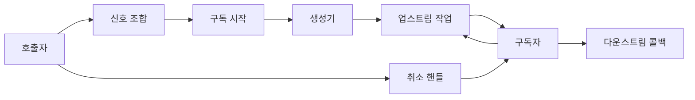
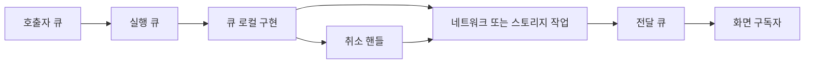
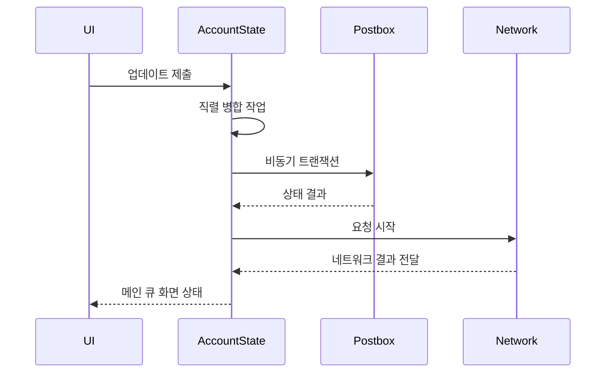

# 리액티브와 동시성 모델

웹: /docs/system/02-reactive-concurrency/ · Markdown: /docs/system/02-reactive-concurrency.md

> Telegram은 Signal, 명시적 취소, 큐 격리로 비동기 상태를 관리해요.

> 시스템 설계 · 기초와 동시성 · 02장 · 도표 3 · 코드 발췌 10 · 인용 27 · 소스 기준선: [TelegramMessenger/Telegram-iOS@f1dd7a2d](https://github.com/TelegramMessenger/Telegram-iOS/tree/f1dd7a2dbd02cbbf513e75d5695d8d36d1cf5838), [overtake/TelegramSwift@579cebbf](https://github.com/overtake/TelegramSwift/tree/579cebbf0c01fd41b712eff3647fa7f69db9665d)
>
> 관련 보충: [macOS fork 장별 검증 (01–07장)](/docs/system/31-fork-verify-01-07/)
>
> 핵심 소스 파일: [TelegramMessenger/Telegram-iOS/submodules/SSignalKit/SwiftSignalKit/Source/Signal.swift](https://github.com/TelegramMessenger/Telegram-iOS/blob/f1dd7a2dbd02cbbf513e75d5695d8d36d1cf5838/submodules/SSignalKit/SwiftSignalKit/Source/Signal.swift), [TelegramMessenger/Telegram-iOS/submodules/SSignalKit/SwiftSignalKit/Source/Subscriber.swift](https://github.com/TelegramMessenger/Telegram-iOS/blob/f1dd7a2dbd02cbbf513e75d5695d8d36d1cf5838/submodules/SSignalKit/SwiftSignalKit/Source/Subscriber.swift), [TelegramMessenger/Telegram-iOS/submodules/SSignalKit/SwiftSignalKit/Source/Disposable.swift](https://github.com/TelegramMessenger/Telegram-iOS/blob/f1dd7a2dbd02cbbf513e75d5695d8d36d1cf5838/submodules/SSignalKit/SwiftSignalKit/Source/Disposable.swift), [TelegramMessenger/Telegram-iOS/submodules/SSignalKit/SwiftSignalKit/Source/Promise.swift](https://github.com/TelegramMessenger/Telegram-iOS/blob/f1dd7a2dbd02cbbf513e75d5695d8d36d1cf5838/submodules/SSignalKit/SwiftSignalKit/Source/Promise.swift), [TelegramMessenger/Telegram-iOS/submodules/SSignalKit/SwiftSignalKit/Source/Atomic.swift](https://github.com/TelegramMessenger/Telegram-iOS/blob/f1dd7a2dbd02cbbf513e75d5695d8d36d1cf5838/submodules/SSignalKit/SwiftSignalKit/Source/Atomic.swift), [TelegramMessenger/Telegram-iOS/submodules/SSignalKit/SwiftSignalKit/Source/Queue.swift](https://github.com/TelegramMessenger/Telegram-iOS/blob/f1dd7a2dbd02cbbf513e75d5695d8d36d1cf5838/submodules/SSignalKit/SwiftSignalKit/Source/Queue.swift), [TelegramMessenger/Telegram-iOS/submodules/SSignalKit/SwiftSignalKit/Source/QueueLocalObject.swift](https://github.com/TelegramMessenger/Telegram-iOS/blob/f1dd7a2dbd02cbbf513e75d5695d8d36d1cf5838/submodules/SSignalKit/SwiftSignalKit/Source/QueueLocalObject.swift), [TelegramMessenger/Telegram-iOS/submodules/SSignalKit/SwiftSignalKit/Source/ThreadPool.swift](https://github.com/TelegramMessenger/Telegram-iOS/blob/f1dd7a2dbd02cbbf513e75d5695d8d36d1cf5838/submodules/SSignalKit/SwiftSignalKit/Source/ThreadPool.swift), [TelegramMessenger/Telegram-iOS/submodules/SSignalKit/SwiftSignalKit/Source/Timer.swift](https://github.com/TelegramMessenger/Telegram-iOS/blob/f1dd7a2dbd02cbbf513e75d5695d8d36d1cf5838/submodules/SSignalKit/SwiftSignalKit/Source/Timer.swift), [TelegramMessenger/Telegram-iOS/submodules/SSignalKit/SwiftSignalKit/Source/Signal_Dispatch.swift](https://github.com/TelegramMessenger/Telegram-iOS/blob/f1dd7a2dbd02cbbf513e75d5695d8d36d1cf5838/submodules/SSignalKit/SwiftSignalKit/Source/Signal_Dispatch.swift), [TelegramMessenger/Telegram-iOS/submodules/SSignalKit/SwiftSignalKit/Source/Signal_Combine.swift](https://github.com/TelegramMessenger/Telegram-iOS/blob/f1dd7a2dbd02cbbf513e75d5695d8d36d1cf5838/submodules/SSignalKit/SwiftSignalKit/Source/Signal_Combine.swift), [TelegramMessenger/Telegram-iOS/submodules/SSignalKit/SwiftSignalKit/Source/Signal_Catch.swift](https://github.com/TelegramMessenger/Telegram-iOS/blob/f1dd7a2dbd02cbbf513e75d5695d8d36d1cf5838/submodules/SSignalKit/SwiftSignalKit/Source/Signal_Catch.swift), [TelegramMessenger/Telegram-iOS/submodules/SSignalKit/SwiftSignalKit/Source/Signal_Meta.swift](https://github.com/TelegramMessenger/Telegram-iOS/blob/f1dd7a2dbd02cbbf513e75d5695d8d36d1cf5838/submodules/SSignalKit/SwiftSignalKit/Source/Signal_Meta.swift), [TelegramMessenger/Telegram-iOS/submodules/Postbox/Sources/Postbox.swift](https://github.com/TelegramMessenger/Telegram-iOS/blob/f1dd7a2dbd02cbbf513e75d5695d8d36d1cf5838/submodules/Postbox/Sources/Postbox.swift), [TelegramMessenger/Telegram-iOS/submodules/TelegramCore/Sources/State/AccountStateManager.swift](https://github.com/TelegramMessenger/Telegram-iOS/blob/f1dd7a2dbd02cbbf513e75d5695d8d36d1cf5838/submodules/TelegramCore/Sources/State/AccountStateManager.swift), [TelegramMessenger/Telegram-iOS/submodules/MtProtoKit/Sources/MTQueue.m](https://github.com/TelegramMessenger/Telegram-iOS/blob/f1dd7a2dbd02cbbf513e75d5695d8d36d1cf5838/submodules/MtProtoKit/Sources/MTQueue.m), [overtake/TelegramSwift/Telegram-Mac/ChatController.swift](https://github.com/overtake/TelegramSwift/blob/579cebbf0c01fd41b712eff3647fa7f69db9665d/Telegram-Mac/ChatController.swift)
>
> 미검증 사항:
> - macOS fork에서는 아직 빌드나 런타임 테스트를 실행하지 않았어요. `Signal.get() async`의 배포 타깃 호환성과 소스 `rg` 집계에 대응하는 런타임 동작은 여전히 미검증이에요.

Telegram은 SwiftSignalKit(Telegram이 쓰는 리액티브 라이브러리)으로 일회성 비동기 작업과 계속 이어지는 상태 스트림을 `Signal` 하나로 통일하고, `Disposable`로 구독자에게 취소 권한을 줘요. 핵심 가변 객체는 보통 직렬 `Queue`(작업을 한 번에 하나씩 차례로 실행하는 큐) 하나에만 속하고, 큐를 넘나드는 작업은 명시적으로 넘겨요.

이 조합은 동시성 안전을 전역 actor(Swift 동시성의 격리 단위)에 맡기지 않아요. 대신 데이터 흐름의 수명 주기와 실행 컨텍스트를 호출 체인에 함께 기록해요.[\[1\]](https://github.com/TelegramMessenger/Telegram-iOS/blob/f1dd7a2dbd02cbbf513e75d5695d8d36d1cf5838/submodules/SSignalKit/SwiftSignalKit/Source/Signal.swift#L63-L75)

## 프로토콜로 만든 작업 기술, Signal [#프로토콜로-만든-작업-기술-signal]

SwiftSignalKit은 클라이언트의 비동기 문제 두 종류를 모두 `Signal<T, E>`로 나타내요. `T`는 값이고 `E`는 실패 타입이에요. 생성자가 저장한 `generator`는 `Subscriber`를 받아서 `Disposable`을 돌려줘요.

클라이언트가 동시에 마주하는 두 종류의 문제는 이래요.

- 한 번 하고 끝나는 작업: 네트워크 요청과 데이터베이스 트랜잭션은 결국 끝나요.
- 계속 이어지는 상태: 채팅 목록, 온라인 상태, 설정은 최신 값을 오랫동안 계속 밀어 넣어야 해요.

호출하는 쪽마다 콜백, 작업 핸들, 스레드 규약을 따로 저장하면 취소할 때 빠뜨리기 쉽고, 상태 갱신도 엉뚱한 스레드에서 일어나요.[\[1\]](https://github.com/TelegramMessenger/Telegram-iOS/blob/f1dd7a2dbd02cbbf513e75d5695d8d36d1cf5838/submodules/SSignalKit/SwiftSignalKit/Source/Signal.swift#L63-L75)

`Signal`은 만들 때 `generator`를 실행하지 않아요. `start`가 `Subscriber`를 만들고 `generator`를 불러야 실행되기 때문에, 같은 인스턴스를 여러 구독이 따로따로 시작할 수 있어요. 이게 cold signal(구독하기 전에는 작업을 시작하지 않는 신호)의 핵심 의미예요.

호출하는 쪽이 `map`, `runOn`, `retry`를 조합해도 작업은 시작되지 않고, `start`를 불러야 시작돼요. `single`, `complete`, `fail`, `never`는 바로 만들어지는 스트림 네 가지일 뿐이고, 이 규칙을 똑같이 따라요.[\[1\]](https://github.com/TelegramMessenger/Telegram-iOS/blob/f1dd7a2dbd02cbbf513e75d5695d8d36d1cf5838/submodules/SSignalKit/SwiftSignalKit/Source/Signal.swift#L63-L75)

`submodules/SSignalKit/SwiftSignalKit/Source/Signal.swift` 63–75행 발췌.

```swift
public final class Signal<T, E> {
    private let generator: (Subscriber<T, E>) -> Disposable
    
    public init(_ generator: @escaping(Subscriber<T, E>) -> Disposable) {
        self.generator = generator
    }
    
    public func start(next: ((T) -> Void)! = nil, error: ((E) -> Void)! = nil, completed: (() -> Void)! = nil) -> Disposable {
        let subscriber = Subscriber<T, E>(next: next, error: error, completed: completed)
        let disposable = self.generator(subscriber)
        let wrappedDisposable = subscriber.assignDisposable(disposable)
        return SubscriberDisposable(subscriber: subscriber, disposable: wrappedDisposable)
    }
}
```

이 구조는 두 가지를 해결해요.

- 작업이 실제로 시작됐는지 호출하는 쪽에서 알 수 없던 문제를 풀어요.
- 일회성 작업과 상태 관찰이 파이프라인 문법을 함께 쓰게 해요.

대가는 신호 자체가 hot(구독자가 없어도 값을 들고 있는 소스)인지 cold인지, 어느 큐에서 값을 내보내는지 보장하지 않는다는 점이에요. 호출 지점을 읽을 때는 생성기와 스케줄링 연산자까지 계속 따라가야 해요. `Signal` 타입만 봐서는 부수 효과를 추론할 수 없어요.

영속 상태에서는 `Promise`와 `ValuePromise`가 이 cold 껍데기 안에서 hot 소스와 리플레이(새 구독자에게 최신 값을 다시 보내 주는 것)를 구현해요. 이건 뒤에서 설명해요.[\[4\]](https://github.com/TelegramMessenger/Telegram-iOS/blob/f1dd7a2dbd02cbbf513e75d5695d8d36d1cf5838/submodules/SSignalKit/SwiftSignalKit/Source/Promise.swift#L1-L139)

`E`는 실패를 타입의 일부로 만들어요. 스트림의 끝은 세 가지로 나뉘어요.

- 실패: 네트워크 요청에는 흔히 비즈니스 오류 타입이 있어요. 순수한 로컬 관찰은 보통 `NoError`를 써서 오류 콜백을 타지 않는다는 걸 나타내요.
- 완료: 실패와 달라요. 업스트림이 더 이상 값을 주지 않는다는 뜻이에요.
- `never`: 값도 내지 않고 끝나지도 않아요.[\[1\]](https://github.com/TelegramMessenger/Telegram-iOS/blob/f1dd7a2dbd02cbbf513e75d5695d8d36d1cf5838/submodules/SSignalKit/SwiftSignalKit/Source/Signal.swift#L63-L75)

이렇게 종점을 세 가지로 나누기 때문에, 호출 지점은 실패를 매핑하고 복구하고 기록할 수 있어요. 모든 종료를 옵셔널 값 하나로 뭉뚱그리지 않아도 돼요.

생성기는 값을 동기적으로 내보낼 수도 있고, 나중에 콜백으로 내보낼 수도 있어요. 그래서 `start`의 순서가 중요해요.

1. 구독자를 만들어요.
2. 생성기를 실행해요.
3. 생성기가 돌려준 disposable을 구독자에게 넘겨요.[\[1\]](https://github.com/TelegramMessenger/Telegram-iOS/blob/f1dd7a2dbd02cbbf513e75d5695d8d36d1cf5838/submodules/SSignalKit/SwiftSignalKit/Source/Signal.swift#L63-L75)

그러니까 동기적으로 완료되는 생성기는 `assignDisposable`보다 먼저 끝날 수 있어요. `Subscriber.assignDisposable`은 이미 끝난 상태를 알아채고, 뒤늦게 도착한 업스트림 disposable을 바로 dispose해요.[\[2\]](https://github.com/TelegramMessenger/Telegram-iOS/blob/f1dd7a2dbd02cbbf513e75d5695d8d36d1cf5838/submodules/SSignalKit/SwiftSignalKit/Source/Subscriber.swift#L152-L250) 동기 빠른 경로와 비동기 취소 사이의 경쟁을 처리하려면 필요한 세부 사항이에요. 이미 끝난 구독이 업스트림 리소스를 의도치 않게 붙잡는 일을 막아요.

`Subscriber` 하나가 끝나면 되돌릴 수 없어요. 오류와 완료는 모두 콜백 참조를 비워요. 그 뒤의 `putNext`는 `terminated`가 참이라서 무시돼요.[\[2\]](https://github.com/TelegramMessenger/Telegram-iOS/blob/f1dd7a2dbd02cbbf513e75d5695d8d36d1cf5838/submodules/SSignalKit/SwiftSignalKit/Source/Subscriber.swift#L152-L250)

그래서 늦게 도착한 네트워크 콜백이 이미 닫힌 화면의 구독을 다시 깨울 수 없어요. 그렇다고 하위 프로토콜 패킷이 도착하지 않는다는 뜻은 아니에요. 취소가 실제 I/O를 멈출 수 있는지는, 생성기가 돌려준 disposable이 취소를 네트워크 계층까지 계속 전달하는지에 달려 있어요.

`Subscriber`는 구독 하나의 종점이에요. 자기 종료 상태를 직렬화해요.

- `putNext`: 끝나지 않았을 때만 값을 전달해요.
- `putError`나 `putCompletion`: 콜백 세 개를 비우고 `terminated`를 표시하고 업스트림 disposable을 해제해요. 그래서 다운스트림이 먼저 완료되면 업스트림이 쥔 리소스도 취소돼요.
- 반대로 호출하는 쪽이 돌려받은 핸들을 dispose하면 `SubscriberDisposable`이 구독을 끝내요.[\[2\]](https://github.com/TelegramMessenger/Telegram-iOS/blob/f1dd7a2dbd02cbbf513e75d5695d8d36d1cf5838/submodules/SSignalKit/SwiftSignalKit/Source/Subscriber.swift#L152-L250)

`submodules/SSignalKit/SwiftSignalKit/Source/Subscriber.swift` 203–227행 발췌.

```swift
public func putCompletion() {
    var action: (() -> Void)! = nil
    
    var disposeDisposable: Disposable? = nil
    var keepAliveObjects: [AnyObject]?
    
    var next: ((T) -> Void)?
    var error: ((E) -> Void)?
    var completed: (() -> Void)?
    
    pthread_mutex_lock(&self.lock)
    if !self.terminated {
        action = self.completed
        next = self.next
        self.next = nil
        error = self.error
        self.error = nil
        completed = self.completed
        self.completed = nil
        self.terminated = true
        disposeDisposable = self.disposable
        self.disposable = nil
    }
```

여기서 락은 구독자의 메타데이터만 보호해요. 코드는 잠금을 푼 뒤에야 사용자의 `next`, `error`, `completed` 클로저와 `dispose`를 불러요. 그래서 사용자 클로저가 재진입(콜백 안에서 같은 객체를 다시 부르는 일)해도 내부 mutex를 쥐고 있지 않아요.

`keepAliveObjects`와 래핑 disposable이 푸는 건 종료 중인 객체가 너무 일찍 해제되는 문제예요. 이벤트 순서를 보장하는 장치가 아니에요.[\[2\]](https://github.com/TelegramMessenger/Telegram-iOS/blob/f1dd7a2dbd02cbbf513e75d5695d8d36d1cf5838/submodules/SSignalKit/SwiftSignalKit/Source/Subscriber.swift#L152-L250) 각 signal의 이벤트가 직렬인지는 여전히 그 업스트림과 고른 `Queue`에 달려 있어요.

아래 도표는 구독, 스케줄링, 취소가 파이프라인을 따라 어떻게 퍼지는지 보여줘요.



## 조합 연산자가 함께 지키는 취소 경계 [#조합-연산자가-함께-지키는-취소-경계]

취소 문제는 오류 전파보다 까다로워요. 검색어를 바꾸거나, 화면을 떠나거나, 계정을 닫을 때는 하위 요청이 나중에 응답을 돌려주더라도 이전 구독은 바로 무효가 돼야 해요. 이 문제를 다루는 `Disposable` 계열은 다음과 같아요.

- `Disposable`: 가장 작은 프로토콜이에요.
- `ActionDisposable`: 해제 동작을 일회성 동작으로 감싸요.
- `MetaDisposable`: 현재 disposable 하나를 들고 있다가, 새 값을 설정하면 이전 값을 해제해요. 자신이 이미 해제됐다면 새 값을 바로 해제해요.
- `DisposableSet`: 여러 개를 들고 있다가 `dispose` 한 번에 하나씩 해제해요.[\[3\]](https://github.com/TelegramMessenger/Telegram-iOS/blob/f1dd7a2dbd02cbbf513e75d5695d8d36d1cf5838/submodules/SSignalKit/SwiftSignalKit/Source/Disposable.swift#L107-L149)

`submodules/SSignalKit/SwiftSignalKit/Source/Disposable.swift` 107–125행 발췌.

```swift
public func set(_ disposable: Disposable?) {
    var previousDisposable: Disposable! = nil
    var disposeImmediately = false
    pthread_mutex_lock(&self.lock)
    disposeImmediately = self.disposed
    if !disposeImmediately {
        previousDisposable = self.disposable
        if let disposable = disposable {
            self.disposable = disposable
        } else {
            self.disposable = nil
        }
    }
    pthread_mutex_unlock(&self.lock)
    if previousDisposable != nil {
        previousDisposable.dispose()
    }
}
```

이 교체 규칙은 비동기 시작과 취소 사이의 경쟁을 풀어줘요. 예를 들어 `runOn`은 먼저 큐에 시작 클로저를 넣고, 이어서 실제 구독을 같은 `MetaDisposable`에 넣어요. 취소 시점에 따라 결과가 달라요.

- 호출하는 쪽이 먼저 취소하면: 동작 disposable이 취소 플래그를 설정하고, 대기 중이던 클로저는 플래그를 확인한 뒤 업스트림을 시작하지 않아요.
- 이미 시작했다면: 두 번째 `set`이 관리하는 게 바로 업스트림 구독이라서, 취소가 업스트림까지 계속 전해져요.[\[8\]](https://github.com/TelegramMessenger/Telegram-iOS/blob/f1dd7a2dbd02cbbf513e75d5695d8d36d1cf5838/submodules/SSignalKit/SwiftSignalKit/Source/Signal_Dispatch.swift#L3-L115)

이 방식은 불리언 값만 쓰는 것보다 나아요. 불리언으로는 이미 만든 네트워크, 타이머, 데이터베이스 구독을 해제할 수 없기 때문이에요.

`take`, `map`, `distinctUntilChanged`를 보면 연산자도 자기만의 작은 상태를 유지해야 한다는 걸 알 수 있어요.

- `take`: `Atomic<Int>`로 개수를 세고, N번째 값 이후에 다운스트림에 완료를 알려요. 완료되면 `Subscriber`가 업스트림을 해제해요.
- `distinctUntilChanged`: `Atomic`에 가장 최근 값을 저장하고, 첫 값과 같지 않은 새 값만 통과시켜요.

이 연산자들은 소스가 값을 만드는 능력은 바꾸지 않아요. 다운스트림이 무엇을 보는지, 구독이 언제 끝나는지만 바꿔요.[\[7\]](https://github.com/TelegramMessenger/Telegram-iOS/blob/f1dd7a2dbd02cbbf513e75d5695d8d36d1cf5838/submodules/SSignalKit/SwiftSignalKit/Source/Signal_Mapping.swift#L1-L129)

`map`은 순수한 값 변환이에요. `mapToSignal`은 값마다 내부 signal을 만들고, `switchToLatest`로 시작한 뒤 상태 객체 안의 `MetaDisposable`로 이전 내부 구독을 교체해요. 그래서 최신 값을 우선하는 평탄화(값마다 만든 내부 신호를 하나의 스트림으로 펴는 일) 연산이에요. 모든 내부 스트림을 병렬로 병합하는 게 아니에요.

설정이나 쿼리 결과처럼 계속 바뀌는 상태에 기대는 경우에 알맞은 선택이에요. 내부 작업을 하나도 버리면 안 되는 비즈니스라면, 이 연산자(`mapToSignal`)가 전부 끝나길 기다려 준다고 가정하면 안 돼요.[\[21\]](https://github.com/TelegramMessenger/Telegram-iOS/blob/f1dd7a2dbd02cbbf513e75d5695d8d36d1cf5838/submodules/SSignalKit/SwiftSignalKit/Source/Signal_Meta.swift#L3-L165)

`combineLatest`는 여러 상태가 일관되게 하나의 뷰를 이뤄야 하는 문제를 풀어요. 구현은 이렇게 움직여요.

- 입력마다 최신 값, 완료 여부, disposable을 저장해요.
- 모든 입력이 적어도 한 번씩 값을 낸 뒤에야 다운스트림에 튜플을 줘요.
- 선택 사항인 `queue`는 공유 상태의 읽기와 쓰기를 한 큐로 모아요. 큐를 주지 않으면 내부에서 락으로 공유 컨텍스트를 보호해요.[\[9\]](https://github.com/TelegramMessenger/Telegram-iOS/blob/f1dd7a2dbd02cbbf513e75d5695d8d36d1cf5838/submodules/SSignalKit/SwiftSignalKit/Source/Signal_Combine.swift#L1-L259)

덕분에 상태를 합성하기는 쉬워지지만, 비즈니스 스냅숏의 데이터베이스 일관성이 자동으로 정의되지는 않아요. 원자적 읽기와 쓰기가 필요하면 여전히 Postbox transaction 안에서 끝내야 해요. 자세한 내용은 [Postbox 스토리지 엔진](/docs/system/08-postbox-storage/)을 참고하세요.

재시도를 맡는 연산자는 둘이에요.

- `restart`: 실패를 바로 재구독으로 바꾸고, 정상 완료될 때까지 반복해요.
- `retry`: `Atomic`으로 재시도할 수 있는지와 현재 지연을 저장해요. 실패할 때마다 지연을 늘리되 `maxDelay`로 제한해요. 정책이 있는 오버로드는 오류를 걸러내고 횟수를 제한할 수도 있어요.

`retry`의 `ActionDisposable`은 현재 구독을 dispose하면서 재시도 스위치도 꺼요. 그래서 이미 큐에 들어간 재시도가 업스트림을 다시 시작하면 안 돼요.[\[10\]](https://github.com/TelegramMessenger/Telegram-iOS/blob/f1dd7a2dbd02cbbf513e75d5695d8d36d1cf5838/submodules/SSignalKit/SwiftSignalKit/Source/Signal_Catch.swift#L39-L189) 이 재시도는 명시적인 복구 전략이에요. 네트워크 신뢰성을 암묵적으로 보장하는 게 아니에요. 실제 업데이트 상태를 차분으로 복구하는 방식은 [업데이트 동기화](/docs/system/06-update-sync/)에서 다뤄요.

`mapToSignal`의 완료 규칙은 따로 눈여겨볼 만해요. 외부 스트림이 완료돼도 `switchToLatest`는 다운스트림을 바로 완료하지 않아요. `terminated`를 상태 객체에 기록해 둬요. 현재 내부 스트림이 아직 실행 중이면, 상태 객체는 내부가 완료된 뒤에야 다운스트림 완료를 불러요.[\[21\]](https://github.com/TelegramMessenger/Telegram-iOS/blob/f1dd7a2dbd02cbbf513e75d5695d8d36d1cf5838/submodules/SSignalKit/SwiftSignalKit/Source/Signal_Meta.swift#L3-L165) 외부가 빨리 끝났을 때 마지막 내부 요청이 잘려 나가는 일을 막아요.

반대로 새 외부 값이 도착하면 큐 모드가 아닐 때 바로 새 내부 스트림을 시작하고, `currentDisposable.set`으로 이전 내부 스트림을 해제해요.[\[21\]](https://github.com/TelegramMessenger/Telegram-iOS/blob/f1dd7a2dbd02cbbf513e75d5695d8d36d1cf5838/submodules/SSignalKit/SwiftSignalKit/Source/Signal_Meta.swift#L3-L165)

같은 `SignalQueueState`가 서로 다른 두 가지 의미도 구현해요.

- `queue`: `queueMode`를 설정하고, 이전 내부 스트림이 끝나지 않았으면 이후 내부 스트림을 배열에 넣어요.
- `throttled`: 이것도 큐에 넣지만, 새 내부 스트림이 도착하면 기존 대기 배열을 비우고 가장 최근 것 하나만 남겨요.[\[21\]](https://github.com/TelegramMessenger/Telegram-iOS/blob/f1dd7a2dbd02cbbf513e75d5695d8d36d1cf5838/submodules/SSignalKit/SwiftSignalKit/Source/Signal_Meta.swift#L3-L165)

`switchToLatest`, `queue`, `throttled`라는 세 이름은 성능 힌트가 아니라 결과를 전달하는 계약이에요. 검색 제안은 보통 최신 결과가 필요해요. 반드시 순서대로 실행해야 하는 쓰기 작업에는 `queue`가 필요할 수 있어요. 계속 새로고침하면서 최종 상태만 신경 쓰는 작업에는 `throttled`가 맞아요. (추론)

`combineLatest`의 오류 경로에도 분명한 경계가 있어요. `SignalCombineState.error`가 오류를 중복해서 전달하지 못하게 막아요. 첫 번째 오류가 다운스트림에 전달되면 구독자가 끝나고 결합기의 `DisposableSet`이 해제돼요. 그 뒤의 업스트림 이벤트는 그 구독에 영향을 주면 안 돼요.[\[2\]](https://github.com/TelegramMessenger/Telegram-iOS/blob/f1dd7a2dbd02cbbf513e75d5695d8d36d1cf5838/submodules/SSignalKit/SwiftSignalKit/Source/Subscriber.swift#L152-L250) [\[9\]](https://github.com/TelegramMessenger/Telegram-iOS/blob/f1dd7a2dbd02cbbf513e75d5695d8d36d1cf5838/submodules/SSignalKit/SwiftSignalKit/Source/Signal_Combine.swift#L1-L259)

오류가 없으면 모든 입력이 완료돼야만 다운스트림이 완료돼요. 값을 거의 내지 않거나 끝나지 않는 입력이 하나라도 있으면 결합 스트림은 계속 살아 있어요. 상태를 관찰할 때는 예상된 동작이지만, 단발성 결과를 기다리는 용도에는 맞지 않아요.

`retry`의 지연은 지수 백오프(재시도 간격을 매번 배로 늘리는 방식)가 아니에요. 소스는 실패할 때마다 `min(maxDelay, value + delayIncrement)`를 계산해요. 다시 말해 선형으로 늘리다가 상한에서 멈춰요.[\[10\]](https://github.com/TelegramMessenger/Telegram-iOS/blob/f1dd7a2dbd02cbbf513e75d5695d8d36d1cf5838/submodules/SSignalKit/SwiftSignalKit/Source/Signal_Catch.swift#L39-L189)

초기 증분, 최대 지연, 큐, 최대 횟수는 호출하는 쪽이 정해요. 덕분에 정책은 투명하게 유지되지만, 네트워크 호출마다 설정이 달라질 수 있어요. 제품에 지터(재시도 간격에 섞는 무작위 값), 서버의 재시도 힌트, 전역 서킷 브레이커(연속 실패 시 호출을 막는 장치)가 필요하다면 생성기나 더 상위 계층에서 따로 구현해야 해요. (추론)

## hot 상태를 cold 인터페이스에 담는 Promise [#hot-상태를-cold-인터페이스에-담는-promise]

상태 소스는 새 구독자가 현재 값을 바로 받아야 해요. 그런데 일반적인 cold signal은 어떤 값도 저장하지 않아요. `Promise<T>`는 다음을 가져요.

- 옵셔널 현재 값
- `Bag`(구독 클로저를 모아 두는 컨테이너) 하나에 담은 구독 클로저
- `MetaDisposable` 하나

`set(signal)`은 받은 signal을 구독하고, 새 값마다 기록하고, 이미 구독 중인 쪽에 알려요. `get()`은 먼저 락 안에서 구독자를 등록하고, 락을 푼 뒤 현재 값을 바로 전달해요. 첫 구독이 `initializeOnFirstAccess`를 일으킬 수도 있어서, 관찰자가 없을 때는 비싼 초기화를 하지 않아요.[\[4\]](https://github.com/TelegramMessenger/Telegram-iOS/blob/f1dd7a2dbd02cbbf513e75d5695d8d36d1cf5838/submodules/SSignalKit/SwiftSignalKit/Source/Promise.swift#L1-L139)

`submodules/SSignalKit/SwiftSignalKit/Source/Promise.swift` 51–71행 발췌.

```swift
public func get() -> Signal<T, NoError> {
    return Signal { subscriber in
        pthread_mutex_lock(&self.lock)
        var initializeOnFirstAccessNow: Signal<T, NoError>?
        if let initializeOnFirstAccess = self.initializeOnFirstAccess {
            initializeOnFirstAccessNow = initializeOnFirstAccess
            self.initializeOnFirstAccess = nil
        }
        let currentValue = self.value
        let index = self.subscribers.add({ next in
            subscriber.putNext(next)
        })
        pthread_mutex_unlock(&self.lock)

        if let currentValue = currentValue {
            subscriber.putNext(currentValue)
        }
        if let initializeOnFirstAccessNow = initializeOnFirstAccessNow {
            self.set(initializeOnFirstAccessNow)
        }
}
```

`ValuePromise<T: Equatable>`는 값을 더 직접적으로 받아요. `ignoreRepeated`를 선택할 수 있고, 새 값이 이전 값과 같으면 구독자에게 알리지 않아요. 중복 제거를 상태 소스 옆에 두면 의미 없는 UI 새로고침이 줄어요. 다만 값의 `Equatable` 의미가 비즈니스상의 동등성을 실제로 나타내야 해요. 그렇지 않으면 관찰해야 할 변화를 잘못 막아요.[\[4\]](https://github.com/TelegramMessenger/Telegram-iOS/blob/f1dd7a2dbd02cbbf513e75d5695d8d36d1cf5838/submodules/SSignalKit/SwiftSignalKit/Source/Promise.swift#L1-L139)

- `ValuePipe`: 리플레이 없는 브로드캐스트용이에요.
- `Promise`: 최신 상태를 리플레이할 수 있어요.

둘 다 콜백을 락 밖에서 부른다는 것만 보장해요. 그래서 호출하는 쪽은 여전히 `deliverOn`으로 UI가 속한 큐를 정해야 해요.

`Promise.set`의 수명 주기도 `MetaDisposable`이 관리해요. 새 signal을 설정할 때마다 이전 구독이 교체돼요. 이전 신호가 계속 값을 만들어 내더라도 promise의 캐시를 더 이상 바꾸면 안 돼요.[\[3\]](https://github.com/TelegramMessenger/Telegram-iOS/blob/f1dd7a2dbd02cbbf513e75d5695d8d36d1cf5838/submodules/SSignalKit/SwiftSignalKit/Source/Disposable.swift#L107-L149) [\[4\]](https://github.com/TelegramMessenger/Telegram-iOS/blob/f1dd7a2dbd02cbbf513e75d5695d8d36d1cf5838/submodules/SSignalKit/SwiftSignalKit/Source/Promise.swift#L1-L139) 이 교체 방식은 새 계정 상태 스트림으로 이전 상태 스트림을 교체하는 데 잘 맞아요.

멀티캐스트 캐시와는 달라요. `get()`은 구독할 때마다 독립된 클로저를 등록하고, 취소하면 `Bag`에서 그 클로저만 지워요.[\[4\]](https://github.com/TelegramMessenger/Telegram-iOS/blob/f1dd7a2dbd02cbbf513e75d5695d8d36d1cf5838/submodules/SSignalKit/SwiftSignalKit/Source/Promise.swift#L1-L139)

구현은 일부러 락을 푼 뒤에 구독 콜백을 불러요. 그래서 `set`의 구독자가 콜백 안에서 상태를 다시 읽거나 취소하거나 설정해도, 같은 pthread mutex에서 데드락이 생기지 않아요.[\[4\]](https://github.com/TelegramMessenger/Telegram-iOS/blob/f1dd7a2dbd02cbbf513e75d5695d8d36d1cf5838/submodules/SSignalKit/SwiftSignalKit/Source/Promise.swift#L1-L139)

대가는 락이 컨테이너 조작만 보호한다는 점이에요. 모든 관찰자가 전역적으로 완전히 같은 타이밍을 본다고 보장하지는 않아요. 예를 들어 `get()`은 이렇게 움직여요.

1. 락 안에서 캐시된 값을 꺼내 구독자를 등록해요.
2. 락 밖에서 그 캐시를 보내요.

그사이 일어난 `set`이 더 새로운 알림을 먼저 보낼 수 있어요. 코드는 이 구간에 버전 번호나 재정렬 로직을 붙이지 않았어요.[\[4\]](https://github.com/TelegramMessenger/Telegram-iOS/blob/f1dd7a2dbd02cbbf513e75d5695d8d36d1cf5838/submodules/SSignalKit/SwiftSignalKit/Source/Promise.swift#L1-L139) 엄격한 이벤트 순서가 필요하다면 생산과 구독을 같은 직렬 `Queue`에 올려야 해요. (추론)

그래서 Promise는 데이터베이스 일관성 프리미티브(기본 도구)가 아니에요. Promise가 풀어 주는 건 최신 메모리 상태의 리플레이와 구독 관리예요. 여러 필드의 읽기, 쓰기, 알림을 하나의 원자적 트랜잭션으로 만들어 주지는 않아요. Postbox는 이런 요구를 transaction에 맡기고, transaction의 결과를 다시 signal로 바꿔요.[\[13\]](https://github.com/TelegramMessenger/Telegram-iOS/blob/f1dd7a2dbd02cbbf513e75d5695d8d36d1cf5838/submodules/Postbox/Sources/Postbox.swift#L4675-L4775) 두 계층을 헷갈리면, UI가 새 메모리 상태를 받았는데 영속화는 아직 커밋되지 않은 시점에 잘못된 가정을 하게 돼요.

`Atomic<T>`는 이 프리미티브들이 쓰는 가장 작은 동기화 도구예요.

- `with`: mutex 안에서 읽어요.
- `modify`: mutex 안에서 읽고 고쳐요.
- `swap`: 이전 값을 돌려줘요.

카운터, 플래그, 작은 참조 상태에 알맞아요. 긴 트랜잭션, 데이터베이스 I/O, 사용자 클로저를 `Atomic`의 클로저에 넣으면 락 범위가 넓어져서 병렬성을 해치고 재진입 위험이 높아져요.[\[20\]](https://github.com/TelegramMessenger/Telegram-iOS/blob/f1dd7a2dbd02cbbf513e75d5695d8d36d1cf5838/submodules/SSignalKit/SwiftSignalKit/Source/Atomic.swift#L7-L56) Telegram은 큰 가변 상태를 객체 전체의 필드별 원자화 대신 직렬 큐 하나에 가두는 경우가 더 많아요.

## 상태를 건드릴 수 있는 주체를 정하는 스케줄링 [#상태를-건드릴-수-있는-주체를-정하는-스케줄링]

`Queue`는 `DispatchQueue`의 가벼운 래퍼예요.

- 이름 있는 생성자: 직렬 큐를 만들고 `setSpecific`(큐에 값을 붙이는 API)으로 정체성을 저장해요.
- `isCurrent`: 이 정체성으로 현재 컨텍스트를 판단하고, 메인 큐는 따로 메인 스레드로 처리해요.
- `async`와 `sync`: 이미 대상 큐 안에 있으면 바로 실행하고, 그렇지 않을 때만 GCD(Apple의 동시성 API)를 불러요.
- `justDispatch`: 항상 비동기로 전달해요.[\[5\]](https://github.com/TelegramMessenger/Telegram-iOS/blob/f1dd7a2dbd02cbbf513e75d5695d8d36d1cf5838/submodules/SSignalKit/SwiftSignalKit/Source/Queue.swift#L42-L87)

`submodules/SSignalKit/SwiftSignalKit/Source/Queue.swift` 50–74행 발췌.

```swift
public func isCurrent() -> Bool {
    if DispatchQueue.getSpecific(key: QueueSpecificKey) === self.specific {
        return true
    } else if self.specialIsMainQueue && Thread.isMainThread {
        return true
    } else {
        return false
    }
}

public func async(_ f: @escaping () -> Void) {
    if self.isCurrent() {
        f()
    } else {
        self.nativeQueue.async(execute: f)
    }
}

public func sync(_ f: () -> Void) {
    if self.isCurrent() {
        f()
    } else {
        self.nativeQueue.sync(execute: f)
    }
}
```

이 빠른 경로는 무엇보다 같은 직렬 큐에서 다시 `sync`하면 생기는 데드락을 풀어요. 이미 대상 큐 안에 있을 때 컨텍스트를 전환하는 일도 줄여요.

하지만 여기서 `async`라는 이름이 항상 지연 실행을 뜻하지는 않아요. 이미 대상 큐에 있으면 클로저가 동기적으로 실행돼요. 다음 중 하나가 필요하면 코드는 `justDispatch`를 골라야 해요.

- 재진입 격리
- 현재 콜 스택 이후로 미루기
- 이벤트 경계 유지

`async`가 항상 지연 실행은 아니라는 점이 Telegram의 콜백을 이해할 때 가장 놓치기 쉬운 성능과 의미상의 요점이에요.[\[5\]](https://github.com/TelegramMessenger/Telegram-iOS/blob/f1dd7a2dbd02cbbf513e75d5695d8d36d1cf5838/submodules/SSignalKit/SwiftSignalKit/Source/Queue.swift#L42-L87)

이름 있는 `Queue`는 기본적으로 직렬 GCD 큐예요. `Queue.mainQueue()`, `concurrentDefaultQueue()`, `concurrentBackgroundQueue()`는 공유 큐를 감싸요.[\[5\]](https://github.com/TelegramMessenger/Telegram-iOS/blob/f1dd7a2dbd02cbbf513e75d5695d8d36d1cf5838/submodules/SSignalKit/SwiftSignalKit/Source/Queue.swift#L42-L87) 그래서 “Queue에서 실행한다”가 자동으로 상호 배제를 뜻하지는 않아요. 어떤 객체가 소유한 직렬 인스턴스만 그 상태의 소유자가 될 수 있어요. 공유 동시 큐는 공유 상태가 없는 계산, 네트워크 대기 콜백, 준비 작업에만 알맞아요. 가변 상태를 `concurrentDefaultQueue()`에 두면 여전히 `Atomic`, 락, 또는 다른 소유권 메커니즘이 필요해요.

`deliverOn`과 `runOn`은 생산과 소비를 정확히 나눠요.

- `deliverOn`: 세 가지 종료 이벤트를 각각 `queue.async`로 전달해요.
- `runOn`: 구독 동작을 큐에 전달하고, 이미 대상 큐에 속해 있으면 바로 시작해요.[\[8\]](https://github.com/TelegramMessenger/Telegram-iOS/blob/f1dd7a2dbd02cbbf513e75d5695d8d36d1cf5838/submodules/SSignalKit/SwiftSignalKit/Source/Signal_Dispatch.swift#L3-L115)

생성기 자체가 큐를 다시 바꿀 수 있어서, `runOn`이 파이프라인 전체를 영구히 묶지는 않아요. 구독 생성기가 처음 실행되는 위치만 정해요. UI 코드는 최종 소비 지점에서 다시 명시적으로 `deliverOn(Queue.mainQueue())`를 해야 해요. 업스트림이 우연히 어느 큐에서 콜백하는지에 기대면 안 돼요.

`Queue.isCurrent`의 정체성은 큐 레이블 문자열을 비교해서가 아니라 dispatch specific 값으로 판단해요. 서로 다른 큐는 레이블이 같아도 같은 컨텍스트로 잘못 판단하면 안 돼요.[\[5\]](https://github.com/TelegramMessenger/Telegram-iOS/blob/f1dd7a2dbd02cbbf513e75d5695d8d36d1cf5838/submodules/SSignalKit/SwiftSignalKit/Source/Queue.swift#L42-L87) 덕분에 단언과 빠른 경로가 런타임에 객체 소유자를 안정적으로 식별할 수 있어요. 메인 큐는 특수한 경우예요. 구현은 `Thread.isMainThread`로 메인 큐 컨텍스트를 인정해요. 그래서 메인 스레드만 이 빠른 경로를 일으킬 수 있어요.[\[5\]](https://github.com/TelegramMessenger/Telegram-iOS/blob/f1dd7a2dbd02cbbf513e75d5695d8d36d1cf5838/submodules/SSignalKit/SwiftSignalKit/Source/Queue.swift#L42-L87)

큐를 넘나들 때는 불변 값, 짧은 클로저, 신호 이벤트를 전달해야 해요. A 큐에서 B 큐의 로컬 객체를 캡처한 뒤 내부 필드에 바로 접근하면 안 돼요. 공개 파사드(밖으로 열어 둔 인터페이스)는 B의 `with`, `syncWith`, `signalWith`를 써야 해요.

`signalWith`가 돌려주는 signal에는 `runOn(self.queue)`도 붙어요. 그래서 생성기가 객체에 접근하는 시점도 소유자 큐로 돌아와요.[\[6\]](https://github.com/TelegramMessenger/Telegram-iOS/blob/f1dd7a2dbd02cbbf513e75d5695d8d36d1cf5838/submodules/SSignalKit/SwiftSignalKit/Source/QueueLocalObject.swift#L3-L57) 접근 지점이 소수의 통로로 모이기 때문에, 코드 리뷰에서 잘못된 큐 점프를 찾기 쉬워요.

큐 격리가 있다고 해서, 큐를 넘나드는 클로저의 비즈니스 전제가 여전히 성립한다는 게 증명되지는 않아요. 콜백이 백그라운드에서 돌아올 때 계정이 이미 로그아웃됐을 수도 있고, 화면 컨트롤러가 이미 해제됐을 수도 있어요. 소스는 이런 무효화 경로를 약한 참조, 교체 가능한 disposable, 소유 큐에서의 상태 확인으로 처리하는 경우가 많아요.[\[3\]](https://github.com/TelegramMessenger/Telegram-iOS/blob/f1dd7a2dbd02cbbf513e75d5695d8d36d1cf5838/submodules/SSignalKit/SwiftSignalKit/Source/Disposable.swift#L107-L149) [\[14\]](https://github.com/TelegramMessenger/Telegram-iOS/blob/f1dd7a2dbd02cbbf513e75d5695d8d36d1cf5838/submodules/TelegramCore/Sources/State/AccountStateManager.swift#L396-L505) 설계할 때는 객체 정체성, 요청 코드, 상태 버전을 콜백 조건에 넣어야 해요. 직렬 큐에만 기대면 안 돼요. (추론)

`deliverOn`과 `runOn`은 바꾸는 대상이 달라요.

- `deliverOn(queue)`: 다운스트림 콜백의 위치를 바꿔요. 먼저 소스를 구독한 뒤 `next`, 오류, 완료를 각각 큐에 전달해요.
- `runOn(queue)`: 소스 작업이 시작되는 위치를 바꿔요. 대상 큐가 이미 현재 큐이면 바로 구독해요.

둘을 조합하면 백그라운드에서 시작하고 메인 큐에서 소비할 수 있어요. 하지만 호출하는 쪽을 대신해 백프레셔나 배치 처리를 구현해 주지는 않아요.[\[8\]](https://github.com/TelegramMessenger/Telegram-iOS/blob/f1dd7a2dbd02cbbf513e75d5695d8d36d1cf5838/submodules/SSignalKit/SwiftSignalKit/Source/Signal_Dispatch.swift#L3-L115)

`submodules/SSignalKit/SwiftSignalKit/Source/Signal_Dispatch.swift` 54–75행 발췌.

```swift
public func runOn<T, E>(_ queue: Queue) -> (Signal<T, E>) -> Signal<T, E> {
    return { signal in
        return Signal { subscriber in
            if queue.isCurrent() {
                return signal.start(next: { next in
                    subscriber.putNext(next)
                }, error: { error in
                    subscriber.putError(error)
                }, completed: {
                    subscriber.putCompletion()
                })
            } else {
                var cancelled = false
                let disposable = MetaDisposable()
                
                disposable.set(ActionDisposable {
                    cancelled = true
                })
                
                queue.async {
                    if cancelled {
                        return
                    }
```

`QueueLocalObject<T>`는 앞에서 본 큐 규약을 객체 경계로 만든 거예요. 소유 큐에서 `T`를 만들어 들고 있다가, 같은 큐에서 해제해요.

- `unsafeGet`: 현재 큐를 단언해요.
- `with`: 비동기로 접근해요.
- `syncWith`: 동기로 결과를 받아요.
- `signalWith`: 소유 큐에서 신호를 시작해요.

이렇게 하면 공개 파사드는 큐를 넘어 쥘 수 있어요. 그러면서도 실제 가변 구현은 엉뚱한 스레드가 직접 읽고 쓰지 못해요.[\[6\]](https://github.com/TelegramMessenger/Telegram-iOS/blob/f1dd7a2dbd02cbbf513e75d5695d8d36d1cf5838/submodules/SSignalKit/SwiftSignalKit/Source/QueueLocalObject.swift#L3-L57)

`submodules/SSignalKit/SwiftSignalKit/Source/QueueLocalObject.swift` 3–24행 발췌.

```swift
public final class QueueLocalObject<T: AnyObject> {
    public let queue: Queue
    private var valueRef: Unmanaged<T>?
    
    public init(queue: Queue, generate: @escaping () -> T) {
        self.queue = queue
        
        self.queue.async {
            let value = generate()
            self.valueRef = Unmanaged.passRetained(value)
        }
    }
    
    deinit {
        let valueRef = self.valueRef
        self.queue.async {
            valueRef?.release()
        }
    }
    
    public func unsafeGet() -> T? {
        assert(self.queue.isCurrent())
        return self.valueRef?.takeUnretainedValue()
    }
}
```

이 타입은 `Unmanaged.passRetained`로 큐를 넘나드는 소멸 문제를 피해 가요. 대가는 호출하는 쪽이 초기화가 비동기라는 점과 큐의 수명 주기를 존중해야 한다는 거예요.

`syncWith`는 편리하지만 호출한 큐를 막을 수 있어요. 설계할 때는 `syncWith`가 아주 작은 동기 값만 돌려주게 하고, I/O와 기다릴 수 있는 계산은 signal로 나타내야 해요. 서로의 실행 순서를 모르는 두 직렬 큐는 서로에게 `syncWith`하면 안 돼요. 서로 `syncWith`하면 여전히 순환 대기가 생길 수 있어요. 큐 격리는 데이터 경쟁을 피하게 해 줄 뿐, 모든 데드락을 없애 주지는 못한다는 경계예요.

아래 도표는 `runOn`, `deliverOn`, 큐 로컬 객체가 역할을 어떻게 나누는지 보여줘요.



## Postbox와 계정 상태의 큐 규율 [#postbox와-계정-상태의-큐-규율]

Postbox(Telegram의 로컬 데이터 저장소)가 푸는 문제는 수많은 비즈니스 호출이 로컬 상태를 동시에 읽고 쓰는 거예요. 공개된 `Postbox`는 `Queue` 하나와 `QueueLocalObject<PostboxImpl>`를 들고 있어요.

- 생성자: 실제 `PostboxImpl`을 지정된 큐에 만들어요.
- 단순한 키-값 읽기는 `syncWith`로, 비동기 쓰기는 `with`로 처리해요.
- `transactionSignal`과 `transaction`: 모두 구독할 때 작업을 `impl`이 속한 큐에 전달하고, 내부 signal의 disposable을 `MetaDisposable`에 저장해요.[\[13\]](https://github.com/TelegramMessenger/Telegram-iOS/blob/f1dd7a2dbd02cbbf513e75d5695d8d36d1cf5838/submodules/Postbox/Sources/Postbox.swift#L4675-L4775)

덕분에 데이터베이스 트랜잭션의 가변 캐시, 쓰기 배치, 뷰 갱신이 하나의 컨텍스트 안에서 직렬로 일어나요. SQLite, 트랜잭션 커밋, 뷰 전파의 저장소 세부 사항은 [Postbox 스토리지 엔진](/docs/system/08-postbox-storage/)과 [Postbox 뷰와 메시지 이력 모델](/docs/system/09-postbox-views/)에 있어요.

`submodules/Postbox/Sources/Postbox.swift` 4754–4775행 발췌.

```swift
public func transactionSignal<T, E>(userInteractive: Bool = false, _ f: @escaping(Subscriber<T, E>, Transaction) -> Disposable) -> Signal<T, E> {
    return Signal<T, E> { subscriber in
        let disposable = MetaDisposable()

        self.impl.with { impl in
            disposable.set(impl.transactionSignal(userInteractive: userInteractive, f).start(next: subscriber.putNext, error: subscriber.putError, completed: subscriber.putCompletion))
        }

        return disposable
    }
}

public func transaction<T>(userInteractive: Bool = false, ignoreDisabled: Bool = false, _ f: @escaping(Transaction) -> T, file: String = #file, line: Int = #line) -> Signal<T, NoError> {
    return Signal<T, NoError> { subscriber in
        let disposable = MetaDisposable()

        self.impl.with { impl in
            disposable.set(impl.transaction(userInteractive: userInteractive, ignoreDisabled: ignoreDisabled, f, file: file, line: line).start(next: subscriber.putNext, error: subscriber.putError, completed: subscriber.putCompletion))
        }

        return disposable
    }
}
```

여기서 cold signal과 큐 격리가 어떻게 맞물리는지 볼 수 있어요. transaction을 만들면 작업 기술만 얻어요. 구독해야 `impl.with`가 Postbox 큐에 들어가요.

취소는 먼저 `MetaDisposable`에 닿아요.

- 내부 구독이 아직 만들어지지 않았다면: 만들어지는 순간 해제돼요.
- 이미 만들어졌다면: 내부 transaction의 disposable을 취소해요.

그래서 호출하는 쪽은 자기가 큐에서 대기 중인 작업을 취소하는지, 실행 중인 작업을 취소하는지 짐작할 필요가 없어요.[\[3\]](https://github.com/TelegramMessenger/Telegram-iOS/blob/f1dd7a2dbd02cbbf513e75d5695d8d36d1cf5838/submodules/SSignalKit/SwiftSignalKit/Source/Disposable.swift#L107-L149) [\[13\]](https://github.com/TelegramMessenger/Telegram-iOS/blob/f1dd7a2dbd02cbbf513e75d5695d8d36d1cf5838/submodules/Postbox/Sources/Postbox.swift#L4675-L4775)

계정 상태 관리자도 같은 패턴을 쓰지만 맡은 건 업데이트 처리 큐예요.

- `AccountStateManager`는 `AccountStateManager`라는 이름의 `Queue`를 초기화하고, `Impl`을 `QueueLocalObject`에 넣어요.
- `Impl`은 내부에 작업 배열, 네트워크 참조, 상태 파이프라인을 들고 있고, 메서드는 `self.queue.async`로 외부 update를 모아요.
- 초기화 중 `shouldKeepOnlinePresence`와 네트워크 요청을 조합할 때는 `combineLatest(queue: self.queue, ...)`를 쓰고, 네트워크 결과도 `deliverOn(self.queue)`로 상태 머신에 돌려보내요.[\[14\]](https://github.com/TelegramMessenger/Telegram-iOS/blob/f1dd7a2dbd02cbbf513e75d5695d8d36d1cf5838/submodules/TelegramCore/Sources/State/AccountStateManager.swift#L396-L505)

`submodules/TelegramCore/Sources/State/AccountStateManager.swift` 2128–2151행 발췌.

```swift
let queue = Queue(name: "AccountStateManager")

self.accountPeerId = accountPeerId
self.postbox = postbox
self.network = network
self.auxiliaryMethods = auxiliaryMethods

let messagesRemovedContext = self.messagesRemovedContext

var updateConfigRequestedImpl: (() -> Void)?
var isPremiumUpdatedImpl: (() -> Void)?

self.impl = QueueLocalObject(queue: queue, generate: {
    return Impl(
        queue: queue,
        accountPeerId: accountPeerId,
        accountManager: accountManager,
        postbox: postbox,
        network: network,
        callSessionManager: callSessionManager,
        addIsContactUpdates: addIsContactUpdates,
        shouldKeepOnlinePresence: shouldKeepOnlinePresence,
        peerInputActivityManager: peerInputActivityManager,
        auxiliaryMethods: auxiliaryMethods
        // ...
```

이렇게 상태 머신 큐 하나로 모으면 `operations`, 폴링 플래그, update 병합기에 각각 락을 거는 것보다 순서를 유지하기 쉬워요. 비용은 같은 계정 안에서 시간이 오래 걸리는 작업이 이 큐를 점유하면 안 된다는 점이에요. 소스의 네트워크 요청은 큐 안에서 동기적으로 기다리지 않고, 결과가 돌아올 때 큐로 전달돼요. 그래서 큐는 상태 전이만 처리해요.

여러 계정이 각자 상태 관리자를 만들면 계정 간 병렬성은 자연히 확보돼요. (추론) 이 방식의 트레이드오프는 계정별 업데이트 순서를 먼저 보장하는 대신, 하나의 hot한 계정이 처리할 수 있는 상태 처리량을 제한한다는 거예요.[\[14\]](https://github.com/TelegramMessenger/Telegram-iOS/blob/f1dd7a2dbd02cbbf513e75d5695d8d36d1cf5838/submodules/TelegramCore/Sources/State/AccountStateManager.swift#L396-L505)

네트워크 계층도 컨텍스트 큐를 지켜요. 오래된 MtProtoKit(MTProto 전송 계층 라이브러리)의 `MTQueue`는 큐에 specific 값을 설정해요. `dispatchOnQueue:synchronous:`는 현재 큐나 메인 스레드이면 바로 실행하고, 그렇지 않을 때만 `dispatch_sync` 또는 `dispatch_async`를 써요. `MTContext`는 여러 곳에서 현재 큐가 자기 `contextQueue`인지 단언해서 세션과 연결 컨텍스트를 보호해요.[\[17\]](https://github.com/TelegramMessenger/Telegram-iOS/blob/f1dd7a2dbd02cbbf513e75d5695d8d36d1cf5838/submodules/MtProtoKit/Sources/MTQueue.m#L15-L130)

이 패턴은 Swift `Queue`와 같아요. 큐 소유권이 Objective-C 전송 계층과 Swift 코어 계층을 가로지른다는 걸 보여줘요. 인증 키, 데이터 센터 선택, 전송 세션의 역할은 [인증 키와 다중 데이터 센터](/docs/system/04-auth-keys-datacenters/)와 [MTProto 전송 계층](/docs/system/03-mtproto-transport/)에 있어요.

아래 도표는 Postbox 트랜잭션과 계정 상태 머신 사이에서 큐를 오가는 흐름을 보여줘요.



## Objective-C 대응 계층과 작업 스레드 [#objective-c-대응-계층과-작업-스레드]

저장소는 `SSignalKit/SSignalKit`의 Objective-C 계층과 `SwiftSignalKit`을 함께 유지해요. Objective-C 계층에는 `SSignal`, `SSubscriber`, `SDisposable`, `SMetaDisposable`, `SQueue`, `SThreadPool`, `STimer` 같은 대응 개념이 있어요. 이 중 `SMetaDisposable`도 마찬가지로 pthread mutex로 교체와 해제를 보호해요. MtProtoKit의 Objective-C 파일은 `MTSignal`과 `MTQueue`를 쓰고, Swift 코어 모듈은 `SwiftSignalKit`을 직접 써요.[\[15\]](https://github.com/TelegramMessenger/Telegram-iOS/blob/f1dd7a2dbd02cbbf513e75d5695d8d36d1cf5838/submodules/SSignalKit/SSignalKit/Source/SSignalKit/SSignal.m#L1-L163) [\[16\]](https://github.com/TelegramMessenger/Telegram-iOS/blob/f1dd7a2dbd02cbbf513e75d5695d8d36d1cf5838/submodules/SSignalKit/SSignalKit/Source/SSignalKit/SQueue.m#L58-L122) [\[17\]](https://github.com/TelegramMessenger/Telegram-iOS/blob/f1dd7a2dbd02cbbf513e75d5695d8d36d1cf5838/submodules/MtProtoKit/Sources/MTQueue.m#L15-L130)

두 구현이 함께 있는 건 우선 언어 경계 문제를 풀기 위해서예요. Objective-C로 된 MTProto 구현은 Swift 제네릭 `Signal<T, E>`를 직접 쓸 수 없어요. Swift의 Postbox와 TelegramCore도 타입 없는 `id`로 이벤트를 전달할 필요가 없어요. (추론)

이름과 수명 주기 모델이 비슷한 두 라이브러리를 유지하면, 세대를 넘나드는 코드 이전에서 느끼는 심리적 차이가 줄어요. 대가는 연산자와 버그 수정을 두 구현에 맞춰 동기화해야 할 수 있다는 점이에요.

macOS 클라이언트의 `ChatController.swift`는 `SwiftSignalKit`을 명시적으로 import하고, `submodules/telegram-ios`를 통해 고정 커밋 `a24bbe45f9861f736a79916a50898512f751e0dc`의 fork를 가리켜요.[\[18\]](https://github.com/overtake/TelegramSwift/blob/579cebbf0c01fd41b712eff3647fa7f69db9665d/Telegram-Mac/ChatController.swift#L9-L20)

macOS 클라이언트가 가리키는 이 fork는 이미 체크아웃돼 있어요. 보충 문서에서 검증한 `Signal`, `Disposable`, `Promise`, `Queue`, `Signal_Dispatch` 파일은 업스트림과 글자 하나까지 같아요. 그래서 Signal, 취소, 큐 스케줄링에 관한 이 장의 주요 결론은 이 fork에도 똑같이 적용돼요. macOS 빌드나 런타임 테스트는 아직 실행하지 않았어요.[\[22\]](https://github.com/overtake/Telegram-iOS/blob/a24bbe45f9861f736a79916a50898512f751e0dc/submodules/SSignalKit/SwiftSignalKit/Source/Signal.swift#L63-L75) [\[23\]](https://github.com/overtake/Telegram-iOS/blob/a24bbe45f9861f736a79916a50898512f751e0dc/submodules/SSignalKit/SwiftSignalKit/Source/Disposable.swift#L107-L149) [\[24\]](https://github.com/overtake/Telegram-iOS/blob/a24bbe45f9861f736a79916a50898512f751e0dc/submodules/SSignalKit/SwiftSignalKit/Source/Promise.swift#L51-L77) [\[25\]](https://github.com/overtake/Telegram-iOS/blob/a24bbe45f9861f736a79916a50898512f751e0dc/submodules/SSignalKit/SwiftSignalKit/Source/Queue.swift#L50-L78) [\[26\]](https://github.com/overtake/Telegram-iOS/blob/a24bbe45f9861f736a79916a50898512f751e0dc/submodules/SSignalKit/SwiftSignalKit/Source/Signal_Dispatch.swift#L3-L115) [\[27\]](https://github.com/overtake/Telegram-iOS/blob/a24bbe45f9861f736a79916a50898512f751e0dc/submodules/SSignalKit/SwiftSignalKit/Source/Signal.swift#L123-L135) [macOS fork 장별 검증 (01–07장)](/docs/system/31-fork-verify-01-07/)

`ThreadPool`은 병렬로 처리할 수 있는 CPU 작업이나 블로킹 작업을 위한 보완책이고, 핵심 상태 큐가 아니에요.

- 생성자는 스레드 수와 우선순위를 받아 스레드마다 worker를 시작해요.
- worker는 조건 변수에서 대기하다가 쓸 수 있는 `ThreadPoolQueue`에서 task 하나를 꺼내 `autoreleasepool` 안에서 실행해요.
- `deliverOn(threadPool)`은 알림을 task로 감싸고, `runOn(threadPool)`은 구독 시작을 task로 감싸요.[\[11\]](https://github.com/TelegramMessenger/Telegram-iOS/blob/f1dd7a2dbd02cbbf513e75d5695d8d36d1cf5838/submodules/SSignalKit/SwiftSignalKit/Source/ThreadPool.swift#L1-L167)

이 설계 덕분에 독립적인 작업 큐를 여러 worker가 가져갈 수 있어요. 하지만 순서에 민감한 상태는 여전히 전용 `Queue`에 둬야 해요.

`Timer`는 지정된 `Queue`로 `DispatchSourceTimer`를 만들고 `Atomic<DispatchSourceTimer?>`로 들고 있어요. 일회성 timer는 콜백 후 스스로 `invalidate`하고, 반복 timer는 `timeout`을 간격으로 써요. 취소는 `timer?.cancel()`로 해요.[\[12\]](https://github.com/TelegramMessenger/Telegram-iOS/blob/f1dd7a2dbd02cbbf513e75d5695d8d36d1cf5838/submodules/SSignalKit/SwiftSignalKit/Source/Timer.swift#L3-L60)

그래서 콜백은 자연히 호출하는 쪽이 고른 큐에서 실행돼요. 재시도, 지연, 스로틀링에 알맞아요. 다만 타이머는 벽시계 정밀도를 보장하는 메커니즘이 아니에요. 시스템 스케줄링과 큐 정체가 콜백을 늦출 수 있어요.

## Swift 동시성과의 제한적 상호 운용 [#swift-동시성과의-제한적-상호-운용]

이 버전의 핵심 세 모듈에서 `rg`로 Swift 구문 패턴을 집계해 봤어요. 결과는 다음과 같아요.

- SwiftSignalKit: `async` 함수 선언이 든 파일이 5개, `await`가 든 파일이 3개 있어요.
- TelegramCore와 Postbox: 모두 0이에요.
- 세 모듈 어디에서도 actor 선언은 찾지 못했어요.
- iOS checkout 전체: 같은 집계를 하면 221, 103, 13개 파일이 나와요. 하지만 실제 actor는 주로 WalletContext와 TelegramUI의 국소적인 기능에 있고, Postbox나 계정 상태의 주 흐름에는 없어요.
- macOS checkout: `async` 선언이 든 파일이 2개뿐이고, `await`나 actor 선언과 일치하는 건 없어요.

이 집계는 소스 텍스트를 센 결과이고, 런타임 Task 수와는 달라요.

가장 직접적인 브리지는 `Signal`의 `E == NoError` 확장에 있어요. `get() async`는 이렇게 움직여요.

- signal에 `take(1)`을 적용해요.
- continuation으로 첫 값을 돌려줘요.
- task가 취소되면 `MetaDisposable`을 dispose해요.[\[19\]](https://github.com/TelegramMessenger/Telegram-iOS/blob/f1dd7a2dbd02cbbf513e75d5695d8d36d1cf5838/submodules/SSignalKit/SwiftSignalKit/Source/Signal.swift#L123-L136)

Task 취소를 기존 signal 취소 체인으로 되돌려 연결하기 때문에, await하던 호출자가 떠난 뒤에도 구독이 남는 일을 피해요. 이 브리지는 결국 값을 낸다고 보장된, 오류 없는 스트림에만 쓸 수 있어요. 무한 스트림이나 값을 내지 않고 끝날 수 있는 스트림을 바로 await하면, 명확한 완료 결과라는 의미가 없어요. 이 제약은 API 설계에서 나온 실제 제약이고, Swift 동시성 자체의 한계가 아니에요.[\[19\]](https://github.com/TelegramMessenger/Telegram-iOS/blob/f1dd7a2dbd02cbbf513e75d5695d8d36d1cf5838/submodules/SSignalKit/SwiftSignalKit/Source/Signal.swift#L123-L136)

`submodules/SSignalKit/SwiftSignalKit/Source/Signal.swift` 123–136행 발췌.

```swift
@available(iOS 13.0, macOS 10.15, *)
public extension Signal where E == NoError {
    func get() async -> T {
        let disposable = MetaDisposable()
        return await withTaskCancellationHandler(operation: {
            return await withCheckedContinuation { continuation in
                disposable.set((self |> take(1)).startStandalone(next: { value in
                    continuation.resume(returning: value)
                }))
            }
        }, onCancel: {
            disposable.dispose()
        })
    }
}
```

엔지니어링 재사용 관점에서 보면 두 방식은 알맞은 곳이 달라요.

- Signal: 취소, 오류, 연속 상태, 스케줄링, 다중 구독 조합을 하나의 타입에 담아야 하는 오래된 대규모 코드베이스에 더 알맞아요. Combine(Apple의 리액티브 프레임워크)도 비슷한 퍼블리셔 연산자를 줄 수 있지만, Telegram의 명시적 `Queue`, `Disposable`, 수많은 파이프라인을 연결하려면 어댑터 계층이 필요해요. (추론)
- `async`나 actor: 단일 결과가 분명하고, 구조화된 부모-자식 task와 컴파일러 격리가 필요한 새 기능에 더 알맞아요. 하지만 연속적인 다중 구독 상태 스트림을 바로 교체하면 기존 연산자와 명시적 큐 규약을 잃어요. 그러니 `AsyncSequence`, Task 수명 주기, UI 스케줄링을 따로 설계해야 해요. (추론)

## 설계 트레이드오프 [#설계-트레이드오프]

Telegram은 명시적 구독과 명시적 취소를 택했어요.

- 장점: 네트워크, 데이터베이스, 타이머, 상태 스트림을 disposable 체인 하나로 닫을 수 있어요.
- 비용: 호출 지점이 disposable을 저장하고 해제해야 해요. 해제를 빠뜨리면 오래 지속되는 구독이 생겨요.

Telegram은 모든 공유 상태를 락이나 actor에 넣는 대신 큐 소유권을 택했어요.

- 장점: 상태 머신마다 순서가 눈에 보이고, Objective-C GCD 코드와 모델을 함께 쓸 수 있어요.
- 비용: `async`의 같은 큐 빠른 경로가 재진입할 수 있고, `syncWith`에는 여전히 엄격한 큐 순서 규칙이 필요해요.[\[5\]](https://github.com/TelegramMessenger/Telegram-iOS/blob/f1dd7a2dbd02cbbf513e75d5695d8d36d1cf5838/submodules/SSignalKit/SwiftSignalKit/Source/Queue.swift#L42-L87) [\[6\]](https://github.com/TelegramMessenger/Telegram-iOS/blob/f1dd7a2dbd02cbbf513e75d5695d8d36d1cf5838/submodules/SSignalKit/SwiftSignalKit/Source/QueueLocalObject.swift#L3-L57)

Telegram은 `Promise`에 최신 값을 캐시하고 `combineLatest`로 상태를 합성하는 방식을 택했어요.

- 장점: 새 관찰자가 UI를 바로 다시 구성할 수 있고, 여러 입력이 일관된 표시 값을 만들 수 있어요.
- 비용: 캐시와 중복 제거의 동등성 의미를 정확히 정의해야 해요. 그리고 이 방식이 데이터베이스 트랜잭션을 대신하는 동시성 제어는 아니에요.[\[4\]](https://github.com/TelegramMessenger/Telegram-iOS/blob/f1dd7a2dbd02cbbf513e75d5695d8d36d1cf5838/submodules/SSignalKit/SwiftSignalKit/Source/Promise.swift#L1-L139) [\[9\]](https://github.com/TelegramMessenger/Telegram-iOS/blob/f1dd7a2dbd02cbbf513e75d5695d8d36d1cf5838/submodules/SSignalKit/SwiftSignalKit/Source/Signal_Combine.swift#L1-L259)

Telegram은 Objective-C와 Swift 두 벌의 리액티브 구현을 유지하고, Swift 동시성은 국소적으로만 접목했어요.

- 장점: 전송 계층, 코어 계층, 클라이언트가 조금씩 발전할 수 있어요.
- 비용: 동시성 추상화가 통일돼 있지 않아요. 그래서 유지보수하는 사람이 모듈 언어, 큐 소유권, 신호의 hot/cold 성격에 따라 올바른 경계를 골라야 해요. (추론)

## 참고 자료 [#references]

- \[1\] [SwiftSignalKit Signal start](https://github.com/TelegramMessenger/Telegram-iOS/blob/f1dd7a2dbd02cbbf513e75d5695d8d36d1cf5838/submodules/SSignalKit/SwiftSignalKit/Source/Signal.swift#L63-L75)
- \[2\] [SwiftSignalKit Subscriber termination](https://github.com/TelegramMessenger/Telegram-iOS/blob/f1dd7a2dbd02cbbf513e75d5695d8d36d1cf5838/submodules/SSignalKit/SwiftSignalKit/Source/Subscriber.swift#L152-L250)
- \[3\] [SwiftSignalKit MetaDisposable](https://github.com/TelegramMessenger/Telegram-iOS/blob/f1dd7a2dbd02cbbf513e75d5695d8d36d1cf5838/submodules/SSignalKit/SwiftSignalKit/Source/Disposable.swift#L107-L149)
- \[4\] [SwiftSignalKit Promise values](https://github.com/TelegramMessenger/Telegram-iOS/blob/f1dd7a2dbd02cbbf513e75d5695d8d36d1cf5838/submodules/SSignalKit/SwiftSignalKit/Source/Promise.swift#L1-L139)
- \[5\] [SwiftSignalKit Queue dispatch](https://github.com/TelegramMessenger/Telegram-iOS/blob/f1dd7a2dbd02cbbf513e75d5695d8d36d1cf5838/submodules/SSignalKit/SwiftSignalKit/Source/Queue.swift#L42-L87)
- \[6\] [SwiftSignalKit QueueLocalObject](https://github.com/TelegramMessenger/Telegram-iOS/blob/f1dd7a2dbd02cbbf513e75d5695d8d36d1cf5838/submodules/SSignalKit/SwiftSignalKit/Source/QueueLocalObject.swift#L3-L57)
- \[7\] [SwiftSignalKit mapping operators](https://github.com/TelegramMessenger/Telegram-iOS/blob/f1dd7a2dbd02cbbf513e75d5695d8d36d1cf5838/submodules/SSignalKit/SwiftSignalKit/Source/Signal_Mapping.swift#L1-L129)
- \[8\] [SwiftSignalKit dispatch operators](https://github.com/TelegramMessenger/Telegram-iOS/blob/f1dd7a2dbd02cbbf513e75d5695d8d36d1cf5838/submodules/SSignalKit/SwiftSignalKit/Source/Signal_Dispatch.swift#L3-L115)
- \[9\] [SwiftSignalKit combine latest](https://github.com/TelegramMessenger/Telegram-iOS/blob/f1dd7a2dbd02cbbf513e75d5695d8d36d1cf5838/submodules/SSignalKit/SwiftSignalKit/Source/Signal_Combine.swift#L1-L259)
- \[10\] [SwiftSignalKit restart retry](https://github.com/TelegramMessenger/Telegram-iOS/blob/f1dd7a2dbd02cbbf513e75d5695d8d36d1cf5838/submodules/SSignalKit/SwiftSignalKit/Source/Signal_Catch.swift#L39-L189)
- \[11\] [SwiftSignalKit ThreadPool](https://github.com/TelegramMessenger/Telegram-iOS/blob/f1dd7a2dbd02cbbf513e75d5695d8d36d1cf5838/submodules/SSignalKit/SwiftSignalKit/Source/ThreadPool.swift#L1-L167)
- \[12\] [SwiftSignalKit Timer](https://github.com/TelegramMessenger/Telegram-iOS/blob/f1dd7a2dbd02cbbf513e75d5695d8d36d1cf5838/submodules/SSignalKit/SwiftSignalKit/Source/Timer.swift#L3-L60)
- \[13\] [Postbox queue facade](https://github.com/TelegramMessenger/Telegram-iOS/blob/f1dd7a2dbd02cbbf513e75d5695d8d36d1cf5838/submodules/Postbox/Sources/Postbox.swift#L4675-L4775)
- \[14\] [TelegramCore AccountStateManager queue](https://github.com/TelegramMessenger/Telegram-iOS/blob/f1dd7a2dbd02cbbf513e75d5695d8d36d1cf5838/submodules/TelegramCore/Sources/State/AccountStateManager.swift#L396-L505)
- \[15\] [SSignalKit Objective C signal](https://github.com/TelegramMessenger/Telegram-iOS/blob/f1dd7a2dbd02cbbf513e75d5695d8d36d1cf5838/submodules/SSignalKit/SSignalKit/Source/SSignalKit/SSignal.m#L1-L163)
- \[16\] [SSignalKit Objective C queue](https://github.com/TelegramMessenger/Telegram-iOS/blob/f1dd7a2dbd02cbbf513e75d5695d8d36d1cf5838/submodules/SSignalKit/SSignalKit/Source/SSignalKit/SQueue.m#L58-L122)
- \[17\] [MtProtoKit queue dispatch](https://github.com/TelegramMessenger/Telegram-iOS/blob/f1dd7a2dbd02cbbf513e75d5695d8d36d1cf5838/submodules/MtProtoKit/Sources/MTQueue.m#L15-L130)
- \[18\] [Telegram macOS ChatController imports](https://github.com/overtake/TelegramSwift/blob/579cebbf0c01fd41b712eff3647fa7f69db9665d/Telegram-Mac/ChatController.swift#L9-L20)
- \[19\] [SwiftSignalKit async bridge](https://github.com/TelegramMessenger/Telegram-iOS/blob/f1dd7a2dbd02cbbf513e75d5695d8d36d1cf5838/submodules/SSignalKit/SwiftSignalKit/Source/Signal.swift#L123-L136)
- \[20\] [SwiftSignalKit Atomic](https://github.com/TelegramMessenger/Telegram-iOS/blob/f1dd7a2dbd02cbbf513e75d5695d8d36d1cf5838/submodules/SSignalKit/SwiftSignalKit/Source/Atomic.swift#L7-L56)
- \[21\] [SwiftSignalKit SignalQueueState, switchToLatest, queue, throttled](https://github.com/TelegramMessenger/Telegram-iOS/blob/f1dd7a2dbd02cbbf513e75d5695d8d36d1cf5838/submodules/SSignalKit/SwiftSignalKit/Source/Signal_Meta.swift#L3-L165)
- \[22\] [Fork Signal start](https://github.com/overtake/Telegram-iOS/blob/a24bbe45f9861f736a79916a50898512f751e0dc/submodules/SSignalKit/SwiftSignalKit/Source/Signal.swift#L63-L75)
- \[23\] [Fork MetaDisposable](https://github.com/overtake/Telegram-iOS/blob/a24bbe45f9861f736a79916a50898512f751e0dc/submodules/SSignalKit/SwiftSignalKit/Source/Disposable.swift#L107-L149)
- \[24\] [Fork Promise replay](https://github.com/overtake/Telegram-iOS/blob/a24bbe45f9861f736a79916a50898512f751e0dc/submodules/SSignalKit/SwiftSignalKit/Source/Promise.swift#L51-L77)
- \[25\] [Fork Queue dispatch](https://github.com/overtake/Telegram-iOS/blob/a24bbe45f9861f736a79916a50898512f751e0dc/submodules/SSignalKit/SwiftSignalKit/Source/Queue.swift#L50-L78)
- \[26\] [Fork Signal dispatch](https://github.com/overtake/Telegram-iOS/blob/a24bbe45f9861f736a79916a50898512f751e0dc/submodules/SSignalKit/SwiftSignalKit/Source/Signal_Dispatch.swift#L3-L115)
- \[27\] [Fork Signal async bridge](https://github.com/overtake/Telegram-iOS/blob/a24bbe45f9861f736a79916a50898512f751e0dc/submodules/SSignalKit/SwiftSignalKit/Source/Signal.swift#L123-L135)
