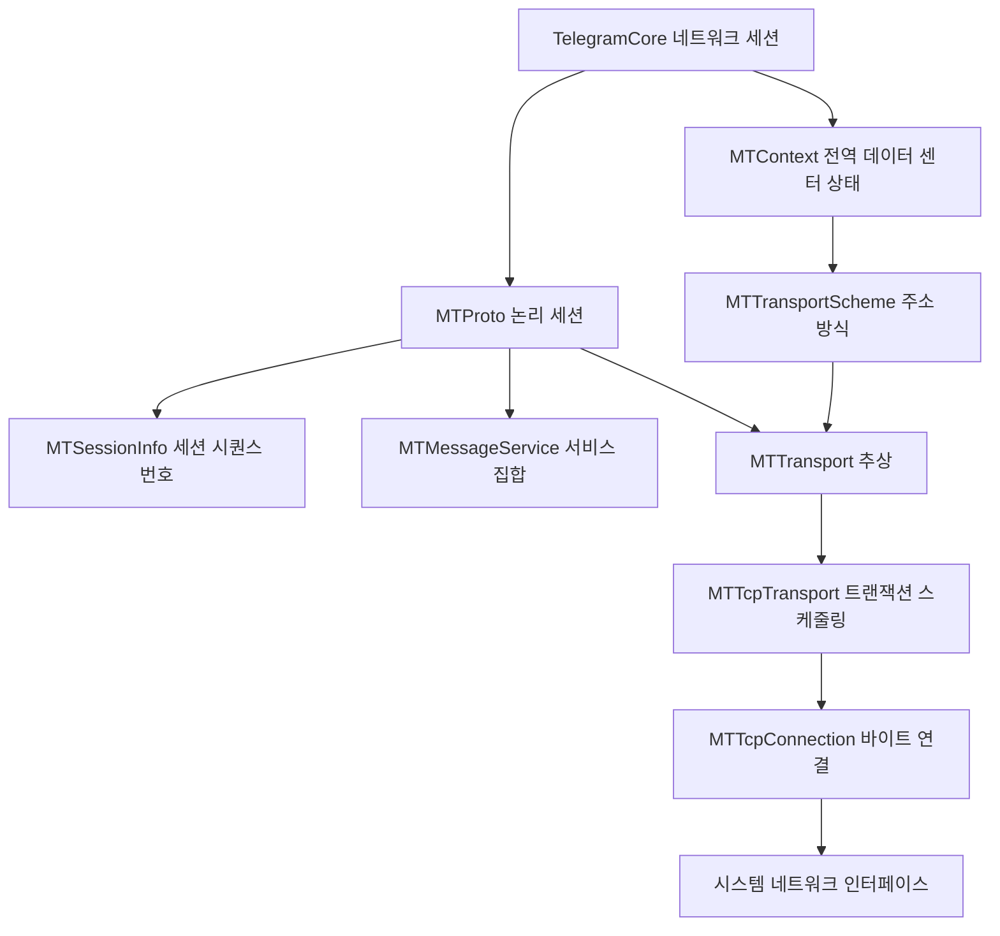
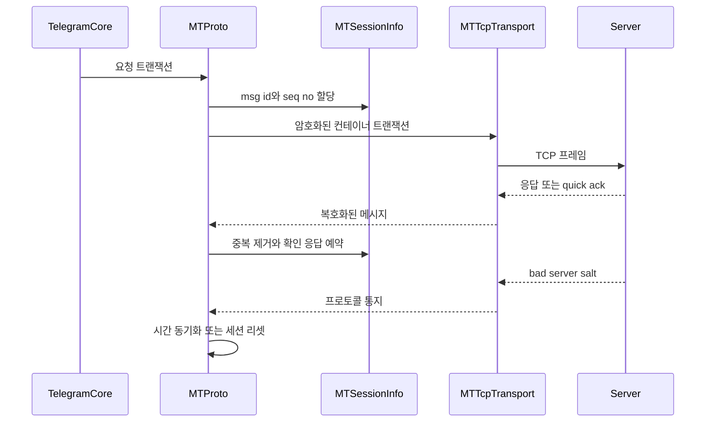
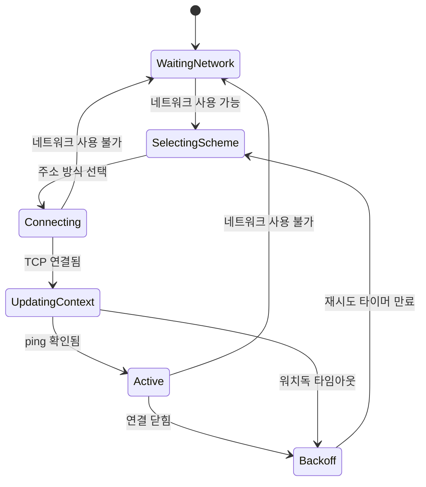

# MTProto 전송 계층

웹: /docs/system/03-mtproto-transport/ · Markdown: /docs/system/03-mtproto-transport.md

> MtProtoKit이 세션을 유지하고, TCP 트래픽을 라우팅하며, 장애를 처리하는 방법.

> 시스템 설계 · 네트워크와 프로토콜 · 03장 · 도표 3 · 코드 발췌 10 · 인용 47 · 소스 기준선: [TelegramMessenger/Telegram-iOS@f1dd7a2d](https://github.com/TelegramMessenger/Telegram-iOS/tree/f1dd7a2dbd02cbbf513e75d5695d8d36d1cf5838), [overtake/TelegramSwift@579cebbf](https://github.com/overtake/TelegramSwift/tree/579cebbf0c01fd41b712eff3647fa7f69db9665d)
>
> 관련 보충: [macOS fork 장별 검증 (01–07장)](/docs/system/31-fork-verify-01-07/)
>
> 핵심 소스 파일: [TelegramMessenger/Telegram-iOS/submodules/MtProtoKit/Sources/MTContext.m](https://github.com/TelegramMessenger/Telegram-iOS/blob/f1dd7a2dbd02cbbf513e75d5695d8d36d1cf5838/submodules/MtProtoKit/Sources/MTContext.m), [TelegramMessenger/Telegram-iOS/submodules/MtProtoKit/Sources/MTProto.m](https://github.com/TelegramMessenger/Telegram-iOS/blob/f1dd7a2dbd02cbbf513e75d5695d8d36d1cf5838/submodules/MtProtoKit/Sources/MTProto.m), [TelegramMessenger/Telegram-iOS/submodules/MtProtoKit/Sources/MTSessionInfo.m](https://github.com/TelegramMessenger/Telegram-iOS/blob/f1dd7a2dbd02cbbf513e75d5695d8d36d1cf5838/submodules/MtProtoKit/Sources/MTSessionInfo.m), [TelegramMessenger/Telegram-iOS/submodules/MtProtoKit/Sources/MTTcpTransport.m](https://github.com/TelegramMessenger/Telegram-iOS/blob/f1dd7a2dbd02cbbf513e75d5695d8d36d1cf5838/submodules/MtProtoKit/Sources/MTTcpTransport.m), [TelegramMessenger/Telegram-iOS/submodules/MtProtoKit/Sources/MTTcpConnection.m](https://github.com/TelegramMessenger/Telegram-iOS/blob/f1dd7a2dbd02cbbf513e75d5695d8d36d1cf5838/submodules/MtProtoKit/Sources/MTTcpConnection.m), [TelegramMessenger/Telegram-iOS/submodules/MtProtoKit/Sources/MTTcpConnectionBehaviour.m](https://github.com/TelegramMessenger/Telegram-iOS/blob/f1dd7a2dbd02cbbf513e75d5695d8d36d1cf5838/submodules/MtProtoKit/Sources/MTTcpConnectionBehaviour.m), [TelegramMessenger/Telegram-iOS/submodules/MtProtoKit/Sources/MTNetworkAvailability.m](https://github.com/TelegramMessenger/Telegram-iOS/blob/f1dd7a2dbd02cbbf513e75d5695d8d36d1cf5838/submodules/MtProtoKit/Sources/MTNetworkAvailability.m), [TelegramMessenger/Telegram-iOS/submodules/MtProtoKit/Sources/MTResendMessageService.m](https://github.com/TelegramMessenger/Telegram-iOS/blob/f1dd7a2dbd02cbbf513e75d5695d8d36d1cf5838/submodules/MtProtoKit/Sources/MTResendMessageService.m), [TelegramMessenger/Telegram-iOS/submodules/MtProtoKit/Sources/MTTimeSyncMessageService.m](https://github.com/TelegramMessenger/Telegram-iOS/blob/f1dd7a2dbd02cbbf513e75d5695d8d36d1cf5838/submodules/MtProtoKit/Sources/MTTimeSyncMessageService.m), [TelegramMessenger/Telegram-iOS/submodules/MtProtoKit/Sources/MTDatacenterSaltInfo.m](https://github.com/TelegramMessenger/Telegram-iOS/blob/f1dd7a2dbd02cbbf513e75d5695d8d36d1cf5838/submodules/MtProtoKit/Sources/MTDatacenterSaltInfo.m), [TelegramMessenger/Telegram-iOS/submodules/MtProtoKit/Sources/MTApiEnvironment.m](https://github.com/TelegramMessenger/Telegram-iOS/blob/f1dd7a2dbd02cbbf513e75d5695d8d36d1cf5838/submodules/MtProtoKit/Sources/MTApiEnvironment.m), [TelegramMessenger/Telegram-iOS/submodules/TelegramCore/Sources/Network/Network.swift](https://github.com/TelegramMessenger/Telegram-iOS/blob/f1dd7a2dbd02cbbf513e75d5695d8d36d1cf5838/submodules/TelegramCore/Sources/Network/Network.swift), [TelegramMessenger/Telegram-iOS/submodules/TelegramCore/Sources/Account/Account.swift](https://github.com/TelegramMessenger/Telegram-iOS/blob/f1dd7a2dbd02cbbf513e75d5695d8d36d1cf5838/submodules/TelegramCore/Sources/Account/Account.swift), [TelegramMessenger/Telegram-iOS/submodules/MTProtoRustEngine/BUILD](https://github.com/TelegramMessenger/Telegram-iOS/blob/f1dd7a2dbd02cbbf513e75d5695d8d36d1cf5838/submodules/MTProtoRustEngine/BUILD), [TelegramMessenger/Telegram-iOS/submodules/MTProtoRustEngine/Sources/MTProtoRustEngine/RustNetworkEngine.swift](https://github.com/TelegramMessenger/Telegram-iOS/blob/f1dd7a2dbd02cbbf513e75d5695d8d36d1cf5838/submodules/MTProtoRustEngine/Sources/MTProtoRustEngine/RustNetworkEngine.swift), [TelegramMessenger/Telegram-iOS/submodules/MTProtoRustEngine/Sources/MTProtoRustEngine/RustNetworkSession.swift](https://github.com/TelegramMessenger/Telegram-iOS/blob/f1dd7a2dbd02cbbf513e75d5695d8d36d1cf5838/submodules/MTProtoRustEngine/Sources/MTProtoRustEngine/RustNetworkSession.swift), [overtake/TelegramSwift/.gitmodules](https://github.com/overtake/TelegramSwift/blob/579cebbf0c01fd41b712eff3647fa7f69db9665d/.gitmodules)
>
> 미검증 사항:
> - 업스트림 third-party/mtproto-engine의 Rust FFI 소스는 읽지 않았어요. 그래서 업스트림 Rust 엔진이 MtProtoKit의 어떤 프로토콜 구현을 대체했는지는 여전히 항목별로 증명할 수 없어요.

MTProto 전송 계층은 상위에서 직렬화한 요청을 복구할 수 있는 암호화 바이트 스트림으로 바꿔요. 핵심은 오래 사는 연결 하나가 아니에요. 아래 네 가지를 따로 나눠 관리하는 데 있어요.

- 데이터 센터 전역 상태
- 단일 세션의 순서 상태
- 바꿔 끼울 수 있는 전송
- 짧게 쓰고 버리는 서비스

이렇게 하면 네트워크 전환, 주소 실패, 서버 시간 드리프트, 프록시 변경을 모두 그 자리에서 복구할 수 있어요. 그래서 비즈니스 요청(앱 기능이 보내는 요청)이 소켓의 세부 사항을 알 필요가 없어요. [\[1\]](https://github.com/TelegramMessenger/Telegram-iOS/blob/f1dd7a2dbd02cbbf513e75d5695d8d36d1cf5838/submodules/MtProtoKit/Sources/MTContext.m#L258-L318) [\[2\]](https://github.com/TelegramMessenger/Telegram-iOS/blob/f1dd7a2dbd02cbbf513e75d5695d8d36d1cf5838/submodules/MtProtoKit/Sources/MTProto.m#L285-L375)

## 책임 경계와 객체 관계 [#책임-경계와-객체-관계]

`MTContext`는 세션을 가로질러 공유하는 제어 평면(주소와 키 같은 공유 상태를 관리하는 층)이에요. 전용 `contextQueue`에서 아래를 갖고 있어요.

- 데이터 센터 주소 집합
- 전송 방식 통계
- 인증 정보
- 공개 키
- 임시 키 상태
- 세션 정리 큐

생성자는 데이터 센터별로 색인된 이 컨테이너들을 만들고 주기 작업을 시작해요. [\[1\]](https://github.com/TelegramMessenger/Telegram-iOS/blob/f1dd7a2dbd02cbbf513e75d5695d8d36d1cf5838/submodules/MtProtoKit/Sources/MTContext.m#L258-L318) 특정 비즈니스 세션이 보내려고 기다리는 요청은 가지고 있지 않아요.

특정 데이터 센터를 향한 논리 세션은 `MTProto`가 나타내요. `MTProto`는 `MTSessionInfo`, 서비스 배열, 현재 `MTTransport`를 갖고 있고, 자기 자신을 `MTContext`의 변경 리스너로 등록해요. [\[2\]](https://github.com/TelegramMessenger/Telegram-iOS/blob/f1dd7a2dbd02cbbf513e75d5695d8d36d1cf5838/submodules/MtProtoKit/Sources/MTProto.m#L285-L375)

`MTMessageService`는 이 계층 구조의 이음매예요. 선택적 콜백으로 서비스가 할 수 있는 일은 두 가지예요.

- 다음 `MTMessageTransaction`을 만들 수 있어요.
- 복호화된 메시지, 트랜잭션 실패, 연결 상태, 네트워크 가용성 변화를 받을 수 있어요. [\[3\]](https://github.com/TelegramMessenger/Telegram-iOS/blob/f1dd7a2dbd02cbbf513e75d5695d8d36d1cf5838/submodules/MtProtoKit/PublicHeaders/MtProtoKit/MTMessageService.h#L13-L45)

덕분에 재전송, 시간 동기화, 인증, 애플리케이션 요청이 같은 세션 순서와 암호화 경로를 함께 쓸 수 있어요. 서비스가 TCP 연결을 직접 만질 필요가 없어요.

아래 도표는 주요 객체의 소유 관계와 콜백 방향을 보여 줘요.



`MTTransport`도 `MTMessageService`를 구현해요. 그래서 `MTProto`가 현재 전송을 서비스 배열에 넣으면, 전송은 보낼 일이 생길 때 트랜잭션을 요청할 수 있어요. 전송은 `MTTransportDelegate`로 거꾸로 메시지 트랜잭션을 얻고, 받은 데이터, quick ack(상대가 패킷을 빨리 받았다는 신호), 트랜잭션 실패, 네트워크와 연결 상태를 세션에 넘겨요. [\[4\]](https://github.com/TelegramMessenger/Telegram-iOS/blob/f1dd7a2dbd02cbbf513e75d5695d8d36d1cf5838/submodules/MtProtoKit/PublicHeaders/MtProtoKit/MTTransport.h#L20-L70)

`MTTcpTransport`는 `MTTransport` 추상의 TCP 구현이에요. `MTTcpConnection` 하나와 `MTTcpConnectionBehaviour` 하나를 유지해요. `MTTcpConnectionBehaviour`는 연결이 무효가 되면 전송에 재연결을 요구해요. [\[5\]](https://github.com/TelegramMessenger/Telegram-iOS/blob/f1dd7a2dbd02cbbf513e75d5695d8d36d1cf5838/submodules/MtProtoKit/Sources/MTTcpTransport.m#L93-L180)

`MTTcpConnection`이 신경 쓰는 건 아래뿐이에요.

- 바이트 연결
- SOCKS 핸드셰이크
- 선택적 난독화
- 길이 프레임
- quick ack
- 읽기·쓰기 타임아웃

완전한 MTProto 암호화 패킷은 `MTTcpTransport`로 올려 보내요. `MTTcpTransport`는 바이트 패킷을 transport transaction에 연결하고 `MTProto`를 불러 파싱해요. 이렇게 나눠 두면 MTProto 암호학과 소켓 버퍼 상태가 한 객체에 뒤섞이지 않아요. [\[5\]](https://github.com/TelegramMessenger/Telegram-iOS/blob/f1dd7a2dbd02cbbf513e75d5695d8d36d1cf5838/submodules/MtProtoKit/Sources/MTTcpTransport.m#L93-L180) [\[6\]](https://github.com/TelegramMessenger/Telegram-iOS/blob/f1dd7a2dbd02cbbf513e75d5695d8d36d1cf5838/submodules/MtProtoKit/Sources/MTTcpConnection.m#L2009-L2079)

이 장의 코드 근거는 iOS에서 체크아웃한 MtProtoKit이에요. macOS fork `a24bbe45`도 체크아웃되어 있어요. 이 fork의 `MTProto` 세션 상태, 메시지 식별자, 컨테이너 매핑, 연결 백오프는 iOS 체크아웃과 같아요. [\[45\]](https://github.com/overtake/Telegram-iOS/blob/a24bbe45f9861f736a79916a50898512f751e0dc/submodules/MtProtoKit/Sources/MTProto.m#L107-L165) [\[46\]](https://github.com/overtake/Telegram-iOS/blob/a24bbe45f9861f736a79916a50898512f751e0dc/submodules/MtProtoKit/Sources/MTSessionInfo.m#L91-L108) [\[47\]](https://github.com/overtake/Telegram-iOS/blob/a24bbe45f9861f736a79916a50898512f751e0dc/submodules/MtProtoKit/Sources/MTTcpConnectionBehaviour.m#L49-L77)

다만 이 fork의 `TelegramCore` 의존성에는 `MtProtoKit`만 나열되어 있고 `WebProxyTransport`는 없어요. Rust 네트워크 엔진이나 WebProxy 엔진을 전환하는 기능은 없어요. [보충: macOS fork 장별 검증(01–07장)](/docs/system/31-fork-verify-01-07/). [\[48\]](https://github.com/overtake/Telegram-iOS/blob/a24bbe45f9861f736a79916a50898512f751e0dc/submodules/TelegramCore/BUILD#L3-L31)

세션을 만들 때 `MTProto.resetTransport`는 이렇게 움직여요.

1. 먼저 `MTContext`에 현재 데이터 센터, 미디어 표지, 프록시 상태에 맞는 방식(`MTTransportScheme`, 전송 클래스·주소·미디어 표지를 묶은 값) 배열을 요청해요.
2. 배열이 비어 있으면 데이터 센터 방식을 기다리는 상태로 바꾸고 context에 주소 탐색을 요구해요.
3. 쓸 수 있는 방식이 이미 있고 인증 조건이 채워졌을 때만 전송을 만들어요. [\[2\]](https://github.com/TelegramMessenger/Telegram-iOS/blob/f1dd7a2dbd02cbbf513e75d5695d8d36d1cf5838/submodules/MtProtoKit/Sources/MTProto.m#L285-L375)

덕분에 “주소 없음”, “키 없음”, “인증 token 대기”가 서로 독립된 차단 원인이 돼요. 연결 로직이 이런 선행 조건을 나타내려고 실패한 TCP 연결을 꾸며 낼 필요가 없어요.

객체의 동시성 경계도 분명해요. 각 객체는 자기 큐에서 상태를 수정해요.

- `MTContext`의 공유 딕셔너리: `contextQueue`
- `MTProto`의 서비스 배열과 상태 비트: `managerQueue`
- `MTTcpTransport`: `tcpTransportQueue`
- `MTTcpConnection`: 자기 TCP 큐 [\[1\]](https://github.com/TelegramMessenger/Telegram-iOS/blob/f1dd7a2dbd02cbbf513e75d5695d8d36d1cf5838/submodules/MtProtoKit/Sources/MTContext.m#L258-L318) [\[2\]](https://github.com/TelegramMessenger/Telegram-iOS/blob/f1dd7a2dbd02cbbf513e75d5695d8d36d1cf5838/submodules/MtProtoKit/Sources/MTProto.m#L285-L375)

락이 없다는 뜻은 아니에요. 직렬 큐로 격리한다는 뜻이에요. 계층을 넘는 콜백은 상태를 가진 쪽으로 다시 디스패치되기 때문에, socket 콜백 안에서 세션 장부를 직접 고치는 일을 피해요. 반응형 조합과 상위 동시성 제어는 [리액티브와 동시성 모델](/docs/system/02-reactive-concurrency/)을 참고하세요.

## 세션 상태, 메시지 프레임, 확인 응답 [#세션-상태-메시지-프레임-확인-응답]

### 메시지 식별자와 시퀀스 번호 생성 [#메시지-식별자와-시퀀스-번호-생성]

전송이 먼저 풀어야 할 문제는 재연결 후의 순서와 중복 제거예요. `MTSessionInfo`는 아래를 저장해요.

- 무작위 64비트 `sessionId`
- 마지막 클라이언트·서버 `msg_id`(메시지 식별자)
- `_seqNo`(시퀀스 번호)
- 처리된 메시지 집합
- 확인 응답 큐
- 컨테이너 매핑
- 전송된 집합 [\[7\]](https://github.com/TelegramMessenger/Telegram-iOS/blob/f1dd7a2dbd02cbbf513e75d5695d8d36d1cf5838/submodules/MtProtoKit/Sources/MTSessionInfo.m#L42-L108)

이 객체는 `MTProto` 세션마다 따로 있어요. 그래서 같은 `MTContext`의 여러 연결이 실수로 시퀀스 번호를 같이 쓰는 일은 없어요.

클라이언트 `msg_id`는 `MTContext.globalTime` × `4294967296`에서 나와요. 구현은 이 값에 아래 처리를 해요.

- 시간이 거꾸로 가는 것을 감지해 단조성 위반을 보고해요.
- 같은 값이면 하나 올려요.
- 하위 두 비트를 0으로 맞춰요.

서버 메시지 식별자는 하위 두 비트가 1이 되도록 맞춰요. [\[7\]](https://github.com/TelegramMessenger/Telegram-iOS/blob/f1dd7a2dbd02cbbf513e75d5695d8d36d1cf5838/submodules/MtProtoKit/Sources/MTSessionInfo.m#L42-L108) 클라이언트 메시지의 하위 두 비트 규칙은 로컬 코드가 강제해요. 서버 메시지를 만드는 로직도 테스트와 미인증 경로를 위해 짝이 되는 형태로 있어요.

`submodules/MtProtoKit/Sources/MTSessionInfo.m` 92–108행 발췌.

```objc
- (int64_t)generateClientMessageId:(bool *)monotonityViolated
{
    int64_t messageId = (int64_t)([_context globalTime] * 4294967296);
    
    if (messageId < _lastClientMessageId)
    {
        if (monotonityViolated != NULL)
            *monotonityViolated = true;
    }
    
    if (messageId == _lastClientMessageId)
        messageId = _lastClientMessageId + 1;
    
    while (messageId % 4 != 0)
        messageId++;
    
    _lastClientMessageId = messageId;
    return messageId;
}
```

`seq_no`는 요청 수와 똑같지 않아요. `takeSeqNo:`는 메시지 종류에 따라 다르게 움직여요.

- 비즈니스 의미가 있는 메시지: 현재 값에 1을 더해 돌려주고 내부 카운트를 2 올려요.
- 비즈니스 의미가 없는 메시지: 카운트를 올리지 않고 현재 값을 돌려줘요. [\[8\]](https://github.com/TelegramMessenger/Telegram-iOS/blob/f1dd7a2dbd02cbbf513e75d5695d8d36d1cf5838/submodules/MtProtoKit/Sources/MTSessionInfo.m#L249-L291)

그래서 ping, 확인 응답, 컨테이너 껍데기는 의미 있는 메시지의 홀수 시퀀스 번호를 차지하지 않을 수 있어요. 대신 호출하는 쪽이 `messageIsMeaningful`을 정확히 표시해야 해요. 잘못 표시하면 프로토콜 순서가 깨지고, TCP 계층은 이를 구해 줄 수 없어요.

`submodules/MtProtoKit/Sources/MTSessionInfo.m` 278–291행 발췌.

```objc
- (int32_t)takeSeqNo:(bool)messageIsMeaningful
{
    int32_t seqNo = 0;
    
    if (messageIsMeaningful)
    {
        seqNo = _seqNo + 1;
        _seqNo += 2;
    }
    else
        seqNo = _seqNo;
    
    return seqNo;
}
```

상위 요청의 TL 인코딩과 API 래핑은 이 장에서 다루지 않아요. 이 요청들은 결국 `MTOutgoingMessage`를 거쳐 여기로 들어와요. 구체적인 인터페이스 계층은 [TL 직렬화와 API 호출 계층](/docs/system/05-tl-api-layer/)을 참고하세요. 인증 키 수립, 임시 키, 데이터 센터 마이그레이션은 `MTContext`의 다른 서비스가 처리해요. [인증 키와 다중 데이터 센터](/docs/system/04-auth-keys-datacenters/)를 참고하세요.

### 컨테이너, 패딩, 암호화 페이로드 [#컨테이너-패딩-암호화-페이로드]

한 번 전송할 때 준비된 메시지 여러 개를 `msg_container`로 합칠 수 있어요. `MTProto`는 컨테이너를 이렇게 만들어요.

1. 컨테이너에 하위 메시지 개수를 써요.
2. 하위 메시지마다 `messageId`, `seqNo`, 길이, 데이터를 써요.
3. 새 컨테이너 `msg_id`를 만들어요.
4. 컨테이너와 하위 메시지 식별자를 `MTSessionInfo` 매핑에 저장해요. [\[9\]](https://github.com/TelegramMessenger/Telegram-iOS/blob/f1dd7a2dbd02cbbf513e75d5695d8d36d1cf5838/submodules/MtProtoKit/Sources/MTProto.m#L1440-L1493)

이 매핑은 이후 `bad_msg_notification`이나 서버가 세션을 다시 만들 때, 컨테이너 수준 오류를 하위 메시지로 되돌리는 근거가 돼요.

아래 발췌 코드는 컨테이너의 바깥 시퀀스 번호 전략도 같이 보여 줘요.

- 컨테이너는 `takeSeqNo:false`를 쓰고, 하위 메시지는 자기 시퀀스 번호를 그대로 가져요.
- 코드는 먼저 매핑을 저장한 다음 salt(서버가 정하는 값으로, 패킷의 유효 시간 구간과 관련돼요), 세션 식별자, 컨테이너 식별자, 페이로드를 써요.

그래서 바깥쪽을 다시 보내도 하위 메시지의 신원을 잃지 않아요. [\[9\]](https://github.com/TelegramMessenger/Telegram-iOS/blob/f1dd7a2dbd02cbbf513e75d5695d8d36d1cf5838/submodules/MtProtoKit/Sources/MTProto.m#L1440-L1493)

`submodules/MtProtoKit/Sources/MTProto.m` 1468–1492행 발췌.

```objc
NSData *containerData = [containerOs currentBytes];

int64_t containerMessageId = [sessionInfo generateClientMessageId:NULL];
if (containerMessageIds.count != 0) {
    [sessionInfo addContainerMessageIdMapping:containerMessageId childMessageIds:containerMessageIds];
}

NSData *decryptedData = [MTProto _paddedPlaintextWithSalt:salt
    sessionId:sessionInfo.sessionId
    messageId:containerMessageId
    seqNo:[sessionInfo takeSeqNo:false]
    body:containerData
    extendedPadding:extendedPadding];

return [MTProto _encryptedTransportDataForPaddedPlaintext:decryptedData
    authKey:effectiveAuthKey
    quickAckId:quickAckId];
```

인증된 메시지의 평문 헤더는 순서대로 아래 필드예요.

1. salt
2. session id
3. msg id
4. seq no
5. body 길이
6. body

패딩은 이렇게 붙여요.

- 먼저 최소 12바이트의 무작위 패딩을 얻고 16바이트까지 채워요.
- 일반 모드에서는 추가 패딩을 72바이트 이내로 제한해요.
- 확장 패딩을 켜면 상한이 256바이트예요. [\[10\]](https://github.com/TelegramMessenger/Telegram-iOS/blob/f1dd7a2dbd02cbbf513e75d5695d8d36d1cf5838/submodules/MtProtoKit/Sources/MTProto.m#L1530-L1561)

암호 블록 정렬과 트래픽 형태 사이에서 절충한 거예요. 패딩은 암호화 전에 붙으니까 TCP 계층은 완전한 암호문만 봐요.

받을 때는 먼저 복호화한 다음 `msg_container` 또는 단일 메시지를 파싱해요. 컨테이너의 하위 메시지마다 독립된 `MTIncomingMessage`를 만들되, 같은 바깥 salt와 session id를 유지해요. [\[11\]](https://github.com/TelegramMessenger/Telegram-iOS/blob/f1dd7a2dbd02cbbf513e75d5695d8d36d1cf5838/submodules/MtProtoKit/Sources/MTProto.m#L2392-L2567)

`MTSessionInfo.messageProcessed:`는 먼저 중복 메시지를 걸러 내요. 확인 응답 큐에는 아래 메시지가 들어가요.

- 중복 메시지
- 새로운 메시지
- 이미 인증된 메시지
- 시퀀스 번호가 홀수인 메시지

확인되지 않은 바이트 양이나 개수가 내부 상한을 넘으면 `MTProto`가 바로 다음 트랜잭션에 확인 응답을 실어 보내라고 요청해요. [\[11\]](https://github.com/TelegramMessenger/Telegram-iOS/blob/f1dd7a2dbd02cbbf513e75d5695d8d36d1cf5838/submodules/MtProtoKit/Sources/MTProto.m#L2392-L2567) 덕분에 수신 신뢰성은 애플리케이션 계층이 비즈니스 처리를 끝냈는지와 상관없어요.

### msgs_ack, 재전송, 장애 귀속 [#msgs_ack-재전송-장애-귀속]

확인 응답은 서버에서 클라이언트로 가는 메시지가 잘 도착했는지 보이게 해 줘요. `MTSessionInfo`는 확인을 기다리는 항목마다 그 항목을 담은 transport transaction 식별자도 기록해요. 전송 트랜잭션의 결과에 따라 이렇게 달라져요.

- 성공하면: `MTProto`는 transaction id로 실제로 전송된 확인 항목을 지울 수 있어요.
- 실패하면: 확인 응답이 그대로 남아서 다음 트랜잭션에 실려 다시 나가요. [\[12\]](https://github.com/TelegramMessenger/Telegram-iOS/blob/f1dd7a2dbd02cbbf513e75d5695d8d36d1cf5838/submodules/MtProtoKit/Sources/MTSessionInfo.m#L196-L247)

덕분에 바이트를 커널 버퍼에 쓴 시점에 너무 일찍 확인하는 일을 피해요.

서버가 어떤 메시지를 다시 보내라고 요구하면 `MTProto`는 짧게 쓰고 버리는 `MTResendMessageService`를 추가해요. 이 서비스는 `msg_resend_req`의 벡터 요청을 만들고 확인 응답을 요구해요. `msgs_state_info`, 오류, 전송 실패를 받으면 델리게이트에 끝났다고 알려요. [\[13\]](https://github.com/TelegramMessenger/Telegram-iOS/blob/f1dd7a2dbd02cbbf513e75d5695d8d36d1cf5838/submodules/MtProtoKit/Sources/MTResendMessageService.m#L44-L138)

이 서비스는 원래의 비즈니스 메시지를 바로 다시 보내는 게 아니에요. 먼저 서버 상태를 물어봐요. 그래서 서버가 이미 처리한 경우, 아직 받지 못한 경우, 복구가 필요한 경우를 구분할 수 있어요. 비즈니스 메시지의 영속화와 오프라인 큐는 [메시지 전송 파이프라인과 오프라인 작업 큐](/docs/system/07-message-send-pipeline/)에서 다뤄요.

`submodules/MtProtoKit/Sources/MTResendMessageService.m` 44–72행 발췌.

```objc
- (MTMessageTransaction *)mtProtoMessageTransaction:(MTProto *)mtProto
    authInfoSelector:(MTDatacenterAuthInfoSelector)authInfoSelector
    sessionInfo:(MTSessionInfo *)sessionInfo
    scheme:(MTTransportScheme *)scheme
{
    if (!_requesting) {
        _requesting = true;
        
        MTBuffer *resendRequestBuffer = [[MTBuffer alloc] init];
        [resendRequestBuffer appendInt32:(int32_t)0x7d861a08];
        [resendRequestBuffer appendInt32:481674261];
        [resendRequestBuffer appendInt32:1];
        [resendRequestBuffer appendInt64:_messageId];
        
        MTOutgoingMessage *outgoingMessage = [[MTOutgoingMessage alloc]
            initWithData:resendRequestBuffer.data metadata:@"resendMessages"
            additionalDebugDescription:nil shortMetadata:@"resendMessages"];
        outgoingMessage.requiresConfirmation = true;
        
        return [[MTMessageTransaction alloc] initWithMessagePayload:@[outgoingMessage]
            prepared:nil failed:nil completion:nil];
    }
    return nil;
}
```

트랜잭션 실패에도 누구 탓인지 분명히 가려요. `MTProto`는 전송 패킷마다 내부 메시지 식별자에서 transport transaction, quick ack, 준비된 메시지로 가는 매핑을 보존해요. 전송이 그 트랜잭션을 거부하면, 데이터가 전달됐다고 가정하지 않고 이번 메시지 트랜잭션 전체에 실패를 콜백해요. [\[14\]](https://github.com/TelegramMessenger/Telegram-iOS/blob/f1dd7a2dbd02cbbf513e75d5695d8d36d1cf5838/submodules/MtProtoKit/Sources/MTProto.m#L1299-L1356) 덕분에 상위 요청 서비스는 상태를 보존하고 다시 시도할 시점을 정할 수 있어요.

트랜잭션을 한 번 가져오는 일은 단순히 큐에서 꺼내는 게 아니에요. `MTProto`는 이렇게 움직여요.

- 각 `MTMessageService`를 역순으로 물어서, 서비스마다 만들려는 `MTMessageTransaction`을 모아요.
- 먼저 시간 보정과 salt를 기다리는 중인지, 데이터 센터 인증을 기다리는 중인지 검사해요. 차단 조건에 걸리면 일반 패킷을 만들지 않아요. [\[32\]](https://github.com/TelegramMessenger/Telegram-iOS/blob/f1dd7a2dbd02cbbf513e75d5695d8d36d1cf5838/submodules/MtProtoKit/Sources/MTProto.m#L940-L1100)
- 또 확인을 기다리는 메시지를 하나의 확인 응답 페이로드로 합쳐서, 서비스가 만든 비즈니스 페이로드와 함께 transport에 넘겨요.

서비스를 역순으로 돌기 때문에 나중에 추가된 임시 서비스가 복구 제어 메시지를 먼저 만들어요. 코드는 이 순서를 왜 정했는지 설명하지 않아요. 그래서 우선순위의 이유는 추론으로만 알 수 있어요.

전송 트랜잭션과 프로토콜 트랜잭션도 일대일 관계가 아니에요. 전송 단계에서는 payload 목록에 따라 `MTTransportTransaction`을 여러 개 만들어요. 성공 콜백은 내부 메시지 식별자를 transport transaction id, 준비된 메시지, quick ack id로 다시 매핑해요. [\[14\]](https://github.com/TelegramMessenger/Telegram-iOS/blob/f1dd7a2dbd02cbbf513e75d5695d8d36d1cf5838/submodules/MtProtoKit/Sources/MTProto.m#L1299-L1356)

그래서 TCP 쓰기가 성공하면 “전송이 받아들임” 상태까지만 나아가요. 프로토콜 응답, `msgs_ack`, RPC 결과는 여전히 독립된 경로로 도착해요. 이렇게 나눠 두면 네트워크 계층이 쓰기 완료를 원격 커밋으로 착각하지 않아요.

컨테이너는 장애가 퍼지는 범위도 제한해요. 컨테이너 바깥에는 자체 `msg_id`가 있고, 하위 항목은 원래의 `msg_id`를 그대로 가져요. 아래 두 경우에 하위 항목을 찾을 수 있어요.

- 서버가 컨테이너에 대해 불량 메시지를 보고하면 `MTSessionInfo.messageIdsInContainer:`가 모든 하위 항목을 찾아낼 수 있어요. [\[8\]](https://github.com/TelegramMessenger/Telegram-iOS/blob/f1dd7a2dbd02cbbf513e75d5695d8d36d1cf5838/submodules/MtProtoKit/Sources/MTSessionInfo.m#L249-L291)
- `new_session_created`가 첫 유효 메시지 식별자를 주면 `messageIdsInContainersAfterMessageId:`가 경계 이후의 하위 항목을 찾아낼 수 있어요. [\[8\]](https://github.com/TelegramMessenger/Telegram-iOS/blob/f1dd7a2dbd02cbbf513e75d5695d8d36d1cf5838/submodules/MtProtoKit/Sources/MTSessionInfo.m#L249-L291)

적은 메모리로 계층을 넘는 인과 관계를 유지하는 사례예요. 매핑을 저장하지 않으면 클라이언트는 배치 전체를 구분할 수 없는 데이터로 다룰 수밖에 없어요.

quick ack는 빠른 피드백 경로 하나를 더 만들어 줘요. `MTTcpConnection`은 abridged 또는 intermediate 프레임에서 quick ack token을 파싱해서, 전송의 콜백으로 `MTProto`에, 다시 서비스에 전달해요. [\[6\]](https://github.com/TelegramMessenger/Telegram-iOS/blob/f1dd7a2dbd02cbbf513e75d5695d8d36d1cf5838/submodules/MtProtoKit/Sources/MTTcpConnection.m#L2009-L2079) quick ack로는 MTProto 계층의 확인 응답을 대신할 수 없어요. 전송 상대방이 어떤 패킷을 빨리 받았다는 것만 알려 줄 뿐, 비즈니스 메시지가 처리됐다는 것은 알려 주지 않기 때문이에요.

### 서버 salt, 시간 동기화, 세션 리셋 [#서버-salt-시간-동기화-세션-리셋]

salt 값은 인증된 패킷이 서로 다른 시간 구간에서 유효한지를 풀어 줘요. `MTDatacenterSaltInfo`는 `int64` salt 하나를 처음과 끝의 유효 `msg_id`와 함께 영속화하고, 어떤 메시지 이후에 유효 범위가 얼마나 남았는지 답할 수 있어요. [\[15\]](https://github.com/TelegramMessenger/Telegram-iOS/blob/f1dd7a2dbd02cbbf513e75d5695d8d36d1cf5838/submodules/MtProtoKit/Sources/MTDatacenterSaltInfo.m#L5-L46) 현재 salt만 캐시하는 것보다 메시지 큐잉, 컨테이너, 네트워크 지연 속에서 고르기에 알맞아요.

`MTTimeSyncMessageService`는 `get_future_salts`를 보내고, 돌아온 `validSince`와 `validUntil` 초 값을 `msg_id` 시간 좌표로 왼쪽 시프트해요. 동시에 서버 메시지 식별자로 로컬 시간 차이를 계산해요.

샘플링 범위가 1초를 넘으면 서비스는 샘플 6개를 요구해요. 다 모이면 절댓값이 가장 큰 샘플과 가장 작은 샘플을 빼고 평균을 계산해요. [\[16\]](https://github.com/TelegramMessenger/Telegram-iOS/blob/f1dd7a2dbd02cbbf513e75d5695d8d36d1cf5838/submodules/MtProtoKit/Sources/MTTimeSyncMessageService.m#L130-L214) 비용을 제한하면서 이상치를 누르는 방식이에요. 대신 처음 시간을 복구할 때 왕복이 몇 번 더 늘어날 수 있어요.

`submodules/MtProtoKit/Sources/MTTimeSyncMessageService.m` 138–150행 발췌.

```objc
NSMutableArray *saltList = [[NSMutableArray alloc] init];
for (MTFutureSalt *futureSalt in ((MTFutureSaltsMessage *)message.body).salts)
{
    [saltList addObject:[[MTDatacenterSaltInfo alloc]
        initWithSalt:futureSalt.salt
        firstValidMessageId:futureSalt.validSince * 4294967296
        lastValidMessageId:futureSalt.validUntil * 4294967296]];
}
[_futureSalts addObjectsFromArray:saltList];

NSTimeInterval timeDifference = message.messageId / 4294967296.0
    - [[NSDate date] timeIntervalSince1970];
[_takenSamples addObject:@(timeDifference)];
_takenSampleCount++;
```

`bad_server_salt`는 일반 요청 오류가 아니에요. 현재 시간 보정 컨텍스트에 해당하면 `MTProto`는 `nextServerSalt`로 현재 서버 메시지부터 길이 30분의 임시 유효 구간을 바로 세우고 동기화를 마쳐요. 그렇지 않으면 시간 동기화를 다시 시작해요. [\[11\]](https://github.com/TelegramMessenger/Telegram-iOS/blob/f1dd7a2dbd02cbbf513e75d5695d8d36d1cf5838/submodules/MtProtoKit/Sources/MTProto.m#L2392-L2567)

오류 코드별 처리는 이래요.

- 16과 17: 세션을 동기적으로 리셋하고 시간을 다시 동기화해요.
- 32와 33: 세션을 리셋한 뒤 동기화해요. [\[11\]](https://github.com/TelegramMessenger/Telegram-iOS/blob/f1dd7a2dbd02cbbf513e75d5695d8d36d1cf5838/submodules/MtProtoKit/Sources/MTProto.m#L2392-L2567)

그래서 시계, salt, 시퀀스 오류가 하나의 복구 진입점으로 모여요.

서버가 `new_session_created`를 보내도 `MTProto`는 모든 요청이 죽었다고 판정하지 않아요. `firstMessageId`를 가져와서, 그 값과 컨테이너 안에서 그 경계 이후에 있는 하위 메시지 식별자를 각 서비스에 알려요. [\[11\]](https://github.com/TelegramMessenger/Telegram-iOS/blob/f1dd7a2dbd02cbbf513e75d5695d8d36d1cf5838/submodules/MtProtoKit/Sources/MTProto.m#L2392-L2567) 서비스는 이를 근거로 자기 확인 응답이나 재전송 전략을 다시 세울 수 있어요.

수신 복호화나 파싱이 실패하면 `MTProto`는 이렇게 해요.

- 현재 트랜잭션이 실패했을 수 있다고 표시해요.
- 주소 방식은 실패로 기록해요.
- `MTSessionInfo`는 리셋해요. [\[14\]](https://github.com/TelegramMessenger/Telegram-iOS/blob/f1dd7a2dbd02cbbf513e75d5695d8d36d1cf5838/submodules/MtProtoKit/Sources/MTProto.m#L1299-L1356)

보수적인 전략이에요. 어긋났을 수 있는 시퀀스 번호와 salt를 계속 믿기보다, 로컬 세션 상태를 다시 세우는 쪽을 택해요.

아래 도표는 전송부터 오류 복구까지의 주요 프로토콜 흐름을 보여 줘요.



## 연결 관리와 관찰 가능한 상태 [#연결-관리와-관찰-가능한-상태]

### 주소 집합에서 단일 연결 선택하기 [#주소-집합에서-단일-연결-선택하기]

연결 관리는 서로 다른 두 문제를 풀어야 해요.

- 어느 주소에 연결할지
- 현재 주소가 실패한 뒤 언제 다시 시도할지

`MTContext.transportSchemesForDatacenterWithId`는 데이터 센터 주소 집합에서 `MTTransportScheme`을 만들어요. 방식에는 전송 클래스, 주소, 미디어 표지가 들어 있어요. 만들 때는 이 순서로 처리해요.

1. 환경 오버라이드 주소를 처리해요.
2. 사용자가 직접 고른 방식을 합쳐요.
3. 일반 또는 미디어 선호에 따라 걸러 내요. [\[17\]](https://github.com/TelegramMessenger/Telegram-iOS/blob/f1dd7a2dbd02cbbf513e75d5695d8d36d1cf5838/submodules/MtProtoKit/Sources/MTContext.m#L1058-L1158)

단일 방식을 고를 때 `MTContext`는 방식마다 `lastFailureTimestamp`와 `lastResponseTimestamp`를 읽어요.

1. 어떤 IPv6 방식이 지난 한 시간 안에 응답한 적이 있으면 IPv6 스캔을 허용해요.
2. 그 뒤 후보 중에서 가장 오래전에 실패한 방식을 골라요. [\[17\]](https://github.com/TelegramMessenger/Telegram-iOS/blob/f1dd7a2dbd02cbbf513e75d5695d8d36d1cf5838/submodules/MtProtoKit/Sources/MTContext.m#L1058-L1158)

DNS 이름으로 무작위 라운드 로빈을 하는 게 아니에요. 실패한 주소가 자연스럽게 식도록 하면서, 최근에 쓸 수 있었던 IPv6의 기회는 남겨 둬요.

`MTTransportScheme`은 주소와 용도도 함께 묶어요.

- 동등 비교: transport class, `MTDatacenterAddress`, 미디어 표지를 같이 검사해요.
- 정렬: `isOptimal`과 `compareToScheme:`이 주소의 media 선호를 정렬에 반영해요. [\[33\]](https://github.com/TelegramMessenger/Telegram-iOS/blob/f1dd7a2dbd02cbbf513e75d5695d8d36d1cf5838/submodules/MtProtoKit/Sources/MTTransportScheme.m#L15-L94)
- 필터링: `MTContext`는 media 요청에서 `preferForMedia` 주소를 우선 남기고, 일반 요청에서는 이런 주소를 빼요. [\[17\]](https://github.com/TelegramMessenger/Telegram-iOS/blob/f1dd7a2dbd02cbbf513e75d5695d8d36d1cf5838/submodules/MtProtoKit/Sources/MTContext.m#L1058-L1158)

이 방식은 서로 겹치지 않는 데이터 센터 테이블 두 벌을 유지하는 것보다 유연하지만, 주소 디렉터리가 용도를 올바르게 표시해야 해요.

`MTContext`가 방식의 결과로 저장하는 건 타임스탬프예요. 연속 성공률이나 RTT 분위수는 저장하지 않아요. `reportTransportSchemeFailureForDatacenterId`는 실패 시각을 갱신하고, 성공 경로는 응답 시각을 갱신해요. [\[17\]](https://github.com/TelegramMessenger/Telegram-iOS/blob/f1dd7a2dbd02cbbf513e75d5695d8d36d1cf5838/submodules/MtProtoKit/Sources/MTContext.m#L1058-L1158) 그래서 선택 알고리즘은 “마지막 실패가 얼마나 오래전인가”와 “IPv6가 최근에 성공했는가”를 주된 신호로 삼아요. 이 구현에는 지연 시간 기반의 적응적 선택이 보이지 않아요. 단순한 통계는 영속화와 해석 비용을 낮춰 주지만, 언제나 가장 빠른 주소를 고를 수는 없어요. (추론)

여기서 “경주”가 무슨 뜻인지 정확히 알아야 해요. 이 버전에서 검증할 수 있는 건 방식의 정렬과 장애 전환이에요. 흔히 말하는 IPv4와 IPv6의 동시 연결 경주인 Happy Eyeballs가 아니에요. `MTTcpTransportContext`는 `connection`을 하나 갖고 있고, 트랜잭션이 필요한데 연결이 비어 있으면 `MTTcpConnectionBehaviour`에 연결을 요청해요. [\[18\]](https://github.com/TelegramMessenger/Telegram-iOS/blob/f1dd7a2dbd02cbbf513e75d5695d8d36d1cf5838/submodules/MtProtoKit/Sources/MTTcpTransport.m#L149-L180) 그래서 비즈니스에서 동시 주소 탐색이 필요하다면, 이 계층이 해 준다고 가정하면 안 돼요. 이 결론은 현재 체크아웃의 단일 연결 상태 구조에 근거해요. (추론)

주소를 쓸 수 없다고 해서 전송이 모든 실패를 바로 애플리케이션 탓으로 돌리지는 않아요. 실패와 성공은 방식 통계에 이렇게 반영돼요.

- 연결 워치독(일정 시간 진전이 없으면 알리는 타이머): 20초 안에 기대한 진전이 없으면 델리게이트에 해당 방식의 실패와 연결 문제를 보고해요. [\[19\]](https://github.com/TelegramMessenger/Telegram-iOS/blob/f1dd7a2dbd02cbbf513e75d5695d8d36d1cf5838/submodules/MtProtoKit/Sources/MTTcpTransport.m#L304-L347)
- 한 트랜잭션에서 복호화나 파싱이 실패하면: `MTProto`가 방식을 실패로 표시해요.
- 성공적으로 파싱한 트랜잭션: 방식의 성공을 보고해요. [\[14\]](https://github.com/TelegramMessenger/Telegram-iOS/blob/f1dd7a2dbd02cbbf513e75d5695d8d36d1cf5838/submodules/MtProtoKit/Sources/MTProto.m#L1299-L1356)

이렇게 물리적 도달 가능성과 종단 간 프로토콜 가용성이 함께 방식 통계에 반영돼요.

### 재연결, 네트워크 변화, 연결 컨텍스트 [#재연결-네트워크-변화-연결-컨텍스트]

`MTTcpConnectionBehaviour`는 재연결의 시간 배치를 맡아요. 연결이 닫힌 횟수별 동작은 이래요.

- 처음 닫혔을 때: 델리게이트에 바로 알려요.
- 2번째부터 5번째 닫힘: 1초 지연을 써요.
- 6번째부터 20번째: 4초를 써요.
- 그 이후: 8초를 써요.

유효한 데이터를 받기만 하면 카운트를 0으로 되돌리고 백오프 타이머를 취소해요. [\[20\]](https://github.com/TelegramMessenger/Telegram-iOS/blob/f1dd7a2dbd02cbbf513e75d5695d8d36d1cf5838/submodules/MtProtoKit/Sources/MTTcpConnectionBehaviour.m#L38-L56) 지수 백오프가 아니라 계단식 백오프예요. 일시적인 모바일 네트워크 전환에서는 빨리 복구하게 하고, 장애가 계속될 때는 깨어나는 횟수를 제한하는 걸 우선해요.

`submodules/MtProtoKit/Sources/MTTcpConnectionBehaviour.m` 38–56행 발췌.

```objc
- (void)connectionClosed
{
    if (_needsReconnection)
    {
        _backoffCount++;
        if (_backoffCount == 1)
            [self timerEvent:true];
        else
        {
            NSTimeInterval delay = 1.0;
            if (_backoffCount <= 5)
                delay = 1.0;
            else if (_backoffCount <= 20)
                delay = 4.0;
            else
                delay = 8.0;
            [self startTimer:delay];
        }
    }
}
```

`MTNetworkAvailability`는 `SCNetworkReachability`로 도달 가능성 콜백을 세우고, 자기 큐에서 중복을 제거한 다음 델리게이트에 알려요. [\[21\]](https://github.com/TelegramMessenger/Telegram-iOS/blob/f1dd7a2dbd02cbbf513e75d5695d8d36d1cf5838/submodules/MtProtoKit/Sources/MTNetworkAvailability.m#L121-L167)

`MTTcpTransport.updateConnectionState`는 서로 독립된 세 가지 정보를 위로 보고해요.

- 네트워크 가용성
- `connectionConnected`
- 현재 연결 컨텍스트를 갱신 중인지 여부 [\[18\]](https://github.com/TelegramMessenger/Telegram-iOS/blob/f1dd7a2dbd02cbbf513e75d5695d8d36d1cf5838/submodules/MtProtoKit/Sources/MTTcpTransport.m#L149-L180)

마지막 정보는 새 연결 뒤의 actualization ping에 해당해요. 전송은 ping을 보낸 뒤 일반 트랜잭션을 잠시 잠그고 최대 1초 기다려요. 대응하는 응답이 오거나 타임아웃이 되어야 트랜잭션 가져오기를 이어 가요. [\[22\]](https://github.com/TelegramMessenger/Telegram-iOS/blob/f1dd7a2dbd02cbbf513e75d5695d8d36d1cf5838/submodules/MtProtoKit/Sources/MTTcpTransport.m#L583-L640) 덕분에 새 연결이 막 만들어졌을 때 이전 컨텍스트에서 보내려고 기다리던 데이터가 세션 확인보다 먼저 나가는 일을 막아요.

애플리케이션은 socket 상태에서 UI 상태를 끌어낼 필요가 없어요. `MTProto`가 아래 상태를 자기 delegate와 모든 메시지 서비스에 전달해요.

- 네트워크 가용성
- 연결됨 상태
- 연결 컨텍스트 갱신 상태 [\[3\]](https://github.com/TelegramMessenger/Telegram-iOS/blob/f1dd7a2dbd02cbbf513e75d5695d8d36d1cf5838/submodules/MtProtoKit/PublicHeaders/MtProtoKit/MTMessageService.h#L13-L45)

`MTTransportDelegate`는 프록시 설정과 “연결에 문제가 있을 수 있음”이라는 진단 콜백도 전달해요. [\[4\]](https://github.com/TelegramMessenger/Telegram-iOS/blob/f1dd7a2dbd02cbbf513e75d5695d8d36d1cf5838/submodules/MtProtoKit/PublicHeaders/MtProtoKit/MTTransport.h#L20-L70) 그래서 상위 계층은 connecting, updating, waiting for network라는 서로 다른 세 상태를 나타낼 수 있어요. 이를 하나의 불리언으로 압축하지 않아도 돼요.

아래 도표는 전송 계층에서 보이는 복구 상태를 보여 줘요. 실제 구현은 비트 플래그, 타이머, 콜백으로 이루어져 있고, 도표의 상태는 그 동작을 추상화한 거예요.



`MTTcpConnection`은 transport scheme의 주소로 연결을 세우고, abridged 또는 intermediate 형식에 따라 길이를 읽어요. 처리하는 대상은 아래와 같아요.

- `0xffffffff`인 intermediate quick ack
- 짧은 nop 패킷
- 완전한 패킷 본문
- 수신 진행 token [\[6\]](https://github.com/TelegramMessenger/Telegram-iOS/blob/f1dd7a2dbd02cbbf513e75d5695d8d36d1cf5838/submodules/MtProtoKit/Sources/MTTcpConnection.m#L2009-L2079)

응답을 기대하는 전송마다 응답 타이머도 설정해요. 타이머 시간은 이 식으로 정해요.

최소 타임아웃 값 + 패킷 길이 ÷ (초당 12 KiB) [\[23\]](https://github.com/TelegramMessenger/Telegram-iOS/blob/f1dd7a2dbd02cbbf513e75d5695d8d36d1cf5838/submodules/MtProtoKit/Sources/MTTcpConnection.m#L1385-L1420)

그래서 큰 패킷은 더 오래 기다려 줘요. 다만 큰 패킷의 실제 미디어 업로드·다운로드 전략은 여전히 [미디어 리소스, 다운로드/업로드, 캐시](/docs/system/10-media-cache/)에서 다뤄요.

실제 연결을 호출할 때는 대상 host와 port에 12초 타임아웃을 써요. 이어지는 동작은 SOCKS 여부에 따라 달라요.

- SOCKS가 없으면: 일반 연결이 바로 전송할 수 있는 상태가 되고, 선택한 형식에 따라 1바이트 abridged 길이 또는 4바이트 intermediate 길이를 읽기 시작해요. [\[35\]](https://github.com/TelegramMessenger/Telegram-iOS/blob/f1dd7a2dbd02cbbf513e75d5695d8d36d1cf5838/submodules/MtProtoKit/Sources/MTTcpConnection.m#L1126-L1179)
- SOCKS가 있으면: 먼저 버전 5 식별 요청을 보내요. 사용자 이름이 없으면 no-auth 방식만 알리고, 사용자 이름이 있으면 사용자 이름/비밀번호 방식도 함께 알려요. [\[35\]](https://github.com/TelegramMessenger/Telegram-iOS/blob/f1dd7a2dbd02cbbf513e75d5695d8d36d1cf5838/submodules/MtProtoKit/Sources/MTTcpConnection.m#L1126-L1179)

이 상태 머신 덕분에 프록시 협상이 끝나기 전에는 MTProto 암호문이 프록시 스트림에 쓰이지 않아요.

받을 때 연결은 큰 패킷이면 이미 복호화한 128바이트 패킷 헤더를 먼저 보존하고, 이어서 나머지 내용을 복호화해요. 주석에 따르면 이렇게 하면 패킷을 다시 조립하느라 한 번 더 복사하는 일을 피할 수 있어요. [\[6\]](https://github.com/TelegramMessenger/Telegram-iOS/blob/f1dd7a2dbd02cbbf513e75d5695d8d36d1cf5838/submodules/MtProtoKit/Sources/MTTcpConnection.m#L2009-L2079) 전송 계층이 메모리 피크를 다루는 방식을 보여 줘요.

동시에 수신 진행 token을 상위 서비스에 넘기기 때문에, 다운로드 진행률이 비즈니스 메시지 경계에 기대지 않아도 돼요. [\[4\]](https://github.com/TelegramMessenger/Telegram-iOS/blob/f1dd7a2dbd02cbbf513e75d5695d8d36d1cf5838/submodules/MtProtoKit/PublicHeaders/MtProtoKit/MTTransport.h#L20-L70) [\[6\]](https://github.com/TelegramMessenger/Telegram-iOS/blob/f1dd7a2dbd02cbbf513e75d5695d8d36d1cf5838/submodules/MtProtoKit/Sources/MTTcpConnection.m#L2009-L2079)

## 프록시, 난독화, WebProxy [#프록시-난독화-webproxy]

### 프록시 구성이 전송에 들어가는 방법 [#프록시-구성이-전송에-들어가는-방법]

업스트림 TelegramCore의 `ProxyServerConnection`은 프록시를 세 종류로 나눠요.

- SOCKS5
- MTProto 프록시
- Web 프록시

`ProxyServerSettings`는 host, port, 연결 종류를 저장하고, Web 프록시에는 `WebProxyConfiguration.port`를 고정으로 써요. [\[24\]](https://github.com/TelegramMessenger/Telegram-iOS/blob/f1dd7a2dbd02cbbf513e75d5695d8d36d1cf5838/submodules/TelegramCore/Sources/SyncCore/SyncCore_ProxySettings.swift#L1-L90)

계정이 시작되면 공유 데이터의 `proxySettings`를 구독해서 유효한 서버를 뽑고, 중복을 제거한 다음 `network.updateProxySettings`를 호출해요. [\[25\]](https://github.com/TelegramMessenger/Telegram-iOS/blob/f1dd7a2dbd02cbbf513e75d5695d8d36d1cf5838/submodules/TelegramCore/Sources/Account/Account.swift#L1530-L1552)

이 업스트림 데이터 흐름은 화면이 `MTTcpConnection`을 직접 수정하지 못하게 일부러 이렇게 설계했어요. `Network.updateProxySettings`는 먼저 Web 구성을 `WebProxyTransport`에 넘긴 다음, 프록시 유형에 따라 달리 처리해요.

- 현재 프록시가 Web 유형이면: `MTContext.makeTcpConnectionInterface`를 WebProxy의 연결 인터페이스로 바꿔요.
- SOCKS5나 MTProto 프록시이면: host, port, 사용자 이름, 비밀번호 또는 secret을 `MTSocksProxySettings`로 변환한 다음 API environment를 갱신해요. [\[26\]](https://github.com/TelegramMessenger/Telegram-iOS/blob/f1dd7a2dbd02cbbf513e75d5695d8d36d1cf5838/submodules/TelegramCore/Sources/Network/Network.swift#L1067-L1166)

새로 만드는 `MTTcpTransport`는 이 environment에서 프록시 설정을 읽어요. [\[18\]](https://github.com/TelegramMessenger/Telegram-iOS/blob/f1dd7a2dbd02cbbf513e75d5695d8d36d1cf5838/submodules/MtProtoKit/Sources/MTTcpTransport.m#L149-L180)

`submodules/TelegramCore/Sources/Account/Account.swift` 1530–1540행 발췌.

```swift
self.managedOperationsDisposable.add((accountManager.sharedData(
    keys: [SharedDataKeys.proxySettings])
|> map { sharedData -> ProxyServerSettings? in
    if let settings = sharedData.entries[SharedDataKeys.proxySettings]?.get(ProxySettings.self) {
        return settings.effectiveActiveServer
    } else {
        return nil
    }
}
|> distinctUntilChanged).start(next: { activeServer in
    network.updateProxySettings(activeServer)
}))
```

이렇게 계층을 나누면 프록시를 바꿀 때 연결 인터페이스와 네트워크 환경이 영향을 받아요. 그래서 이미 연결된 socket 하나만 교체해서는 안 돼요. 대신 세션 복구가 여전히 기존의 트랜잭션 실패, 방식 통계, 재연결 경로를 타요. 프록시 설정의 저장 모델과 UI는 이 장에서 다루지 않아요.

### SOCKS5, MTProto secret, 가짜 TLS [#socks5-mtproto-secret-가짜-tls]

SOCKS5는 `MTTcpConnection` 안에서 협상을 마친 뒤 이후 트래픽을 일반 프레임 디코딩에 넘겨요. MTProto 프록시 secret은 초기 난독화와 송수신 바이트 변환을 한 단계 더 바꿔요. 여기 나오는 세 가지 형식은 `MTProxySecret.parseData:`에서 정확히 확인할 수 있어요.

- 정확히 16바이트: `MTProxySecretType0`이에요.
- 17바이트이고 첫 바이트가 `0xdd`: `MTProxySecretType1`이고, 유효한 secret은 뒤의 16바이트예요.
- 18바이트 이상이고 첫 바이트가 `0xee`: `MTProxySecretType2`이고, 그 뒤 16바이트가 secret, 나머지 UTF-8 바이트가 도메인 이름이에요. [\[36\]](https://github.com/TelegramMessenger/Telegram-iOS/blob/f1dd7a2dbd02cbbf513e75d5695d8d36d1cf5838/submodules/MtProtoKit/Sources/MTApiEnvironment.m#L105-L129)

그래서 `dd`는 Type1에, `ee`는 Type2에 대응해요. 직렬화하면 이래요.

- Type1: `0xdd`를 다시 써요.
- Type2: `0xee`, 16바이트 secret, domain을 쓰고, URL 안전 Base64 텍스트 형태도 만들어 줘요. [\[37\]](https://github.com/TelegramMessenger/Telegram-iOS/blob/f1dd7a2dbd02cbbf513e75d5695d8d36d1cf5838/submodules/MtProtoKit/Sources/MTApiEnvironment.m#L209-L272)

동작은 이래요.

- Type1: 여전히 난독화와 확장 패딩을 켜요.
- Type2: 여기에 더해 도메인 이름으로 Safari 스타일의 ClientHello를 만들고, 가짜 TLS hello 응답의 검증이 끝나야 데이터 전송을 허용해요. [\[35\]](https://github.com/TelegramMessenger/Telegram-iOS/blob/f1dd7a2dbd02cbbf513e75d5695d8d36d1cf5838/submodules/MtProtoKit/Sources/MTTcpConnection.m#L1126-L1179) [\[38\]](https://github.com/TelegramMessenger/Telegram-iOS/blob/f1dd7a2dbd02cbbf513e75d5695d8d36d1cf5838/submodules/MtProtoKit/Sources/MTProto.m#L986-L997)

Type2의 전송 로직은 암호문을 최대 16,408바이트 조각으로 나누고, 조각마다 `0x17 0x03 0x03`과 2바이트 길이를 붙여요. 첫 패킷 앞에는 6바이트 hello 헤더도 써요. [\[27\]](https://github.com/TelegramMessenger/Telegram-iOS/blob/f1dd7a2dbd02cbbf513e75d5695d8d36d1cf5838/submodules/MtProtoKit/Sources/MTTcpConnection.m#L1385-L1411)

이 형식은 TLS application data처럼 보여요. 구현은 응답 레코드 헤더가 같은 3바이트 값인지도 검증하고, secret과 hello 데이터로 계산한 HMAC도 확인해요. [\[28\]](https://github.com/TelegramMessenger/Telegram-iOS/blob/f1dd7a2dbd02cbbf513e75d5695d8d36d1cf5838/submodules/MtProtoKit/Sources/MTTcpConnection.m#L1760-L1837) 그러니까 이건 시스템 TLS 핸드셰이크가 아니고, Telegram API를 HTTPS에 넘긴 것도 아니에요. TCP 데이터 스트림 바깥에서 동작하는, TLS를 흉내 낸 레코드 형식이에요. (추론)

`submodules/MtProtoKit/Sources/MTTcpConnection.m` 1385–1408행 발췌.

```objc
if ([_mtpSecret isKindOfClass:[MTProxySecretType2 class]]) {
    NSMutableData *partitionedCompleteData = [[NSMutableData alloc] init];
    if (!_addedHelloHeader) {
        _addedHelloHeader = true;
        uint8_t helloHeader[6] = { 0x14, 0x03, 0x03, 0x00, 0x01, 0x01 };
        [partitionedCompleteData appendData:[[NSData alloc] initWithBytes:helloHeader length:6]];
    }
    
    NSUInteger limit = 16408;
    NSUInteger offset = 0;
    while (offset < completeData.length) {
        NSUInteger partLength = MIN(limit, completeData.length - offset);
        uint8_t packetHeader[5] = { 0x17, 0x03, 0x03, 0x00, 0x00 };
        int16_t lengthValue = (int16_t)partLength;
        lengthValue = OSSwapInt16(lengthValue);
        memcpy(&packetHeader[3], &lengthValue, 2);
        [partitionedCompleteData appendData:[[NSData alloc] initWithBytes:packetHeader length:5]];
        [partitionedCompleteData appendData:[completeData subdataWithRange:NSMakeRange(offset, partLength)]];
        offset += partLength;
    }
    [_socket writeData:partitionedCompleteData];
}
```

가짜 TLS 핸드셰이크의 실패 전략도 구체적이에요. Type2가 ClientHello를 만든 뒤 코드는 이렇게 처리해요.

1. 그 길이가 최소 513바이트일 것을 요구해요.
2. 16바이트 secret으로 hello에 대해 HMAC을 계산해요.
3. 서버 시간이 들어가는 4바이트 값을 HMAC 끝부분에 XOR해요.
4. 그 결과를 hello의 지정된 위치에 써요. [\[35\]](https://github.com/TelegramMessenger/Telegram-iOS/blob/f1dd7a2dbd02cbbf513e75d5695d8d36d1cf5838/submodules/MtProtoKit/Sources/MTTcpConnection.m#L1126-L1179)

응답을 받으면 연결은 레코드 헤더, 레코드 길이, HMAC을 검사해요. 어느 검사든 실패하면 바로 닫고 오류를 보고해요. [\[28\]](https://github.com/TelegramMessenger/Telegram-iOS/blob/f1dd7a2dbd02cbbf513e75d5695d8d36d1cf5838/submodules/MtProtoKit/Sources/MTTcpConnection.m#L1760-L1837) 이렇게 프록시 secret을 묶는 동시에, 예상한 핸드셰이크를 거치지 않은 트래픽이 MTProto 프레임 해석기로 바로 들어가는 것을 막아요.

이 경로에서 눈여겨볼 점은 Type2가 시스템 TLS 세션이 아니라는 거예요. 연결은 직접 구성한 ClientHello와 레코드 헤더를 socket에 곧바로 쓰고, 이후의 데이터는 여전히 자체 AES CTR로 처리해요. [\[27\]](https://github.com/TelegramMessenger/Telegram-iOS/blob/f1dd7a2dbd02cbbf513e75d5695d8d36d1cf5838/submodules/MtProtoKit/Sources/MTTcpConnection.m#L1385-L1411) [\[35\]](https://github.com/TelegramMessenger/Telegram-iOS/blob/f1dd7a2dbd02cbbf513e75d5695d8d36d1cf5838/submodules/MtProtoKit/Sources/MTTcpConnection.m#L1126-L1179) 그래서 TLS application data처럼 보여도 비즈니스 전송은 여전히 MTProto 자체의 프레임과 암호화 계층이에요. 이 결론은 소스 코드의 설계 설명이 아니라 호출 경로와 바이트 구성에서 나온 거예요. (추론)

### WebProxy는 또 다른 운반체 [#webproxy는-또-다른-운반체]

이 절은 업스트림 iOS 체크아웃을 설명해요. macOS fork에는 `WebProxyTransport`도, 그와 함께 동작하는 Rust 엔진 선택 경로도 없어요. [보충: macOS fork 장별 검증(01–07장)](/docs/system/31-fork-verify-01-07/). [\[48\]](https://github.com/overtake/Telegram-iOS/blob/a24bbe45f9861f736a79916a50898512f751e0dc/submodules/TelegramCore/BUILD#L3-L31)

업스트림에서 Web 프록시는 HTTP CONNECT를 `MTTcpConnection`에 밀어 넣는 방식이 아니에요. `WebProxyTransport`가 `MTTcpConnectionInterface`를 제공하고, `MTContext.makeTcpConnectionInterface`로 TCP 연결이 그 인터페이스를 쓰게 해요. [\[26\]](https://github.com/TelegramMessenger/Telegram-iOS/blob/f1dd7a2dbd02cbbf513e75d5695d8d36d1cf5838/submodules/TelegramCore/Sources/Network/Network.swift#L1067-L1166)

`Network.updateProxySettings`는 Rust 엔진이 `supportsWebProxy`를 선언했는지 검사해요.

- 현재 Rust 엔진이고 WebProxy를 지원하지 않으면 `MtProtoKitEngine`으로 전환해요.
- Web 프록시가 꺼졌을 때, 그 때문에 전환해서 기다리고 있었다면 다시 Rust 엔진으로 되돌려요. [\[26\]](https://github.com/TelegramMessenger/Telegram-iOS/blob/f1dd7a2dbd02cbbf513e75d5695d8d36d1cf5838/submodules/TelegramCore/Sources/Network/Network.swift#L1067-L1166)

Web 구성에는 자체 입력 검증도 있어요. `WebProxyConfiguration`은 host와 선택적 base path를 정규화해요.

- 슬래시로 시작하는 path는 거부해요.
- path 길이를 내부 상수로 제한해요.
- 각 세그먼트가 ASCII 문자나 숫자로 시작할 것을 요구해요. [\[39\]](https://github.com/TelegramMessenger/Telegram-iOS/blob/f1dd7a2dbd02cbbf513e75d5695d8d36d1cf5838/submodules/WebProxyTransport/Sources/WebProxyConfiguration.swift#L102-L173)

TelegramCore가 공유 링크를 파싱할 때, base path가 있는 secret은 반드시 `0x70` 접두사가 있어야 해요. 코드 주석에 따르면 이 규칙은 base path를 지원하지 않는 클라이언트가 host path를 조용히 path 없는 구성으로 바꿔 버리는 것을 막아 줘요. [\[40\]](https://github.com/TelegramMessenger/Telegram-iOS/blob/f1dd7a2dbd02cbbf513e75d5695d8d36d1cf5838/submodules/TelegramCore/Sources/Settings/ProxySettings.swift#L73-L100) WebProxy의 링크 호환성이 전송 인터페이스에만 달려 있지 않고, 구성 계층이 모호한 값을 거부하는 데에도 달려 있다는 걸 보여 줘요.

`submodules/TelegramCore/Sources/Network/Network.swift` 1067–1101행 발췌.

```swift
func updateProxySettings(_ activeServer: ProxyServerSettings?) {
    let webConfiguration = activeServer?.webProxyConfiguration
    WebProxyTransport.shared.apply(configuration: self.isAppExtension ? nil : webConfiguration)
    self.webProxyActive.set(activeServer?.isWebProxy == true)
    if activeServer?.isWebProxy == true {
        self.context.makeTcpConnectionInterface = { delegate, delegateQueue in
            return WebProxyTransport.shared.makeConnectionInterface(
                delegate: delegate, delegateQueue: delegateQueue)
        }
    } else {
        self.context.makeTcpConnectionInterface = nil
    }
    if activeServer?.isWebProxy == true {
        if self.engineKind == .rust && self.engineFactory?.supportsWebProxy != true {
            let _ = self.rustEngineWaitsForWebProxy.swap(true)
        }
    } else if self.rustEngineWaitsForWebProxy.swap(false) {
        self.switchEngine(to: .rust, reason: "WEB proxy turned off")
    }
}
```

업스트림 WebProxy의 장점과 비용은 이래요.

- 장점: `MTTcpConnection` 위의 MTProto 세션, 확인 응답, 장애 모델을 다시 쓴다는 거예요.
- 비용: 더 복잡한 Web 운반체에 기대야 하고, 엔진 선택이 Objective-C 경로로 물러날 수도 있다는 거예요.

iOS App Extension은 이 Web 운반체 경로를 명시적으로 켜지 않아요. 이 경로는 macOS fork에 적용되지 않아요. [\[26\]](https://github.com/TelegramMessenger/Telegram-iOS/blob/f1dd7a2dbd02cbbf513e75d5695d8d36d1cf5838/submodules/TelegramCore/Sources/Network/Network.swift#L1067-L1166) [\[48\]](https://github.com/overtake/Telegram-iOS/blob/a24bbe45f9861f736a79916a50898512f751e0dc/submodules/TelegramCore/BUILD#L3-L31)

## 업스트림 MTProtoRustEngine의 공존과 전환 [#업스트림-mtprotorustengine의-공존과-전환]

이 절은 업스트림 iOS 체크아웃만 설명해요. 고정된 macOS fork에는 `MTProtoRustEngine`, `RustNetworkEngine`, `WebProxyTransport`가 없어요. 그러니 아래의 이중 엔진 폴백과 전환을 그 fork의 기능으로 설명하면 안 돼요. [보충: macOS fork 장별 검증(01–07장)](/docs/system/31-fork-verify-01-07/). [\[48\]](https://github.com/overtake/Telegram-iOS/blob/a24bbe45f9861f736a79916a50898512f751e0dc/submodules/TelegramCore/BUILD#L3-L31)

`MTProtoRustEngine`은 MtProtoKit의 이름만 바꾼 모듈이 아니에요. Bazel(빌드 도구) 정의는 이것을 독립된 Swift 라이브러리로 컴파일하고, 아래에 의존해요.

- `MtProtoKit`
- `SwiftSignalKit`
- `TelegramCore`
- `WebProxyTransport`
- `third-party/mtproto-engine:MTProtoEngineFFI` [\[29\]](https://github.com/TelegramMessenger/Telegram-iOS/blob/f1dd7a2dbd02cbbf513e75d5695d8d36d1cf5838/submodules/MTProtoRustEngine/BUILD#L15-L31)

Swift 어댑터 계층에 Rust FFI(Swift에서 Rust 코드를 부르는 인터페이스)를 더한 형태로 또 다른 `NetworkEngine` 구현을 제공해요. MtProtoKit은 여전히 쓸 수 있는 폴백 구현이고, 공유 `MTContext`와 일부 모델도 계속 제공해요. [\[29\]](https://github.com/TelegramMessenger/Telegram-iOS/blob/f1dd7a2dbd02cbbf513e75d5695d8d36d1cf5838/submodules/MTProtoRustEngine/BUILD#L15-L31) [\[30\]](https://github.com/TelegramMessenger/Telegram-iOS/blob/f1dd7a2dbd02cbbf513e75d5695d8d36d1cf5838/submodules/MTProtoRustEngine/Sources/MTProtoRustEngine/RustNetworkEngine.swift#L29-L54)

Rust 경로의 요청 장부는 ObjC 세션 모델과 비슷하지만 구현 경계가 달라요. `RustNetworkSession`은 요청을 이렇게 다뤄요.

- 보내려고 기다리는 요청마다 런타임 request id를 만들고, `pendingById`, 활성 목록, 로컬 id 매핑을 보존해요.
- 요청 payload, flags, 예상 응답 크기, `invoke_after` 의존성을 `mt_session_send` FFI에 넘겨요. [\[41\]](https://github.com/TelegramMessenger/Telegram-iOS/blob/f1dd7a2dbd02cbbf513e75d5695d8d36d1cf5838/submodules/MTProtoRustEngine/Sources/MTProtoRustEngine/RustNetworkSession.swift#L419-L469)
- 취소할 때는 먼저 Swift 쪽 리소스를 해제한 다음 `mt_session_cancel`을 호출해요.

이걸 보면 Rust 엔진이 적어도 요청 큐잉, 의존성, 전송, 취소에 관한 세션 실행 책임의 일부를 넘겨받았다는 걸 알 수 있어요. [\[41\]](https://github.com/TelegramMessenger/Telegram-iOS/blob/f1dd7a2dbd02cbbf513e75d5695d8d36d1cf5838/submodules/MTProtoRustEngine/Sources/MTProtoRustEngine/RustNetworkSession.swift#L419-L469)

`RustEngineRuntime`은 네트워크 도달 가능성 델리게이트이기도 해요. 런타임은 시스템 네트워크 관찰자를 시작하고, 엔진 세션이 네트워크 변화를 쓸 수 있게 해요. [\[42\]](https://github.com/TelegramMessenger/Telegram-iOS/blob/f1dd7a2dbd02cbbf513e75d5695d8d36d1cf5838/submodules/MTProtoRustEngine/Sources/MTProtoRustEngine/RustEngineRuntime.swift#L130-L184)

동시에 session role, 연결 flags, 이벤트 종류의 Swift 원시 값에 assertion(조건이 어긋나면 바로 멈추는 검사)을 걸어서, 매핑 계층이 FFI 상수와 일치하는지 보장해요. [\[44\]](https://github.com/TelegramMessenger/Telegram-iOS/blob/f1dd7a2dbd02cbbf513e75d5695d8d36d1cf5838/submodules/MTProtoRustEngine/Sources/MTProtoRustEngine/RustEngineRuntime.swift#L377-L394) 이런 런타임 assertion으로 프로토콜 알고리즘이 정확한지는 검증할 수 없지만, 통합 버전이 어긋났을 때 ABI나 열거형이 어긋난 것을 일찍 드러낼 수 있어요.

`RustNetworkEngineFactory.makeEngine`은 아래 경우를 거부해요.

- App Extension
- 주소 오버라이드 환경
- 런타임을 쓸 수 없는 경우

검사를 통과하면 공유 `RustEngineRuntime`과 원래의 `MTContext`로 `RustNetworkEngine`을 만들어요. [\[30\]](https://github.com/TelegramMessenger/Telegram-iOS/blob/f1dd7a2dbd02cbbf513e75d5695d8d36d1cf5838/submodules/MTProtoRustEngine/Sources/MTProtoRustEngine/RustNetworkEngine.swift#L29-L54)

Rust 엔진이 계정 전역 상태를 따로 만들지 않았다는 뜻이에요. 기존 context를 다시 쓰기 때문에 주소, 인증, 시간 같은 상태를 한곳에서 관찰하고 옮길 수 있어요.

그렇다고 Rust가 MtProtoKit을 완전히 대체했다고 말할 수는 없어요. 근거는 이래요.

- 빌드 의존성은 여전히 MtProtoKit을 명시적으로 링크해요.
- 팩토리는 특정 환경도 거부해요.
- 네트워크 계층은 Rust가 WebProxy를 지원하지 않으면 MtProtoKit으로 되돌려요. [\[26\]](https://github.com/TelegramMessenger/Telegram-iOS/blob/f1dd7a2dbd02cbbf513e75d5695d8d36d1cf5838/submodules/TelegramCore/Sources/Network/Network.swift#L1067-L1166) [\[29\]](https://github.com/TelegramMessenger/Telegram-iOS/blob/f1dd7a2dbd02cbbf513e75d5695d8d36d1cf5838/submodules/MTProtoRustEngine/BUILD#L15-L31)
- 소스 코드의 임시 키 만료 환산에는, MtProtoKit은 시간을 로컬 시간으로 기록하지만 엔진과 `auth.bindTempAuthKey`는 서버 시간을 쓴다고 분명히 적혀 있어요. [\[31\]](https://github.com/TelegramMessenger/Telegram-iOS/blob/f1dd7a2dbd02cbbf513e75d5695d8d36d1cf5838/submodules/MTProtoRustEngine/Sources/MTProtoRustEngine/RustEngineRuntime.swift#L373-L403)

그래서 두 경로가 공유하는 context에서는 어댑터 계층이 시간의 의미를 계속 변환해 줘야 해요.

업스트림 `submodules/MTProtoRustEngine/Sources/MTProtoRustEngine/RustNetworkEngine.swift` 39–54행 발췌.

```swift
public func makeEngine(context: MTContext, isAppExtension: Bool) -> NetworkEngine? {
    if isAppExtension {
        rustEngineImportantLog("[MTProtoRust] declined: app extension")
        return nil
    }
    let apiEnvironment = context.apiEnvironment
    if let overrides = apiEnvironment.datacenterAddressOverrides, !overrides.isEmpty {
        rustEngineImportantLog("[MTProtoRust] declined: datacenter address overrides are not supported")
        return nil
    }
    guard let runtime = RustEngineRuntime.shared else {
        rustEngineImportantLog("[MTProtoRust] declined: engine is unavailable")
        return nil
    }
    return RustNetworkEngine(runtime: runtime, context: context)
}
```

업스트림 TelegramCore는 엔진 전환을 drain 시간(기존 작업이 끝나길 기다리는 시간) 5초의 `switchEngine`으로 감싸 놓았어요.

- MtProtoKit으로 전환할 때: `MtProtoKitEngine`을 바로 만들어요.
- Rust로 전환할 때: 주입된 factory를 호출해요. Rust가 비활성화되어 있으면 Rust로 다시 전환하는 것을 거부해요. [\[26\]](https://github.com/TelegramMessenger/Telegram-iOS/blob/f1dd7a2dbd02cbbf513e75d5695d8d36d1cf5838/submodules/TelegramCore/Sources/Network/Network.swift#L1067-L1166)

업스트림 macOS는 구성의 Rust 비활성화 스위치도 지켜보고 있어서, 실행 중에 MtProtoKit으로 되돌릴 수 있어요. 업스트림 iOS는 네트워크를 시작할 때만 그 비활성화 구성을 처리해요. [\[25\]](https://github.com/TelegramMessenger/Telegram-iOS/blob/f1dd7a2dbd02cbbf513e75d5695d8d36d1cf5838/submodules/TelegramCore/Sources/Account/Account.swift#L1530-L1552)

이건 한꺼번에 옮기는 이식이 아니라 업스트림이 조금씩 바꿔 가는 방식이에요.

- 장점: Rust 런타임이나 기능이 맞지 않을 때 MtProtoKit으로 낮출 수 있고, WebProxy 같은 가장자리 기능이 클라이언트를 막지 않는다는 거예요.
- 대가: 두 구현이 상태의 의미를 공유해야 한다는 거예요. 소스 코드의 시간 오프셋, 임시 키 만료 환산, session role 상수 assertion이 바로 이 의미가 어긋나는 것을 막아 줘요. [\[31\]](https://github.com/TelegramMessenger/Telegram-iOS/blob/f1dd7a2dbd02cbbf513e75d5695d8d36d1cf5838/submodules/MTProtoRustEngine/Sources/MTProtoRustEngine/RustEngineRuntime.swift#L373-L403)

구체적인 Rust 커널 알고리즘과 그 FFI의 Rust 소스는 현재 저장소에서 읽은 범위에 없어요. 그래서 MtProtoKit의 어떤 내부 메서드를 항목별로 이미 대체했다고 단정할 수 없어요. 이 결론은 이중 엔진이 없는 macOS fork에는 적용되지 않아요. [\[48\]](https://github.com/overtake/Telegram-iOS/blob/a24bbe45f9861f736a79916a50898512f751e0dc/submodules/TelegramCore/BUILD#L3-L31)

### 복구 경계와 요청 가시성 [#복구-경계와-요청-가시성]

전송 복구의 핵심 원칙은 완료 지점 네 개를 구분하는 거예요.

1. `MTTcpConnection`이 보낼 바이트를 받아 줬어요.
2. transport transaction이 그 transaction id를 얻었어요.
3. 원격이 quick ack를 돌려보냈어요.
4. MTProto가 프로토콜 패킷을 받아 성공적으로 파싱했어요.

코드는 네 번째 지점에서만 transport scheme의 성공을 보고해요. [\[14\]](https://github.com/TelegramMessenger/Telegram-iOS/blob/f1dd7a2dbd02cbbf513e75d5695d8d36d1cf5838/submodules/MtProtoKit/Sources/MTProto.m#L1299-L1356) 첫째부터 셋째 지점에서는 연결이 여전히 끊길 수 있어요. 그래서 상위 계층은 “전송이 시작됐다”와 “원격 비즈니스가 끝났다”를 서로 다른 상태로 저장해야 해요.

`MTTransport`는 추상 인터페이스로 이 실패 경계를 분명히 해요. delegate에 주는 통지는 두 가지예요.

- “트랜잭션이 실패했을 수 있음”이라는 일괄 통지
- “모든 트랜잭션이 실패했을 수 있음”이라는 더 강한 통지 [\[4\]](https://github.com/TelegramMessenger/Telegram-iOS/blob/f1dd7a2dbd02cbbf513e75d5695d8d36d1cf5838/submodules/MtProtoKit/PublicHeaders/MtProtoKit/MTTransport.h#L20-L70)

`MTProto.setTransport:`는 이전 transport를 교체하기 전에 “모든 트랜잭션이 실패했을 수 있음” 통지를 먼저 호출해요. 이어서 비동기로 이전 transport의 활성 transaction id를 가져와 항목별로 실패 가능성을 보고해요. [\[2\]](https://github.com/TelegramMessenger/Telegram-iOS/blob/f1dd7a2dbd02cbbf513e75d5695d8d36d1cf5838/submodules/MtProtoKit/Sources/MTProto.m#L285-L375) 그래서 재연결과 엔진 전환이 이전 연결의 미결 요청을 몰래 남겨 두지 않아요. 다만 호출하는 쪽은 같은 비즈니스 작업이 나중에 재전송이나 상위 큐를 거쳐 다시 나타날 수 있다는 점을 여전히 감안해야 해요.

`MTProto.resetTransport`는 임시 연결을 다시 쓰려고도 시도해요. 다시 쓸 수 있는 연결이 없을 때만 `MTContext`에서 방식을 가져와 새 transport를 만들어요. [\[2\]](https://github.com/TelegramMessenger/Telegram-iOS/blob/f1dd7a2dbd02cbbf513e75d5695d8d36d1cf5838/submodules/MtProtoKit/Sources/MTProto.m#L285-L375) “전송 리셋”이 꼭 새 물리 연결을 만드는 것은 아니라는 뜻이에요. 설계자는 프로토콜 상태 리셋과 비용이 큰 socket 생성을 나눠서 다룰 수 있어요. 소스 코드는 임시 연결이 구체적으로 어느 호출 경로에서 채워지는지 설명하지 않아요. 그래서 다시 쓰는 조건을 완전히 단정할 수 없어요.

네트워크를 쓸 수 없을 때 전송 계층은 먼저 사용 불가 상태를 보고해요. 이 상태를 프로토콜 오류나 주소 실패로 바꿔 인코딩하지 않아요. [\[4\]](https://github.com/TelegramMessenger/Telegram-iOS/blob/f1dd7a2dbd02cbbf513e75d5695d8d36d1cf5838/submodules/MtProtoKit/PublicHeaders/MtProtoKit/MTTransport.h#L20-L70) 네트워크를 다시 쓸 수 있게 되면 연결 동작 객체가 연결 수립을 요청하고, 이어서 정상적인 방식 선택과 백오프 로직이 이어받아요. [\[18\]](https://github.com/TelegramMessenger/Telegram-iOS/blob/f1dd7a2dbd02cbbf513e75d5695d8d36d1cf5838/submodules/MtProtoKit/Sources/MTTcpTransport.m#L149-L180) 이렇게 해서 비행기 모드나 셀룰러 전환 같은 로컬 이벤트가 데이터 센터 주소 품질 통계를 오염시키는 것을 막아요. 구체적인 시스템 네트워크 정책은 `SCNetworkReachability`와 플랫폼 네트워크 스택이 정하고, 여기서는 더 검증하지 않았어요.

`MTMessageTransaction`이 있는 이유도 이 복구 경계에 있어요. 이 객체는 아래를 담아요.

- 비즈니스 메시지
- 준비 콜백
- 실패 콜백
- 완료 매핑

`MTProto`가 서비스를 호출해 `MTMessageTransaction`을 만들어요. 전송은 보낼 수 있을 때 이것을 요청해요. 세션은 암호화한 뒤에도 그 내부 식별자 관계를 보존해요. [\[3\]](https://github.com/TelegramMessenger/Telegram-iOS/blob/f1dd7a2dbd02cbbf513e75d5695d8d36d1cf5838/submodules/MtProtoKit/PublicHeaders/MtProtoKit/MTMessageService.h#L13-L45) [\[14\]](https://github.com/TelegramMessenger/Telegram-iOS/blob/f1dd7a2dbd02cbbf513e75d5695d8d36d1cf5838/submodules/MtProtoKit/Sources/MTProto.m#L1299-L1356) 이 인터페이스 덕분에 같은 전송이 API 호출, 확인 응답, 재전송, 시간 동기화를 한꺼번에 실을 수 있어요. 대신 트랜잭션을 구현하는 쪽이 콜백의 멱등성을 보장해야 해요. 연결을 한 번 리셋하면 활성 transaction 여러 개가 동시에 실패했을 수 있는 상태가 될 수 있기 때문이에요.

세션 리셋이 인증 정보의 무효화와 같지도 않아요. `resetSessionInfo:false`는 로컬 session 장부를 교체해요. 메시지 식별자와 시퀀스 진행이 로컬에서 이어지던 것을 지워요. auth key 누락, 영구 키 거부, 데이터 센터 인증 token을 처리하는 로직은 여전히 `MTContext`와 해당 상태 비트를 거쳐요. [\[2\]](https://github.com/TelegramMessenger/Telegram-iOS/blob/f1dd7a2dbd02cbbf513e75d5695d8d36d1cf5838/submodules/MtProtoKit/Sources/MTProto.m#L285-L375) 이렇게 구분해 둔 덕분에 전송 파싱 오류 한 번이 계정 로그아웃으로 번지는 일을 피해요. 인증 자료의 수명 주기와 데이터 센터 간 인증은 [인증 키와 다중 데이터 센터](/docs/system/04-auth-keys-datacenters/)를 참고하세요.

반대로 복호화할 수 없는 데이터를 받으면 코드는 `requestSecureTransportReset`을 호출해요. 연결 socket을 닫기만 하는 게 아니에요. [\[14\]](https://github.com/TelegramMessenger/Telegram-iOS/blob/f1dd7a2dbd02cbbf513e75d5695d8d36d1cf5838/submodules/MtProtoKit/Sources/MTProto.m#L1299-L1356) 이 경로가 인증 실패를 보안 경계의 문제로 본다는 뜻이에요. 보안 전송 조건을 다시 골라야 하고, 같은 바이트 스트림을 계속 믿을 수 있다고 가정할 수 없어요. 정확한 키 갱신이나 재협상의 세부 사항은 이 장의 범위를 벗어나서 여기서는 검증하거나 풀어 쓰지 않았어요.

시간 복구도 영향을 최소로 하는 원칙을 따라요.

- `initiateTimeSync`: 시간 보정과 salt를 아직 기다리지 않을 때만 상태 비트를 설정해요.
- `completeTimeSync`: 그 비트를 지우고 서비스 배열을 돌면서 `MTTimeSyncMessageService`를 제거해요. [\[2\]](https://github.com/TelegramMessenger/Telegram-iOS/blob/f1dd7a2dbd02cbbf513e75d5695d8d36d1cf5838/submodules/MtProtoKit/Sources/MTProto.m#L285-L375)

같은 서비스가 여러 번 트리거되어도 무한히 쌓이지 않아요. 복구 요청을 세션 수준의 작업 하나로 직렬화해요. 대가로 일반 트랜잭션이 그 작업이 끝나기를 기다려야 해요. 대신 이후 `msg_id`를 만들 때 쓸 공통 시간 기준을 얻어요.

클라이언트 설계자에게 가장 다시 쓸 만한 패턴은 MTProto의 구체적인 상수가 아니라 이렇게 검증할 수 있는 경계들이에요.

- 전역 상태에는 소유자를 하나 정해요.
- 세션마다 복구할 수 있는 순서 장부를 보존해요.
- 제어 메시지는 플러그인처럼 끼울 수 있는 서비스로 구현해요.
- 트랜잭션 식별자로 외부 부수 효과의 확인을 미뤄요.
- 연결 성공, 프로토콜 유효성, 비즈니스 완료를 각각 상위 계층에 드러내요.

이렇게 하면 하위 엔진을 교체해도 복구의 의미를 유지할 수 있어요.

## 설계 트레이드오프 [#설계-트레이드오프]

이 설계는 신뢰성을 작은 상태 머신 여러 개로 쪼개요.

- `MTSessionInfo`: 메시지 식별자, 시퀀스 번호, 확인 응답, 컨테이너 매핑을 보장해요.
- `MTProto`: 프로토콜 오류의 원인이 어디 있는지 가려내는 일을 맡아요.
- `MTTcpTransport`와 `MTTcpConnectionBehaviour`: 연결과 백오프를 맡아요.
- `MTContext`: 세션을 가로지르는 주소와 키 제어 평면을 맡아요.

계층을 나누면 복구 작업이 번지는 범위는 줄어들지만, 호출하는 쪽도 스레드와 소유권 경계를 분명히 지켜야 해요.

주소 전략은 코드에서 보이는 동시 듀얼 스택 연결이 아니라, 최근 응답과 가장 이른 실패 시각을 써요. 동시 socket에 드는 자원 비용은 줄지만, 느린 경로 하나가 타임아웃되기 전에는 다른 주소가 바로 이기지 못할 수 있어요. (추론)

20초 연결 워치독과 1초, 4초, 8초 백오프를 보면, 구현이 극단적으로 짧은 꼬리 지연보다 안정적인 복구 쪽에 기울어 있다는 걸 알 수 있어요. [\[19\]](https://github.com/TelegramMessenger/Telegram-iOS/blob/f1dd7a2dbd02cbbf513e75d5695d8d36d1cf5838/submodules/MtProtoKit/Sources/MTTcpTransport.m#L304-L347) [\[20\]](https://github.com/TelegramMessenger/Telegram-iOS/blob/f1dd7a2dbd02cbbf513e75d5695d8d36d1cf5838/submodules/MtProtoKit/Sources/MTTcpConnectionBehaviour.m#L38-L56)

서비스로 나눈 덕분에 재전송과 시간 동기화가 주 세션과 함께 발전할 수 있고, 따로 끼우고 뺄 수도 있어요. 대신 서비스, 전송, delegate 사이의 트랜잭션 연관이 복잡해져요. 컨테이너 매핑, 확인 응답 transaction id, service task 상태가 바로 이 연관을 유지하려고 치르는 장부 비용이에요. [\[3\]](https://github.com/TelegramMessenger/Telegram-iOS/blob/f1dd7a2dbd02cbbf513e75d5695d8d36d1cf5838/submodules/MtProtoKit/PublicHeaders/MtProtoKit/MTMessageService.h#L13-L45) [\[7\]](https://github.com/TelegramMessenger/Telegram-iOS/blob/f1dd7a2dbd02cbbf513e75d5695d8d36d1cf5838/submodules/MtProtoKit/Sources/MTSessionInfo.m#L42-L108)

업스트림의 프록시 지원은 비즈니스 분기가 아니라 인터페이스 교체로 이루어져요. SOCKS, MTProto secret, WebProxy는 연결 운반체 계층에서 바뀌고, 메시지 프레임과 세션 복구 로직은 그대로 유지돼요.

업스트림 Rust 엔진은 명시적인 기능 검사와 되돌릴 수 있는 전환으로 네트워크 엔진을 조금씩 넘겨받고, MtProtoKit 폴백 경로를 유지해요. macOS fork는 MtProtoKit 경로만 유지하기 때문에 이 이중 엔진 패턴을 fork의 것으로 볼 수 없어요. [\[26\]](https://github.com/TelegramMessenger/Telegram-iOS/blob/f1dd7a2dbd02cbbf513e75d5695d8d36d1cf5838/submodules/TelegramCore/Sources/Network/Network.swift#L1067-L1166) [\[29\]](https://github.com/TelegramMessenger/Telegram-iOS/blob/f1dd7a2dbd02cbbf513e75d5695d8d36d1cf5838/submodules/MTProtoRustEngine/BUILD#L15-L31) [\[48\]](https://github.com/overtake/Telegram-iOS/blob/a24bbe45f9861f736a79916a50898512f751e0dc/submodules/TelegramCore/BUILD#L3-L31)

## 참고 [#references]

- \[1\] [MTContext initialization](https://github.com/TelegramMessenger/Telegram-iOS/blob/f1dd7a2dbd02cbbf513e75d5695d8d36d1cf5838/submodules/MtProtoKit/Sources/MTContext.m#L258-L318)
- \[2\] [MTProto transport setup](https://github.com/TelegramMessenger/Telegram-iOS/blob/f1dd7a2dbd02cbbf513e75d5695d8d36d1cf5838/submodules/MtProtoKit/Sources/MTProto.m#L285-L375)
- \[3\] [MTMessageService callbacks](https://github.com/TelegramMessenger/Telegram-iOS/blob/f1dd7a2dbd02cbbf513e75d5695d8d36d1cf5838/submodules/MtProtoKit/PublicHeaders/MtProtoKit/MTMessageService.h#L13-L45)
- \[4\] [MTTransport delegate](https://github.com/TelegramMessenger/Telegram-iOS/blob/f1dd7a2dbd02cbbf513e75d5695d8d36d1cf5838/submodules/MtProtoKit/PublicHeaders/MtProtoKit/MTTransport.h#L20-L70)
- \[5\] [MTTcpTransport setup](https://github.com/TelegramMessenger/Telegram-iOS/blob/f1dd7a2dbd02cbbf513e75d5695d8d36d1cf5838/submodules/MtProtoKit/Sources/MTTcpTransport.m#L93-L180)
- \[6\] [MTTcpConnection packet receive](https://github.com/TelegramMessenger/Telegram-iOS/blob/f1dd7a2dbd02cbbf513e75d5695d8d36d1cf5838/submodules/MtProtoKit/Sources/MTTcpConnection.m#L2009-L2079)
- \[7\] [MTSessionInfo message ids](https://github.com/TelegramMessenger/Telegram-iOS/blob/f1dd7a2dbd02cbbf513e75d5695d8d36d1cf5838/submodules/MtProtoKit/Sources/MTSessionInfo.m#L42-L108)
- \[8\] [MTSessionInfo sequence numbers](https://github.com/TelegramMessenger/Telegram-iOS/blob/f1dd7a2dbd02cbbf513e75d5695d8d36d1cf5838/submodules/MtProtoKit/Sources/MTSessionInfo.m#L249-L291)
- \[9\] [MTProto message container](https://github.com/TelegramMessenger/Telegram-iOS/blob/f1dd7a2dbd02cbbf513e75d5695d8d36d1cf5838/submodules/MtProtoKit/Sources/MTProto.m#L1440-L1493)
- \[10\] [MTProto encrypted payload padding](https://github.com/TelegramMessenger/Telegram-iOS/blob/f1dd7a2dbd02cbbf513e75d5695d8d36d1cf5838/submodules/MtProtoKit/Sources/MTProto.m#L1530-L1561)
- \[11\] [MTProto incoming protocol errors](https://github.com/TelegramMessenger/Telegram-iOS/blob/f1dd7a2dbd02cbbf513e75d5695d8d36d1cf5838/submodules/MtProtoKit/Sources/MTProto.m#L2392-L2567)
- \[12\] [MTSessionInfo confirmations](https://github.com/TelegramMessenger/Telegram-iOS/blob/f1dd7a2dbd02cbbf513e75d5695d8d36d1cf5838/submodules/MtProtoKit/Sources/MTSessionInfo.m#L196-L247)
- \[13\] [MTResendMessageService requests](https://github.com/TelegramMessenger/Telegram-iOS/blob/f1dd7a2dbd02cbbf513e75d5695d8d36d1cf5838/submodules/MtProtoKit/Sources/MTResendMessageService.m#L44-L138)
- \[14\] [MTProto transaction handling](https://github.com/TelegramMessenger/Telegram-iOS/blob/f1dd7a2dbd02cbbf513e75d5695d8d36d1cf5838/submodules/MtProtoKit/Sources/MTProto.m#L1299-L1356)
- \[15\] [MTDatacenterSaltInfo validity](https://github.com/TelegramMessenger/Telegram-iOS/blob/f1dd7a2dbd02cbbf513e75d5695d8d36d1cf5838/submodules/MtProtoKit/Sources/MTDatacenterSaltInfo.m#L5-L46)
- \[16\] [MTTimeSyncMessageService samples](https://github.com/TelegramMessenger/Telegram-iOS/blob/f1dd7a2dbd02cbbf513e75d5695d8d36d1cf5838/submodules/MtProtoKit/Sources/MTTimeSyncMessageService.m#L130-L214)
- \[17\] [MTContext transport scheme selection](https://github.com/TelegramMessenger/Telegram-iOS/blob/f1dd7a2dbd02cbbf513e75d5695d8d36d1cf5838/submodules/MtProtoKit/Sources/MTContext.m#L1058-L1158)
- \[18\] [MTTcpTransport state update](https://github.com/TelegramMessenger/Telegram-iOS/blob/f1dd7a2dbd02cbbf513e75d5695d8d36d1cf5838/submodules/MtProtoKit/Sources/MTTcpTransport.m#L149-L180)
- \[19\] [MTTcpTransport connection watchdog](https://github.com/TelegramMessenger/Telegram-iOS/blob/f1dd7a2dbd02cbbf513e75d5695d8d36d1cf5838/submodules/MtProtoKit/Sources/MTTcpTransport.m#L304-L347)
- \[20\] [MTTcpConnectionBehaviour backoff](https://github.com/TelegramMessenger/Telegram-iOS/blob/f1dd7a2dbd02cbbf513e75d5695d8d36d1cf5838/submodules/MtProtoKit/Sources/MTTcpConnectionBehaviour.m#L38-L56)
- \[21\] [MTNetworkAvailability reachability](https://github.com/TelegramMessenger/Telegram-iOS/blob/f1dd7a2dbd02cbbf513e75d5695d8d36d1cf5838/submodules/MtProtoKit/Sources/MTNetworkAvailability.m#L121-L167)
- \[22\] [MTTcpTransport actualization ping](https://github.com/TelegramMessenger/Telegram-iOS/blob/f1dd7a2dbd02cbbf513e75d5695d8d36d1cf5838/submodules/MtProtoKit/Sources/MTTcpTransport.m#L583-L640)
- \[23\] [MTTcpConnection send timeout](https://github.com/TelegramMessenger/Telegram-iOS/blob/f1dd7a2dbd02cbbf513e75d5695d8d36d1cf5838/submodules/MtProtoKit/Sources/MTTcpConnection.m#L1385-L1420)
- \[24\] [Proxy server settings](https://github.com/TelegramMessenger/Telegram-iOS/blob/f1dd7a2dbd02cbbf513e75d5695d8d36d1cf5838/submodules/TelegramCore/Sources/SyncCore/SyncCore_ProxySettings.swift#L1-L90)
- \[25\] [Account proxy and engine settings](https://github.com/TelegramMessenger/Telegram-iOS/blob/f1dd7a2dbd02cbbf513e75d5695d8d36d1cf5838/submodules/TelegramCore/Sources/Account/Account.swift#L1530-L1552)
- \[26\] [Network proxy and engine switch](https://github.com/TelegramMessenger/Telegram-iOS/blob/f1dd7a2dbd02cbbf513e75d5695d8d36d1cf5838/submodules/TelegramCore/Sources/Network/Network.swift#L1067-L1166)
- \[27\] [MTProxy secret complex framing](https://github.com/TelegramMessenger/Telegram-iOS/blob/f1dd7a2dbd02cbbf513e75d5695d8d36d1cf5838/submodules/MtProtoKit/Sources/MTTcpConnection.m#L1385-L1411)
- \[28\] [MTProxy secret response validation](https://github.com/TelegramMessenger/Telegram-iOS/blob/f1dd7a2dbd02cbbf513e75d5695d8d36d1cf5838/submodules/MtProtoKit/Sources/MTTcpConnection.m#L1760-L1837)
- \[29\] [MTProtoRustEngine Bazel target](https://github.com/TelegramMessenger/Telegram-iOS/blob/f1dd7a2dbd02cbbf513e75d5695d8d36d1cf5838/submodules/MTProtoRustEngine/BUILD#L15-L31)
- \[30\] [Rust network engine factory](https://github.com/TelegramMessenger/Telegram-iOS/blob/f1dd7a2dbd02cbbf513e75d5695d8d36d1cf5838/submodules/MTProtoRustEngine/Sources/MTProtoRustEngine/RustNetworkEngine.swift#L29-L54)
- \[31\] [Rust engine key time mapping](https://github.com/TelegramMessenger/Telegram-iOS/blob/f1dd7a2dbd02cbbf513e75d5695d8d36d1cf5838/submodules/MTProtoRustEngine/Sources/MTProtoRustEngine/RustEngineRuntime.swift#L373-L403)
- \[32\] [MTProto transaction scheduling](https://github.com/TelegramMessenger/Telegram-iOS/blob/f1dd7a2dbd02cbbf513e75d5695d8d36d1cf5838/submodules/MtProtoKit/Sources/MTProto.m#L940-L1100)
- \[33\] [MTTransportScheme comparison](https://github.com/TelegramMessenger/Telegram-iOS/blob/f1dd7a2dbd02cbbf513e75d5695d8d36d1cf5838/submodules/MtProtoKit/Sources/MTTransportScheme.m#L15-L94)
- \[35\] [MTTcpConnection proxy connection](https://github.com/TelegramMessenger/Telegram-iOS/blob/f1dd7a2dbd02cbbf513e75d5695d8d36d1cf5838/submodules/MtProtoKit/Sources/MTTcpConnection.m#L1126-L1179)
- \[36\] [MTProxy secret parsing](https://github.com/TelegramMessenger/Telegram-iOS/blob/f1dd7a2dbd02cbbf513e75d5695d8d36d1cf5838/submodules/MtProtoKit/Sources/MTApiEnvironment.m#L105-L129)
- \[37\] [MTProxy secret serialization](https://github.com/TelegramMessenger/Telegram-iOS/blob/f1dd7a2dbd02cbbf513e75d5695d8d36d1cf5838/submodules/MtProtoKit/Sources/MTApiEnvironment.m#L209-L272)
- \[38\] [MTProto proxy extended padding](https://github.com/TelegramMessenger/Telegram-iOS/blob/f1dd7a2dbd02cbbf513e75d5695d8d36d1cf5838/submodules/MtProtoKit/Sources/MTProto.m#L986-L997)
- \[39\] [WebProxy configuration validation](https://github.com/TelegramMessenger/Telegram-iOS/blob/f1dd7a2dbd02cbbf513e75d5695d8d36d1cf5838/submodules/WebProxyTransport/Sources/WebProxyConfiguration.swift#L102-L173)
- \[40\] [WebProxy link parsing](https://github.com/TelegramMessenger/Telegram-iOS/blob/f1dd7a2dbd02cbbf513e75d5695d8d36d1cf5838/submodules/TelegramCore/Sources/Settings/ProxySettings.swift#L73-L100)
- \[41\] [Rust network session requests](https://github.com/TelegramMessenger/Telegram-iOS/blob/f1dd7a2dbd02cbbf513e75d5695d8d36d1cf5838/submodules/MTProtoRustEngine/Sources/MTProtoRustEngine/RustNetworkSession.swift#L419-L469)
- \[42\] [Rust engine runtime start](https://github.com/TelegramMessenger/Telegram-iOS/blob/f1dd7a2dbd02cbbf513e75d5695d8d36d1cf5838/submodules/MTProtoRustEngine/Sources/MTProtoRustEngine/RustEngineRuntime.swift#L130-L184)
- \[43\] [TelegramSwift submodule declaration](https://github.com/overtake/TelegramSwift/blob/579cebbf0c01fd41b712eff3647fa7f69db9665d/.gitmodules#L1-L4)
- \[44\] [Rust engine mapping assertions](https://github.com/TelegramMessenger/Telegram-iOS/blob/f1dd7a2dbd02cbbf513e75d5695d8d36d1cf5838/submodules/MTProtoRustEngine/Sources/MTProtoRustEngine/RustEngineRuntime.swift#L377-L394)
- \[45\] [Fork MTProto state](https://github.com/overtake/Telegram-iOS/blob/a24bbe45f9861f736a79916a50898512f751e0dc/submodules/MtProtoKit/Sources/MTProto.m#L107-L165)
- \[46\] [Fork MTProto message id](https://github.com/overtake/Telegram-iOS/blob/a24bbe45f9861f736a79916a50898512f751e0dc/submodules/MtProtoKit/Sources/MTSessionInfo.m#L91-L108)
- \[47\] [Fork TCP reconnect backoff](https://github.com/overtake/Telegram-iOS/blob/a24bbe45f9861f736a79916a50898512f751e0dc/submodules/MtProtoKit/Sources/MTTcpConnectionBehaviour.m#L49-L77)
- \[48\] [Fork TelegramCore dependencies](https://github.com/overtake/Telegram-iOS/blob/a24bbe45f9861f736a79916a50898512f751e0dc/submodules/TelegramCore/BUILD#L3-L31)
