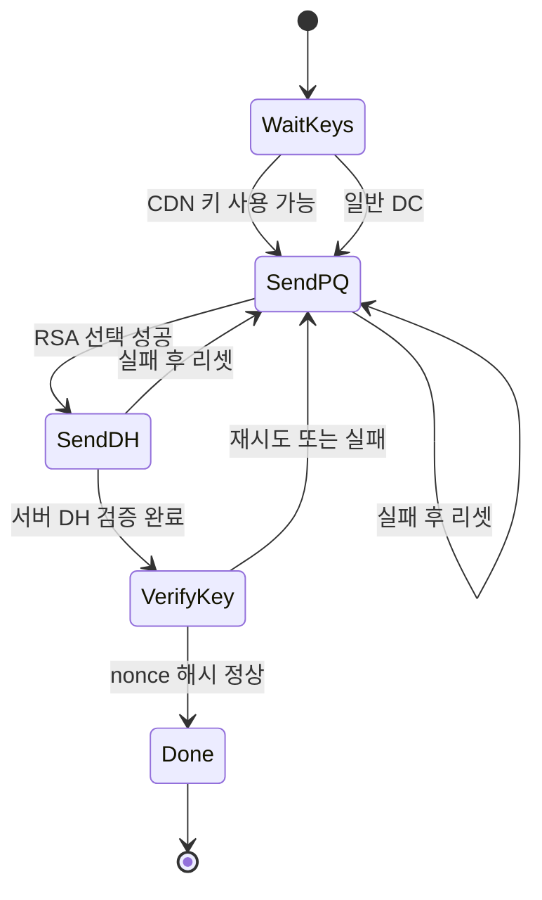
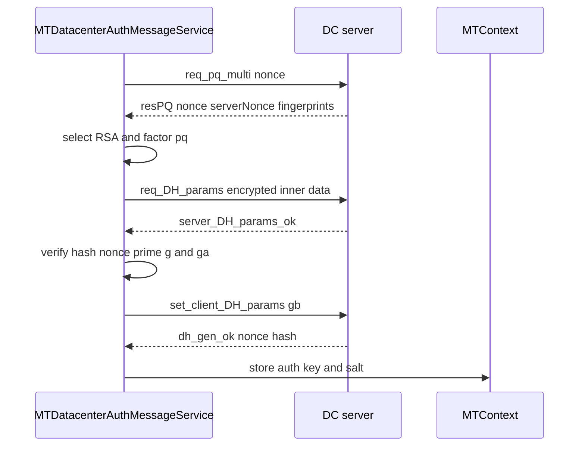
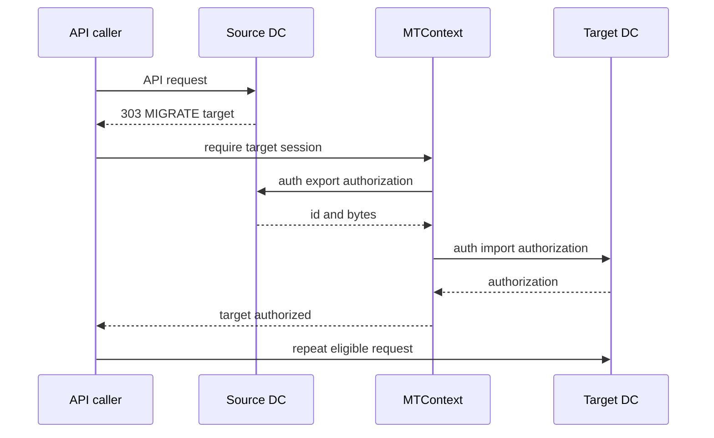

# 인증 키와 다중 데이터 센터

웹: /docs/system/04-auth-keys-datacenters/ · Markdown: /docs/system/04-auth-keys-datacenters.md

> Telegram 클라이언트가 인증 키를 어떻게 만들고, 저장하고, 데이터 센터를 넘나들며 사용하는가

> 시스템 설계 · 네트워크와 프로토콜 · 04장 · 도표 3 · 코드 발췌 10 · 인용 60 · 소스 기준선: [TelegramMessenger/Telegram-iOS@f1dd7a2d](https://github.com/TelegramMessenger/Telegram-iOS/tree/f1dd7a2dbd02cbbf513e75d5695d8d36d1cf5838), [overtake/TelegramSwift@579cebbf](https://github.com/overtake/TelegramSwift/tree/579cebbf0c01fd41b712eff3647fa7f69db9665d)
>
> 관련 보충: [macOS fork 장별 검증 (01–07장)](/docs/system/31-fork-verify-01-07/), [FILE_MIGRATE의 최후 대비책(폴백) 경로](/docs/system/33-file-migrate/)
>
> 핵심 소스 파일: [TelegramMessenger/Telegram-iOS/submodules/MtProtoKit/Sources/MTDatacenterAuthMessageService.m](https://github.com/TelegramMessenger/Telegram-iOS/blob/f1dd7a2dbd02cbbf513e75d5695d8d36d1cf5838/submodules/MtProtoKit/Sources/MTDatacenterAuthMessageService.m), [TelegramMessenger/Telegram-iOS/submodules/MtProtoKit/Sources/MTDatacenterAuthAction.m](https://github.com/TelegramMessenger/Telegram-iOS/blob/f1dd7a2dbd02cbbf513e75d5695d8d36d1cf5838/submodules/MtProtoKit/Sources/MTDatacenterAuthAction.m), [TelegramMessenger/Telegram-iOS/submodules/MtProtoKit/Sources/MTBindKeyMessageService.m](https://github.com/TelegramMessenger/Telegram-iOS/blob/f1dd7a2dbd02cbbf513e75d5695d8d36d1cf5838/submodules/MtProtoKit/Sources/MTBindKeyMessageService.m), [TelegramMessenger/Telegram-iOS/submodules/MtProtoKit/Sources/MTContext.m](https://github.com/TelegramMessenger/Telegram-iOS/blob/f1dd7a2dbd02cbbf513e75d5695d8d36d1cf5838/submodules/MtProtoKit/Sources/MTContext.m), [TelegramMessenger/Telegram-iOS/submodules/MtProtoKit/Sources/MTDatacenterTransferAuthAction.m](https://github.com/TelegramMessenger/Telegram-iOS/blob/f1dd7a2dbd02cbbf513e75d5695d8d36d1cf5838/submodules/MtProtoKit/Sources/MTDatacenterTransferAuthAction.m), [TelegramMessenger/Telegram-iOS/submodules/MtProtoKit/Sources/MTDiscoverDatacenterAddressAction.m](https://github.com/TelegramMessenger/Telegram-iOS/blob/f1dd7a2dbd02cbbf513e75d5695d8d36d1cf5838/submodules/MtProtoKit/Sources/MTDiscoverDatacenterAddressAction.m), [TelegramMessenger/Telegram-iOS/submodules/MtProtoKit/Sources/MTDatacenterAuthInfo.m](https://github.com/TelegramMessenger/Telegram-iOS/blob/f1dd7a2dbd02cbbf513e75d5695d8d36d1cf5838/submodules/MtProtoKit/Sources/MTDatacenterAuthInfo.m), [TelegramMessenger/Telegram-iOS/submodules/MtProtoKit/Sources/MTDatacenterAddress.m](https://github.com/TelegramMessenger/Telegram-iOS/blob/f1dd7a2dbd02cbbf513e75d5695d8d36d1cf5838/submodules/MtProtoKit/Sources/MTDatacenterAddress.m), [TelegramMessenger/Telegram-iOS/submodules/TelegramCore/Sources/Network/Network.swift](https://github.com/TelegramMessenger/Telegram-iOS/blob/f1dd7a2dbd02cbbf513e75d5695d8d36d1cf5838/submodules/TelegramCore/Sources/Network/Network.swift), [TelegramMessenger/Telegram-iOS/submodules/TelegramCore/Sources/Network/Download.swift](https://github.com/TelegramMessenger/Telegram-iOS/blob/f1dd7a2dbd02cbbf513e75d5695d8d36d1cf5838/submodules/TelegramCore/Sources/Network/Download.swift), [TelegramMessenger/Telegram-iOS/submodules/TelegramCore/Sources/Network/MultiplexedRequestManager.swift](https://github.com/TelegramMessenger/Telegram-iOS/blob/f1dd7a2dbd02cbbf513e75d5695d8d36d1cf5838/submodules/TelegramCore/Sources/Network/MultiplexedRequestManager.swift), [TelegramMessenger/Telegram-iOS/submodules/TelegramCore/Sources/State/Serialization.swift](https://github.com/TelegramMessenger/Telegram-iOS/blob/f1dd7a2dbd02cbbf513e75d5695d8d36d1cf5838/submodules/TelegramCore/Sources/State/Serialization.swift), [TelegramMessenger/Telegram-iOS/submodules/TelegramCore/Sources/Authorization.swift](https://github.com/TelegramMessenger/Telegram-iOS/blob/f1dd7a2dbd02cbbf513e75d5695d8d36d1cf5838/submodules/TelegramCore/Sources/Authorization.swift), [TelegramMessenger/Telegram-iOS/submodules/TelegramCore/Sources/Account/Account.swift](https://github.com/TelegramMessenger/Telegram-iOS/blob/f1dd7a2dbd02cbbf513e75d5695d8d36d1cf5838/submodules/TelegramCore/Sources/Account/Account.swift), [TelegramMessenger/Telegram-iOS/submodules/Postbox/Sources/KeychainTable.swift](https://github.com/TelegramMessenger/Telegram-iOS/blob/f1dd7a2dbd02cbbf513e75d5695d8d36d1cf5838/submodules/Postbox/Sources/KeychainTable.swift), [overtake/TelegramSwift/.gitmodules](https://github.com/overtake/TelegramSwift/blob/579cebbf0c01fd41b712eff3647fa7f69db9665d/.gitmodules)

Telegram은 데이터 센터(DC)마다 암호화 신원을 독립된 `auth_key`(클라이언트와 센터가 공유하는 암호화 키)로 만들고, `MTContext`로 주소, 영구 키, 임시 키, 데이터 센터 간 인증 토큰을 관리해요. 덕분에 메인 RPC, 미디어, CDN이 병렬로 동작할 수 있고, 한 센터의 엔드포인트 변경이나 키 무효화가 다른 센터를 직접 깨뜨리지 않아요.

iOS 구현은 `MtProtoKit`과 `TelegramCore`에 있어요. macOS는 `submodules/telegram-ios`를 통해 `overtake/Telegram-iOS`를 참조해요. 고정 fork `a24bbe45`는 체크아웃되어 있으며, 인증 정보 인덱스, 임시 키 바인딩, DC 간 인증 이전 경로를 모두 검증할 수 있어요.[\[1\]](https://github.com/overtake/TelegramSwift/blob/579cebbf0c01fd41b712eff3647fa7f69db9665d/.gitmodules#L7-L9) [\[42\]](https://github.com/overtake/Telegram-iOS/blob/a24bbe45f9861f736a79916a50898512f751e0dc/submodules/MtProtoKit/Sources/MTContext.m#L117-L142) [\[43\]](https://github.com/overtake/Telegram-iOS/blob/a24bbe45f9861f736a79916a50898512f751e0dc/submodules/MtProtoKit/Sources/MTDatacenterAuthAction.m#L69-L89) [\[44\]](https://github.com/overtake/Telegram-iOS/blob/a24bbe45f9861f736a79916a50898512f751e0dc/submodules/MtProtoKit/Sources/MTDatacenterTransferAuthAction.m#L87-L166) 구체적인 검증은 [macOS fork 장별 검증 (01–07장)](/docs/system/31-fork-verify-01-07/)을 참고해요.

## 데이터 센터마다 하나씩 있는 암호화 컨텍스트 [#데이터-센터마다-하나씩-있는-암호화-컨텍스트]

문제는 최초 로그인만이 아니에요. 클라이언트에게는 센터마다 따로 암호화 연결이 필요한 상황이 세 가지 있어요.

- 로그인 전에도 아무 진입 센터에 접근할 수 있어야 해요.
- 로그인 후에는 미디어가 저장된 센터에 연결해야 해요.
- CDN 리다이렉트 시에는 또 다른 신뢰 세션을 만들어야 해요.

프로토콜도 키가 데이터 센터 사이에서 복제되지 않는다고 명시해요. 새 센터는 독립적으로 암호화 연결을 맺어야 하고, 그 뒤에야 사용자 인증을 이전할 수 있어요.[\[2\]](https://core.telegram.org/api/datacenter)

`MTContext`는 키와 주소 상태를 오래 들고 있는 소유자예요.

- 복합 정수 키로 `datacenterId`와 `MTDatacenterAuthInfoSelector`를 인덱싱해요.
- 같은 DC 안에서 영구 키, 임시 메인 연결 키, 임시 미디어 연결 키의 `MTDatacenterAuthInfo`를 따로 저장해요.
- 키 객체는 원본 키, `authKeyId`, 만료 시각, 바인딩 여부를 함께 가져요.
- salt 집합도 키와 함께 저장되며 메시지 식별자에 따라 사용할 수 있는 salt를 골라요.[\[3\]](https://github.com/TelegramMessenger/Telegram-iOS/blob/f1dd7a2dbd02cbbf513e75d5695d8d36d1cf5838/submodules/MtProtoKit/Sources/MTDatacenterAuthInfo.m#L4-L31) [\[4\]](https://github.com/TelegramMessenger/Telegram-iOS/blob/f1dd7a2dbd02cbbf513e75d5695d8d36d1cf5838/submodules/MtProtoKit/Sources/MTDatacenterAuthInfo.m#L77-L132)

`MTDatacenterAuthAction`은 키 하나를 만드는 조정자예요. 키 종류에 따라 이렇게 달라요.

- 영구 셀렉터는 결과를 `INT32_MAX` 유효 기간으로 기록해요.
- 임시 메인 연결과 미디어 연결은 `MTProto`를 `media`로 표시하며, 후자는 `enforceMedia`도 설정해요.

덕분에 같은 상태 머신을 세 가지 용도에 재사용하면서도 다운로드 연결이 메인 세션의 의미를 차지하지 않게 해요.[\[5\]](https://github.com/TelegramMessenger/Telegram-iOS/blob/f1dd7a2dbd02cbbf513e75d5695d8d36d1cf5838/submodules/MtProtoKit/Sources/MTDatacenterAuthAction.m#L70-L228)

키를 요청하는 쪽이 각자 핸드셰이크를 시작하지는 않아요. `authInfoForDatacenterWithIdRequired`는 먼저 복합 키로 `_datacenterAuthActions`와 재시도 타이머를 확인해요. 둘 다 비어 있을 때만 동작을 만들어요.

임시 키를 신청할 때 영구 키가 없고 호출자가 바인딩되지 않은 키를 허용하지 않으면, 컨텍스트는 먼저 영구 키를 신청하고 그것이 갱신된 뒤에 임시 키 동작을 실행해요.

이 게이트는 두 가지를 막아요. (추론)[\[37\]](https://github.com/TelegramMessenger/Telegram-iOS/blob/f1dd7a2dbd02cbbf513e75d5695d8d36d1cf5838/submodules/MtProtoKit/Sources/MTContext.m#L1595-L1632)

- 동시 worker가 같은 selector에 대해 키를 여러 개 만드는 일
- 임시 키가 바인딩할 영구 키보다 먼저 완성되는 일

키 생성 실패 정책은 두 층으로 나뉘어요.

- 핸드셰이크 서비스 자체의 실패 횟수: 첫 실패 후에는 기다리지 않고, 그 뒤로는 2의 0제곱에서 4제곱까지의 초를 기다려요.
- 동작이 끝난 뒤 `MTContext`: 다시 1, 2, 4, 8, 16, 32초 간격으로, 상한 60초까지 대기자에게 재신청을 알려요.

바인딩이 `ENCRYPTED_MESSAGE_INVALID`를 반환하면 코드는 영구 키를 서버가 더 이상 알아보지 못하는 것으로 보고 타이머 재시도를 시작하지 않아요. 이 경우 재시도할 때마다 DH(Diffie-Hellman 키 교환)를 처음부터 다시 해야 하지만 성공할 수 없기 때문이에요.[\[6\]](https://github.com/TelegramMessenger/Telegram-iOS/blob/f1dd7a2dbd02cbbf513e75d5695d8d36d1cf5838/submodules/MtProtoKit/Sources/MTDatacenterAuthMessageService.m#L52-L420) [\[38\]](https://github.com/TelegramMessenger/Telegram-iOS/blob/f1dd7a2dbd02cbbf513e75d5695d8d36d1cf5838/submodules/MtProtoKit/Sources/MTContext.m#L1716-L1773)

아래 상태 도표는 키 생성의 내부 단계를 보여 줘요. 실패해도 중간 상태에 머물지 않아요. 서비스는 nonce(한 번만 쓰는 무작위 값), DH 중간값, 현재 트랜잭션을 비운 뒤 지수 지연으로 재시도해요.



`submodules/MtProtoKit/Sources/MTDatacenterAuthMessageService.m` 163–202행 발췌.

```objc
typedef enum {
    MTDatacenterAuthStageWaitingForPublicKeys = 0,
    MTDatacenterAuthStagePQ = 1,
    MTDatacenterAuthStageReqDH = 2,
    MTDatacenterAuthStageKeyVerification = 3,
    MTDatacenterAuthStageDone = 4
} MTDatacenterAuthStage;

@interface MTDatacenterAuthMessageService () {
    bool _tempAuth;
    MTDatacenterAuthStage _stage;
    NSData *_nonce;
    NSData *_serverNonce;
    NSData *_newNonce;
    NSData *_dhP;
    NSData *_dhQ;
    int64_t _dhPublicKeyFingerprint;
    MTDatacenterAuthKey *_authKey;
    int64_t _serverSalt;
    NSArray<MTDatacenterAuthPublicKey *> *_publicKeys;
    NSUInteger _failureCount;
    int32_t _tempKeyValidUntilTimestamp;
}
```

트랜잭션 식별자 보관도 눈여겨볼 만해요. 서비스는 단계마다 준비된 메시지의 `messageId`, `seqNo`, 트랜잭션 ID를 보관해요. 재전송할 때 nonce를 다시 무작위로 만들지 않고 같은 요청 파라미터를 재사용할 수 있어요.

공식 프로토콜은 서버가 10분 안에 완전히 같은 요청에 대해 응답을 재전송할 수 있다고 규정하는데, 이것이 이렇게 상태를 저장하는 가치를 설명해 줘요. (추론)[\[6\]](https://github.com/TelegramMessenger/Telegram-iOS/blob/f1dd7a2dbd02cbbf513e75d5695d8d36d1cf5838/submodules/MtProtoKit/Sources/MTDatacenterAuthMessageService.m#L52-L420)

## req_pq_multi에서 auth_key까지 [#req_pq_multi에서-auth_key까지]

### 서버 신원과 작업 증명을 먼저 검증하기 [#서버-신원과-작업-증명을-먼저-검증하기]

이 흐름은 최초 키 교환의 두 가지 위험을 해결해요.

- 클라이언트는 자신이 앱에 컴파일되어 들어 있는 서버 RSA 키를 쓰고 있음을 확인해야 해요.
- 서버가 준 `pq`(소수 두 개의 곱)를 먼저 소인수분해해야 DH를 이어 갈 수 있어요.

이 둘을 하지 않으면 공격자가 핸드셰이크 재료를 바꿔치기하거나, 클라이언트가 유효하지 않은 큰 수를 비싼 계산에 끌어들일 수 있어요.

코드는 테스트용과 프로덕션용 RSA 공개 키를 두 개의 정적 배열로 나눠요. `resPQ`가 가져온 핑거프린트는 이 공개 키들로 계산한 핑거프린트와 같아야 해요. 키를 가져오는 곳은 센터 종류에 따라 달라요.

- 일반 센터는 이 두 컴파일 시점 배열만 사용해요.
- CDN은 컨텍스트에서 DC별로 캐시된 공개 키를 읽고, 처음에 일치하는 항목이 없으면 한 번 더 가져와요.

사용할 수 있는 키를 찾지 못하면 실패하며, 알 수 없는 인증서를 시도하지 않아요.[\[6\]](https://github.com/TelegramMessenger/Telegram-iOS/blob/f1dd7a2dbd02cbbf513e75d5695d8d36d1cf5838/submodules/MtProtoKit/Sources/MTDatacenterAuthMessageService.m#L52-L420) [\[7\]](https://github.com/TelegramMessenger/Telegram-iOS/blob/f1dd7a2dbd02cbbf513e75d5695d8d36d1cf5838/submodules/MtProtoKit/Sources/MTDatacenterAuthMessageService.m#L542-L650)

`req_pq_multi`의 nonce는 `SecRandomCopyBytes`에서 얻으며 길이는 16바이트예요. `resPQ`를 받으면 코드는 이렇게 처리해요.

1. 먼저 nonce를 비교해요.
2. `pq` 길이를 1~8바이트로 제한해요.
3. 4 미만이거나 2의 63제곱 이상인 값을 거부해요.
4. `MTFactorize`로 `p`와 `q`로 분해해요.

이는 공식 핸드셰이크에서 `pq`가 홀수 소수 두 개의 곱이며 보통 2의 63제곱 빼기 1을 넘지 않는다는 제약과 일치해요.[\[8\]](https://github.com/TelegramMessenger/Telegram-iOS/blob/f1dd7a2dbd02cbbf513e75d5695d8d36d1cf5838/submodules/MtProtoKit/Sources/MTDatacenterAuthMessageService.m#L339-L365) [\[9\]](https://core.telegram.org/mtproto/auth_key)

`submodules/MtProtoKit/Sources/MTDatacenterAuthMessageService.m` 339–365행 발췌.

```objc
case MTDatacenterAuthStagePQ:
{
    if (_nonce == nil) {
        uint8_t nonceBytes[16];
        if (SecRandomCopyBytes(kSecRandomDefault, 16, nonceBytes) != errSecSuccess) {
            [self fail:mtProto];
            return nil;
        }
        _nonce = [[NSData alloc] initWithBytes:nonceBytes length:16];
    }

    MTBuffer *reqPqBuffer = [[MTBuffer alloc] init];
    [reqPqBuffer appendInt32:(int32_t)0xbe7e8ef1];
    [reqPqBuffer appendBytes:_nonce.bytes length:_nonce.length];
    MTOutgoingMessage *message = [[MTOutgoingMessage alloc]
        initWithData:reqPqBuffer.data metadata:messageDescription
        additionalDebugDescription:nil shortMetadata:messageDescription
        messageId:_currentStageMessageId messageSeqNo:_currentStageMessageSeqNo];
    return [[MTMessageTransaction alloc] initWithMessagePayload:@[message]
        prepared:nil failed:nil completion:^(NSDictionary *transactions,
        NSDictionary *prepared, NSDictionary *quickAcks) {
        // ...
    }];
}
```

`p`, `q`를 얻으면 클라이언트는 32바이트 `new_nonce`를 만들어요. `pq`, 인수 `p`와 `q`, nonce 두 개, 대상 DC를 `p_q_inner_data`로 엮어요. 이때 규칙이 있어요.

- 테스트 환경에서는 DC ID에 10000을 더해요.
- 미디어이지만 CDN이 아닌 연결은 ID를 음수로 취해요.
- 임시 키에는 `expires_in`이 추가돼요.

이것은 로컬 규약이 아니라 핸드셰이크 페이로드의 일부이므로, 환경과 연결 역할이 엔드포인트 선택에만 들어가는 것이 아니라 키 교환에도 들어가요.[\[6\]](https://github.com/TelegramMessenger/Telegram-iOS/blob/f1dd7a2dbd02cbbf513e75d5695d8d36d1cf5838/submodules/MtProtoKit/Sources/MTDatacenterAuthMessageService.m#L52-L420) [\[9\]](https://core.telegram.org/mtproto/auth_key)

이어서 `encryptRSAModernPadding`이 공식 `RSA_PAD`를 구현해요. 하는 일은 이래요.

- 144바이트를 넘는 내부 데이터를 거부해요.
- 192바이트까지 패딩해요.
- 32바이트 임시 AES 키를 만들어요.
- RSA 입력이 모듈러스보다 작아지도록 최대 4096번 시도해요.

그다음 `req_DH_params`를 보내요. 이 상한은 난수나 암호화 제공자가 비정상일 때 무한 루프를 도는 것을 막지만, 아주 드물게 연속 실패하면 전체 핸드셰이크로 돌아가요. (추론)[\[10\]](https://github.com/TelegramMessenger/Telegram-iOS/blob/f1dd7a2dbd02cbbf513e75d5695d8d36d1cf5838/submodules/MtProtoKit/Sources/MTDatacenterAuthMessageService.m#L434-L539)

### 복호화 직후에 하는 DH 파라미터 거부 검사 [#복호화-직후에-하는-dh-파라미터-거부-검사]

서버가 `server_DH_params_ok`를 반환하면 클라이언트는 `new_nonce`와 `server_nonce`로 임시 AES key와 IV를 도출하여 응답을 복호화해요. 복호화한 응답은 이렇게 검사해요.

- 최소 20바이트의 SHA1이 있어야 해요.
- TL로 파싱한 `server_DH_inner_data`가 무작위 padding에 잘려서는 안 돼요.
- SHA1과 원래 nonce, 서버 nonce를 검증해요.

모든 실패 경로가 `fail:`을 호출하며, 부분적으로 협상된 키를 남기지 않아요.[\[11\]](https://github.com/TelegramMessenger/Telegram-iOS/blob/f1dd7a2dbd02cbbf513e75d5695d8d36d1cf5838/submodules/MtProtoKit/Sources/MTDatacenterAuthMessageService.m#L667-L843)

더 중요한 점은 클라이언트가 `g`, `dh_prime`, `g_a`를 그대로 받아들이지 않는다는 거예요. 검사는 이 순서예요.

1. 생성원(`g`)이 안전한지 검사해요.
2. `g_a`가 안전한 범위에 있는지 검사해요.
3. `dh_prime mod`가 이 생성원의 조건을 만족하는지 검사해요.
4. `dh_prime`이 안전 소수인지 검사해요.

`dh_prime`을 검사하는 뒤의 두 검사는 `context.keychain`을 받으며, 이는 비싼 소수 검증을 캐시하라는 공식 권고와 맞아요. 이어서 클라이언트는 `g_b`도 범위 검사를 통과할 때까지 256바이트 비공개 지수 `b`를 최대 8번 생성해요.[\[11\]](https://github.com/TelegramMessenger/Telegram-iOS/blob/f1dd7a2dbd02cbbf513e75d5695d8d36d1cf5838/submodules/MtProtoKit/Sources/MTDatacenterAuthMessageService.m#L667-L843) [\[9\]](https://core.telegram.org/mtproto/auth_key)

`submodules/MtProtoKit/Sources/MTDatacenterAuthMessageService.m` 770–830행 발췌.

```objc
// ...
NSData *innerDataGA = dhInnerData.gA;
NSData *innerDataDhPrime = dhInnerData.dhPrime;
if (!MTCheckIsSafeGAOrB(_encryptionProvider, innerDataGA, innerDataDhPrime)) {
    [self fail:mtProto];
    return;
}
if (!MTCheckMod(_encryptionProvider, innerDataDhPrime, (unsigned int)innerDataG,
    mtProto.context.keychain)) {
    [self fail:mtProto];
    return;
}
if (!MTCheckIsSafePrime(_encryptionProvider, innerDataDhPrime, mtProto.context.keychain)) {
    [self fail:mtProto];
    return;
}
for (int attempt = 0; attempt < 8 && g_b == nil; attempt++) {
    uint8_t bBytes[256];
    if (SecRandomCopyBytes(kSecRandomDefault, 256, bBytes) != errSecSuccess) {
        break;
    }
    // ...
}
```

`authKey`는 `g_a`의 `b`제곱을 `dh_prime`으로 나눈 나머지예요. 그다음 코드는 이렇게 진행해요.

1. `authKey`를 256바이트로 강제해요.
2. SHA1의 마지막 8바이트에서 `authKeyId`를 얻어요.
3. `new_nonce`와 `server_nonce`의 앞 8바이트를 XOR하여 첫 `serverSalt`로 삼아요.
4. SHA1과 무작위 패딩이 붙은 `client_DH_inner_data`를 보내요.
5. nonce에 태그 1, 2, 3과 키 보조 해시를 붙여 세 가지 확인 값을 계산해요.
6. `dh_gen_ok`의 해시가 같을 때만 델리게이트를 호출해 키를 게시해요.[\[12\]](https://github.com/TelegramMessenger/Telegram-iOS/blob/f1dd7a2dbd02cbbf513e75d5695d8d36d1cf5838/submodules/MtProtoKit/Sources/MTDatacenterAuthMessageService.m#L843-L1016) [\[9\]](https://core.telegram.org/mtproto/auth_key)

이 완료 지점이 핵심이에요. 호출자는 최종 키 확인을 통과한 결과만 보게 되며, 로컬에서 계산한 후보 공유 비밀을 인가된 키로 착각하지 않아요. 근거는 이래요.

- `_authKey`는 `set_client_DH_params`를 보내기 전에 임시로 보관되지만 `MTContext`에는 기록되지 않아요.
- `dh_gen_retry`의 확인 값이 올바르면 서비스는 여전히 `fail:`을 호출하며, 이전 `b`를 재사용하지 않고 처음부터 다시 시작해요.
- `dh_gen_fail`도 확인 값이 올바를 때만 실패로 받아들여요.
- 잘못된 확인 값, 잘못된 타입, 일치하지 않는 nonce는 델리게이트를 촉발하지 않아요.[\[12\]](https://github.com/TelegramMessenger/Telegram-iOS/blob/f1dd7a2dbd02cbbf513e75d5695d8d36d1cf5838/submodules/MtProtoKit/Sources/MTDatacenterAuthMessageService.m#L843-L1016)

리셋 경로는 두 가지예요.

- 현재 트랜잭션만 지우는 경로: 전달 실패이거나 트랜잭션이 실패했을 가능성이 있다고 표시되었을 때만 서비스는 현재 트랜잭션을 지우고 새 전송 트랜잭션을 요구해요. “같은 단계의 패킷을 아직 다시 보낼 수 있다”에 가까워요.
- 전체 리셋(`fail:`): 보안 전송의 리셋도 요청하며, 현재 메시지 ID, 시퀀스 번호, 트랜잭션 ID를 0으로 되돌려요. 전체 핸드셰이크 상태를 버려요.

두 경로의 차이는 코드의 상태 필드와 호출 위치로 결정된 것이며, 프로토콜 주석이 밝힌 설계 의도가 아니에요. (추론)[\[6\]](https://github.com/TelegramMessenger/Telegram-iOS/blob/f1dd7a2dbd02cbbf513e75d5695d8d36d1cf5838/submodules/MtProtoKit/Sources/MTDatacenterAuthMessageService.m#L52-L420) [\[12\]](https://github.com/TelegramMessenger/Telegram-iOS/blob/f1dd7a2dbd02cbbf513e75d5695d8d36d1cf5838/submodules/MtProtoKit/Sources/MTDatacenterAuthMessageService.m#L843-L1016)

아래 시퀀스 도표는 핸드셰이크의 인증 경계를 보여 줘요. RSA는 알려진 서버로 보내는 내부 데이터만 보호해요. DH 산출물은 최종 nonce 해시가 확인된 뒤에야 `MTContext`에 들어가요.



## 임시 키로 만드는 PFS 연결 정책 [#임시-키로-만드는-pfs-연결-정책]

장기 키는 재시작 후 재사용하기에 편하지만, 모든 트래픽이 오랫동안 이 키를 직접 쓰면 나중에 기기가 유출되었을 때 복호화될 수 있는 과거 범위가 커져요. Telegram의 프로토콜은 임시 키를 허용하며, 서버는 이를 메모리에만 최대 `expires_in`초 동안 보관한다고 설명해요. 클라이언트는 보통 이를 영구 키에 바인딩한 뒤 사용하여, 클라이언트-서버 통신의 순방향 비밀성(PFS, 키가 나중에 유출돼도 과거 통신을 풀 수 없는 성질)을 얻어요.[\[9\]](https://core.telegram.org/mtproto/auth_key)

임시 키의 수명은 이렇게 정해요.

- TelegramCore는 네트워크를 초기화할 때 항상 `useTempAuthKeys`를 `true`로 설정해요.
- `MTContext`의 기본 임시 키 수명은 24시간이에요.
- `MTDatacenterAuthMessageService`는 임시 키를 만들 때 현재 Unix 시간에 이 값을 더해 `validUntilTimestamp`에 기록해요. 영구 키는 `INT32_MAX`를 써요.

따라서 키 셀렉터는 성능 격리 용도만이 아니라 무효화 가능성도 인코딩해요.[\[13\]](https://github.com/TelegramMessenger/Telegram-iOS/blob/f1dd7a2dbd02cbbf513e75d5695d8d36d1cf5838/submodules/TelegramCore/Sources/Network/Network.swift#L489-L586) [\[14\]](https://github.com/TelegramMessenger/Telegram-iOS/blob/f1dd7a2dbd02cbbf513e75d5695d8d36d1cf5838/submodules/MtProtoKit/Sources/MTContext.m#L258-L319) [\[12\]](https://github.com/TelegramMessenger/Telegram-iOS/blob/f1dd7a2dbd02cbbf513e75d5695d8d36d1cf5838/submodules/MtProtoKit/Sources/MTDatacenterAuthMessageService.m#L843-L1016)

임시 키가 생성되는 시점에는 아직 사용자 인증이 없어요. `MTDatacenterAuthAction`은 이렇게 진행해요.

1. 같은 DC의 영구 키를 찾아요. 영구 키가 없으면 실패해요.
2. 있으면 임시 키를 켠 `MTProto`를 새로 만들고, 핸드셰이크 연결을 재사용해요.
3. `MTBindKeyMessageService`가 바인딩을 하게 해요.
4. `auth.bindTempAuthKey`가 `boolTrue`를 반환해야만 임시 키를 컨텍스트에 기록해요.

이렇게 하면 바인딩되지 않은 키 오류를 로그인된 세션으로 잘못 취급하지 않아요.[\[5\]](https://github.com/TelegramMessenger/Telegram-iOS/blob/f1dd7a2dbd02cbbf513e75d5695d8d36d1cf5838/submodules/MtProtoKit/Sources/MTDatacenterAuthAction.m#L70-L228) [\[15\]](https://github.com/TelegramMessenger/Telegram-iOS/blob/f1dd7a2dbd02cbbf513e75d5695d8d36d1cf5838/submodules/MtProtoKit/Sources/MTBindKeyMessageService.m#L49-L195)

`submodules/MtProtoKit/Sources/MTBindKeyMessageService.m` 55–92행 발췌.

```objc
int64_t bindingMessageId = [sessionInfo generateClientMessageId:NULL];
int32_t bindingSeqNo = [sessionInfo takeSeqNo:true];
int32_t expiresAt = (int32_t)(_ephemeralKey.validUntilTimestamp
    + [mtProto.context globalTimeDifference]);
int64_t nonce = 0;
arc4random_buf(&nonce, 8);

MTBuffer *decryptedMessage = [[MTBuffer alloc] init];
[decryptedMessage appendInt32:(int32_t)0x75a3f765];
[decryptedMessage appendInt64:nonce];
[decryptedMessage appendInt64:_ephemeralKey.authKeyId];
[decryptedMessage appendInt64:_persistentKey.authKeyId];
[decryptedMessage appendInt64:sessionInfo.sessionId];
[decryptedMessage appendInt32:expiresAt];
NSData *encryptedMessage = [MTProto _manuallyEncryptedMessage:[decryptedMessage data]
    messageId:bindingMessageId authKey:_persistentKey];

MTBuffer *bindRequestData = [[MTBuffer alloc] init];
[bindRequestData appendInt32:(int32_t)0xcdd42a05];
[bindRequestData appendInt64:_persistentKey.authKeyId];
[bindRequestData appendInt64:nonce];
[bindRequestData appendInt32:expiresAt];
[bindRequestData appendTLBytes:encryptedMessage];
```

바인딩 요청의 내부 내용에는 다음이 들어 있어요.

- 임시 및 영구 `authKeyId`
- 세션 ID
- nonce
- 전역 시간 차이로 보정한 만료 시각

내부는 영구 키로 수동 암호화하고, 외부 요청도 그 세션에서 전송해요. 이로써 서버는 두 키와 세션이 같은 주체에 속함을 검증할 수 있어요. 메시지 전달이나 트랜잭션이 실패했을 가능성이 있으면 서비스는 현재 트랜잭션을 지운 뒤 다시 전송을 요청해요. `auth_key` 거부가 연속 두 번 나오면 실패를 보고하여, 무효화된 키를 무한정 쓰는 일을 피해요.[\[15\]](https://github.com/TelegramMessenger/Telegram-iOS/blob/f1dd7a2dbd02cbbf513e75d5695d8d36d1cf5838/submodules/MtProtoKit/Sources/MTBindKeyMessageService.m#L49-L195)

바인딩 동작은 일시적 오류와 영구적 오류도 구분해요.

- 상태 코드가 500 이상이거나 420이면 동작은 최대 3번 시도하며, 두 번째와 세 번째 전에 각각 1초와 2초를 기다려요. 재시도할 때는 이전 연결의 재사용을 포기하지만 방금 생성한 임시 키는 재사용해요.
- 다른 오류는 곧바로 `bindError`에 저장하고 실패해요.

그래서 상위 계층은 네트워크 흔들림의 비용을 DH 한 번 이후로 한정하고, 영구 키를 알 수 없다는 신호는 컨텍스트가 무의미한 갱신을 멈추도록 넘길 수 있어요.[\[5\]](https://github.com/TelegramMessenger/Telegram-iOS/blob/f1dd7a2dbd02cbbf513e75d5695d8d36d1cf5838/submodules/MtProtoKit/Sources/MTDatacenterAuthAction.m#L70-L228)

이것은 종단 간 채팅 키의 대체재가 아니에요. 여기서의 PFS는 클라이언트와 Telegram 서버 사이의 임시 인증 키 교체만을 가리켜요. 보호하는 것은 클라우드 세션의 전송 키 이력이에요. 비밀 채팅의 종단 간 키 도출, 기기 키, 삭제 경로는 [종단 간 암호화와 로컬 보안](/docs/system/11-secret-chats-security/)을 참고해요.

업스트림 iOS 체크아웃의 갱신 정책은 만료를 기다리지 않아요.

- 이미 사용했고, 갱신 가능하며, 대응하는 영구 키가 있는 임시 메인 키 또는 미디어 키만 갱신해요.
- 선행 시간(만료보다 앞서 갱신하는 시간)은 수명의 4분의 1이며 최소 1초, 최대 1시간이에요.
- 스케줄러는 매번 최대 300초까지만 기다려요.
- 바인딩 오류 `ENCRYPTED_MESSAGE_INVALID`는 그 키의 재시도 시각을 최댓값으로 설정해요.
- 다른 실패는 60초 뒤에 재시도해요.

이는 아직 쓸 수 있는 키를 유지하면서, 서버가 영구 키를 잊어버린 경우의 무의미한 루프를 피해요.[\[16\]](https://github.com/TelegramMessenger/Telegram-iOS/blob/f1dd7a2dbd02cbbf513e75d5695d8d36d1cf5838/submodules/MtProtoKit/Sources/MTContext.m#L1790-L1890) [\[5\]](https://github.com/TelegramMessenger/Telegram-iOS/blob/f1dd7a2dbd02cbbf513e75d5695d8d36d1cf5838/submodules/MtProtoKit/Sources/MTDatacenterAuthAction.m#L70-L228)

macOS fork의 차이: `MTContext`를 만드는 초기화 구간은 `supplementary`를 받고 `disableUpdates`를 설정하지만 임시 키 갱신 스위치는 설정하지 않아요. `context.refreshesTemporaryKeys = !supplementary`는 업스트림 체크아웃에서만 보여요. 따라서 fork의 supplementary 네트워크가 임시 키 갱신을 끈다고 단정할 수 없어요.[\[45\]](https://github.com/overtake/Telegram-iOS/blob/a24bbe45f9861f736a79916a50898512f751e0dc/submodules/TelegramCore/Sources/Network/Network.swift#L466-L508) [\[46\]](https://github.com/TelegramMessenger/Telegram-iOS/blob/f1dd7a2dbd02cbbf513e75d5695d8d36d1cf5838/submodules/TelegramCore/Sources/Network/Network.swift#L529-L532) 검증 범위는 [macOS fork 장별 검증 (01–07장)](/docs/system/31-fork-verify-01-07/)을 참고해요.

## 재시작 후의 키와 주소 상태 [#재시작-후의-키와-주소-상태]

키 교환은 비싸고 데이터 센터 목록은 변하므로, 클라이언트는 런타임 컨텍스트를 저장해 두어야 해요. 다만 여기서의 `Keychain`이라는 이름은 오해하기 쉬워요. TelegramCore의 이 프록시는 Apple Security Keychain을 직접 호출하지 않아요. 대신 `MTKeychain` 프로토콜을 구현해서 다음을 해요.

- 객체를 `NSKeyedArchiver`로 인코딩해요.
- 키 이름을 `group:key`로 이어 붙여요.
- 주입된 `get`, `set`, `remove` 클로저에 넘겨요.[\[17\]](https://github.com/TelegramMessenger/Telegram-iOS/blob/f1dd7a2dbd02cbbf513e75d5695d8d36d1cf5838/submodules/TelegramCore/Sources/Network/Network.swift#L1412-L1466)

계정이 `makeExclusiveKeychain`을 만들 때, `get`, `set`, `remove` 클로저를 그 계정 `Postbox`의 keychain 테이블에 연결해요. 각 `AccountRecordId`에 증가하는 인스턴스 ID를 부여해요. 낡은 네트워크 객체의 읽기와 쓰기는 거부되므로 이전 계정이나 교체된 네트워크가 새 계정의 인증 상태를 덮어쓸 수 없어요.

`KeychainTable`은 바이트 값을 `ValueBox` 테이블에 그대로 기록해요. 삭제할 때는 `secure: false`를 전달하므로, 여기서 삭제가 물리적 보안 소거를 한다고 추론할 수 없어요.[\[18\]](https://github.com/TelegramMessenger/Telegram-iOS/blob/f1dd7a2dbd02cbbf513e75d5695d8d36d1cf5838/submodules/TelegramCore/Sources/Account/Account.swift#L9-L52) [\[19\]](https://github.com/TelegramMessenger/Telegram-iOS/blob/f1dd7a2dbd02cbbf513e75d5695d8d36d1cf5838/submodules/Postbox/Sources/KeychainTable.swift#L3-L26)

`submodules/TelegramCore/Sources/Account/Account.swift` 9–52행 발췌.

```swift
private let accountRecordToActiveKeychainId = Atomic<[AccountRecordId: Int]>(value: [:])

private func makeExclusiveKeychain(id: AccountRecordId, postbox: Postbox) -> Keychain {
    var keychainId = 0
    let _ = accountRecordToActiveKeychainId.modify { dict in
        var dict = dict
        if let value = dict[id] {
            dict[id] = value + 1
            keychainId = value + 1
        } else {
            keychainId = 0
            dict[id] = 0
        }
        return dict
    }
    return Keychain(get: { [weak postbox] key in
        let enabled = accountRecordToActiveKeychainId.with { dict in
            return dict[id] == keychainId
        }
        if enabled, let postbox = postbox {
            return postbox.keychainEntryForKey(key)
        } else {
            return nil
        }
    })
    // ...
```

업스트림 `MTContext.setKeychain:`은 프록시를 주입한 뒤 다음을 복원해요.

- 전역 시간 차이
- 영속 주소 집합
- 수동으로 고른 전송 방식
- 인증 정보
- CDN 공개 키
- 전송 통계
- DC 간 인증 토큰
- 정리 대기 세션

복원할 때 만료된 비영구 키를 삭제하고, 남은 임시 키에는 갱신을 예약해요. 주소 집합, 인증 정보, 인증 토큰의 갱신은 모두 해당 그룹에 즉시 기록돼요. 덕분에 앱을 재시작해도 DC마다 DH를 다시 할 필요가 없고, 만료되었거나 서버가 폐기한 항목만 재구성하면 돼요.[\[20\]](https://github.com/TelegramMessenger/Telegram-iOS/blob/f1dd7a2dbd02cbbf513e75d5695d8d36d1cf5838/submodules/MtProtoKit/Sources/MTContext.m#L465-L549) [\[21\]](https://github.com/TelegramMessenger/Telegram-iOS/blob/f1dd7a2dbd02cbbf513e75d5695d8d36d1cf5838/submodules/MtProtoKit/Sources/MTContext.m#L653-L1169)

각 그룹의 의미는 완전히 같지 않아요.

- `persistent`: `datacenterAuthInfoById`, 주소 집합, 수동 방식, 인증 토큰
- `ephemeral`: CDN 공개 키
- `temp`: 시간 차이와 전송 방식 통계
- `cleanup`: 세션 정리 목록

그런데 임시 인증 정보도 `persistent:datacenterAuthInfoById`에 기록되며, 다음 로드 때 만료 시각에 따라 걸러져요. 따라서 그룹 이름만으로 키의 유효 기간이 정해지지 않으며, `validUntilTimestamp`가 결정 조건이에요.[\[20\]](https://github.com/TelegramMessenger/Telegram-iOS/blob/f1dd7a2dbd02cbbf513e75d5695d8d36d1cf5838/submodules/MtProtoKit/Sources/MTContext.m#L465-L549) [\[21\]](https://github.com/TelegramMessenger/Telegram-iOS/blob/f1dd7a2dbd02cbbf513e75d5695d8d36d1cf5838/submodules/MtProtoKit/Sources/MTContext.m#L653-L1169)

공유 경로는 계정을 여는 방식에서도 드러나요. `accountWithId`는 계정 경로로 Postbox를 열며, 프로세스에 따라 다르게 전달해요.

- 메인 프로세스는 `isMainProcess: true`를 전달해요.
- 보조 프로세스는 `false`를 전달하고 캐시를 비활성화해요.

이어서 두 경로 모두 `makeExclusiveKeychain`을 만들어 `initializedNetwork`에 넘겨요. 그래서 같은 계정의 보조 프로세스는 같은 Postbox에서 네트워크 상태를 읽을 수 있고, 배타적 인스턴스 ID는 이미 비활성화된 네트워크 객체가 계속 쓰는 것을 막아요. (추론)[\[35\]](https://github.com/TelegramMessenger/Telegram-iOS/blob/f1dd7a2dbd02cbbf513e75d5695d8d36d1cf5838/submodules/TelegramCore/Sources/Account/Account.swift#L228-L350)

`MTContext.copyAuthInfoFrom:toTempKeychain:`은 임시 keychain으로 인증 정보를 복사하는 상황을 위해 더 좁은 복사 집합을 제공해요. 복사하는 것은 이래요.

- 임시 시간 차이
- 영속 주소 집합
- 영속 인증 정보
- 임시 CDN 공개 키

`authTokenById`는 복사하지 않으며, 코드에서 이 행은 주석 처리되어 있어요. 따라서 인증 이전 토큰을 컨텍스트 간에 무조건 복사할 수 있는 데이터로 볼 수 없어요. 이 선택은 임시 컨텍스트가 DC 간 요청에서 토큰 이전을 다시 기다리게 할 수 있지만, 단기 인증 상태가 모든 사본으로 퍼지는 것을 피해요. (후반부는 추론)[\[39\]](https://github.com/TelegramMessenger/Telegram-iOS/blob/f1dd7a2dbd02cbbf513e75d5695d8d36d1cf5838/submodules/MtProtoKit/Sources/MTContext.m#L345-L365)

객체 아카이브에는 호환성 비용도 있어요.

- `Keychain.dictionary`와 `number`는 모두 `MTDeprecated.unarchiveDeprecated`를 쓰며, 이 함수는 `NSKeyedUnarchiver`가 던진 예외를 잡은 뒤 빈 값을 반환해요.
- 예상치 못한 타입을 읽으면 Swift 쪽에서 단언 실패가 발생해요.

코드는 단일 키 값 때문에 시작 과정 전체가 크래시하는 것보다 오래된 아카이브를 디코딩하지 못하는 것을 감수하는 쪽을 택해요. 대가는 유실된 키가 이후 네트워크 접근 때 재인증을 촉발하며, 진단할 수 있는 아카이브 버전 오류가 남지 않는다는 점이에요. (추론)[\[17\]](https://github.com/TelegramMessenger/Telegram-iOS/blob/f1dd7a2dbd02cbbf513e75d5695d8d36d1cf5838/submodules/TelegramCore/Sources/Network/Network.swift#L1412-L1466)

인증 정보는 불변 키 하나만으로 이루어지지 않아요. `MTDatacenterAuthInfo`의 `saltSet`은 `MTDatacenterSaltInfo` 여러 개를 보관해요.

- 메시지를 보낼 때 `authSaltForMessageId`는 집합을 순회하여 그 메시지 ID 이후에도 사용할 수 있고 남은 유효 메시지 수가 가장 많은 salt를 골라요.
- 새 salt를 병합할 때 코드는 현재 시간에 해당하는 메시지 ID에 대해 아직 유효한 항목만 남기고 `firstValidMessageId`로 중복을 제거해요.

그래서 시계 조정이나 서버의 새 salt 전달 시, 이전 salt와 새 salt가 잠시 공존할 수 있어 호출자가 단일 패킷 경계에서 전환할 필요가 없어요. (마지막 문장은 추론)[\[4\]](https://github.com/TelegramMessenger/Telegram-iOS/blob/f1dd7a2dbd02cbbf513e75d5695d8d36d1cf5838/submodules/MtProtoKit/Sources/MTDatacenterAuthInfo.m#L77-L132)

전역 시간 차이도 저장되는데, 메시지 ID가 서버 시간과 관련되기 때문이에요. `setGlobalTimeDifference:`는 새 값을 `temp:globalTimeDifference`에 기록해요. 재시작 후의 `setKeychain:`은 이 값을 먼저 복원한 뒤 주소와 키를 복원해요. 시계 보정을 UI 설정이 아니라 네트워크 인증 컨텍스트의 일부로 취급해요. 대가는 임시 저장소가 무효화되면 클라이언트가 이후 프로토콜 메시지에 기대어 시간을 다시 맞춰야 한다는 점이에요. (마지막 문장은 추론)[\[20\]](https://github.com/TelegramMessenger/Telegram-iOS/blob/f1dd7a2dbd02cbbf513e75d5695d8d36d1cf5838/submodules/MtProtoKit/Sources/MTContext.m#L465-L549) [\[21\]](https://github.com/TelegramMessenger/Telegram-iOS/blob/f1dd7a2dbd02cbbf513e75d5695d8d36d1cf5838/submodules/MtProtoKit/Sources/MTContext.m#L653-L1169)

여기서 프로세스 공유는 신중하게 표현해야 해요. 앱, 알림 서비스, 기타 확장이 같은 계정 경로로 같은 Postbox를 열면 keychain 테이블을 통해 같은 아카이브 데이터를 보게 돼요. (추론) 이 코드 구간이 증명하는 것은 공유 저장소 추상화이며, 독립된 Apple Keychain access group의 사용이 아니에요. 확장 프로세스 협력의 실제 수명 주기는 [푸시, 확장 프로세스와 다중 프로세스 협업](/docs/system/12-push-extensions/)을 참고해요. Postbox의 트랜잭션과 크래시 복구는 [Postbox 스토리지 엔진](/docs/system/08-postbox-storage/)을 참고해요.

`submodules/MtProtoKit/Sources/MTContext.m` 473–520행 발췌.

```objc
// ...
NSDictionary *datacenterAddressSetById = [keychain dictionaryForKey:@"datacenterAddressSetById"
    group:@"persistent"];
if (datacenterAddressSetById != nil) {
    _datacenterAddressSetById = [[NSMutableDictionary alloc]
        initWithDictionary:datacenterAddressSetById];
}
NSDictionary *datacenterAuthInfoById = [keychain dictionaryForKey:@"datacenterAuthInfoById"
    group:@"persistent"];
if (datacenterAuthInfoById != nil) {
    _datacenterAuthInfoById = [[NSMutableDictionary alloc]
        initWithDictionary:datacenterAuthInfoById];
    int32_t currentTimestamp = (int32_t)([NSDate date].timeIntervalSince1970);
    for (NSNumber *key in [_datacenterAuthInfoById allKeys]) {
        if (parseAuthInfoMapKeyInteger(key).selector != MTDatacenterAuthInfoSelectorPersistent) {
            MTDatacenterAuthInfo *authInfo = _datacenterAuthInfoById[key];
            if (authInfo.validUntilTimestamp != INT32_MAX &&
                currentTimestamp > authInfo.validUntilTimestamp) {
                [_datacenterAuthInfoById removeObjectForKey:key];
            }
        }
    }
    [self _scheduleTempKeyRefresh];
}
```

## 시드에서 서버 설정으로 이어지는 주소 탐색 [#시드에서-서버-설정으로-이어지는-주소-탐색]

앱은 컴파일 시점의 IP를 완전한 디렉터리로 취급할 수 없어요. 진입 주소는 지역, 부하, 네트워크 정책에 따라 바뀌어요. 그래서 TelegramCore는 네트워크를 초기화할 때 먼저 최소한의 시드 집합(컴파일 시점에 들어 있는 초기 주소)을 설정하고, 인증된 DC의 `help.getConfig`로 모든 `dcOption`을 학습해요.

- 테스트 환경에는 IPv4 시드 주소 3개를 설정해요.
- 프로덕션 환경에는 DC 1~5의 IPv4와 IPv6 주소를 설정해요.

초기 주소의 포트는 모두 443이며 미디어나 CDN 주소가 아니에요.[\[13\]](https://github.com/TelegramMessenger/Telegram-iOS/blob/f1dd7a2dbd02cbbf513e75d5695d8d36d1cf5838/submodules/TelegramCore/Sources/Network/Network.swift#L489-L586)

`MTContext`는 시드 주소 집합과 탐색된 주소 집합을 함께 보관해요. 조회할 때는 탐색된 집합을 우선 쓰고, 집합이 없거나 비어 있을 때만 시드 집합으로 폴백해요. 주소 집합을 갱신하면 이렇게 해요.

- `persistent:datacenterAddressSetById`에 영속화해요.
- 리스너에게 알려요.
- 조건에 따라 기존 전송 방식을 리셋해요.

전송의 세부 사항은 [MTProto 전송 계층](/docs/system/03-mtproto-transport/)에 속해요.[\[21\]](https://github.com/TelegramMessenger/Telegram-iOS/blob/f1dd7a2dbd02cbbf513e75d5695d8d36d1cf5838/submodules/MtProtoKit/Sources/MTContext.m#L653-L1169)

`MTDiscoverDatacenterAddressAction`은 대상 DC에 주소가 없는 경우를 해결해요. 동작은 이래요.

1. 아직 시도하지 않은 알려진 DC를 순회하며, 그 DC의 영구 키를 먼저 요구해요.
2. 키가 준비되면 그 센터에서 백그라운드 요청 서비스를 시작하고, 직렬화기가 제공하는 `getConfig` 요청을 호출해요.
3. 성공하면 대상 DC의 주소 목록만 취해 컨텍스트에 되써 넣어요.
4. 그 후보 센터가 실패하거나 대상 주소가 없으면 연결을 정리하고 다음 미처리 센터로 넘어가요.

이 폴백은 디렉터리 탐색을 알려진 건강한 센터들에 분산하며, 단일 디렉터리 서비스가 항상 사용 가능하다고 가정하지 않아요. (추론)[\[22\]](https://github.com/TelegramMessenger/Telegram-iOS/blob/f1dd7a2dbd02cbbf513e75d5695d8d36d1cf5838/submodules/MtProtoKit/Sources/MTDiscoverDatacenterAddressAction.m#L43-L230)

`submodules/MtProtoKit/Sources/MTDiscoverDatacenterAddressAction.m` 82–128행 발췌.

```objc
if ([context authInfoForDatacenterWithId:_targetDatacenterId
    selector:MTDatacenterAuthInfoSelectorPersistent] != nil) {
    _mtProto = [[MTProto alloc] initWithContext:context
        datacenterId:_targetDatacenterId usageCalculationInfo:nil
        requiredAuthToken:nil authTokenMasterDatacenterId:0];
    _mtProto.useTempAuthKeys = useTempAuthKeys;
    _requestService = [[MTRequestMessageService alloc] initWithContext:_context];
    _requestService.forceBackgroundRequests = true;
    [_mtProto addMessageService:_requestService];
    [_mtProto resume];

    NSData *getConfigData = nil;
    MTRequestDatacenterAddressListParser responseParser =
        [_context.serialization requestDatacenterAddressWithData:&getConfigData];
    [request setPayload:getConfigData metadata:@"getConfig"
        shortMetadata:@"getConfig" responseParser:responseParser];
    [request setCompleted:^(MTDatacenterAddressListData *result,
        MTRequestResponseInfo *info, id error) {
        if (error == nil)
            [strongSelf getConfigSuccess:result.addressList[@(strongSelf->_datacenterId)]];
        else
            [strongSelf getConfigFailed];
    }];
    [_requestService addRequest:request];
// ...
```

`Serialization.requestDatacenterAddress`는 생성된 코드의 `Api.functions.help.getConfig()`를 MtProtoKit의 콜백 인터페이스로 감싸요. `dcOption`의 네 가지 라우팅 의미를 보존해요.

- `media_only`는 `preferForMedia`가 돼요.
- `tcpo_only`는 `restrictToTcp`가 돼요.
- `cdn`은 `isCdn`이 돼요.
- 정적 플래그는 `preferForProxy` 필드에 저장돼요.

이 함수는 API 스키마와 오래된 네트워크 코어 사이의 경계 어댑터 계층이에요.[\[23\]](https://github.com/TelegramMessenger/Telegram-iOS/blob/f1dd7a2dbd02cbbf513e75d5695d8d36d1cf5838/submodules/TelegramCore/Sources/State/Serialization.swift#L294-L324)

주소 탐색과 실제 경로 선택도 분리되어 있어요. 탐색 동작은 모든 후보 주소를 `MTContext`에 갱신할 뿐이에요. 그다음 `transportSchemesForDatacenterWithId`가 주소를 전송 방식으로 감싸고 요청 역할에 따라 걸러내요.

- 미디어를 강제하면 미디어 우선이 아닌 주소를 모두 삭제해요.
- 일반 메인 연결은 미디어 우선 주소를 삭제해요.
- 일반 미디어 연결은 목록에 미디어 우선 주소가 있으면 미디어가 아닌 항목도 추가로 삭제해요.
- 명시적 주소 오버라이드는 예외로, TCP 방식 하나를 곧바로 삽입해요.

이렇게 하면 디렉터리 캐시는 온전히 유지되고, 개별 연결의 역할은 선택 단계에서만 작용해요.[\[21\]](https://github.com/TelegramMessenger/Telegram-iOS/blob/f1dd7a2dbd02cbbf513e75d5695d8d36d1cf5838/submodules/MtProtoKit/Sources/MTContext.m#L653-L1169) [\[33\]](https://github.com/TelegramMessenger/Telegram-iOS/blob/f1dd7a2dbd02cbbf513e75d5695d8d36d1cf5838/submodules/MtProtoKit/Sources/MTDatacenterAddress.m#L6-L120)

학습한 주소를 맹목적으로 영구히 신뢰하는 것은 아니에요. 주소 집합을 갱신한 뒤 `MTContext`는 주소와 전송 방식 리스너에게 알려요. 이전 집합이 비어 있거나 호출자가 강제 갱신을 요구하면, 그 DC에 대한 전송 방식 탐색을 재시작해요. 전송 방식의 성공과 실패 타임스탬프는 5초 지연으로 배치하여 `temp:transportSchemeStats_v1`에 기록해요. 이는 짧은 시간에 연속된 네트워크 이벤트의 저장소 쓰기를 줄이지만, 크래시 시 마지막 5초의 통계가 사라질 수 있어요. (추론)[\[21\]](https://github.com/TelegramMessenger/Telegram-iOS/blob/f1dd7a2dbd02cbbf513e75d5695d8d36d1cf5838/submodules/MtProtoKit/Sources/MTContext.m#L653-L1169)

시드, 탐색 주소, 백업 탐색도 역할이 달라요. `addressSetForDatacenterWithId`는 비어 있지 않은 탐색 집합을 우선 반환하고, 그렇지 않을 때만 시드 집합을 반환해요. 방식이 필요하면 `MTContext`는 현재 주소와 시드 주소를 합쳐 연결 탐색 신호에 넘겨요. 방식이 실패하면 네트워크 설정에 따라 5초 또는 20초 뒤에 대체 주소 탐색을 시작해요. 그래서 정적 시드는 콜드 스타트에만 쓰이는 것이 아니라 캐시된 엔드포인트에 닿지 못할 때의 폴백 후보도 돼요. 실제 socket 탐사, HTTP 시작, 프록시 선택은 [MTProto 전송 계층](/docs/system/03-mtproto-transport/)에 남겨 둬요.[\[21\]](https://github.com/TelegramMessenger/Telegram-iOS/blob/f1dd7a2dbd02cbbf513e75d5695d8d36d1cf5838/submodules/MtProtoKit/Sources/MTContext.m#L653-L1169)

`submodules/TelegramCore/Sources/State/Serialization.swift` 294–318행 발췌.

```swift
public func requestDatacenterAddress(with data: AutoreleasingUnsafeMutablePointer<NSData?>)
    -> MTRequestDatacenterAddressListParser! {
    let (_, buffer, parser) = Api.functions.help.getConfig()
    data.pointee = buffer.makeData() as NSData
    return { response in
        if let config = parser.parse(Buffer(data: response)) {
            switch config {
            case let .config(configData):
                var addressDict: [NSNumber: [Any]] = [:]
                for option in configData.dcOptions {
                    switch option {
                    case let .dcOption(dcOptionData):
                        let (flags, id, ipAddress, port, secret) =
                            (dcOptionData.flags, dcOptionData.id, dcOptionData.ipAddress,
                             dcOptionData.port, dcOptionData.secret)
                        let preferForMedia = (flags & (1 << 1)) != 0
                        let restrictToTcp = (flags & (1 << 2)) != 0
                        let isCdn = (flags & (1 << 3)) != 0
                        let preferForProxy = (flags & (1 << 4)) != 0
                        addressDict[id as NSNumber, default: []].append(MTDatacenterAddress(
                            ip: ipAddress, port: UInt16(port), preferForMedia: preferForMedia,
                            restrictToTcp: restrictToTcp, cdn: isCdn,
                            preferForProxy: preferForProxy, secret: secret?.makeData()))
                        // ...
```

## 마이그레이션 오류와 데이터 센터 간 인증 [#마이그레이션-오류와-데이터-센터-간-인증]

303 오류가 뜻하는 것은 연결 재시도가 아니라, 요청을 다른 DC에서 다시 실행해야 한다는 거예요. 공식 문서는 네 가지 오류를 정의하고, 각각 다음에 대응해요.

- `PHONE_MIGRATE_X`: 번호 귀속
- `NETWORK_MIGRATE_X`: 등록 출처 주소
- `USER_MIGRATE_X`: 사용자 귀속
- `FILE_MIGRATE_X`: 파일 위치

`X`는 재시도해야 할 DC ID예요.[\[24\]](https://core.telegram.org/api/errors)

로그인의 실제 처리는 `sendAuthorizationCode`에 있어요.

1. 정규식으로 `PHONE_`, `USER_`, `NETWORK_`에 `MIGRATE_`와 숫자 접미사가 붙은 것을 매칭하여 대상 DC ID를 꺼내요.
2. `changedMasterDatacenterId`를 호출해 같은 계정 ID, Postbox, 전용 Keychain, 네트워크 설정, 테스트 환경으로 `Network`를 새로 만들어요.
3. 새 네트워크에서 같은 `auth.sendCode` 요청을 다시 보내요.[\[34\]](https://github.com/TelegramMessenger/Telegram-iOS/blob/f1dd7a2dbd02cbbf513e75d5695d8d36d1cf5838/submodules/TelegramCore/Sources/Authorization.swift#L195-L229) [\[35\]](https://github.com/TelegramMessenger/Telegram-iOS/blob/f1dd7a2dbd02cbbf513e75d5695d8d36d1cf5838/submodules/TelegramCore/Sources/Account/Account.swift#L228-L350)

여기서의 재실행 범위는 좁고 검증할 수 있어요. 최초 `auth.sendCode`의 오류 스트림만 감싸요. 두 번째 요청이 다시 실패하면 코드는 `SESSION_PASSWORD_NEEDED`에 대해서만 비밀번호를 가져오는 특별 처리를 하고, 다른 오류는 계속 밖으로 전파해요. 이렇게 하면 “실패한 API는 모두 멱등하게 재시도할 수 있다”는 가정이 범용 네트워크 계층에 묻히는 것을 피해요. 쓰기 작업이 DC를 넘어 자동으로 재실행될 수 있는지는 호출 지점이 API 의미에 따라 결정해야 해요. (추론)[\[34\]](https://github.com/TelegramMessenger/Telegram-iOS/blob/f1dd7a2dbd02cbbf513e75d5695d8d36d1cf5838/submodules/TelegramCore/Sources/Authorization.swift#L195-L229)

계정 메인 DC의 변경도 기존 `Network`를 제자리에서 수정하는 방식이 아니에요. `changedMasterDatacenterId`는 공유 설정과 Postbox 환경설정을 읽은 뒤 `initializedNetwork`를 호출하고, 새 네트워크로 새 `UnauthorizedAccount`를 만들어요. 이 객체는 원래의 `shouldBeServiceTaskMaster` 신호를 유지해요. 이전 객체는 전용 Keychain의 인스턴스 ID 때문에 쓰기 권한을 잃어요. 이 객체 교체는 이전 네트워크와 새 네트워크가 같은 미인증 계정에 동시에 키 상태를 쓰는 일을 막아요. (추론)[\[35\]](https://github.com/TelegramMessenger/Telegram-iOS/blob/f1dd7a2dbd02cbbf513e75d5695d8d36d1cf5838/submodules/TelegramCore/Sources/Account/Account.swift#L228-L350) [\[18\]](https://github.com/TelegramMessenger/Telegram-iOS/blob/f1dd7a2dbd02cbbf513e75d5695d8d36d1cf5838/submodules/TelegramCore/Sources/Account/Account.swift#L9-L52)

`FILE_MIGRATE_X`는 위의 로그인 분기를 타지 않아요. 파일 객체 자체가 `dc_id`를 포함하므로 다운로드 스케줄러가 이를 근거로 미디어 DC를 고를 수 있어요. 고정 iOS 커밋에는 이 오류에 대한 범용 DC 간 최후 대비책(폴백)이 없어요.

- `MTInternalMessageParser`는 RPC 오류를 `MTRpcError`로 구성하고, `MTRequestMessageService`는 303에 대해 대상 DC를 고쳐 쓰거나 재전송하지 않아요.
- V1, V2 다운로드는 각각 식별되지 않는 오류를 일반 실패로 분류하며, 업로드도 일반 오류로만 분류해요.
- 클라이언트는 이를 근거로 새 worker를 만들거나, 인증을 import하거나, 새 DC에서 조각을 재실행하지 않아요.
- `Download.part`를 직접 쓸 때의 일반 재시도도 여전히 원래 worker를 가리키므로 마이그레이션 폴백이 아니에요.[\[47\]](https://github.com/TelegramMessenger/Telegram-iOS/blob/f1dd7a2dbd02cbbf513e75d5695d8d36d1cf5838/submodules/MtProtoKit/Sources/MTInternalMessageParser.m#L211-L222) [\[48\]](https://github.com/TelegramMessenger/Telegram-iOS/blob/f1dd7a2dbd02cbbf513e75d5695d8d36d1cf5838/submodules/MtProtoKit/Sources/MTRequestMessageService.m#L849-L1063) [\[49\]](https://github.com/TelegramMessenger/Telegram-iOS/blob/f1dd7a2dbd02cbbf513e75d5695d8d36d1cf5838/submodules/TelegramCore/Sources/Network/MultipartFetch.swift#L337-L391) [\[50\]](https://github.com/TelegramMessenger/Telegram-iOS/blob/f1dd7a2dbd02cbbf513e75d5695d8d36d1cf5838/submodules/TelegramCore/Sources/Network/FetchV2.swift#L871-L1100) [\[51\]](https://github.com/TelegramMessenger/Telegram-iOS/blob/f1dd7a2dbd02cbbf513e75d5695d8d36d1cf5838/submodules/TelegramCore/Sources/Network/Download.swift#L94-L171) [\[52\]](https://github.com/TelegramMessenger/Telegram-iOS/blob/f1dd7a2dbd02cbbf513e75d5695d8d36d1cf5838/submodules/TelegramCore/Sources/Network/MultipartUpload.swift#L406-L489) [\[53\]](https://github.com/TelegramMessenger/Telegram-iOS/blob/f1dd7a2dbd02cbbf513e75d5695d8d36d1cf5838/submodules/TelegramCore/Sources/Network/Download.swift#L221-L269)

네트워크 텔레메트리는 여전히 모든 303을 `migrate`로 분류하지만 재전송은 담당하지 않아요.[\[36\]](https://github.com/TelegramMessenger/Telegram-iOS/blob/f1dd7a2dbd02cbbf513e75d5695d8d36d1cf5838/submodules/TelegramCore/Sources/Network/NetworkTelemetry.swift#L350-L412) 자세한 내용은 [FILE_MIGRATE의 최후 대비책(폴백) 경로](/docs/system/33-file-migrate/)를 참고해요.

macOS fork에도 범용 DC 간 재실행은 없어요. 마이그레이션 텍스트 매칭은 로그인의 `PHONE_`, `USER_`, `NETWORK_` 접두사만 다루며, RPC 오류는 여전히 `MTRpcError`로 위로 던져져요. V1, V2 다운로드와 업로드 모두 이 오류에서 새 DC를 고르는 분기가 없어요.[\[54\]](https://github.com/overtake/Telegram-iOS/blob/a24bbe45f9861f736a79916a50898512f751e0dc/submodules/TelegramCore/Sources/Authorization.swift#L195-L224) [\[55\]](https://github.com/overtake/Telegram-iOS/blob/a24bbe45f9861f736a79916a50898512f751e0dc/submodules/MtProtoKit/Sources/MTInternalMessageParser.m#L210-L221) [\[56\]](https://github.com/overtake/Telegram-iOS/blob/a24bbe45f9861f736a79916a50898512f751e0dc/submodules/MtProtoKit/Sources/MTRequestMessageService.m#L845-L1060) [\[57\]](https://github.com/overtake/Telegram-iOS/blob/a24bbe45f9861f736a79916a50898512f751e0dc/submodules/TelegramCore/Sources/Network/MultipartFetch.swift#L343-L382) [\[58\]](https://github.com/overtake/Telegram-iOS/blob/a24bbe45f9861f736a79916a50898512f751e0dc/submodules/TelegramCore/Sources/Network/FetchV2.swift#L850-L940) [\[59\]](https://github.com/overtake/Telegram-iOS/blob/a24bbe45f9861f736a79916a50898512f751e0dc/submodules/TelegramCore/Sources/Network/Download.swift#L106-L130) [\[60\]](https://github.com/overtake/Telegram-iOS/blob/a24bbe45f9861f736a79916a50898512f751e0dc/submodules/TelegramCore/Sources/Network/MultipartUpload.swift#L411-L488)

이미 존재하는 범용 인프라는 인증 이전이에요.

- `MTProto`는 `requiredAuthToken`을 달고 시작할 수 있어요.
- 대상 DC의 토큰이 일치하지 않으면 `MTContext`에 토큰을 가져오도록 요청해요.
- 컨텍스트는 대상 DC마다 `MTDatacenterTransferAuthAction`을 하나만 유지하며, 실패하면 1, 2, 4, 8, 16, 32, 60초 상한의 지수 백오프로 여전히 대기 중인 연결에 다시 알려요.[\[25\]](https://github.com/TelegramMessenger/Telegram-iOS/blob/f1dd7a2dbd02cbbf513e75d5695d8d36d1cf5838/submodules/MtProtoKit/Sources/MTProto.m#L2693-L2696) [\[26\]](https://github.com/TelegramMessenger/Telegram-iOS/blob/f1dd7a2dbd02cbbf513e75d5695d8d36d1cf5838/submodules/MtProtoKit/Sources/MTContext.m#L1634-L1702)

`MTDatacenterTransferAuthAction`은 소스 DC에서 `auth.exportAuthorization(destination)`을 호출해요. 응답은 `authorizationId`와 바이트 문자열을 돌려줘요. 그다음은 이래요.

1. 소스 연결을 멈춰요.
2. 대상 DC에 요청 서비스를 만들어요.
3. `auth.importAuthorization`을 호출해요.
4. 성공하면 전달받은 `authToken`을 컨텍스트에 기록해요.

두 요청 모두 백그라운드 실행을 강제하고 `shouldContinueExecutionWithErrorContext`를 참으로 설정하여, 500과 FLOOD_WAIT의 재시도 정책을 허용해요.[\[27\]](https://github.com/TelegramMessenger/Telegram-iOS/blob/f1dd7a2dbd02cbbf513e75d5695d8d36d1cf5838/submodules/MtProtoKit/Sources/MTDatacenterTransferAuthAction.m#L57-L180) [\[28\]](https://github.com/TelegramMessenger/Telegram-iOS/blob/f1dd7a2dbd02cbbf513e75d5695d8d36d1cf5838/submodules/TelegramCore/Sources/State/Serialization.swift#L273-L292)

대상 세션은 토큰을 아직 import하지 않았을 때 일반 전송을 먼저 만들지 않아요. `MTProto`는 자신에게 `requiredAuthToken`이 있고 컨텍스트에 있는 같은 DC의 값과 다르면 이렇게 해요.

- `AwaitingDatacenterAuthToken` 상태를 설정해요.
- `MTContext`에 이전을 요청해요.
- 토큰이 같아질 때까지 TCP transport 생성을 계속하지 않아요.

이 차단 지점 덕분에 로그인 상태가 필요한 worker는 대상 센터에서 잘못된 인증으로 비즈니스 요청을 곧바로 보내지 않아요. 이는 이전이 막히면 그 세션이 조용히 미인증 모드로 강등되지 않고 대기 상태를 유지한다는 뜻이기도 해요.[\[25\]](https://github.com/TelegramMessenger/Telegram-iOS/blob/f1dd7a2dbd02cbbf513e75d5695d8d36d1cf5838/submodules/MtProtoKit/Sources/MTProto.m#L2693-L2696) [\[40\]](https://github.com/TelegramMessenger/Telegram-iOS/blob/f1dd7a2dbd02cbbf513e75d5695d8d36d1cf5838/submodules/MtProtoKit/Sources/MTProto.m#L320-L359)

인증 이전과 QR 코드 로그인 이전은 혼동해서는 안 돼요. `AuthTransfer.swift`가 `auth.exportLoginToken`의 `loginTokenMigrateTo` 생성자를 처리할 때도 미인증 계정 네트워크를 다시 만들고 `auth.importLoginToken`을 호출해요. 이 흐름은 로그인 토큰을 위한 것이고, 이 글의 `MTDatacenterTransferAuthAction`은 기존 사용자의 다른 DC에서의 인증 가용성을 위한 거예요. 둘 다 대상 DC를 바꾸지만 메시지 타입, 상태 머신, 완료 조건이 달라요.[\[41\]](https://github.com/TelegramMessenger/Telegram-iOS/blob/f1dd7a2dbd02cbbf513e75d5695d8d36d1cf5838/submodules/TelegramCore/Sources/TelegramEngine/Auth/AuthTransfer.swift#L23-L152)

아래 시퀀스 도표는 마이그레이션 처리와 인증 이전을 어떻게 조합해야 하는지 보여 줘요. 오류 타입이 대상을 결정해요. 이전 동작은 대상 DC가 현재 사용자 인증을 얻도록 해요. 원래의 비즈니스 요청을 안전하게 재실행할 수 있는지는 여전히 호출자가 결정해야 해요. (추론)



이 시퀀스는 호출자가 대상 DC를 이미 알고 있을 때의 인증 준비 모델을 설명해요. 현재 `FILE_MIGRATE_X`의 실제 호출 체인이 아니에요. 자세한 내용은 [FILE_MIGRATE의 최후 대비책(폴백) 경로](/docs/system/33-file-migrate/)를 참고해요.

`submodules/MtProtoKit/Sources/MTDatacenterTransferAuthAction.m` 99–180행 발췌.

```objc
_sourceDatacenterMtProto = [[MTProto alloc] initWithContext:context datacenterId:sourceDatacenterId usageCalculationInfo:nil requiredAuthToken:nil authTokenMasterDatacenterId:0];
_sourceDatacenterMtProto.useTempAuthKeys = context.useTempAuthKeys;

MTRequestMessageService *requestService = [[MTRequestMessageService alloc] initWithContext:context];
requestService.forceBackgroundRequests = true;
[_sourceDatacenterMtProto addMessageService:requestService];
[_sourceDatacenterMtProto resume];

MTRequest *request = [[MTRequest alloc] init];
NSData *exportAuthRequestData = nil;
MTExportAuthorizationResponseParser responseParser = [[context.serialization exportAuthorization:(int32_t)_destinationDatacenterId data:&exportAuthRequestData] copy];

[request setPayload:exportAuthRequestData metadata:@"exportAuthorization" shortMetadata:@"exportAuthorization" responseParser:responseParser];
[MTDatacenterTransferAuthAction applyRetryPolicyToRequest:request];

__weak MTDatacenterTransferAuthAction *weakSelf = self;
[request setCompleted:^(MTExportedAuthorizationData *result, __unused MTRequestResponseInfo *info, id error)
{
    __strong MTDatacenterTransferAuthAction *strongSelf = weakSelf;
    if (strongSelf == nil)
        return;
    // ...
}];
```

데이터 센터 전환을 키 마이그레이션과 혼동해서는 안 돼요. DC마다 여전히 각자 DH를 하고 서로 다른 `auth_key`를 가져요. `auth.exportAuthorization`과 `auth.importAuthorization`은 사용자의 로그인 상태만 운반해요. 이 분리 덕분에 한 센터의 전송 키가 유출되거나 폐기되어도 다른 센터로 복제할 필요가 없지만, 대가로 새 DC에 처음 접근할 때는 반드시 핸드셰이크와 import 비용이 들어요.[\[2\]](https://core.telegram.org/api/datacenter) [\[27\]](https://github.com/TelegramMessenger/Telegram-iOS/blob/f1dd7a2dbd02cbbf513e75d5695d8d36d1cf5838/submodules/MtProtoKit/Sources/MTDatacenterTransferAuthAction.m#L57-L180)

## 미디어 DC, CDN, 연결 풀 [#미디어-dc-cdn-연결-풀]

미디어 트래픽의 문제는 처리량이 메인 세션을 압박한다는 거예요. 공식 문서는 큰 파일 요청을 미디어 연결에 두어 업데이트와 일반 RPC를 방해하지 않게 하라고 권고해요. 현재 클라이언트는 `Download` worker의 역할을 `worker`로 두고 `masterDatacenterId`, `isMedia`, `isCdn`을 명시적으로 전달해요. 다운로드 연결의 온라인 상태와 일시 정지 상태는 메인 세션과 독립적이에요.[\[2\]](https://core.telegram.org/api/datacenter) [\[29\]](https://github.com/TelegramMessenger/Telegram-iOS/blob/f1dd7a2dbd02cbbf513e75d5695d8d36d1cf5838/submodules/TelegramCore/Sources/Network/Download.swift#L40-L92)

`MultiplexedRequestManager`는 대상과 `continueInBackground`에 따라 작업 풀을 나눠요. 상한은 이래요.

- 일반 DC의 상한은 worker당 요청 3개, 대상당 worker 4개예요.
- CDN의 기본값도 3과 4예요.
- 현재 네트워크 엔진이 Rust이면 생성자는 CDN 상한을 worker당 요청 4개, 대상당 worker 8개로 조정해요.

요청은 같은 리소스의 최고 우선순위로 정렬하고, 우선순위가 같으면 큐 진입 ID로 정렬해요. 비어 있는 worker는 20분 지연 후 제거해요.[\[30\]](https://github.com/TelegramMessenger/Telegram-iOS/blob/f1dd7a2dbd02cbbf513e75d5695d8d36d1cf5838/submodules/TelegramCore/Sources/Network/MultiplexedRequestManager.swift#L95-L381) [\[31\]](https://github.com/TelegramMessenger/Telegram-iOS/blob/f1dd7a2dbd02cbbf513e75d5695d8d36d1cf5838/submodules/TelegramCore/Sources/Network/Network.swift#L1009-L1030)

대상 키에 `continueInBackground`가 포함되므로, 같은 DC의 포그라운드 요청과 백그라운드 허용 요청은 같은 worker 그룹을 다투지 않아요.

구독을 취소하거나 요청이 끝나면 관리자는 이렇게 처리해요.

- 구독을 취소하면 먼저 대기 배열에서 요청을 지워요. 요청이 이미 실행 중이면 이 worker 요청을 dispose하고 실행 목록에서 제거해요.
- 성공 또는 오류 콜백마다 점유한 슬롯을 해제하고 곧바로 다음 배치를 스케줄링해요.

이 모델은 직렬 `Queue` 하나가 큐, 우선순위, worker 목록을 보유하므로 이 스케줄링 구조가 스레드를 넘나들며 부분적으로 갱신되는 일이 없어요. (추론)[\[30\]](https://github.com/TelegramMessenger/Telegram-iOS/blob/f1dd7a2dbd02cbbf513e75d5695d8d36d1cf5838/submodules/TelegramCore/Sources/Network/MultiplexedRequestManager.swift#L95-L381)

`Download`는 별도의 요청 인코딩을 자체 구현하지 않아요. worker `requestService`를 `NetworkEngineRequest`로 감싸 범용 오류 정책과 타임아웃 옵션을 재사용해요.

- `uploadPart`의 정적 버전은 `saveFilePart` 요청을 `.main(datacenterId)`로 향하게 하고 백그라운드 계속 실행을 요구해요.
- `part`는 `upload.getFile`의 일반 파일 응답을 파싱하며, CDN 리다이렉트 생성자를 만나면 이 저수준 메서드 안에서 내용을 해석하지 않아요.

라우팅, 세션, 동시성, 파일 조각 파싱이 각각 하나의 컴포넌트에 귀속돼요.[\[29\]](https://github.com/TelegramMessenger/Telegram-iOS/blob/f1dd7a2dbd02cbbf513e75d5695d8d36d1cf5838/submodules/TelegramCore/Sources/Network/Download.swift#L40-L92) [\[30\]](https://github.com/TelegramMessenger/Telegram-iOS/blob/f1dd7a2dbd02cbbf513e75d5695d8d36d1cf5838/submodules/TelegramCore/Sources/Network/MultiplexedRequestManager.swift#L95-L381)

`submodules/TelegramCore/Sources/Network/MultiplexedRequestManager.swift` 209–229행 발췌.

```swift
private func limits(_ target: MultiplexedRequestTarget)
    -> (requestsPerWorker: Int, workersPerTarget: Int) {
    switch target {
    case .main:
        return (3, 4)
    case .cdn:
        return (self.cdnMaxRequestsPerWorker, self.cdnMaxWorkersPerTarget)
    }
}

private func isTargetSaturated(_ targetKey: MultiplexedRequestTargetKey) -> Bool {
    let (maxRequestsPerWorker, maxWorkersPerTarget) = self.limits(targetKey.target)
    guard let contexts = self.targetContexts[targetKey],
          contexts.count >= maxWorkersPerTarget else {
        return false
    }
    for context in contexts {
        if context.requests.count < maxRequestsPerWorker {
            return false
        }
    }
    return true
}
```

CDN은 일반 DC의 하드코딩된 RSA 공개 키를 재사용하지 않아요. 대신 이렇게 해요.

- `NetworkHelper`는 인증된 메인 네트워크로 `help.getCdnConfig`를 호출하고, 대상 `dcId`의 PEM을 골라 핑거프린트를 함께 계산해요.
- 결과는 `MTContext`의 `datacenterPublicKeysById`로 넘겨요.
- CDN 핸드셰이크 서비스는 공개 키가 없으면 `WaitingForPublicKeys`에서 멈춰요.
- `resPQ`가 핑거프린트와 일치하지 않으면 설정을 한 번 더 가져와요.
- 서버와 클라이언트 모두 CDN 키가 하나뿐일 때만 그 하나로 격하하여 사용하고, 그렇지 않으면 실패해요.[\[32\]](https://github.com/TelegramMessenger/Telegram-iOS/blob/f1dd7a2dbd02cbbf513e75d5695d8d36d1cf5838/submodules/TelegramCore/Sources/Network/Network.swift#L962-L1007) [\[6\]](https://github.com/TelegramMessenger/Telegram-iOS/blob/f1dd7a2dbd02cbbf513e75d5695d8d36d1cf5838/submodules/MtProtoKit/Sources/MTDatacenterAuthMessageService.m#L52-L420)

이 정책의 보안상 이점은 CDN 신뢰 앵커가 메인 DC가 돌려준 설정에 따라 갱신되며, CDN이 스스로 보고한 키를 받아들이지 않는다는 거예요. 대가는 CDN을 처음 쓸 때 메인 네트워크가 설정을 가져올 수 있어야 한다는 점이에요. 메인 네트워크를 쓸 수 없으면 CDN 핸드셰이크는 계속되지 않아요. 가용성을 위해 핑거프린트를 건너뛰는 것보다 이 거부 우선 정책이 더 알맞아요. (추론)

미디어 DC의 주소 플래그와 CDN 플래그는 모두 `MTDatacenterAddress`에 저장되며 동등성 판단에 참여해요. `MTContext.transportSchemesForDatacenterWithId`는 `enforceMedia`일 때 `preferForMedia` 주소만 남겨요. 요청이 미디어로만 표시되고 미디어가 강제되지 않았더라도, 목록에 미디어 우선 주소가 있으면 미디어가 아닌 주소는 여전히 걸러내요. 파일 조각의 길이, CDN 리다이렉트, 캐시 재사용은 이 장에서 다루지 않으며 [미디어 리소스, 다운로드/업로드, 캐시](/docs/system/10-media-cache/)를 참고해요.[\[33\]](https://github.com/TelegramMessenger/Telegram-iOS/blob/f1dd7a2dbd02cbbf513e75d5695d8d36d1cf5838/submodules/MtProtoKit/Sources/MTDatacenterAddress.m#L6-L120) [\[21\]](https://github.com/TelegramMessenger/Telegram-iOS/blob/f1dd7a2dbd02cbbf513e75d5695d8d36d1cf5838/submodules/MtProtoKit/Sources/MTContext.m#L653-L1169)

관리자의 포화 판단은 전역 제한이 아니라 대상별로 해요. 먼저 대상 하나가 worker 수 상한에 도달했는지 보고, 그다음 각 worker가 요청 수 상한에 도달했는지 확인해요. 대상이 포화되지 않았을 때만 worker를 새로 만들거나 대기 중인 요청을 기존 worker에 넣어요. 그래서 바쁜 CDN DC의 큐가 다른 일반 미디어 DC의 worker 몫을 고갈시키지 않아요. 대가는 대상마다 유휴 연결이 여러 개 남을 수 있다는 점이며, 그래서 구현은 즉시 중지하지 않고 20분 지연 후 회수해요. (추론)[\[30\]](https://github.com/TelegramMessenger/Telegram-iOS/blob/f1dd7a2dbd02cbbf513e75d5695d8d36d1cf5838/submodules/TelegramCore/Sources/Network/MultiplexedRequestManager.swift#L95-L381)

리소스 우선순위도 요청의 고정 필드가 아니에요. 호출자는 `resourceId`로 우선순위를 하나 이상 `Bag`에 넣어요. 스케줄러는 매 라운드마다 같은 리소스의 최댓값을 취한 뒤, 그 우선순위 최댓값의 내림차순과 요청 ID의 오름차순으로 정렬해요. 마지막 우선순위 disposable이 해제되면 리소스 카운터가 제거되고 다시 스케줄링돼요.

이 설계는 스크롤하는 미디어 뷰가 이미 큐에 있는 요청을 복제하거나 취소하지 않고도 같은 리소스의 다운로드 가중치를 일시적으로 높일 수 있게 해요. 비용은 우선순위가 다음 스케줄링 라운드에서야 적용되며, 이미 worker로 보낸 요청은 선점되지 않는다는 거예요. (추론)[\[30\]](https://github.com/TelegramMessenger/Telegram-iOS/blob/f1dd7a2dbd02cbbf513e75d5695d8d36d1cf5838/submodules/TelegramCore/Sources/Network/MultiplexedRequestManager.swift#L95-L381)

CDN 키 캐시에는 무효화 복구 경로도 있어요. `MTDatacenterAuthMessageService.reset:`은 CDN에 대해 먼저 `publicKeysForDatacenterWithId`를 읽어요. 그다음은 경우에 따라 달라요.

- 목록이 비어 있으면 대기 상태로 들어가 컨텍스트에 알림을 요청해요.
- 목록이 비어 있지 않지만 `resPQ` 핑거프린트와 일치하지 않으면 한 번만 다시 가져와요.
- 두 번째에도 일치하는 항목이 없으면, 서버의 핑거프린트 목록과 클라이언트의 목록이 모두 정확히 한 항목일 때만 그 유일한 키를 사용해요.

이 특수 분기는 단일 키 설정 갱신 중의 가용성을 높이되, 다중 키의 모호함은 추측하지 않아요. (추론)[\[6\]](https://github.com/TelegramMessenger/Telegram-iOS/blob/f1dd7a2dbd02cbbf513e75d5695d8d36d1cf5838/submodules/MtProtoKit/Sources/MTDatacenterAuthMessageService.m#L52-L420) [\[32\]](https://github.com/TelegramMessenger/Telegram-iOS/blob/f1dd7a2dbd02cbbf513e75d5695d8d36d1cf5838/submodules/TelegramCore/Sources/Network/Network.swift#L962-L1007)

호출 관계로 보면 `NetworkHelper`는 메인 `Network`에서만 `help.getCdnConfig`를 시작하고, 반환된 `cdnPublicKey`를 `dcId`로 걸러요. 이어서 `MTContext`가 그 결과를 대기 중인 CDN 핸드셰이크 서비스에 알려요. 따라서 CDN의 첫 키 생성에는 최소한 메인 DC 네트워크가 동작하거나 복구할 수 있는 CDN 공개 키 캐시가 이미 있어야 해요. CDN 주소의 `cdn` 플래그를 키의 출처로 오해하지 않아요. 주소는 어디로 연결할지를 맡고, 메인 DC가 돌려준 키는 누구를 신뢰할지를 맡아요. (마지막 두 문장은 추론)[\[32\]](https://github.com/TelegramMessenger/Telegram-iOS/blob/f1dd7a2dbd02cbbf513e75d5695d8d36d1cf5838/submodules/TelegramCore/Sources/Network/Network.swift#L962-L1007) [\[6\]](https://github.com/TelegramMessenger/Telegram-iOS/blob/f1dd7a2dbd02cbbf513e75d5695d8d36d1cf5838/submodules/MtProtoKit/Sources/MTDatacenterAuthMessageService.m#L52-L420) [\[33\]](https://github.com/TelegramMessenger/Telegram-iOS/blob/f1dd7a2dbd02cbbf513e75d5695d8d36d1cf5838/submodules/MtProtoKit/Sources/MTDatacenterAddress.m#L6-L120)

## 설계 트레이드오프 [#설계-트레이드오프]

- Telegram은 전역 공유 키 대신 DC별 독립 키를 택했어요.
  - 장점은 키, 엔드포인트, 인증 이전의 경계가 분명하다는 거예요.
  - 비용은 새 DC에 처음 접근할 때 DH와 인증 import가 필요하고 더 많은 상태를 영속화해야 한다는 거예요.

- 세션 ID만 교체하는 대신 영구 키와 바인딩된 임시 키를 택했어요.
  - 장점은 순방향 비밀성을 수명과 갱신기로 명시적으로 강제할 수 있다는 거예요.
  - 비용은 바인딩 실패, 만료 임박, 영구 키 유실이 모두 상태 머신의 분기를 늘린다는 거예요.

- IP 목록만 유지하는 대신 `help.getConfig`를 주소 속성으로 해석하는 방식을 택했어요.
  - 장점은 같은 디렉터리가 미디어, CDN, TCP 제한, 프록시 선호를 표현할 수 있다는 거예요.
  - 비용은 주소를 갱신할 때 기존 연결에 알려야 하고 시드와 캐시의 폴백 순서를 처리해야 한다는 거예요.

- 다운로드마다 연결을 만드는 대신 상한이 고정된 다중화 worker 풀을 택했어요.
  - 장점은 동시성, 백그라운드 트래픽, 유휴 리소스를 명확히 통제할 수 있다는 거예요.
  - 비용은 다운로드 스케줄링이 리소스 우선순위, 포화 판단, 지연 회수를 유지해야 한다는 거예요.

## 참고 자료 [#references]

- \[1\] [TelegramSwift shared iOS submodule](https://github.com/overtake/TelegramSwift/blob/579cebbf0c01fd41b712eff3647fa7f69db9665d/.gitmodules#L7-L9)
- \[2\] [Working with different data centers](https://core.telegram.org/api/datacenter)
- \[3\] [MtProtoKit auth key model](https://github.com/TelegramMessenger/Telegram-iOS/blob/f1dd7a2dbd02cbbf513e75d5695d8d36d1cf5838/submodules/MtProtoKit/Sources/MTDatacenterAuthInfo.m#L4-L31)
- \[4\] [MtProtoKit auth info salts](https://github.com/TelegramMessenger/Telegram-iOS/blob/f1dd7a2dbd02cbbf513e75d5695d8d36d1cf5838/submodules/MtProtoKit/Sources/MTDatacenterAuthInfo.m#L77-L132)
- \[5\] [MtProtoKit datacenter auth action](https://github.com/TelegramMessenger/Telegram-iOS/blob/f1dd7a2dbd02cbbf513e75d5695d8d36d1cf5838/submodules/MtProtoKit/Sources/MTDatacenterAuthAction.m#L70-L228)
- \[6\] [MtProtoKit auth handshake state](https://github.com/TelegramMessenger/Telegram-iOS/blob/f1dd7a2dbd02cbbf513e75d5695d8d36d1cf5838/submodules/MtProtoKit/Sources/MTDatacenterAuthMessageService.m#L52-L420)
- \[7\] [MtProtoKit RSA selection and pq](https://github.com/TelegramMessenger/Telegram-iOS/blob/f1dd7a2dbd02cbbf513e75d5695d8d36d1cf5838/submodules/MtProtoKit/Sources/MTDatacenterAuthMessageService.m#L542-L650)
- \[8\] [MtProtoKit req pq message](https://github.com/TelegramMessenger/Telegram-iOS/blob/f1dd7a2dbd02cbbf513e75d5695d8d36d1cf5838/submodules/MtProtoKit/Sources/MTDatacenterAuthMessageService.m#L339-L365)
- \[9\] [Creating an authorization key](https://core.telegram.org/mtproto/auth_key)
- \[10\] [MtProtoKit RSA padding](https://github.com/TelegramMessenger/Telegram-iOS/blob/f1dd7a2dbd02cbbf513e75d5695d8d36d1cf5838/submodules/MtProtoKit/Sources/MTDatacenterAuthMessageService.m#L434-L539)
- \[11\] [MtProtoKit DH validation](https://github.com/TelegramMessenger/Telegram-iOS/blob/f1dd7a2dbd02cbbf513e75d5695d8d36d1cf5838/submodules/MtProtoKit/Sources/MTDatacenterAuthMessageService.m#L667-L843)
- \[12\] [MtProtoKit DH completion](https://github.com/TelegramMessenger/Telegram-iOS/blob/f1dd7a2dbd02cbbf513e75d5695d8d36d1cf5838/submodules/MtProtoKit/Sources/MTDatacenterAuthMessageService.m#L843-L1016)
- \[13\] [TelegramCore network initialization](https://github.com/TelegramMessenger/Telegram-iOS/blob/f1dd7a2dbd02cbbf513e75d5695d8d36d1cf5838/submodules/TelegramCore/Sources/Network/Network.swift#L489-L586)
- \[14\] [MtProtoKit context initialization](https://github.com/TelegramMessenger/Telegram-iOS/blob/f1dd7a2dbd02cbbf513e75d5695d8d36d1cf5838/submodules/MtProtoKit/Sources/MTContext.m#L258-L319)
- \[15\] [MtProtoKit temporary key binding](https://github.com/TelegramMessenger/Telegram-iOS/blob/f1dd7a2dbd02cbbf513e75d5695d8d36d1cf5838/submodules/MtProtoKit/Sources/MTBindKeyMessageService.m#L49-L195)
- \[16\] [MtProtoKit temporary key refresh](https://github.com/TelegramMessenger/Telegram-iOS/blob/f1dd7a2dbd02cbbf513e75d5695d8d36d1cf5838/submodules/MtProtoKit/Sources/MTContext.m#L1790-L1890)
- \[17\] [TelegramCore keychain adapter](https://github.com/TelegramMessenger/Telegram-iOS/blob/f1dd7a2dbd02cbbf513e75d5695d8d36d1cf5838/submodules/TelegramCore/Sources/Network/Network.swift#L1412-L1466)
- \[18\] [TelegramCore exclusive keychain](https://github.com/TelegramMessenger/Telegram-iOS/blob/f1dd7a2dbd02cbbf513e75d5695d8d36d1cf5838/submodules/TelegramCore/Sources/Account/Account.swift#L9-L52)
- \[19\] [Postbox keychain table](https://github.com/TelegramMessenger/Telegram-iOS/blob/f1dd7a2dbd02cbbf513e75d5695d8d36d1cf5838/submodules/Postbox/Sources/KeychainTable.swift#L3-L26)
- \[20\] [MtProtoKit keychain restoration](https://github.com/TelegramMessenger/Telegram-iOS/blob/f1dd7a2dbd02cbbf513e75d5695d8d36d1cf5838/submodules/MtProtoKit/Sources/MTContext.m#L465-L549)
- \[21\] [MtProtoKit address and auth persistence](https://github.com/TelegramMessenger/Telegram-iOS/blob/f1dd7a2dbd02cbbf513e75d5695d8d36d1cf5838/submodules/MtProtoKit/Sources/MTContext.m#L653-L1169)
- \[22\] [MtProtoKit datacenter discovery](https://github.com/TelegramMessenger/Telegram-iOS/blob/f1dd7a2dbd02cbbf513e75d5695d8d36d1cf5838/submodules/MtProtoKit/Sources/MTDiscoverDatacenterAddressAction.m#L43-L230)
- \[23\] [TelegramCore config address parser](https://github.com/TelegramMessenger/Telegram-iOS/blob/f1dd7a2dbd02cbbf513e75d5695d8d36d1cf5838/submodules/TelegramCore/Sources/State/Serialization.swift#L294-L324)
- \[24\] [Telegram API errors](https://core.telegram.org/api/errors)
- \[25\] [MtProtoKit required auth token](https://github.com/TelegramMessenger/Telegram-iOS/blob/f1dd7a2dbd02cbbf513e75d5695d8d36d1cf5838/submodules/MtProtoKit/Sources/MTProto.m#L2693-L2696)
- \[26\] [MtProtoKit auth transfer scheduler](https://github.com/TelegramMessenger/Telegram-iOS/blob/f1dd7a2dbd02cbbf513e75d5695d8d36d1cf5838/submodules/MtProtoKit/Sources/MTContext.m#L1634-L1702)
- \[27\] [MtProtoKit authorization transfer](https://github.com/TelegramMessenger/Telegram-iOS/blob/f1dd7a2dbd02cbbf513e75d5695d8d36d1cf5838/submodules/MtProtoKit/Sources/MTDatacenterTransferAuthAction.m#L57-L180)
- \[28\] [TelegramCore authorization transfer serialization](https://github.com/TelegramMessenger/Telegram-iOS/blob/f1dd7a2dbd02cbbf513e75d5695d8d36d1cf5838/submodules/TelegramCore/Sources/State/Serialization.swift#L273-L292)
- \[29\] [TelegramCore download worker](https://github.com/TelegramMessenger/Telegram-iOS/blob/f1dd7a2dbd02cbbf513e75d5695d8d36d1cf5838/submodules/TelegramCore/Sources/Network/Download.swift#L40-L92)
- \[30\] [TelegramCore multiplexed request scheduler](https://github.com/TelegramMessenger/Telegram-iOS/blob/f1dd7a2dbd02cbbf513e75d5695d8d36d1cf5838/submodules/TelegramCore/Sources/Network/MultiplexedRequestManager.swift#L95-L381)
- \[31\] [TelegramCore worker pool setup](https://github.com/TelegramMessenger/Telegram-iOS/blob/f1dd7a2dbd02cbbf513e75d5695d8d36d1cf5838/submodules/TelegramCore/Sources/Network/Network.swift#L1009-L1030)
- \[32\] [TelegramCore CDN public keys](https://github.com/TelegramMessenger/Telegram-iOS/blob/f1dd7a2dbd02cbbf513e75d5695d8d36d1cf5838/submodules/TelegramCore/Sources/Network/Network.swift#L962-L1007)
- \[33\] [MtProtoKit datacenter address model](https://github.com/TelegramMessenger/Telegram-iOS/blob/f1dd7a2dbd02cbbf513e75d5695d8d36d1cf5838/submodules/MtProtoKit/Sources/MTDatacenterAddress.m#L6-L120)
- \[34\] [TelegramCore authorization migration](https://github.com/TelegramMessenger/Telegram-iOS/blob/f1dd7a2dbd02cbbf513e75d5695d8d36d1cf5838/submodules/TelegramCore/Sources/Authorization.swift#L195-L229)
- \[35\] [TelegramCore account datacenter switch](https://github.com/TelegramMessenger/Telegram-iOS/blob/f1dd7a2dbd02cbbf513e75d5695d8d36d1cf5838/submodules/TelegramCore/Sources/Account/Account.swift#L228-L350)
- \[36\] [TelegramCore migration telemetry](https://github.com/TelegramMessenger/Telegram-iOS/blob/f1dd7a2dbd02cbbf513e75d5695d8d36d1cf5838/submodules/TelegramCore/Sources/Network/NetworkTelemetry.swift#L350-L412)
- \[37\] [MtProtoKit auth key request deduplication](https://github.com/TelegramMessenger/Telegram-iOS/blob/f1dd7a2dbd02cbbf513e75d5695d8d36d1cf5838/submodules/MtProtoKit/Sources/MTContext.m#L1595-L1632)
- \[38\] [MtProtoKit auth key failure retry](https://github.com/TelegramMessenger/Telegram-iOS/blob/f1dd7a2dbd02cbbf513e75d5695d8d36d1cf5838/submodules/MtProtoKit/Sources/MTContext.m#L1716-L1773)
- \[39\] [MtProtoKit auth info copy](https://github.com/TelegramMessenger/Telegram-iOS/blob/f1dd7a2dbd02cbbf513e75d5695d8d36d1cf5838/submodules/MtProtoKit/Sources/MTContext.m#L345-L365)
- \[40\] [MtProtoKit auth token wait](https://github.com/TelegramMessenger/Telegram-iOS/blob/f1dd7a2dbd02cbbf513e75d5695d8d36d1cf5838/submodules/MtProtoKit/Sources/MTProto.m#L320-L359)
- \[41\] [TelegramCore login token migration](https://github.com/TelegramMessenger/Telegram-iOS/blob/f1dd7a2dbd02cbbf513e75d5695d8d36d1cf5838/submodules/TelegramCore/Sources/TelegramEngine/Auth/AuthTransfer.swift#L23-L152)
- \[42\] [Fork 인증 정보 복합 키](https://github.com/overtake/Telegram-iOS/blob/a24bbe45f9861f736a79916a50898512f751e0dc/submodules/MtProtoKit/Sources/MTContext.m#L117-L142)
- \[43\] [Fork 임시 키 역할](https://github.com/overtake/Telegram-iOS/blob/a24bbe45f9861f736a79916a50898512f751e0dc/submodules/MtProtoKit/Sources/MTDatacenterAuthAction.m#L69-L89)
- \[44\] [Fork 데이터 센터 간 인증 이전](https://github.com/overtake/Telegram-iOS/blob/a24bbe45f9861f736a79916a50898512f751e0dc/submodules/MtProtoKit/Sources/MTDatacenterTransferAuthAction.m#L87-L166)
- \[45\] [Fork 네트워크 컨텍스트 초기화](https://github.com/overtake/Telegram-iOS/blob/a24bbe45f9861f736a79916a50898512f751e0dc/submodules/TelegramCore/Sources/Network/Network.swift#L466-L508)
- \[46\] [업스트림 supplementary 임시 키 갱신 스위치](https://github.com/TelegramMessenger/Telegram-iOS/blob/f1dd7a2dbd02cbbf513e75d5695d8d36d1cf5838/submodules/TelegramCore/Sources/Network/Network.swift#L529-L532)
- \[47\] [iOS RPC 오류 디코딩](https://github.com/TelegramMessenger/Telegram-iOS/blob/f1dd7a2dbd02cbbf513e75d5695d8d36d1cf5838/submodules/MtProtoKit/Sources/MTInternalMessageParser.m#L211-L222)
- \[48\] [iOS 요청 서비스 오류 분기](https://github.com/TelegramMessenger/Telegram-iOS/blob/f1dd7a2dbd02cbbf513e75d5695d8d36d1cf5838/submodules/MtProtoKit/Sources/MTRequestMessageService.m#L849-L1063)
- \[49\] [iOS V1 다운로드 오류 매핑](https://github.com/TelegramMessenger/Telegram-iOS/blob/f1dd7a2dbd02cbbf513e75d5695d8d36d1cf5838/submodules/TelegramCore/Sources/Network/MultipartFetch.swift#L337-L391)
- \[50\] [iOS V2 다운로드 오류 매핑](https://github.com/TelegramMessenger/Telegram-iOS/blob/f1dd7a2dbd02cbbf513e75d5695d8d36d1cf5838/submodules/TelegramCore/Sources/Network/FetchV2.swift#L871-L1100)
- \[51\] [iOS 업로드 조각 오류 매핑](https://github.com/TelegramMessenger/Telegram-iOS/blob/f1dd7a2dbd02cbbf513e75d5695d8d36d1cf5838/submodules/TelegramCore/Sources/Network/Download.swift#L94-L171)
- \[52\] [iOS 업로드 데이터 센터 선택](https://github.com/TelegramMessenger/Telegram-iOS/blob/f1dd7a2dbd02cbbf513e75d5695d8d36d1cf5838/submodules/TelegramCore/Sources/Network/MultipartUpload.swift#L406-L489)
- \[53\] [iOS 직접 파일 읽기의 같은 센터 재시도](https://github.com/TelegramMessenger/Telegram-iOS/blob/f1dd7a2dbd02cbbf513e75d5695d8d36d1cf5838/submodules/TelegramCore/Sources/Network/Download.swift#L221-L269)
- \[54\] [Fork 로그인 마이그레이션 매칭과 재실행](https://github.com/overtake/Telegram-iOS/blob/a24bbe45f9861f736a79916a50898512f751e0dc/submodules/TelegramCore/Sources/Authorization.swift#L195-L224)
- \[55\] [Fork RPC 오류 디코딩](https://github.com/overtake/Telegram-iOS/blob/a24bbe45f9861f736a79916a50898512f751e0dc/submodules/MtProtoKit/Sources/MTInternalMessageParser.m#L210-L221)
- \[56\] [Fork 요청 서비스 오류 분기](https://github.com/overtake/Telegram-iOS/blob/a24bbe45f9861f736a79916a50898512f751e0dc/submodules/MtProtoKit/Sources/MTRequestMessageService.m#L845-L1060)
- \[57\] [Fork V1 다운로드 오류 매핑](https://github.com/overtake/Telegram-iOS/blob/a24bbe45f9861f736a79916a50898512f751e0dc/submodules/TelegramCore/Sources/Network/MultipartFetch.swift#L343-L382)
- \[58\] [Fork V2 다운로드 오류 매핑](https://github.com/overtake/Telegram-iOS/blob/a24bbe45f9861f736a79916a50898512f751e0dc/submodules/TelegramCore/Sources/Network/FetchV2.swift#L850-L940)
- \[59\] [Fork 업로드 조각 오류 매핑](https://github.com/overtake/Telegram-iOS/blob/a24bbe45f9861f736a79916a50898512f751e0dc/submodules/TelegramCore/Sources/Network/Download.swift#L106-L130)
- \[60\] [Fork 업로드 데이터 센터 선택](https://github.com/overtake/Telegram-iOS/blob/a24bbe45f9861f736a79916a50898512f751e0dc/submodules/TelegramCore/Sources/Network/MultipartUpload.swift#L411-L488)
