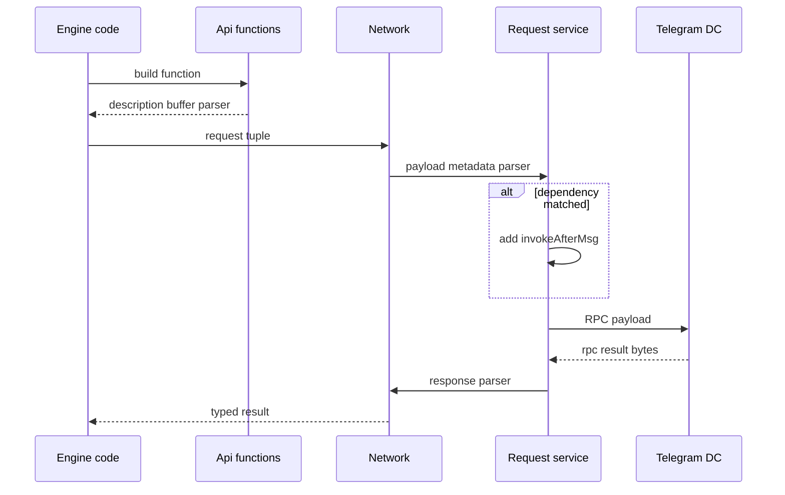
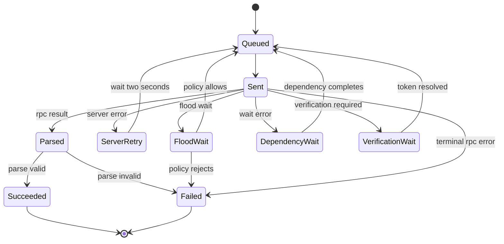

# TL 직렬화와 API 호출 계층

웹: /docs/system/05-tl-api-layer/ · Markdown: /docs/system/05-tl-api-layer.md

> Telegram 클라이언트가 TL 함수에서 도메인 모델에 이르기까지 거치는 호출 경계를 따라가 봐요

> 시스템 설계 · 네트워크와 프로토콜 · 05장 · 도표 3 · 코드 발췌 10 · 인용 28 · 소스 기준선: [TelegramMessenger/Telegram-iOS@f1dd7a2d](https://github.com/TelegramMessenger/Telegram-iOS/tree/f1dd7a2dbd02cbbf513e75d5695d8d36d1cf5838), [overtake/TelegramSwift@579cebbf](https://github.com/overtake/TelegramSwift/tree/579cebbf0c01fd41b712eff3647fa7f69db9665d)
>
> 관련 보충: [macOS fork 장별 검증 (01–07장)](/docs/system/31-fork-verify-01-07/)
>
> 핵심 소스 파일: [TelegramMessenger/Telegram-iOS/submodules/TelegramApi/Sources/Api0.swift](https://github.com/TelegramMessenger/Telegram-iOS/blob/f1dd7a2dbd02cbbf513e75d5695d8d36d1cf5838/submodules/TelegramApi/Sources/Api0.swift), [TelegramMessenger/Telegram-iOS/submodules/TelegramApi/Sources/Api30.swift](https://github.com/TelegramMessenger/Telegram-iOS/blob/f1dd7a2dbd02cbbf513e75d5695d8d36d1cf5838/submodules/TelegramApi/Sources/Api30.swift), [TelegramMessenger/Telegram-iOS/submodules/TelegramApi/Sources/Api43.swift](https://github.com/TelegramMessenger/Telegram-iOS/blob/f1dd7a2dbd02cbbf513e75d5695d8d36d1cf5838/submodules/TelegramApi/Sources/Api43.swift), [TelegramMessenger/Telegram-iOS/submodules/TelegramApi/Sources/Buffer.swift](https://github.com/TelegramMessenger/Telegram-iOS/blob/f1dd7a2dbd02cbbf513e75d5695d8d36d1cf5838/submodules/TelegramApi/Sources/Buffer.swift), [TelegramMessenger/Telegram-iOS/submodules/TelegramApi/Sources/DeserializeFunctionResponse.swift](https://github.com/TelegramMessenger/Telegram-iOS/blob/f1dd7a2dbd02cbbf513e75d5695d8d36d1cf5838/submodules/TelegramApi/Sources/DeserializeFunctionResponse.swift), [TelegramMessenger/Telegram-iOS/submodules/TelegramCore/Sources/Network/Network.swift](https://github.com/TelegramMessenger/Telegram-iOS/blob/f1dd7a2dbd02cbbf513e75d5695d8d36d1cf5838/submodules/TelegramCore/Sources/Network/Network.swift), [TelegramMessenger/Telegram-iOS/submodules/TelegramCore/Sources/Network/NetworkEngine.swift](https://github.com/TelegramMessenger/Telegram-iOS/blob/f1dd7a2dbd02cbbf513e75d5695d8d36d1cf5838/submodules/TelegramCore/Sources/Network/NetworkEngine.swift), [TelegramMessenger/Telegram-iOS/submodules/TelegramCore/Sources/State/Serialization.swift](https://github.com/TelegramMessenger/Telegram-iOS/blob/f1dd7a2dbd02cbbf513e75d5695d8d36d1cf5838/submodules/TelegramCore/Sources/State/Serialization.swift), [TelegramMessenger/Telegram-iOS/submodules/MtProtoKit/Sources/MTRequestMessageService.m](https://github.com/TelegramMessenger/Telegram-iOS/blob/f1dd7a2dbd02cbbf513e75d5695d8d36d1cf5838/submodules/MtProtoKit/Sources/MTRequestMessageService.m), [TelegramMessenger/Telegram-iOS/submodules/MtProtoKit/PublicHeaders/MtProtoKit/MTRequest.h](https://github.com/TelegramMessenger/Telegram-iOS/blob/f1dd7a2dbd02cbbf513e75d5695d8d36d1cf5838/submodules/MtProtoKit/PublicHeaders/MtProtoKit/MTRequest.h), [TelegramMessenger/Telegram-iOS/submodules/MtProtoKit/PublicHeaders/MtProtoKit/MTRequestErrorContext.h](https://github.com/TelegramMessenger/Telegram-iOS/blob/f1dd7a2dbd02cbbf513e75d5695d8d36d1cf5838/submodules/MtProtoKit/PublicHeaders/MtProtoKit/MTRequestErrorContext.h), [TelegramMessenger/Telegram-iOS/submodules/TelegramCore/Sources/ApiUtils/StoreMessage_Telegram.swift](https://github.com/TelegramMessenger/Telegram-iOS/blob/f1dd7a2dbd02cbbf513e75d5695d8d36d1cf5838/submodules/TelegramCore/Sources/ApiUtils/StoreMessage_Telegram.swift), [TelegramMessenger/Telegram-iOS/submodules/TelegramCore/Sources/ApiUtils/TelegramUser.swift](https://github.com/TelegramMessenger/Telegram-iOS/blob/f1dd7a2dbd02cbbf513e75d5695d8d36d1cf5838/submodules/TelegramCore/Sources/ApiUtils/TelegramUser.swift), [TelegramMessenger/Telegram-iOS/submodules/TelegramCore/Sources/ApiUtils/ApiGroupOrChannel.swift](https://github.com/TelegramMessenger/Telegram-iOS/blob/f1dd7a2dbd02cbbf513e75d5695d8d36d1cf5838/submodules/TelegramCore/Sources/ApiUtils/ApiGroupOrChannel.swift), [overtake/TelegramSwift/.gitmodules](https://github.com/overtake/TelegramSwift/blob/579cebbf0c01fd41b712eff3647fa7f69db9665d/.gitmodules), [overtake/TelegramSwift/Telegram-Mac/AppDelegate.swift](https://github.com/overtake/TelegramSwift/blob/579cebbf0c01fd41b712eff3647fa7f69db9665d/Telegram-Mac/AppDelegate.swift)
>
> 미검증 사항:
> - 업스트림과 macOS fork의 TelegramApi 체크아웃 모두에 검증할 수 있는 TL schema 입력이나 완전한 생성 명령이 들어 있지 않아요. 그래서 전체 재생성 절차와 CI 호출은 여전히 미검증이에요.

Telegram의 TL(Telegram이 API를 기술하는 타입 언어) API 계층은 계속 바뀌는 원격 schema를 Swift의 닫힌 타입, 바이너리 요청, 검증할 수 있는 응답 파서로 바꿔요. 덕분에 네트워크 프로토콜의 세부 사항이 비즈니스 코드로 번지지 않아요. 역할은 이렇게 나뉘어요.

- 호출 지점: `Api.functions`를 구성해요.
- `Network`: 제출과 일시적 실패를 맡아요.
- `TelegramCore`: 프로토콜 객체를 Postbox와 Engine 모델로 투영해요. [\[1\]](https://core.telegram.org/mtproto/TL) [\[6\]](https://github.com/TelegramMessenger/Telegram-iOS/blob/f1dd7a2dbd02cbbf513e75d5695d8d36d1cf5838/submodules/TelegramCore/Sources/Network/Network.swift#L1306-L1341)

여기서 말하는 API 계층은 MTProto 페이로드 위에서 객체를 인코딩하고 RPC에 맞추는 계층이에요. 이 장이 다루지 않는 내용은 다른 장에 있어요.

- 키, 암호화 패킷 헤더, 연결 재전송: [MTProto 전송 계층](/docs/system/03-mtproto-transport/)에서 다뤄요.
- `pts`, `qts`, `seq`(업데이트 순서를 나타내는 상태 값)와 차분 업데이트의 상태 전진: [업데이트 동기화](/docs/system/06-update-sync/)에서 다뤄요.

## 와이어 프로토콜의 유일한 경계, Schema 생성물 [#와이어-프로토콜의-유일한-경계-schema-생성물]

TL 언어는 선언을 생성자와 함수 두 부분으로 나눠요.

- 생성자: 데이터 값을 기술해요.
- 함수: RPC(원격 프로시저 호출) 질의를 기술해요.

각 combinator(생성자나 함수 같은 선언 하나)에는 32비트 번호가 있고, 번호 뒤에 필드 순서대로 인코딩이 이어져요. 공식 예제는 함수 반환값의 정적 타입을 호출하는 쪽이 이미 알고 있어서, 벡터 원소를 대상 원소 타입에 따라 디코딩할 수 있다는 점도 설명해요. [\[1\]](https://core.telegram.org/mtproto/TL)

클라이언트가 마주하는 문제는 schema의 규모, 생성자 분기, 함수 시그니처가 빠르게 늘어난다는 거예요. 이 정의들을 손으로 쓰면 메서드 번호, 필드 순서, 선택 필드에서 파서로 검토하기 어려운 반복 오류가 대량으로 생겨요.

Telegram은 이곳을 생성 경계(코드를 자동으로 생성하는 경계)로 보는 방식을 택했어요. `TelegramApi`는 독립된 Swift package이고, target의 경로는 바로 `Sources`예요. [\[2\]](https://github.com/TelegramMessenger/Telegram-iOS/blob/f1dd7a2dbd02cbbf513e75d5695d8d36d1cf5838/submodules/TelegramApi/Package.swift#L1-L22)

주어진 업스트림 iOS 체크아웃을 센 결과는 이래요.

- 번호가 붙은 분할 파일 `Api0.swift`부터 `Api43.swift`까지는 44개예요. 합계 102,654행, 5,241,023바이트예요. 이 분할 파일들에서 `static func` 2,544개와 최상위 `enum` 선언 586개를 세었어요.
- 그 밖에 `SecretApiLayer*.swift` 버전 스냅숏이 11개 있고, 합계 15,519행, 688,377바이트예요.
- `Sources` 디렉터리 전체는 Swift 파일 58개, 118,613행이에요.

이 수치들은 현재 체크아웃에 대한 `wc`와 `rg` 집계이고, 프로토콜의 상한이 아니에요. macOS fork의 생성 분할 파일은 `Api39.swift`에서 끝나요. 그러니까 `Api0.swift`부터 `Api39.swift`까지 40개예요. [\[27\]](https://github.com/overtake/Telegram-iOS/blob/a24bbe45f9861f736a79916a50898512f751e0dc/submodules/TelegramApi/Sources/Api39.swift#L12068-L12076)

이 조직은 파일을 비즈니스 도메인별로 나누지 않아요. `Api0.swift`는 공개 진입점, 기본 타입, 전역 디스패처를 담아요. 이후의 `ApiN.swift`는 생성기가 나눈 것일 뿐이에요. 생성기는 TL 요소를 이렇게 Swift로 옮겨요.

- 추상 TL 타입 하나가 Swift `enum` 하나가 돼요.
- 구체 constructor 하나가 연관된 `Cons_*` 구조체가 돼요.
- namespace별 RPC 함수는 `Api.functions`의 extension에 들어가요.

그래서 `Api.User`를 쓰는 쪽은 문자열 discriminator에 기대는 대신 `switch`에서 `user`, `userEmpty` 같은 분기를 처리해야 해요. [\[4\]](https://github.com/TelegramMessenger/Telegram-iOS/blob/f1dd7a2dbd02cbbf513e75d5695d8d36d1cf5838/submodules/TelegramApi/Sources/Api0.swift#L2-L1810) [\[10\]](https://github.com/TelegramMessenger/Telegram-iOS/blob/f1dd7a2dbd02cbbf513e75d5695d8d36d1cf5838/submodules/TelegramApi/Sources/Api30.swift#L805-L1038)

### 생성자, 함수, 디버그 메타데이터 [#생성자-함수-디버그-메타데이터]

constructor의 `serialize`는 이 순서로 써요.

1. 먼저 자기 시그니처를 써요.
2. boxed 인코딩(constructor 번호를 앞에 붙이는 인코딩)일 때만 constructor 번호를 써요.
3. 그런 다음 schema의 필드 순서대로 스칼라, 중첩 객체, 벡터를 기록해요.

반대 방향의 파싱 함수는 항목을 하나씩 꺼내고, 필수 값이 모두 있을 때만 연관 case를 돌려줘요. 바이트가 모자라거나 선택 필드가 맞지 않으면 그 constructor는 `nil`로 파싱돼요. 반쯤 만들어진 객체를 만들지 않아요. [\[10\]](https://github.com/TelegramMessenger/Telegram-iOS/blob/f1dd7a2dbd02cbbf513e75d5695d8d36d1cf5838/submodules/TelegramApi/Sources/Api30.swift#L805-L1038)

`submodules/TelegramApi/Sources/Api30.swift` 810–835행 발췌.

```swift
public func serialize(_ buffer: Buffer, _ boxed: Swift.Bool) {
    switch self {
        case let .user(_data):
            if boxed {
                buffer.appendInt32(13289085)
            }
            serializeInt32(_data.flags, buffer: buffer, boxed: false)
            serializeInt32(_data.flags2, buffer: buffer, boxed: false)
            serializeInt64(_data.id, buffer: buffer, boxed: false)
            if Int(_data.flags) & Int(1 << 0) != 0 {
                serializeInt64(_data.accessHash!, buffer: buffer, boxed: false)
            }
            if Int(_data.flags) & Int(1 << 1) != 0 {
                serializeString(_data.firstName!, buffer: buffer, boxed: false)
            }
            if Int(_data.flags) & Int(1 << 2) != 0 {
                serializeString(_data.lastName!, buffer: buffer, boxed: false)
            }
            if Int(_data.flags) & Int(1 << 3) != 0 {
                serializeString(_data.username!, buffer: buffer, boxed: false)
            }
            if Int(_data.flags) & Int(1 << 4) != 0 {
                serializeString(_data.phone!, buffer: buffer, boxed: false)
            }
```

함수는 객체 인스턴스가 아니에요. 생성기는 함수마다 세 요소의 튜플을 만들어요.

- `FunctionDescription`: 메서드 이름과 매개변수 이름-값 쌍만 보관해요. 로그와 메타데이터를 위한 것이고, 와이어 프로토콜 인코딩이 아니에요.
- 요청 `Buffer`: 이미 함수 번호와 필드가 들어 있어요.
- `DeserializeFunctionResponse<T>`: 제네릭 응답 클로저예요. 이 RPC 결과의 알려진 타입을 캡슐화해요.

그래서 `Network`는 어떤 `Api.*`의 구체적인 case도 알 필요가 없어요. [\[5\]](https://github.com/TelegramMessenger/Telegram-iOS/blob/f1dd7a2dbd02cbbf513e75d5695d8d36d1cf5838/submodules/TelegramApi/Sources/Api43.swift#L14778-L14793) [\[6\]](https://github.com/TelegramMessenger/Telegram-iOS/blob/f1dd7a2dbd02cbbf513e75d5695d8d36d1cf5838/submodules/TelegramCore/Sources/Network/Network.swift#L1306-L1341)

`submodules/TelegramApi/Sources/Api43.swift` 14778–14793행 발췌.

```swift
static func getUsers(id: [Api.InputUser]) -> (FunctionDescription, Buffer, DeserializeFunctionResponse<[Api.User]>) {
    let buffer = Buffer()
    buffer.appendInt32(227648840)
    buffer.appendInt32(481674261)
    buffer.appendInt32(Int32(id.count))
    for item in id {
        item.serialize(buffer, true)
    }
    return (FunctionDescription(name: "users.getUsers", parameters: [("id", ConstructorParameterDescription(id))]), buffer, DeserializeFunctionResponse { (buffer: Buffer) -> [Api.User]? in
        let reader = BufferReader(buffer)
        var result: [Api.User]?
        if let _ = reader.readInt32() {
            result = Api.parseVector(reader, elementSignature: 0, elementType: Api.User.self)
        }
        return result
    })
}
```

위 예제에는 프로토콜 상수가 두 개 있어요.

- 첫째: `users.getUsers`의 함수 번호예요.
- 둘째: 범용 `vector` 번호예요. 이어서 `Int32` 길이와 boxed된 각 `InputUser`를 써요.

응답 클로저는 먼저 벡터 번호를 소비한 다음, `Api.User`를 기대 원소 타입으로 `parseVector`를 불러요. 이 방식은 공식 TL의 `getUsers` 인코딩 모델과 일치해요. 다만 숫자는 현재 schema에서 가져온 거라서 비즈니스 코드에 복사해 쓰면 안 돼요. [\[1\]](https://core.telegram.org/mtproto/TL) [\[5\]](https://github.com/TelegramMessenger/Telegram-iOS/blob/f1dd7a2dbd02cbbf513e75d5695d8d36d1cf5838/submodules/TelegramApi/Sources/Api43.swift#L14778-L14793)

아래 구조 도표는 컴파일 시점의 schema 정의가 어떻게 런타임 요청과 도메인 객체가 되는지 보여줘요. 일부러 `Network`에서는 RPC 페이로드까지만 다루고, MTProto의 암호화 래핑은 나타내지 않았어요.

```mermaid
flowchart LR
    Schema["TL schema"] --> Generator["코드 생성기"]
    Generator --> ApiFiles["Api 분할 파일"]
    ApiFiles --> Function["Api functions"]
    ApiFiles --> Types["Api 생성자 타입"]
    Function --> Triple["설명 요청 버퍼 응답 파서"]
    Triple --> Network["Network"]
    Network --> Request["MTRequest"]
    Request --> Rpc["RPC 결과 바이트"]
    Rpc --> Parser["응답 파싱 클로저"]
    Parser --> Types
    Types --> Convert["TelegramCore 변환기"]
    Convert --> Models["Postbox 와 Engine 모델"]
```



### Buffer와 BufferReader [#buffer와-bufferreader]

`Buffer`는 용량을 수동으로 관리하는 가변 바이트 영역이에요. 원시 포인터, 현재 크기, 용량, 해제 책임을 보관해요.

- `appendBytes`: 용량이 부족하면 할당하거나 확장하고, 길이를 기록된 바이트 수만큼 늘려요.
- `appendInt32`, `appendInt64`, `appendDouble`: 메모리 표현을 그대로 덧붙여요.
- `makeData`: 요청이 Foundation과 Objective-C 경계를 넘을 때 `Data`를 만들어요.

이 인터페이스는 생성 코드를 위한 좁은 인터페이스이고, 범용의 안전한 직렬화 프레임워크가 아니에요. [\[3\]](https://github.com/TelegramMessenger/Telegram-iOS/blob/f1dd7a2dbd02cbbf513e75d5695d8d36d1cf5838/submodules/TelegramApi/Sources/Buffer.swift#L80-L393)

TL 문자열과 bytes의 문제는 길이와 4바이트 정렬이에요.

- `serializeBytes`: 길이가 254 미만인 값에 1바이트를 써요. 더 긴 값은 `254`와 길이 3바이트로 나타내요. 두 형식 모두 4바이트 경계까지 0으로 채워요.
- `parseBytes`: 대칭적으로 길이를 읽고, 바이트 영역을 복사하고, padding을 건너뛰어요.

이 코드는 길이 파싱 실패를 `nil`로 나타내고, 상위 constructor의 필수 필드 검사가 파싱을 한꺼번에 끝내게 해요. [\[3\]](https://github.com/TelegramMessenger/Telegram-iOS/blob/f1dd7a2dbd02cbbf513e75d5695d8d36d1cf5838/submodules/TelegramApi/Sources/Buffer.swift#L80-L393)

`submodules/TelegramApi/Sources/Buffer.swift` 80–112행 발췌.

```swift
public func serializeBytes(_ value: Buffer, buffer: Buffer, boxed: Bool) {
    if boxed {
        buffer.appendInt32(-1255641564)
    }
    var length: Int32 = Int32(value.size)
    var padding: Int32 = 0
    if (length >= 254) {
        var tmp: UInt8 = 254
        buffer.appendBytes(&tmp, length: 1)
        buffer.appendBytes(&length, length: 3)
        padding = (((length % 4) == 0 ? length : (length + 4 - (length % 4)))) - length;
    } else {
        buffer.appendBytes(&length, length: 1)
        let e1 = (((length + 1) % 4) == 0 ? (length + 1) : ((length + 1) + 4 - ((length + 1) % 4)))
        padding = (e1) - (length + 1)
    }
    if value.size != 0 {
        buffer.appendBytes(value.data!, length: UInt(length))
    }
    // ... write zero padding
}
```

`BufferReader`는 입력 `Buffer`와 단조 증가하는 offset(줄어들지 않고 늘어나기만 하는 읽기 위치)을 갖고 있어요. `Int32`, `Int64`, `Double`을 읽기 전에는 항상 남은 바이트를 검사해요. `readBuffer`도 범위를 검증해요. 예외를 던지는 대신 optional로, 잘리거나 불완전한 payload를 생성된 파서에 전달해요.

중요한 대가가 하나 있어요. 인코딩 계층이 필드 단위의 오류 원인을 남기지 않는다는 점이에요. `Network`는 마지막에 `nil`을 `TL_VERIFICATION_ERROR`로 연결할 뿐이에요. [\[3\]](https://github.com/TelegramMessenger/Telegram-iOS/blob/f1dd7a2dbd02cbbf513e75d5695d8d36d1cf5838/submodules/TelegramApi/Sources/Buffer.swift#L80-L393) [\[6\]](https://github.com/TelegramMessenger/Telegram-iOS/blob/f1dd7a2dbd02cbbf513e75d5695d8d36d1cf5838/submodules/TelegramCore/Sources/Network/Network.swift#L1306-L1341)

### 파서 레지스트리 [#파서-레지스트리]

알 수 없는 구체 타입을 받으면 클라이언트는 constructor 시그니처로 parser를 골라야 해요. `Api0.swift`는 정적 딕셔너리를 만들어요. 키는 `Int32` 시그니처이고, 값은 `BufferReader`를 받아 `Any`를 돌려주는 클로저예요. 각 항목의 클로저는 생성된 `parse_*` 메서드 하나를 직접 불러요.

`Api.parse`는 이렇게 동작해요.

1. 시그니처를 꺼내요.
2. 딕셔너리에서 클로저를 찾아요.
3. 찾지 못하면 로그를 남기고 `nil`을 돌려줘요.

벡터를 파싱할 때 원소 시그니처가 0이면, 원소마다 boxed 시그니처를 하나씩 읽은 뒤 같은 디스패처를 불러요. [\[4\]](https://github.com/TelegramMessenger/Telegram-iOS/blob/f1dd7a2dbd02cbbf513e75d5695d8d36d1cf5838/submodules/TelegramApi/Sources/Api0.swift#L2-L1810)

`submodules/TelegramApi/Sources/Api0.swift` 1771–1809행 발췌.

```swift
static func parse(_ buffer: Buffer) -> Any? {
    let reader = BufferReader(buffer)
    if let signature = reader.readInt32() {
        return parse(reader, signature: signature)
    }
    return nil
}
static func parse(_ reader: BufferReader, signature: Int32) -> Any? {
    if let parser = parsers[signature] {
        return parser(reader)
    } else {
        telegramApiLog("Type constructor \(String(UInt32(bitPattern: signature), radix: 16, uppercase: false)) not found")
        return nil
    }
}
static func parseVector<T>(_ reader: BufferReader, elementSignature: Int32, elementType: T.Type) -> [T]? {
    if let count = reader.readInt32() {
        var array = [T]()
        // ... parse count elements by signature
    }
}
```

레지스트리 덕분에 생성기는 TL의 열린 생성자 집합을 유지하면서도, Swift 호출 지점은 닫힌 `enum`으로 둘 수 있어요. 대가는 여기에 `Any`와 런타임 cast가 있다는 점이에요.

이 타입 소거는 아주 작은 경계 안에 한정돼요. 생성 함수가 돌려주는 `DeserializeFunctionResponse<T>`가 바로 이 `Any`를 구체적인 `T`로 되돌려요. `FunctionDescription`도 마찬가지로 리플렉션을 로그 메타데이터에만 한정하고, 비즈니스 모델에는 관여하지 않아요. [\[4\]](https://github.com/TelegramMessenger/Telegram-iOS/blob/f1dd7a2dbd02cbbf513e75d5695d8d36d1cf5838/submodules/TelegramApi/Sources/Api0.swift#L2-L1810) [\[5\]](https://github.com/TelegramMessenger/Telegram-iOS/blob/f1dd7a2dbd02cbbf513e75d5695d8d36d1cf5838/submodules/TelegramApi/Sources/Api43.swift#L14778-L14793)

## Api.functions에서 MTRequest까지 [#apifunctions에서-mtrequest까지]

비즈니스 계층은 원시 `Buffer`를 직접 다루면 안 되고, `MTRequest`의 Objective-C 콜백도 알면 안 돼요. `Network.request`는 이 두 시스템 사이의 어댑터예요. 하는 일은 이래요.

- 생성 함수의 튜플을 받아 `makeData`로 payload를 만들어요.
- `FunctionDescription`으로 전체와 간략 두 가지 메타데이터를 만들어요.
- 돌려받을 바이트용으로 `DeserializeFunctionResponse`를 설치해요.

이 경계는 `Signal<T, MTRpcError>`도 유지해서, 오류가 너무 일찍 불리언으로 눌려 사라지지 않아요. [\[5\]](https://github.com/TelegramMessenger/Telegram-iOS/blob/f1dd7a2dbd02cbbf513e75d5695d8d36d1cf5838/submodules/TelegramApi/Sources/Api43.swift#L14778-L14793) [\[6\]](https://github.com/TelegramMessenger/Telegram-iOS/blob/f1dd7a2dbd02cbbf513e75d5695d8d36d1cf5838/submodules/TelegramCore/Sources/Network/Network.swift#L1306-L1341)

`Network`가 만드는 건 직접적인 `MTRequest`가 아니라 `NetworkEngineRequest`예요. 요청 서비스가 이 요청을 현재 engine에 전달해요. 응답이 돌아오면 이렇게 처리해요.

1. 성공하면 응답 bytes를 `Buffer`로 감싸서, 생성 함수가 가진 `parse` 클로저에 넘겨요.
2. 파싱해서 얻은 제네릭 값은 내부 `BoxedMessage`에 담겨요. 그래서 콜백이 안전하게 `T`로 되돌릴 수 있어요.
3. 클로저가 `nil`을 돌려주면 완료 콜백은 code 500, 설명 `TL_VERIFICATION_ERROR`의 `MTRpcError`를 만들어요.

이 오류는 원격의 `rpc_error`와 구분되고, 손상된 응답이 도메인 모델로 흘러드는 것도 막아요. [\[6\]](https://github.com/TelegramMessenger/Telegram-iOS/blob/f1dd7a2dbd02cbbf513e75d5695d8d36d1cf5838/submodules/TelegramCore/Sources/Network/Network.swift#L1306-L1341)

`submodules/TelegramCore/Sources/Network/Network.swift` 1306–1341행 발췌.

```swift
public func request<T>(_ data: (FunctionDescription, Buffer, DeserializeFunctionResponse<T>), tag: NetworkRequestDependencyTag? = nil, automaticFloodWait: Bool = true, onFloodWaitError: ((String) -> Void)? = nil) -> Signal<T, MTRpcError> {
    let requestService = self.requestService
    return Signal { [requestService] subscriber in
        let request = NetworkEngineRequest(
            payload: data.1.makeData(),
            metadata: WrappedRequestMetadata(metadata: WrappedFunctionDescription(data.0), tag: tag),
            shortMetadata: WrappedRequestShortMetadata(shortMetadata: WrappedShortFunctionDescription(data.0)),
            parse: { response in
                if let result = data.2.parse(Buffer(data: response)) {
                    return BoxedMessage(result)
                }
                return nil
            },
            options: NetworkEngineRequestOptions(),
            shouldContinueAfterError: networkRequestErrorPolicy(automaticFloodWait: automaticFloodWait, onFloodWaitError: onFloodWaitError, failOnServerErrors: false),
            dependsOn: networkRequestDependency(tag: tag),
            acknowledged: nil,
            progress: nil,
```

여기에는 “타입 검사”가 두 층 있어요.

- 첫째 층: Swift 컴파일 시점의 `T`예요. 생성 함수의 반환 타입에서 호출하는 쪽까지 전파돼요.
- 둘째 층: 런타임의 TL constructor 검증이에요. 네트워크 응답의 첫 시그니처는 레지스트리에서 찾을 수 있어야 하고, 결과는 `T`로 변환할 수 있어야 해요.

둘째 층은 bytes가 서버에서 오기 때문에 Swift가 정적으로 증명할 수 없어요. `nil`과 통일된 검증 오류를 택하면 진단을 세밀하게 하지는 못해요. 대신 RPC 호출마다 잘림과 잘못된 constructor를 반복해서 처리하는 일을 피해요. [\[4\]](https://github.com/TelegramMessenger/Telegram-iOS/blob/f1dd7a2dbd02cbbf513e75d5695d8d36d1cf5838/submodules/TelegramApi/Sources/Api0.swift#L2-L1810) [\[6\]](https://github.com/TelegramMessenger/Telegram-iOS/blob/f1dd7a2dbd02cbbf513e75d5695d8d36d1cf5838/submodules/TelegramCore/Sources/Network/Network.swift#L1306-L1341)

`MTRequest` 자체는 다음을 갖고 있어요.

- payload
- 두 가지 metadata
- response parser
- 요청 컨텍스트
- 오류 컨텍스트
- 완료 콜백
- 의존성 판정기

그래서 상위 `Network`는 정책만 선언하고, 하위 서비스가 메시지 식별, 실제 전송 시점, 요청 재시작 능력을 여전히 소유해요. [\[8\]](https://github.com/TelegramMessenger/Telegram-iOS/blob/f1dd7a2dbd02cbbf513e75d5695d8d36d1cf5838/submodules/MtProtoKit/PublicHeaders/MtProtoKit/MTRequest.h#L19-L45)

### 로컬 직렬 큐가 아닌 의존성 [#로컬-직렬-큐가-아닌-의존성]

원격은 요청을 병렬로 처리할 수 있어요. 하지만 오프라인 동안 쌓인 연속 쓰기 작업처럼 어떤 호출은 선후 관계를 유지해야 해요. 공식 문서는 `invokeAfterMsg`와 `invokeAfterMsgs`를 정의해서, 클라이언트가 첫 번째 결과를 기다리지 않고도 서버 쪽 순서 의존을 나타낼 수 있게 해요. 서버가 돌려주는 오류는 두 가지예요.

- `MSG_WAIT_TIMEOUT`: 대기 창을 넘길 때예요.
- `MSG_WAIT_FAILED`: 앞선 항목이 실패할 때예요. [\[12\]](https://core.telegram.org/api/invoking)

Telegram은 먼저 `NetworkRequestDependencyTag`에서 비즈니스 쪽의 “의존하는가”를 술어로 정의해요. `networkRequestDependency`는 tag가 있을 때만 클로저를 돌려줘요. 요청 서비스는 전송 대기 요청의 역순 목록에서 처음으로 일치하는 항목을 찾아요. 그다음은 이래요.

- 일치 항목이 이미 request message id를 갖고 있으면: `0xcb9f372d`와 그 id를 현재 payload 앞에 붙여요. 이게 `invokeAfterMsg`예요.
- 아직 id가 없으면: 서비스는 미해결 의존성을 기록하고 현재 요청을 미뤄요.

이 과정은 비즈니스의 순서 의도를 프로토콜 래핑으로 연결하는 거예요. UI 계층에서 이후의 모든 요청을 막는 게 아니에요. [\[7\]](https://github.com/TelegramMessenger/Telegram-iOS/blob/f1dd7a2dbd02cbbf513e75d5695d8d36d1cf5838/submodules/TelegramCore/Sources/Network/Network.swift#L1366-L1409) [\[14\]](https://github.com/TelegramMessenger/Telegram-iOS/blob/f1dd7a2dbd02cbbf513e75d5695d8d36d1cf5838/submodules/MtProtoKit/Sources/MTRequestMessageService.m#L485-L519)

`submodules/MtProtoKit/Sources/MTRequestMessageService.m` 485–519행 발췌.

```objc
if (request.shouldDependOnRequest != nil)
{
    NSUInteger index = [_requests indexOfObject:request];
    if (index != NSNotFound) {
        // ... scan earlier requests in reverse order
        for (MTRequest *anotherRequest in _requests.reverseObjectEnumerator) {
            if (request.shouldDependOnRequest(anotherRequest))
            {
                if (anotherRequest.requestContext != nil) {
                    MTBuffer *buffer = [[MTBuffer alloc] init];
                    [buffer appendInt32:(int32_t)0xcb9f372d];
                    [buffer appendInt64:anotherRequest.requestContext.messageId];
                    [buffer appendBytes:currentData.bytes length:currentData.length];
                    currentData = buffer.data;
                } else if (unresolvedDependencyOnRequestInternalId != nil) {
                    *unresolvedDependencyOnRequestInternalId = anotherRequest.internalId;
                }
                break;
            }
        }
    }
}
```

이 설계의 이득은 동시성과 국소적 순서가 함께 있을 수 있다는 점이에요. tag가 없는 일반 읽기 요청은 동시성을 유지해요. tag가 있는 요청은 predicate가 일치할 때만 프로토콜 의존성을 얻어요.

비용은 두 가지예요.

- predicate의 의미론이 호출하는 쪽이 정의한 tag 구현에 흩어져 있어요.
- `MSG_WAIT_TIMEOUT`과 `MSG_WAIT_FAILED`를 서비스 계층이 복구해야 해요. `MTRequestMessageService`는 이 두 종류의 설명에 대해 의존 요청을 다시 찾고, `waitingForRequestToComplete`를 설정하고, 현재 요청을 재시작해요. [\[9\]](https://github.com/TelegramMessenger/Telegram-iOS/blob/f1dd7a2dbd02cbbf513e75d5695d8d36d1cf5838/submodules/MtProtoKit/Sources/MTRequestMessageService.m#L849-L1063) [\[12\]](https://core.telegram.org/api/invoking)

아래 도표는 전형적인 RPC 하나가 생성 함수에서 요청 서비스를 거쳐 강타입 결과로 돌아오는 경로를 보여줘요. `invokeAfterMsg`는 의존 술어가 일치할 때만 나타나요.



### 재시도할 수 있는 오류의 상태와 책임 [#재시도할-수-있는-오류의-상태와-책임]

네트워크 실패가 무한 재전송이 가능하다는 뜻은 아니에요. `MTRequestErrorContext`는 이런 상태를 보관해요.

- 최소 실행 시각, 내부 서버 오류 횟수, flood 대기 초, 원본 텍스트
- 인증 token 대기, 선행 요청 대기, APNS(Apple 푸시 알림 서비스) 검증, reCAPTCHA 검증에 필요한 중간 상태

이 컨텍스트는 개별 `MTRequest`에 딸려 있어서, 서비스는 같은 논리적 요청을 재시작할 수 있고, 상위는 여전히 `Signal` 하나로 이를 관찰해요. [\[11\]](https://github.com/TelegramMessenger/Telegram-iOS/blob/f1dd7a2dbd02cbbf513e75d5695d8d36d1cf5838/submodules/MtProtoKit/PublicHeaders/MtProtoKit/MTRequestErrorContext.h#L27-L40)

`submodules/MtProtoKit/PublicHeaders/MtProtoKit/MTRequestErrorContext.h` 27–40행 발췌.

```objc
@interface MTRequestErrorContext : NSObject

@property (nonatomic) CFAbsoluteTime minimalExecuteTime;
@property (nonatomic) NSUInteger internalServerErrorCount;
@property (nonatomic) NSUInteger floodWaitSeconds;
@property (nonatomic, strong) NSString *floodWaitErrorText;

@property (nonatomic) bool waitingForTokenExport;
@property (nonatomic, strong) id waitingForRequestToComplete;

@property (nonatomic, strong) MTRequestPendingVerificationData *pendingVerificationData;
@property (nonatomic, strong) MTRequestPendingRecaptchaVerificationData *pendingRecaptchaVerificationData;

@end
```

서비스는 오류에 따라 이렇게 복구해요.

- code가 500이거나 음수 500인 RPC 오류: `internalServerErrorCount`를 늘려요. `shouldContinueExecutionWithErrorContext`가 계속을 허용하면 서비스는 `minimalExecuteTime`을 최소 2초 미루고 재시작해요.
- 401의 `SESSION_REVOKED`나 `AUTH_KEY_UNREGISTERED`: required auth token이 있으면 `waitingForTokenExport`로 표시해요.
- 400의 `CONNECTION_NOT_INITED`: 저장된 API 초기화 hash를 지우고 재시작해요.

이건 메시지 서비스가 가로질러 처리하는 복구예요. Engine API마다 한 번씩 따로 작성하는 재시도가 아니에요. [\[9\]](https://github.com/TelegramMessenger/Telegram-iOS/blob/f1dd7a2dbd02cbbf513e75d5695d8d36d1cf5838/submodules/MtProtoKit/Sources/MTRequestMessageService.m#L849-L1063)

flood 처리(속도 제한 420 오류 처리)는 더 세밀해요. 서비스는 code 420, `FLOOD_WAIT_`, `FLOOD_PREMIUM_WAIT_`를 식별하고, 이렇게 처리해요.

1. 오류 텍스트에서 초를 파싱해 `floodWaitSeconds`와 `floodWaitErrorText`에 기록해요.
2. 정책에 따라 재시작할지 정해요.
3. 가장 이른 전송 시각을 그 초만큼 미뤄요.

공식 문서도 `FLOOD_WAIT_X`를 X초를 반드시 기다려야 하는 420 오류로 정의해요. [\[9\]](https://github.com/TelegramMessenger/Telegram-iOS/blob/f1dd7a2dbd02cbbf513e75d5695d8d36d1cf5838/submodules/MtProtoKit/Sources/MTRequestMessageService.m#L849-L1063) [\[17\]](https://core.telegram.org/api/errors)

`submodules/MtProtoKit/Sources/MTRequestMessageService.m` 905–929행 발췌.

```objc
else if ((rpcError.errorCode == 420 && [rpcError.errorDescription rangeOfString:@"FROZEN_METHOD_INVALID"].location == NSNotFound) || [rpcError.errorDescription rangeOfString:@"FLOOD_WAIT_"].location != NSNotFound || [rpcError.errorDescription rangeOfString:@"FLOOD_PREMIUM_WAIT_"].location != NSNotFound) {
    if (request.errorContext == nil)
        request.errorContext = [[MTRequestErrorContext alloc] init];
    if ([rpcError.errorDescription rangeOfString:@"FLOOD_WAIT_"].location != NSNotFound) {
        int errorWaitTime = 0;
        NSScanner *scanner = [[NSScanner alloc] initWithString:rpcError.errorDescription];
        [scanner scanUpToString:@"FLOOD_WAIT_" intoString:nil];
        [scanner scanString:@"FLOOD_WAIT_" intoString:nil];
        if ([scanner scanInt:&errorWaitTime]) {
            request.errorContext.floodWaitSeconds = errorWaitTime;
            request.errorContext.floodWaitErrorText = rpcError.errorDescription;
            if (request.shouldContinueExecutionWithErrorContext != nil) {
                if (request.shouldContinueExecutionWithErrorContext(request.errorContext)) {
                    restartRequest = true;
                    request.errorContext.minimalExecuteTime = MAX(request.errorContext.minimalExecuteTime, MTAbsoluteSystemTime() + (CFAbsoluteTime)errorWaitTime);
                }
            } else {
                restartRequest = true;
```

`Network`의 기본 `automaticFloodWait`는 `true`예요.

- 이 정책은 대기를 감지하면 먼저 `onFloodWaitError`를 부를 수 있어요. 하지만 호출하는 쪽이 `false`로 설정한 경우에만 진행을 거부해요.
- `failOnServerErrors`가 참이면 이미 내부 서버 오류가 있는 요청을 중지할 수도 있어요.
- 공개된 `retryRequest`는 또 다른 층의 선택이에요. 이미 오류로 끝난 `Signal`을 0.2초씩 늘어나고 최대 5초인 지연으로 계속 구독해요.
- `retryRequestIfNotFrozen`은 `FROZEN_METHOD_INVALID`를 제외하고, 마지막에는 옵셔널 값으로 끝나요. [\[7\]](https://github.com/TelegramMessenger/Telegram-iOS/blob/f1dd7a2dbd02cbbf513e75d5695d8d36d1cf5838/submodules/TelegramCore/Sources/Network/Network.swift#L1366-L1409)

`submodules/TelegramCore/Sources/Network/Network.swift` 1366–1409행 발췌.

```swift
func networkRequestErrorPolicy(automaticFloodWait: Bool, onFloodWaitError: ((String) -> Void)?, failOnServerErrors: Bool) -> (NetworkEngineErrorContext) -> Bool {
    return { errorContext in
        if let onFloodWaitError, errorContext.floodWaitSeconds > 0, let errorText = errorContext.floodWaitErrorText {
            onFloodWaitError(errorText)
        }
        if errorContext.floodWaitSeconds > 0 && !automaticFloodWait {
            return false
        }
        if errorContext.internalServerErrorCount > 0 && failOnServerErrors {
            return false
        }
        return true
    }
}

public func retryRequest<T>(signal: Signal<T, MTRpcError>) -> Signal<T, NoError> {
    return signal
    |> retry(0.2, maxDelay: 5.0, onQueue: Queue.concurrentDefaultQueue())
}
```

그래서 헷갈리면 안 되는 재시도가 세 가지 있어요.

- 요청 서비스의 재시작: 아직 끝나지 않은 `MTRequest`를 유지하면서 초기화, 의존성, 검증, 서버 오류, 대기 시간을 처리해요.
- `automaticFloodWait`: `Network.request`마다 있는 정책 스위치예요.
- `retryRequest`: 비즈니스 함수가 이걸로 완전한 RPC를 다시 구독할 수 있어요.

`automaticFloodWait`와 `retryRequest`를 겹쳐 쓰면 트래픽이 증폭되거나 비즈니스 실패가 가려질 수 있어요. 그러니 멱등(여러 번 실행해도 결과가 같음)한 읽기나 명확한 멱등 키가 있는 작업에서만 써야 해요. 이 마지막 권고는 이 제어 지점들을 바탕으로 한 엔지니어링 추론이에요. 코드가 범용 멱등성 규칙을 선언하지는 않아요.

아래 상태 도표는 단일 요청의 핵심 복구 상태를 보여줘요. 연결을 다시 만드는 과정과 암호화 세션 상태는 생략했어요.



### 도메인 지향 오류 매핑 [#도메인-지향-오류-매핑]

`Network`는 일부러 원격 실패를 `MTRpcError`로 유지해요. numeric code와 `errorDescription`이 있어요. 공식 API 문서도 오류 타입 문자열과 그 매개변수화된 형태를 정의하고, 이런 의미론을 나열해요.

- 303: 데이터 센터 이전
- 400: 입력 오류
- 401: 미인증
- 420: 속도 제한 [\[17\]](https://core.telegram.org/api/errors)

범용 계층이 모든 문자열을 거대한 오류 enum 하나에 연결하면 안 돼요. 같은 오류라도 메서드마다 UI와 복구 의미론이 다르기 때문이에요. 그래서 각 Engine 작업은 사용자 의도에 가장 가까운 곳에서, 알려진 설명 몇 개를 의미 있는 domain error로 연결해요.

Secure ID의 이메일 인증 코드 전송이 그 예예요.

- 자동 flood 대기를 명시적으로 꺼요.
- `FLOOD_WAIT`를 `.flood`에, `EMAIL_INVALID`를 `.invalidEmail`에 연결하고, 나머지는 `.generic`이에요.

이렇게 하면 호출하는 쪽이 MTProto 텍스트를 건드리지 않고도 이메일 재입력이나 나중에 다시 시도하기를 보여줄 수 있어요. [\[15\]](https://github.com/TelegramMessenger/Telegram-iOS/blob/f1dd7a2dbd02cbbf513e75d5695d8d36d1cf5838/submodules/TelegramCore/Sources/TelegramEngine/SecureId/VerifySecureIdValue.swift#L65-L92)

`submodules/TelegramCore/Sources/TelegramEngine/SecureId/VerifySecureIdValue.swift` 65–92행 발췌.

```swift
public enum SecureIdPrepareEmailVerificationError {
    case generic
    case invalidEmail
    case flood
}

public func secureIdPrepareEmailVerification(network: Network, value: SecureIdEmailValue) -> Signal<SecureIdPrepareEmailVerificationPayload, SecureIdPrepareEmailVerificationError> {
    return network.request(Api.functions.account.sendVerifyEmailCode(purpose: .emailVerifyPurposePassport, email: value.email), automaticFloodWait: false)
    |> mapError { error -> SecureIdPrepareEmailVerificationError in
        if error.errorDescription.hasPrefix("FLOOD_WAIT") {
            return .flood
        } else if error.errorDescription.hasPrefix("EMAIL_INVALID") {
            return .invalidEmail
        }
        return .generic
    }
    |> map { sentCode -> SecureIdPrepareEmailVerificationPayload in
        switch sentCode {
        case let .sentEmailCode(sentEmailCodeData):
            let length = sentEmailCodeData.length
            return SecureIdPrepareEmailVerificationPayload(email: value.email, length: length)
        }
    }
}
```

이렇게 계층을 나누면 대가와 이득이 생겨요.

- 대가: 오류 매핑이 많은 Engine 파일에 흩어져요.
- 이득: 사용자에게 보이는 오류가 전송 계층에서 미리 사라지지 않아요. 어떤 API에 새 오류가 생겨도 그 비즈니스의 정책에만 영향을 줘요.

이 패턴을 재사용하는 시스템에서 더 안정적인 제약은 이래요. 기본 RPC 계층은 프로토콜 오류와 재시도 가능성이라는 사실만 보존하고, 도메인 계층은 실제로 처리할 수 있는 오류 코드와 텍스트만 해석해요.

## 프로토콜 객체를 로컬 모델로 투영하기 [#프로토콜-객체를-로컬-모델로-투영하기]

생성된 `Api.Message`와 `Api.Chat`은 wire model(와이어로 오가는 형태 그대로의 모델)이에요. server schema를 충실히 반영하지만, 바로 저장하거나 인터페이스를 구동하기에는 맞지 않아요. 다음이 들어 있기 때문이에요.

- 프로토콜 flags
- 부분적인 `InputPeer` 형태
- 누락될 수 있는 access hash
- 서비스 동작 constructor
- 미디어 constructor

반면 로컬에서는 이런 모델이 필요해요.

- Postbox: 안정적인 `MessageId`, `PeerId`, 인덱스 tags, 속성 배열, `Media` 인스턴스
- Engine: 제품 기능 지향의 오류, 상태, 렌더링 모델

`Api.*`를 그대로 상위에 흘려보내면 schema 변동이 클라이언트 전체를 가로질러 퍼져요.

TelegramCore는 이 단계를 `Sources/ApiUtils`에 모아 놨어요.

- `StoreMessage_Telegram.swift`: `Api.Message`로부터 `StoreMessage`를 만드는 failable convenience initializer를 정의해요.
- `TelegramUser.swift`: `Api.User`로 `TelegramUser`를 만들거나, `merge`로 간략한 객체를 병합해요.
- `ApiGroupOrChannel.swift`: `Api.Chat`을 `TelegramGroup`, `TelegramChannel` 같은 `Peer`로 분기해요.
- 메시지 엔티티, 미디어, 사진, 지리 좌표, 권한, 전달 출처, 서비스 동작: 각자의 `ApiUtils` 변환기가 있어요.

이 구조는 명확한 부패 방지 계층(anti-corruption layer, 외부 모델이 내부로 퍼지지 않게 막는 변환 계층)이에요. 생성 코드는 TL에만 의존하고, Postbox 타입은 생성 schema의 case 배치에 의존하지 않아요. [\[13\]](https://github.com/TelegramMessenger/Telegram-iOS/blob/f1dd7a2dbd02cbbf513e75d5695d8d36d1cf5838/submodules/TelegramCore/Sources/ApiUtils/StoreMessage_Telegram.swift#L1101-L1685) [\[18\]](https://github.com/TelegramMessenger/Telegram-iOS/blob/f1dd7a2dbd02cbbf513e75d5695d8d36d1cf5838/submodules/TelegramCore/Sources/ApiUtils/TelegramUser.swift#L59-L95) [\[19\]](https://github.com/TelegramMessenger/Telegram-iOS/blob/f1dd7a2dbd02cbbf513e75d5695d8d36d1cf5838/submodules/TelegramCore/Sources/ApiUtils/ApiGroupOrChannel.swift#L67-L305)

### 메시지 변환의 입도 [#메시지-변환의-입도]

`StoreMessage` 초기화기는 `Api.Message`에 대해 바깥쪽 `switch`를 수행해요. 일반 `.message` 분기는 이렇게 처리해요.

- 구조에서 `flags`, `flags2`, id, 발신자, 대화 peer, reply, 날짜, 텍스트, media, entities, reactions와 많은 선택 필드를 꺼내요.
- 프로토콜 peer를 로컬 `PeerId`로 바꿔요.
- namespace, 앵커, 환영 메시지 같은 조건에 따라 로컬 `MessageId.Namespace`를 골라요.

이 단계는 단순한 필드 복사가 아니에요. 같은 프로토콜 필드 조합이 로컬 인덱스 동작으로 해석돼야 하기 때문이에요. [\[13\]](https://github.com/TelegramMessenger/Telegram-iOS/blob/f1dd7a2dbd02cbbf513e75d5695d8d36d1cf5838/submodules/TelegramCore/Sources/ApiUtils/StoreMessage_Telegram.swift#L1101-L1685)

일반 메시지는 `textMediaAndExpirationTimerFromApiMedia`를 불러요. 이 함수는 `Api.MessageMedia`의 여러 constructor를 `TelegramMediaImage`, 파일, 위치, 연락처, 웹 페이지 같은 `Media`로 바꿔요. 변환기는 만료 타이머, 비 Premium 제한, spoiler, 웹 페이지 미리보기 속성, 비디오 타임스탬프도 부가 정보로 돌려줘요. 이어서 `StoreMessage`가 이 부가 정보를 `AutoclearTimeoutMessageAttribute`, `MediaSpoilerMessageAttribute`, `WebpagePreviewMessageAttribute` 같은 속성으로 기록해요.

미디어의 리소스 위치 지정, 분할 다운로드, 캐시는 이 계층에서 정의하지 않아요. [미디어 리소스, 다운로드/업로드, 캐시](/docs/system/10-media-cache/)를 참고하세요. [\[13\]](https://github.com/TelegramMessenger/Telegram-iOS/blob/f1dd7a2dbd02cbbf513e75d5695d8d36d1cf5838/submodules/TelegramCore/Sources/ApiUtils/StoreMessage_Telegram.swift#L1101-L1685)

프로토콜 flags는 저장 의미론도 만들어 내요. 일반 메시지는 이렇게 해석해요.

- bit 1이 설정되지 않은 것: `.Incoming`으로 해석해요.
- bit 18: `.WasScheduled`와 `.CountedAsIncoming`을 설정해요.
- bit 26: `.CopyProtected`에 대응해요.
- bit 27: `.IsForumTopic`에 대응해요.

이어서 메시지 방향, attributes, media, entities, 고정 상태로 tags를 계산하고 최종 `StoreMessage`를 만들어요. 빈 메시지 `.messageEmpty`는 `nil`을 돌려줘요. 저장할 수 있는 내용이 없는 건 “빈 Message”가 아니라 변환 실패 경로예요. 호출하는 쪽이 이 `nil`을 걸러 내야 한다는 뜻이에요. [\[13\]](https://github.com/TelegramMessenger/Telegram-iOS/blob/f1dd7a2dbd02cbbf513e75d5695d8d36d1cf5838/submodules/TelegramCore/Sources/ApiUtils/StoreMessage_Telegram.swift#L1101-L1685)

서비스 메시지도 같은 목표 모델로 가지만, 내용의 출처는 `telegramMediaActionFromApiAction`이에요. 변환기는 이렇게 처리해요.

- 식별할 수 있는 동작을 `media` 배열에 넣어요.
- 텍스트는 비워요.
- 답장, 반응, 자동 삭제, 알림, 로컬 flags를 계속 구성해요.

덕분에 기록 뷰는 일반 콘텐츠와 서비스 이벤트를 메시지 인덱스로 통일해서 읽을 수 있어요. 저장 테이블에 서비스 constructor마다 컬럼을 만들 필요도 없어요. Postbox가 이걸 어떻게 저장하고, 인덱싱하고, 뷰를 만드는지는 [Postbox 스토리지 엔진](/docs/system/08-postbox-storage/)과 [Postbox 뷰와 메시지 이력 모델](/docs/system/09-postbox-views/)을 참고하세요. [\[13\]](https://github.com/TelegramMessenger/Telegram-iOS/blob/f1dd7a2dbd02cbbf513e75d5695d8d36d1cf5838/submodules/TelegramCore/Sources/ApiUtils/StoreMessage_Telegram.swift#L1101-L1685)

이 변환 계층은 프로토콜 진화와 로컬 읽기 성능이 부딪히는 문제를 풀어요. 대안은 둘 다 문제가 있어요.

- 원본 TL bytes를 저장하면 표시할 때마다 역직렬화하고 flags를 다시 해석해야 해요.
- 원격 필드마다 SQL 컬럼을 만들면 schema가 진화할 때 저장 구조를 자주 바꿔야 해요.

Telegram은 안정적이고 질의와 관련된 의미론을 `StoreMessage`, attributes, media 객체에 눌러 담는 쪽을 택했어요. 대가는 큰 변환기 하나가 수많은 비트 위치 해석을 담고 schema 갱신을 따라가야 한다는 점이에요. 이 대가는 `StoreMessage_Telegram.swift`의 긴 함수에서 눈에 보여요. [\[13\]](https://github.com/TelegramMessenger/Telegram-iOS/blob/f1dd7a2dbd02cbbf513e75d5695d8d36d1cf5838/submodules/TelegramCore/Sources/ApiUtils/StoreMessage_Telegram.swift#L1101-L1685)

### Peer의 식별, 간략 객체, 병합 [#peer의-식별-간략-객체-병합]

Peer를 해석할 때 가장 먼저 만나는 문제는 프로토콜 id에 namespace가 없다는 거예요. `parseTelegramGroupOrChannel`은 이렇게 해결해요.

- `Api.Chat`을 분기할 때 `Namespaces.Peer.CloudGroup`이나 `Namespaces.Peer.CloudChannel`로 `PeerId`를 명시적으로 구성해요.
- 일반 그룹에 `migratedTo`가 있으면 `Api.InputChannel`에서 channel id와 access hash를 추출해서 그룹에서 채널로 이전했다는 참조를 만들어요.
- 빈 그룹과 접근이 금지된 그룹도 안정적인 `PeerId`를 가진 로컬 peer로 변환돼요. 다만 빈 제목이나 `.Removed` 멤버 상태로 정보가 빠졌다는 걸 나타내요.

이렇게 하면 완전한 profile을 쓸 수 없어도 기록이 참조 대상을 잃지 않아요. [\[19\]](https://github.com/TelegramMessenger/Telegram-iOS/blob/f1dd7a2dbd02cbbf513e75d5695d8d36d1cf5838/submodules/TelegramCore/Sources/ApiUtils/ApiGroupOrChannel.swift#L67-L305)

사용자 변환도 완전한 원격 객체와 간략한 객체를 구분해요. `TelegramUser.init(user:)`는 `Api.User.user`에서 flags 두 개, id, access hash, 이름, 사용자 이름, 전화번호, 프로필 사진, 제한, 상태 이모지 같은 필드를 꺼내요. flags의 bit 20을 `isMin`으로 감지해요. access hash가 있으면 간략 객체는 `.genericPublic`을 쓰고, 없으면 `.personal`을 써요. 이 구분은 프로토콜이 돌려준 완전도를 로컬 access hash의 의미론에 보존해요. 모든 user가 같은 API 호출에 쓸 수 있는 것처럼 꾸미지 않아요. [\[18\]](https://github.com/TelegramMessenger/Telegram-iOS/blob/f1dd7a2dbd02cbbf513e75d5695d8d36d1cf5838/submodules/TelegramCore/Sources/ApiUtils/TelegramUser.swift#L59-L95)

채널의 병합 전략은 간략 응답이 캐시를 덮어쓰는 일을 한 걸음 더 막아요. `mergeGroupOrChannel`은 `.channel`에 대해 flags bit 12의 `isMin`을 검사해요.

- 응답에 access hash가 있고 간략 객체가 아니면: 바로 완전하게 파싱해요.
- 그렇지 않고 로컬에 이미 `TelegramChannel`이 있으면: 안전하게 확인할 수 있는 flags와 표시 속성만 갱신하고 이전 프로필의 나머지 부분은 보존해요.

그래서 검색이나 업데이트가 실어 온 min channel이 로컬에 이미 있는 이름, 권한, access hash를 지우지 않아요. 여기서 “덮어쓰기를 피한다”는 건 분기와 필드 선택에서 나온 엔지니어링 추론이에요. 코드에는 설계 동기를 설명하는 주석이 없어요. [\[19\]](https://github.com/TelegramMessenger/Telegram-iOS/blob/f1dd7a2dbd02cbbf513e75d5695d8d36d1cf5838/submodules/TelegramCore/Sources/ApiUtils/ApiGroupOrChannel.swift#L67-L305)

변환은 업데이트 동기화와 같지 않아요. 다음 두 가지는 이 장이 아니라 다른 장에 속해요.

- RPC 결과 하나에 담긴 users, chats, messages가 계정 상태와 어떻게 원자적으로 병합되는지, 도착한 업데이트가 순서 상태를 어떻게 전진시키는지: [업데이트 동기화](/docs/system/06-update-sync/)
- 전송하기 전에 로컬 `StoreMessage`를 `Api.functions.messages.sendMessage`의 매개변수로 바꾸고, 오프라인 작업을 기록하고, 수신 확인을 처리하는 일: [메시지 전송 파이프라인과 오프라인 작업 큐](/docs/system/07-message-send-pipeline/)

이 장은 `Api` 값과 로컬 모델 사이의 변환 함수가 어디에 있고 어떤 의미인지만 규정해요.

## Layer, flags, schema 진화 [#layer-flags-schema-진화]

원격 schema는 정적 ABI(고정된 바이너리 규약)가 아니에요. constructor를 추가하거나 필드를 늘리고 줄이면 constructor 번호가 바뀌어요. 그러면 옛 클라이언트는 “끝의 바이트를 무시하는 것”만으로는 올바르게 동작할 수 없어요. 공식 프로토콜은 증가하는 TL layer로 schema를 갱신할 때마다 경계를 나눠요.

클라이언트는 `initConnection`과 `invokeWithLayer`를 조합해서 현재 layer를 선언하고, 서버가 이를 저장해요. 그래서 이후 호출은 보통 layer helper를 하나하나 감쌀 필요가 없어요. 공식 문서는 일부 대형 채널 업데이트가 더 오래된 layer의 constructor를 돌려줄 수 있다고 경고하기도 해요. 그럴 때 클라이언트는 재연결하고, 초기화하고, 차분 동기화를 해야 해요. [\[12\]](https://core.telegram.org/api/invoking)

iOS 체크아웃의 `Serialization.currentLayer()`는 **230**을 돌려줘요. `initializedNetwork`는 이 값을 `MTApiEnvironment.layer`에 써요. 요청 서비스가 API 환경을 초기화할 때는 이 순서로 써요.

1. 먼저 `invokeWithLayer`의 constructor `0xda9b0d0d`와 같은 `currentLayer`를 써요.
2. 이어서 `initConnection`에 필요한 flags, api id, 기기, 시스템, 앱, 언어 필드를 써요.
3. 원래 요청의 bytes를 덧붙여요.

다시 말해 layer는 Network가 초기화하는 환경의 일부예요. Engine 함수마다 스스로 갖고 있는 매개변수가 아니에요. [\[16\]](https://github.com/TelegramMessenger/Telegram-iOS/blob/f1dd7a2dbd02cbbf513e75d5695d8d36d1cf5838/submodules/TelegramCore/Sources/State/Serialization.swift#L261-L270) [\[20\]](https://github.com/TelegramMessenger/Telegram-iOS/blob/f1dd7a2dbd02cbbf513e75d5695d8d36d1cf5838/submodules/TelegramCore/Sources/Network/Network.swift#L489-L505) [\[21\]](https://github.com/TelegramMessenger/Telegram-iOS/blob/f1dd7a2dbd02cbbf513e75d5695d8d36d1cf5838/submodules/MtProtoKit/Sources/MTRequestMessageService.m#L430-L470)

macOS fork의 `Serialization.currentLayer()`는 **210**을 돌려줘요. 이건 fork와 업스트림의 버전 차이이고, macOS 전용 프로토콜 분기가 아니에요. [\[26\]](https://github.com/overtake/Telegram-iOS/blob/a24bbe45f9861f736a79916a50898512f751e0dc/submodules/TelegramCore/Sources/State/Serialization.swift#L211-L218)

`currentLayer`와 생성된 `ApiN.swift` 파일 번호 사이에는 직접적인 일대일 관계가 없어요.

- 업스트림: 프로토콜 협상 값은 230이고 생성 출력은 소스 파일 44개예요.
- macOS fork: 프로토콜 협상 값은 210이고 생성 출력은 소스 파일 40개예요. [\[26\]](https://github.com/overtake/Telegram-iOS/blob/a24bbe45f9861f736a79916a50898512f751e0dc/submodules/TelegramCore/Sources/State/Serialization.swift#L211-L218) [\[27\]](https://github.com/overtake/Telegram-iOS/blob/a24bbe45f9861f736a79916a50898512f751e0dc/submodules/TelegramApi/Sources/Api39.swift#L12068-L12076)

layer 번호와 파일 번호를 헷갈리면 layer 업그레이드를 평가할 때 진짜 변경 지점을 놓쳐요. 진짜 변경 지점은 이래요.

- 생성 schema
- `Serialization.currentLayer` 갱신
- API 초기화 재테스트
- 새 flags와 constructor에 대한 변환기의 처리 검토

위 업그레이드 단계 중 “schema 생성”과 “테스트”는 엔지니어링 추론이에요. 현재 체크아웃의 `TelegramApi`에서 검증할 수 있는 건 생성 결과와 package 구성뿐이에요. schema 생성 명령이나 입력 `.tl` 파일은 들어 있지 않아요.

### 선택 필드의 인코딩 계약 [#선택-필드의-인코딩-계약]

TL의 flags 필드는 “그 필드가 와이어에 있는가”를 비트로 인코딩해요. 생성된 `Api.User.user`에는 `Int32` 두 개인 `flags`와 `flags2`가 있고, `accessHash`, 이름, 사용자 이름, 프로필 사진 같은 Swift 속성은 모두 optional이에요.

- 쓸 때: 생성 코드는 해당 bit가 설정된 경우에만 optional 값을 강제 언래핑해서 기록해요.
- 읽을 때: 먼저 flags를 읽고, 설정된 bit에 대해서만 필드를 읽어요. 마지막으로 필수 필드마다, 그리고 있다고 선언된 optional 필드마다 조건을 계산해서, 모든 조건이 만족될 때만 `.user`를 만들어요.

그래서 flags와 optional 값이 일치하지 않으면 송신 측에서는 런타임 실패가 일어나고 수신 측에서는 `nil`이 나와요. 불일치한 객체는 만들어지지 않아요. [\[10\]](https://github.com/TelegramMessenger/Telegram-iOS/blob/f1dd7a2dbd02cbbf513e75d5695d8d36d1cf5838/submodules/TelegramApi/Sources/Api30.swift#L805-L1038)

이 약속은 같은 constructor에 선택 필드가 추가되는 경우를 풀어요.

- 옛 데이터는 새 bit를 생략할 수 있어요.
- 새 데이터는 협상된 layer가 그 필드를 지원할 때만 bit를 설정하고 값을 써요.
- 비즈니스 코드는 optional로 필드가 나타나지 않은 경우와 일부 기본 비즈니스 값을 구분할 수 있어요.

대가는 bit 번호가 schema ABI라서 호출을 손으로 구성하면 매우 취약하다는 점이에요. 상위에서는 보통 생성된 함수를 부르고, 함수 매개변수와 flags를 전용 비즈니스 코드가 함께 계산하게 해야 해요. 스스로 `Buffer`에 필드를 덧붙이면 안 돼요. [\[5\]](https://github.com/TelegramMessenger/Telegram-iOS/blob/f1dd7a2dbd02cbbf513e75d5695d8d36d1cf5838/submodules/TelegramApi/Sources/Api43.swift#L14778-L14793) [\[10\]](https://github.com/TelegramMessenger/Telegram-iOS/blob/f1dd7a2dbd02cbbf513e75d5695d8d36d1cf5838/submodules/TelegramApi/Sources/Api30.swift#L805-L1038)

constructor가 새로 추가되거나 번호가 바뀌는 경우에는 flags로 충분하지 않아요. 알 수 없는 시그니처는 `Api.parse`의 딕셔너리 조회에서 실패하고, 16진 시그니처를 기록한 뒤 `nil`을 돌려줘요. 응답 파서는 바로 `TL_VERIFICATION_ERROR`를 일으켜요.

이 동작은 보수적인 실패예요. 저장 모델이 잘못된 타입을 받아들이지 않도록 보호하지만, 범용적인 forward compatibility는 지원하지 않아요. Layer 협상이 그 짝이 되는 조건이에요. 클라이언트가 특정 layer를 약속하면 서버는 그 layer가 이해할 수 있는 schema 형태를 돌려줘야 해요. 서버가 비정상이거나 불일치하면, 필드 배치를 추측하는 대신 연결과 동기화 복구 흐름으로 실패를 끌어올려요. [\[4\]](https://github.com/TelegramMessenger/Telegram-iOS/blob/f1dd7a2dbd02cbbf513e75d5695d8d36d1cf5838/submodules/TelegramApi/Sources/Api0.swift#L2-L1810) [\[6\]](https://github.com/TelegramMessenger/Telegram-iOS/blob/f1dd7a2dbd02cbbf513e75d5695d8d36d1cf5838/submodules/TelegramCore/Sources/Network/Network.swift#L1306-L1341) [\[12\]](https://core.telegram.org/api/invoking)

생성 디렉터리의 `SecretApiLayer8.swift`부터 `SecretApiLayer144.swift`까지는 또 다른 버전화의 흔적이에요. 여러 secret chat layer의 독립된 API 형태를 보존한 거예요. 이 파일들은 업스트림의 현재 클라우드 API layer 230이나 macOS fork의 layer 210을 구현한 게 아니고, layer 210의 과거 schema로 쓸 수도 없어요. 종단 간 대화가 이 layer들을 어떻게 협상하고, 암호화하고, 영속화하는지는 [종단 간 암호화와 로컬 보안](/docs/system/11-secret-chats-security/)을 참고하세요.

### iOS와 macOS의 경계 [#ios와-macos의-경계]

이 장은 공유 코어의 구체적인 동작에 대해 iOS 체크아웃의 commit `f1dd7a2dbd02cbbf513e75d5695d8d36d1cf5838`을 증거로 삼아요. macOS 앱 코드는 실제로 `TelegramCore`와 `MtProtoKit`을 import해요. macOS fork에 대해 확인한 내용은 이래요.

- TelegramSwift의 `submodules/telegram-ios`는 `overtake/Telegram-iOS.git`을 가리키고, gitlink(서브모듈이 가리키는 커밋)는 `a24bbe45f9861f736a79916a50898512f751e0dc`에 고정돼 있어요.
- 이 fork는 체크아웃돼 있어요. fork의 `currentLayer()`는 210이고 생성 출력은 `Api0.swift`부터 `Api39.swift`까지예요.
- 생성 함수 튜플과 `Network.request`의 파싱 실패 경로는 이 fork에서 검증했어요.

공유 인코딩 경계에 대한 결론은 fork에 쓸 수 있어요. 하지만 업스트림의 layer 230, 44개 분할 파일, 거기에 새로 추가된 constructor는 바로 fork의 사실로 삼을 수 없어요. [보충: macOS fork 장별 검증(01–07장)](/docs/system/31-fork-verify-01-07/). [\[22\]](https://github.com/overtake/TelegramSwift/blob/579cebbf0c01fd41b712eff3647fa7f69db9665d/.gitmodules#L7-L9) [\[23\]](https://github.com/overtake/TelegramSwift/blob/579cebbf0c01fd41b712eff3647fa7f69db9665d/Telegram-Mac/AppDelegate.swift#L1-L12) [\[26\]](https://github.com/overtake/Telegram-iOS/blob/a24bbe45f9861f736a79916a50898512f751e0dc/submodules/TelegramCore/Sources/State/Serialization.swift#L211-L218) [\[27\]](https://github.com/overtake/Telegram-iOS/blob/a24bbe45f9861f736a79916a50898512f751e0dc/submodules/TelegramApi/Sources/Api39.swift#L12068-L12076) [\[28\]](https://github.com/overtake/Telegram-iOS/blob/a24bbe45f9861f736a79916a50898512f751e0dc/submodules/TelegramCore/Sources/Network/Network.swift#L1140-L1177)

macOS 앱 계층이 윈도우, 메뉴, 시스템 알림, Core Services를 어떻게 바인딩하는지는 [macOS 클라이언트의 시스템 계층](/docs/system/15-macos-system-layer/)을 참고하세요. 이 계층이 `TelegramCore`를 import한다고 해서 이 장의 TL 직렬화 경계를 복제하거나 다시 구현했다는 뜻은 아니에요. [\[23\]](https://github.com/overtake/TelegramSwift/blob/579cebbf0c01fd41b712eff3647fa7f69db9665d/Telegram-Mac/AppDelegate.swift#L1-L12)

### 재사용 가능한 경계의 작동 방식 [#재사용-가능한-경계의-작동-방식]

대형 클라이언트에서 생성 타입은 디버깅할 수 있으면서도 비즈니스 의존성이 되면 안 돼요. 이 분리는 이렇게 이뤄져요.

- `FunctionDescription`: 함수 이름과 매개변수의 설명 래퍼만 기록해요.
- 요청의 실제 인코딩: 같은 튜플에서 `Buffer`만 가져다 써요.
- `Network`: 전체 설명을 `WrappedRequestMetadata`에, 간략 설명을 `WrappedRequestShortMetadata`에 감싸요.

덕분에 로그, 원격 측정, 요청 스케줄링은 모든 네트워크 요청마다 바이너리 payload를 파싱하지 않고도 `users.getUsers` 같은 이름을 얻을 수 있어요. 생성 함수의 반환 튜플과 `Network.request`의 metadata 구성이 모두 이 분리를 그대로 보여줘요. [\[5\]](https://github.com/TelegramMessenger/Telegram-iOS/blob/f1dd7a2dbd02cbbf513e75d5695d8d36d1cf5838/submodules/TelegramApi/Sources/Api43.swift#L14778-L14793) [\[6\]](https://github.com/TelegramMessenger/Telegram-iOS/blob/f1dd7a2dbd02cbbf513e75d5695d8d36d1cf5838/submodules/TelegramCore/Sources/Network/Network.swift#L1306-L1341) [\[25\]](https://github.com/TelegramMessenger/Telegram-iOS/blob/f1dd7a2dbd02cbbf513e75d5695d8d36d1cf5838/submodules/TelegramCore/Sources/Network/Network.swift#L72-L92)

이 구조는 API 계층에서 테스트할 수 있는 단위도 규정해요.

- 생성 함수: 알려진 필드로 `Buffer`의 헤더, 벡터 길이, parser의 반환 타입을 검사할 수 있어요.
- 파서 레지스트리: 알려진 constructor bytes로 시그니처 분기를 검사할 수 있어요.
- `ApiUtils`: `Api.Message` 하나로 생성된 `StoreMessage`의 flags, attributes, media를 검사할 수 있어요.
- `Network`: 가상 engine으로 `TL_VERIFICATION_ERROR`, 의존성, flood 정책을 검사할 수 있어요.

여기서 나눈 테스트 구분은 코드 경계에 따라 제안하는 엔지니어링 권고예요. 이 체크아웃에 대응하는 완전한 테스트 집합이 있다는 뜻은 아니에요.

요청 API는 `requestWithAdditionalInfo`도 제공해요. 같은 종류의 생성 함수 튜플을 받지만 `NetworkRequestResult<T>`를 돌려주고, 호출하는 쪽이 선택하면 acknowledgement나 progress 이벤트를 보낼 수 있어요. 이 메서드의 응답도 같은 parser를 거치고, 타입이 맞지 않으면 여전히 `TL_VERIFICATION_ERROR`가 돼요. 그래서 업로드, 다운로드, 그 밖에 과정을 관측해야 하는 호출도 TL 타입 경계를 우회할 필요가 없어요. 하위 전송이 ack와 packet progress를 어떻게 보고하는지는 이 장의 범위가 아니에요. [\[24\]](https://github.com/TelegramMessenger/Telegram-iOS/blob/f1dd7a2dbd02cbbf513e75d5695d8d36d1cf5838/submodules/TelegramCore/Sources/Network/Network.swift#L1260-L1304)

response parser를 보안 경계로 보면 안 돼요. 이 parser가 검증하는 건 이래요.

- 바이트 길이
- constructor 시그니처
- Swift 타입 투영

서버는 여전히 신뢰하는 프로토콜 상대예요. 비즈니스 권한, 미디어 해시, 사용자 입력의 타당성은 검증하지 않아요. 서버가 400, 401, 403, 420을 돌려주면 기본 계층은 `MTRpcError`를 보존할 수 있을 뿐이에요. 입력 오류가 재시도 안내를 해야 하는지, 필드 수정을 요구해야 하는지, 로컬 상태를 갱신해야 하는지는 비즈니스 맥락에 가장 가까운 Engine 함수만 알아요. Secure ID 매핑이 두 종류의 설명만 식별하는 이유도 여기에 있어요. [\[15\]](https://github.com/TelegramMessenger/Telegram-iOS/blob/f1dd7a2dbd02cbbf513e75d5695d8d36d1cf5838/submodules/TelegramCore/Sources/TelegramEngine/SecureId/VerifySecureIdValue.swift#L65-L92) [\[17\]](https://core.telegram.org/api/errors)

같은 아키텍처를 쓰는 프로젝트라면, 핵심은 “생성 코드”가 “경계 없는 코드”가 되지 않게 하는 거예요. 모든 상위 모듈이 `Api`를 참조할 수는 있지만, `Buffer`의 append 메서드나 `Api.parse`를 참조해야 하는 브리지 지점은 극소수여야 해요. 현재 코드는 이 두 저수준 작업(`Buffer`의 append와 `Api.parse`)을 생성 파일, `Serialization`, `Network`에 모아 놨어요. 이 관찰은 추적한 호출 경로를 바탕으로 한 거예요. 저장소 전체의 모든 참조를 철저히 증명한 건 아니에요.

### 업그레이드 때 검토해야 할 연결 지점 [#업그레이드-때-검토해야-할-연결-지점]

TL layer를 올릴 때 검토할 순서는 이래요.

1. 생성된 API의 constructor, 함수 매개변수, flags를 비교해야 해요. 새 constructor는 parser 딕셔너리를 바꿔요. 기존 constructor의 새 필드는 그 `Cons_*` 구조체, serialize 분기, parse 조건을 바꿔요.
2. `Serialization.currentLayer`를 갱신해야 해요. `MTRequestMessageService`가 이 인터페이스에서 `invokeWithLayer`를 쓰기 때문이에요.
3. `ApiUtils`와 Engine의 `switch`가 새로 추가된 case를 명시적으로 처리하는지 검토해야 해요.

앞의 두 항목에는 코드 증거가 있어요. 마지막 항목은 Swift enum 분기와 모델 변환 경계에서 도출한 엔지니어링 점검 항목이에요. [\[4\]](https://github.com/TelegramMessenger/Telegram-iOS/blob/f1dd7a2dbd02cbbf513e75d5695d8d36d1cf5838/submodules/TelegramApi/Sources/Api0.swift#L2-L1810) [\[10\]](https://github.com/TelegramMessenger/Telegram-iOS/blob/f1dd7a2dbd02cbbf513e75d5695d8d36d1cf5838/submodules/TelegramApi/Sources/Api30.swift#L805-L1038) [\[16\]](https://github.com/TelegramMessenger/Telegram-iOS/blob/f1dd7a2dbd02cbbf513e75d5695d8d36d1cf5838/submodules/TelegramCore/Sources/State/Serialization.swift#L261-L270) [\[21\]](https://github.com/TelegramMessenger/Telegram-iOS/blob/f1dd7a2dbd02cbbf513e75d5695d8d36d1cf5838/submodules/MtProtoKit/Sources/MTRequestMessageService.m#L430-L470)

특히 서버 방향과 클라이언트 방향의 차이를 점검해야 해요.

- 클라이언트가 새 optional 매개변수를 보낼 때: 올바른 bit를 설정하고 비어 있지 않은 값을 제공해야 해요.
- 클라이언트가 새 optional 매개변수를 받을 때: 생성된 parser가 그 bit와 필드 순서를 알고 있어야만 읽을 수 있어요.
- 클라이언트가 완전히 새로운 constructor를 받을 때: 레지스트리에 클로저가 아예 없어서 강등 경로가 없어요.

공식 layer 문서는 이런 schema 호환 문제를 layer의 동기로 들어요. 클라이언트의 보수적인 `nil` 실패 전략을 보면, Telegram은 알 수 없는 객체를 건너뛰려 하기보다 잘못된 상태가 로컬 저장소에 들어오는 걸 피하는 쪽을 우선한다는 걸 알 수 있어요. [\[4\]](https://github.com/TelegramMessenger/Telegram-iOS/blob/f1dd7a2dbd02cbbf513e75d5695d8d36d1cf5838/submodules/TelegramApi/Sources/Api0.swift#L2-L1810) [\[12\]](https://core.telegram.org/api/invoking)

`CONNECTION_NOT_INITED`는 layer와 연결 초기화 사이에서 실제로 복구하는 지점이에요. 요청 서비스는 이 400 텍스트를 받으면 인증 정보에서 `apiInitializationHash`를 지우고 요청을 재시작해요. 다음 API 초기화에서 layer와 클라이언트 환경을 다시 써요.

이 분기가 “로컬에서 생성한 schema가 서버보다 뒤처진” 모든 경우를 해결하지는 못해요. 하지만 서버가 현재 연결의 초기화 상태를 잃었거나 거부한 경우는 복구할 수 있어요. 이 중 “서버가 ... 복구할 수 있다”는 뒤의 한정은 코드 분기와 공식 초기화 설명을 근거로 한 추론이에요. [\[9\]](https://github.com/TelegramMessenger/Telegram-iOS/blob/f1dd7a2dbd02cbbf513e75d5695d8d36d1cf5838/submodules/MtProtoKit/Sources/MTRequestMessageService.m#L849-L1063) [\[12\]](https://core.telegram.org/api/invoking)

HTTP나 JSON RPC 시스템에도 여기서 얻은 경험은 그대로 적용돼요. schema 코드, 요청 policy, 프로토콜 오류, 영속화 모델을 분리해야 해요.

다른 점은 TL이 constructor id, 필드 순서, flags를 촘촘한 바이너리 ABI에 담기 때문에 “알 수 없는 필드를 무시하는” 구현의 비용이 더 높다는 거예요. Telegram의 답은 비즈니스 호출마다 버전을 정하게 하는 게 아니라 layer 협상과 생성기 구동이에요. 이건 현재 코드와 TL 문서에서 설계 방식을 귀납한 결과예요. [\[1\]](https://core.telegram.org/mtproto/TL) [\[12\]](https://core.telegram.org/api/invoking)

### 바이너리 경계의 복사와 소유권 [#바이너리-경계의-복사와-소유권]

`Buffer`의 구현은 Swift `Array`를 중간 바이트 컨테이너로 쓰지 않아요. 확장할 때 `malloc`이나 `realloc`으로 용량을 관리하고, 메모리를 소유한 경우 소멸자에서 해제해요. 읽기 쪽에는 두 경로가 있어요.

- `BufferReader.readBuffer`: 필드 하나에 대해 새 `Buffer`를 복사해 내요.
- `withReadBufferNoCopy`: 원래 입력 포인터로 해제 책임이 없는 임시 뷰를 만들어요.

생성된 `parseBytes`는 복사 경로를 택해요. 그래서 파싱 결과가 응답 전체 버퍼의 생명주기에서 벗어날 수 있어요. 대가는 큰 bytes 필드에서 복사가 일어난다는 점이에요. 무복사 뷰로 바꿀지는 상위 객체의 소유권 기간까지 함께 증명해야 해요. 처리량만으로 판단하면 안 돼요. [\[3\]](https://github.com/TelegramMessenger/Telegram-iOS/blob/f1dd7a2dbd02cbbf513e75d5695d8d36d1cf5838/submodules/TelegramApi/Sources/Buffer.swift#L80-L393)

이런 소유권 설계가 `DeserializeFunctionResponse`의 입구가 `UnsafeRawPointer`가 아니라 `Buffer`인 이유예요. 포인터 범위, 길이, 해제 책임을 TelegramApi 내부에 한정해요. `Network`는 Foundation `Data`를 `Buffer`로 재구성한 뒤에야 parser를 불러요.

비즈니스 변환기는 이렇게 해서 Swift enum, 문자열, 미디어 객체를 얻고, response bytes에는 닿지 않아요. 이 방향으로 의존하기 때문에 Postbox는 네트워크 응답이 얼마나 오래 살아 있는지 알 필요가 없어요. 같은 모델 변환 함수를 RPC 결과와 그 밖의 이미 파싱된 출처에 쓸 수 있어요. [\[3\]](https://github.com/TelegramMessenger/Telegram-iOS/blob/f1dd7a2dbd02cbbf513e75d5695d8d36d1cf5838/submodules/TelegramApi/Sources/Buffer.swift#L80-L393) [\[6\]](https://github.com/TelegramMessenger/Telegram-iOS/blob/f1dd7a2dbd02cbbf513e75d5695d8d36d1cf5838/submodules/TelegramCore/Sources/Network/Network.swift#L1306-L1341) [\[13\]](https://github.com/TelegramMessenger/Telegram-iOS/blob/f1dd7a2dbd02cbbf513e75d5695d8d36d1cf5838/submodules/TelegramCore/Sources/ApiUtils/StoreMessage_Telegram.swift#L1101-L1685)

`BufferReader`가 보장하는 건 읽기가 `Buffer._size`를 넘지 않는다는 것뿐이에요. TL의 모든 의미론 규칙을 여기서 강제하지는 않아요. 예를 들어 벡터의 길이 값은 원격에서 오고, `parseVector`는 원소를 하나씩 순회하다가 어느 원소에 시그니처가 없거나 cast할 수 없으면 `nil`을 돌려줘요.

이렇게 하면 생성된 parser마다 쓰는 보일러플레이트 코드를 줄일 수 있어요. 하지만 컬렉션 크기 제한, 비즈니스 필드 관계, 리소스 쿼터를 이 reader가 한꺼번에 막아 준다고 가정할 수는 없어요. 신뢰할 수 없는 서버를 겨냥한 추가적인 총량 제한이 있는지는 이번에 추적한 파일에서 검증하지 않았어요.

### API 실패의 관측 가능성과 계층화 [#api-실패의-관측-가능성과-계층화]

요청의 전체 metadata와 간략 metadata는 용도가 달라요.

- 전체 설명: 매개변수 래핑을 보존해요.
- 간략 설명: 함수 이름만 줘요. `WrappedRequestShortMetadata`는 `functionName`도 제공하는데, metadata가 래핑된 함수 설명에 속할 때만 이름을 돌려줘요.

덕분에 네트워크 로그와 통계는 요청 매개변수를 억지로 기록하거나 다시 역직렬화하지 않고도 메서드를 분류할 수 있어요. 매개변수가 로그에서 마스킹되는지는 래핑된 설명과 로그 구현에 달려 있어요. 이 장은 전체 로그 출력 형식을 검증하지 않았으므로 metadata를 보안 감사 기록과 같다고 보지 않아요. [\[6\]](https://github.com/TelegramMessenger/Telegram-iOS/blob/f1dd7a2dbd02cbbf513e75d5695d8d36d1cf5838/submodules/TelegramCore/Sources/Network/Network.swift#L1306-L1341)

요청 API는 두 가지가 있고, 구독자가 받는 값이 달라요.

- `Network.request`: 구독자는 최종 `T`나 `MTRpcError`만 받아요.
- `requestWithAdditionalInfo`: 목표 결과 외에 acknowledgement와 progress도 노출해요.

둘 다 같은 `requestService.add`로 disposable을 등록해요. 그래서 구독을 취소하면 구체적으로 어떻게 전파되는지는 request service와 signal 구현에 속해요. 이 장은 요청 등록 인터페이스를 확인했지만 모든 engine의 취소 타이밍은 검증하지 않았어요. 호출하는 쪽은 progress를 관측 신호로 봐야 해요. 이걸 근거로 원격 메서드가 제출됐다거나 비즈니스 상태가 이미 영속화됐다고 추론하면 안 돼요. [\[24\]](https://github.com/TelegramMessenger/Telegram-iOS/blob/f1dd7a2dbd02cbbf513e75d5695d8d36d1cf5838/submodules/TelegramCore/Sources/Network/Network.swift#L1260-L1304)

`MTRequestErrorContext`가 있다는 건 “오류”가 네트워크 트랜잭션 한 번을 넘어 지속될 수 있다는 것도 보여줘요.

- flood 대기는 단순한 sleep이 아니에요.
- 인증 token 내보내기는 단순한 retry가 아니에요.
- APNS와 reCAPTCHA 검증은 같은 request에 대해 nonce나 site key를 보관하고, 외부 검증이 끝난 뒤 새 transport transaction을 요청해요.

Engine 계층은 이 과정이 끝나기 전에는 보통 다른 API 호출을 만들 필요가 없어요. Engine의 중복 호출 위험에 관한 여기의 결론은, request가 오류 상태와 재시작 로직을 쥐고 있다는 사실을 바탕으로 한 추론이에요. [\[9\]](https://github.com/TelegramMessenger/Telegram-iOS/blob/f1dd7a2dbd02cbbf513e75d5695d8d36d1cf5838/submodules/MtProtoKit/Sources/MTRequestMessageService.m#L849-L1063) [\[11\]](https://github.com/TelegramMessenger/Telegram-iOS/blob/f1dd7a2dbd02cbbf513e75d5695d8d36d1cf5838/submodules/MtProtoKit/PublicHeaders/MtProtoKit/MTRequestErrorContext.h#L27-L40)

## 설계 트레이드오프 [#설계-트레이드오프]

Telegram은 schema 코드 생성, 바이트 인코딩, 요청 스케줄링, 모델 변환을 서로 인접하지만 다른 경계로 나눠요.

- 생성된 `Api` 파일: 정확한 constructor 번호, 필드 순서, 함수 응답 타입을 제공해요.
- `Network`: 범용 payload, 로그 메타데이터, 의존성, 일시적 오류만 맡아요.
- `ApiUtils`: 다시 안정적인 의미론을 StoreMessage와 Peer에 넘겨요.

이 방식은 “만능 API 클라이언트가 JSON을 그대로 돌려주는” 방식보다 변환 코드가 늘어나요. 하지만 원격 schema 변화의 영향 범위를 제한할 수 있어요.

`Buffer`와 `BufferReader`는 `Codable`과 throw 대신 원시 포인터와 optional 실패를 써요.

- 이득: 생성 코드가 TL 순서에 밀착해서 인코딩하고, 통일된 `nil` 경로로 빠져나갈 수 있어요.
- 대가: 메모리 경계와 type erasure의 정확성이 주로 생성기, 테스트, layer 협상에 달려 있어요. `TL_VERIFICATION_ERROR`도 정확히 어느 필드가 잘렸는지, 어느 타입이 맞지 않는지는 알려주지 못해요.

요청 의존성은 항상 로컬에서 직렬화하는 대신 predicate와 `invokeAfterMsg`를 써요.

- 이득: 독립적인 RPC는 동시에 처리할 수 있고, 순서 제약이 있는 요청도 미리 내보낼 수 있어요.
- 대가: 의존성 tag의 의미론이 한곳에 모여 있지 않아요. 그리고 대기 실패, flood 대기, 인증 token, 서버 오류가 복잡한 요청 상태 머신을 이뤄요.

비즈니스 코드도 어떤 작업은 자동 대기를 허용하고 어떤 작업은 바로 `.flood`를 노출해야 하는지 정해야 해요.

마지막으로 flags와 layer는 편의 필드가 아니라 호환성 프로토콜이에요.

- flags: 알려진 선택 필드를 처리해요.
- layer: constructor와 필드 배치의 전체 버전을 처리해요.

알 수 없는 constructor를 만나면 바이트의 의미를 추측하느니 파싱을 중단하고 연결을 복구하는 편을 택해요. 이 보수적인 선택은 저장소와 상태의 일관성을 높여줘요. 대신 클라이언트가 schema 생성물, layer 상수, 도메인 변환기를 계속 따라가야 해요.

## 참고 [#references]

- \[1\] [TL Language](https://core.telegram.org/mtproto/TL)
- \[2\] [TelegramApi Package](https://github.com/TelegramMessenger/Telegram-iOS/blob/f1dd7a2dbd02cbbf513e75d5695d8d36d1cf5838/submodules/TelegramApi/Package.swift#L1-L22)
- \[3\] [TelegramApi Buffer Serialization](https://github.com/TelegramMessenger/Telegram-iOS/blob/f1dd7a2dbd02cbbf513e75d5695d8d36d1cf5838/submodules/TelegramApi/Sources/Buffer.swift#L80-L393)
- \[4\] [TelegramApi Parser Registry](https://github.com/TelegramMessenger/Telegram-iOS/blob/f1dd7a2dbd02cbbf513e75d5695d8d36d1cf5838/submodules/TelegramApi/Sources/Api0.swift#L2-L1810)
- \[5\] [TelegramApi GetUsers Function](https://github.com/TelegramMessenger/Telegram-iOS/blob/f1dd7a2dbd02cbbf513e75d5695d8d36d1cf5838/submodules/TelegramApi/Sources/Api43.swift#L14778-L14793)
- \[6\] [TelegramCore Network Request](https://github.com/TelegramMessenger/Telegram-iOS/blob/f1dd7a2dbd02cbbf513e75d5695d8d36d1cf5838/submodules/TelegramCore/Sources/Network/Network.swift#L1306-L1341)
- \[7\] [TelegramCore Request Error Policy](https://github.com/TelegramMessenger/Telegram-iOS/blob/f1dd7a2dbd02cbbf513e75d5695d8d36d1cf5838/submodules/TelegramCore/Sources/Network/Network.swift#L1366-L1409)
- \[8\] [MtProtoKit Request Interface](https://github.com/TelegramMessenger/Telegram-iOS/blob/f1dd7a2dbd02cbbf513e75d5695d8d36d1cf5838/submodules/MtProtoKit/PublicHeaders/MtProtoKit/MTRequest.h#L19-L45)
- \[9\] [MtProtoKit RPC Error Handling](https://github.com/TelegramMessenger/Telegram-iOS/blob/f1dd7a2dbd02cbbf513e75d5695d8d36d1cf5838/submodules/MtProtoKit/Sources/MTRequestMessageService.m#L849-L1063)
- \[10\] [TelegramApi User Flags Parsing](https://github.com/TelegramMessenger/Telegram-iOS/blob/f1dd7a2dbd02cbbf513e75d5695d8d36d1cf5838/submodules/TelegramApi/Sources/Api30.swift#L805-L1038)
- \[11\] [MtProtoKit Request Error Context](https://github.com/TelegramMessenger/Telegram-iOS/blob/f1dd7a2dbd02cbbf513e75d5695d8d36d1cf5838/submodules/MtProtoKit/PublicHeaders/MtProtoKit/MTRequestErrorContext.h#L27-L40)
- \[12\] [Calling API Methods](https://core.telegram.org/api/invoking)
- \[13\] [TelegramCore Store Message Conversion](https://github.com/TelegramMessenger/Telegram-iOS/blob/f1dd7a2dbd02cbbf513e75d5695d8d36d1cf5838/submodules/TelegramCore/Sources/ApiUtils/StoreMessage_Telegram.swift#L1101-L1685)
- \[14\] [MtProtoKit Request Dependency](https://github.com/TelegramMessenger/Telegram-iOS/blob/f1dd7a2dbd02cbbf513e75d5695d8d36d1cf5838/submodules/MtProtoKit/Sources/MTRequestMessageService.m#L485-L519)
- \[15\] [TelegramCore SecureId Error Mapping](https://github.com/TelegramMessenger/Telegram-iOS/blob/f1dd7a2dbd02cbbf513e75d5695d8d36d1cf5838/submodules/TelegramCore/Sources/TelegramEngine/SecureId/VerifySecureIdValue.swift#L65-L92)
- \[16\] [TelegramCore Current API Layer](https://github.com/TelegramMessenger/Telegram-iOS/blob/f1dd7a2dbd02cbbf513e75d5695d8d36d1cf5838/submodules/TelegramCore/Sources/State/Serialization.swift#L261-L270)
- \[17\] [Telegram API Error Handling](https://core.telegram.org/api/errors)
- \[18\] [TelegramCore User Conversion](https://github.com/TelegramMessenger/Telegram-iOS/blob/f1dd7a2dbd02cbbf513e75d5695d8d36d1cf5838/submodules/TelegramCore/Sources/ApiUtils/TelegramUser.swift#L59-L95)
- \[19\] [TelegramCore Group Channel Conversion](https://github.com/TelegramMessenger/Telegram-iOS/blob/f1dd7a2dbd02cbbf513e75d5695d8d36d1cf5838/submodules/TelegramCore/Sources/ApiUtils/ApiGroupOrChannel.swift#L67-L305)
- \[20\] [TelegramCore Network API Environment](https://github.com/TelegramMessenger/Telegram-iOS/blob/f1dd7a2dbd02cbbf513e75d5695d8d36d1cf5838/submodules/TelegramCore/Sources/Network/Network.swift#L489-L505)
- \[21\] [MtProtoKit API Initialization](https://github.com/TelegramMessenger/Telegram-iOS/blob/f1dd7a2dbd02cbbf513e75d5695d8d36d1cf5838/submodules/MtProtoKit/Sources/MTRequestMessageService.m#L430-L470)
- \[22\] [TelegramSwift Shared Core Submodule](https://github.com/overtake/TelegramSwift/blob/579cebbf0c01fd41b712eff3647fa7f69db9665d/.gitmodules#L7-L9)
- \[23\] [TelegramSwift AppDelegate Imports](https://github.com/overtake/TelegramSwift/blob/579cebbf0c01fd41b712eff3647fa7f69db9665d/Telegram-Mac/AppDelegate.swift#L1-L12)
- \[24\] [TelegramCore Request Additional Info](https://github.com/TelegramMessenger/Telegram-iOS/blob/f1dd7a2dbd02cbbf513e75d5695d8d36d1cf5838/submodules/TelegramCore/Sources/Network/Network.swift#L1260-L1304)
- \[25\] [TelegramCore Request Short Metadata](https://github.com/TelegramMessenger/Telegram-iOS/blob/f1dd7a2dbd02cbbf513e75d5695d8d36d1cf5838/submodules/TelegramCore/Sources/Network/Network.swift#L72-L92)
- \[26\] [Fork TL layer](https://github.com/overtake/Telegram-iOS/blob/a24bbe45f9861f736a79916a50898512f751e0dc/submodules/TelegramCore/Sources/State/Serialization.swift#L211-L218)
- \[27\] [Fork generated Api39 function](https://github.com/overtake/Telegram-iOS/blob/a24bbe45f9861f736a79916a50898512f751e0dc/submodules/TelegramApi/Sources/Api39.swift#L12068-L12076)
- \[28\] [Fork Network request parser](https://github.com/overtake/Telegram-iOS/blob/a24bbe45f9861f736a79916a50898512f751e0dc/submodules/TelegramCore/Sources/Network/Network.swift#L1140-L1177)
