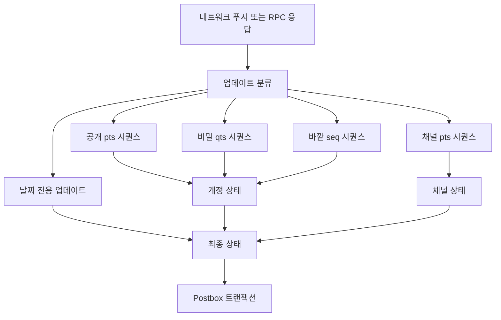
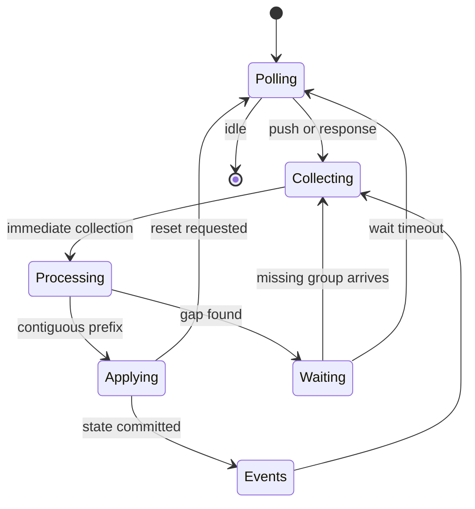
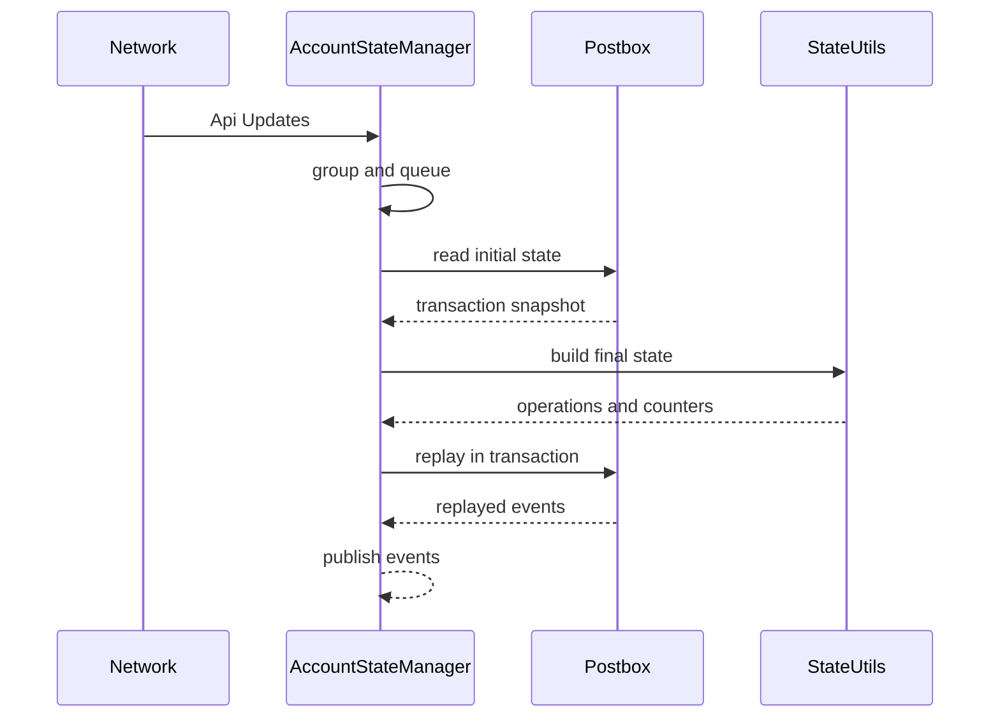
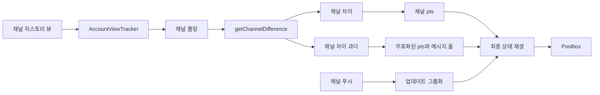

# 업데이트 동기화: pts, qts, seq와 getDifference

웹: /docs/system/06-update-sync/ · Markdown: /docs/system/06-update-sync.md

> Telegram 클라이언트가 업데이트 공백을 감지하고 로컬 상태를 원자적으로 복구하는 방법

> 시스템 설계 · 동기화와 메시지 · 06장 · 도표 4 · 코드 발췌 10 · 인용 23 · 소스 기준선: [TelegramMessenger/Telegram-iOS@f1dd7a2d](https://github.com/TelegramMessenger/Telegram-iOS/tree/f1dd7a2dbd02cbbf513e75d5695d8d36d1cf5838), [overtake/TelegramSwift@579cebbf](https://github.com/overtake/TelegramSwift/tree/579cebbf0c01fd41b712eff3647fa7f69db9665d)
>
> 관련 보충: [macOS fork 장별 검증 (01–07장)](/docs/system/31-fork-verify-01-07/)
>
> 핵심 소스 파일: [TelegramMessenger/Telegram-iOS/submodules/TelegramCore/Sources/State/AccountStateManager.swift](https://github.com/TelegramMessenger/Telegram-iOS/blob/f1dd7a2dbd02cbbf513e75d5695d8d36d1cf5838/submodules/TelegramCore/Sources/State/AccountStateManager.swift), [TelegramMessenger/Telegram-iOS/submodules/TelegramCore/Sources/State/AccountStateManagementUtils.swift](https://github.com/TelegramMessenger/Telegram-iOS/blob/f1dd7a2dbd02cbbf513e75d5695d8d36d1cf5838/submodules/TelegramCore/Sources/State/AccountStateManagementUtils.swift), [TelegramMessenger/Telegram-iOS/submodules/TelegramCore/Sources/State/UpdateMessageService.swift](https://github.com/TelegramMessenger/Telegram-iOS/blob/f1dd7a2dbd02cbbf513e75d5695d8d36d1cf5838/submodules/TelegramCore/Sources/State/UpdateMessageService.swift), [TelegramMessenger/Telegram-iOS/submodules/TelegramCore/Sources/State/UpdateGroup.swift](https://github.com/TelegramMessenger/Telegram-iOS/blob/f1dd7a2dbd02cbbf513e75d5695d8d36d1cf5838/submodules/TelegramCore/Sources/State/UpdateGroup.swift), [TelegramMessenger/Telegram-iOS/submodules/TelegramCore/Sources/SyncCore/SyncCore_AuthorizedAccountState.swift](https://github.com/TelegramMessenger/Telegram-iOS/blob/f1dd7a2dbd02cbbf513e75d5695d8d36d1cf5838/submodules/TelegramCore/Sources/SyncCore/SyncCore_AuthorizedAccountState.swift), [TelegramMessenger/Telegram-iOS/submodules/TelegramCore/Sources/SyncCore/SyncCore_ChannelState.swift](https://github.com/TelegramMessenger/Telegram-iOS/blob/f1dd7a2dbd02cbbf513e75d5695d8d36d1cf5838/submodules/TelegramCore/Sources/SyncCore/SyncCore_ChannelState.swift), [TelegramMessenger/Telegram-iOS/submodules/TelegramCore/Sources/Account/AccountIntermediateState.swift](https://github.com/TelegramMessenger/Telegram-iOS/blob/f1dd7a2dbd02cbbf513e75d5695d8d36d1cf5838/submodules/TelegramCore/Sources/Account/AccountIntermediateState.swift), [TelegramMessenger/Telegram-iOS/submodules/TelegramCore/Sources/State/AccountViewTracker.swift](https://github.com/TelegramMessenger/Telegram-iOS/blob/f1dd7a2dbd02cbbf513e75d5695d8d36d1cf5838/submodules/TelegramCore/Sources/State/AccountViewTracker.swift), [TelegramMessenger/Telegram-iOS/submodules/TelegramCore/Sources/State/HistoryViewStateValidation.swift](https://github.com/TelegramMessenger/Telegram-iOS/blob/f1dd7a2dbd02cbbf513e75d5695d8d36d1cf5838/submodules/TelegramCore/Sources/State/HistoryViewStateValidation.swift), [TelegramMessenger/Telegram-iOS/submodules/TelegramCore/Sources/State/ResetState.swift](https://github.com/TelegramMessenger/Telegram-iOS/blob/f1dd7a2dbd02cbbf513e75d5695d8d36d1cf5838/submodules/TelegramCore/Sources/State/ResetState.swift), [TelegramMessenger/Telegram-iOS/submodules/TelegramCore/Sources/State/ApplyUpdateMessage.swift](https://github.com/TelegramMessenger/Telegram-iOS/blob/f1dd7a2dbd02cbbf513e75d5695d8d36d1cf5838/submodules/TelegramCore/Sources/State/ApplyUpdateMessage.swift), [overtake/TelegramSwift/.gitmodules](https://github.com/overtake/TelegramSwift/blob/579cebbf0c01fd41b712eff3647fa7f69db9665d/.gitmodules)

Telegram은 서버 이벤트를 복구할 수 있는 순서 있는 로그 여러 개로 다뤄요. 클라이언트는 푸시를 믿을 수 있다고 가정하지 않고, 응답 순서가 고정되어 있다고도 가정하지 않아요. 진행 상황은 계정 수준의 `pts`, `qts`, `seq`, `date`와 채널별 `pts`로 찾아요(각각의 뜻은 첫 절에서 설명해요). 순서가 뒤섞여 들어온 입력은 검증할 수 있는 상태 커밋 한 번으로 정리해요. [\[1\]](https://core.telegram.org/api/updates) [\[3\]](https://github.com/TelegramMessenger/Telegram-iOS/blob/f1dd7a2dbd02cbbf513e75d5695d8d36d1cf5838/submodules/TelegramCore/Sources/SyncCore/SyncCore_AuthorizedAccountState.swift#L11-L130)

iOS의 중심 컴포넌트는 `AccountStateManager`예요. 네트워크 푸시, RPC가 돌려주는 `Api.Updates`, 로컬에서 시작한 상태 조작을 전용 큐 하나에 줄 세우고, 이렇게 처리해요.

1. Postbox(로컬 데이터베이스)에서 읽어 `AccountMutableState`를 만들어요.
2. `AccountFinalState`를 계산해요.
3. Postbox 트랜잭션 하나 안에서 연산을 재생해요.

그래서 카운터의 전진과 메시지, 대화, 읽기 상태의 변경이 따로따로 보이는 일은 없어요. [\[6\]](https://github.com/TelegramMessenger/Telegram-iOS/blob/f1dd7a2dbd02cbbf513e75d5695d8d36d1cf5838/submodules/TelegramCore/Sources/State/AccountStateManager.swift#L7-L1549) [\[7\]](https://github.com/TelegramMessenger/Telegram-iOS/blob/f1dd7a2dbd02cbbf513e75d5695d8d36d1cf5838/submodules/TelegramCore/Sources/State/AccountStateManagementUtils.swift#L560-L782) [\[12\]](https://github.com/TelegramMessenger/Telegram-iOS/blob/f1dd7a2dbd02cbbf513e75d5695d8d36d1cf5838/submodules/TelegramCore/Sources/State/AccountStateManagementUtils.swift#L4052-L4968)

macOS 저장소는 `submodules/telegram-ios`로 `overtake/Telegram-iOS`를 가리키고, 고정 커밋은 `a24bbe45f9861f736a79916a50898512f751e0dc`예요. 보충에서 이 fork의 다음 항목을 검증했어요.

- 4원 상태
- 7종 연산 큐
- 업데이트 그룹화
- 연속 접두사
- 오래된 스냅샷 거부

그래서 이 장의 핵심 동기화 불변식은 그 fork에도 똑같이 적용돼요. [\[13\]](https://github.com/overtake/TelegramSwift/blob/579cebbf0c01fd41b712eff3647fa7f69db9665d/.gitmodules#L7-L9) [\[19\]](https://github.com/overtake/Telegram-iOS/blob/a24bbe45f9861f736a79916a50898512f751e0dc/submodules/TelegramCore/Sources/SyncCore/SyncCore_AuthorizedAccountState.swift#L12-L36) [\[20\]](https://github.com/overtake/Telegram-iOS/blob/a24bbe45f9861f736a79916a50898512f751e0dc/submodules/TelegramCore/Sources/State/AccountStateManager.swift#L7-L14) [\[21\]](https://github.com/overtake/Telegram-iOS/blob/a24bbe45f9861f736a79916a50898512f751e0dc/submodules/TelegramCore/Sources/State/UpdateGroup.swift#L196-L225) [\[22\]](https://github.com/overtake/Telegram-iOS/blob/a24bbe45f9861f736a79916a50898512f751e0dc/submodules/TelegramCore/Sources/State/AccountStateManagementUtils.swift#L571-L605) [\[23\]](https://github.com/overtake/Telegram-iOS/blob/a24bbe45f9861f736a79916a50898512f751e0dc/submodules/TelegramCore/Sources/State/AccountStateManager.swift#L841-L865) [macOS fork 장별 검증 (01–07장)](/docs/system/31-fork-verify-01-07/)

## 프로토콜 상태와 로컬 모델 [#프로토콜-상태와-로컬-모델]

Telegram의 공식 규칙은 업데이트를 세 시퀀스로 나눠요.

- 공개 메시지함 시퀀스: `pts`로 추적해요.
- 비밀 채팅 이벤트 시퀀스: `qts`로 추적해요.
- `Updates` 바깥 시퀀스: `pts`나 `qts`가 없는 나머지 업데이트로, `seq`와 `date`로 추적해요.

처음 로그인하면 클라이언트는 최신 공개 상태를 가져와 저장해요. 채널에는 따로 각자의 `pts`가 있어서 계정 공개 시퀀스에 섞이지 않아요. [\[1\]](https://core.telegram.org/api/updates)

`AuthorizedAccountState.State`가 바로 이 공개 체크포인트예요. `Int32` 필드 네 개가 계정 상태에 인코딩돼요. 바깥의 `AuthorizedAccountState`는 `invalidatedChannels`도 저장해요. 각 항목에는 채널 식별자, 선택적 `pts`, 유효성 표시가 들어 있어요. 이 표시 덕분에 계정 수준 복구가 이어서 병렬로 재설정할 채널을 등록해 둘 수 있어요. [\[3\]](https://github.com/TelegramMessenger/Telegram-iOS/blob/f1dd7a2dbd02cbbf513e75d5695d8d36d1cf5838/submodules/TelegramCore/Sources/SyncCore/SyncCore_AuthorizedAccountState.swift#L11-L130)

`submodules/TelegramCore/Sources/SyncCore/SyncCore_AuthorizedAccountState.swift` 12–36행 발췌.

```swift
public final class State: PostboxCoding, Equatable, CustomStringConvertible {
    public let pts: Int32
    public let qts: Int32
    public let date: Int32
    public let seq: Int32
    public init(pts: Int32, qts: Int32, date: Int32, seq: Int32) {
        self.pts = pts
        self.qts = qts
        self.date = date
        self.seq = seq
    }
    public init(decoder: PostboxDecoder) {
        self.pts = decoder.decodeInt32ForKey("pts", orElse: 0)
        self.qts = decoder.decodeInt32ForKey("qts", orElse: 0)
        self.date = decoder.decodeInt32ForKey("date", orElse: 0)
        self.seq = decoder.decodeInt32ForKey("seq", orElse: 0)
    }
    
    public func encode(_ encoder: PostboxEncoder) {
        encoder.encodeInt32(self.pts, forKey: "pts")
        encoder.encodeInt32(self.qts, forKey: "qts")
        encoder.encodeInt32(self.date, forKey: "date")
        encoder.encodeInt32(self.seq, forKey: "seq")
    }
}
```

여기서 `date`, `seq`, `pts`는 쓰임이 서로 달라요.

- `date`: 다른 메시지 로그의 카운터가 아니에요. `Updates` 시퀀스의 시간 경계이고, `pts`, `qts`와 함께 `updates.getDifference`에 전달돼요.
- `seq`: `Updates` 패킷이 제공하고 상태에 저장돼요.
- `pts`: 위치 의미는 업데이트가 싣고 오는 `pts_count`가 정해요.

`pts` 항목을 만나면 로컬 값과 비교해서 이렇게 판단해요.

- 로컬 값이 `pts - pts_count`와 같으면 그 항목은 정확히 이어져요.
- 로컬 값이 이미 그 항목의 끝점 이상이면 재생이거나 중복 입력이에요.
- 그렇지 않으면 구멍이 생긴 것이므로 뒤따르는 항목을 바로 커밋하면 안 돼요.

[\[1\]](https://core.telegram.org/api/updates) [\[2\]](https://core.telegram.org/method/updates.getDifference) [\[4\]](https://github.com/TelegramMessenger/Telegram-iOS/blob/f1dd7a2dbd02cbbf513e75d5695d8d36d1cf5838/submodules/TelegramCore/Sources/State/UpdateGroup.swift#L5-L236)

소스는 모든 `Api.Update`에 같은 규칙을 만들어 주지 않아요. 분류는 이렇게 나뉘어요.

- `apiUpdatePtsRange`: 삭제, 새 메시지, 읽기 상태, 편집, 웹 페이지, 폴더, 고정 같은 공개 업데이트를 명시적으로 나열해요.
- `apiUpdateQtsRange`: 현재 `updateNewEncryptedMessage`만 카운트가 1인 `qts` 항목으로 매핑해요.
- 나머지 업데이트: 바깥 `seq`나 `date`만으로 처리해요.

이렇게 분류하기 때문에 복합 `Updates` 패킷 하나를 서로 간섭하지 않는 순서 도메인으로 쪼갤 수 있어요. [\[4\]](https://github.com/TelegramMessenger/Telegram-iOS/blob/f1dd7a2dbd02cbbf513e75d5695d8d36d1cf5838/submodules/TelegramCore/Sources/State/UpdateGroup.swift#L5-L236)

비밀 채팅의 키 협상과 암호문 처리는 여기서 다루지 않아요. `qts`는 여기서 복구에 참여하는 두 번째 순서 도메인일 뿐이고, 나머지 보안 의미는 [종단 간 암호화와 로컬 보안](/docs/system/11-secret-chats-security/)을 참고하세요.

아래 도표는 같은 계정에 왜 공개 상태 필드 네 개와 여러 채널 상태가 필요한지 보여 줘요.



## 입력 합류와 단일 쓰기 큐 [#입력-합류와-단일-쓰기-큐]

`AccountStateManager`는 모든 업데이트 처리를 큐 하나로 직렬화해요. 문제는 패킷 유실만이 아니기 때문이에요. 푸시는 아무 때나 도착할 수 있고, API 호출 하나의 `Api.Updates` 응답도 푸시와 뒤섞여 들어올 수 있어요. 호출마다 곧장 DB에 쓰면 카운터 검사, 중복 필터링, UI 이벤트가 경합해요.

그래서 `AccountStateManager.Impl`은 `AccountStateManager`라는 이름의 `Queue`를 만들고 `operations` 배열을 유지해요. `startFirstOperation`은 배열에서 아직 실행되지 않은 첫 연산만 시작하며, 먼저 `isRunning`을 세워요. 데이터베이스 락에만 기대는 동시 쓰기가 아니라 직렬 커밋 관문이에요. [\[6\]](https://github.com/TelegramMessenger/Telegram-iOS/blob/f1dd7a2dbd02cbbf513e75d5695d8d36d1cf5838/submodules/TelegramCore/Sources/State/AccountStateManager.swift#L7-L1549)

연산은 일곱 가지예요.

- `pollDifference`: 공개 차이를 가져와요.
- `collectUpdateGroups`: 합칠 입력을 기다려요.
- `processUpdateGroups`: 구성하고 커밋해요.
- `custom`: 아무 외부 상태 조작이나 직렬화해요.
- `pollCompletion`: 이미 있는 연산이 비워지기를 기다려요.
- `processEvents`: 커밋 후 알림을 보내요.
- `replayAsynchronouslyBuiltFinalState`: 비동기 채널 작업이 구성한 최종 상태를 커밋해요.

[\[6\]](https://github.com/TelegramMessenger/Telegram-iOS/blob/f1dd7a2dbd02cbbf513e75d5695d8d36d1cf5838/submodules/TelegramCore/Sources/State/AccountStateManager.swift#L7-L1549)

`submodules/TelegramCore/Sources/State/AccountStateManager.swift` 7–23행 발췌.

```swift
private enum AccountStateManagerOperationContent {
    case pollDifference(Int32, AccountFinalStateEvents)
    case collectUpdateGroups([UpdateGroup], Double)
    case processUpdateGroups([UpdateGroup])
    case custom(Int32, Signal<Void, NoError>)
    case pollCompletion(Int32, [MessageId], [(Int32, ([MessageId]) -> Void)])
    case processEvents(Int32, AccountFinalStateEvents)
    case replayAsynchronouslyBuiltFinalState(AccountFinalState, () -> Void)
}

private final class AccountStateManagerOperation {
    var isRunning: Bool = false
    let content: AccountStateManagerOperationContent
    
    init(content: AccountStateManagerOperationContent) {
        self.content = content
    }
}
```

`reset`은 수신 체인의 시작점이에요. `UpdateMessageService`(받은 `Api.Updates`를 `UpdateGroup`으로 통일하는 서비스)를 만들고 그 `ValuePipe`를 구독하며, `network.addUpdateSink`로 네트워크 업데이트 수신기에 등록해요.

네트워크는 래핑된 메시지 안의 `Api.Updates`를 `networkSessionDidReceive`에 넘겨요. 같은 서비스가 상태 관리자의 `addUpdates`도 받기 때문에, 푸시와 RPC 응답이 같은 정규화 경로를 타요. 세션 리셋과 `updatesTooLong`은 모두 `.reset` 업데이트 그룹이 돼요. [\[5\]](https://github.com/TelegramMessenger/Telegram-iOS/blob/f1dd7a2dbd02cbbf513e75d5695d8d36d1cf5838/submodules/TelegramCore/Sources/State/UpdateMessageService.swift#L7-L86) [\[6\]](https://github.com/TelegramMessenger/Telegram-iOS/blob/f1dd7a2dbd02cbbf513e75d5695d8d36d1cf5838/submodules/TelegramCore/Sources/State/AccountStateManager.swift#L7-L1549)

`UpdateMessageService`는 완전한 형식, 조합 형식, 짧은 형식에 대해 `groupUpdates`를 호출해요. 짧은 메시지는 먼저 일반 `updateNewMessage`로 채워져요. 짧은 전송 확인은 `updatePts`만 내보내요. 그래서 확인 응답은 진행 상황을 전진시키지만 메시지 객체를 위조하지는 않아요. [\[5\]](https://github.com/TelegramMessenger/Telegram-iOS/blob/f1dd7a2dbd02cbbf513e75d5695d8d36d1cf5838/submodules/TelegramCore/Sources/State/UpdateMessageService.swift#L7-L86)

일반 RPC의 반환도 이 체인을 우회하지 않아요. 예를 들어 전송 후 처리 코드는 서버의 `result`를 `stateManager.addUpdates(result)`에 넘기고 `ensurePeerHasLocalState`를 덧붙여요. 투표 결과를 가져오는 응답도 똑같이 처리해요. 여기서는 반환된 업데이트의 합류만 설명해요. 전송의 재시도, 무작위 식별자, 오프라인 큐는 [메시지 전송 파이프라인과 오프라인 작업 큐](/docs/system/07-message-send-pipeline/)에서 다뤄요. [\[14\]](https://github.com/TelegramMessenger/Telegram-iOS/blob/f1dd7a2dbd02cbbf513e75d5695d8d36d1cf5838/submodules/TelegramCore/Sources/State/ApplyUpdateMessage.swift#L480-L485) [\[15\]](https://github.com/TelegramMessenger/Telegram-iOS/blob/f1dd7a2dbd02cbbf513e75d5695d8d36d1cf5838/submodules/TelegramCore/Sources/State/AccountViewTracker.swift#L166-L187)

`addUpdates`는 호출 스레드에서 곧바로 분류하지 않아요. 비동기로 `updateService`를 호출해요. `addUpdateGroups`는 다시 같은 큐로 들어가요.

- 큐 끝이 이미 그룹을 수집하는 중이면: 새 그룹을 기존 그룹에 이어 붙이고 그 연산의 실행 표시를 유지해요.
- 그렇지 않으면: 대기 시간 0인 수집 연산을 덧붙여요.

이렇게 하면 짧은 시간에 쪼개져 들어오는 푸시의 트랜잭션 횟수가 줄어들고, 최종 정렬 기준은 바뀌지 않아요. [\[6\]](https://github.com/TelegramMessenger/Telegram-iOS/blob/f1dd7a2dbd02cbbf513e75d5695d8d36d1cf5838/submodules/TelegramCore/Sources/State/AccountStateManager.swift#L7-L1549)

`submodules/TelegramCore/Sources/State/AccountStateManager.swift` 491–513행 발췌.

```swift
func addUpdates(_ updates: Api.Updates) {
    self.queue.async {
        self.updateService?.addUpdates(updates)
    }
}

func addUpdateGroups(_ groups: [UpdateGroup]) {
    self.queue.async {
        if let last = self.operations.last {
            switch last.content {
            case .pollDifference, .processUpdateGroups, .custom, .pollCompletion, .processEvents, .replayAsynchronouslyBuiltFinalState:
                self.addOperation(.collectUpdateGroups(groups, 0.0), position: .last)
            case let .collectUpdateGroups(currentGroups, timeout):
                let operation = AccountStateManagerOperation(content: .collectUpdateGroups(currentGroups + groups, timeout))
                operation.isRunning = last.isRunning
                self.operations[self.operations.count - 1] = operation
                self.startFirstOperation()
            }
        } else {
            self.addOperation(.collectUpdateGroups(groups, 0.0), position: .last)
        }
    }
}
```

이 큐는 네트워크를 막지 않아요. 구성과 네트워크 파싱은 신호 체인에서 실행될 수 있어요. 상태를 실제로 바꾸는 재생은 여전히 Postbox 트랜잭션으로 돌아와요. 동시성, `Queue`, `Signal`의 일반 모델은 [리액티브와 동시성 모델](/docs/system/02-reactive-concurrency/)을 참고하세요.

큐를 교체할 때도 보존 의미가 있어요. `replaceOperations`는 실행 중인 첫 항목을 버리지 않아요. 아직 실행되지 않은 항목 중에서 다음을 모아 두고, 새 `pollDifference`를 이 보존 항목들 앞이나 사이에 끼워 넣어요.

- `processUpdateGroups`
- 폴링 완료 구독자
- 비동기 최종 상태
- 이벤트
- 커스텀 연산

그러면 차이 복구가 오래된 일반 처리를 앞지르면서도, 호출자가 기다리는 완료 콜백이 영영 사라지지 않아요. [\[6\]](https://github.com/TelegramMessenger/Telegram-iOS/blob/f1dd7a2dbd02cbbf513e75d5695d8d36d1cf5838/submodules/TelegramCore/Sources/State/AccountStateManager.swift#L7-L1549)

`custom`은 확장을 편하게 하는 데서 그치지 않아요. 동기화와 관련된 상태를 읽거나 바꿀 수 있는 `Signal`을 같은 인과 순서에 놓아요. 신호의 값과 오류는 내부 `ValuePipe`로 원래 호출자에게 전달되고, 큐는 그 완료만 기다려요. 외부 API의 비동기 결과가 업데이트 커밋과 분리되는 셈이에요. 대가는 오래 걸리는 커스텀 연산이 큐 뒤쪽 작업을 늦춘다는 거예요. (추론) [\[6\]](https://github.com/TelegramMessenger/Telegram-iOS/blob/f1dd7a2dbd02cbbf513e75d5695d8d36d1cf5838/submodules/TelegramCore/Sources/State/AccountStateManager.swift#L7-L1549)

커밋과 외부로 나가는 부수 효과도 일부러 나눴어요. `processUpdateGroups`는 먼저 트랜잭션 안에서 `replayFinalState`를 호출해요. 성공한 뒤에야 `processEvents`를 끼워 넣어요. `processEvents`가 입력 상태 관리자, 웹 구독자, 통화 세션, 알림 파이프, 읽음 확인을 갱신해요. 그래서 구독자가 이벤트를 받을 때는 이벤트가 가리키는 Postbox 내용이 이미 있어요. [\[6\]](https://github.com/TelegramMessenger/Telegram-iOS/blob/f1dd7a2dbd02cbbf513e75d5695d8d36d1cf5838/submodules/TelegramCore/Sources/State/AccountStateManager.swift#L7-L1549)

`pollCompletion`은 호출자에게 비우기 펜스(앞선 연산이 모두 비워졌음을 알려 주는 장치)를 제공해요.

- 뒤에 연산이 더 있으면 자신을 큐 끝으로 미뤄요.
- 이미 유일한 연산이면 `help.test`를 보내고, 응답이나 오류가 온 뒤에야 쌓아 둔 메시지 식별자를 전달해요.

동기화 정확성의 근원은 아니에요. “로컬에 커밋되었음”과 “그 이전의 네트워크와 큐 작업이 경계 하나를 넘었음”을 구분하는 인터페이스예요. [\[6\]](https://github.com/TelegramMessenger/Telegram-iOS/blob/f1dd7a2dbd02cbbf513e75d5695d8d36d1cf5838/submodules/TelegramCore/Sources/State/AccountStateManager.swift#L7-L1549)

큐의 실행 표시는 로컬 실행의 재진입만 해결해요. 네트워크 응답을 직렬화해 주지는 않아요. `pollDifference`가 요청을 보낸 뒤에도 늦게 도착한 푸시는 수집 큐로 들어갈 수 있어요. 그래서 차이 경로는 네트워크가 돌아온 뒤 시작 상태를 다시 대조해야 해요. 이 계층 구분이 `operations` 배열과 초기 상태의 동등 비교가 둘 다 필요한 이유예요. [\[6\]](https://github.com/TelegramMessenger/Telegram-iOS/blob/f1dd7a2dbd02cbbf513e75d5695d8d36d1cf5838/submodules/TelegramCore/Sources/State/AccountStateManager.swift#L7-L1549)

재생 한 번이 1초를 넘으면 관리자가 `State` 로그를 남겨요. 코드는 이 임계값을 타임아웃이나 취소 조건으로 쓰지 않아요. 성능 관측 지점일 뿐이에요. 네트워크 요청의 재시도는 `retryRequest`가 맡아요. 공백을 기다리는 2초와 채널 서버가 돌려주는 `timeout`은 서로 다른 계층의 시간 정책이므로 같은 요청 타임아웃으로 뭉뚱그리면 안 돼요. [\[6\]](https://github.com/TelegramMessenger/Telegram-iOS/blob/f1dd7a2dbd02cbbf513e75d5695d8d36d1cf5838/submodules/TelegramCore/Sources/State/AccountStateManager.swift#L7-L1549) [\[8\]](https://github.com/TelegramMessenger/Telegram-iOS/blob/f1dd7a2dbd02cbbf513e75d5695d8d36d1cf5838/submodules/TelegramCore/Sources/State/AccountStateManagementUtils.swift#L3147-L3762)

## 업데이트 그룹화, 순서 검사, 공백 버퍼링 [#업데이트-그룹화-순서-검사-공백-버퍼링]

> 인터랙티브 그림(update-gaps)은 웹 페이지에서 볼 수 있어요.

`UpdateMessageService`는 `updates`, `updatesCombined`, 짧은 업데이트를 `UpdateGroup`으로 통일해요. 그룹은 `pts`, `qts`, `seqRange`, 날짜를 가질 수 있어요. `updatesCombined`의 범위는 끝 `seq`와 차이 `seq - seqStart`예요. 바깥 번호가 없는 나머지 항목은 `withDate`에 넣어요. 특히 짧은 전송 확인은 `updatePts`만 만들어요. 진행 상황은 주지만 완전한 콘텐츠 페이로드는 없기 때문이에요. [\[4\]](https://github.com/TelegramMessenger/Telegram-iOS/blob/f1dd7a2dbd02cbbf513e75d5695d8d36d1cf5838/submodules/TelegramCore/Sources/State/UpdateGroup.swift#L5-L236) [\[5\]](https://github.com/TelegramMessenger/Telegram-iOS/blob/f1dd7a2dbd02cbbf513e75d5695d8d36d1cf5838/submodules/TelegramCore/Sources/State/UpdateMessageService.swift#L7-L86)

`submodules/TelegramCore/Sources/State/UpdateGroup.swift` 206–235행 발췌.

```swift
func groupUpdates(_ updates: [Api.Update], users: [Api.User], chats: [Api.Chat], date: Int32, seqRange: (Int32, Int32)?) -> [UpdateGroup] {
    var updatesWithPts: [Api.Update] = []
    var updatesWithQts: [Api.Update] = []
    var otherUpdates: [Api.Update] = []
    
    for update in updates {
        if let _ = apiUpdatePtsRange(update) {
            updatesWithPts.append(update)
        } else if let _ = apiUpdateQtsRange(update) {
            updatesWithQts.append(update)
        } else {
            otherUpdates.append(update)
        }
    }
    
    var groups: [UpdateGroup] = []
    if updatesWithPts.count != 0 {
        groups.append(.withPts(updates: updatesWithPts, users: users, chats: chats))
    }
    if updatesWithQts.count != 0 {
        groups.append(.withQts(updates: updatesWithQts, users: users, chats: chats))
    }
    // ...
}
```

`finalStateWithUpdateGroups`는 먼저 정렬할 수 있는 입력 세 종류(공개 `pts`, 비밀 `qts`, `seq` 그룹)를 각각 범위 시작점으로 정렬해요. 네트워크 도착 순서에 기대지 않아요. 공개 `pts`에는 세 분기를 차례로 적용해요.

- 오래된 항목: 건너뛰어요.
- 이어지는 항목: 사용자와 채팅을 합치고 `pts`를 전진시켜요.
- 그 밖의 항목: `ptsUpdatesAfterHole`에 넣어요.

구멍이 한 번 생기면 뒤의 항목은 독립적으로 이어지더라도 적용하지 않아요. `qts`와 `seq`도 첫 공백에서 멈추는 같은 전략을 써요. 덕분에 트랜잭션 한 번에 접두사 하나만 커밋되고, 빠진 이벤트보다 앞서 미래 상태를 덮어쓰는 일이 없어요. [\[7\]](https://github.com/TelegramMessenger/Telegram-iOS/blob/f1dd7a2dbd02cbbf513e75d5695d8d36d1cf5838/submodules/TelegramCore/Sources/State/AccountStateManagementUtils.swift#L560-L782)

`submodules/TelegramCore/Sources/State/AccountStateManagementUtils.swift` 603–628행 발췌.

```swift
for update in currentPtsUpdates {
    if updatedState.state.pts >= update.ptsRange.0 {
        if let update = update.update, case .updateWebPage = update {
            collectedUpdates.append(update)
        }
        //skip old update
    }
    else if ptsUpdatesAfterHole.count == 0 && updatedState.state.pts == update.ptsRange.0 - update.ptsRange.1 {
        updatedState.mergeChats(update.chats)
        updatedState.mergeUsers(update.users)
        
        if let ptsUpdate = update.update {
            collectedUpdates.append(ptsUpdate)
        }
        
        updatedState.updateState(AuthorizedAccountState.State(pts: update.ptsRange.0, qts: updatedState.state.qts, date: updatedState.state.date, seq: updatedState.state.seq))
    } else {
        if ptsUpdatesAfterHole.count == 0 {
            Logger.shared.log("State", "update pts hole: \(update.ptsRange.0) != \(updatedState.state.pts) + \(update.ptsRange.1)")
        }
        ptsUpdatesAfterHole.append(update)
    }
}
```

중복 입력의 멱등성은 메시지 내용이 같은지 비교해서가 아니라 단조 검사에서 나와요. 이미 적용된 공개 항목은 일반 변경을 다시 일으키지 않아요. 코드는 중복된 웹 페이지 업데이트에만 예외를 하나 두어 `updateWebPage`를 계속 수집해요. 웹 페이지 미리보기를 기다리는 쪽이 최신 결과를 알 수 있게 하려는 거예요. 이 예외는 코드가 직접 표현한 것이므로, 모든 업데이트를 반복 실행할 수 있다는 식으로 일반화하면 안 돼요. [\[7\]](https://github.com/TelegramMessenger/Telegram-iOS/blob/f1dd7a2dbd02cbbf513e75d5695d8d36d1cf5838/submodules/TelegramCore/Sources/State/AccountStateManagementUtils.swift#L560-L782)

`seq` 그룹은 성공하면 그 그룹의 `date`도 함께 기록해요. 날짜만 있는 그룹은 공개 4원 상태를 전진시키지 않고, 날짜순으로 정렬해 적용 대기 업데이트에 더해요. 이렇게 나누는 건 공식 규칙인 “`pts`나 `qts`가 있는 중첩 업데이트를 먼저 처리한 뒤 나머지 업데이트를 `seq`로 처리한다”와 같아요. [\[1\]](https://core.telegram.org/api/updates) [\[7\]](https://github.com/TelegramMessenger/Telegram-iOS/blob/f1dd7a2dbd02cbbf513e75d5695d8d36d1cf5838/submodules/TelegramCore/Sources/State/AccountStateManagementUtils.swift#L560-L782)

아래 도표는 순서가 뒤섞여 도착한 상태에서 한 번의 커밋에 이르는 상태 기계를 보여 줘요. `AccountStateManager`의 큐 수준 동작을 나타내요.



공백이 있어도 곧바로 요청을 보내지는 않아요. 흐름은 이래요.

- 접두사를 처리한 뒤 `AccountFinalState.incomplete`가 참이면 관리자는 같은 그룹을 `collectUpdateGroups`로 되돌리고 2초를 기다려요.
- 수집 타이머가 만료되면 업데이트 대기 타임아웃을 기록하고 `pollDifference`로 실행되지 않은 큐 연산을 교체해요.
- 0초 타이머는 수집 연산을 처리 연산으로 바꿀 뿐이에요.

이 2단계 전략은 아주 짧은 푸시 재배열은 먼저 참아 주고, 그다음 가져오기로 수렴시켜요. (추론) 2초는 불필요한 차이 요청을 줄이는 것과 보이지 않는 구간을 줄이는 것 사이의 절충이에요. [\[6\]](https://github.com/TelegramMessenger/Telegram-iOS/blob/f1dd7a2dbd02cbbf513e75d5695d8d36d1cf5838/submodules/TelegramCore/Sources/State/AccountStateManager.swift#L7-L1549)

수집 단계는 공백을 일으킨 원래 그룹을 보존하고, 기대하는 카운터 하나만 남기지 않아요. 그래서 빠진 그룹이 나중에 도착하면 다음 정렬에서 빠진 항목과 먼저 온 항목을 함께 볼 수 있어요. 정렬 키는 범위 시작점이지 패킷 수신 시각이 아니에요. 공개 항목과 비밀 항목은 따로 정렬하고, `seq` 그룹도 따로 정렬해요. 이렇게 한 덕분에 한 도메인의 지연 오류가 다른 도메인의 이미 알려진 접두사를 막지 않아요. [\[4\]](https://github.com/TelegramMessenger/Telegram-iOS/blob/f1dd7a2dbd02cbbf513e75d5695d8d36d1cf5838/submodules/TelegramCore/Sources/State/UpdateGroup.swift#L5-L236) [\[7\]](https://github.com/TelegramMessenger/Telegram-iOS/blob/f1dd7a2dbd02cbbf513e75d5695d8d36d1cf5838/submodules/TelegramCore/Sources/State/AccountStateManagementUtils.swift#L560-L782)

`UpdateGroup.reset`은 더 강한 신호예요. `finalStateWithUpdateGroups`는 이 그룹을 발견하면 `hadReset`을 참으로 만들어요. 이번 회차에서 쓸 수 있는 업데이트는 그래도 수집하지만, 최종 상태를 돌려줄 때 `shouldPoll`을 설정해요. 관리자는 이어서 큐를 차이 폴링으로 교체해요. 독립적인 `updateChannelPts`는 빈 메시지 목록을 가진 `updateDeleteChannelMessages`로 변환되어, 채널 카운터도 같은 최종 상태 계산에 들어가요. [\[7\]](https://github.com/TelegramMessenger/Telegram-iOS/blob/f1dd7a2dbd02cbbf513e75d5695d8d36d1cf5838/submodules/TelegramCore/Sources/State/AccountStateManagementUtils.swift#L560-L782)

여기서 “버퍼링”은 또 다른 영속 큐가 아니에요. `ptsUpdatesAfterHole`, `qtsUpdatesAfterHole`, `seqGroupsAfterHole`은 모두 이번 회차 구성 중의 배열이에요. 이어지지 않는 부분은 Postbox에 기록되지 않아요. 이 항목들은 원래 `groups`를 다시 수집하거나 서버 차이를 통해 다시 계산에 들어가요. 크래시가 나도 이미 영속화된 체크포인트에서 복구하고, 메모리 배열에 기대지 않아요. (추론) [\[6\]](https://github.com/TelegramMessenger/Telegram-iOS/blob/f1dd7a2dbd02cbbf513e75d5695d8d36d1cf5838/submodules/TelegramCore/Sources/State/AccountStateManager.swift#L7-L1549) [\[7\]](https://github.com/TelegramMessenger/Telegram-iOS/blob/f1dd7a2dbd02cbbf513e75d5695d8d36d1cf5838/submodules/TelegramCore/Sources/State/AccountStateManagementUtils.swift#L560-L782)

`pts`와 `qts`의 오래된 항목 판정은 비대칭처럼 보여요.

- 공개 항목: 로컬 `pts >= update.pts`를 써요.
- 비밀 항목: 로컬 `qts >= update.qts + update.qtsCount`를 써요.

이는 현재 구현의 두 범위 정의에서 곧바로 나와요. `qts`에서 유일하게 식별되는 업데이트의 카운트는 1로 고정이에요. 이 로직을 읽거나 고칠 때는 기존 비교식을 유지해야 해요. 필드 이름만 보고 둘을 기계적으로 통일하면 안 돼요. [\[4\]](https://github.com/TelegramMessenger/Telegram-iOS/blob/f1dd7a2dbd02cbbf513e75d5695d8d36d1cf5838/submodules/TelegramCore/Sources/State/UpdateGroup.swift#L5-L236) [\[7\]](https://github.com/TelegramMessenger/Telegram-iOS/blob/f1dd7a2dbd02cbbf513e75d5695d8d36d1cf5838/submodules/TelegramCore/Sources/State/AccountStateManagementUtils.swift#L560-L782)

공개 `seq`의 범위도 끝점에 카운트를 더하는 오래된 항목 판정을 쓰고, 이어질 때 그룹의 `date`를 갱신해요. `withDate`는 순서 번호가 없는 나머지 업데이트만 처리해요. 이들은 날짜 오름차순으로 `collectedUpdates`에 더해지지만, 날짜만으로 계정 4원 상태를 바꾸지는 않아요. 그래서 날짜는 순서 번호가 없는 부수 효과에 안정적인 처리 순서만 줄 뿐이에요. 프로토콜 카운터를 대신해 복구할 수 있는 순서를 약속하지는 않아요. [\[4\]](https://github.com/TelegramMessenger/Telegram-iOS/blob/f1dd7a2dbd02cbbf513e75d5695d8d36d1cf5838/submodules/TelegramCore/Sources/State/UpdateGroup.swift#L5-L236) [\[7\]](https://github.com/TelegramMessenger/Telegram-iOS/blob/f1dd7a2dbd02cbbf513e75d5695d8d36d1cf5838/submodules/TelegramCore/Sources/State/AccountStateManagementUtils.swift#L560-L782)

## 초기 스냅샷에서 Postbox 트랜잭션까지 [#초기-스냅샷에서-postbox-트랜잭션까지]

정렬은 카운터의 연속성만 해결해요. 실제로 적용하려면 현재 peer(사용자, 그룹, 채널 같은 대화 대상), 채널 상태, 읽기 상태, 저장된 메시지, 참조된 메시지도 필요해요. `initialStateWithUpdateGroups`는 Postbox 트랜잭션 안에서 그룹으로부터 관련 peer 식별자, 활성 채널, 연관된 답글, 로컬 채팅 상태에 필요한 것을 알아내요. 이어서 `initialStateWithPeerIds`를 호출해 일관된 읽기 스냅샷을 얻고 `AccountMutableState`를 구성해요. [\[7\]](https://github.com/TelegramMessenger/Telegram-iOS/blob/f1dd7a2dbd02cbbf513e75d5695d8d36d1cf5838/submodules/TelegramCore/Sources/State/AccountStateManagementUtils.swift#L560-L782) [\[16\]](https://github.com/TelegramMessenger/Telegram-iOS/blob/f1dd7a2dbd02cbbf513e75d5695d8d36d1cf5838/submodules/TelegramCore/Sources/Account/AccountIntermediateState.swift#L227-L334)

`AccountMutableState`는 데이터베이스 엔터티가 아니에요. 이번 업데이트의 작업 영역이에요. 여기에 들어 있는 건 이래요.

- 초기 상태
- 최신 공개 상태
- peer 매핑
- 채널 상태
- 메시지 집합
- 메시지 홀(로컬 히스토리에서 아직 채워지지 않은 구간)
- 리소스 사전 캐시
- `AccountStateMutationOperation` 배열

처리 코드는 최종 재생 때까지 작업 영역에 연산만 덧붙여요. `AccountFinalState`에는 `shouldPoll`, `incomplete`, 누락된 채널 집합, `discard`도 있어서 큐가 결과에 따라 다음 단계를 정할 수 있어요. [\[16\]](https://github.com/TelegramMessenger/Telegram-iOS/blob/f1dd7a2dbd02cbbf513e75d5695d8d36d1cf5838/submodules/TelegramCore/Sources/Account/AccountIntermediateState.swift#L227-L334)

`submodules/TelegramCore/Sources/State/AccountStateManagementUtils.swift` 560–578행 발췌.

```swift
func initialStateWithUpdateGroups(postbox: Postbox, groups: [UpdateGroup]) -> Signal<AccountMutableState, NoError> {
    return postbox.transaction { transaction -> AccountMutableState in
        let peerIds = peerIdsFromUpdateGroups(groups)
        let activeChannelIds = activeChannelsFromUpdateGroups(groups)
        let associatedMessageIds = associatedMessageIdsFromUpdateGroups(groups)
        let peerIdsRequiringLocalChatState = peerIdsRequiringLocalChatStateFromUpdateGroups(groups)
        
        return initialStateWithPeerIds(transaction, peerIds: peerIds, activeChannelIds: activeChannelIds, referencedReplyMessageIds: associatedMessageIds.replyIds, referencedGeneralMessageIds: associatedMessageIds.generalIds, peerIdsRequiringLocalChatState: peerIdsRequiringLocalChatState, locallyGeneratedMessageTimestamps: locallyGeneratedMessageTimestampsFromUpdateGroups(groups), storedStories: associatedStoredStories(groups))
    }
}

func initialStateWithDifference(postbox: Postbox, difference: Api.updates.Difference) -> Signal<AccountMutableState, NoError> {
    return postbox.transaction { transaction -> AccountMutableState in
        let peerIds = peerIdsFromDifference(difference)
        let activeChannelIds = activeChannelsFromDifference(difference)
        let associatedMessageIds = associatedMessageIdsFromDifference(difference)
        let peerIdsRequiringLocalChatState = peerIdsRequiringLocalChatStateFromDifference(difference)
        return initialStateWithPeerIds(transaction, peerIds: peerIds, activeChannelIds: activeChannelIds, referencedReplyMessageIds: associatedMessageIds.replyIds, referencedGeneralMessageIds: associatedMessageIds.generalIds, peerIdsRequiringLocalChatState: peerIdsRequiringLocalChatState, locallyGeneratedMessageTimestamps: locallyGeneratedMessageTimestampsFromDifference(difference), storedStories: associatedStoredStories(difference))
    }
}
```

차이와 실시간 그룹은 결국 `finalStateWithUpdates`에서 만나요. 차이 함수는 먼저 `newMessages`, 암호화 메시지, 그 밖의 업데이트, 사용자, 채팅을 흡수해요. 완전한 차이와 슬라이스 차이는 모두 서버의 `updates.State`로 작업 영역의 공개 카운터 네 개를 덮어써요. 빈 차이는 `date`와 `seq`만 갱신하고 로컬 `pts`와 `qts`는 유지해요. `differenceTooLong`은 이 함수에서 단언 실패인데, 상위 계층에서 리셋 경로로 넘어가야 하기 때문이에요. [\[7\]](https://github.com/TelegramMessenger/Telegram-iOS/blob/f1dd7a2dbd02cbbf513e75d5695d8d36d1cf5838/submodules/TelegramCore/Sources/State/AccountStateManagementUtils.swift#L560-L782)

`submodules/TelegramCore/Sources/State/AccountStateManagementUtils.swift` 717–747행 발췌.

```swift
switch difference {
case let .difference(differenceData):
    let (newMessages, newEncryptedMessages, otherUpdates, apiChats, apiUsers, apiState) = (differenceData.newMessages, differenceData.newEncryptedMessages, differenceData.otherUpdates, differenceData.chats, differenceData.users, differenceData.state)
    messages = newMessages
    encryptedMessages = newEncryptedMessages
    updates = otherUpdates
    chats = apiChats
    users = apiUsers
    switch apiState {
    case let .state(stateData):
        let (pts, qts, date, seq, _) = (stateData.pts, stateData.qts, stateData.date, stateData.seq, stateData.unreadCount)
        updatedState.updateState(AuthorizedAccountState.State(pts: pts, qts: qts, date: date, seq: seq))
    }
case let .differenceEmpty(differenceEmptyData):
    let (date, seq) = (differenceEmptyData.date, differenceEmptyData.seq)
    updatedState.updateState(AuthorizedAccountState.State(pts: updatedState.state.pts, qts: updatedState.state.qts, date: date, seq: seq))
case let .differenceSlice(differenceSliceData):
    // ...
case .differenceTooLong:
    assertionFailure()
    break
}
```

`replayFinalState`는 먼저 `verifyTransaction`을 호출해요. 검증에 실패하면 `nil`을 반환하고 호출자는 커밋하지 않아요. 통과하면 작업 영역의 변경 연산을 해석해요. `UpdateState`와 `UpdateChannelState`는 같은 트랜잭션에서 계정 상태와 채널 상태를 기록해요.

`ignoreDate`가 참이면 재생은 트랜잭션에 이미 있는 날짜를 보존하고, 나머지 카운터 세 개는 여전히 최종 상태에서 가져와요. 이 옵션은 독립적인 차이 폴링에서, 동시 경로의 새 날짜를 덮어쓰지 않게 하려는 거예요. [\[6\]](https://github.com/TelegramMessenger/Telegram-iOS/blob/f1dd7a2dbd02cbbf513e75d5695d8d36d1cf5838/submodules/TelegramCore/Sources/State/AccountStateManager.swift#L7-L1549) [\[12\]](https://github.com/TelegramMessenger/Telegram-iOS/blob/f1dd7a2dbd02cbbf513e75d5695d8d36d1cf5838/submodules/TelegramCore/Sources/State/AccountStateManagementUtils.swift#L4052-L4968)

작업 영역 덕분에 네트워크 파싱 전후에 의존 대상을 보충할 수 있어요. 차이 함수는 API 사용자와 채팅을 `AccountMutableState`에 합치고, 변환할 수 있는 `Api.Message`를 `StoreMessage`로 만들며, 암호화 메시지는 비밀 메시지 경로에 넘겨요. 사전 캐시할 리소스와 스토리도 기록해서, 관리자가 재생 전에 MediaBox에 쓸 수 있게 해요. 메시지, 사용자, 상태, 연관 객체가 최종 상태 하나로 함께 커밋되기 때문에, 커밋 순서가 차이 응답의 필드 순서에 좌우되지 않아요. [\[7\]](https://github.com/TelegramMessenger/Telegram-iOS/blob/f1dd7a2dbd02cbbf513e75d5695d8d36d1cf5838/submodules/TelegramCore/Sources/State/AccountStateManagementUtils.swift#L560-L782)

커밋 전후의 체크포인트는 섞어 쓸 수 없어요. `initialStateWithDifference`의 결과에는 읽을 때의 초기 상태가 실려 있어요. 호출자는 네트워크가 돌아온 뒤 이 초기 상태를 요청에 쓴 상태와 비교해요. 같을 때만 구성하고 재생할 수 있어요. 이미 끝난 푸시 트랜잭션이 더 일찍 시작된 차이 응답에 덮어쓰이는 일을 막아요.

이 검사는 직렬 큐와 함께 2중 보호를 이뤄요.

- 초기 상태 비교: 네트워크 대기를 가로지르는 오래된 스냅샷을 다뤄요.
- 직렬 큐: 로컬 커밋 순서를 다뤄요.

[\[6\]](https://github.com/TelegramMessenger/Telegram-iOS/blob/f1dd7a2dbd02cbbf513e75d5695d8d36d1cf5838/submodules/TelegramCore/Sources/State/AccountStateManager.swift#L7-L1549) [\[7\]](https://github.com/TelegramMessenger/Telegram-iOS/blob/f1dd7a2dbd02cbbf513e75d5695d8d36d1cf5838/submodules/TelegramCore/Sources/State/AccountStateManagementUtils.swift#L560-L782)

`AccountFinalState`는 채널 복구를 요구하거나 `discard`를 표시할 수도 있어요. `discard`가 참이면 관리자는 그 상태를 재생하지 않아요. 재생에 성공한 뒤에야 `AccountReplayedFinalState`가 새 메시지, 삭제 식별자, 입력 상태, 알림에 필요한 데이터를 만들어 내요. 그래서 UI 부수 효과가 검증된 쓰기와 동떨어져 따로 일어날 수 없어요. [\[6\]](https://github.com/TelegramMessenger/Telegram-iOS/blob/f1dd7a2dbd02cbbf513e75d5695d8d36d1cf5838/submodules/TelegramCore/Sources/State/AccountStateManager.swift#L7-L1549) [\[16\]](https://github.com/TelegramMessenger/Telegram-iOS/blob/f1dd7a2dbd02cbbf513e75d5695d8d36d1cf5838/submodules/TelegramCore/Sources/Account/AccountIntermediateState.swift#L227-L334)

연산 로그의 장점은 업데이트 한 번이 이질적인 변화를 동시에 표현할 수 있다는 거예요. `AccountMutableState`의 `operations`에는 계정 `UpdateState`뿐 아니라 채널 상태, 읽기 상태, 메시지 추가와 삭제, 미디어, 알림 설정, 목록 변화가 있어요. 네트워크 디코딩 계층은 Postbox의 각 테이블에 어떤 순서로 쓰는지 알 필요가 없어요. 이 변경 연산을 해석하는 곳은 재생기뿐이에요. 대가는 새 업데이트 타입을 추가할 때 파싱 계층과 재생 계층을 모두 함께 확장해야 한다는 거예요. (추론) [\[12\]](https://github.com/TelegramMessenger/Telegram-iOS/blob/f1dd7a2dbd02cbbf513e75d5695d8d36d1cf5838/submodules/TelegramCore/Sources/State/AccountStateManagementUtils.swift#L4052-L4968) [\[16\]](https://github.com/TelegramMessenger/Telegram-iOS/blob/f1dd7a2dbd02cbbf513e75d5695d8d36d1cf5838/submodules/TelegramCore/Sources/Account/AccountIntermediateState.swift#L227-L334)

`updatedQts`는 커밋 후 이벤트의 일부예요. 상태 작업 영역은 `updateState`에서 초기 `qts`와 새 값이 다를 때만 이를 기록해요. 이어서 `processEvents`가 이 값을 `appliedQtsPromise`에 넣어요. `reset`에서 이 promise는 온라인 상태와 결합해 `messages.receivedQueue`를 촉발해요. 이 경로를 보면 비밀 메시지 확인은 커밋된 `qts`에 의존하고, 네트워크 패킷의 도착에는 직접 의존하지 않는다는 걸 알 수 있어요. [\[6\]](https://github.com/TelegramMessenger/Telegram-iOS/blob/f1dd7a2dbd02cbbf513e75d5695d8d36d1cf5838/submodules/TelegramCore/Sources/State/AccountStateManager.swift#L7-L1549) [\[16\]](https://github.com/TelegramMessenger/Telegram-iOS/blob/f1dd7a2dbd02cbbf513e75d5695d8d36d1cf5838/submodules/TelegramCore/Sources/Account/AccountIntermediateState.swift#L227-L334)

`submodules/TelegramCore/Sources/State/AccountStateManagementUtils.swift` 4946–4968행 발췌.

```swift
case let .UpdateState(innerState):
    let currentState = transaction.getState() as! AuthorizedAccountState
    var updatedInnerState = innerState
    if ignoreDate, let previousInnerState = currentState.state {
        updatedInnerState = AuthorizedAccountState.State(pts: updatedInnerState.pts, qts: updatedInnerState.qts, date: previousInnerState.date, seq: updatedInnerState.seq)
    }
    transaction.setState(currentState.changedState(updatedInnerState))
    Logger.shared.log("State", "apply state \(updatedInnerState)")
case let .UpdateChannelState(peerId, pts):
    var state = (transaction.getPeerChatState(peerId) as? ChannelState) ?? ChannelState(pts: pts, invalidatedPts: nil, synchronizedUntilMessageId: nil)
    state = state.withUpdatedPts(pts)
    transaction.setPeerChatState(peerId, state: state)
    Logger.shared.log("State", "apply channel state \(peerId): \(state)")
case let .UpdateChannelInvalidationPts(peerId, pts):
    var state = (transaction.getPeerChatState(peerId) as? ChannelState) ?? ChannelState(pts: 0, invalidatedPts: pts, synchronizedUntilMessageId: nil)
    state = state.withUpdatedInvalidatedPts(pts)
    transaction.setPeerChatState(peerId, state: state)
    Logger.shared.log("State", "apply channel invalidation pts \(peerId): \(state)")
```

Postbox의 색인, 메시지 저장 형식, 트랜잭션 격리는 다른 두 장에서 다뤄요. 이 장의 핵심 경계는 이래요. 동기화 계층은 Postbox에서 일관된 스냅샷을 가져오고, 검증된 연산을 원자적으로 다시 재생해 넣어요. 자세한 내용은 [Postbox 스토리지 엔진](/docs/system/08-postbox-storage/)과 [Postbox 뷰와 메시지 이력 모델](/docs/system/09-postbox-views/)을 참고하세요.

아래 도표는 상태 구성과 상태 커밋 사이의 경계를 보여 줘요.



## getDifference, 슬라이스, 전체 리셋 [#getdifference-슬라이스-전체-리셋]

공개 공백을 복구하는 권위 있는 진입점은 `updates.getDifference`(서버에 놓친 업데이트를 요청하는 API)예요. 요청은 영속화된 `pts`, `date`, `qts`를 써요. 공식 API는 `differenceEmpty`, `difference`, `differenceSlice`, `differenceTooLong`을 반환할 수 있어요. `pts_total_limit`이 설정되어 있고 차이가 너무 크면 서버가 너무 긴 결과를 반환해요. 현재 주 폴링 경로는 `flags`를 명시적으로 0으로, `ptsTotalLimit`를 `nil`로 설정해요. 그래서 이 빠른 업데이트 임계값을 켜지 않아요. [\[2\]](https://core.telegram.org/method/updates.getDifference) [\[6\]](https://github.com/TelegramMessenger/Telegram-iOS/blob/f1dd7a2dbd02cbbf513e75d5695d8d36d1cf5838/submodules/TelegramCore/Sources/State/AccountStateManager.swift#L7-L1549)

`submodules/TelegramCore/Sources/State/AccountStateManager.swift` 871–890행 발췌.

```swift
let request = network.request(Api.functions.updates.getDifference(flags: flags, pts: authorizedState.pts, ptsLimit: nil, ptsTotalLimit: ptsTotalLimit, date: authorizedState.date, qts: authorizedState.qts, qtsLimit: nil))
|> map(Optional.init)
|> `catch` { error -> Signal<Api.updates.Difference?, MTRpcError> in
    if error.errorCode == 406 && error.errorDescription == "AUTH_KEY_DUPLICATED" {
        return .single(nil)
    } else {
        return .fail(error)
    }
}
|> retryRequest

return request
|> mapToSignal { difference -> Signal<(difference: Api.updates.Difference?, finalStatte: AccountReplayedFinalState?, skipBecauseOfError: Bool, resetState: Bool), NoError> in
    guard let difference = difference else {
        return .single((nil, nil, true, false))
    }
    switch difference {
    case .differenceTooLong:
        return .single((nil, nil, false, true))
    default:
        // ...
    }
}
```

차이 요청은 매번 먼저 인증 상태를 읽어요. 차이 작업 영역을 구성한 뒤 코드는 작업 영역의 초기 공개 상태와 요청 시점의 `authorizedState`를 비교해요. 다르면 다른 경로가 이미 로컬 체크포인트를 바꾼 것이므로, 이번 결과는 오래된 스냅샷에 기반해 되쓰지 않고 버려요.

이건 낙관적 동시성 검증(먼저 진행하고, 쓰기 직전에 충돌 여부만 확인하는 방식)이에요. 쓰기 자체는 직렬이지만, 스냅샷 읽기와 네트워크 요청 사이에는 다른 트랜잭션이 끼어들 수 있기 때문이에요. [\[6\]](https://github.com/TelegramMessenger/Telegram-iOS/blob/f1dd7a2dbd02cbbf513e75d5695d8d36d1cf5838/submodules/TelegramCore/Sources/State/AccountStateManager.swift#L7-L1549)

`differenceSlice`가 반환되면 관리자는 새 `pollDifference`를 큐 맨 앞에 끼워 넣어요. 조각마다 재생하며 중간 상태를 전진시켜요. 완전한 차이나 빈 차이를 받을 때까지는 쌓아 둔 부수 효과 이벤트를 처리하지 않아요. 그러면 슬라이스가 반쯤만 적용된 상태에서 UI 알림이 최종 이벤트를 관측하는 일이 없어요. (추론) 읽기 상태, 알림, 메시지 목록이 조각을 가로질러 일관되지 않을 위험을 줄여요. [\[6\]](https://github.com/TelegramMessenger/Telegram-iOS/blob/f1dd7a2dbd02cbbf513e75d5695d8d36d1cf5838/submodules/TelegramCore/Sources/State/AccountStateManager.swift#L7-L1549) [\[7\]](https://github.com/TelegramMessenger/Telegram-iOS/blob/f1dd7a2dbd02cbbf513e75d5695d8d36d1cf5838/submodules/TelegramCore/Sources/State/AccountStateManagementUtils.swift#L560-L782)

`differenceTooLong`은 오래된 `pts`에서 보정하려 하지 않아요. 상태 관리자는 `_internal_resetAccountState`를 호출하고, 이 함수는 이렇게 처리해요.

1. 먼저 `updates.getState`를 가져와요.
2. 이어서 상한이 100인 일반 채팅 목록을 가져와요.
3. 일반 peer를 채팅 목록에 없는 것으로 표시해요.
4. 클라우드 메시지에 전체 범위 홀을 더해요.
5. 목록 항목을 지워요.
6. 가져온 peer, 메시지, 읽기 상태, 채널 `pts`, 새 4원 상태를 기록해요.

비용이 크지만, 이미 서버가 잘라 버린 증분 히스토리에서 벗어날 수 있어요. [\[11\]](https://github.com/TelegramMessenger/Telegram-iOS/blob/f1dd7a2dbd02cbbf513e75d5695d8d36d1cf5838/submodules/TelegramCore/Sources/State/ResetState.swift#L6-L164)

이 전체 새로 고침(리셋)은 로컬 히스토리의 모든 메시지를 무턱대고 삭제하지 않고 홀 표시를 써요. 캐시할 수 있는 객체는 남기면서, 이후 필요할 때 검증하고 다시 채우게 해요. 이 동작은 Postbox의 홀 모델에 구체적으로 의존하므로 단순한 네트워크 전체 다운로드로만 이해하면 안 돼요. [\[11\]](https://github.com/TelegramMessenger/Telegram-iOS/blob/f1dd7a2dbd02cbbf513e75d5695d8d36d1cf5838/submodules/TelegramCore/Sources/State/ResetState.swift#L6-L164)

처음 인증 상태가 비어 있을 때는 주 폴링이 `getDifference`를 호출하지 않아요. `updates.getState`를 호출하고 트랜잭션 안에서 카운터 네 개를 만들어요. 이 분기는 0값을 히스토리의 시작점으로 오해하는 것을 피해요. 공식 문서도 처음 로그인하면 절대 0에서부터 동기화하려 하지 말고 서버의 현재 상태를 저장하라고 요구해요. [\[1\]](https://core.telegram.org/api/updates) [\[6\]](https://github.com/TelegramMessenger/Telegram-iOS/blob/f1dd7a2dbd02cbbf513e75d5695d8d36d1cf5838/submodules/TelegramCore/Sources/State/AccountStateManager.swift#L7-L1549)

오류 경로는 복구할 수 있는 실패와 계정 보안 실패를 구분해요.

- `AUTH_KEY_DUPLICATED`: 요청을 빈 옵셔널 값으로 감싸고, 이후 이번 회차는 차이 결과를 건너뛰어요.
- 그 밖의 RPC 오류: `retryRequest`에 맡겨요.

차이가 없고 이 특수 분기에 해당하면 관리자는 이미 쌓인 이벤트를 처리할 수는 있지만, 허구의 원격 상태를 계정 상태에 기록하지는 않아요. [\[6\]](https://github.com/TelegramMessenger/Telegram-iOS/blob/f1dd7a2dbd02cbbf513e75d5695d8d36d1cf5838/submodules/TelegramCore/Sources/State/AccountStateManager.swift#L7-L1549)

주 폴링은 `invalidatedChannels`도 살펴봐요. 기록된 유효성 표시가 현재 표시와 다르면 관리자는 그 채널의 비동기 리셋 작업을 만들어요. 무효화 기록을 계정 상태에 쓰고, Postbox에서 그 채널만 담은 초기 작업 영역을 구성해요. 공개 차이가 성공하면 채널 결과가 같은 이벤트 수렴 지점으로 합쳐져요. 그래서 공개 복구가 채널마다 네트워크 왕복을 차례로 기다릴 필요가 없어요. (추론) [\[6\]](https://github.com/TelegramMessenger/Telegram-iOS/blob/f1dd7a2dbd02cbbf513e75d5695d8d36d1cf5838/submodules/TelegramCore/Sources/State/AccountStateManager.swift#L7-L1549)

이 병렬화에는 경계가 있어요. 채널 비동기 작업의 결과는 `AccountStateManager`를 건너뛰고 직접 DB에 쓰지 않아요. `addReplayAsynchronouslyBuiltFinalState`를 호출해 여전히 연산 큐 안에서 재생해요. 공개 차이가 끝나기 전에는 `ChannelOperationsContext`가 채널 결과와 이벤트를 누적하고, `canComplete`로 최종 완료를 조율해요. 이 설계는 채널 요청의 병렬성을 얻으면서 관측할 수 있는 커밋의 단일 순서를 유지해요. [\[6\]](https://github.com/TelegramMessenger/Telegram-iOS/blob/f1dd7a2dbd02cbbf513e75d5695d8d36d1cf5838/submodules/TelegramCore/Sources/State/AccountStateManager.swift#L7-L1549)

구체적으로 비동기 리셋 작업은 완료될 때 채널 작업 영역을 `channelResults`에 넣고 `isCompleted`를 참으로 표시해요. 공개 차이가 완료를 허용하고 대기 중인 채널이 모두 끝났을 때만 `checkChannelOperationsCompletion`이 계속 진행돼요. 이 함수는 채널 작업 영역을 `PeerId`순으로 정렬하고 하나씩 `AccountMutableState.merge`를 호출해요.

병합 결과는 트랜잭션 하나에서 재생되며 `invalidatedChannels`를 비워요. 이 커밋은 `skipVerification: true`를 넘기는데, 이미 구성된 채널 결과를 조합한 것이기 때문이에요. 이 빠른 경로는 병합 규칙 자체가 올바르게 유지되어야 성립해요. [\[6\]](https://github.com/TelegramMessenger/Telegram-iOS/blob/f1dd7a2dbd02cbbf513e75d5695d8d36d1cf5838/submodules/TelegramCore/Sources/State/AccountStateManager.swift#L7-L1549)

어떤 채널 작업에 결과가 없더라도 코드는 공개 이벤트 경로를 완료할 수 있어요. `checkChannelOperationsCompletion`은 채널 상태가 없으면 컨텍스트만 비우고 누적된 이벤트를 발행해요. 채널 체크포인트를 허공에서 만들어 내지 않아요. 채널 네트워크 오류의 복구는 주로 `retryRequest`가 맡고, 비공개이거나 유효하지 않은 채널은 단일 차이에서 결과 없음으로 변환돼요. 권한이 바뀐 탓에 공개 동기화가 영영 막히는 일을 피해요. [\[6\]](https://github.com/TelegramMessenger/Telegram-iOS/blob/f1dd7a2dbd02cbbf513e75d5695d8d36d1cf5838/submodules/TelegramCore/Sources/State/AccountStateManager.swift#L7-L1549) [\[8\]](https://github.com/TelegramMessenger/Telegram-iOS/blob/f1dd7a2dbd02cbbf513e75d5695d8d36d1cf5838/submodules/TelegramCore/Sources/State/AccountStateManagementUtils.swift#L3147-L3762)

## 채널의 독립 시퀀스와 가시성 기반 폴링 [#채널의-독립-시퀀스와-가시성-기반-폴링]

채널은 계정 공개 `pts`를 쓰지 않아요. `ChannelState`는 peer chat state에 저장되며 이 값들을 담아요.

- 채널 `pts`
- 선택적 `invalidatedPts`
- `synchronizedUntilMessageId`

그래서 같은 계정에서 공개 업데이트가 이미 이어져 있어도 특정 채널만 따로 고칠 수 있어요. 공식 프로토콜도 채널의 초기 상태가 dialog, 전체 채널 정보, `updateChannelTooLong`에서 올 수 있다고 규정해요. [\[1\]](https://core.telegram.org/api/updates) [\[17\]](https://github.com/TelegramMessenger/Telegram-iOS/blob/f1dd7a2dbd02cbbf513e75d5695d8d36d1cf5838/submodules/TelegramCore/Sources/SyncCore/SyncCore_ChannelState.swift#L3-L59)

채널 동기화는 `updates.getChannelDifference`를 호출해요.

- `limit`: 프로덕션 빌드는 100으로, 디버그 빌드는 2로 요청해요.
- 시작 `pts`: 저장된 채널 `pts`를 쓰고, 없으면 1부터 시작해요.
- 오류: 요청이 `CHANNEL_PRIVATE`나 `CHANNEL_INVALID`를 만나면 그 채널의 결과를 `nil`로 봐요. 그 밖의 오류는 `retryRequest`로 들어가요.

공식 문서는 이 메서드의 최대 상한을 100000으로 규정하고 일반 사용자에게는 10~100을 권장하는데, 여기서는 권장 범위의 상단을 골랐어요. [\[8\]](https://github.com/TelegramMessenger/Telegram-iOS/blob/f1dd7a2dbd02cbbf513e75d5695d8d36d1cf5838/submodules/TelegramCore/Sources/State/AccountStateManagementUtils.swift#L3147-L3762) [\[18\]](https://core.telegram.org/method/updates.getChannelDifference)

`submodules/TelegramCore/Sources/State/AccountStateManagementUtils.swift` 3468–3498행 발췌.

```swift
private func pollChannel(accountPeerId: PeerId, postbox: Postbox, network: Network, peer: Peer, state: AccountMutableState) -> Signal<(AccountMutableState, Bool, Int32?), NoError> {
    if let inputChannel = apiInputChannel(peer) {
        let limit: Int32
        #if DEBUG
        limit = 2
        #else
        limit = 100
        #endif
        let pollPts: Int32
        if let channelState = state.channelStates[peer.id] {
            pollPts = channelState.pts
        } else {
            pollPts = 1
        }
        return (network.request(Api.functions.updates.getChannelDifference(flags: 0, channel: inputChannel, filter: .channelMessagesFilterEmpty, pts: max(pollPts, 1), limit: limit))
        |> map(Optional.init)
        |> `catch` { error -> Signal<Api.updates.ChannelDifference?, MTRpcError> in
            switch error.errorDescription {
            case "CHANNEL_PRIVATE", "CHANNEL_INVALID":
                return .single(nil)
            default:
                return .fail(error)
            }
        })
        // ...
```

일반 `channelDifference`와 빈 결과는 모두 그 채널의 `pts`를 갱신해요. 일반 `channelDifference`는 새 메시지에 `ChannelMessageStateVersionAttribute`를 붙이고, 삭제, 편집, 고정, 콘텐츠 읽음, 조회수, 웹 페이지, 최소 사용 가능 메시지 같은 채널 업데이트를 처리해요. 서버가 반환한 `timeout`은 폴러까지 위로 전달돼요. [\[8\]](https://github.com/TelegramMessenger/Telegram-iOS/blob/f1dd7a2dbd02cbbf513e75d5695d8d36d1cf5838/submodules/TelegramCore/Sources/State/AccountStateManagementUtils.swift#L3147-L3762)

`channelDifferenceTooLong`은 채널 수준의 재구성이고, 공개 `differenceTooLong`의 별칭이 아니에요. 클라이언트는 이렇게 처리해요.

- 반환된 `Dialog`에서 채널 `pts`, 최상단 메시지, 읽기 카운트를 추출해요.
- `invalidatedPts`를 설정해요.
- 히스토리 홀을 추가해요.
- 반환된 메시지에 그 채널 `pts`를 표시해요.
- 읽기 상태와 읽지 않은 태그 요약을 재구성해요.

이후 뷰 검증은 이를 근거로 어떤 오래된 메시지를 곧이곧대로 믿으면 안 되는지 판단해요. [\[8\]](https://github.com/TelegramMessenger/Telegram-iOS/blob/f1dd7a2dbd02cbbf513e75d5695d8d36d1cf5838/submodules/TelegramCore/Sources/State/AccountStateManagementUtils.swift#L3147-L3762)

아래 도표는 채널 경로와 공개 경로의 차이를 보여 줘요. 둘 다 같은 상태 관리자에 커밋되지만 체크포인트가 달라요.



채널은 모든 peer에 대해 영구히 폴링하지 않아요. `AccountViewTracker.polledChannel`은 `peerId`별로 `ChannelPollingContext`를 유지해요.

- 첫 구독자가 나타나면 `keepPollingChannel`을 시작해요.
- 마지막 구독자가 떠나면 폴링을 해제해요.
- `keepPollingChannel`은 단일 폴링을 반복하며, 매번 완료된 뒤 추가로 1초를 늦춰요.
- 단일 폴링은 서버가 `timeout`을 주지 않으면 기본으로 30초를 써요.

지연된 완료를 요구하면 그 초 수가 지난 뒤에야 완료되어, 서버 쪽 스로틀링(호출 빈도 조절) 리듬이 만들어져요. [\[8\]](https://github.com/TelegramMessenger/Telegram-iOS/blob/f1dd7a2dbd02cbbf513e75d5695d8d36d1cf5838/submodules/TelegramCore/Sources/State/AccountStateManagementUtils.swift#L3147-L3762) [\[9\]](https://github.com/TelegramMessenger/Telegram-iOS/blob/f1dd7a2dbd02cbbf513e75d5695d8d36d1cf5838/submodules/TelegramCore/Sources/State/AccountViewTracker.swift#L1877-L2101)

채널 히스토리 뷰가 열리면 트래커는 먼저 그 폴링을 구독해요. 현재 채널이 서버가 준 유효 기간 안에 아직 갱신되지 않았다면 뷰는 히스토리를 호출자에게 곧바로 넘기지 않아요.

채널이 자동 추적에 들어가지 않았고 아직 유효성이 확인되지 않았다면, 코드는 1부터 최대 메시지 식별자까지의 홀을 추가하고 먼저 로딩 중인 빈 뷰를 만들어요. 폴링이나 자동 추적이 확인된 뒤에야 실제 히스토리가 흘러나와요. 이렇게 눈에 보이는 UI를 동기화 정확성에 묶고, 폴링을 백그라운드의 최선 노력으로 두지 않아요. [\[9\]](https://github.com/TelegramMessenger/Telegram-iOS/blob/f1dd7a2dbd02cbbf513e75d5695d8d36d1cf5838/submodules/TelegramCore/Sources/State/AccountViewTracker.swift#L1877-L2101)

`HistoryViewStateValidation`은 더 세밀한 무효화 상황을 처리해요. `ChannelState.invalidatedPts`를 봐요.

- 검증이 필요한 경우: 채널 메시지에 버전 속성이 없거나 버전이 무효화 지점보다 낮을 때예요.
- 배치: 연속된 메시지를 구간으로 나누어 배치당 최대 64개씩 채널 메시지 검증을 시작해요.
- 중복 제거: 같은 배치에서 이미 처리된 식별자는 `batchReferences`로 중복을 없애요.
- 스로틀: 예약 메시지와 빠른 답장의 검증은 같은 peer에 대해 60초 스로틀을 써요.

[\[10\]](https://github.com/TelegramMessenger/Telegram-iOS/blob/f1dd7a2dbd02cbbf513e75d5695d8d36d1cf5838/submodules/TelegramCore/Sources/State/HistoryViewStateValidation.swift#L24-L425)

이 메커니즘은 순서 보장 두 가지를 줘요.

- 첫째, 공개 `pts`, `qts`, `seq`는 연속된 접두사만 커밋해요.
- 둘째, 채널 히스토리의 보이는 메시지에는 버전 경계가 붙어 있어서, 채널 리셋 지점을 넘어선 오래된 기록은 다시 확인해야 해요.

모든 네트워크 요청이 시작한 순서대로 끝난다고 보장하지는 않아요. 대신 DB에 기록되는 진행은 단조적이고, 공백이 촉발한 상태는 검증된 데이터로 위장하지 않는다는 점을 보장해요. [\[6\]](https://github.com/TelegramMessenger/Telegram-iOS/blob/f1dd7a2dbd02cbbf513e75d5695d8d36d1cf5838/submodules/TelegramCore/Sources/State/AccountStateManager.swift#L7-L1549) [\[8\]](https://github.com/TelegramMessenger/Telegram-iOS/blob/f1dd7a2dbd02cbbf513e75d5695d8d36d1cf5838/submodules/TelegramCore/Sources/State/AccountStateManagementUtils.swift#L3147-L3762) [\[10\]](https://github.com/TelegramMessenger/Telegram-iOS/blob/f1dd7a2dbd02cbbf513e75d5695d8d36d1cf5838/submodules/TelegramCore/Sources/State/HistoryViewStateValidation.swift#L24-L425)

채널 `timeout`의 의미는 요청 타임아웃이 아니라 가용성 임대(lease)예요. `AccountViewTracker`는 폴링에 성공하면 `isUpdated`를 참으로 매핑해요. 서버가 준 초 수가 지나면 값을 다시 거짓으로 돌려요. `timeout`이 없으면 단일 폴링 경로는 30초를 써요. 뷰 계층은 이 임대나 자동 추적이 성립할 때만 히스토리를 통과시켜요. 응답을 한 번 받았다고 캐시를 영구히 믿는 것보다 채널의 독립적인 복제 상태에 더 알맞아요. [\[8\]](https://github.com/TelegramMessenger/Telegram-iOS/blob/f1dd7a2dbd02cbbf513e75d5695d8d36d1cf5838/submodules/TelegramCore/Sources/State/AccountStateManagementUtils.swift#L3147-L3762) [\[9\]](https://github.com/TelegramMessenger/Telegram-iOS/blob/f1dd7a2dbd02cbbf513e75d5695d8d36d1cf5838/submodules/TelegramCore/Sources/State/AccountViewTracker.swift#L1877-L2101)

`synchronizedUntilMessageId`는 채널 동기화가 어디까지 되었는지에 대한 로컬 경계를 제공해요. 정상적인 채널 차이는 메시지를 추가할 때 이를 갱신해요. 채널 차이 과다는 최상단 메시지만 위쪽 히스토리 블록에 넣고, 나머지 반환 메시지는 아무 위치에나 넣으며, 동시에 히스토리 홀도 설정해요. 최상단 메시지와 히스토리 홀을 함께 두는 이 조합은 클라이언트에 새 앵커가 있지만 중간 히스토리가 완전하다고 주장하지는 않는다는 뜻이에요. 재구성 뒤에도 뷰 검증과 필요할 때 홀 가져오기가 필요한 이유도 설명해 줘요. [\[8\]](https://github.com/TelegramMessenger/Telegram-iOS/blob/f1dd7a2dbd02cbbf513e75d5695d8d36d1cf5838/submodules/TelegramCore/Sources/State/AccountStateManagementUtils.swift#L3147-L3762) [\[17\]](https://github.com/TelegramMessenger/Telegram-iOS/blob/f1dd7a2dbd02cbbf513e75d5695d8d36d1cf5838/submodules/TelegramCore/Sources/SyncCore/SyncCore_ChannelState.swift#L3-L59)

무효화 검사는 표시 날짜로 추측하지 않고 메시지 속성을 증거로 삼아요. `HistoryState.isMessageValid`는 `ChannelMessageStateVersionAttribute`를 찾은 뒤, 그 `pts`가 `invalidatedPts` 이상일 때만 통과시켜요. 속성이 없어도 검증이 촉발돼요. 연속된 무효 범위는 쪼개지며 배치마다 상한이 64예요. 그래서 채널 차이 리셋 뒤에도 긴 히스토리 뷰를 조금씩 바로잡을 수 있고, 채널 히스토리 전체의 로딩을 막지 않아요. [\[10\]](https://github.com/TelegramMessenger/Telegram-iOS/blob/f1dd7a2dbd02cbbf513e75d5695d8d36d1cf5838/submodules/TelegramCore/Sources/State/HistoryViewStateValidation.swift#L24-L425)

검증 컨텍스트의 수명은 뷰 식별자에 묶여 있어요. 뷰가 해제되거나 태그가 맞지 않으면 `updateView`가 그 context를 삭제해 배치의 disposable을 해제해요. 검증 중인 메시지 식별자는 `batchReferences`에 등록되기 때문에, 새 프레임의 뷰가 같은 식별자에 대해 요청을 중복해서 보내지 않아요. 뷰의 변화가 네트워크 완료보다 빠를 때를 위한 중복 제거 조치예요. (추론) [\[10\]](https://github.com/TelegramMessenger/Telegram-iOS/blob/f1dd7a2dbd02cbbf513e75d5695d8d36d1cf5838/submodules/TelegramCore/Sources/State/HistoryViewStateValidation.swift#L24-L425)

여기서 64개 배치 상한은 무효화된 채널 메시지의 뷰 검증에만 써요. `getChannelDifference`의 100개 요청 제한도 아니고, 메시지 히스토리 페이지 크기도 아니에요. 예약 메시지와 빠른 답장은 서로 다른 검증 함수를 쓰지만, 둘 다 `previousPeerValidationTimestamps`에 따라 같은 peer에 60초 창을 둬요. 이 숫자들을 각각의 코드 경로에 묶어 두면 성능을 조정할 때 다른 종류의 동기화 리듬을 잘못 고치는 일을 피할 수 있어요. [\[8\]](https://github.com/TelegramMessenger/Telegram-iOS/blob/f1dd7a2dbd02cbbf513e75d5695d8d36d1cf5838/submodules/TelegramCore/Sources/State/AccountStateManagementUtils.swift#L3147-L3762) [\[10\]](https://github.com/TelegramMessenger/Telegram-iOS/blob/f1dd7a2dbd02cbbf513e75d5695d8d36d1cf5838/submodules/TelegramCore/Sources/State/HistoryViewStateValidation.swift#L24-L425)

채널 푸시도 범용 `UpdateGroup` 흐름에 들어가지만, 그 상태 전진은 결국 공개 `pts`가 아니라 채널 상태에 반영돼요. `updateChannelPts`는 서버가 채널 진행 상황만 알려 주는 입력 형태예요. 채널 차이가 이를 로컬 메시지, 읽기 상태, 히스토리 경계로 변환해요. 공개 차이가 채널 차이를 대신하지는 않아요. 두 복구 인터페이스는 서로 다른 두 프로토콜 체크포인트에 대응해요. [\[1\]](https://core.telegram.org/api/updates) [\[4\]](https://github.com/TelegramMessenger/Telegram-iOS/blob/f1dd7a2dbd02cbbf513e75d5695d8d36d1cf5838/submodules/TelegramCore/Sources/State/UpdateGroup.swift#L5-L236) [\[8\]](https://github.com/TelegramMessenger/Telegram-iOS/blob/f1dd7a2dbd02cbbf513e75d5695d8d36d1cf5838/submodules/TelegramCore/Sources/State/AccountStateManagementUtils.swift#L3147-L3762)

푸시가 도착하는 방식, 앱 확장, 여러 프로세스의 협력은 이 장의 범위가 아니에요. 이들은 결국 같은 종류의 업데이트 이벤트를 제공하거나 소비해요. 자세한 내용은 [푸시, 확장 프로세스와 다중 프로세스 협업](/docs/system/12-push-extensions/)을 참고하세요.

## 설계상의 선택과 절충 [#설계상의-선택과-절충]

Telegram은 전역 단일 시퀀스가 아니라 논리적 순서 도메인을 택했어요. 공개 채팅, 비밀 채팅, 채널은 독립적으로 진행할 수 있어요. 채널의 고빈도 이벤트가 계정 전체를 붙잡지 않아요. 대가는 클라이언트가 상태를 여러 벌 유지해야 하고, 복합 패킷 하나를 쪼갠 뒤 다시 조립해야 한다는 거예요. [\[1\]](https://core.telegram.org/api/updates) [\[4\]](https://github.com/TelegramMessenger/Telegram-iOS/blob/f1dd7a2dbd02cbbf513e75d5695d8d36d1cf5838/submodules/TelegramCore/Sources/State/UpdateGroup.swift#L5-L236)

먼저 버퍼링하고 나중에 가져오는 방식을 택했어요. 잠깐의 순서 뒤섞임은 2초만 기다려요. 공백이 계속될 때만 차이 인터페이스를 호출해요. 대가는 구멍이 생기면 일부 새 이벤트가 잠시 보이지 않는다는 거예요. 대안은 이어지지 않는 패킷마다 즉시 가져오는 것이지만, 그러면 네트워크 지터와 서버 부하가 커져요. (추론) [\[6\]](https://github.com/TelegramMessenger/Telegram-iOS/blob/f1dd7a2dbd02cbbf513e75d5695d8d36d1cf5838/submodules/TelegramCore/Sources/State/AccountStateManager.swift#L7-L1549)

네트워크 패킷을 파싱하면서 Postbox를 직접 고치지 않고, 가변 작업 영역과 연산 로그를 택했어요. 덕분에 초기 읽기, 검증, 커밋의 경계가 분명해져요. 대가는 `AccountMutableState`가 크고, 업데이트 코드가 연산 해석기와 작업 영역 필드를 계속 맞춰 두어야 한다는 거예요. [\[7\]](https://github.com/TelegramMessenger/Telegram-iOS/blob/f1dd7a2dbd02cbbf513e75d5695d8d36d1cf5838/submodules/TelegramCore/Sources/State/AccountStateManagementUtils.swift#L560-L782) [\[12\]](https://github.com/TelegramMessenger/Telegram-iOS/blob/f1dd7a2dbd02cbbf513e75d5695d8d36d1cf5838/submodules/TelegramCore/Sources/State/AccountStateManagementUtils.swift#L4052-L4968) [\[16\]](https://github.com/TelegramMessenger/Telegram-iOS/blob/f1dd7a2dbd02cbbf513e75d5695d8d36d1cf5838/submodules/TelegramCore/Sources/Account/AccountIntermediateState.swift#L227-L334)

채널 차이 과다는 채널의 로컬 메시지를 모두 비우지 않고, 무효화로 표시한 뒤 필요할 때 히스토리를 검증하는 방식을 택했어요. 캐시와 스크롤 경험이 유지돼요. 대가는 뷰 계층이 `invalidatedPts`, 홀, 배치 검증을 이해해야 한다는 거예요. [\[8\]](https://github.com/TelegramMessenger/Telegram-iOS/blob/f1dd7a2dbd02cbbf513e75d5695d8d36d1cf5838/submodules/TelegramCore/Sources/State/AccountStateManagementUtils.swift#L3147-L3762) [\[10\]](https://github.com/TelegramMessenger/Telegram-iOS/blob/f1dd7a2dbd02cbbf513e75d5695d8d36d1cf5838/submodules/TelegramCore/Sources/State/HistoryViewStateValidation.swift#L24-L425)

이 설계를 재사용하려면 서버가 단조 체크포인트와 권위 있는 차이 인터페이스를 제공할 수 있어야 해요. 프로토콜에 이벤트 타임스탬프만 있고 비교할 수 있는 시퀀스 위치가 없다면, 클라이언트는 중복, 지연, 누락을 안전하게 구분할 수 없어요. 이때는 클라이언트 큐에 재시도를 더하기 전에 프로토콜 계층에서 버전 번호나 커서부터 만들어야 해요. (추론) [\[1\]](https://core.telegram.org/api/updates) [\[2\]](https://core.telegram.org/method/updates.getDifference)

작업 영역 패턴은 초기 스냅샷의 범위가 충분히 작아야 한다는 조건도 요구해요. Telegram은 데이터베이스 전체를 복사하지 않고 이번 회차 업데이트와 관련된 peer, 연관 메시지, 채널 상태만 수집해요. `initialStateWithUpdateGroups`가 그룹으로부터 이 집합들을 알아내요. 푸시 배치마다 메모리와 트랜잭션 읽기가 영향 범위에 따라 늘어나요. 대가는 의존 관계를 빠뜨리고 수집하면 최종 상태를 제대로 해석할 수 없다는 거예요. 그래서 새 업데이트 타입은 필요한 peer와 연관 메시지를 분명히 선언해야 해요. [\[7\]](https://github.com/TelegramMessenger/Telegram-iOS/blob/f1dd7a2dbd02cbbf513e75d5695d8d36d1cf5838/submodules/TelegramCore/Sources/State/AccountStateManagementUtils.swift#L560-L782) [\[16\]](https://github.com/TelegramMessenger/Telegram-iOS/blob/f1dd7a2dbd02cbbf513e75d5695d8d36d1cf5838/submodules/TelegramCore/Sources/Account/AccountIntermediateState.swift#L227-L334)

사용하는 쪽에서 가장 중요한 경계는 `Api.Updates` 응답 지점에서 Postbox에 직접 쓰지 않는 거예요. 이 응답은 푸시와 중복될 수도 있고, 나중 트랜잭션이 이미 앞지른 스냅샷일 수도 있어요. 상태 관리자에게 일괄로 넘겨서 범위 검사, 초기 상태 검증, 트랜잭션 재생을 맡겨야 해요. 이 규칙은 UI가 시작한 질의가 돌려준 업데이트에도 똑같이 적용돼요. [\[6\]](https://github.com/TelegramMessenger/Telegram-iOS/blob/f1dd7a2dbd02cbbf513e75d5695d8d36d1cf5838/submodules/TelegramCore/Sources/State/AccountStateManager.swift#L7-L1549) [\[14\]](https://github.com/TelegramMessenger/Telegram-iOS/blob/f1dd7a2dbd02cbbf513e75d5695d8d36d1cf5838/submodules/TelegramCore/Sources/State/ApplyUpdateMessage.swift#L480-L485) [\[15\]](https://github.com/TelegramMessenger/Telegram-iOS/blob/f1dd7a2dbd02cbbf513e75d5695d8d36d1cf5838/submodules/TelegramCore/Sources/State/AccountViewTracker.swift#L166-L187)

큐가 처리량 병목에 대한 유일한 답은 아니에요. Telegram은 독립 채널의 네트워크 복구를 병렬화하되, 병합 결과는 다시 정렬하고 단일 트랜잭션으로 커밋해요. 다른 클라이언트라면 병렬화에 알맞은 것은 공유 체크포인트가 없는 가져오기와 파싱이에요. 직렬화에 알맞은 것은 공유 커서의 전진, 눈에 보이는 부수 효과의 생성, 파생 상태의 영속화예요. 뒤의 두 부류 작업을 잘못 병렬화하면 멱등성 로직이 검증하기 어려운 트랜잭션 간 제약이 돼요. (추론) [\[6\]](https://github.com/TelegramMessenger/Telegram-iOS/blob/f1dd7a2dbd02cbbf513e75d5695d8d36d1cf5838/submodules/TelegramCore/Sources/State/AccountStateManager.swift#L7-L1549)

각 시간 상수도 범위를 반영해요. 이들을 전역 재시도 간격 하나로 통일하면 안 돼요.

- `2`초: 공개 공백 이후 다시 수집하기를 기다리는 시간이에요.
- `1`초: 채널 지속 폴링의 추가 지연이에요.
- `30`초: 채널이 임대를 주지 않았을 때의 기본 완료 지연이에요.
- `60`초: 예약 메시지와 빠른 답장 검증의 peer 수준 스로틀이에요.
- `64`: 채널 히스토리 검증의 배치 크기예요.
- `100`: 프로덕션 채널 차이 요청의 제한이에요.

[\[6\]](https://github.com/TelegramMessenger/Telegram-iOS/blob/f1dd7a2dbd02cbbf513e75d5695d8d36d1cf5838/submodules/TelegramCore/Sources/State/AccountStateManager.swift#L7-L1549) [\[8\]](https://github.com/TelegramMessenger/Telegram-iOS/blob/f1dd7a2dbd02cbbf513e75d5695d8d36d1cf5838/submodules/TelegramCore/Sources/State/AccountStateManagementUtils.swift#L3147-L3762) [\[9\]](https://github.com/TelegramMessenger/Telegram-iOS/blob/f1dd7a2dbd02cbbf513e75d5695d8d36d1cf5838/submodules/TelegramCore/Sources/State/AccountViewTracker.swift#L1877-L2101) [\[10\]](https://github.com/TelegramMessenger/Telegram-iOS/blob/f1dd7a2dbd02cbbf513e75d5695d8d36d1cf5838/submodules/TelegramCore/Sources/State/HistoryViewStateValidation.swift#L24-L425)

## 참고 자료 [#references]

- \[1\] [Working with Updates](https://core.telegram.org/api/updates)
- \[2\] [updates.getDifference](https://core.telegram.org/method/updates.getDifference)
- \[3\] [SyncCore AuthorizedAccountState.swift L11-130](https://github.com/TelegramMessenger/Telegram-iOS/blob/f1dd7a2dbd02cbbf513e75d5695d8d36d1cf5838/submodules/TelegramCore/Sources/SyncCore/SyncCore_AuthorizedAccountState.swift#L11-L130)
- \[4\] [State UpdateGroup.swift L5-236](https://github.com/TelegramMessenger/Telegram-iOS/blob/f1dd7a2dbd02cbbf513e75d5695d8d36d1cf5838/submodules/TelegramCore/Sources/State/UpdateGroup.swift#L5-L236)
- \[5\] [State UpdateMessageService.swift L7-86](https://github.com/TelegramMessenger/Telegram-iOS/blob/f1dd7a2dbd02cbbf513e75d5695d8d36d1cf5838/submodules/TelegramCore/Sources/State/UpdateMessageService.swift#L7-L86)
- \[6\] [State AccountStateManager.swift L7-1549](https://github.com/TelegramMessenger/Telegram-iOS/blob/f1dd7a2dbd02cbbf513e75d5695d8d36d1cf5838/submodules/TelegramCore/Sources/State/AccountStateManager.swift#L7-L1549)
- \[7\] [State AccountStateManagementUtils.swift L560-782](https://github.com/TelegramMessenger/Telegram-iOS/blob/f1dd7a2dbd02cbbf513e75d5695d8d36d1cf5838/submodules/TelegramCore/Sources/State/AccountStateManagementUtils.swift#L560-L782)
- \[8\] [State AccountStateManagementUtils.swift L3147-3762](https://github.com/TelegramMessenger/Telegram-iOS/blob/f1dd7a2dbd02cbbf513e75d5695d8d36d1cf5838/submodules/TelegramCore/Sources/State/AccountStateManagementUtils.swift#L3147-L3762)
- \[9\] [State AccountViewTracker.swift L1877-2101](https://github.com/TelegramMessenger/Telegram-iOS/blob/f1dd7a2dbd02cbbf513e75d5695d8d36d1cf5838/submodules/TelegramCore/Sources/State/AccountViewTracker.swift#L1877-L2101)
- \[10\] [State HistoryViewStateValidation.swift L24-425](https://github.com/TelegramMessenger/Telegram-iOS/blob/f1dd7a2dbd02cbbf513e75d5695d8d36d1cf5838/submodules/TelegramCore/Sources/State/HistoryViewStateValidation.swift#L24-L425)
- \[11\] [State ResetState.swift L6-164](https://github.com/TelegramMessenger/Telegram-iOS/blob/f1dd7a2dbd02cbbf513e75d5695d8d36d1cf5838/submodules/TelegramCore/Sources/State/ResetState.swift#L6-L164)
- \[12\] [State AccountStateManagementUtils.swift L4052-4968](https://github.com/TelegramMessenger/Telegram-iOS/blob/f1dd7a2dbd02cbbf513e75d5695d8d36d1cf5838/submodules/TelegramCore/Sources/State/AccountStateManagementUtils.swift#L4052-L4968)
- \[13\] [TelegramSwift .gitmodules L7-9](https://github.com/overtake/TelegramSwift/blob/579cebbf0c01fd41b712eff3647fa7f69db9665d/.gitmodules#L7-L9)
- \[14\] [State ApplyUpdateMessage.swift L480-485](https://github.com/TelegramMessenger/Telegram-iOS/blob/f1dd7a2dbd02cbbf513e75d5695d8d36d1cf5838/submodules/TelegramCore/Sources/State/ApplyUpdateMessage.swift#L480-L485)
- \[15\] [State AccountViewTracker.swift L166-187](https://github.com/TelegramMessenger/Telegram-iOS/blob/f1dd7a2dbd02cbbf513e75d5695d8d36d1cf5838/submodules/TelegramCore/Sources/State/AccountViewTracker.swift#L166-L187)
- \[16\] [Account AccountIntermediateState.swift L227-334](https://github.com/TelegramMessenger/Telegram-iOS/blob/f1dd7a2dbd02cbbf513e75d5695d8d36d1cf5838/submodules/TelegramCore/Sources/Account/AccountIntermediateState.swift#L227-L334)
- \[17\] [SyncCore ChannelState.swift L3-59](https://github.com/TelegramMessenger/Telegram-iOS/blob/f1dd7a2dbd02cbbf513e75d5695d8d36d1cf5838/submodules/TelegramCore/Sources/SyncCore/SyncCore_ChannelState.swift#L3-L59)
- \[18\] [updates.getChannelDifference](https://core.telegram.org/method/updates.getChannelDifference)
- \[19\] [Fork update state fields](https://github.com/overtake/Telegram-iOS/blob/a24bbe45f9861f736a79916a50898512f751e0dc/submodules/TelegramCore/Sources/SyncCore/SyncCore_AuthorizedAccountState.swift#L12-L36)
- \[20\] [Fork update operations](https://github.com/overtake/Telegram-iOS/blob/a24bbe45f9861f736a79916a50898512f751e0dc/submodules/TelegramCore/Sources/State/AccountStateManager.swift#L7-L14)
- \[21\] [Fork update grouping](https://github.com/overtake/Telegram-iOS/blob/a24bbe45f9861f736a79916a50898512f751e0dc/submodules/TelegramCore/Sources/State/UpdateGroup.swift#L196-L225)
- \[22\] [Fork contiguous pts updates](https://github.com/overtake/Telegram-iOS/blob/a24bbe45f9861f736a79916a50898512f751e0dc/submodules/TelegramCore/Sources/State/AccountStateManagementUtils.swift#L571-L605)
- \[23\] [Fork getDifference snapshot check](https://github.com/overtake/Telegram-iOS/blob/a24bbe45f9861f736a79916a50898512f751e0dc/submodules/TelegramCore/Sources/State/AccountStateManager.swift#L841-L865)
