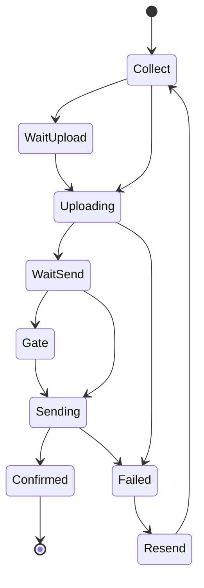
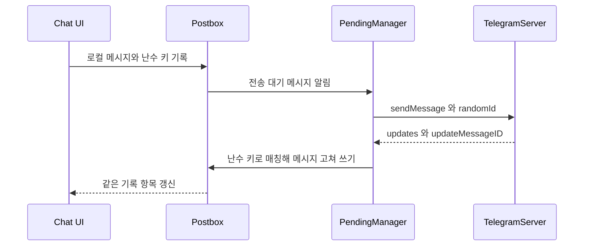
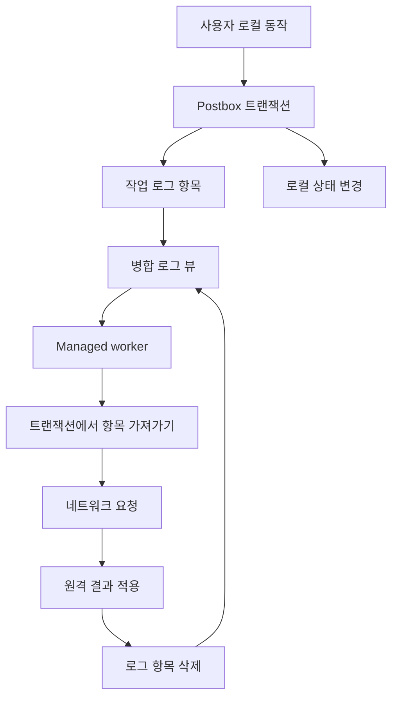

# 메시지 전송 파이프라인과 오프라인 작업 큐

웹: /docs/system/07-message-send-pipeline/ · Markdown: /docs/system/07-message-send-pipeline.md

> Telegram은 로컬 의도를 어떻게 복구 가능한 메시지와 백그라운드 작업으로 영속화하는가

> 시스템 설계 · 동기화와 메시지 · 07장 · 도표 4 · 코드 발췌 10 · 인용 50 · 소스 기준선: [TelegramMessenger/Telegram-iOS@f1dd7a2d](https://github.com/TelegramMessenger/Telegram-iOS/tree/f1dd7a2dbd02cbbf513e75d5695d8d36d1cf5838), [overtake/TelegramSwift@579cebbf](https://github.com/overtake/TelegramSwift/tree/579cebbf0c01fd41b712eff3647fa7f69db9665d)
>
> 관련 보충: [macOS fork 장별 검증 (01–07장)](/docs/system/31-fork-verify-01-07/), [음성 녹음과 사전 업로드](/docs/system/39-audio-preupload/)
>
> 핵심 소스 파일: [TelegramMessenger/Telegram-iOS/submodules/TelegramCore/Sources/PendingMessages/EnqueueMessage.swift](https://github.com/TelegramMessenger/Telegram-iOS/blob/f1dd7a2dbd02cbbf513e75d5695d8d36d1cf5838/submodules/TelegramCore/Sources/PendingMessages/EnqueueMessage.swift), [TelegramMessenger/Telegram-iOS/submodules/TelegramCore/Sources/State/PendingMessageManager.swift](https://github.com/TelegramMessenger/Telegram-iOS/blob/f1dd7a2dbd02cbbf513e75d5695d8d36d1cf5838/submodules/TelegramCore/Sources/State/PendingMessageManager.swift), [TelegramMessenger/Telegram-iOS/submodules/TelegramCore/Sources/PendingMessages/PendingMessageUploadedContent.swift](https://github.com/TelegramMessenger/Telegram-iOS/blob/f1dd7a2dbd02cbbf513e75d5695d8d36d1cf5838/submodules/TelegramCore/Sources/PendingMessages/PendingMessageUploadedContent.swift), [TelegramMessenger/Telegram-iOS/submodules/TelegramCore/Sources/State/MessageMediaPreuploadManager.swift](https://github.com/TelegramMessenger/Telegram-iOS/blob/f1dd7a2dbd02cbbf513e75d5695d8d36d1cf5838/submodules/TelegramCore/Sources/State/MessageMediaPreuploadManager.swift), [TelegramMessenger/Telegram-iOS/submodules/TelegramCore/Sources/State/ApplyUpdateMessage.swift](https://github.com/TelegramMessenger/Telegram-iOS/blob/f1dd7a2dbd02cbbf513e75d5695d8d36d1cf5838/submodules/TelegramCore/Sources/State/ApplyUpdateMessage.swift), [TelegramMessenger/Telegram-iOS/submodules/TelegramCore/Sources/PendingMessages/RequestEditMessage.swift](https://github.com/TelegramMessenger/Telegram-iOS/blob/f1dd7a2dbd02cbbf513e75d5695d8d36d1cf5838/submodules/TelegramCore/Sources/PendingMessages/RequestEditMessage.swift), [TelegramMessenger/Telegram-iOS/submodules/TelegramCore/Sources/TelegramEngine/Messages/ScheduledMessages.swift](https://github.com/TelegramMessenger/Telegram-iOS/blob/f1dd7a2dbd02cbbf513e75d5695d8d36d1cf5838/submodules/TelegramCore/Sources/TelegramEngine/Messages/ScheduledMessages.swift), [TelegramMessenger/Telegram-iOS/submodules/TelegramCore/Sources/TelegramEngine/Messages/DeleteMessagesInteractively.swift](https://github.com/TelegramMessenger/Telegram-iOS/blob/f1dd7a2dbd02cbbf513e75d5695d8d36d1cf5838/submodules/TelegramCore/Sources/TelegramEngine/Messages/DeleteMessagesInteractively.swift), [TelegramMessenger/Telegram-iOS/submodules/TelegramCore/Sources/State/CloudChatRemoveMessagesOperation.swift](https://github.com/TelegramMessenger/Telegram-iOS/blob/f1dd7a2dbd02cbbf513e75d5695d8d36d1cf5838/submodules/TelegramCore/Sources/State/CloudChatRemoveMessagesOperation.swift), [TelegramMessenger/Telegram-iOS/submodules/TelegramCore/Sources/State/ManagedCloudChatRemoveMessagesOperations.swift](https://github.com/TelegramMessenger/Telegram-iOS/blob/f1dd7a2dbd02cbbf513e75d5695d8d36d1cf5838/submodules/TelegramCore/Sources/State/ManagedCloudChatRemoveMessagesOperations.swift), [TelegramMessenger/Telegram-iOS/submodules/TelegramCore/Sources/State/ManagedSynchronizePinnedChatsOperations.swift](https://github.com/TelegramMessenger/Telegram-iOS/blob/f1dd7a2dbd02cbbf513e75d5695d8d36d1cf5838/submodules/TelegramCore/Sources/State/ManagedSynchronizePinnedChatsOperations.swift), [TelegramMessenger/Telegram-iOS/submodules/TelegramCore/Sources/State/ManagedSynchronizePeerReadStates.swift](https://github.com/TelegramMessenger/Telegram-iOS/blob/f1dd7a2dbd02cbbf513e75d5695d8d36d1cf5838/submodules/TelegramCore/Sources/State/ManagedSynchronizePeerReadStates.swift), [TelegramMessenger/Telegram-iOS/submodules/TelegramCore/Sources/SyncCore/SyncCore_SynchronizePinnedChatsOperation.swift](https://github.com/TelegramMessenger/Telegram-iOS/blob/f1dd7a2dbd02cbbf513e75d5695d8d36d1cf5838/submodules/TelegramCore/Sources/SyncCore/SyncCore_SynchronizePinnedChatsOperation.swift), [TelegramMessenger/Telegram-iOS/submodules/Postbox/Sources/PeerOperationLogTable.swift](https://github.com/TelegramMessenger/Telegram-iOS/blob/f1dd7a2dbd02cbbf513e75d5695d8d36d1cf5838/submodules/Postbox/Sources/PeerOperationLogTable.swift), [TelegramMessenger/Telegram-iOS/submodules/Postbox/Sources/PeerMergedOperationLogView.swift](https://github.com/TelegramMessenger/Telegram-iOS/blob/f1dd7a2dbd02cbbf513e75d5695d8d36d1cf5838/submodules/Postbox/Sources/PeerMergedOperationLogView.swift), [TelegramMessenger/Telegram-iOS/submodules/Postbox/Sources/MessageHistoryIndexTable.swift](https://github.com/TelegramMessenger/Telegram-iOS/blob/f1dd7a2dbd02cbbf513e75d5695d8d36d1cf5838/submodules/Postbox/Sources/MessageHistoryIndexTable.swift), [TelegramMessenger/Telegram-iOS/submodules/Postbox/Sources/MessageHistoryTable.swift](https://github.com/TelegramMessenger/Telegram-iOS/blob/f1dd7a2dbd02cbbf513e75d5695d8d36d1cf5838/submodules/Postbox/Sources/MessageHistoryTable.swift), [overtake/TelegramSwift/.gitmodules](https://github.com/overtake/TelegramSwift/blob/579cebbf0c01fd41b712eff3647fa7f69db9665d/.gitmodules)
>
> 미검증 사항:
> - 음성 미리듣기를 삭제한 뒤 초안 `LocalFileMediaResource`의 디스크 바이트를 MediaBox가 언제 회수하는지는 미검증이에요.
> - 원형 비디오에서 `discardVideo`를 호출한 뒤 컨트롤러와 노드가 모든 표시 경로에서 언제 소멸하는지는 미검증이에요. 따라서 실시간 업로드의 중단을 취소 이벤트의 동기적 보장으로 적어서는 안 돼요.

Telegram은 전송을 먼저 디스크에 기록하고, 나중에 실행하며, 서버 결과로 고쳐 쓸 수 있는 로컬 트랜잭션으로 이해해요. 흐름은 이래요.

1. 사용자가 전송을 누르면 클라이언트는 먼저 Postbox(로컬 저장소)에 `Unsent` 플래그가 붙은 메시지를 삽입해요.
2. 이어서 `PendingMessageManager`(전송 대기 메시지를 실행하는 manager)가 미전송 집합을 관찰하고, 미디어를 업로드하고, RPC를 구성해요.
3. 같은 저장 레코드를 서버 메시지로 고쳐 써요.

덕분에 인터페이스는 네트워크를 기다리지 않아도 되고, 프로세스가 재시작되어도 전송 의도가 사라지지 않아요. [\[1\]](https://github.com/TelegramMessenger/Telegram-iOS/blob/f1dd7a2dbd02cbbf513e75d5695d8d36d1cf5838/submodules/TelegramCore/Sources/PendingMessages/EnqueueMessage.swift#L942-L958) [\[2\]](https://github.com/TelegramMessenger/Telegram-iOS/blob/f1dd7a2dbd02cbbf513e75d5695d8d36d1cf5838/submodules/TelegramCore/Sources/PendingMessages/EnqueueMessage.swift#L1101-L1204)

여기서 핵심은 `messages.sendMessage` 호출 한 번을 비동기 함수로 감싸는 것이 아니라, 로컬 메시지, 업로드 상태, 요청 의존성, 서버 확인을 복구 가능한 단계로 나누는 거예요. 영속화된 메시지가 전송 큐의 사실상 원천이에요. 메모리 안의 manager는 현재 프로세스의 실행기일 뿐이에요. Postbox의 하위 트랜잭션과 뷰 메커니즘은 [Postbox 스토리지 엔진](/docs/system/08-postbox-storage/)에서 별도로 다뤄요.

## 로컬 메시지가 네트워크보다 먼저 [#로컬-메시지가-네트워크보다-먼저]

### 로컬 생명주기를 메시지 정체성에 담은 네임스페이스 [#로컬-생명주기를-메시지-정체성에-담은-네임스페이스]

전송 파이프라인이 가장 먼저 풀어야 할 난제는 이거예요. 서버가 아직 메시지 번호를 배정하지 않았는데도, 아래가 가능한 메시지가 채팅 기록에 즉시 하나 나타나야 해요.

- 정렬
- 답장
- 삭제
- 재시작 후 복구

Telegram은 outbox 테이블(보낼 메시지만 모아 두는 테이블)을 만들지 않고, 작성 중인 발신 메시지를 일반 `StoreMessage`로 메시지 기록에 쓰며 `MessageId`의 `namespace`로 그 생명주기를 구분해요.

`Namespaces.Message`는 메시지의 생명주기를 이렇게 나눠요.

- 일반 클라우드 메시지: `Cloud`
- 로컬 전송 대기 메시지: `Local`
- 예약 메시지: `ScheduledLocal`과 `ScheduledCloud`의 두 단계가 더 있어요.
- 빠른 답장: 독립된 로컬 및 클라우드 네임스페이스를 사용해요.

`allLocal`은 로컬에 있을 수 있지만 아직 일반 클라우드 메시지와는 같지 않은 네임스페이스를 한데 묶어요. [\[3\]](https://github.com/TelegramMessenger/Telegram-iOS/blob/f1dd7a2dbd02cbbf513e75d5695d8d36d1cf5838/submodules/TelegramCore/Sources/SyncCore/SyncCore_Namespaces.swift#L4-L31)

`submodules/TelegramCore/Sources/SyncCore/SyncCore_Namespaces.swift` 4–31행 발췌.

```swift
public struct Namespaces {
    public struct Message {
        public static let Cloud: Int32 = 0
        public static let Local: Int32 = 1
        public static let SecretIncoming: Int32 = 2
        public static let ScheduledCloud: Int32 = 3
        public static let ScheduledLocal: Int32 = 4
        public static let QuickReplyCloud: Int32 = 5
        public static let QuickReplyLocal: Int32 = 6
        public static let EphemeralLocal: Int32 = 7
        public static let EphemeralAnchored: Int32 = 8
        public static let WelcomeMessageCloud: Int32 = 9
        public static let WelcomeMessageLocal: Int32 = 10
        
        public static let allScheduled: Set<Int32> = Set([Namespaces.Message.ScheduledCloud, Namespaces.Message.ScheduledLocal])
        public static let allQuickReply: Set<Int32> = Set([Namespaces.Message.QuickReplyCloud, Namespaces.Message.QuickReplyLocal])
        public static let allEphemeral: Set<Int32> = Set([Namespaces.Message.EphemeralLocal, Namespaces.Message.EphemeralAnchored])
```

`enqueueMessages`의 공개 진입점은 먼저 계정 수준의 미디어 변환기가 기회적으로 처리하게 한 다음 `postbox.transaction`에 들어가요.

- 같은 트랜잭션 안에서 여러 메시지를 삽입할 수 있으므로, 앨범, 전달, 텍스트가 반쯤 보이고 반쯤 안 보이는 상태에 놓이지 않아요.
- inline 스티커를 먼저 미디어 라이브러리에 저장해요.
- 답장 속성, 텍스트 엔티티, 자동 삭제 속성, 채팅 컨텍스트에 필요한 정보를 채워요. [\[4\]](https://github.com/TelegramMessenger/Telegram-iOS/blob/f1dd7a2dbd02cbbf513e75d5695d8d36d1cf5838/submodules/TelegramCore/Sources/PendingMessages/EnqueueMessage.swift#L697-L740)

일반 전송 대기 메시지마다 64비트 난수가 하나씩 만들어져요. 이 난수는 아래 두 곳에 함께 기록돼요.

- `OutgoingMessageInfoAttribute.uniqueId`: 나중에 MTProto API의 `randomId` 필드로 들어가 `updateMessageID`와 매칭돼요.
- `StoreMessage.globallyUniqueId`: `addMessages`가 로컬에서 배정한 `MessageId`를 반환하게 해, 호출자가 방금 삽입한 레코드를 즉시 찾을 수 있게 해요. [\[1\]](https://github.com/TelegramMessenger/Telegram-iOS/blob/f1dd7a2dbd02cbbf513e75d5695d8d36d1cf5838/submodules/TelegramCore/Sources/PendingMessages/EnqueueMessage.swift#L942-L958) [\[5\]](https://github.com/TelegramMessenger/Telegram-iOS/blob/f1dd7a2dbd02cbbf513e75d5695d8d36d1cf5838/submodules/TelegramCore/Sources/PendingMessages/EnqueueMessage.swift#L1441-L1470)

`submodules/TelegramCore/Sources/PendingMessages/EnqueueMessage.swift` 942–958행 발췌.

```swift
var attributes: [MessageAttribute] = []
var flags = StoreMessageFlags()
flags.insert(.Unsent)

var randomId: Int64 = 0
arc4random_buf(&randomId, 8)
var infoFlags = OutgoingMessageInfoFlags()
if transformedMedia {
    infoFlags.insert(.transformedMedia)
}

var partialReference: PartialMediaReference?
if case let .message(_, _, _, mediaReference, _, _, _, _, _, _) = message {
    partialReference = mediaReference?.partial
}
attributes.append(OutgoingMessageInfoAttribute(uniqueId: randomId, flags: infoFlags, acknowledged: false, correlationId: message.correlationId, bubbleUpEmojiOrStickersets: message.bubbleUpEmojiOrStickersets, partialReference: partialReference))
globallyUniqueIds.append(randomId)
```

각 식별자의 역할은 달라요.

- `MessageId`: 로컬 저장 인덱스로, peer, namespace, 정수 id로 구성돼요.
- `randomId`: 전송 멱등성을 위한 연관 키예요.
- `globallyUniqueId`: 삽입 반환 매핑에 쓰이는 값이며, 서버 id로 오해해서는 안 돼요.

서버의 최종 id는 확인 결과에서만 나타나요.

앨범에는 여러 미디어가 로컬에서 먼저 같은 `groupingKey`를 공유해야 해요. 그룹 키는 이렇게 정해져요.

- 직접 전송할 때: `EnqueueMessage.message`가 호출자가 준 `localGroupingKey`를 받아요.
- 전달할 때: `forwardGroupingKey`가 원본 메시지의 그룹 키와 로컬 딕셔너리로 대상 그룹 키를 생성하거나 재사용해요.

저장할 때 모든 `StoreMessage`가 이 키를 보관하므로, manager는 전송 대기 중인 구성원을 `sendMultiMedia` 요청 한 번으로 묶을 수 있어요. [\[2\]](https://github.com/TelegramMessenger/Telegram-iOS/blob/f1dd7a2dbd02cbbf513e75d5695d8d36d1cf5838/submodules/TelegramCore/Sources/PendingMessages/EnqueueMessage.swift#L1101-L1204) [\[6\]](https://github.com/TelegramMessenger/Telegram-iOS/blob/f1dd7a2dbd02cbbf513e75d5695d8d36d1cf5838/submodules/TelegramCore/Sources/PendingMessages/EnqueueMessage.swift#L856-L906)

예약과 빠른 답장은 전송 시점에 덧붙는 불리언 값이 아니라 서로 다른 로컬 네임스페이스예요. 코드는 `OutgoingScheduleInfoMessageAttribute`를 검사해요.

- 예약: “상대가 온라인일 때 전송”이면서 현재 presence가 이미 조건을 만족할 때가 아니라면 `ScheduledLocal`을 선택하고 타임스탬프를 예약 시각으로 설정해요.
- 빠른 답장: `QuickReplyLocal`을 선택하고 타임스탬프를 0으로 둬요.
- 대응하는 네임스페이스가 없으면: 이 속성들을 제거해, 일반 메시지가 무효한 예약 메타데이터를 달고 다니지 않게 해요. [\[2\]](https://github.com/TelegramMessenger/Telegram-iOS/blob/f1dd7a2dbd02cbbf513e75d5695d8d36d1cf5838/submodules/TelegramCore/Sources/PendingMessages/EnqueueMessage.swift#L1101-L1204)

`submodules/TelegramCore/Sources/PendingMessages/EnqueueMessage.swift` 1101–1118행 발췌.

```swift
var messageNamespace = Namespaces.Message.Local
var effectiveTimestamp = timestamp
var sendAsPeer: Peer?
for attribute in attributes {
    if let attribute = attribute as? OutgoingScheduleInfoMessageAttribute {
        if attribute.scheduleTime == scheduleWhenOnlineTimestamp, let presence = peerPresence as? TelegramUserPresence, case let .present(statusTimestamp) = presence.status, statusTimestamp >= timestamp {
        } else {
            messageNamespace = Namespaces.Message.ScheduledLocal
            effectiveTimestamp = attribute.scheduleTime
        }
    } else if attribute is OutgoingQuickReplyMessageAttribute {
        messageNamespace = Namespaces.Message.QuickReplyLocal
        effectiveTimestamp = 0
    } else if let attribute = attribute as? SendAsMessageAttribute {
        if let peer = transaction.getPeer(attribute.peerId) {
            sendAsPeer = peer
        }
    }
}
```

마지막으로 트랜잭션이 `transaction.addMessages`를 한 번에 호출한 뒤, 각각의 난수 `globallyUniqueId`로 로컬 id를 조회해요. 쓰기 동작이 Postbox의 unsent 뷰를 구동하므로, manager는 UI가 명시적으로 호출해 주지 않아도 돼요. 이 흐름이 중요해요.

- UI는 의도를 써요.
- 저장소의 변경이 실행기를 깨워요.
- UI가 네트워크 작업을 쥐고 있지 않아요. [\[5\]](https://github.com/TelegramMessenger/Telegram-iOS/blob/f1dd7a2dbd02cbbf513e75d5695d8d36d1cf5838/submodules/TelegramCore/Sources/PendingMessages/EnqueueMessage.swift#L1441-L1470)

아래 도표는 일반 메시지가 사용자 의도에서 서버 확인에 이르는 영속화 경로를 보여 줘요.

```mermaid
flowchart LR
    UI["전송 동작"] --> ENQ["enqueueMessages"]
    ENQ --> TX["Postbox 트랜잭션"]
    TX --> LOC["로컬 전송 대기 메시지"]
    LOC --> VIEW["미전송 뷰"]
    VIEW --> PM["PendingMessageManager"]
    PM --> UP["미디어 업로드"]
    UP --> RPC["전송 요청"]
    RPC --> RES["서버 업데이트"]
    RES --> MAP["로컬 메시지 고쳐 쓰기"]
    MAP --> HIST["채팅 기록 뷰"]
```



### 요청을 만들 때 나중에 들어가는 입력, 속성 [#요청을-만들-때-나중에-들어가는-입력-속성]

전송 대기 메시지는 텍스트와 첨부만 담은 DTO(데이터를 나르기만 하는 객체)가 아니에요. `enqueueMessages`는 아래 정보를 `MessageAttribute`로 표현해요.

- 답장 대상
- 인용
- thread
- 전송 신원
- 무음 전송
- 엔티티
- 미디어 참조
- 열람 후 자동 삭제
- 유료 메시지와 효과 등

이후 manager가 저장된 메시지에서 이 속성들을 다시 읽어 API flags와 매개변수를 구성해요. 덕분에 프로세스가 강제 종료된 뒤에도 메모리 클로저에 의존하지 않고 전체 요청을 재구성할 수 있어요.

여기에는 대가도 따라요. 속성 타입이 로컬 비즈니스 모델과 TL 매개변수 모델 사이의 경계를 떠맡아요. 전송 기능을 하나 추가할 때 엔지니어는 아래를 모두 함께 확인해야 해요.

- 큐 삽입
- 콘텐츠 업로드
- 단일 및 그룹 요청 구성
- 서버 결과 매핑
- 실패했을 때 속성이 여전히 재시도 가능한지

UI 모델에만 필드를 추가하면 재시작 후 전송의 의미가 사라져요. (추정)

## PendingMessageManager의 실행 상태 머신 [#pendingmessagemanager의-실행-상태-머신]

`Account`는 `MessageMediaPreuploadManager`를 만든 뒤, 이를 아래와 함께 `PendingMessageManager`에 주입해요.

- 네트워크
- Postbox
- `AccountStateManager`
- 입력 활동 관리자
- 미디어 참조 재검증기

manager는 자체 `Queue`를 하나 가지며, `MessageId`를 키로 하는 `messageContexts`를 보유해요. 상태를 별도의 데이터베이스 레코드로 쓰지 않고 미전송 메시지 뷰로부터 메모리 컨텍스트를 재구성해요. 전송 의도 자체는 여전히 메시지 레코드 안에 있어요. [\[7\]](https://github.com/TelegramMessenger/Telegram-iOS/blob/f1dd7a2dbd02cbbf513e75d5695d8d36d1cf5838/submodules/TelegramCore/Sources/Account/Account.swift#L1347-L1351)

각 context(메시지마다 메모리에 두는 실행 상태)는 아래를 보관해요.

- upload, send, activity, postpone의 네 disposable(취소할 수 있는 작업 핸들)
- 현재 thread
- 콘텐츠 범주
- 진행률
- 실패 원인
- 일회성 강제 재전송 표식
- 상태 구독자

상태 enum은 아래 단계를 분명하게 구분해요.

- 정보 수집
- 업로드 대기열 진입
- 업로드 중
- 앨범 구성원 대기
- 전송 게이트 대기
- 전송 중
- 새 토픽 생성 등 [\[8\]](https://github.com/TelegramMessenger/Telegram-iOS/blob/f1dd7a2dbd02cbbf513e75d5695d8d36d1cf5838/submodules/TelegramCore/Sources/State/PendingMessageManager.swift#L27-L76)

`submodules/TelegramCore/Sources/State/PendingMessageManager.swift` 27–58행 발췌.

```swift
private enum PendingMessageState {
    case none
    case collectingInfo(message: Message)
    case waitingForUploadToStart(groupId: Int64?, upload: Signal<PendingMessageUploadedContentResult, PendingMessageUploadError>)
    case uploading(groupId: Int64?)
    case waitingToBeSent(groupId: Int64?, content: PendingMessageUploadedContentAndReuploadInfo)
    case waitingForSendGate(groupId: Int64?, content: PendingMessageUploadedContentAndReuploadInfo)
    case waitingForForwardSendGate
    case sending(groupId: Int64?)
    case waitingForNewTopic(message: Message)
    
    var groupId: Int64? {
        switch self {
        case .none:
            return nil
        case let .collectingInfo(message):
            return message.groupingKey
        case let .waitingForUploadToStart(groupId, _):
            return groupId
```

`updatePendingMessageIds`는 manager의 직렬 queue 안에서 집합 차분을 구해요.

- 새로 추가된 id: 정렬된 뒤 `beginSendingMessages`로 보내져요.
- 삭제된 id: context를 `none`으로 표시하고, upload, send, activity, postpone disposable을 취소한 다음 진행률 구독자에게 알려요.

이 취소 경로는 사용자가 업로드 중에 메시지를 삭제할 때를 처리하며, 제거된 앨범 구성원이 계속 네트워크 전송을 일으키는 일도 막아요. [\[9\]](https://github.com/TelegramMessenger/Telegram-iOS/blob/f1dd7a2dbd02cbbf513e75d5695d8d36d1cf5838/submodules/TelegramCore/Sources/State/PendingMessageManager.swift#L414-L538)

### 전역 동시성 임계값이 아니라 순서 있는 업로드 [#전역-동시성-임계값이-아니라-순서-있는-업로드]

미디어 업로드가 가장 먼저 해결하는 것은 같은 대화에서 연속된 메시지의 직관적인 순서 문제예요. 규칙은 이래요.

- `canBeginUploadingMessage`: 텍스트에는 곧바로 true를 반환해요. 미디어에 대해서는 `MessageId`로 정렬하고, 같은 peer에 더 작은 id가 있고 그 상태가 `uploading`이면 시작을 거부해요.
- `updateWaitingUploads`: 매번 이 peer의 대기 항목 중 조건에 맞는 첫 번째 항목만 시작해요.

따라서 코드가 구현하는 것은 peer별로 앞선 미디어가 뒤를 막는 방식이지, 고정된 전역 병렬도 상수가 아니에요. [\[10\]](https://github.com/TelegramMessenger/Telegram-iOS/blob/f1dd7a2dbd02cbbf513e75d5695d8d36d1cf5838/submodules/TelegramCore/Sources/State/PendingMessageManager.swift#L576-L595)

`submodules/TelegramCore/Sources/State/PendingMessageManager.swift` 576–595행 발췌.

```swift
private func canBeginUploadingMessage(id: MessageId, type: PendingMessageUploadedContentType) -> Bool {
    assert(self.queue.isCurrent())
    
    if case .text = type {
        return true
    }
    
    let messageIdsForPeer: [MessageId] = self.messageContexts.keys.filter({ $0.peerId == id.peerId }).sorted()
    for contextId in messageIdsForPeer {
        if contextId < id {
            let context = self.messageContexts[contextId]!
            if case .uploading = context.state {
                return false
            }
        } else {
            break
        }
    }
    
    return true
}
```

이 선택은 처리량을 내주고 국소적인 순서와 더 추론하기 쉬운 실패 복구를 얻어요.

- 서로 다른 peer의 미디어는 이 판정에서 서로를 막지 않아요.
- 텍스트는 업로드 제한을 우회해, 첨부가 대기 중일 때도 전송될 수 있어요.
- 앨범에는 다른 규칙이 있어요. `dataForPendingMessageGroup`은 구성원 중 하나라도 아직 수집 중이거나, 업로드를 기다리거나, 업로드 중이면 빈 값을 반환하며, 전원이 `waitingToBeSent`에 도달해야 함께 제출해요. [\[11\]](https://github.com/TelegramMessenger/Telegram-iOS/blob/f1dd7a2dbd02cbbf513e75d5695d8d36d1cf5838/submodules/TelegramCore/Sources/State/PendingMessageManager.swift#L906-L993)

업스트림 체크아웃에는 전송 전에 입력 게이트가 하나 더 있어요. 일반 클라우드 대화에 live typing draft(실시간으로 입력 중인 초안)가 남아 있으면, 아래에 모두 해당하는 메시지는 `waitingForSendGate`로 들어가요.

- 예약이 아니에요.
- 비밀 채팅이 아니에요.
- 나와의 채팅이 아니에요.
- 새 토픽도 아니에요.

초안 상태가 지워지면 `drainSendGate`는 이렇게 처리해요.

- 단일 메시지: 로컬 메시지 id 순으로 전송해요.
- 앨범: 최소 id 순으로 전송해요.
- 전달 배치: FIFO(먼저 들어온 순서)로 해제해요.

코드는 UX상의 이유를 밝히지 않으므로, “본인 기기가 아직 입력 중일 때 너무 일찍 제출하는 것을 피한다”는 설명은 추정으로만 볼 수 있어요. [\[8\]](https://github.com/TelegramMessenger/Telegram-iOS/blob/f1dd7a2dbd02cbbf513e75d5695d8d36d1cf5838/submodules/TelegramCore/Sources/State/PendingMessageManager.swift#L27-L76)

macOS fork 차이: 고정 커밋 `a24bbe45`의 상태 enum에는 `waitingForSendGate`, `waitingForForwardSendGate`, `waitingForNewTopic`이 없어요. 따라서 입력 게이트는 업스트림에서 새로 추가된 동작이며, 이 fork의 전송 사실로 서술해서는 안 돼요. [\[41\]](https://github.com/overtake/Telegram-iOS/blob/a24bbe45f9861f736a79916a50898512f751e0dc/submodules/TelegramCore/Sources/State/PendingMessageManager.swift#L28-L48) [macOS fork 장별 검증 (01–07장)](/docs/system/31-fork-verify-01-07/)

아래 도표는 업스트림 체크아웃에서 manager가 단일 메시지에 대해 유지하는 주요 상태와 분기를 보여 줘요.



### 파일 경로가 아닌 전송 가능한 콘텐츠, 업로드 결과 [#파일-경로가-아닌-전송-가능한-콘텐츠-업로드-결과]

`messageContentToUpload`는 저장된 미디어와 속성을 바탕으로 두 종류의 결과를 만들어요.

- `immediate`: 즉시 확정할 수 있는 전달, inline bot 결과, 스토리 참조, 웹 페이지 미리보기, 순수 텍스트를 반환해요.
- 진행률이 있는 `Signal`: 이미지, 파일, 유료 콘텐츠, 리치 텍스트 미디어를 반환해요.

성공하면 일괄적으로 `PendingMessageUploadedContentAndReuploadInfo`를 내놓는데, 여기서 `content`는 `Api.InputMedia`, 텍스트, 전달 정보, 암호화 파일 중 하나이며 로컬 경로가 아니에요. [\[12\]](https://github.com/TelegramMessenger/Telegram-iOS/blob/f1dd7a2dbd02cbbf513e75d5695d8d36d1cf5838/submodules/TelegramCore/Sources/PendingMessages/PendingMessageUploadedContent.swift#L131-L199)

`submodules/TelegramCore/Sources/PendingMessages/PendingMessageUploadedContent.swift` 131–199행 발췌.

```swift
if let media = media.first as? TelegramMediaAction, media.action == .historyScreenshot {
    return .immediate(.content(PendingMessageUploadedContentAndReuploadInfo(content: .messageScreenshot, reuploadInfo: nil, cacheReferenceKey: nil)), .none)
} else if let forwardInfo = forwardInfo {
    return .immediate(.content(PendingMessageUploadedContentAndReuploadInfo(content: .forward(forwardInfo), reuploadInfo: nil, cacheReferenceKey: nil)), .text)
} else if let contextResult = contextResult {
    return .immediate(.content(PendingMessageUploadedContentAndReuploadInfo(content: .chatContextResult(contextResult), reuploadInfo: nil, cacheReferenceKey: nil)), .text)
} else if let media = media.first as? TelegramMediaStory {
    return .signal(postbox.transaction { transaction -> PendingMessageUploadedContentResult in
        guard let inputPeer = transaction.getPeer(media.storyId.peerId).flatMap(apiInputPeer) else {
            return .progress(PendingMessageUploadedContentProgress(progress: 0.0))
        }
        return .content(PendingMessageUploadedContentAndReuploadInfo(content: .media(.inputMediaStory(.init(peer: inputPeer, id: media.storyId.id)), ""), reuploadInfo: nil, cacheReferenceKey: nil))
    }
    |> castError(PendingMessageUploadError.self), .text)
} else if let media = media.first, let mediaResult = mediaContentToUpload(accountPeerId: accountPeerId, network: network, postbox: postbox, auxiliaryMethods: auxiliaryMethods, transformOutgoingMessageMedia: transformOutgoingMessageMedia, messageMediaPreuploadManager: messageMediaPreuploadManager, revalidationContext: revalidationContext, forceReupload: forceReupload, isGrouped: isGrouped, passFetchProgress: passFetchProgress, forceNoBigParts: forceNoBigParts, peerId: peerId, media: media, text: text, autoremoveMessageAttribute: autoremoveMessageAttribute, autoclearMessageAttribute: autoclearMessageAttribute, messageId: messageId, attributes: attributes, mediaReference: mediaReference, explicitPartialReference: explicitPartialReference) {
    return .signal(mediaResult, .media)
} else {
    return .signal(.single(.content(PendingMessageUploadedContentAndReuploadInfo(content: .text(text), reuploadInfo: nil, cacheReferenceKey: nil))), .text)
}
```

`beginUploadingMessage`는 이렇게 움직여요.

- 먼저 상태를 `uploading`으로 두고, 진행률 0의 `PendingMessageStatus`를 만든 다음 signal을 시작해요.
- 진행률은 항목마다 브로드캐스트돼요.
- 콘텐츠가 도착하면 단일 또는 그룹 전송으로 넘어가요.

업로드 오류는 Postbox transaction 안에서 원래 메시지를 `Failed`로 갱신할 뿐 삭제하지 않아요. 그래서 사용자는 실패한 항목을 보고 재전송을 선택할 수 있어요. [\[13\]](https://github.com/TelegramMessenger/Telegram-iOS/blob/f1dd7a2dbd02cbbf513e75d5695d8d36d1cf5838/submodules/TelegramCore/Sources/State/PendingMessageManager.swift#L1055-L1118)

실시간 사전 업로드(녹음하는 동안 파일을 미리 올리는 방식)는 모든 녹음 경로가 공통으로 갖는 것이 아니에요. 음성 녹음은 중지된 뒤에야 완전한 Ogg 데이터를 얻어 `LocalFileMediaResource`에 쓰고 큐에 넣어요. 전송 대기 미디어는 그 뒤에야 manager를 거쳐 업로드돼요. 따라서 음성 녹음은 녹음하면서 동시에 업로드하지 않아요. [\[43\]](https://github.com/TelegramMessenger/Telegram-iOS/blob/f1dd7a2dbd02cbbf513e75d5695d8d36d1cf5838/submodules/TelegramUI/Sources/ManagedAudioRecorder.swift#L585-L755) [\[44\]](https://github.com/TelegramMessenger/Telegram-iOS/blob/f1dd7a2dbd02cbbf513e75d5695d8d36d1cf5838/submodules/TelegramUI/Sources/Chat/ChatControllerMediaRecording.swift#L343-L397) [음성 녹음과 사전 업로드](/docs/system/39-audio-preupload/)

비밀 채팅이 아닌 채팅에서, 보정하지 않은 원형 비디오는 `LegacyLiveUploadInterface`가 `Resources.preUpload`를 통해 계속 커지는 파일을 manager에 넘겨요. 녹화가 끝나면 전송 대기 메시지가 같은 `LocalFileMediaResource` 파일 id로 기존 context를 구독하므로, 같은 바이트 스트림을 다시 업로드하지 않아요.

자르거나 이어 붙인 원형 비디오는 다른 종류의 로컬 리소스를 쓰므로 이 context를 재사용할 수 없어요. 편집에서 새 미디어가 필요할 때도 manager를 쓸 수 있지만, 이것이 녹화 중 전송이 되는 것은 아니에요. [\[26\]](https://github.com/TelegramMessenger/Telegram-iOS/blob/f1dd7a2dbd02cbbf513e75d5695d8d36d1cf5838/submodules/TelegramCore/Sources/PendingMessages/RequestEditMessage.swift#L30-L50) [\[45\]](https://github.com/TelegramMessenger/Telegram-iOS/blob/f1dd7a2dbd02cbbf513e75d5695d8d36d1cf5838/submodules/TelegramUI/Sources/Chat/ChatControllerMediaRecording.swift#L149-L235) [\[46\]](https://github.com/TelegramMessenger/Telegram-iOS/blob/f1dd7a2dbd02cbbf513e75d5695d8d36d1cf5838/submodules/LegacyMediaPickerUI/Sources/LegacyLiveUploadInterface.swift#L45-L109) [\[47\]](https://github.com/TelegramMessenger/Telegram-iOS/blob/f1dd7a2dbd02cbbf513e75d5695d8d36d1cf5838/submodules/TelegramCore/Sources/TelegramEngine/Resources/TelegramEngineResources.swift#L237-L248) [\[48\]](https://github.com/TelegramMessenger/Telegram-iOS/blob/f1dd7a2dbd02cbbf513e75d5695d8d36d1cf5838/submodules/TelegramUI/Components/VideoMessageCameraScreen/Sources/VideoMessageCameraScreen.swift#L2037-L2089) [\[14\]](https://github.com/TelegramMessenger/Telegram-iOS/blob/f1dd7a2dbd02cbbf513e75d5695d8d36d1cf5838/submodules/TelegramCore/Sources/State/MessageMediaPreuploadManager.swift#L39-L158)

사전 업로드를 다루는 두 함수의 동작은 이래요.

- `add`: 사전 업로드 쪽을 위해 구독 슬롯을 점유해요.
- `upload`: 같은 리소스에 이미 context가 있으면 기존 진행률이나 완료된 결과를 구독하며, 구독자가 없어지면 1초를 기다린 뒤 context를 취소하고 축출해요.

이미 공유된 리소스를 중복 업로드하지 않으면서도 전송을 영구히 점유하지 않아요. [\[14\]](https://github.com/TelegramMessenger/Telegram-iOS/blob/f1dd7a2dbd02cbbf513e75d5695d8d36d1cf5838/submodules/TelegramCore/Sources/State/MessageMediaPreuploadManager.swift#L39-L158)

파일 분할, 업로드 RPC, CDN 같은 전송 세부 사항은 이 장의 범위가 아니에요. 이는 [미디어 리소스, 다운로드/업로드, 캐시](/docs/system/10-media-cache/)에서 논의해요. 여기서 재사용할 수 있는 설계는 업로더를 공유 가능한 결과 signal로 추상화해, 메시지 전송 단계가 `InputMedia`만 다루게 하는 거예요.

### 콘텐츠 유형별 요청 분기 [#콘텐츠-유형별-요청-분기]

단일 메시지는 `sendMessageContent`에서 저장된 `Message`로부터 요청을 다시 구성해요.

- `OutgoingMessageInfoAttribute`를 파싱해 `uniqueId`를 얻어요.
- 답장, 엔티티, 무음, 예약, send as, 빠른 답장, 효과, 유료 금액, 제안 게시물을 다시 모아요.
- 요청마다 `PendingMessageRequestDependencyTag`를 붙여요. 같은 peer와 namespace에서 더 큰 로컬 id는 더 작은 id에 의존하므로, 네트워크 계층이 전송 순서를 유지할 수 있어요. [\[15\]](https://github.com/TelegramMessenger/Telegram-iOS/blob/f1dd7a2dbd02cbbf513e75d5695d8d36d1cf5838/submodules/TelegramCore/Sources/State/PendingMessageManager.swift#L191-L204)

콘텐츠 유형별로 호출하는 RPC는 이래요.

- 순수 텍스트: `messages.sendMessage`를 호출하며 `randomId`를 전달해요.
- 단일 미디어: `messages.sendMedia`를 호출해요.
- 앨범: `sendGroupMessagesContent` 안에서 구성원마다 `Api.InputSingleMedia`로 바꾼 뒤 `messages.sendMultiMedia`를 호출해요.
- 전달 배치: `messages.forwardMessages`를 호출해요.

요청 구성이 영속 메시지에서 데이터를 읽는다는 것은 재시작이 발신 매개변수를 바꾸지 않는다는 뜻이에요. [\[16\]](https://github.com/TelegramMessenger/Telegram-iOS/blob/f1dd7a2dbd02cbbf513e75d5695d8d36d1cf5838/submodules/TelegramCore/Sources/State/PendingMessageManager.swift#L1724-L2057) [\[17\]](https://github.com/TelegramMessenger/Telegram-iOS/blob/f1dd7a2dbd02cbbf513e75d5695d8d36d1cf5838/submodules/TelegramCore/Sources/State/PendingMessageManager.swift#L1183-L1546)

macOS fork 차이: 이 fork의 `sendMessage` 호출은 `randomId`, `allowPaidStars`, `suggestedPost`를 유지하지만 `scheduleRepeatPeriod`와 `richMessage` 매개변수는 없어요. 이 fork에 적용할 때는 업스트림에서 새로 추가된 이 두 매개변수를 요청 시그니처에 적어서는 안 돼요. [\[42\]](https://github.com/overtake/Telegram-iOS/blob/a24bbe45f9861f736a79916a50898512f751e0dc/submodules/TelegramCore/Sources/State/PendingMessageManager.swift#L1539-L1546) [macOS fork 장별 검증 (01–07장)](/docs/system/31-fork-verify-01-07/)

fork의 `submodules/TelegramCore/Sources/State/PendingMessageManager.swift` 1539–1546행 발췌.

```swift
if let _ = allowPaidStars {
    flags |= 1 << 21
}
if let _ = suggestedPost {
    flags |= 1 << 22
}

sendMessageRequest = network.requestWithAdditionalInfo(Api.functions.messages.sendMessage(flags: flags, peer: inputPeer, replyTo: replyTo, message: message.text, randomId: uniqueId, replyMarkup: nil, entities: messageEntities, scheduleDate: scheduleTime, sendAs: sendAsInputPeer, quickReplyShortcut: quickReplyShortcut, effect: messageEffectId, allowPaidStars: allowPaidStars, suggestedPost: suggestedPost), info: .acknowledgement, tag: dependencyTag)
case let .media(inputMedia, text):
    if bubbleUpEmojiOrStickersets {
        flags |= Int32(1 << 15)
    }
```

서버 확인은 두 단계로 나뉘어요.

1. 네트워크 계층이 acknowledgement를 제공하면 manager는 `OutgoingMessageInfoAttribute.acknowledged`를 true로만 설정해요.
2. 완전한 `Api.Updates`를 얻었을 때에야 `applySentMessage`를 호출해요.

이 두 단계는 클라이언트가 “요청이 수신 확인되었다”를 “서버 메시지가 기록에 들어갔다”로 잘못 표시하는 것을 막아요. [\[18\]](https://github.com/TelegramMessenger/Telegram-iOS/blob/f1dd7a2dbd02cbbf513e75d5695d8d36d1cf5838/submodules/TelegramCore/Sources/State/PendingMessageManager.swift#L2221-L2316)

서버가 푸시하는 일반 업데이트의 처리는 [업데이트 동기화: pts, qts, seq와 getDifference](/docs/system/06-update-sync/)에 속해요. 이 장은 발신 RPC가 돌려주는 `Api.Updates`가 로컬 메시지와 어떻게 연결되는지만 설명해요.

## 로컬 id에서 서버 id로의 매핑 [#로컬-id에서-서버-id로의-매핑]

### random id로 업데이트를 정확히 매칭하기 [#random-id로-업데이트를-정확히-매칭하기]

서버 응답에는 여러 메시지와 여러 종류의 update가 들어 있을 수 있어요. `applyUpdateMessage`는 이렇게 매칭해요.

1. 먼저 `result.allUpdates`를 순회하며 `updateMessageID`를 찾고, 그중 `randomId`가 로컬 `OutgoingMessageInfoAttribute.uniqueId`와 같은 server id만 받아들여요.
2. 그런 다음 `result.messages`에서 같은 peer이고 id가 일치하는 `Api.Message`를 골라요.
3. 완전한 메시지가 없으면 `rawMessageIds`로 되돌아가고, `updateShortSentMessage`에서 날짜를 가져와요. [\[19\]](https://github.com/TelegramMessenger/Telegram-iOS/blob/f1dd7a2dbd02cbbf513e75d5695d8d36d1cf5838/submodules/TelegramCore/Sources/State/ApplyUpdateMessage.swift#L167-L239)

`submodules/TelegramCore/Sources/State/ApplyUpdateMessage.swift` 167–209행 발췌.

```swift
var correspondingMessageId: Int32?

for update in result.allUpdates {
    switch update {
    case let .updateMessageID(updateMessageIDData):
        let (id, randomId) = (updateMessageIDData.id, updateMessageIDData.randomId)
        for attribute in message.attributes {
            if let attribute = attribute as? OutgoingMessageInfoAttribute {
                if attribute.uniqueId == randomId {
                    correspondingMessageId = id
                    break
                }
            }
        }
    default:
        break
    }
}
```

매칭 뒤에 일어나는 일은 로컬 행을 지우고 클라우드 행을 삽입하는 것이 아니라 한 transaction 안의 제자리 업데이트예요. 코드는 이렇게 처리해요.

- `Cloud`, `ScheduledCloud`, `QuickReplyCloud` namespace 중 하나를 골라요.
- 새 `MessageId`를 만들어요.
- 원래의 `globallyUniqueId`, `groupingKey`, thread, local tags는 유지해요.
- 텍스트, 속성, 미디어, 타임스탬프, flags를 교체해요.

미디어 리소스도 `applyMediaResourceChanges`를 통해 로컬 리소스에서 클라우드 리소스 참조로 이동되거나 복사돼요. [\[20\]](https://github.com/TelegramMessenger/Telegram-iOS/blob/f1dd7a2dbd02cbbf513e75d5695d8d36d1cf5838/submodules/TelegramCore/Sources/State/ApplyUpdateMessage.swift#L246-L466)

`submodules/TelegramCore/Sources/State/ApplyUpdateMessage.swift` 326–347행 발췌.

```swift
let updatedId: MessageId
if let messageId = messageId {
    var namespace: MessageId.Namespace = Namespaces.Message.Cloud
    if attributes.contains(where: { $0 is PendingProcessingMessageAttribute }) {
        namespace = Namespaces.Message.ScheduledCloud
    }
    if Namespaces.Message.allQuickReply.contains(message.id.namespace) {
        namespace = Namespaces.Message.QuickReplyCloud
    } else if let updatedTimestamp = updatedTimestamp {
        if attributes.contains(where: { $0 is PendingProcessingMessageAttribute }) {
            namespace = Namespaces.Message.ScheduledCloud
        } else {
            if message.scheduleTime != nil && message.scheduleTime == updatedTimestamp {
                namespace = Namespaces.Message.ScheduledCloud
            }
        }
    } else if Namespaces.Message.allScheduled.contains(message.id.namespace) {
        namespace = Namespaces.Message.ScheduledCloud
    }
    updatedId = MessageId(peerId: currentMessage.id.peerId, namespace: namespace, id: messageId)
} else {
    updatedId = currentMessage.id
}
```

메시지 행이 화면에서 안정적으로 보이는 건 `MessageId`가 바뀌지 않아서가 아니에요. 안정성은 아래 두 가지에서 나와요.

- `MessageHistoryIndexTable.updateMessage`는 index가 바뀌면 먼저 remove와 insert의 중간 연산을 생성하지만, 이 한 쌍을 같은 `previousIndex`의 `.Update` 하나로 압축해요.
- 메시지 기록은 자체 `stableId`를 보관해요. `MessageHistoryTable`은 업데이트를 쓸 때 기존 `IntermediateMessage.stableId`를 재사용해요.

따라서 기록 뷰가 받는 것은 안정된 항목의 내용 또는 위치 업데이트이지, 반드시 새로운 행인 것은 아니에요. 이 결론은 Postbox의 업데이트 구현에서 직접 나온 것이며, 구체적인 UI diff 동작은 여전히 상위 목록 구현이 결정해요. [\[21\]](https://github.com/TelegramMessenger/Telegram-iOS/blob/f1dd7a2dbd02cbbf513e75d5695d8d36d1cf5838/submodules/Postbox/Sources/MessageHistoryIndexTable.swift#L136-L160) [\[22\]](https://github.com/TelegramMessenger/Telegram-iOS/blob/f1dd7a2dbd02cbbf513e75d5695d8d36d1cf5838/submodules/Postbox/Sources/MessageHistoryTable.swift#L575-L579)

앨범의 매핑은 배치 경로를 사용해요. `applyUpdateGroupMessages`는 이렇게 처리해요.

1. 로컬 `uniqueId`에서 서버 raw id로의 매핑을 만들어요.
2. 서버의 `MessageIndex`로 정렬해요.
3. 같은 그룹의 로컬 메시지들의 grouping key를 먼저 원자적으로 갱신해요.
4. 그러고 나서 id와 내용을 하나씩 고쳐 써요.

이렇게 하면 구성원마다 확인 시점이 어긋나 앨범이 여러 개의 짧은 그룹으로 쪼개지는 일이 없어요. (추정) 코드는 모든 그룹 구성원이 업로드를 마친 뒤에야 전송하도록 요구하며, 결과에서는 매핑으로 일괄 갱신하는 것이 확인돼요. [\[11\]](https://github.com/TelegramMessenger/Telegram-iOS/blob/f1dd7a2dbd02cbbf513e75d5695d8d36d1cf5838/submodules/TelegramCore/Sources/State/PendingMessageManager.swift#L906-L993) [\[23\]](https://github.com/TelegramMessenger/Telegram-iOS/blob/f1dd7a2dbd02cbbf513e75d5695d8d36d1cf5838/submodules/TelegramCore/Sources/State/ApplyUpdateMessage.swift#L503-L700)

아래 도표는 단일 메시지 확인 시 프로토콜의 난수 키와 저장소 정체성이 각각 맡는 역할을 보여 줘요.



## 실패, 재시도, 재전송, 편집 [#실패-재시도-재전송-편집]

업로드 signal의 실패와 전송 RPC의 실패는 모두 메시지를 `Failed`로 갱신해요. 식별 가능한 오류는 아래로 매핑되어 이 peer의 실패 구독자에게 푸시돼요.

- flood
- 공개 그룹 발언 금지
- 미디어 제한
- 슬로우 모드
- 과다한 예약 메시지
- 음성 비활성화
- 너무 빠른 전송
- 비 Premium 제한

파일 참조 만료는 특수한 경우예요. context는 `forcedReuploadOnce`를 한 번만 허용하고 이어서 콘텐츠 준비를 다시 실행해요. 두 번째에도 만료되면 그때 실패로 처리해, 무한 재업로드를 피해요. [\[24\]](https://github.com/TelegramMessenger/Telegram-iOS/blob/f1dd7a2dbd02cbbf513e75d5695d8d36d1cf5838/submodules/TelegramCore/Sources/State/PendingMessageManager.swift#L2240-L2277)

“재전송”은 실패 플래그를 지우고 원래의 로컬 레코드를 재사용하는 것이 아니에요. `resendMessages`는 이렇게 처리해요.

1. 실패한 발신 메시지의 텍스트, 미디어, 답장, 전달 원본, 보존 가능한 속성을 읽어요.
2. 같은 `enqueueMessages`를 호출해 새 메시지를 만들어요.
3. 그다음 옛 로컬 메시지를 삭제해요.

그래서 새 메시지는 새 난수 id를 받고 일반 상태 머신에 다시 들어가요. [\[25\]](https://github.com/TelegramMessenger/Telegram-iOS/blob/f1dd7a2dbd02cbbf513e75d5695d8d36d1cf5838/submodules/TelegramCore/Sources/PendingMessages/EnqueueMessage.swift#L773-L829)

편집은 `PendingMessageManager`의 미전송 큐에 들어가지 않아요. `requestEditMessage`는 이렇게 움직여요.

- 새 미디어가 필요하면 `mediaContentToUpload`와 사전 업로드 manager를 재사용하며, 파일 참조가 무효이면 전체를 `forceReupload`로 한 번 재시도해요.
- 예약 메시지에는 `scheduleDate`와 반복 주기를, 빠른 답장에는 shortcut id를 설정한 뒤 `messages.editMessage`를 호출해요.

반환되는 `updateEditMessage`, `updateNewMessage`와 channel 변형은 transaction 안에서 서버의 `StoreMessage`로 기존 id를 갱신해요. [\[26\]](https://github.com/TelegramMessenger/Telegram-iOS/blob/f1dd7a2dbd02cbbf513e75d5695d8d36d1cf5838/submodules/TelegramCore/Sources/PendingMessages/RequestEditMessage.swift#L30-L50)

예약 메시지는 정상적으로 큐에 들어갈 때 `ScheduledLocal`을 사용하고, 확인되면 `ScheduledCloud`가 돼요. 사용자가 즉시 전송을 선택하면 클라이언트는 이렇게 처리해요.

1. `PendingMessageActionType.sendScheduledMessageImmediately`를 기록해요.
2. 백그라운드에서 동작 뷰를 관찰하다가 `messages.sendScheduledMessages`를 호출해요.
3. RPC가 오류를 내든 말든, 이 worker는 이후 이 동작에 대응하는 로컬 예약 메시지를 삭제해요.

코드는 이 경로에서 자동 재시도하는 동작을 남겨 두지 않아요. 이 방식은 제품 차원에서 명시적으로 평가해야 하며, 모든 영속 동작이 최소 한 번의 원격 실행과 동등하다고 가정해서는 안 돼요. [\[27\]](https://github.com/TelegramMessenger/Telegram-iOS/blob/f1dd7a2dbd02cbbf513e75d5695d8d36d1cf5838/submodules/TelegramCore/Sources/TelegramEngine/Messages/ScheduledMessages.swift#L7-L160)

비밀 채팅의 전송과 삭제는 독립된 상태와 암호화 동작을 따라요. 이 장은 클라우드 메시지 큐만 다뤄요. 비밀 채팅의 종단 간 암호화 의미론은 [종단 간 암호화와 로컬 보안](/docs/system/11-secret-chats-security/)을 참고해요.

## 영속화된 작업으로서의 삭제 [#영속화된-작업으로서의-삭제]

삭제는 두 가지 시간 순서를 동시에 풀어야 해요. 인터페이스는 메시지를 즉시 숨겨야 해요. 그러나 네트워크 요청은 오프라인일 수도, 취소될 수도, 프로세스가 재시작된 뒤에 이어질 수도 있어요.

그래서 `deleteMessagesInteractively`는 하나의 Postbox transaction 안에서 이 순서로 처리해요.

1. 먼저 peer별로 원격 id를 분류해 `CloudChatRemoveMessagesOperation`을 기록해요.
2. 로컬에서 메시지를 삭제하고 `stateManager`에 알려요.

로컬의 `Local`, `ScheduledLocal`, `QuickReplyLocal` 등의 id는 클라우드 삭제 RPC에서 제외돼요. [\[28\]](https://github.com/TelegramMessenger/Telegram-iOS/blob/f1dd7a2dbd02cbbf513e75d5695d8d36d1cf5838/submodules/TelegramCore/Sources/TelegramEngine/Messages/DeleteMessagesInteractively.swift#L70-L171)

`cloudChatAddRemoveMessagesOperation`은 `OperationLogTags.CloudChatRemoveMessages`에 인코딩된 payload를 추가하는 일만 맡아요.

- 기록 비우기: top message, thread, 시간 범위, 범위 유형을 저장해요.
- 예약 메시지 비우기: 먼저 `ScheduledCloud` id를 모은 다음 메시지 삭제 작업을 재사용해요. [\[29\]](https://github.com/TelegramMessenger/Telegram-iOS/blob/f1dd7a2dbd02cbbf513e75d5695d8d36d1cf5838/submodules/TelegramCore/Sources/State/CloudChatRemoveMessagesOperation.swift#L3-L50)

`ManagedCloudChatRemoveMessagesOperations`는 최대 10개의 merged-log entry를 구독해요. helper는 merged index로 disposable을 추적하는 동시에 peer마다 실행 중인 삭제 작업이 하나만 있도록 보장해요. worker는 아래 순서로 처리해요.

1. transaction 안에서 `operationLogUpdateEntry`를 호출해 merged index를 가져가요. 그래서 같은 entry가 다른 뷰 갱신 라운드에서 다시 시작되지 않아요.
2. 삭제 로직을 실행해요.
3. 마지막으로 다른 transaction 안에서 entry를 삭제해요. [\[30\]](https://github.com/TelegramMessenger/Telegram-iOS/blob/f1dd7a2dbd02cbbf513e75d5695d8d36d1cf5838/submodules/TelegramCore/Sources/State/ManagedCloudChatRemoveMessagesOperations.swift#L8-L126)

`submodules/TelegramCore/Sources/State/ManagedCloudChatRemoveMessagesOperations.swift` 52–65행 발췌.

```swift
private func withTakenOperation(postbox: Postbox, peerId: PeerId, tagLocalIndex: Int32, _ f: @escaping (Transaction, PeerMergedOperationLogEntry?) -> Signal<Void, NoError>) -> Signal<Void, NoError> {
    return postbox.transaction { transaction -> Signal<Void, NoError> in
        var result: PeerMergedOperationLogEntry?
        transaction.operationLogUpdateEntry(peerId: peerId, tag: OperationLogTags.CloudChatRemoveMessages, tagLocalIndex: tagLocalIndex, { entry in
            if let entry = entry, let _ = entry.mergedIndex, (entry.contents is CloudChatRemoveMessagesOperation || entry.contents is CloudChatRemoveChatOperation || entry.contents is CloudChatClearHistoryOperation)  {
                result = entry.mergedEntry!
                return PeerOperationLogEntryUpdate(mergedIndex: .none, contents: .none)
            } else {
                return PeerOperationLogEntryUpdate(mergedIndex: .none, contents: .none)
            }
        })
        
        return f(transaction, result)
    } |> switchToLatest
}
```

일반 클라우드 삭제와 채널 삭제는 모두 id 100개씩 나누어 처리해요. 성공하면 `pts` 또는 채널 pts를 `stateManager`에 넘겨요. 하지만 네트워크 오류는 `nil`로 catch되어 signal은 여전히 완료되고, 바깥에서도 작업 로그 entry를 그대로 제거해요.

이는 이 삭제 worker의 이 경로가 “실패하면 성공할 때까지 큐에 남는” 범용 재시도 큐가 아니라는 뜻이에요. 이것은 “최선을 다해 요청한 뒤 로컬 삭제를 마치는” 구현이에요. 이를 신뢰할 수 있는 원격 삭제라고 부르면 실제 의미론을 가리게 돼요. [\[31\]](https://github.com/TelegramMessenger/Telegram-iOS/blob/f1dd7a2dbd02cbbf513e75d5695d8d36d1cf5838/submodules/TelegramCore/Sources/State/ManagedCloudChatRemoveMessagesOperations.swift#L190-L255)

## 범용 영속 작업 로그 패턴 [#범용-영속-작업-로그-패턴]

메시지 전송은 미전송 메시지 뷰를 큐로 활용해요. 삭제, 고정 동기화, 읽음 동기화, 이모지 동기화와 많은 상태 작업은 또 다른 범용 메커니즘, 곧 peer operation log(peer마다 쌓는 작업 기록)를 사용해요.

이들의 공통 문제는 이래요. 사용자 상호작용이 먼저 로컬 상태를 바꾸지만, 원격 부수 효과는 네트워크가 가능해질 때 이어져야 하고 앱을 재시작한 뒤에도 복구되어야 해요.

각 `PeerOperationLogEntry`는 아래를 포함해요.

- peer
- tag
- tag별 로컬 일련번호
- 선택적 merged index
- `PostboxCoding` payload

두 연산의 동작은 이래요.

- `addEntry`: local index를 자동으로 배정하고, merged index가 요청되면 전역 merged 인덱스에 기록한 뒤 append 연산을 발행해요.
- `removeEntry`: 주 테이블과 merged 인덱스에서 삭제하고 remove 연산을 발행해요. [\[32\]](https://github.com/TelegramMessenger/Telegram-iOS/blob/f1dd7a2dbd02cbbf513e75d5695d8d36d1cf5838/submodules/Postbox/Sources/PeerOperationLogTable.swift#L9-L202)

`PeerMergedOperationLogView`는 tag와 merged index에 따라 한도가 있는 순서 있는 entry를 출력해요. append, remove, 내용 갱신을 증분으로 replay해요. 그래서 worker는 반응형 뷰 하나만 구독하면 되고 데이터베이스를 폴링하지 않아요. 작업 생산자, Postbox commit, 소비자의 깨어남이 같은 트랜잭션 알림 체인에 연결되어 있어요. [\[33\]](https://github.com/TelegramMessenger/Telegram-iOS/blob/f1dd7a2dbd02cbbf513e75d5695d8d36d1cf5838/submodules/Postbox/Sources/PeerMergedOperationLogView.swift#L3-L138)

아래 도표는 영속 작업이 로컬 변경에서 백그라운드 실행에 이르는 일반적인 과정을 보여 줘요.



고정된 채팅의 동기화는 큐 삽입 시의 중복 제거를 보여 줘요. `addSynchronizePinnedChatsOperation`은 이렇게 처리해요.

1. 먼저 이 group의 tag에 대응하는 기존 entry를 열거해 가장 오래된 `previousItemIds`를 남겨요.
2. 옛 entry를 삭제해요.
3. 새 entry를 하나 추가해요.

이는 여러 번의 부분적인 드래그를 “원래의 원격 순서에서 현재의 로컬 순서로”라는 한 번의 동기화로 접는 것이며, 드래그마다 하나씩 전송하는 것이 아니에요. [\[34\]](https://github.com/TelegramMessenger/Telegram-iOS/blob/f1dd7a2dbd02cbbf513e75d5695d8d36d1cf5838/submodules/TelegramCore/Sources/SyncCore/SyncCore_SynchronizePinnedChatsOperation.swift#L46-L63)

대응하는 `managedSynchronizePinnedChatsOperations`도 view limit 10으로 구독해요.

- peer마다 하나씩만 동시에 처리해요.
- 같은 가져가기 패턴(트랜잭션에서 entry를 가져가는 방식)을 호출해요.
- 완료되면 entry를 삭제하고, 추가로 2초를 지연한 뒤 signal을 시작해요.

실제 동기화 함수는 `getPinnedDialogs`에 `retryRequestIfNotFrozen`을 사용해요. 여기서 “재시도”는 구체적인 operation의 요청 체인에서 구현되며, operation log가 자동으로 제공하는 보장이 아니에요. [\[35\]](https://github.com/TelegramMessenger/Telegram-iOS/blob/f1dd7a2dbd02cbbf513e75d5695d8d36d1cf5838/submodules/TelegramCore/Sources/State/ManagedSynchronizePinnedChatsOperations.swift#L51-L132)

`managedSynchronizePeerReadStates`는 마찬가지로 중요한 또 다른 변형이에요.

- peer operation log를 재사용하지 않고 전용 `synchronizePeerReadStatesView`를 구독해요.
- `currentState`, `activeOperations`, `pendingOperations`의 세 딕셔너리를 유지해요.
- 같은 peer에 대해 실행 중에 다른 상태가 또 나타나면 마지막 pending 작업만 남겨요.
- 완료되거나 오류가 나면 active를 제거하고 다시 `update`해요.

이는 peer별로 병합되는 최신 상태 동기화이며, 항목마다 순서를 보존해야 하는 삭제 로그에는 맞지 않아요. [\[36\]](https://github.com/TelegramMessenger/Telegram-iOS/blob/f1dd7a2dbd02cbbf513e75d5695d8d36d1cf5838/submodules/TelegramCore/Sources/State/ManagedSynchronizePeerReadStates.swift#L5-L123)

엔지니어링 설계에 주는 시사점은 부수 효과에 따라 큐의 의미론을 먼저 골라야 한다는 거예요.

- 유실되어서는 안 되고 순서가 있는 의도: 메시지 레코드나 operation log가 맞아요.
- 마지막 상태만 필요한 동기화: per-peer 덮어쓰기 큐가 맞아요.

둘을 섞어 쓰면 RPC가 중복되거나, 오래된 상태가 새 상태를 덮거나, 무의미한 오프라인 적체가 생길 수 있어요. (추정)

macOS 클라이언트는 `submodules/telegram-ios`를 통해 `overtake/Telegram-iOS` fork를 가리켜요. 이 submodule은 로컬 gitlink에서 `a24bbe45f9861f736a79916a50898512f751e0dc`로 고정되어 있으며 직접 검증했어요. 이 fork는 아래를 유지해요.

- `Unsent`와 `uniqueId`가 붙은 큐 삽입
- 같은 peer의 미디어 업로드 정렬
- `randomId` 수신 확인 매핑 [\[37\]](https://github.com/overtake/TelegramSwift/blob/579cebbf0c01fd41b712eff3647fa7f69db9665d/.gitmodules#L7-L9) [\[38\]](https://github.com/overtake/Telegram-iOS/blob/a24bbe45f9861f736a79916a50898512f751e0dc/submodules/TelegramCore/Sources/PendingMessages/EnqueueMessage.swift#L557-L570) [\[39\]](https://github.com/overtake/Telegram-iOS/blob/a24bbe45f9861f736a79916a50898512f751e0dc/submodules/TelegramCore/Sources/State/PendingMessageManager.swift#L366-L385) [\[40\]](https://github.com/overtake/Telegram-iOS/blob/a24bbe45f9861f736a79916a50898512f751e0dc/submodules/TelegramCore/Sources/State/ApplyUpdateMessage.swift#L61-L102)

이 장은 관련 단락에 입력 게이트와 요청 매개변수의 알려진 차이를 표시해 두었으며, 나머지 업스트림 코드 단락을 그대로 fork의 사실로 적어서는 안 돼요. [macOS fork 장별 검증 (01–07장)](/docs/system/31-fork-verify-01-07/) macOS 앱 계층의 차이는 [macOS 클라이언트의 시스템 계층](/docs/system/15-macos-system-layer/)을 참고해요.

## 설계 트레이드오프 [#설계-트레이드오프]

Telegram은 “메시지가 곧 큐”를 선택했어요. 그래서 사용자가 보는 전송 대기 항목, 실패 항목, 재전송 가능한 항목이 모두 같은 메시지 기록 모델의 일부예요. 이는 오프라인 복구와 UI 일관성을 단순하게 만들지만, 새 전송 기능마다 아래를 요구해요.

- 직렬화 가능한 속성 표현을 완전하게 갖출 것
- 결과 매핑이 local과 cloud namespace를 신중하게 유지할 것

peer별 미디어 직렬화와 앨범 전원 준비는 순서 뒤바뀜과 부분 앨범의 복잡도를 낮추지만, 같은 채팅 안에서 큰 파일 뒤에 오는 항목의 처리량을 희생할 수 있어요.

비밀 채팅이 아닌 채팅의 보정하지 않은 원형 비디오만이 녹화 중에 실시간 업로드 context를 공유해 녹화 완료 후의 지연을 줄일 수 있으며, 음성 녹음과 자르거나 이어 붙인 원형 비디오에는 이 경로가 없어요. 이 공유 메커니즘은 여전히 아래 비용을 들여요.

- 구독 카운트
- 1초 유예 후 취소
- 생명주기 관리 [\[10\]](https://github.com/TelegramMessenger/Telegram-iOS/blob/f1dd7a2dbd02cbbf513e75d5695d8d36d1cf5838/submodules/TelegramCore/Sources/State/PendingMessageManager.swift#L576-L595) [\[14\]](https://github.com/TelegramMessenger/Telegram-iOS/blob/f1dd7a2dbd02cbbf513e75d5695d8d36d1cf5838/submodules/TelegramCore/Sources/State/MessageMediaPreuploadManager.swift#L39-L158) [\[45\]](https://github.com/TelegramMessenger/Telegram-iOS/blob/f1dd7a2dbd02cbbf513e75d5695d8d36d1cf5838/submodules/TelegramUI/Sources/Chat/ChatControllerMediaRecording.swift#L149-L235) [\[48\]](https://github.com/TelegramMessenger/Telegram-iOS/blob/f1dd7a2dbd02cbbf513e75d5695d8d36d1cf5838/submodules/TelegramUI/Components/VideoMessageCameraScreen/Sources/VideoMessageCameraScreen.swift#L2037-L2089)

[음성 녹음과 사전 업로드](/docs/system/39-audio-preupload/)

작업 로그는 로컬 변경과 백그라운드 부수 효과를 분리하고, 고정 같은 고빈도 작업에 병합 진입점을 제공해요. 하지만 작업 로그가 자동으로 신뢰할 수 있는 전송 계층인 것은 아니에요. 삭제 worker는 오류를 삼킨 뒤 항목을 제거하는 반면, 고정 동기화는 구체적인 요청 체인에서 재시도해요. 실패를 보존할지, 병합할지, 보상할지, 명시적으로 강등할지는 제품과 백엔드의 의미론이 정해야 해요. [\[31\]](https://github.com/TelegramMessenger/Telegram-iOS/blob/f1dd7a2dbd02cbbf513e75d5695d8d36d1cf5838/submodules/TelegramCore/Sources/State/ManagedCloudChatRemoveMessagesOperations.swift#L190-L255) [\[35\]](https://github.com/TelegramMessenger/Telegram-iOS/blob/f1dd7a2dbd02cbbf513e75d5695d8d36d1cf5838/submodules/TelegramCore/Sources/State/ManagedSynchronizePinnedChatsOperations.swift#L51-L132)

## 미검증 사항 [#미검증-사항]

- 음성 미리듣기를 삭제한 뒤 초안 `LocalFileMediaResource`의 디스크 바이트를 MediaBox가 언제 회수하는지는 미검증이에요. [\[49\]](https://github.com/TelegramMessenger/Telegram-iOS/blob/f1dd7a2dbd02cbbf513e75d5695d8d36d1cf5838/submodules/TelegramUI/Sources/Chat/ChatControllerMediaRecording.swift#L557-L572)
- 원형 비디오에서 `discardVideo`를 호출한 뒤 컨트롤러와 노드가 모든 표시 경로에서 언제 소멸하는지는 미검증이에요. 따라서 실시간 업로드의 중단을 취소 이벤트의 동기적 보장으로 적어서는 안 돼요. [\[14\]](https://github.com/TelegramMessenger/Telegram-iOS/blob/f1dd7a2dbd02cbbf513e75d5695d8d36d1cf5838/submodules/TelegramCore/Sources/State/MessageMediaPreuploadManager.swift#L39-L158) [\[50\]](https://github.com/TelegramMessenger/Telegram-iOS/blob/f1dd7a2dbd02cbbf513e75d5695d8d36d1cf5838/submodules/TelegramUI/Components/VideoMessageCameraScreen/Sources/VideoMessageCameraScreen.swift#L500-L506)

## 참고 [#references]

- \[1\] [EnqueueMessage.swift L942-958](https://github.com/TelegramMessenger/Telegram-iOS/blob/f1dd7a2dbd02cbbf513e75d5695d8d36d1cf5838/submodules/TelegramCore/Sources/PendingMessages/EnqueueMessage.swift#L942-L958)
- \[2\] [EnqueueMessage.swift L1101-1204](https://github.com/TelegramMessenger/Telegram-iOS/blob/f1dd7a2dbd02cbbf513e75d5695d8d36d1cf5838/submodules/TelegramCore/Sources/PendingMessages/EnqueueMessage.swift#L1101-L1204)
- \[3\] [SyncCore Namespaces L4-31](https://github.com/TelegramMessenger/Telegram-iOS/blob/f1dd7a2dbd02cbbf513e75d5695d8d36d1cf5838/submodules/TelegramCore/Sources/SyncCore/SyncCore_Namespaces.swift#L4-L31)
- \[4\] [EnqueueMessage.swift L697-740](https://github.com/TelegramMessenger/Telegram-iOS/blob/f1dd7a2dbd02cbbf513e75d5695d8d36d1cf5838/submodules/TelegramCore/Sources/PendingMessages/EnqueueMessage.swift#L697-L740)
- \[5\] [EnqueueMessage.swift L1441-1470](https://github.com/TelegramMessenger/Telegram-iOS/blob/f1dd7a2dbd02cbbf513e75d5695d8d36d1cf5838/submodules/TelegramCore/Sources/PendingMessages/EnqueueMessage.swift#L1441-L1470)
- \[6\] [EnqueueMessage.swift L856-906](https://github.com/TelegramMessenger/Telegram-iOS/blob/f1dd7a2dbd02cbbf513e75d5695d8d36d1cf5838/submodules/TelegramCore/Sources/PendingMessages/EnqueueMessage.swift#L856-L906)
- \[7\] [Account.swift L1347-1351](https://github.com/TelegramMessenger/Telegram-iOS/blob/f1dd7a2dbd02cbbf513e75d5695d8d36d1cf5838/submodules/TelegramCore/Sources/Account/Account.swift#L1347-L1351)
- \[8\] [PendingMessageManager.swift L27-76](https://github.com/TelegramMessenger/Telegram-iOS/blob/f1dd7a2dbd02cbbf513e75d5695d8d36d1cf5838/submodules/TelegramCore/Sources/State/PendingMessageManager.swift#L27-L76)
- \[9\] [PendingMessageManager.swift L414-538](https://github.com/TelegramMessenger/Telegram-iOS/blob/f1dd7a2dbd02cbbf513e75d5695d8d36d1cf5838/submodules/TelegramCore/Sources/State/PendingMessageManager.swift#L414-L538)
- \[10\] [PendingMessageManager.swift L576-595](https://github.com/TelegramMessenger/Telegram-iOS/blob/f1dd7a2dbd02cbbf513e75d5695d8d36d1cf5838/submodules/TelegramCore/Sources/State/PendingMessageManager.swift#L576-L595)
- \[11\] [PendingMessageManager.swift L906-993](https://github.com/TelegramMessenger/Telegram-iOS/blob/f1dd7a2dbd02cbbf513e75d5695d8d36d1cf5838/submodules/TelegramCore/Sources/State/PendingMessageManager.swift#L906-L993)
- \[12\] [PendingMessageUploadedContent.swift L131-199](https://github.com/TelegramMessenger/Telegram-iOS/blob/f1dd7a2dbd02cbbf513e75d5695d8d36d1cf5838/submodules/TelegramCore/Sources/PendingMessages/PendingMessageUploadedContent.swift#L131-L199)
- \[13\] [PendingMessageManager.swift L1055-1118](https://github.com/TelegramMessenger/Telegram-iOS/blob/f1dd7a2dbd02cbbf513e75d5695d8d36d1cf5838/submodules/TelegramCore/Sources/State/PendingMessageManager.swift#L1055-L1118)
- \[14\] [MessageMediaPreuploadManager.swift L39-158](https://github.com/TelegramMessenger/Telegram-iOS/blob/f1dd7a2dbd02cbbf513e75d5695d8d36d1cf5838/submodules/TelegramCore/Sources/State/MessageMediaPreuploadManager.swift#L39-L158)
- \[15\] [PendingMessageManager.swift L191-204](https://github.com/TelegramMessenger/Telegram-iOS/blob/f1dd7a2dbd02cbbf513e75d5695d8d36d1cf5838/submodules/TelegramCore/Sources/State/PendingMessageManager.swift#L191-L204)
- \[16\] [PendingMessageManager.swift L1724-2057](https://github.com/TelegramMessenger/Telegram-iOS/blob/f1dd7a2dbd02cbbf513e75d5695d8d36d1cf5838/submodules/TelegramCore/Sources/State/PendingMessageManager.swift#L1724-L2057)
- \[17\] [PendingMessageManager.swift L1183-1546](https://github.com/TelegramMessenger/Telegram-iOS/blob/f1dd7a2dbd02cbbf513e75d5695d8d36d1cf5838/submodules/TelegramCore/Sources/State/PendingMessageManager.swift#L1183-L1546)
- \[18\] [PendingMessageManager.swift L2221-2316](https://github.com/TelegramMessenger/Telegram-iOS/blob/f1dd7a2dbd02cbbf513e75d5695d8d36d1cf5838/submodules/TelegramCore/Sources/State/PendingMessageManager.swift#L2221-L2316)
- \[19\] [ApplyUpdateMessage.swift L167-239](https://github.com/TelegramMessenger/Telegram-iOS/blob/f1dd7a2dbd02cbbf513e75d5695d8d36d1cf5838/submodules/TelegramCore/Sources/State/ApplyUpdateMessage.swift#L167-L239)
- \[20\] [ApplyUpdateMessage.swift L246-466](https://github.com/TelegramMessenger/Telegram-iOS/blob/f1dd7a2dbd02cbbf513e75d5695d8d36d1cf5838/submodules/TelegramCore/Sources/State/ApplyUpdateMessage.swift#L246-L466)
- \[21\] [MessageHistoryIndexTable.swift L136-160](https://github.com/TelegramMessenger/Telegram-iOS/blob/f1dd7a2dbd02cbbf513e75d5695d8d36d1cf5838/submodules/Postbox/Sources/MessageHistoryIndexTable.swift#L136-L160)
- \[22\] [MessageHistoryTable.swift L575-579](https://github.com/TelegramMessenger/Telegram-iOS/blob/f1dd7a2dbd02cbbf513e75d5695d8d36d1cf5838/submodules/Postbox/Sources/MessageHistoryTable.swift#L575-L579)
- \[23\] [ApplyUpdateMessage.swift L503-700](https://github.com/TelegramMessenger/Telegram-iOS/blob/f1dd7a2dbd02cbbf513e75d5695d8d36d1cf5838/submodules/TelegramCore/Sources/State/ApplyUpdateMessage.swift#L503-L700)
- \[24\] [PendingMessageManager.swift L2240-2277](https://github.com/TelegramMessenger/Telegram-iOS/blob/f1dd7a2dbd02cbbf513e75d5695d8d36d1cf5838/submodules/TelegramCore/Sources/State/PendingMessageManager.swift#L2240-L2277)
- \[25\] [EnqueueMessage.swift L773-829](https://github.com/TelegramMessenger/Telegram-iOS/blob/f1dd7a2dbd02cbbf513e75d5695d8d36d1cf5838/submodules/TelegramCore/Sources/PendingMessages/EnqueueMessage.swift#L773-L829)
- \[26\] [RequestEditMessage.swift L30-50](https://github.com/TelegramMessenger/Telegram-iOS/blob/f1dd7a2dbd02cbbf513e75d5695d8d36d1cf5838/submodules/TelegramCore/Sources/PendingMessages/RequestEditMessage.swift#L30-L50)
- \[27\] [ScheduledMessages.swift L7-160](https://github.com/TelegramMessenger/Telegram-iOS/blob/f1dd7a2dbd02cbbf513e75d5695d8d36d1cf5838/submodules/TelegramCore/Sources/TelegramEngine/Messages/ScheduledMessages.swift#L7-L160)
- \[28\] [DeleteMessagesInteractively.swift L70-171](https://github.com/TelegramMessenger/Telegram-iOS/blob/f1dd7a2dbd02cbbf513e75d5695d8d36d1cf5838/submodules/TelegramCore/Sources/TelegramEngine/Messages/DeleteMessagesInteractively.swift#L70-L171)
- \[29\] [CloudChatRemoveMessagesOperation.swift L3-50](https://github.com/TelegramMessenger/Telegram-iOS/blob/f1dd7a2dbd02cbbf513e75d5695d8d36d1cf5838/submodules/TelegramCore/Sources/State/CloudChatRemoveMessagesOperation.swift#L3-L50)
- \[30\] [ManagedCloudChatRemoveMessagesOperations.swift L8-126](https://github.com/TelegramMessenger/Telegram-iOS/blob/f1dd7a2dbd02cbbf513e75d5695d8d36d1cf5838/submodules/TelegramCore/Sources/State/ManagedCloudChatRemoveMessagesOperations.swift#L8-L126)
- \[31\] [ManagedCloudChatRemoveMessagesOperations.swift L190-255](https://github.com/TelegramMessenger/Telegram-iOS/blob/f1dd7a2dbd02cbbf513e75d5695d8d36d1cf5838/submodules/TelegramCore/Sources/State/ManagedCloudChatRemoveMessagesOperations.swift#L190-L255)
- \[32\] [PeerOperationLogTable.swift L9-202](https://github.com/TelegramMessenger/Telegram-iOS/blob/f1dd7a2dbd02cbbf513e75d5695d8d36d1cf5838/submodules/Postbox/Sources/PeerOperationLogTable.swift#L9-L202)
- \[33\] [PeerMergedOperationLogView.swift L3-138](https://github.com/TelegramMessenger/Telegram-iOS/blob/f1dd7a2dbd02cbbf513e75d5695d8d36d1cf5838/submodules/Postbox/Sources/PeerMergedOperationLogView.swift#L3-L138)
- \[34\] [SyncCore SynchronizePinnedChatsOperation.swift L46-63](https://github.com/TelegramMessenger/Telegram-iOS/blob/f1dd7a2dbd02cbbf513e75d5695d8d36d1cf5838/submodules/TelegramCore/Sources/SyncCore/SyncCore_SynchronizePinnedChatsOperation.swift#L46-L63)
- \[35\] [ManagedSynchronizePinnedChatsOperations.swift L51-132](https://github.com/TelegramMessenger/Telegram-iOS/blob/f1dd7a2dbd02cbbf513e75d5695d8d36d1cf5838/submodules/TelegramCore/Sources/State/ManagedSynchronizePinnedChatsOperations.swift#L51-L132)
- \[36\] [ManagedSynchronizePeerReadStates.swift L5-123](https://github.com/TelegramMessenger/Telegram-iOS/blob/f1dd7a2dbd02cbbf513e75d5695d8d36d1cf5838/submodules/TelegramCore/Sources/State/ManagedSynchronizePeerReadStates.swift#L5-L123)
- \[37\] [TelegramSwift gitmodules L7-9](https://github.com/overtake/TelegramSwift/blob/579cebbf0c01fd41b712eff3647fa7f69db9665d/.gitmodules#L7-L9)
- \[38\] [Fork EnqueueMessage.swift L557-570](https://github.com/overtake/Telegram-iOS/blob/a24bbe45f9861f736a79916a50898512f751e0dc/submodules/TelegramCore/Sources/PendingMessages/EnqueueMessage.swift#L557-L570)
- \[39\] [Fork PendingMessageManager.swift L366-385](https://github.com/overtake/Telegram-iOS/blob/a24bbe45f9861f736a79916a50898512f751e0dc/submodules/TelegramCore/Sources/State/PendingMessageManager.swift#L366-L385)
- \[40\] [Fork ApplyUpdateMessage.swift L61-102](https://github.com/overtake/Telegram-iOS/blob/a24bbe45f9861f736a79916a50898512f751e0dc/submodules/TelegramCore/Sources/State/ApplyUpdateMessage.swift#L61-L102)
- \[41\] [Fork PendingMessageManager states L28-48](https://github.com/overtake/Telegram-iOS/blob/a24bbe45f9861f736a79916a50898512f751e0dc/submodules/TelegramCore/Sources/State/PendingMessageManager.swift#L28-L48)
- \[42\] [Fork sendMessage parameters L1539-1546](https://github.com/overtake/Telegram-iOS/blob/a24bbe45f9861f736a79916a50898512f751e0dc/submodules/TelegramCore/Sources/State/PendingMessageManager.swift#L1539-L1546)
- \[43\] [ManagedAudioRecorder encoding and complete data](https://github.com/TelegramMessenger/Telegram-iOS/blob/f1dd7a2dbd02cbbf513e75d5695d8d36d1cf5838/submodules/TelegramUI/Sources/ManagedAudioRecorder.swift#L585-L755)
- \[44\] [ChatController direct voice send](https://github.com/TelegramMessenger/Telegram-iOS/blob/f1dd7a2dbd02cbbf513e75d5695d8d36d1cf5838/submodules/TelegramUI/Sources/Chat/ChatControllerMediaRecording.swift#L343-L397)
- \[45\] [ChatController round video entry](https://github.com/TelegramMessenger/Telegram-iOS/blob/f1dd7a2dbd02cbbf513e75d5695d8d36d1cf5838/submodules/TelegramUI/Sources/Chat/ChatControllerMediaRecording.swift#L149-L235)
- \[46\] [LegacyLiveUploadInterface live upload](https://github.com/TelegramMessenger/Telegram-iOS/blob/f1dd7a2dbd02cbbf513e75d5695d8d36d1cf5838/submodules/LegacyMediaPickerUI/Sources/LegacyLiveUploadInterface.swift#L45-L109)
- \[47\] [Resources preUpload delegation](https://github.com/TelegramMessenger/Telegram-iOS/blob/f1dd7a2dbd02cbbf513e75d5695d8d36d1cf5838/submodules/TelegramCore/Sources/TelegramEngine/Resources/TelegramEngineResources.swift#L237-L248)
- \[48\] [Round video final media resource](https://github.com/TelegramMessenger/Telegram-iOS/blob/f1dd7a2dbd02cbbf513e75d5695d8d36d1cf5838/submodules/TelegramUI/Components/VideoMessageCameraScreen/Sources/VideoMessageCameraScreen.swift#L2037-L2089)
- \[49\] [Delete recorded media](https://github.com/TelegramMessenger/Telegram-iOS/blob/f1dd7a2dbd02cbbf513e75d5695d8d36d1cf5838/submodules/TelegramUI/Sources/Chat/ChatControllerMediaRecording.swift#L557-L572)
- \[50\] [Round video cancellation](https://github.com/TelegramMessenger/Telegram-iOS/blob/f1dd7a2dbd02cbbf513e75d5695d8d36d1cf5838/submodules/TelegramUI/Components/VideoMessageCameraScreen/Sources/VideoMessageCameraScreen.swift#L500-L506)
