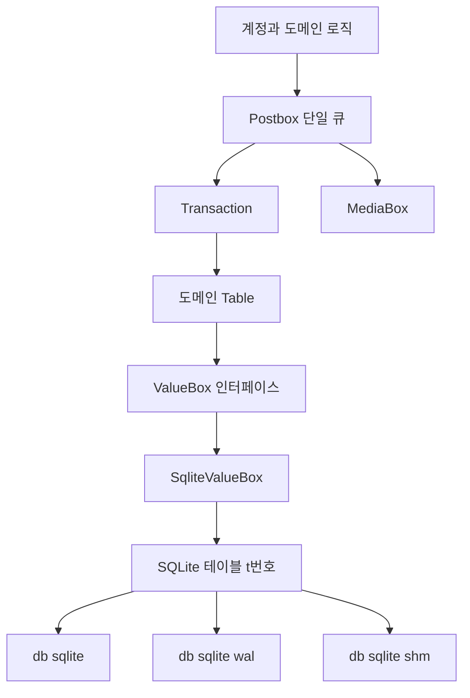
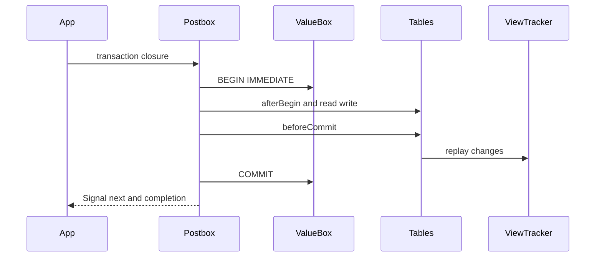
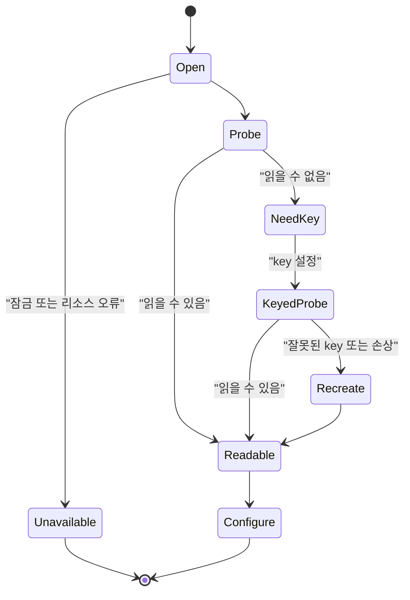

# Postbox 스토리지 엔진

웹: /docs/system/08-postbox-storage/ · Markdown: /docs/system/08-postbox-storage.md

> Telegram 클라이언트는 단일 큐 트랜잭션, 바이너리 키-값 테이블, SQLCipher로 로컬 상태 저장소를 구축해요.

> 시스템 설계 · 저장과 검색 · 08장 · 도표 3 · 코드 발췌 10 · 인용 34 · 소스 기준선: [TelegramMessenger/Telegram-iOS@f1dd7a2d](https://github.com/TelegramMessenger/Telegram-iOS/tree/f1dd7a2dbd02cbbf513e75d5695d8d36d1cf5838), [overtake/TelegramSwift@579cebbf](https://github.com/overtake/TelegramSwift/tree/579cebbf0c01fd41b712eff3647fa7f69db9665d)
>
> 관련 보충: [macOS fork 장별 검증(08–15장)](/docs/system/32-fork-verify-08-15/)
>
> 핵심 소스 파일: [TelegramMessenger/Telegram-iOS/submodules/Postbox/Sources/Postbox.swift](https://github.com/TelegramMessenger/Telegram-iOS/blob/f1dd7a2dbd02cbbf513e75d5695d8d36d1cf5838/submodules/Postbox/Sources/Postbox.swift), [TelegramMessenger/Telegram-iOS/submodules/Postbox/Sources/SqliteValueBox.swift](https://github.com/TelegramMessenger/Telegram-iOS/blob/f1dd7a2dbd02cbbf513e75d5695d8d36d1cf5838/submodules/Postbox/Sources/SqliteValueBox.swift), [TelegramMessenger/Telegram-iOS/submodules/Postbox/Sources/ValueBox.swift](https://github.com/TelegramMessenger/Telegram-iOS/blob/f1dd7a2dbd02cbbf513e75d5695d8d36d1cf5838/submodules/Postbox/Sources/ValueBox.swift), [TelegramMessenger/Telegram-iOS/submodules/Postbox/Sources/ValueBoxKey.swift](https://github.com/TelegramMessenger/Telegram-iOS/blob/f1dd7a2dbd02cbbf513e75d5695d8d36d1cf5838/submodules/Postbox/Sources/ValueBoxKey.swift), [TelegramMessenger/Telegram-iOS/submodules/Postbox/Sources/Coding.swift](https://github.com/TelegramMessenger/Telegram-iOS/blob/f1dd7a2dbd02cbbf513e75d5695d8d36d1cf5838/submodules/Postbox/Sources/Coding.swift), [TelegramMessenger/Telegram-iOS/submodules/Postbox/Sources/Database.swift](https://github.com/TelegramMessenger/Telegram-iOS/blob/f1dd7a2dbd02cbbf513e75d5695d8d36d1cf5838/submodules/Postbox/Sources/Database.swift), [TelegramMessenger/Telegram-iOS/submodules/Postbox/Sources/Table.swift](https://github.com/TelegramMessenger/Telegram-iOS/blob/f1dd7a2dbd02cbbf513e75d5695d8d36d1cf5838/submodules/Postbox/Sources/Table.swift), [TelegramMessenger/Telegram-iOS/submodules/Postbox/Sources/ViewTracker.swift](https://github.com/TelegramMessenger/Telegram-iOS/blob/f1dd7a2dbd02cbbf513e75d5695d8d36d1cf5838/submodules/Postbox/Sources/ViewTracker.swift), [TelegramMessenger/Telegram-iOS/submodules/Postbox/Sources/MetadataTable.swift](https://github.com/TelegramMessenger/Telegram-iOS/blob/f1dd7a2dbd02cbbf513e75d5695d8d36d1cf5838/submodules/Postbox/Sources/MetadataTable.swift), [TelegramMessenger/Telegram-iOS/submodules/Postbox/Sources/PeerTable.swift](https://github.com/TelegramMessenger/Telegram-iOS/blob/f1dd7a2dbd02cbbf513e75d5695d8d36d1cf5838/submodules/Postbox/Sources/PeerTable.swift), [TelegramMessenger/Telegram-iOS/submodules/Postbox/Sources/MessageHistoryIndexTable.swift](https://github.com/TelegramMessenger/Telegram-iOS/blob/f1dd7a2dbd02cbbf513e75d5695d8d36d1cf5838/submodules/Postbox/Sources/MessageHistoryIndexTable.swift), [TelegramMessenger/Telegram-iOS/submodules/Postbox/Sources/Upgrades.swift](https://github.com/TelegramMessenger/Telegram-iOS/blob/f1dd7a2dbd02cbbf513e75d5695d8d36d1cf5838/submodules/Postbox/Sources/Upgrades.swift), [TelegramMessenger/Telegram-iOS/submodules/Postbox/Sources/PostboxUpgrade_24to25.swift](https://github.com/TelegramMessenger/Telegram-iOS/blob/f1dd7a2dbd02cbbf513e75d5695d8d36d1cf5838/submodules/Postbox/Sources/PostboxUpgrade_24to25.swift), [TelegramMessenger/Telegram-iOS/submodules/TelegramCore/Sources/AccountManager/AccountManagerImpl.swift](https://github.com/TelegramMessenger/Telegram-iOS/blob/f1dd7a2dbd02cbbf513e75d5695d8d36d1cf5838/submodules/TelegramCore/Sources/AccountManager/AccountManagerImpl.swift), [overtake/TelegramSwift/.gitmodules](https://github.com/overtake/TelegramSwift/blob/579cebbf0c01fd41b712eff3647fa7f69db9665d/.gitmodules), [overtake/TelegramSwift/packages/Spotlight/Package.swift](https://github.com/overtake/TelegramSwift/blob/579cebbf0c01fd41b712eff3647fa7f69db9665d/packages/Spotlight/Package.swift)

Postbox는 Telegram 로컬 상태를 디스크에 저장하는 영속화 커널이에요.

- 수많은 도메인 테이블을 하나의 직렬 큐로 모아요.
- 도메인 변경이 일어날 때마다 `ValueBox`(key와 value blob만 저장하는 저장소 인터페이스)에 커밋해요.
- 기본 백엔드 `SqliteValueBox`는 SQLCipher(암호화를 지원하는 SQLite)로 SQLite를 구동해요.

이 조합은 원자적 쓰기, 정렬된 스캔, 필요에 따른 메모리 캐시를 한꺼번에 제공해요. [\[1\]](https://github.com/TelegramMessenger/Telegram-iOS/blob/f1dd7a2dbd02cbbf513e75d5695d8d36d1cf5838/submodules/Postbox/Sources/Postbox.swift#L1463-L1596)[\[2\]](https://github.com/TelegramMessenger/Telegram-iOS/blob/f1dd7a2dbd02cbbf513e75d5695d8d36d1cf5838/submodules/Postbox/Sources/Postbox.swift#L1604-L1882)

## 위치와 경계 [#위치와-경계]

iOS 체크아웃의 `submodules/Postbox`가 이 장의 사실 출처예요.

- `openPostbox`는 계정마다 전달받은 루트 디렉터리 아래의 `db` 하위 디렉터리를 써요.
- `SqliteValueBox`는 다시 주 파일의 이름을 `db_sqlite`로 지어요. [\[1\]](https://github.com/TelegramMessenger/Telegram-iOS/blob/f1dd7a2dbd02cbbf513e75d5695d8d36d1cf5838/submodules/Postbox/Sources/Postbox.swift#L1463-L1596)[\[3\]](https://github.com/TelegramMessenger/Telegram-iOS/blob/f1dd7a2dbd02cbbf513e75d5695d8d36d1cf5838/submodules/Postbox/Sources/SqliteValueBox.swift#L189-L375)
- WAL 모드(SQLite가 변경을 별도 로그 파일에 먼저 기록하는 모드)에서는 같은 디렉터리에 `db_sqlite-wal`과 `db_sqlite-shm`도 생겨요.

업스트림(iOS 원본 소스)에서 삭제하고 다시 만들 때는 주 파일만 지우지 않고 `db_sqlite`, `db_sqlite-wal`, `db_sqlite-shm` 묶음 전체를 처리해요. [\[3\]](https://github.com/TelegramMessenger/Telegram-iOS/blob/f1dd7a2dbd02cbbf513e75d5695d8d36d1cf5838/submodules/Postbox/Sources/SqliteValueBox.swift#L189-L375)

Postbox는 미디어 파일 저장소가 아니에요. `Postbox`는 같은 계정 루트 디렉터리 아래에 `media`라는 `MediaBox`를 만들지만, `ValueBox`는 테이블의 key와 value blob만 저장해요. [\[4\]](https://github.com/TelegramMessenger/Telegram-iOS/blob/f1dd7a2dbd02cbbf513e75d5695d8d36d1cf5838/submodules/Postbox/Sources/Postbox.swift#L4679-L4724) 미디어 리소스의 분할, 다운로드, 캐시 전략은 [미디어 리소스, 다운로드/업로드, 캐시](/docs/system/10-media-cache/)를 참고하세요.

Postbox는 메시지 공백(hole), 기록 윈도우, 뷰의 데이터 모델도 직접 정의하지 않아요. 제공하는 건 아래 셋뿐이에요.

- 트랜잭션 경계
- 테이블 업데이트 집계
- `ViewTracker`의 디스패치 진입점

메시지 기록 모델, 공백, 구체적인 뷰 증분은 [Postbox 뷰와 메시지 이력 모델](/docs/system/09-postbox-views/)에서 다뤄요.

macOS 저장소는 `submodules/telegram-ios`를 통해 `overtake/Telegram-iOS`를 가리키고, 그 Swift Package는 이 서브모듈의 `Postbox`에 직접 의존해요. [\[5\]](https://github.com/overtake/TelegramSwift/blob/579cebbf0c01fd41b712eff3647fa7f69db9665d/.gitmodules#L7-L9)[\[6\]](https://github.com/overtake/TelegramSwift/blob/579cebbf0c01fd41b712eff3647fa7f69db9665d/packages/Spotlight/Package.swift#L16-L30) 이 서브모듈은 `a24bbe45f9861f736a79916a50898512f751e0dc`로 체크아웃되어 있고, 이 장이 검증한 iOS 커밋보다 더 이른 커밋이에요.

그래서 이하의 공유 코어 결론은 iOS 소스 코드를 기준으로 해요. macOS의 같은 이름의 모듈은 버전이 다를 수 있어요. 구체적인 차이는 [macOS fork 장별 검증(08–15장)](/docs/system/32-fork-verify-08-15/)을 참고하세요. macOS 프로세스와 시스템 통합은 [macOS 클라이언트의 시스템 계층](/docs/system/15-macos-system-layer/)을 참고하세요.

`openPostbox`의 `useCopy` 파라미터는 격리된 읽기 경로도 제공해요. 이 경로는 아래 순서로 움직여요.

1. `TempBox` 임시 디렉터리를 만들어요.
2. 원래의 `basePath/db` 아래 파일 전부를 그곳에 복사해요.
3. 사본에서 `SqliteValueBox`를 열어요.

복사에 실패하거나 원본 디렉터리를 열거할 수 없으면 `.error`가 발생해요. [\[1\]](https://github.com/TelegramMessenger/Telegram-iOS/blob/f1dd7a2dbd02cbbf513e75d5695d8d36d1cf5838/submodules/Postbox/Sources/Postbox.swift#L1463-L1596)

이 복사 방식을 보면 사본에 주 데이터베이스 외의 동반 파일도 반드시 포함해야 한다는 걸 알 수 있어요. 호출자가 `db_sqlite`만 따로 복사하면 안 돼요. 그러면 WAL에 있는 아직 checkpoint(WAL의 내용을 주 데이터베이스 파일에 합치는 일)되지 않은 내용이 빠질 수 있어요. (추론)

아래 도표는 Postbox의 영속화 계층을 보여 줘요. 도메인 테이블과 SQLite 스키마를 일부러 분리해 둔 구조예요.



## Postbox의 단일 큐와 트랜잭션 경계 [#postbox의-단일-큐와-트랜잭션-경계]

동시성 문제는 우선 로컬 상태의 복합 업데이트예요. 메시지나 연락처가 한 번 바뀌면 본체 테이블, 인덱스 테이블, 읽지 않은 수, 구독 중인 뷰까지 건드리는 경우가 많아요. 이 쓰기들이 뒤섞이면 메모리 캐시, 인덱스, UI 옵저버가 서로 다른 버전을 볼 수 있어요.

Postbox는 `Postbox.sharedQueue`로 `org.telegram.postbox.Postbox`라는 이름의 큐를 만들어요. 공개 퍼사드(복잡한 내부 구현을 감싼 단순한 겉 인터페이스)는 구현을 같은 큐의 `QueueLocalObject`에 담아요. [\[4\]](https://github.com/TelegramMessenger/Telegram-iOS/blob/f1dd7a2dbd02cbbf513e75d5695d8d36d1cf5838/submodules/Postbox/Sources/Postbox.swift#L4679-L4724)

`PostboxImpl`이 가진 것은 아래와 같아요.

- 유일한 `SqliteValueBox`
- `ViewTracker`
- 트랜잭션 상태 버전
- 이번 트랜잭션의 변경을 누적하는 수많은 어큐뮬레이터

생성자는 고정된 ID로 도메인 테이블을 먼저 만든 다음 테이블 객체를 `tables` 배열에 추가해요. 현재의 생성 경로는 이 배열에 테이블 객체 76개를 추가해요. 이 배열은 SQLite 테이블 이름을 하드코딩한 목록이 아니라, 캐시 정리와 `beforeCommit` 훅(커밋 직전에 호출되는 함수)의 등록부예요. [\[2\]](https://github.com/TelegramMessenger/Telegram-iOS/blob/f1dd7a2dbd02cbbf513e75d5695d8d36d1cf5838/submodules/Postbox/Sources/Postbox.swift#L1604-L1882)[\[7\]](https://github.com/TelegramMessenger/Telegram-iOS/blob/f1dd7a2dbd02cbbf513e75d5695d8d36d1cf5838/submodules/Postbox/Sources/Postbox.swift#L1889-L2075)

테이블의 생성 순서는 의존 관계를 반영해요. 예를 들어 이런 의존이 있어요.

- `PeerTable`은 역방향 연관 테이블과 타임아웃 속성 테이블에 의존해요.
- 메시지 기록 테이블은 다시 인덱스, 미디어, 미전송, 태그, 대기 중 동작 테이블을 가져와요.

그래서 Postbox는 테이블 간 쓰기를 같은 큐, 같은 SQLite 트랜잭션 안에 둬요. 모듈 계층과 모듈 간 의존성의 전체 설계는 [전체 아키텍처와 모듈 계층](/docs/system/01-architecture/)을 참고하세요.

`tables` 배열(도메인 `Table` 등록부)과 SQLite 쪽의 테이블 정보는 하는 일이 달라서 서로를 대체할 수 없어요.

- `SqliteValueBox`는 스스로 `sqlite_master`(SQLite가 테이블 정의를 저장하는 시스템 테이블)에서 이미 있는 `t` 접두사 테이블을 열거하고, 테이블 생성 SQL에서 key 타입, 기본 키, `WITHOUT ROWID` 속성을 추론해요. [\[13\]](https://github.com/TelegramMessenger/Telegram-iOS/blob/f1dd7a2dbd02cbbf513e75d5695d8d36d1cf5838/submodules/Postbox/Sources/SqliteValueBox.swift#L822-L1013) 이 쪽은 물리 테이블의 사실을 복원해요.
- 도메인 `Table` 등록부는 런타임 객체의 집합이에요. 이 쪽은 캐시 무효화와 지연 쓰기를 실행해요.

`PostboxImpl`은 초기화가 끝날 때 아래 순서로 움직여요.

1. Metadata에서 트랜잭션 버전을 읽어요.
2. `ViewTracker`를 만들어요.
3. 스스로 트랜잭션을 열어 읽지 않은 수 재구축 표시를 확인해요.
4. 임시가 아니고 캐시가 켜져 있다는 등의 조건이 맞으면 읽지 않은 통계를 재구축해요. [\[7\]](https://github.com/TelegramMessenger/Telegram-iOS/blob/f1dd7a2dbd02cbbf513e75d5695d8d36d1cf5838/submodules/Postbox/Sources/Postbox.swift#L1889-L2075)

그래서 시작은 단순히 SQLite를 여는 일이 아니에요. 파생 상태를 다시 일관되게 만드는 복구 단계이기도 해요. 여기서의 재구축 범위는 메시지와 목록 모델에 속하기 때문에 이 장에서는 다루지 않아요.

비즈니스 호출은 보통 `transaction`을 써요.

- `transaction`은 `Signal<T, NoError>`를 반환하며, 구독 시점에 클로저를 Postbox 큐에 올려요.
- `transactionSignal`의 클로저는 트랜잭션 안에서 여러 신호 이벤트를 구독자에게 써 줄 수 있고, 취소 가능한 객체를 반환해요.

둘 다 `userInteractive` 파라미터가 있으며, 후자는 user-interactive QoS로 스케줄링하도록 바뀌어요. [\[8\]](https://github.com/TelegramMessenger/Telegram-iOS/blob/f1dd7a2dbd02cbbf513e75d5695d8d36d1cf5838/submodules/Postbox/Sources/Postbox.swift#L3300-L3387)

`submodules/Postbox/Sources/Postbox.swift` 3300–3324행 발췌.

```swift
private func internalTransaction<T>(_ f: (Transaction) -> T, file: String = #file, line: Int = #line) -> (result: T, updatedTransactionStateVersion: Int64?, updatedMasterClientId: Int64?) {
    let _ = self.isInTransaction.swap(true)

    let startTime = CFAbsoluteTimeGetCurrent()

    self.valueBox.begin()
    let transaction = Transaction(queue: self.queue, postbox: self)
    self.afterBegin(transaction: transaction)
    let result = f(transaction)
    let (updatedTransactionState, updatedMasterClientId) = self.beforeCommit(currentTransaction: transaction)
    transaction.disposed = true
    self.valueBox.commit()

    let endTime = CFAbsoluteTimeGetCurrent()
    let transactionDuration = endTime - startTime
    if transactionDuration > 0.01 {
        postboxLog("Postbox transaction took \(transactionDuration * 1000.0) ms, from: \(file):\(line)")
    }

    let _ = self.isInTransaction.swap(false)

    if let currentUpdatedState = self.currentUpdatedState {
        self.statePipe.putNext(currentUpdatedState)
    }
```

이 순서가 트랜잭션의 의미를 정의해요.

1. Postbox가 먼저 SQLite `BEGIN`을 실행해요.
2. `Transaction`을 만들어요.
3. 호출자의 클로저를 실행해요.
4. `beforeCommit`을 실행해요. 이 단계는 파생 인덱스를 재생하고, 변경을 집계하고, 각 테이블의 `beforeCommit`을 호출하는 일을 맡아요.
5. 이 준비가 모두 끝난 뒤에야 SQLite `COMMIT`을 실행해요. [\[8\]](https://github.com/TelegramMessenger/Telegram-iOS/blob/f1dd7a2dbd02cbbf513e75d5695d8d36d1cf5838/submodules/Postbox/Sources/Postbox.swift#L3300-L3387)[\[9\]](https://github.com/TelegramMessenger/Telegram-iOS/blob/f1dd7a2dbd02cbbf513e75d5695d8d36d1cf5838/submodules/Postbox/Sources/Postbox.swift#L2629-L2847)

`setCanBeginTransactions`는 트랜잭션을 일시 중지하고 재개하는 변경형 인터페이스예요.

- 스위치를 끄면 실행 대기 중인 클로저를 `Atomic.modify`로 배열에 덧붙여요.
- 스위치가 다시 켜지면 교환해서 얻은 배열을 원래 순서대로 실행해요.

이 메커니즘으로 호출자는 기존 공개 API를 바꾸지 않고도 새로운 영속화 트랜잭션을 잠시 미룰 수 있어요. [\[10\]](https://github.com/TelegramMessenger/Telegram-iOS/blob/f1dd7a2dbd02cbbf513e75d5695d8d36d1cf5838/submodules/Postbox/Sources/Postbox.swift#L3269-L3295)

`setCanBeginTransactions`에서 쓰는 `modify`는 데이터베이스를 수정하지 않아요. 대기 중인 트랜잭션의 원자 배열을 수정해요. 공개 `transaction`은 구독 시점에 `impl.with`로 큐 로컬 구현에 넘기고, 내부 신호의 next, error, completed를 호출자에게 계속 전달해요. [\[4\]](https://github.com/TelegramMessenger/Telegram-iOS/blob/f1dd7a2dbd02cbbf513e75d5695d8d36d1cf5838/submodules/Postbox/Sources/Postbox.swift#L4679-L4724)[\[8\]](https://github.com/TelegramMessenger/Telegram-iOS/blob/f1dd7a2dbd02cbbf513e75d5695d8d36d1cf5838/submodules/Postbox/Sources/Postbox.swift#L3300-L3387) 두 이름은 비슷하지만 서로 다른 계층에 있어요. 비즈니스 쓰기를 호출할 때는 `Transaction` 클로저를 써야 하고, 아무 스레드에서나 테이블 객체를 직접 조작하면 안 돼요.

게이트 배열에는 아직 시작하지 않은 클로저만 저장돼요. `setCanBeginTransactions(true)`는 `swap([])`로 현재 밀려 있는 항목을 먼저 얻은 다음, 큐 안에서 하나씩 호출해요. 새로 도착한 클로저는 이후의 게이트 검사에서 현재 큐 상태로 들어가요. [\[10\]](https://github.com/TelegramMessenger/Telegram-iOS/blob/f1dd7a2dbd02cbbf513e75d5695d8d36d1cf5838/submodules/Postbox/Sources/Postbox.swift#L3269-L3295) 그래서 우선순위가 있는 스케줄러가 아니고, 대기 중인 개별 트랜잭션을 취소하는 API도 없어요. 이 장치가 해결하는 건 시작을 잠시 막는 조정 문제예요. 비즈니스 작업 큐를 대체하는 것이 아니에요. (추론)

호출이 Postbox 큐에서 일어나면서 동시에 메인 큐이기도 하면 `transaction`은 클로저를 곧바로 실행해요. 그 밖의 경우는 여전히 Postbox 큐로 스케줄링돼요. [\[8\]](https://github.com/TelegramMessenger/Telegram-iOS/blob/f1dd7a2dbd02cbbf513e75d5695d8d36d1cf5838/submodules/Postbox/Sources/Postbox.swift#L3300-L3387) 이는 의도된 재진입 예외예요. 특정 메인 스레드 경로가 다시 비동기로 줄 서는 것을 피하지만, 그 대신 트랜잭션 클로저가 짧아야 해요. 소스는 10밀리초를 넘으면 출처 파일과 행 번호를 기록할 뿐, 느린 트랜잭션을 취소하거나 쪼개지는 않아요.

외부 프로세스의 쓰기는 또 다른 종류의 일관성 문제예요. `afterBegin`은 `MetadataTable.transactionStateVersion`을 읽어요. 버전이 메모리 값과 다르면 이렇게 해요.

- 모든 테이블 캐시를 비워요.
- `ViewTracker`에 현재 데이터베이스로 뷰를 다시 새로 고치도록 요구해요.

그런 다음 새 버전과 주 클라이언트 ID를 저장해요. [\[9\]](https://github.com/TelegramMessenger/Telegram-iOS/blob/f1dd7a2dbd02cbbf513e75d5695d8d36d1cf5838/submodules/Postbox/Sources/Postbox.swift#L2629-L2847) 프로세스 간 접근과 확장의 조정 세부 사항은 [푸시, 확장 프로세스와 다중 프로세스 협업](/docs/system/12-push-extensions/)을 참고하세요.

아래 도표는 일반 트랜잭션의 실제 호출 순서를 보여 줘요. 뷰 업데이트와 커밋의 상대적 위치에 주목하세요.



뷰 알림의 순서에는 오해하기 쉬운 사실이 하나 있어요.

- `beforeCommit`은 `valueBox.commit`을 호출하기 전에 `viewTracker.updateViews`를 실행해요.
- `ViewTracker.updateViews`는 각 `ValuePipe`에 직접 `putNext`를 호출해요.
- 반면 `statePipe.putNext`는 `commit` 뒤에 있어요. [\[8\]](https://github.com/TelegramMessenger/Telegram-iOS/blob/f1dd7a2dbd02cbbf513e75d5695d8d36d1cf5838/submodules/Postbox/Sources/Postbox.swift#L3300-L3387)[\[9\]](https://github.com/TelegramMessenger/Telegram-iOS/blob/f1dd7a2dbd02cbbf513e75d5695d8d36d1cf5838/submodules/Postbox/Sources/Postbox.swift#L2629-L2847)[\[11\]](https://github.com/TelegramMessenger/Telegram-iOS/blob/f1dd7a2dbd02cbbf513e75d5695d8d36d1cf5838/submodules/Postbox/Sources/ViewTracker.swift#L267-L420)

그래서 소스 코드는 모든 뷰 알림이 영속화 커밋 이후에 일어난다고 보장하지 않아요. 단일 큐 덕분에 같은 큐의 이후 읽기는 커밋 뒤에 줄을 서지만, 구독자가 뷰 이벤트를 언제 소비하는지는 여전히 스케줄링 문제예요. 이런 순서는 커밋 후 추가 재생 비용을 줄여 주지만, 옵저버가 뷰 이벤트만으로 durable-commit 확인을 대신하면 안 돼요. (추론)

`beforeCommit`은 아래 순서로 움직여요.

1. 채팅방 목록과 고정 메시지 테이블의 `replay`를 먼저 호출해요.
2. peer, 연락처, 읽기 상태, 스레드 요약, 읽지 않은 수의 변화를 집계해요. [\[9\]](https://github.com/TelegramMessenger/Telegram-iOS/blob/f1dd7a2dbd02cbbf513e75d5695d8d36d1cf5838/submodules/Postbox/Sources/Postbox.swift#L2629-L2847)
3. 불변인 `PostboxTransaction` 변경 묶음을 만들어요.
4. 이 묶음이 비어 있지 않을 때만 코드는 뷰를 재생하고, 트랜잭션 상태 버전을 올리고, master client ID를 쓸 수 있어요. [\[9\]](https://github.com/TelegramMessenger/Telegram-iOS/blob/f1dd7a2dbd02cbbf513e75d5695d8d36d1cf5838/submodules/Postbox/Sources/Postbox.swift#L2629-L2847)
5. 현재 트랜잭션의 배열과 집합을 비우고 모든 `Table.beforeCommit`을 차례로 호출해요. [\[9\]](https://github.com/TelegramMessenger/Telegram-iOS/blob/f1dd7a2dbd02cbbf513e75d5695d8d36d1cf5838/submodules/Postbox/Sources/Postbox.swift#L2629-L2847)

이렇게 해서 한 번의 쓰기가 남기는 후처리가 같은 순서로 고정되고, 호출 지점마다 손으로 브로드캐스트하는 일을 피해요.

SQLite 트랜잭션 API에는 대응하는 `ROLLBACK` 경로가 없어요. 호출자 클로저나 `beforeCommit`에서 assertion 실패가 일어나면 이렇게 돼요.

- 프로세스는 Swift 런타임의 동작대로 종료돼요.
- SQLite는 연결이 닫힐 때 커밋되지 않은 트랜잭션을 복구하는 데 의존해요.

소스는 비즈니스 계층에서 복구할 수 있는 트랜잭션 오류 타입을 제공하지 않아요. (추론) `transactionSignal`의 disposable은 구독 생명주기를 위한 것이고, 이미 `internalTransaction`에 들어간 SQLite 작업을 롤백하지는 않아요. [\[8\]](https://github.com/TelegramMessenger/Telegram-iOS/blob/f1dd7a2dbd02cbbf513e75d5695d8d36d1cf5838/submodules/Postbox/Sources/Postbox.swift#L3300-L3387)

`submodules/Postbox/Sources/Postbox.swift` 2775–2785행 발췌.

```swift
var updatedTransactionState: Int64?
var updatedMasterClientId: Int64?
if !transaction.isEmpty {
    self.viewTracker.updateViews(postbox: self, currentTransaction: currentTransaction, transaction: transaction)
    self.transactionStateVersion = self.metadataTable.incrementTransactionStateVersion()
    updatedTransactionState = self.transactionStateVersion

    if let currentUpdatedMasterClientId = self.currentUpdatedMasterClientId {
        self.metadataTable.setMasterClientId(currentUpdatedMasterClientId)
        updatedMasterClientId = currentUpdatedMasterClientId
    }
}
```

위 코드의 흐름은 `Transaction`이 범용 ORM 세션이 아닌 이유도 설명해 줘요. 이건 도메인 작업의 퍼사드예요. 트랜잭션 안의 테이블 메서드는 초기값과 작업 로그를 먼저 기록하고, `beforeCommit`이 캐시와 파생 테이블을 정리해요. 이렇게 하면 같은 트랜잭션 안에서 채팅방 목록과 카운트를 반복해서 재구축하는 횟수를 줄일 수 있어요. (추론)

## ValueBox와 SQLite 테이블 레이아웃 [#valuebox와-sqlite-테이블-레이아웃]

저장소 문제는 수십 종의 도메인 테이블이 작고 안정적인 물리 인터페이스 하나를 공유하게 하는 방법이에요.

`ValueBoxTable`에는 아래 셋만 들어 있어요.

- 정수 ID
- 키 타입
- 생성 시 컴팩트 값을 쓸지 여부

`ValueBox`는 아래 작업을 제공해요.

- begin
- commit
- 범위 읽기
- 스캔
- set
- remove
- 복사
- 테이블 삭제
- 카운트
- 전문 검색

도메인 테이블에 SQL 문자열을 노출하지 않아요. [\[12\]](https://github.com/TelegramMessenger/Telegram-iOS/blob/f1dd7a2dbd02cbbf513e75d5695d8d36d1cf5838/submodules/Postbox/Sources/ValueBox.swift#L3-L101)

`SqliteValueBox`는 논리 테이블 ID 하나를 SQLite의 `t` + ID 테이블로 매핑해요.

- 바이너리 키 테이블: `key BLOB PRIMARY KEY, value BLOB`이에요. `compactValuesOnCreation`이 참이면 `WITHOUT ROWID`를 덧붙여요.
- 64비트 키 테이블: `key INTEGER PRIMARY KEY, value BLOB`이에요.
- 논리 전문 테이블: 별도로 FTS5 가상 테이블 `ft` + ID를 만들고, ID를 `__meta_fulltext_tables`에 기록해요. [\[13\]](https://github.com/TelegramMessenger/Telegram-iOS/blob/f1dd7a2dbd02cbbf513e75d5695d8d36d1cf5838/submodules/Postbox/Sources/SqliteValueBox.swift#L822-L1013)

`submodules/Postbox/Sources/SqliteValueBox.swift` 898–912행 발췌.

```swift
private func createTable(database: Database, table: ValueBoxTable) {
    switch table.keyType {
        case .binary:
            var resultCode: Bool
            var createStatement = "CREATE TABLE IF NOT EXISTS t\(table.id) (key BLOB PRIMARY KEY, value BLOB)"
            if table.compactValuesOnCreation {
                createStatement += " WITHOUT ROWID"
            }
            resultCode = database.execute(createStatement)
            assert(resultCode)
        case .int64:
            let resultCode = database.execute("CREATE TABLE IF NOT EXISTS t\(table.id) (key INTEGER PRIMARY KEY, value BLOB)")
            assert(resultCode)
    }
}
```

이 키-값 방식은 스키마가 자주 바뀌는 문제를 해결해요. 새 도메인 테이블을 추가할 때는 보통 정수 ID를 할당하고 blob 인코딩을 정의하면 충분해요. Swift 타입마다 SQL 컬럼 마이그레이션을 설계할 필요가 없어요.

대가는 SQLite가 value 안의 필드를 이해하지 못해서, 일반 SQL로 필드 필터링을 할 수 없다는 거예요. 그래서 Telegram은 정렬과 범위 읽기가 필요한 필드를 key로 복사해 넣어요. 전문 검색은 SQLite FTS5를 명시적으로 쓰는 몇 안 되는 예외예요. [\[13\]](https://github.com/TelegramMessenger/Telegram-iOS/blob/f1dd7a2dbd02cbbf513e75d5695d8d36d1cf5838/submodules/Postbox/Sources/SqliteValueBox.swift#L822-L1013)

바이너리 테이블은 처음 접근할 때 `checkTable`이 만들어요. 이미 있는 테이블은 key 타입이 호출자가 선언한 것과 같은지 검사해요. 보이지 않으면 백엔드가 곧바로 물리 테이블을 만들고 기본 키가 있는 `SqliteValueBoxTable`로 기록해요. [\[13\]](https://github.com/TelegramMessenger/Telegram-iOS/blob/f1dd7a2dbd02cbbf513e75d5695d8d36d1cf5838/submodules/Postbox/Sources/SqliteValueBox.swift#L822-L1013) 덕분에 빈 설치본이 가능한 모든 비즈니스 테이블을 미리 만들 필요가 없어요.

대가는 테이블 ID, key 타입, 컴팩트 속성이 한번 배포되면 장기적인 디스크 계약이 된다는 거예요. 기존 테이블의 `WITHOUT ROWID` 속성은 SQL 텍스트 검출에서 나오기 때문에, 새 코드의 `compactValuesOnCreation` 파라미터만으로는 바꿀 수 없어요. [\[13\]](https://github.com/TelegramMessenger/Telegram-iOS/blob/f1dd7a2dbd02cbbf513e75d5695d8d36d1cf5838/submodules/Postbox/Sources/SqliteValueBox.swift#L822-L1013)

전문 테이블도 지연 생성을 택해요. `checkFullTextTable`은 처음 set할 때에야 `ft` + ID 가상 테이블을 만들고 ID를 메타 테이블에 넣어요. [\[13\]](https://github.com/TelegramMessenger/Telegram-iOS/blob/f1dd7a2dbd02cbbf513e75d5695d8d36d1cf5838/submodules/Postbox/Sources/SqliteValueBox.swift#L822-L1013)[\[14\]](https://github.com/TelegramMessenger/Telegram-iOS/blob/f1dd7a2dbd02cbbf513e75d5695d8d36d1cf5838/submodules/Postbox/Sources/SqliteValueBox.swift#L1709-L2177) 쿼리는 contents로 전역 매칭할 수도 있고 collectionId와 tags를 덧붙일 수도 있어요. 도메인 객체를 직접 반환하지 않고 collectionId와 itemId를 반환해요. [\[14\]](https://github.com/TelegramMessenger/Telegram-iOS/blob/f1dd7a2dbd02cbbf513e75d5695d8d36d1cf5838/submodules/Postbox/Sources/SqliteValueBox.swift#L1709-L2177) 도메인 계층은 이 collectionId와 itemId를 근거로 자신의 데이터를 다시 찾아요. 그래서 FTS 인덱스와 핵심 객체 테이블이 분리된 상태로 유지돼요. (추론)

`set`의 쓰기도 이 물리적 차이에 따라 갈라져요.

- 기본 키가 있는 테이블: `ON CONFLICT`가 붙은 insert나 update를 써요.
- 기본 키가 없는 테이블: 먼저 `exists`를 확인한 뒤 update나 insert를 골라요. [\[14\]](https://github.com/TelegramMessenger/Telegram-iOS/blob/f1dd7a2dbd02cbbf513e75d5695d8d36d1cf5838/submodules/Postbox/Sources/SqliteValueBox.swift#L1709-L2177)

현재 테이블 생성 경로에서는 두 key 타입 모두 primary key를 만들어요. 기본 키가 없는 쪽 분기는 열거된 구형 테이블을 위한 호환 동작으로 남아 있어요. 이는 `listTables`가 BLOB 테이블에 `PRIMARY KEY`가 있는지 파싱하는 부분에서 확인할 수 있어요. [\[13\]](https://github.com/TelegramMessenger/Telegram-iOS/blob/f1dd7a2dbd02cbbf513e75d5695d8d36d1cf5838/submodules/Postbox/Sources/SqliteValueBox.swift#L822-L1013)[\[14\]](https://github.com/TelegramMessenger/Telegram-iOS/blob/f1dd7a2dbd02cbbf513e75d5695d8d36d1cf5838/submodules/Postbox/Sources/SqliteValueBox.swift#L1709-L2177)

데이터베이스 백엔드는 `copy`, `renameTable`, `removeAllFromTable`, `drop`도 제공해요.

- `copy`: 하위 쿼리를 곁들인 `INSERT INTO` 한 번이므로 value를 Swift로 읽어 들였다가 다시 쓰는 일을 피해요.
- `renameTable`: 물리 테이블 이름을 바꾸고 메모리의 테이블 딕셔너리를 갱신해요.
- `drop`: 모든 prepared statement를 정리하고, 데이터베이스 참조를 해제하고, 파일 묶음 전체를 삭제한 다음, 원래의 암호화 파라미터로 빈 데이터베이스를 열어요. [\[14\]](https://github.com/TelegramMessenger/Telegram-iOS/blob/f1dd7a2dbd02cbbf513e75d5695d8d36d1cf5838/submodules/Postbox/Sources/SqliteValueBox.swift#L1709-L2177)[\[20\]](https://github.com/TelegramMessenger/Telegram-iOS/blob/f1dd7a2dbd02cbbf513e75d5695d8d36d1cf5838/submodules/Postbox/Sources/SqliteValueBox.swift#L2232-L2534)

이 네 가지는 마이그레이션과 재해 복구용 도구이고, 도메인 API의 일반 경로가 아니에요.

자주 쓰는 작업마다 테이블 ID별로 캐시된 `SqlitePreparedStatement`(미리 컴파일해 둔 SQL 구문)가 있어요. 캐시는 get, 범위, 스캔, 업데이트, 삽입, 삭제, 복사, 전문 쿼리를 모두 포괄해요.

- 사용하기 전에 매번 `reset`과 `sqlite3_clear_bindings`를 호출해요.
- 준비할 때는 `SQLITE_PREPARE_PERSISTENT`를 써요.
- 닫거나 drop할 때 `clearStatements`가 하나씩 finalize하고 딕셔너리를 비워요. [\[3\]](https://github.com/TelegramMessenger/Telegram-iOS/blob/f1dd7a2dbd02cbbf513e75d5695d8d36d1cf5838/submodules/Postbox/Sources/SqliteValueBox.swift#L189-L375)[\[13\]](https://github.com/TelegramMessenger/Telegram-iOS/blob/f1dd7a2dbd02cbbf513e75d5695d8d36d1cf5838/submodules/Postbox/Sources/SqliteValueBox.swift#L822-L1013)[\[14\]](https://github.com/TelegramMessenger/Telegram-iOS/blob/f1dd7a2dbd02cbbf513e75d5695d8d36d1cf5838/submodules/Postbox/Sources/SqliteValueBox.swift#L1709-L2177)

범위 쿼리의 SQL은 배타적인 `key > ? AND key < ?`를 써요. 방향은 두 경계의 비교로 정해져요. 정방향은 `ORDER BY key ASC`, 역방향은 `ORDER BY key DESC`를 써요. 호출자는 실제 처음과 끝 키에 각각 `predecessor`와 `successor`를 취해서 배타적 SQL을 비즈니스상의 닫힌 구간으로 바꾸는 경우가 많아요. [\[14\]](https://github.com/TelegramMessenger/Telegram-iOS/blob/f1dd7a2dbd02cbbf513e75d5695d8d36d1cf5838/submodules/Postbox/Sources/SqliteValueBox.swift#L1709-L2177)[\[15\]](https://github.com/TelegramMessenger/Telegram-iOS/blob/f1dd7a2dbd02cbbf513e75d5695d8d36d1cf5838/submodules/Postbox/Sources/MessageHistoryIndexTable.swift#L38-L130)

- `range`: SQL 쿼리 하나로 키와 value를 반환해요.
- `filteredRange`: callback의 `accept`, `skip`, `stop`을 계속, 필터링, 중지로 변환해요. 콜백 필터링 후에도 limit에 도달하지 못하면 마지막 키에서 다시 스캔을 시작해요. 덕분에 건너뛴 레코드가 결과 수를 소모하지 않아요. [\[14\]](https://github.com/TelegramMessenger/Telegram-iOS/blob/f1dd7a2dbd02cbbf513e75d5695d8d36d1cf5838/submodules/Postbox/Sources/SqliteValueBox.swift#L1709-L2177)
- `read`와 `readWrite`: 먼저 rowid를 조회한 뒤 `sqlite3_blob_open`으로 blob을 부분적으로 읽거나 그 자리에서 쓸 수 있어요. 일부 큰 value를 통째로 복사하지 않으려는 경우에 알맞아요. [\[14\]](https://github.com/TelegramMessenger/Telegram-iOS/blob/f1dd7a2dbd02cbbf513e75d5695d8d36d1cf5838/submodules/Postbox/Sources/SqliteValueBox.swift#L1709-L2177)

범위 API의 경계가 통일된 닫힌 구간인 것은 아니에요.

- 기본 SQL 쿼리와 `range`는 모두 start와 end를 제외해요.
- 그런데 `removeRange`는 `key >= ? AND key <= ?`를 쓰고, Swift에서 먼저 min과 max를 취해요. [\[13\]](https://github.com/TelegramMessenger/Telegram-iOS/blob/f1dd7a2dbd02cbbf513e75d5695d8d36d1cf5838/submodules/Postbox/Sources/SqliteValueBox.swift#L822-L1013)[\[14\]](https://github.com/TelegramMessenger/Telegram-iOS/blob/f1dd7a2dbd02cbbf513e75d5695d8d36d1cf5838/submodules/Postbox/Sources/SqliteValueBox.swift#L1709-L2177)

테이블 구현은 대응하는 경계 보조 함수를 골라야 해요. `MessageHistoryIndexTable.removeMessagesInRange`의 구체적인 방법은 최소 비즈니스 키에 predecessor를, 최대 비즈니스 키에 successor를 취한 뒤 `range`에 전달하는 거예요. [\[15\]](https://github.com/TelegramMessenger/Telegram-iOS/blob/f1dd7a2dbd02cbbf513e75d5695d8d36d1cf5838/submodules/Postbox/Sources/MessageHistoryIndexTable.swift#L38-L130) 이 추상화에서 off-by-one 오류가 가장 생기기 쉬운 곳이에요.

`ValueBoxKey`의 메모리 소유권도 눈여겨볼 만해요.

- 구조체는 같은 `ValueBoxKeyImpl` 참조를 들고 있어요.
- 구현 객체의 소멸자가 `malloc`한 메모리를 해제해요. [\[16\]](https://github.com/TelegramMessenger/Telegram-iOS/blob/f1dd7a2dbd02cbbf513e75d5695d8d36d1cf5838/submodules/Postbox/Sources/ValueBoxKey.swift#L55-L222)
- 구조체를 복사해도 key 바이트는 복사되지 않고, `prefix`, `successor`, `reversed`만 새 메모리를 할당해요. [\[16\]](https://github.com/TelegramMessenger/Telegram-iOS/blob/f1dd7a2dbd02cbbf513e75d5695d8d36d1cf5838/submodules/Postbox/Sources/ValueBoxKey.swift#L55-L222)

값 전달에 따른 할당이 줄어들지만, 테이블이 그 key를 아직 쓰고 있는 동안 호출자가 그 backing memory를 수정하면 안 돼요. (추론)

### 정렬된 바이너리 키 [#정렬된-바이너리-키]

복합 인덱스의 문제는 데이터베이스의 사전순이 비즈니스 필드 순서와 같아지게 하는 거예요. `ValueBoxKey`는 수동으로 관리되는 메모리 조각이에요. `setInt32`, `setUInt32`, `setInt64`는 모두 big endian(상위 바이트부터 저장하는 바이트 순서)으로 변환한 뒤 써요. 대응하는 읽기 함수는 다시 호스트 바이트 순서로 되돌려요. [\[16\]](https://github.com/TelegramMessenger/Telegram-iOS/blob/f1dd7a2dbd02cbbf513e75d5695d8d36d1cf5838/submodules/Postbox/Sources/ValueBoxKey.swift#L55-L222) 고정 너비의 음이 아닌 부호 없는 필드에서는 big endian의 바이트 사전순이 수치 순서를 보존해요. 부호 있는 필드에는 소스가 부호 비트 편향을 적용하지 않았어요. 그래서 모든 음수와 양수의 자연스러운 수치 순서가 이 인코딩 덕분이라고 볼 수는 없어요. (추론)

`submodules/Postbox/Sources/ValueBoxKey.swift` 55–70행 발췌.

```swift
public func setInt32(_ offset: Int, value: Int32) {
    assert(offset >= 0 && offset + 4 <= self.length)
    var bigEndianValue = Int32(bigEndian: value)
    memcpy(self.memory + offset, &bigEndianValue, 4)
}

public func setUInt32(_ offset: Int, value: UInt32) {
    assert(offset >= 0 && offset + 4 <= self.length)
    var bigEndianValue = UInt32(bigEndian: value)
    memcpy(self.memory + offset, &bigEndianValue, 4)
}

public func setInt64(_ offset: Int, value: Int64) {
    assert(offset >= 0 && offset + 8 <= self.length)
    var bigEndianValue = Int64(bigEndian: value)
    memcpy(self.memory + offset, &bigEndianValue, 8)
}
```

- `successor`: 마지막 바이트에서 앞쪽으로 올림해요.
- `predecessor`: 앞쪽으로 빌려 와요. 첫 바이트에서 빌려 와야 하고 키 길이가 1보다 크면 키를 짧게 만들어요.

둘 다 접두사 경계를 계산할 때 쓰여요. [\[16\]](https://github.com/TelegramMessenger/Telegram-iOS/blob/f1dd7a2dbd02cbbf513e75d5695d8d36d1cf5838/submodules/Postbox/Sources/ValueBoxKey.swift#L55-L222) `MessageHistoryIndexTable`이 구체적인 예예요. 키는 아래를 이어 붙여 만들어요.

- 8바이트 peer ID
- 4바이트 namespace
- 4바이트 message ID

peer, 또는 peer와 namespace의 접두사와 그 successor로 스캔 범위를 제한해요. [\[15\]](https://github.com/TelegramMessenger/Telegram-iOS/blob/f1dd7a2dbd02cbbf513e75d5695d8d36d1cf5838/submodules/Postbox/Sources/MessageHistoryIndexTable.swift#L38-L130) 이것이 키-값 테이블 위에 보조 정렬 인덱스를 구현하는 핵심이에요.

`range`는 방향을 이렇게 정해요.

- binary 키: 두 `ValueBoxKey`를 비교해요. start가 end보다 작으면 오름차순으로 스캔해요. 그렇지 않으면 내림차순으로 스캔해요.
- int64 테이블: 먼저 키에서 Int64를 복원한 뒤 방향을 정해요.

그래서 설계자는 모든 테이블이 정수를 BLOB에 인코딩하도록 요구하지 않았어요. 정수 기본 키 경로는 SQLite가 정수로 비교하게 하고, rowid 접근 최적화를 유지해요. [\[13\]](https://github.com/TelegramMessenger/Telegram-iOS/blob/f1dd7a2dbd02cbbf513e75d5695d8d36d1cf5838/submodules/Postbox/Sources/SqliteValueBox.swift#L822-L1013)[\[14\]](https://github.com/TelegramMessenger/Telegram-iOS/blob/f1dd7a2dbd02cbbf513e75d5695d8d36d1cf5838/submodules/Postbox/Sources/SqliteValueBox.swift#L1709-L2177)

## SQLite, WAL, SQLCipher [#sqlite-wal-sqlcipher]

신뢰성 문제는 모바일 환경이 빠르게 디스크에 쓰면서도 잠금 경쟁과 일시적 사용 불가를 견뎌야 한다는 점이에요. `Database.open`은 연결 종류마다 다른 플래그를 써요.

- 읽기-쓰기 연결: `SQLITE_OPEN_CREATE`, `SQLITE_OPEN_READWRITE`, `SQLITE_OPEN_FULLMUTEX`
- 읽기 전용 연결: `SQLITE_OPEN_READONLY`

열기에 실패하면 SQLite code와 system errno를 읽어 반환하고, 실패해도 할당되었을 수 있는 핸들을 닫아요. [\[17\]](https://github.com/TelegramMessenger/Telegram-iOS/blob/f1dd7a2dbd02cbbf513e75d5695d8d36d1cf5838/submodules/Postbox/Sources/Database.swift#L34-L121)

`SqliteValueBox`는 열 때마다 5초 busy timeout(잠금이 풀리길 기다리는 최대 시간)을 설정해요.

- 일반 쓰기 가능 연결은 `BEGIN IMMEDIATE`로 트랜잭션을 열어요.
- 읽기 전용 연결은 `BEGIN DEFERRED`로 트랜잭션을 열어요.
- commit은 단순한 `COMMIT`이에요. 명시적인 `wal_checkpoint(PASSIVE)`도 제공해요. [\[18\]](https://github.com/TelegramMessenger/Telegram-iOS/blob/f1dd7a2dbd02cbbf513e75d5695d8d36d1cf5838/submodules/Postbox/Sources/SqliteValueBox.swift#L425-L707)

`IMMEDIATE`는 쓰기 예약 잠금을 일찍 잡기 때문에 같은 데이터베이스에는 쓰기 트랜잭션이 하나만 들어가요. 단일 Postbox 큐가 이 인스턴스 안의 쓰기 경쟁은 이미 없앴어요. 연결 사이에서는 SQLite가 여전히 잠금을 담당해요. (추론)

열고 나면 백엔드는 아래 PRAGMA를 실행해요.

- `mmap_size=0`
- `synchronous=NORMAL`
- `temp_store=MEMORY`
- `journal_mode=WAL`
- `cipher_memory_security = OFF`

`useCaches`가 거짓이면 `cache_size=32`도 설정해요. `page_size`를 읽어 캐시해 두는데, `page_count`를 데이터베이스 바이트 수로 환산하기 위해서예요. 코드는 여기서 page size를 설정하지 않아요. 그래서 페이지 크기는 기존 데이터베이스나 SQLite 기본값이 정해요. [\[18\]](https://github.com/TelegramMessenger/Telegram-iOS/blob/f1dd7a2dbd02cbbf513e75d5695d8d36d1cf5838/submodules/Postbox/Sources/SqliteValueBox.swift#L425-L707)[\[19\]](https://github.com/TelegramMessenger/Telegram-iOS/blob/f1dd7a2dbd02cbbf513e75d5695d8d36d1cf5838/submodules/Postbox/Sources/SqliteValueBox.swift#L1709-L1733)

checkpoint 설정은 아래와 같아요.

- 백엔드는 추가로 `checkpoint_fullfsync = 1`을 설정한 뒤 같은 PRAGMA를 읽고 결과가 `1`인지 assert해요. [\[18\]](https://github.com/TelegramMessenger/Telegram-iOS/blob/f1dd7a2dbd02cbbf513e75d5695d8d36d1cf5838/submodules/Postbox/Sources/SqliteValueBox.swift#L425-L707)
- 자동 checkpoint와 관련된 두 줄은 소스에서 주석 처리되어 있어요. 그래서 이 구현은 현재 코드에서 `wal_autocheckpoint`나 `journal_size_limit`을 명시적으로 설정하지 않아요. [\[18\]](https://github.com/TelegramMessenger/Telegram-iOS/blob/f1dd7a2dbd02cbbf513e75d5695d8d36d1cf5838/submodules/Postbox/Sources/SqliteValueBox.swift#L425-L707)
- `checkpoint` 메서드는 PASSIVE 모드만 써요. 오직 `vacuum`만 이어서 TRUNCATE checkpoint를 실행해요. [\[18\]](https://github.com/TelegramMessenger/Telegram-iOS/blob/f1dd7a2dbd02cbbf513e75d5695d8d36d1cf5838/submodules/Postbox/Sources/SqliteValueBox.swift#L425-L707)[\[20\]](https://github.com/TelegramMessenger/Telegram-iOS/blob/f1dd7a2dbd02cbbf513e75d5695d8d36d1cf5838/submodules/Postbox/Sources/SqliteValueBox.swift#L2232-L2534)

운영 측에서 WAL 파일이 커지는 것을 관찰하더라도 Postbox가 commit마다 WAL을 잘라 낸다고 가정하면 안 돼요.

`SqlitePreparedStatement.step`은 SQL 오류를 기록해요. `SQLITE_CORRUPT`가 반환되고 현재 연결이 삭제 권한을 가지고 있으면 이렇게 해요.

1. 데이터베이스 파일 묶음 전체를 삭제해요.
2. 로그를 flush해요.
3. `preconditionFailure`를 일으켜요. [\[3\]](https://github.com/TelegramMessenger/Telegram-iOS/blob/f1dd7a2dbd02cbbf513e75d5695d8d36d1cf5838/submodules/Postbox/Sources/SqliteValueBox.swift#L189-L375)

이 경로는 열기 실패 밸브와 달라요. 이 경로는 이미 구문 실행에서 corruption 결과를 받은 거예요. 열기 실패 밸브는 `sqlite3_open_v2`가 실패했을 뿐이어서 파일 내용이 잘못되었다고 증명할 수는 없어요. [\[3\]](https://github.com/TelegramMessenger/Telegram-iOS/blob/f1dd7a2dbd02cbbf513e75d5695d8d36d1cf5838/submodules/Postbox/Sources/SqliteValueBox.swift#L189-L375)[\[30\]](https://github.com/TelegramMessenger/Telegram-iOS/blob/f1dd7a2dbd02cbbf513e75d5695d8d36d1cf5838/submodules/Postbox/Sources/SqliteValueBox.swift#L710-L790)

`submodules/Postbox/Sources/SqliteValueBox.swift` 590–605행 발췌.

```swift
if !self.useCaches {
    resultCode = database.execute("PRAGMA cache_size=32")
    assert(resultCode)
}
resultCode = database.execute("PRAGMA mmap_size=0")
assert(resultCode)
resultCode = database.execute("PRAGMA synchronous=NORMAL")
assert(resultCode)
resultCode = database.execute("PRAGMA temp_store=MEMORY")
assert(resultCode)
resultCode = database.execute("PRAGMA journal_mode=WAL")
assert(resultCode)
resultCode = database.execute("PRAGMA cipher_memory_security = OFF")
assert(resultCode)

self.pageSize = Int(self.runPragma(database, "page_size"))
```

여기서의 트레이드오프는 분명해요.

- WAL: 읽는 쪽과 쓰는 쪽이 서로를 덜 막게 해요.
- `synchronous=NORMAL`: 더 약한 동기화 보장을 대가로 쓰기 처리량을 얻어요.
- `temp_store=MEMORY`: 임시 파일 I/O를 줄이지만 프로세스 메모리 사용량을 늘려요.
- mmap 끄기: mmap 페이지 점유나 생명주기의 복잡함을 피해요.

마지막 두 항목의 구체적인 동기는 소스에 설명되어 있지 않아요. (추론)

암호화 문제는 데이터베이스가 이미 암호화되어 있을 수도, 아직 암호화되지 않았을 수도, 잘못된 키를 받았을 수도 있다는 점이에요. `ValueBoxEncryptionParameters`는 key가 정확히 32바이트, salt가 정확히 16바이트일 것을 요구해요. 열 때는 이렇게 해요.

1. plaintext-header PRAGMA 두 개를 먼저 설정해요.
2. `sqlite_master`를 읽어 보려 해요.
3. 암호화가 필요하면 key와 salt를 이어 붙여 16진수로 변환하고 SQLCipher `PRAGMA key`에 전달해요. [\[12\]](https://github.com/TelegramMessenger/Telegram-iOS/blob/f1dd7a2dbd02cbbf513e75d5695d8d36d1cf5838/submodules/Postbox/Sources/ValueBox.swift#L3-L101)[\[18\]](https://github.com/TelegramMessenger/Telegram-iOS/blob/f1dd7a2dbd02cbbf513e75d5695d8d36d1cf5838/submodules/Postbox/Sources/SqliteValueBox.swift#L425-L707)

`submodules/Postbox/Sources/SqliteValueBox.swift` 494–518행 발췌.

```swift
if let encryptionParameters = encryptionParameters {
    precondition(encryptionParameters.salt.data.count == 16)
    precondition(encryptionParameters.key.data.count == 32)

    let hexKey = hexString(encryptionParameters.key.data + encryptionParameters.salt.data)

    resultCode = database.execute("PRAGMA key=\"x'\(hexKey)'\"")
    assert(resultCode)

    postboxLog("Setting encryption key")

    let keyedProbe = self.probeEncryptionWithRetries(database)
    if case let .unavailable(code) = keyedProbe {
        return self.failForUnavailableDatabase(code: code)
    }
    if case .unreadable = keyedProbe {
        postboxLog("Encryption key is invalid")

        // removeDatabaseOnError already folds in isReadOnly / isTemporary.
        if !self.removeDatabaseOnError {
            return nil
        }

        database = self.recreateEncryptedDatabase(path: path, hexKey: hexKey)
    }
}
```

`forceEncryptionIfNoSet`이 참이면, 이미 있는 평문 데이터베이스를 소유자(삭제 권한이 있는 연결)가 `sqlcipher_export`로 임시 `db_export`에 내보낸 뒤 원래 데이터베이스 파일을 교체해요. 내보내기는 SQLite `user_version`을 복사해요. 읽기 전용이나 임시 연결은 재암호화하지 않고 데이터베이스를 삭제하지도 않아요. [\[20\]](https://github.com/TelegramMessenger/Telegram-iOS/blob/f1dd7a2dbd02cbbf513e75d5695d8d36d1cf5838/submodules/Postbox/Sources/SqliteValueBox.swift#L2232-L2534) 읽기 전용·임시 연결에 두는 이 제한은 보조 프로세스가 메인 프로세스가 쓰고 있는 파일을 파괴적으로 교체하는 일을 막아요.

첫 탐색과 key 설정 뒤의 탐색 모두 `SELECT`로 `sqlite_master`를 읽어요. prepare나 step이 일시적인 SQLite code를 반환하면 `probeEncryptionWithRetries`는 잠금 경쟁에 대해서만 한 번 재시도해요. 각 시도는 이미 5초 busy timeout으로 제한되기 때문에, 주석은 두 번의 최악 시간을 약 10초로 설명해요. [\[18\]](https://github.com/TelegramMessenger/Telegram-iOS/blob/f1dd7a2dbd02cbbf513e75d5695d8d36d1cf5838/submodules/Postbox/Sources/SqliteValueBox.swift#L425-L707)[\[30\]](https://github.com/TelegramMessenger/Telegram-iOS/blob/f1dd7a2dbd02cbbf513e75d5695d8d36d1cf5838/submodules/Postbox/Sources/SqliteValueBox.swift#L710-L790)

또 15초 뒤에 진단 로그를 한 줄만 써요. 그 지연 작업은 파일을 삭제하지 않아요. [\[30\]](https://github.com/TelegramMessenger/Telegram-iOS/blob/f1dd7a2dbd02cbbf513e75d5695d8d36d1cf5838/submodules/Postbox/Sources/SqliteValueBox.swift#L710-L790)

`cipher_memory_security = OFF`는 명시적인 SQLCipher 설정이에요. 소스는 이를 끈 이유를 설명하지 않아요. 이것으로 키의 출처, 키체인 저장 위치, 나머지 로컬 보안 정책을 추론할 수는 없어요. 종단 간 암호화 세션 키와 로컬 보안 경계는 [종단 간 암호화와 로컬 보안](/docs/system/11-secret-chats-security/)을 참고하세요.

삭제에도 두 가지 비용이 있어요. `remove`와 전문 삭제의 `secure` 파라미터는 값이 바뀔 때 `PRAGMA secure_delete`를 전환해요.

- 일반 삭제: 빈 페이지를 덮어쓰지 않아도 돼요.
- 안전 삭제: 삭제된 데이터가 데이터베이스 페이지에 남아 있을 가능성을 줄이지만 쓰기 증폭을 늘려요. (추론) [\[14\]](https://github.com/TelegramMessenger/Telegram-iOS/blob/f1dd7a2dbd02cbbf513e75d5695d8d36d1cf5838/submodules/Postbox/Sources/SqliteValueBox.swift#L1709-L2177)[\[20\]](https://github.com/TelegramMessenger/Telegram-iOS/blob/f1dd7a2dbd02cbbf513e75d5695d8d36d1cf5838/submodules/Postbox/Sources/SqliteValueBox.swift#L2232-L2534)

`vacuum`은 `VACUUM`을 명시적으로 실행한 뒤 `wal_checkpoint(TRUNCATE)`를 실행해요. 이는 능동적인 유지보수 작업이고, 삭제할 때마다 실행되는 정책이 아니에요. [\[20\]](https://github.com/TelegramMessenger/Telegram-iOS/blob/f1dd7a2dbd02cbbf513e75d5695d8d36d1cf5838/submodules/Postbox/Sources/SqliteValueBox.swift#L2232-L2534)

아래 도표는 열기, 탐색, 복구의 주요 상태를 보여 줘요. 계정 비즈니스 계층의 키 획득 과정은 생략했어요.



## 바이너리 직렬화와 타입 디스패치 [#바이너리-직렬화와-타입-디스패치]

도메인 객체는 진화 가능성, 간결함, 빠른 읽기와 쓰기를 동시에 만족해야 해요.

- `PostboxCoding`은 `init(decoder:)`와 `encode`만 요구해요.
- 전역 `EncodableTypeStore`는 32비트 hash를 디코딩 클로저로 매핑해요. hash는 Swift 타입 문자열의 MurmurHash32(비암호화 해시 함수)예요.
- 중복 등록하면 assertion failure가 일어나요. [\[21\]](https://github.com/TelegramMessenger/Telegram-iOS/blob/f1dd7a2dbd02cbbf513e75d5695d8d36d1cf5838/submodules/Postbox/Sources/Coding.swift#L4-L50)

버퍼는 세 종류예요.

- `WriteBuffer`: 인코더가 쓰는 연속된 버퍼예요. 32바이트 용량에서 시작하고, 공간이 모자라면 필요한 크기로 확장하되 256바이트를 추가로 늘려요.
- `ReadBuffer`: 기존 memory를 복사 없이 공유할 수 있어요.
- `MemoryBuffer`: 원시 포인터, 용량, 길이, 해제 소유권을 명시적으로 기록해요. [\[22\]](https://github.com/TelegramMessenger/Telegram-iOS/blob/f1dd7a2dbd02cbbf513e75d5695d8d36d1cf5838/submodules/Postbox/Sources/Coding.swift#L54-L262)

이 구성은 blob 지향의 메모리 프로토콜이에요. Foundation `Data`처럼 필드마다 객체 그래프를 이루는 방식이 아니에요.

각 필드는 key, 값 타입 tag, 페이로드가 이어진 레이아웃이에요.

- 문자열 key: Int8 길이 하나와 UTF-8 바이트로 이루어져요.
- 기본 타입: 고정 너비 값을 그대로 써요.
- 객체: tag 뒤에 4바이트 type hash, 4바이트 페이로드 길이, 중첩된 객체의 바이트를 써요.
- 배열: 개수와 각 객체의 hash와 길이를 써요. [\[23\]](https://github.com/TelegramMessenger/Telegram-iOS/blob/f1dd7a2dbd02cbbf513e75d5695d8d36d1cf5838/submodules/Postbox/Sources/Coding.swift#L333-L749)

`submodules/Postbox/Sources/Coding.swift` 430–445행 발췌.

```swift
public func encodeObject(_ value: PostboxCoding, forKey key: String) {
    self.encodeKey(key)
    var t: Int8 = ValueType.Object.rawValue
    self.buffer.write(&t, offset: 0, length: 1)

    let string = "\(type(of: value))"
    var typeHash: Int32 = murMurHashString32(string)
    self.buffer.write(&typeHash, offset: 0, length: 4)

    let innerEncoder = PostboxEncoder()
    value.encode(innerEncoder)

    var length: Int32 = Int32(innerEncoder.buffer.offset)
    self.buffer.write(&length, offset: 0, length: 4)
    self.buffer.write(innerEncoder.buffer.memory, offset: 0, length: Int(length))
}
```

디코더는 범용 딕셔너리를 만들지 않아요. 현재 offset부터 필드를 선형으로 스캔해요.

- 필드 이름이 맞지 않으면 `skipValue`가 tag와 길이를 보고 value를 건너뛰어요.
- 목표 key까지 스캔하고 나면 디코더가 타입을 검사한 뒤 페이로드를 읽어요. [\[24\]](https://github.com/TelegramMessenger/Telegram-iOS/blob/f1dd7a2dbd02cbbf513e75d5695d8d36d1cf5838/submodules/Postbox/Sources/Coding.swift#L930-L1420)

객체 디코딩은 안쪽 영역을 메모리를 소유하지 않는 `ReadBuffer`로 감싸고 type hash로 전역 등록부를 조회해요. [\[24\]](https://github.com/TelegramMessenger/Telegram-iOS/blob/f1dd7a2dbd02cbbf513e75d5695d8d36d1cf5838/submodules/Postbox/Sources/Coding.swift#L930-L1420)

신뢰할 수 없거나 오래된 로컬 바이트를 파싱할 때를 위해 decoder에는 이미 여러 경계 검사가 추가되어 있어요.

- `skipValue`는 음수 길이를 거부하고, 건너뛴 뒤 offset이 전체 길이를 넘었는지 검사해요. [\[24\]](https://github.com/TelegramMessenger/Telegram-iOS/blob/f1dd7a2dbd02cbbf513e75d5695d8d36d1cf5838/submodules/Postbox/Sources/Coding.swift#L930-L1420)
- 원시 Int32와 Int64 배열 읽기는 먼저 요소 수가 음수가 아니고 남은 바이트가 모든 요소를 담을 수 있는지 검증한 다음 reserve하고 복사해요. [\[24\]](https://github.com/TelegramMessenger/Telegram-iOS/blob/f1dd7a2dbd02cbbf513e75d5695d8d36d1cf5838/submodules/Postbox/Sources/Coding.swift#L930-L1420)

이것이 데이터베이스 수준의 무결성 검증과 같지는 않지만, 일부 잘못된 형식의 value가 범위 밖 읽기를 일으키지 않고 디코딩 실패나 기본값에서 그치게 할 수 있어요. (추론)

인코더의 key 길이는 Int8에 저장돼요. 그래서 필드 key의 UTF-8 바이트 수는 이 표현의 범위에 제약돼요. 소스는 `encodeKey` 전에 변환이 오버플로하는지 검사하지 않아요. [\[23\]](https://github.com/TelegramMessenger/Telegram-iOS/blob/f1dd7a2dbd02cbbf513e75d5695d8d36d1cf5838/submodules/Postbox/Sources/Coding.swift#L333-L749) 실제로는 루트 객체 필드 `_`처럼 짧은 필드 이름을 써요. 이런 형식 제약은 영속화 필드를 새로 추가할 때 명시적으로 지켜야 해요. UI 지향의 긴 문자열을 필드 이름으로 쓰면 안 돼요. (추론)

이 형식에는 재사용할 만한 장점이 세 가지 있어요. (추론)

1. 오래된 레코드를 읽을 때 빠진 필드가 호출자가 제공한 기본값을 반환할 수 있어요.
2. 오래된 디코더가 새 필드를 건너뛸 수 있어요.
3. 테이블 구현이 `WriteBuffer`, `ValueBoxKey`, SQLite blob 바인딩을 재사용할 수 있어서 JSON과 객체 그래프의 중간 할당이 줄어요.

대가는 아래와 같아요.

- 바이너리 레이아웃을 개발자가 손으로 써야 해요.
- 타입 이름이 바뀌면 기본 hash가 바뀌어요.
- hash 충돌은 등록 시점에만 assertion으로 방어하고, 디스크 형식에 원래의 타입 이름을 저장하지는 않아요. [\[21\]](https://github.com/TelegramMessenger/Telegram-iOS/blob/f1dd7a2dbd02cbbf513e75d5695d8d36d1cf5838/submodules/Postbox/Sources/Coding.swift#L4-L50)[\[23\]](https://github.com/TelegramMessenger/Telegram-iOS/blob/f1dd7a2dbd02cbbf513e75d5695d8d36d1cf5838/submodules/Postbox/Sources/Coding.swift#L333-L749)

`Codable`을 완전히 배제하는 것은 아니에요. `PostboxEncoder.encodeCodable`은 `JSONEncoder`로 data를 만들고, 디코더에도 대응하는 `JSONDecoder` 경로가 있어요. 또 다른 `encode` 오버로드는 Swift `Encodable`을 어댑터 인코더에 연결해요. [\[23\]](https://github.com/TelegramMessenger/Telegram-iOS/blob/f1dd7a2dbd02cbbf513e75d5695d8d36d1cf5838/submodules/Postbox/Sources/Coding.swift#L333-L749)[\[24\]](https://github.com/TelegramMessenger/Telegram-iOS/blob/f1dd7a2dbd02cbbf513e75d5695d8d36d1cf5838/submodules/Postbox/Sources/Coding.swift#L930-L1420) 그래서 더 정확한 결론은 이래요. Postbox의 핵심 객체와 테이블 값은 커스텀 형식을 쓰고, 호환 경로는 여전히 `Codable`을 담을 수 있어요. 이 소스 파일들에서 Core Data는 Postbox 백엔드로 등장하지 않아요.

## 캐시, 쓰기 지연, 성능 [#캐시-쓰기-지연-성능]

디스크 읽기가 잦으면 채팅 목록과 대화 렌더링이 대량의 blob 디코딩을 감당해야 해요. 기본 `Table`은 이를 위해 `useCaches`를 들고 있고 `clearMemoryCache`와 `beforeCommit` 훅을 제공해요. 캐시는 큐 간에 동기화되는 구조가 아니에요. 모든 접근이 Postbox 큐에서 일어난다고 가정해요. [\[25\]](https://github.com/TelegramMessenger/Telegram-iOS/blob/f1dd7a2dbd02cbbf513e75d5695d8d36d1cf5838/submodules/Postbox/Sources/Table.swift#L3-L19)

`PeerTable`이 지연 쓰기의 예를 보여 줘요.

- `get`은 먼저 `cachedPeers`를 조회하고, 없으면 ValueBox에서 읽어 디코딩해요.
- `set`은 객체를 캐시에 넣고 이전 값을 처음 기록해 둬요.
- `beforeCommit`에 가서야 공유 `PostboxEncoder`로 ValueBox에 써요.
- `useCaches`가 거짓이면 쓰기 후에 `cachedPeers`를 비워요. [\[26\]](https://github.com/TelegramMessenger/Telegram-iOS/blob/f1dd7a2dbd02cbbf513e75d5695d8d36d1cf5838/submodules/Postbox/Sources/PeerTable.swift#L24-L124)

이런 write-back(쓰기 지연) 덕분에 같은 트랜잭션 안의 peer 변경이 여러 번이어도 인코딩은 한 번만 일어나요. 대가는 트랜잭션 중의 캐시가 아직 커밋되지 않은 작업 집합이므로, 순서가 보장되지 않는 다른 스레드가 읽으면 절대 안 된다는 거예요. (추론)

`submodules/Postbox/Sources/PeerTable.swift` 37–53행 발췌.

```swift
func get(_ id: PeerId) -> Peer? {
    if let peer = self.cachedPeers[id] {
        return peer
    }
    if let value = self.valueBox.get(self.table, key: self.key(id)) {
        if let peer = PostboxDecoder(buffer: value).decodeRootObject() as? Peer {
            self.cachedPeers[id] = peer
            return peer
        }
    }
    return nil
}

override func clearMemoryCache() {
    self.cachedPeers.removeAll()
    assert(self.updatedInitialPeers.isEmpty)
}
```

`MetadataTable`도 account state와 원격 연락처 수를 캐시해요. 하지만 트랜잭션 상태 버전은 항상 ValueBox에서 읽어요. 이 버전은 다른 연결의 커밋을 감지하고 모든 테이블 캐시의 무효화를 트리거하는 데 쓰여요. [\[9\]](https://github.com/TelegramMessenger/Telegram-iOS/blob/f1dd7a2dbd02cbbf513e75d5695d8d36d1cf5838/submodules/Postbox/Sources/Postbox.swift#L2629-L2847)[\[27\]](https://github.com/TelegramMessenger/Telegram-iOS/blob/f1dd7a2dbd02cbbf513e75d5695d8d36d1cf5838/submodules/Postbox/Sources/MetadataTable.swift#L3-L135) 다른 테이블도 비슷하지만 더 좁은 캐시를 써요. 예를 들어 메시지 인덱스 테이블은 peer마다 이미 있는 namespace를 캐시하고, 읽음 상태 테이블은 peer의 읽음 상태를 캐시해요.

캐시의 쓰기 시점도 완전히 통일되어 있지는 않아요. `MetadataTable.setState`는 즉시 인코딩해서 `valueBox.set`하고, 동시에 `cachedState`를 갱신해요. 반면 `PeerTable.set`은 `updatedInitialPeers`만 기록하고 `beforeCommit`에서 써요. [\[26\]](https://github.com/TelegramMessenger/Telegram-iOS/blob/f1dd7a2dbd02cbbf513e75d5695d8d36d1cf5838/submodules/Postbox/Sources/PeerTable.swift#L24-L124)[\[27\]](https://github.com/TelegramMessenger/Telegram-iOS/blob/f1dd7a2dbd02cbbf513e75d5695d8d36d1cf5838/submodules/Postbox/Sources/MetadataTable.swift#L3-L135) 이를 보면 `Table.beforeCommit`은 최적화 훅이지, 모든 테이블이 반드시 써야 하는 WAL 버퍼 계층이 아니라는 걸 알 수 있어요. 새 테이블을 설계할 때는 업데이트가 관련 인덱스와 함께 커밋되어야 하는지를 먼저 따져 본 뒤 즉시 쓸지 지연 쓰기를 할지 정해야 해요. (추론)

프로세스 간 트랜잭션 버전 검사는 캐시 정확성의 마지막 방어선이에요. `afterBegin`이 Metadata의 버전이 다르다는 것을 발견해야만 모든 테이블의 `clearMemoryCache`를 호출해요. 이는 같은 프로세스에서 한 트랜잭션이 읽은 캐시는 그 트랜잭션에 계속 쓰일 수 있고, 트랜잭션을 넘어서는 외부 커밋은 다음 트랜잭션이 시작될 때 발견된다는 뜻이에요. [\[9\]](https://github.com/TelegramMessenger/Telegram-iOS/blob/f1dd7a2dbd02cbbf513e75d5695d8d36d1cf5838/submodules/Postbox/Sources/Postbox.swift#L2629-L2847) 이건 지연 무효화 프로토콜이에요. 개별 읽기마다 잠그거나 다시 조회하는 프로토콜이 아니에요. (추론)

캐시 외의 성능 수단으로 세 가지가 더 있어요.

1. SQLite의 사전 컴파일된 구문을 테이블 ID별로 캐시해요.
2. 범위와 스캔에서 key만 가져올 수 있어서 필요 없을 때 value blob을 복사하지 않아요.
3. `ValueBoxKey`와 공유 인코더가 임시 `Data` 할당을 피해요. [\[13\]](https://github.com/TelegramMessenger/Telegram-iOS/blob/f1dd7a2dbd02cbbf513e75d5695d8d36d1cf5838/submodules/Postbox/Sources/SqliteValueBox.swift#L822-L1013)[\[14\]](https://github.com/TelegramMessenger/Telegram-iOS/blob/f1dd7a2dbd02cbbf513e75d5695d8d36d1cf5838/submodules/Postbox/Sources/SqliteValueBox.swift#L1709-L2177)[\[22\]](https://github.com/TelegramMessenger/Telegram-iOS/blob/f1dd7a2dbd02cbbf513e75d5695d8d36d1cf5838/submodules/Postbox/Sources/Coding.swift#L54-L262)

이런 최적화는 타입 안전성과 디버깅 가시성을 희생해서 핫 경로에서 적은 할당과 예측할 수 있는 쿼리를 얻어요.

## 버전 마이그레이션과 무효화 복구 [#버전-마이그레이션과-무효화-복구]

영속화 형식은 오래 남기 때문에 스키마 버전은 앱 버전과 분리해야 해요. 버전은 두 곳에 있어요.

- SQLite의 `PRAGMA user_version`: 이 구현에서 ValueBox 자체의 메타 테이블 준비에만 쓰이고, 현재 4로 초기화돼요.
- Postbox의 도메인 스키마 버전: `MetadataTable`의 `UserVersion` key에 저장돼요. `openPostbox`는 현재 버전 25를 요구해요. [\[18\]](https://github.com/TelegramMessenger/Telegram-iOS/blob/f1dd7a2dbd02cbbf513e75d5695d8d36d1cf5838/submodules/Postbox/Sources/SqliteValueBox.swift#L425-L707)[\[28\]](https://github.com/TelegramMessenger/Telegram-iOS/blob/f1dd7a2dbd02cbbf513e75d5695d8d36d1cf5838/submodules/Postbox/Sources/Postbox.swift#L1517-L1595)

열 때는 버전에 따라 이렇게 처리해요.

- Metadata에 버전이 없으면 코드는 25를 써요.
- 버전이 25보다 낮으면 `registeredUpgrades`에서 옛 버전으로 마이그레이션을 찾아 현재 버전에 이를 때까지 반복 실행해요. 등록부에는 12에서 25까지 13개의 업그레이드 엣지가 있어요. 21에서 22는 standalone 업그레이드(새 경로를 반환하는 방식)이고 나머지는 inplace 업그레이드(원래 데이터베이스 안에서 실행하는 방식)예요. [\[28\]](https://github.com/TelegramMessenger/Telegram-iOS/blob/f1dd7a2dbd02cbbf513e75d5695d8d36d1cf5838/submodules/Postbox/Sources/Postbox.swift#L1517-L1595)[\[29\]](https://github.com/TelegramMessenger/Telegram-iOS/blob/f1dd7a2dbd02cbbf513e75d5695d8d36d1cf5838/submodules/Postbox/Sources/Upgrades.swift#L4-L25)
- 임시 데이터베이스는 업그레이드하지 않고 error를 반환해요.
- 데이터베이스 버전이 클라이언트보다 높거나 업그레이드 함수가 없으면 코드는 drop한 뒤 데이터베이스를 다시 만들어요. [\[28\]](https://github.com/TelegramMessenger/Telegram-iOS/blob/f1dd7a2dbd02cbbf513e75d5695d8d36d1cf5838/submodules/Postbox/Sources/Postbox.swift#L1517-L1595)

이 루프는 각 마이그레이션이 스스로 metadata 버전을 다음 버전으로 올리기를 요구해요. 24에서 25로 가는 함수는 스캔과 쓰기 후에 `metadataTable.setUserVersion(25)`를 실행해요. [\[33\]](https://github.com/TelegramMessenger/Telegram-iOS/blob/f1dd7a2dbd02cbbf513e75d5695d8d36d1cf5838/submodules/Postbox/Sources/PostboxUpgrade_24to25.swift#L38-L142) 마이그레이션이 버전을 갱신하지 않으면 바깥의 `continue loop`가 같은 업그레이드 함수를 다시 골라요. 이 불변식은 `registeredUpgrades`가 자동으로 강제하지 않아요. 각 마이그레이션 구현이 유지할 수밖에 없어요. (추론)

24에서 25로의 마이그레이션은 ValueBox 기본 요소를 직접 쓰는 방식도 보여 줘요.

1. 채팅 목록 바이너리 키를 스캔해 peer와 group의 관계를 딕셔너리에 모아요.
2. 64비트 키의 채팅 목록 인덱스를 스캔하며 영향받는 value를 하나씩 다시 써요.
3. 마지막으로 읽지 않은 수를 다시 만들라는 표시 하나와 그룹 통계 동기화 표시 하나를 써요. [\[33\]](https://github.com/TelegramMessenger/Telegram-iOS/blob/f1dd7a2dbd02cbbf513e75d5695d8d36d1cf5838/submodules/Postbox/Sources/PostboxUpgrade_24to25.swift#L38-L142)

여기서는 옛 레코드를 완전한 비즈니스 객체로 디코딩하지 않아요. 마이그레이션은 바꿔야 할 필드만 읽어요. 이런 국소적인 blob 변환은 임시 객체 수를 줄이지만, 유지보수하는 사람이 옛 레이아웃과 새 레이아웃을 정확히 알고 있어야 해요. (추론)

업그레이드 진행 상황도 열기 프로토콜의 일부예요.

- `SqliteValueBox`의 생성자는 진행 클로저를 받아요.
- `openPostbox`는 이 클로저를 `.upgrading(progress)` 이벤트로 변환해요.
- inplace와 standalone 업그레이드 모두 이 클로저에 진행 상황을 보고해요. [\[1\]](https://github.com/TelegramMessenger/Telegram-iOS/blob/f1dd7a2dbd02cbbf513e75d5695d8d36d1cf5838/submodules/Postbox/Sources/Postbox.swift#L1463-L1596)[\[28\]](https://github.com/TelegramMessenger/Telegram-iOS/blob/f1dd7a2dbd02cbbf513e75d5695d8d36d1cf5838/submodules/Postbox/Sources/Postbox.swift#L1517-L1595)

그래서 열기 호출자는 사용할 수 있는 `.postbox`, 업그레이드 중, `.error`를 구분할 수 있어요. 긴 마이그레이션이 응답 없는 데이터베이스 열기처럼 보이지 않아요.

버전 판정에는 중요한 경계가 하나 있어요. Metadata 테이블은 `ValueBoxTable` ID 0으로 구성되기 때문에, 완전한 도메인 테이블이 인스턴스화되기 전에도 UserVersion을 읽을 수 있어요. [\[1\]](https://github.com/TelegramMessenger/Telegram-iOS/blob/f1dd7a2dbd02cbbf513e75d5695d8d36d1cf5838/submodules/Postbox/Sources/Postbox.swift#L1463-L1596)[\[7\]](https://github.com/TelegramMessenger/Telegram-iOS/blob/f1dd7a2dbd02cbbf513e75d5695d8d36d1cf5838/submodules/Postbox/Sources/Postbox.swift#L1889-L2075)[\[27\]](https://github.com/TelegramMessenger/Telegram-iOS/blob/f1dd7a2dbd02cbbf513e75d5695d8d36d1cf5838/submodules/Postbox/Sources/MetadataTable.swift#L3-L135) 덕분에 마이그레이션 선택이 이미 낡았을 수 있는 메시지, peer, 목록 테이블 구현에 의존하지 않아요. 반대로 마이그레이션 함수는 읽고 쓸 테이블 ID와 key 타입을 명시적으로 선언해요. 예를 들어 24에서 25로의 업그레이드가 선언한 테이블 ID는 9, 10, 8, 59예요. [\[33\]](https://github.com/TelegramMessenger/Telegram-iOS/blob/f1dd7a2dbd02cbbf513e75d5695d8d36d1cf5838/submodules/Postbox/Sources/PostboxUpgrade_24to25.swift#L38-L142) 이는 직접적이지만 취약한 진화 계약이에요. 테이블 ID를 재사용하면 과거 마이그레이션이 엉뚱한 물리 테이블을 읽게 돼요. (추론)

- inplace 업그레이드: `valueBox.begin`과 `valueBox.commit` 안에서 실행돼요.
- standalone 업그레이드: 새 경로를 반환해요. 호출자는 옛 ValueBox를 닫고 옛 디렉터리를 삭제한 다음 새 디렉터리를 옮기고 다시 열어요.

이렇게 나누면 비용이 크거나 구조 차이가 큰 마이그레이션을 원래 데이터베이스와 분리해서 끝낼 수 있어요. (추론) [\[28\]](https://github.com/TelegramMessenger/Telegram-iOS/blob/f1dd7a2dbd02cbbf513e75d5695d8d36d1cf5838/submodules/Postbox/Sources/Postbox.swift#L1517-L1595)[\[29\]](https://github.com/TelegramMessenger/Telegram-iOS/blob/f1dd7a2dbd02cbbf513e75d5695d8d36d1cf5838/submodules/Postbox/Sources/Upgrades.swift#L4-L25)

`submodules/Postbox/Sources/PostboxUpgrade_24to25.swift` 125–142행 발췌.

```swift
for (peerId, value) in updatedValues {
    let key = ValueBoxKey(length: 8)
    key.setInt64(0, value: peerId.toInt64())
    valueBox.set(chatListIndexTable, key: key, value: value)
}

let shouldReindexUnreadCountsKey = ValueBoxKey(length: 1)
shouldReindexUnreadCountsKey.setInt8(0, value: 8)
valueBox.set(messageHistoryMetadataTable, key: shouldReindexUnreadCountsKey, value: MemoryBuffer())

let synchronizeGroupMessageStatsTable = ValueBoxTable(id: 59, keyType: .binary, compactValuesOnCreation: true)
let synchronizeGroupMessageStatsKey = ValueBoxKey(length: 4 + 4)
synchronizeGroupMessageStatsKey.setInt32(0, value: 1) //Archive
synchronizeGroupMessageStatsKey.setInt32(4, value: 0) //Messages.Cloud
valueBox.set(synchronizeGroupMessageStatsTable, key: synchronizeGroupMessageStatsKey, value: MemoryBuffer())

metadataTable.setUserVersion(25)
```

손상과 일시적 사용 불가를 혼동하면 안 돼요. 이 장이 인용한 업스트림 iOS 커밋에서 열기 실패는 아래를 일시적 결과로 분류해요.

- `SQLITE_BUSY`
- `SQLITE_LOCKED`
- I/O
- 열 수 없음
- 메모리 부족
- 디스크 가득 참

잠금 경쟁에 대해서는 schema 탐색이 5초 busy timeout이 포함된 시도 뒤에 한 번 더 재시도해요. 일시적 실패에서는 파일을 건드리지 않아요. [\[3\]](https://github.com/TelegramMessenger/Telegram-iOS/blob/f1dd7a2dbd02cbbf513e75d5695d8d36d1cf5838/submodules/Postbox/Sources/SqliteValueBox.swift#L189-L375)[\[30\]](https://github.com/TelegramMessenger/Telegram-iOS/blob/f1dd7a2dbd02cbbf513e75d5695d8d36d1cf5838/submodules/Postbox/Sources/SqliteValueBox.swift#L710-L790)

업스트림에서는 주 연결만 데이터베이스를 삭제할 수 있어요. `removeDatabaseOnError`는 읽기 전용과 임시 연결을 제외해요.

- `sqlite3_open_v2` 실패가 곧바로 데이터베이스를 지우지는 않아요.
- 구현은 셈 가능한 open failure를 별도의 `-open-failures` 파일에 기록해요.
- 연속으로 임계값 3에 도달해야 주 데이터베이스, WAL, SHM과 그 기록 파일을 삭제해요.
- 열기에 성공하면 카운트를 지워요. [\[3\]](https://github.com/TelegramMessenger/Telegram-iOS/blob/f1dd7a2dbd02cbbf513e75d5695d8d36d1cf5838/submodules/Postbox/Sources/SqliteValueBox.swift#L189-L375)[\[31\]](https://github.com/TelegramMessenger/Telegram-iOS/blob/f1dd7a2dbd02cbbf513e75d5695d8d36d1cf5838/submodules/Postbox/Sources/SqliteValueBox.swift#L254-L321)

이렇게 해서 기기 잠금, 파일 디스크립터 고갈, 권한의 일시적 상태가 데이터 손상으로 오판되는 일을 피해요.

`submodules/Postbox/Sources/SqliteValueBox.swift` 289–303행 발췌.

```swift
static func shouldWipeAfterOpenFailure(databasePath: String, systemErrno: Int32) -> Bool {
    guard shouldCountOpenFailure(systemErrno: systemErrno) else {
        return false
    }
    let failures = self.consecutiveOpenFailures(databasePath: databasePath) + 1
    let _ = try? Data(String(failures).utf8).write(to: URL(fileURLWithPath: self.openFailuresPath(databasePath: databasePath)), options: .atomic)
    return failures >= self.openFailureWipeThreshold
}

static func removeDatabaseFiles(databasePath: String) {
    for suffix in ["", "-shm", "-wal", "-open-failures"] {
        let _ = try? FileManager.default.removeItem(atPath: databasePath + suffix)
    }
}
```

위의 연속 세 번 삭제 밸브는 업스트림에만 있어요. macOS fork는 `removeDatabaseOnError`가 참이면 열기 실패 후 주 데이터베이스 파일 `path`를 삭제하려 시도한 다음 종료해요. 세 번의 임계값이나 동반 파일 묶음 삭제 로직은 없어요. [\[34\]](https://github.com/overtake/Telegram-iOS/blob/a24bbe45f9861f736a79916a50898512f751e0dc/submodules/Postbox/Sources/SqliteValueBox.swift#L275-L312) 자세한 내용은 [macOS fork 장별 검증(08–15장)](/docs/system/32-fork-verify-08-15/)을 참고하세요.

이미 열린 파일을 탐색할 때 백엔드는 `SELECT`를 준비하고 실행해 `sqlite_master`를 읽어요. 읽을 수 없다는 것은 key가 없거나, 잘못된 key이거나, 손상되었다는 뜻일 수 있어요. 연결에 삭제 권한이 있으면 잘못된 key나 읽을 수 없는 암호문이 암호화 데이터베이스의 재구축을 트리거할 수 있어요. 결과가 사용 불가이면 소유자는 실패하고 다음 시작을 기다리며, 소유자가 아닌 쪽은 nil을 반환해요. 이는 잠금 경쟁 중에 계정을 비우느니 잠시 사용 불가가 되는 편을 택하는 보수적인 전략이에요. [\[18\]](https://github.com/TelegramMessenger/Telegram-iOS/blob/f1dd7a2dbd02cbbf513e75d5695d8d36d1cf5838/submodules/Postbox/Sources/SqliteValueBox.swift#L425-L707)[\[30\]](https://github.com/TelegramMessenger/Telegram-iOS/blob/f1dd7a2dbd02cbbf513e75d5695d8d36d1cf5838/submodules/Postbox/Sources/SqliteValueBox.swift#L710-L790)

열기 실패 시 먼저 데이터베이스 디렉터리에 쓸 수 있는지도 테스트해요.

- 구현은 아무 임시 디렉터리를 새로 만들고 그 안에서 `test_db`를 열어 WAL과 `user_version=123`을 설정해요.
- 이 단계가 실패하면 쓰기 권한이 없다고 기록하고 곧바로 `preconditionFailure`를 일으켜요.
- 사용자의 데이터베이스를 삭제하려 시도하지 않아요. [\[18\]](https://github.com/TelegramMessenger/Telegram-iOS/blob/f1dd7a2dbd02cbbf513e75d5695d8d36d1cf5838/submodules/Postbox/Sources/SqliteValueBox.swift#L425-L707)

이렇게 해서 디렉터리 권한 장애와 데이터베이스 내용 장애가 분리돼요.

복구 전략에는 범위의 한계도 하나 있어요. 현재 코드는 데이터베이스를 삭제하고 다시 만들 뿐이고, 이 장이 검증한 경로에는 원격에서 구체적인 레코드를 복원하는 로직이 없어요. 클라우드 상태를 다시 가져오고, 업데이트 차이를 처리하고, 비즈니스 데이터를 재구축하는 일은 상위 동기화 시스템이 맡아요. `SqliteValueBox`의 책임이 아니에요. 관련된 서버 상태 수렴 메커니즘은 [업데이트 동기화](/docs/system/06-update-sync/)를 참고하세요.

계정 관리자에도 자체 레이아웃이 있어요. `atomic-state`, `login-tokens`, `guard_db`, `db`를 저장해요. account manager의 일반 ValueBox를 열 때는 최대 3번 시도하며, 대기 간격은 0.1초 + (0.5 × 시도 번호)예요. [\[32\]](https://github.com/TelegramMessenger/Telegram-iOS/blob/f1dd7a2dbd02cbbf513e75d5695d8d36d1cf5838/submodules/TelegramCore/Sources/AccountManager/AccountManagerImpl.swift#L111-L152) 이는 계정 Postbox의 `basePath/db/db_sqlite`와 인접해 있지만 서로 다른 데이터베이스 영역이에요.

## 설계 트레이드오프 [#설계-트레이드오프]

Postbox의 주된 결정은 단일 쓰기 큐에 SQLite 트랜잭션을 더하는 거예요. 이는 테이블 간 업데이트와 메모리 캐시를 단순하고 추론하기 쉽게 만들어요. 대가는 이 인스턴스의 모든 데이터베이스 작업이 줄을 서고, 긴 트랜잭션이 뒤따르는 읽기와 쓰기를 막는다는 거예요. 코드가 10밀리초를 넘는 트랜잭션을 기록한다는 것은 이 위험을 명시적으로 모니터링하고 있다는 뜻이에요. [\[8\]](https://github.com/TelegramMessenger/Telegram-iOS/blob/f1dd7a2dbd02cbbf513e75d5695d8d36d1cf5838/submodules/Postbox/Sources/Postbox.swift#L3300-L3387)

두 번째 결정은 범용 키-값 테이블에 수작업 정렬 키를 더하는 거예요. 이렇게 하면 비즈니스 객체마다 SQL 스키마를 진화시킬 필요가 없고, 범위 인덱스에 드는 추상화 비용도 아주 낮아요. 대가는 value blob이 SQL에게 불투명해서, 복합 키 인코딩, 버전 마이그레이션, 인덱스 일관성을 모두 애플리케이션이 유지해야 한다는 거예요. [\[13\]](https://github.com/TelegramMessenger/Telegram-iOS/blob/f1dd7a2dbd02cbbf513e75d5695d8d36d1cf5838/submodules/Postbox/Sources/SqliteValueBox.swift#L822-L1013)[\[15\]](https://github.com/TelegramMessenger/Telegram-iOS/blob/f1dd7a2dbd02cbbf513e75d5695d8d36d1cf5838/submodules/Postbox/Sources/MessageHistoryIndexTable.swift#L38-L130)

세 번째 결정은 커스텀 바이너리 인코딩과 메모리 캐시예요. 기본값이 있는 필드, 알 수 없는 필드 건너뛰기, 복사가 적은 경로를 지원해요. 대가는 타입 hash와 필드 레이아웃이 컴파일러의 마이그레이션 체계로 보호되지 않아서, 마이그레이션과 디코딩 경계 검사를 오랫동안 유지해야 한다는 거예요. [\[21\]](https://github.com/TelegramMessenger/Telegram-iOS/blob/f1dd7a2dbd02cbbf513e75d5695d8d36d1cf5838/submodules/Postbox/Sources/Coding.swift#L4-L50)[\[24\]](https://github.com/TelegramMessenger/Telegram-iOS/blob/f1dd7a2dbd02cbbf513e75d5695d8d36d1cf5838/submodules/Postbox/Sources/Coding.swift#L930-L1420)

네 번째 결정은 WAL, `synchronous=NORMAL`, 선택적 secure delete예요. 모바일에서 자주 쓰는 경로를 처리량과 응답성 쪽으로 기울여요. 대가는 가장 강한 영속성 의미와 삭제 후 공간 회수에 checkpoint와 vacuum 같은 명시적인 유지보수가 필요하다는 거예요. [\[18\]](https://github.com/TelegramMessenger/Telegram-iOS/blob/f1dd7a2dbd02cbbf513e75d5695d8d36d1cf5838/submodules/Postbox/Sources/SqliteValueBox.swift#L425-L707)[\[20\]](https://github.com/TelegramMessenger/Telegram-iOS/blob/f1dd7a2dbd02cbbf513e75d5695d8d36d1cf5838/submodules/Postbox/Sources/SqliteValueBox.swift#L2232-L2534)

마지막으로, 복구 전략은 로컬 데이터 보호를 우선해요. 파일 손상, 잘못된 키, 잠금 경쟁, 리소스 실패를 구분하며, 삭제 권한은 소유자에게만 제한해요. 대가는 메인 프로세스가 일시적 사용 불가를 만나면 빈 데이터베이스를 계속 쓰는 대신 실패하고 종료할 수 있다는 거예요. 이는 계정 상태를 조용히 잃는 것보다 더 안전한 실패 방식이에요. (추론) [\[3\]](https://github.com/TelegramMessenger/Telegram-iOS/blob/f1dd7a2dbd02cbbf513e75d5695d8d36d1cf5838/submodules/Postbox/Sources/SqliteValueBox.swift#L189-L375)[\[30\]](https://github.com/TelegramMessenger/Telegram-iOS/blob/f1dd7a2dbd02cbbf513e75d5695d8d36d1cf5838/submodules/Postbox/Sources/SqliteValueBox.swift#L710-L790)

## 참고 [#references]

- \[1\] [Postbox factory and upgrades](https://github.com/TelegramMessenger/Telegram-iOS/blob/f1dd7a2dbd02cbbf513e75d5695d8d36d1cf5838/submodules/Postbox/Sources/Postbox.swift#L1463-L1596)
- \[2\] [Postbox implementation state](https://github.com/TelegramMessenger/Telegram-iOS/blob/f1dd7a2dbd02cbbf513e75d5695d8d36d1cf5838/submodules/Postbox/Sources/Postbox.swift#L1604-L1882)
- \[3\] [SqliteValueBox files and ownership](https://github.com/TelegramMessenger/Telegram-iOS/blob/f1dd7a2dbd02cbbf513e75d5695d8d36d1cf5838/submodules/Postbox/Sources/SqliteValueBox.swift#L189-L375)
- \[4\] [Postbox facade initialization](https://github.com/TelegramMessenger/Telegram-iOS/blob/f1dd7a2dbd02cbbf513e75d5695d8d36d1cf5838/submodules/Postbox/Sources/Postbox.swift#L4679-L4724)
- \[5\] [TelegramSwift Telegram iOS submodule](https://github.com/overtake/TelegramSwift/blob/579cebbf0c01fd41b712eff3647fa7f69db9665d/.gitmodules#L7-L9)
- \[6\] [Spotlight shared Postbox dependency](https://github.com/overtake/TelegramSwift/blob/579cebbf0c01fd41b712eff3647fa7f69db9665d/packages/Spotlight/Package.swift#L16-L30)
- \[7\] [Postbox table registration](https://github.com/TelegramMessenger/Telegram-iOS/blob/f1dd7a2dbd02cbbf513e75d5695d8d36d1cf5838/submodules/Postbox/Sources/Postbox.swift#L1889-L2075)
- \[8\] [Postbox transaction execution](https://github.com/TelegramMessenger/Telegram-iOS/blob/f1dd7a2dbd02cbbf513e75d5695d8d36d1cf5838/submodules/Postbox/Sources/Postbox.swift#L3300-L3387)
- \[9\] [Postbox transaction commit preparation](https://github.com/TelegramMessenger/Telegram-iOS/blob/f1dd7a2dbd02cbbf513e75d5695d8d36d1cf5838/submodules/Postbox/Sources/Postbox.swift#L2629-L2847)
- \[10\] [Postbox transaction gate](https://github.com/TelegramMessenger/Telegram-iOS/blob/f1dd7a2dbd02cbbf513e75d5695d8d36d1cf5838/submodules/Postbox/Sources/Postbox.swift#L3269-L3295)
- \[11\] [ViewTracker update delivery](https://github.com/TelegramMessenger/Telegram-iOS/blob/f1dd7a2dbd02cbbf513e75d5695d8d36d1cf5838/submodules/Postbox/Sources/ViewTracker.swift#L267-L420)
- \[12\] [ValueBox API and encryption parameters](https://github.com/TelegramMessenger/Telegram-iOS/blob/f1dd7a2dbd02cbbf513e75d5695d8d36d1cf5838/submodules/Postbox/Sources/ValueBox.swift#L3-L101)
- \[13\] [SQLite table mapping and range statements](https://github.com/TelegramMessenger/Telegram-iOS/blob/f1dd7a2dbd02cbbf513e75d5695d8d36d1cf5838/submodules/Postbox/Sources/SqliteValueBox.swift#L822-L1013)
- \[14\] [SQLite reads ranges and writes](https://github.com/TelegramMessenger/Telegram-iOS/blob/f1dd7a2dbd02cbbf513e75d5695d8d36d1cf5838/submodules/Postbox/Sources/SqliteValueBox.swift#L1709-L2177)
- \[15\] [Message history index key ranges](https://github.com/TelegramMessenger/Telegram-iOS/blob/f1dd7a2dbd02cbbf513e75d5695d8d36d1cf5838/submodules/Postbox/Sources/MessageHistoryIndexTable.swift#L38-L130)
- \[16\] [ValueBoxKey ordered encoding](https://github.com/TelegramMessenger/Telegram-iOS/blob/f1dd7a2dbd02cbbf513e75d5695d8d36d1cf5838/submodules/Postbox/Sources/ValueBoxKey.swift#L55-L222)
- \[17\] [SQLite database open and execution](https://github.com/TelegramMessenger/Telegram-iOS/blob/f1dd7a2dbd02cbbf513e75d5695d8d36d1cf5838/submodules/Postbox/Sources/Database.swift#L34-L121)
- \[18\] [SQLite open encryption and pragmas](https://github.com/TelegramMessenger/Telegram-iOS/blob/f1dd7a2dbd02cbbf513e75d5695d8d36d1cf5838/submodules/Postbox/Sources/SqliteValueBox.swift#L425-L707)
- \[19\] [SQLite page count size](https://github.com/TelegramMessenger/Telegram-iOS/blob/f1dd7a2dbd02cbbf513e75d5695d8d36d1cf5838/submodules/Postbox/Sources/SqliteValueBox.swift#L1709-L1733)
- \[20\] [Secure delete encryption export and vacuum](https://github.com/TelegramMessenger/Telegram-iOS/blob/f1dd7a2dbd02cbbf513e75d5695d8d36d1cf5838/submodules/Postbox/Sources/SqliteValueBox.swift#L2232-L2534)
- \[21\] [Postbox coding type registry](https://github.com/TelegramMessenger/Telegram-iOS/blob/f1dd7a2dbd02cbbf513e75d5695d8d36d1cf5838/submodules/Postbox/Sources/Coding.swift#L4-L50)
- \[22\] [Postbox memory buffers](https://github.com/TelegramMessenger/Telegram-iOS/blob/f1dd7a2dbd02cbbf513e75d5695d8d36d1cf5838/submodules/Postbox/Sources/Coding.swift#L54-L262)
- \[23\] [Postbox binary encoder](https://github.com/TelegramMessenger/Telegram-iOS/blob/f1dd7a2dbd02cbbf513e75d5695d8d36d1cf5838/submodules/Postbox/Sources/Coding.swift#L333-L749)
- \[24\] [Postbox binary decoder](https://github.com/TelegramMessenger/Telegram-iOS/blob/f1dd7a2dbd02cbbf513e75d5695d8d36d1cf5838/submodules/Postbox/Sources/Coding.swift#L930-L1420)
- \[25\] [Postbox table hooks](https://github.com/TelegramMessenger/Telegram-iOS/blob/f1dd7a2dbd02cbbf513e75d5695d8d36d1cf5838/submodules/Postbox/Sources/Table.swift#L3-L19)
- \[26\] [PeerTable cache and write back](https://github.com/TelegramMessenger/Telegram-iOS/blob/f1dd7a2dbd02cbbf513e75d5695d8d36d1cf5838/submodules/Postbox/Sources/PeerTable.swift#L24-L124)
- \[27\] [Metadata state and transaction version](https://github.com/TelegramMessenger/Telegram-iOS/blob/f1dd7a2dbd02cbbf513e75d5695d8d36d1cf5838/submodules/Postbox/Sources/MetadataTable.swift#L3-L135)
- \[28\] [Postbox schema migration loop](https://github.com/TelegramMessenger/Telegram-iOS/blob/f1dd7a2dbd02cbbf513e75d5695d8d36d1cf5838/submodules/Postbox/Sources/Postbox.swift#L1517-L1595)
- \[29\] [Postbox registered upgrades](https://github.com/TelegramMessenger/Telegram-iOS/blob/f1dd7a2dbd02cbbf513e75d5695d8d36d1cf5838/submodules/Postbox/Sources/Upgrades.swift#L4-L25)
- \[30\] [Database encryption probe recovery](https://github.com/TelegramMessenger/Telegram-iOS/blob/f1dd7a2dbd02cbbf513e75d5695d8d36d1cf5838/submodules/Postbox/Sources/SqliteValueBox.swift#L710-L790)
- \[31\] [Database open failure valve](https://github.com/TelegramMessenger/Telegram-iOS/blob/f1dd7a2dbd02cbbf513e75d5695d8d36d1cf5838/submodules/Postbox/Sources/SqliteValueBox.swift#L254-L321)
- \[32\] [Account manager database layout](https://github.com/TelegramMessenger/Telegram-iOS/blob/f1dd7a2dbd02cbbf513e75d5695d8d36d1cf5838/submodules/TelegramCore/Sources/AccountManager/AccountManagerImpl.swift#L111-L152)
- \[33\] [Postbox upgrade twenty four to twenty five](https://github.com/TelegramMessenger/Telegram-iOS/blob/f1dd7a2dbd02cbbf513e75d5695d8d36d1cf5838/submodules/Postbox/Sources/PostboxUpgrade_24to25.swift#L38-L142)
- \[34\] [fork database open failure](https://github.com/overtake/Telegram-iOS/blob/a24bbe45f9861f736a79916a50898512f751e0dc/submodules/Postbox/Sources/SqliteValueBox.swift#L275-L312)
