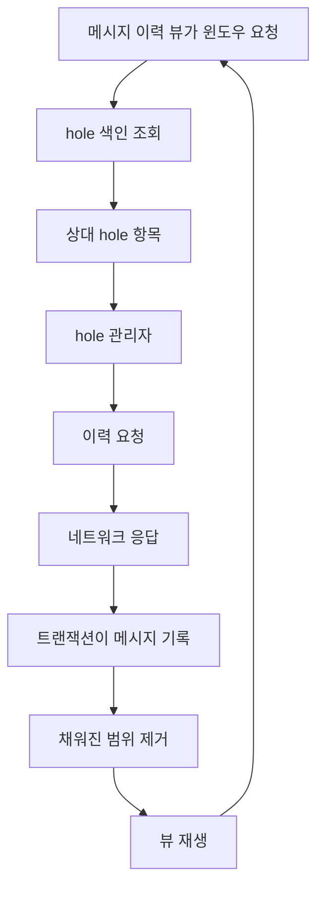
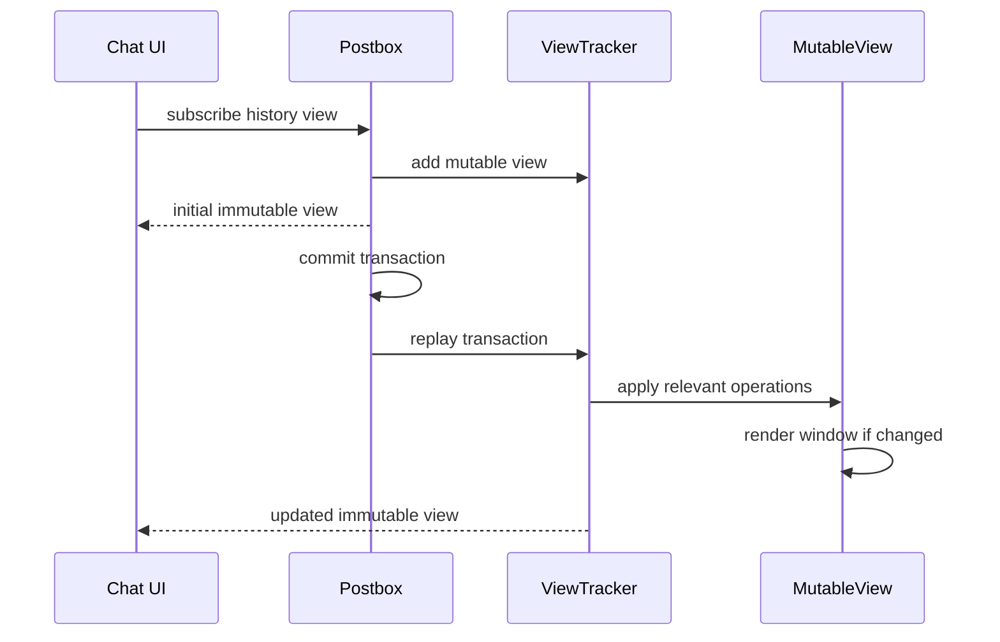

# Postbox 뷰와 메시지 이력 모델

웹: /docs/system/09-postbox-views/ · Markdown: /docs/system/09-postbox-views.md

> Telegram이 듬성듬성한 메시지 이력을 어떻게 색인하고 화면을 조금씩 구동하는지 설명해요

> 시스템 설계 · 저장과 검색 · 09장 · 도표 2 · 코드 발췌 9 · 인용 39 · 소스 기준선: [TelegramMessenger/Telegram-iOS@f1dd7a2d](https://github.com/TelegramMessenger/Telegram-iOS/tree/f1dd7a2dbd02cbbf513e75d5695d8d36d1cf5838), [overtake/TelegramSwift@579cebbf](https://github.com/overtake/TelegramSwift/tree/579cebbf0c01fd41b712eff3647fa7f69db9665d)
>
> 관련 보충: [macOS fork 장별 검증(08–15장)](/docs/system/32-fork-verify-08-15/), [공백 채우기 실패 후의 재시도와 백오프](/docs/system/34-hole-retry/)
>
> 핵심 소스 파일: [TelegramMessenger/Telegram-iOS/submodules/Postbox/Sources/Message.swift](https://github.com/TelegramMessenger/Telegram-iOS/blob/f1dd7a2dbd02cbbf513e75d5695d8d36d1cf5838/submodules/Postbox/Sources/Message.swift), [TelegramMessenger/Telegram-iOS/submodules/TelegramCore/Sources/SyncCore/SyncCore_Namespaces.swift](https://github.com/TelegramMessenger/Telegram-iOS/blob/f1dd7a2dbd02cbbf513e75d5695d8d36d1cf5838/submodules/TelegramCore/Sources/SyncCore/SyncCore_Namespaces.swift), [TelegramMessenger/Telegram-iOS/submodules/Postbox/Sources/MessageHistoryTable.swift](https://github.com/TelegramMessenger/Telegram-iOS/blob/f1dd7a2dbd02cbbf513e75d5695d8d36d1cf5838/submodules/Postbox/Sources/MessageHistoryTable.swift), [TelegramMessenger/Telegram-iOS/submodules/Postbox/Sources/MessageHistoryIndexTable.swift](https://github.com/TelegramMessenger/Telegram-iOS/blob/f1dd7a2dbd02cbbf513e75d5695d8d36d1cf5838/submodules/Postbox/Sources/MessageHistoryIndexTable.swift), [TelegramMessenger/Telegram-iOS/submodules/Postbox/Sources/MessageHistoryHoleIndexTable.swift](https://github.com/TelegramMessenger/Telegram-iOS/blob/f1dd7a2dbd02cbbf513e75d5695d8d36d1cf5838/submodules/Postbox/Sources/MessageHistoryHoleIndexTable.swift), [TelegramMessenger/Telegram-iOS/submodules/Postbox/Sources/MessageHistoryHolesView.swift](https://github.com/TelegramMessenger/Telegram-iOS/blob/f1dd7a2dbd02cbbf513e75d5695d8d36d1cf5838/submodules/Postbox/Sources/MessageHistoryHolesView.swift), [TelegramMessenger/Telegram-iOS/submodules/TelegramCore/Sources/State/ManagedMessageHistoryHoles.swift](https://github.com/TelegramMessenger/Telegram-iOS/blob/f1dd7a2dbd02cbbf513e75d5695d8d36d1cf5838/submodules/TelegramCore/Sources/State/ManagedMessageHistoryHoles.swift), [TelegramMessenger/Telegram-iOS/submodules/TelegramCore/Sources/State/Holes.swift](https://github.com/TelegramMessenger/Telegram-iOS/blob/f1dd7a2dbd02cbbf513e75d5695d8d36d1cf5838/submodules/TelegramCore/Sources/State/Holes.swift), [TelegramMessenger/Telegram-iOS/submodules/Postbox/Sources/ChatListTable.swift](https://github.com/TelegramMessenger/Telegram-iOS/blob/f1dd7a2dbd02cbbf513e75d5695d8d36d1cf5838/submodules/Postbox/Sources/ChatListTable.swift), [TelegramMessenger/Telegram-iOS/submodules/Postbox/Sources/MessageHistoryReadStateTable.swift](https://github.com/TelegramMessenger/Telegram-iOS/blob/f1dd7a2dbd02cbbf513e75d5695d8d36d1cf5838/submodules/Postbox/Sources/MessageHistoryReadStateTable.swift), [TelegramMessenger/Telegram-iOS/submodules/Postbox/Sources/UnreadMessageCountsView.swift](https://github.com/TelegramMessenger/Telegram-iOS/blob/f1dd7a2dbd02cbbf513e75d5695d8d36d1cf5838/submodules/Postbox/Sources/UnreadMessageCountsView.swift), [TelegramMessenger/Telegram-iOS/submodules/Postbox/Sources/MessageHistoryTextIndexTable.swift](https://github.com/TelegramMessenger/Telegram-iOS/blob/f1dd7a2dbd02cbbf513e75d5695d8d36d1cf5838/submodules/Postbox/Sources/MessageHistoryTextIndexTable.swift), [TelegramMessenger/Telegram-iOS/submodules/Postbox/Sources/MessageHistoryView.swift](https://github.com/TelegramMessenger/Telegram-iOS/blob/f1dd7a2dbd02cbbf513e75d5695d8d36d1cf5838/submodules/Postbox/Sources/MessageHistoryView.swift), [TelegramMessenger/Telegram-iOS/submodules/Postbox/Sources/ViewTracker.swift](https://github.com/TelegramMessenger/Telegram-iOS/blob/f1dd7a2dbd02cbbf513e75d5695d8d36d1cf5838/submodules/Postbox/Sources/ViewTracker.swift), [TelegramMessenger/Telegram-iOS/submodules/Postbox/Sources/PostboxView.swift](https://github.com/TelegramMessenger/Telegram-iOS/blob/f1dd7a2dbd02cbbf513e75d5695d8d36d1cf5838/submodules/Postbox/Sources/PostboxView.swift), [overtake/TelegramSwift/Telegram-Mac/MainViewController.swift](https://github.com/overtake/TelegramSwift/blob/579cebbf0c01fd41b712eff3647fa7f69db9665d/Telegram-Mac/MainViewController.swift)
>
> 미검증 사항:
> - 같은 `LocationKey` 아래의 hole이 서로 다른 namespace, 방향 또는 `count`를 가질 때, 소스는 안정적인 병합 규칙이나 우선순위 규칙을 정의하지 않아요.

Postbox(Telegram-iOS의 로컬 저장소 계층)는 채팅 기록을 페이지가 비어 있을 수 있는 정렬된 사실 집합으로 모델링해요. 그리고 한 트랜잭션의 변경을 오래 살아 있는 메모리 뷰에 다시 재생해요. 이 설계 덕분에 채팅, 폴더, 읽지 않음 배지, 포럼 주제가 모두 국소적인 윈도우(이력 중 화면에 필요한 작은 구간)를 구독할 수 있어요. 데이터베이스가 바뀔 때마다 전체 이력 테이블을 다시 조회할 필요도 없어요. [\[1\]](https://github.com/TelegramMessenger/Telegram-iOS/blob/f1dd7a2dbd02cbbf513e75d5695d8d36d1cf5838/submodules/Postbox/Sources/Message.swift#L3-L250) [\[20\]](https://github.com/TelegramMessenger/Telegram-iOS/blob/f1dd7a2dbd02cbbf513e75d5695d8d36d1cf5838/submodules/Postbox/Sources/MessageHistoryView.swift#L305-L1060) [\[21\]](https://github.com/TelegramMessenger/Telegram-iOS/blob/f1dd7a2dbd02cbbf513e75d5695d8d36d1cf5838/submodules/Postbox/Sources/ViewTracker.swift#L4-L345)

## 정수 하나로 담을 수 없는 신원 [#정수-하나로-담을-수-없는-신원]

메시지 시스템이 가장 먼저 풀어야 하는 문제는 신원 충돌과 정렬 경계예요. 서버 메시지 번호는 일부 대화 도메인 안에서만 의미가 있어요. 로컬의 전송 대기 메시지, 예약 메시지, 비밀 채팅은 누가 만들고 언제까지 살아 있는지도 또 달라요. 그래서 Postbox는 메시지 키를 단일 `Int32`로 정의하지 않았어요. 대신 세 타입으로 신원을 나눠 표현해요.

- `PeerId`(대화 상대의 식별자): `Int64` 하나를 감싸요.
- `MessageId`: `peerId`, `namespace`, `id` 세 부분으로 이루어져요.
- `MessageIndex`: 그 신원 위에 `timestamp`를 덧붙여요. [\[1\]](https://github.com/TelegramMessenger/Telegram-iOS/blob/f1dd7a2dbd02cbbf513e75d5695d8d36d1cf5838/submodules/Postbox/Sources/Message.swift#L3-L250)

`MessageId.Namespace`는 논리적 번호 공간이지, 표시 계층의 분류가 아니에요. 현재 업스트림이 정의하는 번호 공간은 이래요.

- `0`: 클라우드 메시지
- `1`: 로컬 메시지
- `2`: 비밀 채팅 수신 메시지
- `3`, `4`: 예약된 클라우드 및 로컬 메시지
- `5`, `6`: Quick Reply 클라우드 및 로컬 메시지 [\[2\]](https://github.com/TelegramMessenger/Telegram-iOS/blob/f1dd7a2dbd02cbbf513e75d5695d8d36d1cf5838/submodules/TelegramCore/Sources/SyncCore/SyncCore_Namespaces.swift#L4-L16)

**macOS fork 차이.** 고정 fork도 Cloud `5`와 Local `6`을 정의하지만 `6`까지만 정의해요. 업스트림에는 ephemeral과 welcome message 공간이 더 있어요. [\[30\]](https://github.com/overtake/Telegram-iOS/blob/a24bbe45f9861f736a79916a50898512f751e0dc/submodules/TelegramCore/Sources/SyncCore/SyncCore_Namespaces.swift#L4-L22)

같은 peer 안에서 `id`가 같아도 namespace가 다르면 서로 다른 메시지예요. 이 선택 덕분에 클라이언트는 먼저 로컬 자리 표시 메시지를 넣고, 나중에 서버가 확인한 클라우드 메시지를 저장하면서도 원래 레코드를 덮어쓰지 않아요. (추론) 또 “서버에서 이력을 보충할 수 있는가”를 알맞은 공간으로 한정해서, 로컬 큐를 원격 이력으로 잘못 보는 일을 피해요. 네임스페이스의 fork 검증은 [macOS fork 장별 검증(08–15장)](/docs/system/32-fork-verify-08-15/)을 참고하세요.

`submodules/Postbox/Sources/Message.swift` 3–22행 발췌.

```swift
public struct MessageId: Hashable, Comparable, CustomStringConvertible, PostboxCoding, Codable {
    public typealias Id = Int32
    public typealias Namespace = Int32
    
    public let peerId: PeerId
    public let namespace: Namespace
    public let id: Id
    
    public init(peerId: PeerId, namespace: Namespace, id: Id) {
        self.peerId = peerId
        self.namespace = namespace
        self.id = id
    }
    
    public init(_ buffer: ReadBuffer) {
        self.peerId = PeerId(buffer.readInt64())
        self.namespace = buffer.readInt32()
        self.id = buffer.readInt32()
    }
}
```

`submodules/TelegramCore/Sources/SyncCore/SyncCore_Namespaces.swift` 4–16행 발췌.

```swift
public struct Namespaces {
    public struct Message {
        public static let Cloud: Int32 = 0
        public static let Local: Int32 = 1
        public static let SecretIncoming: Int32 = 2
        public static let ScheduledCloud: Int32 = 3
        public static let ScheduledLocal: Int32 = 4
        public static let QuickReplyCloud: Int32 = 5
        public static let QuickReplyLocal: Int32 = 6
    }
```

`MessageIndex`는 다음 순서로 비교해요. 메시지 번호만으로 비교하지 않아요. [\[1\]](https://github.com/TelegramMessenger/Telegram-iOS/blob/f1dd7a2dbd02cbbf513e75d5695d8d36d1cf5838/submodules/Postbox/Sources/Message.swift#L3-L250)

1. 타임스탬프
2. namespace
3. 메시지 번호
4. peerId

이 비교 순서 덕분에 화면은 peer 사이에서도, 공간 사이에서도 안정적인 전체 순서를 갖고, 같은 초 안의 여러 메시지도 처리해요. 그래서 `lowerBound`, `upperBound`, `peerLocalPredecessor`, `peerLocalSuccessor`는 페이지 경계를 배열 인덱스가 아니라 색인으로 표현해요. 호출한 쪽은 이미 아는 메시지를 중심으로 윈도우를 만들 수도 있고, 상한과 하한으로 첫 화면을 로드할 수도 있어요.

대가는 타임스탬프가 서버의 엄밀한 일련번호가 아니라는 점이에요. 메시지 위치를 정확히 지정해야 하는 경로는 완전한 `MessageId`를 유지해야 해요. (추론)

`submodules/Postbox/Sources/Message.swift` 236–250행 발췌.

```swift
public static func <(lhs: MessageIndex, rhs: MessageIndex) -> Bool {
    if lhs.timestamp != rhs.timestamp {
        return lhs.timestamp < rhs.timestamp
    }
    
    if lhs.id.namespace != rhs.id.namespace {
        return lhs.id.namespace < rhs.id.namespace
    }
    
    if lhs.id.id != rhs.id.id {
        return lhs.id.id < rhs.id.id
    }
    
    return lhs.id.peerId.toInt64() < rhs.id.peerId.toInt64()
}
```

## 이력 기록과 파생 색인 [#이력-기록과-파생-색인]

메시지 이력은 다음을 한꺼번에 지원해야 해요.

- 정확한 신원으로 읽기
- 시간순 페이지 넘김
- 태그 필터링
- 주제별 읽기
- 텍스트 검색

테이블 하나로는 이 질의를 모두 국소 스캔으로 처리할 수 없어요. 그래서 Postbox는 정규 메시지 레코드와 여러 파생 색인을 따로 유지해요.

- `MessageHistoryTable`: 직렬화된 메시지 레코드를 저장해요. 키는 peer, namespace, 메시지 번호로 위치를 정해요.
- `MessageHistoryIndexTable`: 신원에서 시간 색인으로 가는 매핑을 저장해요. 그리고 더 이른 항목, 기존 namespace, 가장 가까운 색인 같은 범위 접근을 제공해요. [\[3\]](https://github.com/TelegramMessenger/Telegram-iOS/blob/f1dd7a2dbd02cbbf513e75d5695d8d36d1cf5838/submodules/Postbox/Sources/MessageHistoryTable.swift#L68-L510) [\[4\]](https://github.com/TelegramMessenger/Telegram-iOS/blob/f1dd7a2dbd02cbbf513e75d5695d8d36d1cf5838/submodules/Postbox/Sources/MessageHistoryIndexTable.swift#L38-L346)

여기서 핵심은 SQLite의 구체적인 레이아웃이 아니라 커밋 프로토콜(트랜잭션을 확정할 때 파생 데이터를 함께 갱신하는 규칙)이에요. 이력 테이블은 삽입, 제거, 갱신, 시간 갱신을 `MessageHistoryOperation`으로 모아요. 이어서 `processIndexOperations`가 다음을 동기적으로 갱신해요.

- 주 레코드
- 태그
- 미디어
- 미전송 큐
- 읽기 상태
- 기타 색인 [\[3\]](https://github.com/TelegramMessenger/Telegram-iOS/blob/f1dd7a2dbd02cbbf513e75d5695d8d36d1cf5838/submodules/Postbox/Sources/MessageHistoryTable.swift#L68-L510)

그래서 한 트랜잭션은 뷰에 메시지 삽입이나 색인 삭제 같은 의미 있는 연산을 알려 줄 수 있어요. 모든 관찰자가 데이터베이스 스냅샷을 비교하게 만들 필요가 없어요. 아래쪽의 ValueBox, SQLite, 암호화 세부 사항은 [Postbox 스토리지 엔진](/docs/system/08-postbox-storage/)에서 다뤄요.

`MessageHistoryIndexTable`은 각 peer에 현재 있는 namespace 집합도 캐시해요. 처음 호출될 때 그 peer의 색인 키를 스캔하고, 이후에는 캐시를 돌려줘요. 메모리 캐시를 비울 때만 다시 찾아요. [\[4\]](https://github.com/TelegramMessenger/Telegram-iOS/blob/f1dd7a2dbd02cbbf513e75d5695d8d36d1cf5838/submodules/Postbox/Sources/MessageHistoryIndexTable.swift#L38-L346) 이 캐시는 적은 메모리로 이력을 렌더링하는 동안의 범위 스캔을 줄이는 방식이에요. (추론)

쓰기 경로는 namespace가 생기거나 사라질 때 캐시를 올바르게 무효화해야 해요. 그렇지 않으면 필터 윈도우가 한 공간을 놓쳐요. 소스는 메모리 캐시를 비울 때 이 캐시를 명시적으로 버려요. [\[4\]](https://github.com/TelegramMessenger/Telegram-iOS/blob/f1dd7a2dbd02cbbf513e75d5695d8d36d1cf5838/submodules/Postbox/Sources/MessageHistoryIndexTable.swift#L38-L346)

포럼과 답글 스레드는 대화 수준 타임라인에만 기댈 수 없어요. `MessageThreadIndexTable`은 각 peer와 thread의 표시 가능한 정보를 저장하고, `MessageHistoryThreadsTable`은 스레드 안의 메시지 색인을 유지해요. 스레드 색인 뷰는 다음을 읽어요.

- 고정 순번
- 최상단 메시지
- 임베디드 인터페이스 상태
- 태그 요약

그다음 “고정이 앞, 그다음은 최신 색인의 역순”으로 주제를 배열해요. [\[5\]](https://github.com/TelegramMessenger/Telegram-iOS/blob/f1dd7a2dbd02cbbf513e75d5695d8d36d1cf5838/submodules/Postbox/Sources/MessageHistoryThreadIndexView.swift#L109-L200) [\[27\]](https://github.com/TelegramMessenger/Telegram-iOS/blob/f1dd7a2dbd02cbbf513e75d5695d8d36d1cf5838/submodules/Postbox/Sources/MessageHistoryThreadsTable.swift#L1-L290)

덕분에 채널 포럼 목록과 한 주제의 이력이 각자 페이지를 나눌 수 있어요. 어떤 주제의 읽지 않음과 태그 요약을 구하려고 채널의 모든 메시지를 스캔할 필요도 없어요. [\[5\]](https://github.com/TelegramMessenger/Telegram-iOS/blob/f1dd7a2dbd02cbbf513e75d5695d8d36d1cf5838/submodules/Postbox/Sources/MessageHistoryThreadIndexView.swift#L109-L200)

태그 색인은 “같은 듬성듬성한 이력 안에서 사진, 링크, 읽지 않은 멘션만 나열하기” 같은 문제를 풀어요. `MessageHistoryTagsTable`의 키는 다음을 포함해요.

- tag
- thread
- peer
- namespace
- `MessageIndex`

태그를 넣거나 뺄 때 테이블은 요약 집합에 속한 `MessageHistoryTagsSummaryTable`도 함께 갱신해요. 요약은 일치하는 개수와 최대 메시지 번호를 저장해서, 채팅 목록이나 필터 진입점에서 개수를 빠르게 보여 주는 데 써요. [\[6\]](https://github.com/TelegramMessenger/Telegram-iOS/blob/f1dd7a2dbd02cbbf513e75d5695d8d36d1cf5838/submodules/Postbox/Sources/MessageHistoryTagsTable.swift#L45-L65)

이 경로는 쓰기 증폭(한 번의 변경에 쓰기가 여러 번 필요한 것)이 있어요. 하지만 미디어 태그 페이지, 멘션 페이지, 채팅 목록을 읽을 때 메시지를 다시 돌 필요가 없어서, 읽기가 많고 쓰기가 적은 클라이언트 상호작용에 알맞아요. (추론)

`submodules/Postbox/Sources/MessageHistoryTagsTable.swift` 228–243행 발췌.

```swift
func add(tags: MessageTags, threadId: Int64, index: MessageIndex, isNewlyAdded: Bool, updatedSummaries: inout [MessageHistoryTagsSummaryKey: MessageHistoryTagNamespaceSummary], invalidateSummaries: inout [InvalidatedMessageHistoryTagsSummaryEntryOperation]) {
    for tag in tags {
        self.valueBox.set(self.table, key: self.key(tag: tag, threadId: threadId, index: index, key: self.sharedKey), value: MemoryBuffer())
        if self.summaryTags.contains(tag) {
            self.summaryTable.addMessage(key: MessageHistoryTagsSummaryKey(tag: tag, peerId: index.id.peerId, threadId: threadId, namespace: index.id.namespace, customTag: nil), id: index.id.id, isNewlyAdded: isNewlyAdded, updatedSummaries: &updatedSummaries, invalidateSummaries: &invalidateSummaries)
        }
    }
}

func remove(tags: MessageTags, threadId: Int64, index: MessageIndex, updatedSummaries: inout [MessageHistoryTagsSummaryKey: MessageHistoryTagNamespaceSummary], invalidateSummaries: inout [InvalidatedMessageHistoryTagsSummaryEntryOperation]) {
    for tag in tags {
        self.valueBox.remove(self.table, key: self.key(tag: tag, threadId: threadId, index: index, key: self.sharedKey), secure: false)
        if self.summaryTags.contains(tag) {
            self.summaryTable.removeMessage(key: MessageHistoryTagsSummaryKey(tag: tag, peerId: index.id.peerId, threadId: threadId, namespace: index.id.namespace, customTag: nil), id: index.id.id, updatedSummaries: &updatedSummaries, invalidateSummaries: &invalidateSummaries)
        }
    }
}
```

로컬 전문 검색은 또 다른 파생 경로예요. `MessageHistoryTextIndexTable`은 `ValueBoxFullTextTable`을 써요.

- 인코딩: peer를 collection id로, 완전한 `MessageId`를 item id로 인코딩해요.
- 쓸 때: 텍스트와 태그 문자열을 저장해요.
- 검색할 때: 영숫자가 아닌 문자를 공백으로 바꾸고, 비어 있지 않은 질의에 접두사 일치용 별표를 붙여요. peer와 태그로 범위를 제한할 수도 있어요. [\[7\]](https://github.com/TelegramMessenger/Telegram-iOS/blob/f1dd7a2dbd02cbbf513e75d5695d8d36d1cf5838/submodules/Postbox/Sources/MessageHistoryTextIndexTable.swift#L3-L98)

이는 검색 결과가 먼저 `MessageId` 목록이라는 뜻이에요. 화면에 보여 줄 때는 여전히 이력 모델을 거쳐 메시지를 로드해야 해요. 이 검색은 클라우드 전역 검색을 대신하는 게 아니라, 로컬 캐시가 답할 수 있는 검색이에요. (추론)

`submodules/Postbox/Sources/MessageHistoryTextIndexTable.swift` 51–98행 발췌.

```swift
func add(messageId: MessageId, text: String, tags: MessageTags) {
    self.valueBox.fullTextSet(
        self.table,
        collectionId: collectionId(messageId.peerId),
        itemId: itemId(messageId),
        contents: text,
        tags: messageTags(tags)
    )
}

func search(peerId: PeerId?, text: String, tags: MessageTags?) -> [MessageId] {
    // ...
    if !escapedText.isEmpty {
        escapedText += "*"
    }
    var result: [MessageId] = []
    self.valueBox.fullTextMatch(self.table, collectionId: peerId.flatMap { collectionId($0) }, query: escapedText, tags: tags.flatMap(messageTags), values: { _, itemId in
        if let messageId = parseMessageId(itemId) {
            result.append(messageId)
        }
        return true
    })
    return result
}
```

## hole로 내려받지 않은 이력을 표현하기 [#hole로-내려받지-않은-이력을-표현하기]

모바일 기기가 한 대화의 이력을 전부 갖고 있는 경우는 드물어요. 내려받지 않은 구간을 그냥 비어 있다고 보면, 화면은 “오래된 메시지가 없다”와 “아직 오래된 메시지를 받지 못했다”를 구분할 수 없어요. 그래서 Postbox는 빠진 구간을 hole(내려받지 않아 비어 있는 이력 구간)로 분명하게 기록하고, 이력 뷰가 hole에 대한 상대 방향을 갖게 해요.

hole 하나는 다음으로 정해져요.

- peer
- 선택적 thread
- namespace
- 공간
- 닫힌 구간

공간은 전체 이력을 뜻할 수도 있고, 일반 태그나 사용자 정의 태그 필터를 뜻할 수도 있어요. [\[8\]](https://github.com/TelegramMessenger/Telegram-iOS/blob/f1dd7a2dbd02cbbf513e75d5695d8d36d1cf5838/submodules/Postbox/Sources/MessageHistoryHoleIndexTable.swift#L93-L490) [\[9\]](https://github.com/TelegramMessenger/Telegram-iOS/blob/f1dd7a2dbd02cbbf513e75d5695d8d36d1cf5838/submodules/Postbox/Sources/MessageHistoryHolesView.swift#L1-L82)

`MessageHistoryHoleIndexTable`은 이렇게 동작해요.

- 구간의 상단 메시지 번호를 키로, 하단 메시지 번호를 값으로 써요.
- hole을 추가하기 전에 범위를 `1`부터 `Int32.max - 1`까지로 자르고, 겹치는 범위를 확인해서 병합해요.
- 이미 채워진 범위를 삭제할 때는 완전히 덮이는 hole을 지워요. 겹치는 hole이면 채워진 정수 구간을 빼고 남은 구간을 다시 써요. [\[8\]](https://github.com/TelegramMessenger/Telegram-iOS/blob/f1dd7a2dbd02cbbf513e75d5695d8d36d1cf5838/submodules/Postbox/Sources/MessageHistoryHoleIndexTable.swift#L93-L490)

이렇게 끝점만 저장하면 이어진 빈 구간 하나가 항목 하나로 줄어요. 대가는 hole이 일부만 채워질 때 쪼개서 다시 써야 한다는 점이에요. 소스는 실제로 `IndexSet`으로 남은 범위를 다시 만들어요. [\[8\]](https://github.com/TelegramMessenger/Telegram-iOS/blob/f1dd7a2dbd02cbbf513e75d5695d8d36d1cf5838/submodules/Postbox/Sources/MessageHistoryHoleIndexTable.swift#L93-L490)

이 도표는 메시지 hole이 저장소, 뷰, 네트워크 보충으로 이어지는 순환을 보여 줘요.



`MutableMessageHistoryHolesView`는 처음에 모든 hole을 읽고, 트랜잭션의 `currentPeerHoleOperations`에서 삽입과 제거를 조금씩 처리해요. 이 뷰가 내놓는 공개 `MessageHistoryHolesView`는 `entries`를 갖고, 각 항목은 peer hole과 상대 방향, 공간, 요청 수량을 줘요. [\[9\]](https://github.com/TelegramMessenger/Telegram-iOS/blob/f1dd7a2dbd02cbbf513e75d5695d8d36d1cf5838/submodules/Postbox/Sources/MessageHistoryHolesView.swift#L1-L82) `ViewTracker`는 추적 중인 이력 뷰에 맞춰 추적할 hole을 갱신해요. 그래서 백그라운드에서 모든 peer의 모든 hole을 무차별로 가져올 필요가 없어요. [\[21\]](https://github.com/TelegramMessenger/Telegram-iOS/blob/f1dd7a2dbd02cbbf513e75d5695d8d36d1cf5838/submodules/Postbox/Sources/ViewTracker.swift#L4-L345)

`submodules/Postbox/Sources/MessageHistoryHoleIndexTable.swift` 428–469행 발췌.

```swift
private func removeInternal(peerId: PeerId, namespace: MessageId.Namespace, space: MessageHistoryHoleSpace, range: ClosedRange<MessageId.Id>, operations: inout [MessageHistoryIndexHoleOperationKey: [MessageHistoryIndexHoleOperation]]) {
    var removeKeys: [Int32] = []
    var insertRanges = IndexSet()
    
    func processRange(_ key: ValueBoxKey, _ value: ReadBuffer) {
        let (upperId, keySpace) = decomposeKey(key)
        assert(keySpace == space)
        let lowerId = decodeValue(value: value, peerId: peerId, namespace: namespace)
        let holeRange: ClosedRange<MessageId.Id> = lowerId.id ... upperId.id
        if range.lowerBound <= holeRange.lowerBound && range.upperBound >= holeRange.upperBound {
            removeKeys.append(upperId.id)
        } else if range.overlaps(holeRange) {
            removeKeys.append(upperId.id)
            var holeIndices = IndexSet(integersIn: Int(holeRange.lowerBound) ... Int(holeRange.upperBound))
            holeIndices.remove(integersIn: Int(range.lowerBound) ... Int(range.upperBound))
            insertRanges.formUnion(holeIndices)
        }
    }
    // ...
    for insertRange in insertRanges.rangeView {
        let closedRange: ClosedRange<MessageId.Id> = Int32(insertRange.lowerBound) ... Int32(insertRange.upperBound - 1)
        var lowerBound: Int32 = closedRange.lowerBound
        self.valueBox.set(self.table, key: self.key(id: MessageId(peerId: peerId, namespace: namespace, id: closedRange.upperBound), space: space), value: MemoryBuffer(memory: &lowerBound, capacity: 4, length: 4, freeWhenDone: false))
    }
}
```

TelegramCore의 `managedMessageHistoryHoles`는 `postbox.messageHistoryHolesView()`를 구독하고, 전용 큐에서 처리 대기, 폐기, 최근 완료 항목을 유지해요. [\[10\]](https://github.com/TelegramMessenger/Telegram-iOS/blob/f1dd7a2dbd02cbbf513e75d5695d8d36d1cf5838/submodules/TelegramCore/Sources/State/ManagedMessageHistoryHoles.swift#L1-L236) 새로 추가된 대기 항목에는 `fetchMessageHistoryHole`을 호출하고, 끝나면 대기 집합에서 빼고 완료 시각을 기록해요.

중복 제거 키는 peer, thread, hole 공간만 포함해요. namespace, 방향, 요청 수량은 포함하지 않아요. 이 중복 제거는 이 관리자의 컨텍스트에만 적용돼요. [\[36\]](https://github.com/TelegramMessenger/Telegram-iOS/blob/f1dd7a2dbd02cbbf513e75d5695d8d36d1cf5838/submodules/TelegramCore/Sources/State/ManagedMessageHistoryHoles.swift#L5-L210) 프리로더, 희소 목록, 답글 스레드는 `fetchMessageHistoryHole`을 직접 호출할 수 있고, 이 대기 집합을 공유하지 않아요. [\[37\]](https://github.com/TelegramMessenger/Telegram-iOS/blob/f1dd7a2dbd02cbbf513e75d5695d8d36d1cf5838/submodules/TelegramCore/Sources/State/ChatHistoryPreloadManager.swift#L98-L121) [\[38\]](https://github.com/TelegramMessenger/Telegram-iOS/blob/f1dd7a2dbd02cbbf513e75d5695d8d36d1cf5838/submodules/TelegramCore/Sources/TelegramEngine/Messages/SparseMessageList.swift#L352-L381) [\[39\]](https://github.com/TelegramMessenger/Telegram-iOS/blob/f1dd7a2dbd02cbbf513e75d5695d8d36d1cf5838/submodules/TelegramCore/Sources/TelegramEngine/Messages/ReplyThreadHistory.swift#L295-L315)

업데이트 동기화에서 전역 순서를 복구하는 일은 [업데이트 동기화](/docs/system/06-update-sync/)가 맡아요. 여기서의 요청은 뷰에 필요한 이력 조각에만 집중해요.

`Holes.swift`는 응답을 받으면 파싱한 메시지와 연관 메시지를 같은 트랜잭션으로 기록해요. 그다음 실제로 채워진 범위를 계산하고, direct peer 입력에 대해 `transaction.removeHole`을 호출해요. [\[11\]](https://github.com/TelegramMessenger/Telegram-iOS/blob/f1dd7a2dbd02cbbf513e75d5695d8d36d1cf5838/submodules/TelegramCore/Sources/State/Holes.swift#L423-L1150)

채워진 범위는 응답에 따라 이렇게 정해요.

- 응답이 비었거나 암묵적 채움으로 표시되면 요청한 최소·최대 범위를 채워진 것으로 봐요.
- 그렇지 않으면 응답 메시지 번호 범위에 따라 처리하고, 앵커 주변 요청에는 경계를 한 번 더 판단해요. [\[11\]](https://github.com/TelegramMessenger/Telegram-iOS/blob/f1dd7a2dbd02cbbf513e75d5695d8d36d1cf5838/submodules/TelegramCore/Sources/State/Holes.swift#L423-L1150)

그래서 서버가 한 페이지에 못 미치게 돌려줬을 때 hole이 전부 사라졌다고 단순하게 가정하지 않아요.

hole 채우기가 실패하면 이렇게 흘러가요. 첫 `MTRpcError`가 나면 `retry`를 거친 뒤에도 두 번째 RPC를 예약하지 않아요. `maxRetries: 0` 때문에 첫 오류 직후 카운터가 곧바로 상한에 닿기 때문이에요. [\[34\]](https://github.com/TelegramMessenger/Telegram-iOS/blob/f1dd7a2dbd02cbbf513e75d5695d8d36d1cf5838/submodules/TelegramCore/Sources/State/Holes.swift#L966-L989) [\[35\]](https://github.com/TelegramMessenger/Telegram-iOS/blob/f1dd7a2dbd02cbbf513e75d5695d8d36d1cf5838/submodules/SSignalKit/SwiftSignalKit/Source/Signal_Catch.swift#L142-L188)

1. `catch`가 오류를 `nil`로 바꾸므로 Signal은 정상으로 완료돼요.
2. 관리자는 대기 항목을 지우고 20초 동안 완료로 보고 억제하는 기록을 남겨요.
3. `nil` 분기는 쓰기 트랜잭션에 들어가지 않아서 hole은 제거되지 않아요. [\[34\]](https://github.com/TelegramMessenger/Telegram-iOS/blob/f1dd7a2dbd02cbbf513e75d5695d8d36d1cf5838/submodules/TelegramCore/Sources/State/Holes.swift#L966-L989) [\[36\]](https://github.com/TelegramMessenger/Telegram-iOS/blob/f1dd7a2dbd02cbbf513e75d5695d8d36d1cf5838/submodules/TelegramCore/Sources/State/ManagedMessageHistoryHoles.swift#L5-L210)

관리자는 이 억제에 대한 재시도 타이머를 설정하지 않아요. 20초가 지난 뒤에도, 게시된 hole 집합의 변화나 메인 인스턴스 재구성, 자동 추적 hole의 쓰기가 있어야 다시 평가돼요. [\[36\]](https://github.com/TelegramMessenger/Telegram-iOS/blob/f1dd7a2dbd02cbbf513e75d5695d8d36d1cf5838/submodules/TelegramCore/Sources/State/ManagedMessageHistoryHoles.swift#L5-L210) hole 채우기 실패의 경계는 [공백 채우기 실패 후의 재시도와 백오프](/docs/system/34-hole-retry/)를 참고하세요.

`submodules/TelegramCore/Sources/State/ManagedMessageHistoryHoles.swift` 190–207행 발췌.

```swift
for pendingEntry in added {
    let id = pendingEntry.id
    let entry = pendingEntry.entry
    switch pendingEntry.entry.hole {
    case let .peer(hole):
        pendingEntry.disposable.set((fetchMessageHistoryHole(
            accountPeerId: self.accountPeerId,
            source: .network(self.network),
            postbox: self.postbox,
            peerInput: .direct(peerId: hole.peerId, threadId: hole.threadId), namespace: hole.namespace, direction: pendingEntry.entry.direction, space: pendingEntry.entry.space, count: pendingEntry.entry.count)
        |> deliverOn(self.queue)).start(completed: { [weak self] in
            guard let self = self else {
                return
            }
            self.pendingEntries.removeAll(where: { $0.id == id })
            self.completedEntries[entry] = CFAbsoluteTimeGetCurrent()
            self.update(entries: self.currentEntries)
        }))
    }
}
```

## 또 하나의 hole 색인, 채팅 목록 [#또-하나의-hole-색인-채팅-목록]

채팅 목록에서 어려운 점은 어떤 peer의 마지막 메시지를 얻는 일이 아니에요. 고정된 대화, 보관함, 폴더가 바뀌어도 페이지를 나눌 수 있는 전체 순서를 유지하는 일이 어려워요. `ChatListIndex`는 선택적 `pinningIndex`와 `MessageIndex`를 조합해 정렬 키를 만들어요. 정렬 규칙은 이래요.

- 두 대화가 모두 고정되어 있으면 더 큰 고정 색인이 앞에 와요.
- 한쪽만 고정되어 있으면 고정된 대화가 먼저예요.
- 둘 다 아니면 메시지 색인 순서로 돌아가요. [\[12\]](https://github.com/TelegramMessenger/Telegram-iOS/blob/f1dd7a2dbd02cbbf513e75d5695d8d36d1cf5838/submodules/Postbox/Sources/Message.swift#L253-L280)

이 키는 “고정”을 정렬 기준의 하나로 만들어요. UI가 일반 목록 위에 배열 한 토막을 따로 붙이는 방식이 아니에요.

`submodules/Postbox/Sources/Message.swift` 253–275행 발췌.

```swift
public struct ChatListIndex: Comparable, Hashable {
    public let pinningIndex: UInt16?
    public let messageIndex: MessageIndex
    
    public init(pinningIndex: UInt16?, messageIndex: MessageIndex) {
        self.pinningIndex = pinningIndex
        self.messageIndex = messageIndex
    }
    
    public static func <(lhs: ChatListIndex, rhs: ChatListIndex) -> Bool {
        if let lhsPinningIndex = lhs.pinningIndex, let rhsPinningIndex = rhs.pinningIndex {
            if lhsPinningIndex > rhsPinningIndex {
                return true
            } else if lhsPinningIndex < rhsPinningIndex {
                return false
            }
        } else if lhs.pinningIndex != nil {
            return false
        } else if rhs.pinningIndex != nil {
            return true
        }
        return lhs.messageIndex < rhs.messageIndex
    }
}
```

`ChatListTable`은 같은 정렬 테이블 안에 메시지 항목과 hole 항목을 함께 둬요. `allHoles(groupId:)`는 지정한 `PeerGroupId`의 범위를 스캔해서 hole 유형만 고르고, 키의 `messageIndex`에서 `ChatListHole`을 다시 만들어요. [\[13\]](https://github.com/TelegramMessenger/Telegram-iOS/blob/f1dd7a2dbd02cbbf513e75d5695d8d36d1cf5838/submodules/Postbox/Sources/ChatListTable.swift#L810-L955) 따라서 채팅 목록도 “여기에는 더 이상 대화가 없다”와 “이 페이지 위치는 아직 동기화되지 않았다”의 차이를 표현할 수 있어요.

`AllChatListHolesView`는 hole 집합을 유지해요. 트랜잭션에 `InsertHole`이나 `RemoveHoles`가 나타나면 가장 최신 hole만 다시 계산하고, 채팅 목록 전체를 다시 만들지는 않아요. [\[26\]](https://github.com/TelegramMessenger/Telegram-iOS/blob/f1dd7a2dbd02cbbf513e75d5695d8d36d1cf5838/submodules/Postbox/Sources/AllChatListHolesView.swift#L3-L66)

채팅이 어디에 속하는지는 루트 목록으로 하드코딩되어 있지 않아요. `PeerChatListInclusion`은 `notIncluded`일 수도 있고, “메시지가 있거나 조건을 충족하면 어떤 group에 포함”일 수도 있어요. 선택적 고정 순번과 최소 타임스탬프도 함께 가져요. [\[14\]](https://github.com/TelegramMessenger/Telegram-iOS/blob/f1dd7a2dbd02cbbf513e75d5695d8d36d1cf5838/submodules/Postbox/Sources/PeerChatListInclusion.swift#L3-L42) group은 보관함이나 목록 컨테이너의 기본 단위예요.

사용자 정의 채팅 필터는 더 높은 계층에서 predicate로 보이는 집합을 정하고, 그에 맞는 채팅 목록 뷰를 요청해요. [\[14\]](https://github.com/TelegramMessenger/Telegram-iOS/blob/f1dd7a2dbd02cbbf513e75d5695d8d36d1cf5838/submodules/Postbox/Sources/PeerChatListInclusion.swift#L3-L42) 폴더 조건, 연락처 조건, 읽지 않음 조건을 저장소의 정렬 키에 복제하면 안 돼요. 그러면 필터마다 별도의 전체 정렬 색인을 유지해야 하기 때문이에요. (추론)

채팅 목록 hole과 메시지 hole은 두 가지 원칙을 같이 써요.

- hole이 일반 항목과 같은 정렬 공간에 있어요.
- hole 자체가 트랜잭션 연산에 참여해요.

차이는 hole의 단위예요.

- 메시지 hole은 메시지 번호의 닫힌 구간이에요. 네트워크 요청이 일부 번호 범위만 정확히 지울 수 있게 해요.
- 채팅 hole은 정렬 위치 하나예요. 어떤 채팅 정렬 앵커에서 대화를 계속 가져오는 데 알맞아요. [\[8\]](https://github.com/TelegramMessenger/Telegram-iOS/blob/f1dd7a2dbd02cbbf513e75d5695d8d36d1cf5838/submodules/Postbox/Sources/MessageHistoryHoleIndexTable.swift#L93-L490) [\[13\]](https://github.com/TelegramMessenger/Telegram-iOS/blob/f1dd7a2dbd02cbbf513e75d5695d8d36d1cf5838/submodules/Postbox/Sources/ChatListTable.swift#L810-L955)

## 읽기 상태, 폴더 개수, 총 배지 [#읽기-상태-폴더-개수-총-배지]

읽지 않음 상태는 메시지 목록, 각 대화, 포럼 주제, 폴더, 앱 배지를 한꺼번에 만족시켜야 해요. `PeerReadState`는 두 가지 표현을 줘요.

- `idBased`: 최대 읽은 메시지 번호 기준이에요.
- `indexBased`: 최대 읽은 `MessageIndex` 기준이에요.

둘 다 읽지 않은 개수, 수동으로 읽지 않음 표시를 했는지 여부, 수신 또는 발신 메시지의 읽음 판정에 쓰는 경계를 기록해요. [\[15\]](https://github.com/TelegramMessenger/Telegram-iOS/blob/f1dd7a2dbd02cbbf513e75d5695d8d36d1cf5838/submodules/Postbox/Sources/PeerReadState.swift#L1-L145)

한 peer에 대해 `CombinedPeerReadState`는 namespace별로 상태를 합산해요.

- `count`: 각 공간의 개수를 더해요.
- `markedUnread`와 `isUnread`: 어느 한 공간이라도 참이면 참이에요. [\[15\]](https://github.com/TelegramMessenger/Telegram-iOS/blob/f1dd7a2dbd02cbbf513e75d5695d8d36d1cf5838/submodules/Postbox/Sources/PeerReadState.swift#L1-L145)

`MessageHistoryReadStateTable`은 읽기 상태의 기준이 되는 테이블이에요. 이력 쓰기와 읽기 위치 변경은 같은 Postbox 트랜잭션에서 읽기 상태 업데이트가 돼요. 이어지는 커밋 단계에서 영향받은 각 peer의 차이값이 그룹 수준의 읽지 않음 요약에 병합돼요. [\[16\]](https://github.com/TelegramMessenger/Telegram-iOS/blob/f1dd7a2dbd02cbbf513e75d5695d8d36d1cf5838/submodules/Postbox/Sources/MessageHistoryReadStateTable.swift#L1-L400) [\[17\]](https://github.com/TelegramMessenger/Telegram-iOS/blob/f1dd7a2dbd02cbbf513e75d5695d8d36d1cf5838/submodules/Postbox/Sources/MessageHistoryMetadataTable.swift#L20-L593)

코드는 `messageCount`와 `chatCount`를 0 이상으로 제한하고, 두 종류의 카운터를 구분해요.

- absolute: 카운트에 참여하는 모든 대화를 나타내요.
- filtered: 필터링 규칙의 영향을 받은 뒤의 카운트를 나타내요.

각 counter는 `PeerSummaryCounterTags`로 버킷도 나뉘어요. [\[17\]](https://github.com/TelegramMessenger/Telegram-iOS/blob/f1dd7a2dbd02cbbf513e75d5695d8d36d1cf5838/submodules/Postbox/Sources/MessageHistoryMetadataTable.swift#L20-L593)

그래서 루트 목록, 보관함, 기타 `PeerGroupId`가 각자 `ChatListTotalUnreadState`를 저장할 수 있어요. 메타데이터 테이블은 group id로 총 읽지 않음 키를 만들어요. 읽을 때는 메모리 캐시를 먼저 쓰고, 쓸 때는 업데이트로 표시된 group만 저장해요. [\[17\]](https://github.com/TelegramMessenger/Telegram-iOS/blob/f1dd7a2dbd02cbbf513e75d5695d8d36d1cf5838/submodules/Postbox/Sources/MessageHistoryMetadataTable.swift#L20-L593) 덕분에 채팅 목록을 스크롤해도 배지를 위해 전체 데이터베이스를 다시 집계하지 않아요. 대신 변경 전파는 더 복잡해져요. 대화를 옮기거나, 음소거를 바꾸거나, 필터 자격이 바뀔 때도 총합을 갱신해야 해요. (추론)

`UnreadMessageCountsView`는 `.peer`, `.total`, `.totalInGroup` 항목을 구독할 수 있어요. 점진적 재생은 트랜잭션에서 바뀐 총 상태, 환경설정, 또는 관련 peer의 병합 읽기 상태만 검사해요. 불변 뷰를 만들 때는 내부의 `handleThreads` 구현 매개변수를 지워요. [\[18\]](https://github.com/TelegramMessenger/Telegram-iOS/blob/f1dd7a2dbd02cbbf513e75d5695d8d36d1cf5838/submodules/Postbox/Sources/UnreadMessageCountsView.swift#L1-L242)

macOS 코드도 `.unreadCounts(items: [.total(nil)])`의 combined view로 루트 그룹의 absolute counters를 얻어요. 그리고 모든 tag의 `messageCount`를 더해서 화면 값을 빠르게 설정해요. [\[23\]](https://github.com/overtake/TelegramSwift/blob/579cebbf0c01fd41b712eff3647fa7f69db9665d/Telegram-Mac/MainViewController.swift#L439-L451)

TelegramSwift는 `submodules/telegram-ios`를 통해 fork `overtake/Telegram-iOS`의 고정 커밋 `a24bbe45f9861f736a79916a50898512f751e0dc`를 가리켜 공유 코어를 써요. 그래서 이 글의 iOS 소스 동작은 공통된 설계 근거예요. 다만 macOS의 실제 고정 버전은 다를 수 있어요. [\[23\]](https://github.com/overtake/TelegramSwift/blob/579cebbf0c01fd41b712eff3647fa7f69db9665d/Telegram-Mac/MainViewController.swift#L439-L451)

## 트랜잭션을 화면 변경분으로 바꾸는 뷰 [#트랜잭션을-화면-변경분으로-바꾸는-뷰]

테이블과 색인만으로는 UI를 효율적으로 갱신하기에 부족해요. 화면에 필요한 건 계속 유지되는 관찰 결과이고, 그 결과는 보통 이력의 작은 한 토막이에요. 뷰 관련 타입은 이렇게 나뉘어요.

- `PostboxView`: 불변인 공개 결과의 마커 프로토콜(메서드 없이 종류만 표시하는 프로토콜)이에요.
- `MutablePostboxView`: `replay`, 외부 트랜잭션 갱신, `immutableView`의 구현을 요구해요.
- `PostboxViewKey`: 구독 의도를 값으로 인코딩하고, 채팅 목록, 메시지 이력, hole, 태그 요약, 읽지 않음 개수 등의 키를 포함해요. [\[19\]](https://github.com/TelegramMessenger/Telegram-iOS/blob/f1dd7a2dbd02cbbf513e75d5695d8d36d1cf5838/submodules/Postbox/Sources/Views.swift#L1-L380) [\[24\]](https://github.com/TelegramMessenger/Telegram-iOS/blob/f1dd7a2dbd02cbbf513e75d5695d8d36d1cf5838/submodules/Postbox/Sources/PostboxView.swift#L3-L40)

핵심은 “트랜잭션이 커밋된 뒤 질의를 다시 실행”하는 일을 피하는 거예요. `MutableMessageHistoryView`는 생성할 때 다음을 받아요.

- peer 또는 연관 peer
- 선택적 thread
- anchor(윈도우를 시작하는 기준 위치)
- namespace 집합
- tag
- hole 추적 여부
- 윈도우 수량
- 읽기 상태
- 부가 데이터

이 뷰는 이에 대응하는 `MessageHistoryViewState`를 갖고, anchor에서 더 이른 방향과 더 늦은 방향으로 한정된 윈도우를 렌더링해요. [\[20\]](https://github.com/TelegramMessenger/Telegram-iOS/blob/f1dd7a2dbd02cbbf513e75d5695d8d36d1cf5838/submodules/Postbox/Sources/MessageHistoryView.swift#L305-L1060)

anchor는 상한, 하한, 또는 하나의 `MessageIndex`일 수 있어요. 그래서 지정한 메시지로 점프하기, 채팅 하단 열기, 가장 오래된 기록 로드는 같은 모델의 서로 다른 진입점이에요. [\[20\]](https://github.com/TelegramMessenger/Telegram-iOS/blob/f1dd7a2dbd02cbbf513e75d5695d8d36d1cf5838/submodules/Postbox/Sources/MessageHistoryView.swift#L305-L1060)

이 윈도우는 단순한 고정 배열이 아니에요. 뷰를 렌더링할 때는 관련된 각 namespace에서 메시지를 고르면서 다음도 함께 기록해요.

- hole
- 메시지 그룹
- 연관 메시지
- 읽기 상태
- 초안
- 추가 peer 데이터

트랜잭션을 재생할 때는 먼저 이 뷰와 관련된 다음 항목을 검사해요.

- 이력 연산
- peer 변경
- 읽기 상태
- 태그 요약
- hole 연산

관련된 변화가 있을 때만 다시 render해요. [\[20\]](https://github.com/TelegramMessenger/Telegram-iOS/blob/f1dd7a2dbd02cbbf513e75d5695d8d36d1cf5838/submodules/Postbox/Sources/MessageHistoryView.swift#L305-L1060)

그러면 “데이터베이스가 바뀌었다”가 “이 구독의 결과가 바뀌었다”로 좁혀져요. 모든 관찰자가 전체 질의를 하던 복잡도가, 구독한 윈도우마다 필요할 때만 다시 계산하는 복잡도로 바뀌어요. 대가는 view가 트랜잭션 연산의 의미를 이해해야 한다는 점이에요. (추론)

주 레코드와 정렬 레코드는 일부러 나뉘어 있어요.

- `MessageHistoryTable`: `MessageId`로 완전한 레코드를 되찾는 일을 맡아요. 메시지 하나를 정확히 갱신하거나 렌더링하는 데 알맞아요.
- `MessageHistoryIndexTable`: 색인 키로 “이 peer와 namespace에서 어느 항목이 특정 id에 이웃해 있는가”와 “더 이른 방향으로 색인을 몇 개 가져올 것인가”에 답해요. 페이지 분할과 윈도우 경계에 알맞아요. [\[3\]](https://github.com/TelegramMessenger/Telegram-iOS/blob/f1dd7a2dbd02cbbf513e75d5695d8d36d1cf5838/submodules/Postbox/Sources/MessageHistoryTable.swift#L68-L510) [\[4\]](https://github.com/TelegramMessenger/Telegram-iOS/blob/f1dd7a2dbd02cbbf513e75d5695d8d36d1cf5838/submodules/Postbox/Sources/MessageHistoryIndexTable.swift#L38-L346)

뷰는 먼저 색인을 얻은 뒤 그 색인으로 메시지 레코드를 다시 조회해요. 그래서 메시지 본문이나 첨부가 정렬에 끼지 않고, 색인도 간결하게 유지할 수 있어요. (추론)

색인 테이블의 범위 API가 이런 역할 분담을 보여 줘요. `earlierEntries`는 주어진 id의 키에서 이 namespace의 하한 쪽으로 스캔하고, 받은 `count`로 돌려줄 수를 제한해요. `indexForId`는 더 높은 항목 하나만 읽어요. [\[4\]](https://github.com/TelegramMessenger/Telegram-iOS/blob/f1dd7a2dbd02cbbf513e75d5695d8d36d1cf5838/submodules/Postbox/Sources/MessageHistoryIndexTable.swift#L38-L346) 여기서 범위 끝점은 항상 peer와 namespace를 포함해요. 그래서 같은 메시지 번호가 공간 경계를 넘을 수 없어요.

anchor에 해당하는 메시지가 이미 삭제됐다면 `closestIndex`는 먼저 정확한 색인을 시도하고, 이어서 후속과 선행을 각각 한 항목씩 스캔해요. [\[4\]](https://github.com/TelegramMessenger/Telegram-iOS/blob/f1dd7a2dbd02cbbf513e75d5695d8d36d1cf5838/submodules/Postbox/Sources/MessageHistoryIndexTable.swift#L38-L346) 덕분에 딥링크나 검색 적중이 로컬 정리 뒤에도 이웃한 윈도우를 찾을 가능성이 있어요. 무조건 실패하는 상황은 아니에요. (추론)

쓰기 쪽에서 어려운 점은 파생 상태가 잠깐이라도 어긋나는 일을 피하는 거예요. `MessageHistoryTable`은 색인 연산을 처리할 때 연속된 삽입과 삭제를 모아서 커밋하고, 변경 종류마다 출력 연산을 만들어요. 메시지 하나를 갱신하면 먼저 옛 색인의 제거를 내보낸 뒤 새 메시지를 삽입해요. [\[3\]](https://github.com/TelegramMessenger/Telegram-iOS/blob/f1dd7a2dbd02cbbf513e75d5695d8d36d1cf5838/submodules/Postbox/Sources/MessageHistoryTable.swift#L68-L510) 태그, 미전송 상태, 미디어, 메시지 그룹, 읽기 상태의 갱신도 이 처리 경로가 이끌어 내요. [\[3\]](https://github.com/TelegramMessenger/Telegram-iOS/blob/f1dd7a2dbd02cbbf513e75d5695d8d36d1cf5838/submodules/Postbox/Sources/MessageHistoryTable.swift#L68-L510)

그래서 뷰가 보는 것은 트랜잭션이 끝난 뒤의 일관된 집합이에요. “메시지는 기록됐지만 태그 색인은 아직 기록되지 않은” 중간 상태가 아니에요. 이건 소스의 호출 관계에서 볼 수 있는 원자적 트랜잭션 효과예요. 저장소 구현에 대한 추가 가정이 아니에요. [\[3\]](https://github.com/TelegramMessenger/Telegram-iOS/blob/f1dd7a2dbd02cbbf513e75d5695d8d36d1cf5838/submodules/Postbox/Sources/MessageHistoryTable.swift#L68-L510)

스레드 테이블은 메시지 본문이 아닌 상태도 맡아요. 스레드 색인 뷰는 `StoredMessageHistoryThreadInfo`의 데이터, 각 주제의 최상단 메시지, `PeerThreadCombinedStateTable`이 주는 요약 정보를 읽어요. [\[5\]](https://github.com/TelegramMessenger/Telegram-iOS/blob/f1dd7a2dbd02cbbf513e75d5695d8d36d1cf5838/submodules/Postbox/Sources/MessageHistoryThreadIndexView.swift#L109-L200) 트랜잭션이 그 peer의 다음 중 하나에 변화가 있다고 알리면, 스레드 색인 뷰는 다시 로드하는 쪽을 택해요.

- 스레드
- 고정 스레드
- 스레드 병합 상태
- 태그 요약
- 알림 설정
- 임베디드 상태 [\[5\]](https://github.com/TelegramMessenger/Telegram-iOS/blob/f1dd7a2dbd02cbbf513e75d5695d8d36d1cf5838/submodules/Postbox/Sources/MessageHistoryThreadIndexView.swift#L109-L200)

일반 이력 뷰가 항목 단위로 재생하는 것과 비교하면, 주제 디렉터리를 위한 굵은 단위의 갱신이에요. 세밀한 diff를 포기하는 대신, 여러 테이블에 기대는 주제 정렬을 단순하게 유지해요. (추론)

`submodules/Postbox/Sources/MessageHistoryView.swift` 1003–1039행 발췌.

```swift
if !transaction.currentPeerHoleOperations.isEmpty {
    var holePeerIdsSet: [PeerId] = []
    var threadId: Int64?
    switch self.peerIds {
    case let .single(peerId, threadIdValue):
        holePeerIdsSet.append(peerId)
        threadId = threadIdValue
    case let .associated(peerId, associatedId):
        holePeerIdsSet.append(peerId)
        if let associatedId = associatedId {
            holePeerIdsSet.append(associatedId.peerId)
        }
    case .external:
        break
    }
    for key in transaction.currentPeerHoleOperations.keys {
        if holePeerIdsSet.contains(key.peerId) && threadId == key.threadId && key.space == space {
            hasChanges = true
        }
    }
}

if hasChanges {
    self.render(postbox: postbox)
}
```

`Postbox`는 메시지 이력 구독을 만들 때 이 순서로 움직여요.

1. 먼저 `MutableMessageHistoryView`를 구성해서 `ViewTracker`에 등록해요.
2. `.Initial`이 붙은 불변 `MessageHistoryView`를 바로 내보내요.
3. 이후 tracker의 Signal 업데이트를 구독자에게 계속 전달해요. [\[22\]](https://github.com/TelegramMessenger/Telegram-iOS/blob/f1dd7a2dbd02cbbf513e75d5695d8d36d1cf5838/submodules/Postbox/Sources/Postbox.swift#L3660-L3715)

`ViewTracker`는 `Bag`으로 가변 이력 뷰와 그 `ValuePipe`를 보관해요. 이력 뷰를 등록하거나 제거한 뒤에는 추적하는 hole을 갱신해요. 채팅 목록 뷰도 같은 패턴으로 추적하는 채팅 목록 hole을 갱신해요. [\[21\]](https://github.com/TelegramMessenger/Telegram-iOS/blob/f1dd7a2dbd02cbbf513e75d5695d8d36d1cf5838/submodules/Postbox/Sources/ViewTracker.swift#L4-L345) 이 경로는 구독 관리와 테이블 쓰기를 나눠요. 그래서 UI는 테이블을 직접 갖지도, SQL 변화를 직접 관찰하지도 않아요.

이 도표는 로컬 또는 네트워크 트랜잭션이 어떻게 UI 업데이트가 되는지 보여 줘요.



`combinedView(keys:)`는 화면이 서로 일관성을 지켜야 하는 여러 결과를 합쳐서 구독하는 방식이에요. Postbox는 각 키마다 mutable view를 만들어 `CombinedMutableView`로 감싸요. 먼저 초깃값을 전달하고, 이후 업데이트를 전달해요. 등록을 해제할 때는 Postbox 큐에서 관찰자를 제거해요. [\[22\]](https://github.com/TelegramMessenger/Telegram-iOS/blob/f1dd7a2dbd02cbbf513e75d5695d8d36d1cf5838/submodules/Postbox/Sources/Postbox.swift#L3660-L3715)

UI 입장에서는 채팅 행, 읽지 않은 개수, 환경설정이 서로 조율할 수 없는 여러 독립 콜백으로 쪼개지는 일을 피할 수 있어요. 서로 다른 Postbox 사이의 원자성은 보장하지 않고, UI 메인 스레드 스케줄링을 대신하지도 않아요. 리액티브 큐와 Signal의 동시성 제약은 [리액티브와 동시성 모델](/docs/system/02-reactive-concurrency/)을 참고하세요.

뷰와 hole이 함께 일할 때 `trackHoles`는 단순한 렌더링 옵션이 아니에요. 이력 뷰를 등록하면 tracker가 추적하는 hole을 갱신하고, hole 관리자는 그 hole들에 대해서만 요청을 시작해요. [\[21\]](https://github.com/TelegramMessenger/Telegram-iOS/blob/f1dd7a2dbd02cbbf513e75d5695d8d36d1cf5838/submodules/Postbox/Sources/ViewTracker.swift#L4-L345) 그래서 사용자가 이력 중간으로 스크롤하거나, 검색 결과로 점프하거나, 포럼 주제를 열 때도 모두 같은 “구독 윈도우가 hole 수요를 낳는” 메커니즘으로 보충이 시작돼요. 컨트롤러마다 따로 페이지 분할을 구현하지 않아요. (추론) 메시지를 보낸 뒤의 로컬 상태, 재시도, 오프라인 작업 큐는 [메시지 전송 파이프라인과 오프라인 작업 큐](/docs/system/07-message-send-pipeline/)를 참고하세요.

### 이력 윈도우의 경계 규칙 [#이력-윈도우의-경계-규칙]

앵커는 윈도우가 어디서 시작하는지만 정해요. 메시지가 반드시 있다는 것까지 정하지는 않아요. `HistoryViewAnchor`는 상한, 하한, 구체적인 `MessageIndex`의 세 가지 값을 가져요. 그리고 anchor를 지정한 peer와 namespace로 고쳐 쓴 뒤 크기를 비교하는 보조 메서드를 제공해요. [\[20\]](https://github.com/TelegramMessenger/Telegram-iOS/blob/f1dd7a2dbd02cbbf513e75d5695d8d36d1cf5838/submodules/Postbox/Sources/MessageHistoryView.swift#L305-L1060) 화면은 상황에 따라 값을 골라 써요.

- 최신 메시지를 열 때: 상한
- 타임라인의 시작을 요구할 때: 하한
- 인용이나 검색 결과로 점프할 때: 구체적인 색인

이 경우들을 하나의 타입으로 모아서, 메시지 이력, 태그 이력, thread 이력이 윈도우 알고리즘을 함께 쓰게 해요. (추론)

윈도우는 여러 namespace도 감당해야 해요. 일반 클라우드 이력, 로컬 전송 대기 기록, 예약 메시지는 호출한 쪽이 넘긴 `namespaces` 집합에 따라 하나의 뷰에 함께 있을 수 있어요. [\[2\]](https://github.com/TelegramMessenger/Telegram-iOS/blob/f1dd7a2dbd02cbbf513e75d5695d8d36d1cf5838/submodules/TelegramCore/Sources/SyncCore/SyncCore_Namespaces.swift#L4-L16) [\[20\]](https://github.com/TelegramMessenger/Telegram-iOS/blob/f1dd7a2dbd02cbbf513e75d5695d8d36d1cf5838/submodules/Postbox/Sources/MessageHistoryView.swift#L305-L1060)

`MessageHistoryView`는 hole 연산을 검사할 때 현재 tag를 `.everywhere`, `.tag`, `.customTag`의 hole 공간으로 바꿔요. 그리고 peer, thread, 공간이 동시에 일치하길 요구해요. [\[20\]](https://github.com/TelegramMessenger/Telegram-iOS/blob/f1dd7a2dbd02cbbf513e75d5695d8d36d1cf5838/submodules/Postbox/Sources/MessageHistoryView.swift#L305-L1060) 그래서 일반 이력을 내려받아도 미디어 필터 페이지의 hole이 잘못 지워지지 않아요. 어떤 포럼 주제의 hole이 채널 루트 타임라인에 표시되지도 않아요.

메시지 그룹은 윈도우 모델에서 특수한 경우예요. 뷰를 만들 때 `appendMessagesFromTheSameGroup`을 요구할 수 있어요. 재생 중 삽입 연산이 태그에 맞지 않는 그룹 메시지를 만나면, 그룹 안에 일치하는 메시지가 있는지 확인하고 최대 `20`개로 그 메시지 그룹을 가져와요. [\[20\]](https://github.com/TelegramMessenger/Telegram-iOS/blob/f1dd7a2dbd02cbbf513e75d5695d8d36d1cf5838/submodules/Postbox/Sources/MessageHistoryView.swift#L305-L1060)

미디어 앨범 같은 논리 그룹이 필터 페이지에서 태그 필터 때문에 따로 떨어진 항목으로 쪼개지지 않고, 이어진 맥락으로 보일 수 있다는 뜻이에요. `20`은 이 그룹 재조회의 소스상 상한이고 프로토콜의 제한이 아니에요. [\[20\]](https://github.com/TelegramMessenger/Telegram-iOS/blob/f1dd7a2dbd02cbbf513e75d5695d8d36d1cf5838/submodules/Postbox/Sources/MessageHistoryView.swift#L305-L1060)

상대 hole 방향도 윈도우 경계에 영향을 줘요. hole 관리자는 `MessageHistoryHolesView` 항목을 받으면 그 방향과 요청 수량을 `fetchMessageHistoryHole`에 넘겨요. [\[10\]](https://github.com/TelegramMessenger/Telegram-iOS/blob/f1dd7a2dbd02cbbf513e75d5695d8d36d1cf5838/submodules/TelegramCore/Sources/State/ManagedMessageHistoryHoles.swift#L1-L236) `Holes.swift`는 범위 요청에서 방향에 따라 요청의 `offsetId`, `addOffset`, `minId`, `maxId`를 고르고, 응답이 오면 실제 메시지 번호로 `filledRange`를 계산해요. [\[11\]](https://github.com/TelegramMessenger/Telegram-iOS/blob/f1dd7a2dbd02cbbf513e75d5695d8d36d1cf5838/submodules/TelegramCore/Sources/State/Holes.swift#L423-L1150) 따라서 “위로 스크롤해 오래된 메시지 로드”와 “점프 지점 주변으로 한 페이지 보충”은 결국 같은 hole 채움 트랜잭션을 써요. 네트워크 페이지의 경계 매개변수만 달라요.

### 채팅 목록의 2차 색인 [#채팅-목록의-2차-색인]

채팅 목록의 메시지 항목이 저장하는 건 정렬 키만이 아니에요. `ChatListTable`은 범위 질의에서 키로부터 group, 고정 순번, `MessageIndex`, 항목 유형을 풀어 내요. 메시지 항목이면 값에서 메시지 색인을 복원하고, peer 테이블, 읽기 상태 테이블, 이력 테이블과 합쳐서 목록 항목을 만들어요. [\[13\]](https://github.com/TelegramMessenger/Telegram-iOS/blob/f1dd7a2dbd02cbbf513e75d5695d8d36d1cf5838/submodules/Postbox/Sources/ChatListTable.swift#L810-L955) 그래서 마지막 메시지의 변경, 고정 상태의 변경, peer 표시 정보의 변경이 모두 채팅 목록 재생을 일으킬 수 있어요. 목록 항목은 여러 테이블에 걸친 투영이에요. 단일 메시지 색인을 그대로 보여 주는 게 아니에요. (추론)

`allHoles(groupId:)`는 전역 싱글턴 hole을 유지하지 않고 group의 상한과 하한으로 스캔해요. [\[13\]](https://github.com/TelegramMessenger/Telegram-iOS/blob/f1dd7a2dbd02cbbf513e75d5695d8d36d1cf5838/submodules/Postbox/Sources/ChatListTable.swift#L810-L955) 그래서 보관함과 루트 목록이 서로 다른 페이지 공백을 가질 수 있어요.

`AllChatListHolesView`는 `latestHole`만 공개해요. 내부에는 완전한 `Set`을 유지하고, 삽입이나 제거 뒤에 최대 원소를 꺼내요. [\[13\]](https://github.com/TelegramMessenger/Telegram-iOS/blob/f1dd7a2dbd02cbbf513e75d5695d8d36d1cf5838/submodules/Postbox/Sources/ChatListTable.swift#L810-L955) 백그라운드 동기화는 보통 가장 앞쪽에서 가져올 위치만 알면 돼요. 그 요구에 맞추면서도, 다른 hole 뷰가 쓸 수 있도록 더 완전한 집합을 보존해요. (추론)

고정 정렬에는 번호 방향에 관한 세부 사항도 있어요. `ChatListIndex`의 비교 구현에서는 수치가 더 큰 `pinningIndex`가 더 앞이에요. [\[12\]](https://github.com/TelegramMessenger/Telegram-iOS/blob/f1dd7a2dbd02cbbf513e75d5695d8d36d1cf5838/submodules/Postbox/Sources/Message.swift#L253-L280) `pinningIndex`를 눈에 보이는 순번으로 그대로 표시하거나 오름차순으로 정렬하면 안 돼요.

고정 값이 없을 때 정렬은 엄밀히 `MessageIndex`에 맡겨요. 그래서 새 메시지를 받으면 대화가 자연스럽게 위로 올라와요. 고정 값이 있으면 일반 새 메시지가 맨 위 자리를 빼앗지 못해요. [\[12\]](https://github.com/TelegramMessenger/Telegram-iOS/blob/f1dd7a2dbd02cbbf513e75d5695d8d36d1cf5838/submodules/Postbox/Sources/Message.swift#L253-L280)

group과 filter의 경계도 다시 쓸 만해요. `PeerChatListInclusion`은 어떤 group에 있는지 여부, 선택적 pinning index, 최소 타임스탬프만 표현해요. [\[14\]](https://github.com/TelegramMessenger/Telegram-iOS/blob/f1dd7a2dbd02cbbf513e75d5695d8d36d1cf5838/submodules/Postbox/Sources/PeerChatListInclusion.swift#L3-L42) “개인 채팅만”, “읽은 것 제외”, “연락처만” 같은 사용자 필터 규칙을 저장 레코드에 밀어 넣지 않았어요. 소스의 채팅 목록 predicate는 다음을 받을 수 있어요.

- peer
- group
- 총 읽지 않음에서 제외할지 여부
- 읽지 않음 여부
- 연락처 여부
- 태그 요약 계산 결과 [\[25\]](https://github.com/TelegramMessenger/Telegram-iOS/blob/f1dd7a2dbd02cbbf513e75d5695d8d36d1cf5838/submodules/Postbox/Sources/Postbox.swift#L903-L945)

바뀌지 않는 소속 사실은 테이블에 남기고, 자주 바뀌는 제품 규칙은 질의 계층에 두는 방식이에요. 대가는 필터 뷰가 읽을 때 술어를 평가해야 한다는 점이에요. (추론)

### 읽기 경계에서 배지까지 [#읽기-경계에서-배지까지]

`PeerReadState`의 두 가지 표현은 서로 다른 정렬 방식을 아울러요. 서버 메시지 번호를 직접 비교할 수 있는 이력에서는 `idBased`가 최대 수신 및 발신 읽음 id로 판정해요. 복합 시간 색인으로 판정해야 할 때는 `indexBased`가 `MessageIndex`를 비교해요. [\[15\]](https://github.com/TelegramMessenger/Telegram-iOS/blob/f1dd7a2dbd02cbbf513e75d5695d8d36d1cf5838/submodules/Postbox/Sources/PeerReadState.swift#L1-L145)

두 경우 모두 `count`와 `markedUnread`를 저장해요. 그래서 “읽지 않은 메시지가 몇 개인가”와 “사용자가 직접 채팅을 읽지 않음으로 표시했는가”는 같은 불리언이 아니에요. UI가 count만으로 상태를 표시하면 `markedUnread`가 담은 제품 의미를 잃어요. (추론)

병합 상태를 기계적으로 하나의 최대 id로 합칠 수는 없어요. `CombinedPeerReadState`는 namespace에서 `PeerReadState`로 가는 배열을 유지해요. count를 계산할 때는 각 상태를 누적하고, `isUnread`와 `markedUnread`는 어느 하나라도 참인지 돌면서 확인해요. [\[15\]](https://github.com/TelegramMessenger/Telegram-iOS/blob/f1dd7a2dbd02cbbf513e75d5695d8d36d1cf5838/submodules/Postbox/Sources/PeerReadState.swift#L1-L145) 그래서 클라우드와 로컬 공간이 각자 읽기 경계를 가질 수 있어요. 대가는 호출한 쪽이 메시지 하나의 읽음 여부를 조회할 때 올바른 namespace의 상태를 골라야 하고, 총수만 봐서는 안 된다는 점이에요. (추론)

총 읽지 않음 요약은 “메시지 수”와 “대화 수”를 한층 더 구분해요. `ChatListTotalUnreadCounters`는 메시지 수와 대화 수, 이 두 `Int32`를 저장해요. 그룹 수준 상태는 tag를 키로 absolute와 filtered 두 사전을 가져요. [\[17\]](https://github.com/TelegramMessenger/Telegram-iOS/blob/f1dd7a2dbd02cbbf513e75d5695d8d36d1cf5838/submodules/Postbox/Sources/MessageHistoryMetadataTable.swift#L20-L593)

커밋할 때의 변화 함수는 다음을 해요.

- 어떤 peer의 읽지 않은 수가 0에서 0이 아닌 값으로, 또는 그 반대로 바뀌면 chat count를 조정해요.
- 새 count와 옛 count의 차이로 message count를 갱신해요.
- 두 수를 0 이상으로 잘라요. [\[17\]](https://github.com/TelegramMessenger/Telegram-iOS/blob/f1dd7a2dbd02cbbf513e75d5695d8d36d1cf5838/submodules/Postbox/Sources/MessageHistoryMetadataTable.swift#L20-L593)

덕분에 앱은 알림 설정이나 카운트 선호도에 따라 읽지 않은 대화 수와 읽지 않은 메시지 수 중 무엇을 보여 줄지 고를 수 있어요. 이력 테이블을 바꿀 필요는 없어요.

`UnreadMessageCountsView`의 증분 조건도 갱신 범위를 제한해요.

- total: 환경설정 항목과 루트 group의 갱신된 총 상태를 검사해요.
- total in group: 지정한 group만 검사해요.
- peer: 먼저 `peerCombinedReadStateMayHaveChanged`로 판단한 뒤 그 peer의 상태를 다시 계산해요. [\[18\]](https://github.com/TelegramMessenger/Telegram-iOS/blob/f1dd7a2dbd02cbbf513e75d5695d8d36d1cf5838/submodules/Postbox/Sources/UnreadMessageCountsView.swift#L1-L242)

따라서 메시지 하나의 읽기 상태가 바뀌어도 모든 읽지 않음 구독자를 깨울 필요가 없어요. 이 효율을 얻으려면 커밋 경로가 `currentUpdatedTotalUnreadStates` 같은 트랜잭션 집합을 정확히 채워야 해요. (추론)

### 스레드 hole과 다차원 페이지 분할 [#스레드-hole과-다차원-페이지-분할]

일반 메시지 hole의 키에는 thread id가 없어요. 스레드 이력은 따로 `MessageHistoryThreadHoleIndexTable`을 쓰고, 그 범위 키는 peer, thread, namespace, hole 공간을 인코딩해요. [\[28\]](https://github.com/TelegramMessenger/Telegram-iOS/blob/f1dd7a2dbd02cbbf513e75d5695d8d36d1cf5838/submodules/Postbox/Sources/MessageHistoryThreadHoleIndexTable.swift#L20-L160)

어떤 thread의 hole 색인에 처음 접근하면 테이블이 `seedConfiguration.messageThreadHoles`를 조회해요. 구성이 그 peer namespace와 thread에 대해 메시지 공간을 돌려주면, 테이블은 각 공간에 `1`부터 `Int32.max - 1`까지의 초기 hole을 삽입해요. [\[28\]](https://github.com/TelegramMessenger/Telegram-iOS/blob/f1dd7a2dbd02cbbf513e75d5695d8d36d1cf5838/submodules/Postbox/Sources/MessageHistoryThreadHoleIndexTable.swift#L20-L160) 그래서 포럼 주제 하나가 “알 수 없는 전체 이력”에서 시작해 필요에 따라 가져올 수 있어요. 채널 루트 이력의 hole 집합을 오염시키지도 않아요.

스레드 hole의 초기 전체 범위는 서버에 그만큼 많은 메시지가 있다는 주장이 아니에요. 어떤 id가 이미 있는지 아직 모르는 커버리지 범위를 나타내요. 이후 네트워크 응답이 실제로 채워진 부분을 지우거나 쪼개요. [\[8\]](https://github.com/TelegramMessenger/Telegram-iOS/blob/f1dd7a2dbd02cbbf513e75d5695d8d36d1cf5838/submodules/Postbox/Sources/MessageHistoryHoleIndexTable.swift#L93-L490) [\[28\]](https://github.com/TelegramMessenger/Telegram-iOS/blob/f1dd7a2dbd02cbbf513e75d5695d8d36d1cf5838/submodules/Postbox/Sources/MessageHistoryThreadHoleIndexTable.swift#L20-L160) 이렇게 낙관적으로 미지를 표현하는 방식은 듬성듬성한 캐시에 알맞아요. 하지만 처음 스레드를 열 때 논리 범위가 아주 커져요. 클라이언트는 이 범위를 도는 게 아니라 윈도우, 요청 수량, 반환 범위 제한에 기대어 실제 작업량을 제한해요. (추론) 스레드 색인 뷰는 `isLoading`도 공개해서, 주제 디렉터리의 hole 상태를 UI에 보이게 만들어요. [\[5\]](https://github.com/TelegramMessenger/Telegram-iOS/blob/f1dd7a2dbd02cbbf513e75d5695d8d36d1cf5838/submodules/Postbox/Sources/MessageHistoryThreadIndexView.swift#L109-L200)

포럼 주제 목록에도 메시지 id hole과는 다른 표현이 있어요. `ForumTopicListHolesEntry`는 peer와 선택적 `StoredPeerThreadCombinedState.Index`를 항목으로 삼아요. `MutableForumTopicListHolesView`는 집합이 바뀔 때만 업데이트를 내보내요. [\[29\]](https://github.com/TelegramMessenger/Telegram-iOS/blob/f1dd7a2dbd02cbbf513e75d5695d8d36d1cf5838/submodules/Postbox/Sources/ChatListHolesView.swift#L34-L63) 주제 디렉터리는 주제 최상단 색인으로 정렬되므로, 여기서는 메시지 번호보다 색인 위치가 더 알맞아요. hole 유형을 페이지로 나뉘는 집합에 맞추는 건 다른 곳에도 옮겨 쓸 수 있는 설계 원칙이에요. 모든 누락을 이어진 정수 범위로 억지로 끼워 넣지 말라는 거예요. (추론)

### 재생의 상태 머신 경계 [#재생의-상태-머신-경계]

`MutableMessageHistoryView`는 초기화된 뒤 먼저 `HistoryViewState`를 만들어요. 상태가 아직 로딩 중이면 loading state를 샘플링해요. 샘플링이 준비되면 `HistoryViewLoadedState`로 바뀌어요. `HistoryViewLoadedState`에는 다음이 저장돼요. [\[20\]](https://github.com/TelegramMessenger/Telegram-iOS/blob/f1dd7a2dbd02cbbf513e75d5695d8d36d1cf5838/submodules/Postbox/Sources/MessageHistoryView.swift#L305-L1060)

- anchor
- tag
- namespace
- 절반 윈도우 한계
- 위치 집합
- holes

매번 render하기 전의 샘플링도 `clipHoles`의 제어를 받아요. 이 상태 계층은 “아직 hole 채우기가 필요함”과 “이미 표시 가능한 윈도우가 있음”을 나눠요. 그래서 UI가 로컬 기록과 로딩 자리 표시를 직접 이어 붙이는 일을 피해요. (추론)

외부 트랜잭션과 로컬 트랜잭션은 서로 다른 진입점을 타요.

- 외부 트랜잭션: `refreshDueToExternalTransaction`이 메시지 이력 뷰에 대해 `reset`을 실행하고 참을 반환해요.
- 로컬 트랜잭션: `replay`로 들어가서 관련 history operations를 수집해요. [\[20\]](https://github.com/TelegramMessenger/Telegram-iOS/blob/f1dd7a2dbd02cbbf513e75d5695d8d36d1cf5838/submodules/Postbox/Sources/MessageHistoryView.swift#L305-L1060)

`ViewTracker`는 먼저 등록된 메시지 이력 뷰를 돌아요. 재생이 참을 반환하면 새 불변 뷰와 업데이트 유형을 그 뷰의 `ValuePipe`에 넣어요. [\[21\]](https://github.com/TelegramMessenger/Telegram-iOS/blob/f1dd7a2dbd02cbbf513e75d5695d8d36d1cf5838/submodules/Postbox/Sources/ViewTracker.swift#L4-L345) 그래서 저장 계층은 모든 레코드 변경을 UI에 브로드캐스트할 필요가 없어요. UI는 구독한 투영이 실제로 바뀐 뒤의 스냅샷만 받아요.

업데이트 유형에는 추가적인 의미가 있어요. `ViewUpdateType`에는 적어도 초기, 초기 읽지 않음, 일반 업데이트가 있어요. `CombinedMutableView`는 현재 트랜잭션에 구독한 peer와 thread의 hole 연산이 있는지 검사하고, 메시지 이력 업데이트를 `FillHole`로 표시할 수 있어요. [\[21\]](https://github.com/TelegramMessenger/Telegram-iOS/blob/f1dd7a2dbd02cbbf513e75d5695d8d36d1cf5838/submodules/Postbox/Sources/ViewTracker.swift#L4-L345) 컨트롤러는 이를 근거로 첫 구성, 일반 삽입, hole 채움 뒤의 재정렬을 구분할 수 있어요. 그러면 불필요한 스크롤 위치 지정이나 애니메이션을 줄일 수 있어요. (추론) 구체적인 UI 컨트롤러가 이 열거형을 어떻게 쓰는지는 Postbox 뷰 모델의 범위 밖이에요.

`combinedView`가 원자성을 보장하는 경계는 단일 Postbox 트랜잭션이에요. 내부적으로 키마다 mutable view를 만들어 같은 tracker 안에서 조합해요. 조합 객체는 재생할 때 각 내부 뷰를 차례로 호출하고, 어느 하나라도 바뀌면 새 `CombinedView`를 내보내요. [\[22\]](https://github.com/TelegramMessenger/Telegram-iOS/blob/f1dd7a2dbd02cbbf513e75d5695d8d36d1cf5838/submodules/Postbox/Sources/Postbox.swift#L3660-L3715) [\[24\]](https://github.com/TelegramMessenger/Telegram-iOS/blob/f1dd7a2dbd02cbbf513e75d5695d8d36d1cf5838/submodules/Postbox/Sources/PostboxView.swift#L3-L40) “읽지 않은 개수와 환경설정을 읽은 뒤 배지를 결정”하는 경우에 이게 중요해요. 두 항목을 같은 커밋 상태에서 얻을 수 있기 때문이에요. 네트워크, 계정 관리자, 또 다른 계정 데이터베이스의 상태는 자동으로 병합하지 않아요. 다중 계정 진입점과 계정 설정 동기화는 [다중 계정, 로그인, 구성 동기화](/docs/system/14-accounts-auth-config/)를 참고하세요.

### iOS와 macOS의 재사용 경계 [#ios와-macos의-재사용-경계]

이 장의 모든 Postbox와 TelegramCore 코드 인용은 Telegram-iOS의 지정 체크아웃에서 가져왔어요. TelegramSwift 작업 트리는 `submodules/telegram-ios`를 체크아웃해 두었고, 고정 커밋은 `a24bbe45f9861f736a79916a50898512f751e0dc`예요. fork도 다음이 이 장에서 설명한 메커니즘과 같아요.

- `MessageId`
- `MessageIndex` 비교
- hole 구간 삭제
- 외부 트랜잭션 reset과 로컬 트랜잭션 replay [\[31\]](https://github.com/overtake/Telegram-iOS/blob/a24bbe45f9861f736a79916a50898512f751e0dc/submodules/Postbox/Sources/Message.swift#L3-L250) [\[32\]](https://github.com/overtake/Telegram-iOS/blob/a24bbe45f9861f736a79916a50898512f751e0dc/submodules/Postbox/Sources/MessageHistoryHoleIndexTable.swift#L428-L469) [\[33\]](https://github.com/overtake/Telegram-iOS/blob/a24bbe45f9861f736a79916a50898512f751e0dc/submodules/Postbox/Sources/MessageHistoryView.swift#L305-L490)

**macOS fork 차이.** 이 fork는 현재 업스트림보다 앞선 시점의 것이에요. Quick Reply Local `6`까지만 정의하고, 업스트림에는 ephemeral과 welcome message 공간이 더 있어요. [\[2\]](https://github.com/TelegramMessenger/Telegram-iOS/blob/f1dd7a2dbd02cbbf513e75d5695d8d36d1cf5838/submodules/TelegramCore/Sources/SyncCore/SyncCore_Namespaces.swift#L4-L16) [\[30\]](https://github.com/overtake/Telegram-iOS/blob/a24bbe45f9861f736a79916a50898512f751e0dc/submodules/TelegramCore/Sources/SyncCore/SyncCore_Namespaces.swift#L4-L22) 따라서 macOS 변경은 이 고정 fork를 기준으로 해야 해요. 더 새로운 업스트림 필드를 기존 동작으로 여기면 안 돼요. fork 검증은 [macOS fork 장별 검증(08–15장)](/docs/system/32-fork-verify-08-15/)을 참고하세요.

macOS 애플리케이션 코드에서 `PostboxViewKey.unreadCounts`를 구독하는 모습을 볼 수 있어요. 이어서 `UnreadMessageCountsView`에서 total을 얻고 absolute counters의 `messageCount`를 누적해요. [\[23\]](https://github.com/overtake/TelegramSwift/blob/579cebbf0c01fd41b712eff3647fa7f69db9665d/Telegram-Mac/MainViewController.swift#L439-L451) 뷰 추상화가 플랫폼을 가로질러 안정적인 도메인 결과를 내놓고, 각 플랫폼은 자기 윈도우, 메인 스레드, 메뉴 막대 표시 로직을 유지한다는 걸 보여 줘요. (추론) macOS 클라이언트 고유의 애플리케이션 계층과 시스템 통합은 [macOS 클라이언트의 시스템 계층](/docs/system/15-macos-system-layer/)을 참고하세요.

새 클라이언트가 다시 쓸 수 있는 경계는 Postbox의 비공개 테이블 형식이 아니라 도메인 투영이에요. UI는 `PostboxView`의 불변 출력만 구독하고, 결과는 플랫폼 자체의 큐에서 전달받아야 해요. `MutableMessageHistoryView`를 갖고 있거나 hole 집합을 직접 수정하면 안 돼요. [\[19\]](https://github.com/TelegramMessenger/Telegram-iOS/blob/f1dd7a2dbd02cbbf513e75d5695d8d36d1cf5838/submodules/Postbox/Sources/Views.swift#L1-L380) [\[24\]](https://github.com/TelegramMessenger/Telegram-iOS/blob/f1dd7a2dbd02cbbf513e75d5695d8d36d1cf5838/submodules/Postbox/Sources/PostboxView.swift#L3-L40) 이렇게 하면 메시지 이력, 필터, 읽지 않음, hole의 복잡한 일관성 규칙이 하나의 트랜잭션 도메인 안에 머물러요. 대가는 새로운 투영을 추가할 때 view key, mutable replay 로직, 초기 로드, 불변 결과 타입을 함께 정의해야 한다는 점이에요. (추론)

다시 쓸 수 있는 또 다른 원칙은 “미지”를 모델 안에 저장하는 거예요. 이력과 채팅 목록은 모두 가져오지 못한 구간을 hole로 표현해요. 뷰는 hole을 로딩 수요로 드러내고, Core는 결과를 트랜잭션으로 되써요. [\[8\]](https://github.com/TelegramMessenger/Telegram-iOS/blob/f1dd7a2dbd02cbbf513e75d5695d8d36d1cf5838/submodules/Postbox/Sources/MessageHistoryHoleIndexTable.swift#L93-L490) [\[9\]](https://github.com/TelegramMessenger/Telegram-iOS/blob/f1dd7a2dbd02cbbf513e75d5695d8d36d1cf5838/submodules/Postbox/Sources/MessageHistoryHolesView.swift#L1-L82) [\[10\]](https://github.com/TelegramMessenger/Telegram-iOS/blob/f1dd7a2dbd02cbbf513e75d5695d8d36d1cf5838/submodules/TelegramCore/Sources/State/ManagedMessageHistoryHoles.swift#L1-L236) 컨트롤러가 `isLoadingMore` 같은 임시 플래그를 유지하는 방식과 비교하면, 이 접근은 화면이 파괴되거나 다시 만들어지거나, 여러 화면이 같은 이력을 동시에 관찰할 때도 실제 동기화 상태를 지켜 줘요. 다만 삭제, 마이그레이션, 데이터베이스 비우기 같은 모든 작업이 hole과 색인의 대응 관계를 유지해야 해요. (추론)

## 설계에서 고른 절충 [#설계에서-고른-절충]

네임스페이스 덕분에 로컬, 클라우드, 비밀, 예약 메시지가 함께 있을 수 있어요. 하지만 모든 색인, hole, 읽기 상태, 질의 조건이 namespace를 가져야 해요. 이를 생략하면 국소 코드는 단순해지지만, 로컬 자리 표시와 원격 확인이 만나는 지점에서 신원이 모호해져요. [\[1\]](https://github.com/TelegramMessenger/Telegram-iOS/blob/f1dd7a2dbd02cbbf513e75d5695d8d36d1cf5838/submodules/Postbox/Sources/Message.swift#L3-L250) [\[2\]](https://github.com/TelegramMessenger/Telegram-iOS/blob/f1dd7a2dbd02cbbf513e75d5695d8d36d1cf5838/submodules/TelegramCore/Sources/SyncCore/SyncCore_Namespaces.swift#L4-L16)

정규 테이블에 파생 색인을 더하면 페이지 분할, 태그, 스레드, 검색에 범위 질의를 쓸 수 있어요. 대신 쓸 때마다 색인을 유지하는 비용이 늘어요. Postbox는 한 트랜잭션의 의미 있는 연산 집합으로 이 부수 효과를 한곳에서 유지해요. 그래서 관찰자가 스스로 일관성을 복구해야 하는 위험이 낮아져요. [\[3\]](https://github.com/TelegramMessenger/Telegram-iOS/blob/f1dd7a2dbd02cbbf513e75d5695d8d36d1cf5838/submodules/Postbox/Sources/MessageHistoryTable.swift#L68-L510) [\[6\]](https://github.com/TelegramMessenger/Telegram-iOS/blob/f1dd7a2dbd02cbbf513e75d5695d8d36d1cf5838/submodules/Postbox/Sources/MessageHistoryTagsTable.swift#L45-L65)

hole은 캐시의 불완전함을 일급 데이터로 끌어올려요. 그래서 UI는 로딩 경계를 솔직하게 보여 줄 수 있고, 필요할 때 보충도 할 수 있어요. 다만 hole의 분할, 병합, 추적, 요청 중복 제거는 상태 머신의 복잡도를 높여요. 이 커밋은 실패한 hole 채우기 RPC에 두 번째 시도를 예약하지 않아요. `maxRetries: 0` 때문에 명목상 `0.1`초에서 `2.0`초까지 누적되는 백오프는 효력이 없어요. [\[34\]](https://github.com/TelegramMessenger/Telegram-iOS/blob/f1dd7a2dbd02cbbf513e75d5695d8d36d1cf5838/submodules/TelegramCore/Sources/State/Holes.swift#L966-L989) [\[35\]](https://github.com/TelegramMessenger/Telegram-iOS/blob/f1dd7a2dbd02cbbf513e75d5695d8d36d1cf5838/submodules/SSignalKit/SwiftSignalKit/Source/Signal_Catch.swift#L142-L188) 실패한 hole은 남고, 같은 완전한 hole 항목은 20초 동안 완료 기록 때문에 억제돼요. 그 이후에도 hole 집합의 변화, 메인 인스턴스 재구성, 자동 추적 hole의 쓰기가 있어야 다시 시작돼요. [\[36\]](https://github.com/TelegramMessenger/Telegram-iOS/blob/f1dd7a2dbd02cbbf513e75d5695d8d36d1cf5838/submodules/TelegramCore/Sources/State/ManagedMessageHistoryHoles.swift#L5-L210) 이 결론을 행 단위로 검증한 내용은 [공백 채우기 실패 후의 재시도와 백오프](/docs/system/34-hole-retry/)를 참고하세요.

가변 뷰가 트랜잭션을 재생하는 방식은 전체 질의를 피하고, 구독 윈도우가 작업 집합을 자연스럽게 제한하게 해요. 대가는 모든 종류의 뷰가 어떤 연산이 관련 있는지 정확히 판단해야 한다는 점이에요. 구현이 어떤 트랜잭션 연산 하나를 빠뜨리면 화면이 낡은 상태가 될 수 있어요. 소스는 한곳에 모은 `ViewTracker`와 불변 출력으로 이 위험의 범위를 줄여요. [\[19\]](https://github.com/TelegramMessenger/Telegram-iOS/blob/f1dd7a2dbd02cbbf513e75d5695d8d36d1cf5838/submodules/Postbox/Sources/Views.swift#L1-L380) [\[21\]](https://github.com/TelegramMessenger/Telegram-iOS/blob/f1dd7a2dbd02cbbf513e75d5695d8d36d1cf5838/submodules/Postbox/Sources/ViewTracker.swift#L4-L345)

## 미검증 사항 [#미검증-사항]

- 같은 `LocationKey` 아래의 hole이 서로 다른 namespace, 방향 또는 `count`를 가질 때, 소스는 안정적인 병합 규칙이나 우선순위 규칙을 정의하지 않아요. [\[36\]](https://github.com/TelegramMessenger/Telegram-iOS/blob/f1dd7a2dbd02cbbf513e75d5695d8d36d1cf5838/submodules/TelegramCore/Sources/State/ManagedMessageHistoryHoles.swift#L5-L210)

## 참고 [#references]

- \[1\] [Postbox Message identity and index](https://github.com/TelegramMessenger/Telegram-iOS/blob/f1dd7a2dbd02cbbf513e75d5695d8d36d1cf5838/submodules/Postbox/Sources/Message.swift#L3-L250)
- \[2\] [SyncCore message namespaces](https://github.com/TelegramMessenger/Telegram-iOS/blob/f1dd7a2dbd02cbbf513e75d5695d8d36d1cf5838/submodules/TelegramCore/Sources/SyncCore/SyncCore_Namespaces.swift#L4-L16)
- \[3\] [Postbox message history table](https://github.com/TelegramMessenger/Telegram-iOS/blob/f1dd7a2dbd02cbbf513e75d5695d8d36d1cf5838/submodules/Postbox/Sources/MessageHistoryTable.swift#L68-L510)
- \[4\] [Postbox message history index table](https://github.com/TelegramMessenger/Telegram-iOS/blob/f1dd7a2dbd02cbbf513e75d5695d8d36d1cf5838/submodules/Postbox/Sources/MessageHistoryIndexTable.swift#L38-L346)
- \[5\] [Postbox thread index view](https://github.com/TelegramMessenger/Telegram-iOS/blob/f1dd7a2dbd02cbbf513e75d5695d8d36d1cf5838/submodules/Postbox/Sources/MessageHistoryThreadIndexView.swift#L109-L200)
- \[6\] [Postbox message tag table](https://github.com/TelegramMessenger/Telegram-iOS/blob/f1dd7a2dbd02cbbf513e75d5695d8d36d1cf5838/submodules/Postbox/Sources/MessageHistoryTagsTable.swift#L45-L65)
- \[7\] [Postbox message text index](https://github.com/TelegramMessenger/Telegram-iOS/blob/f1dd7a2dbd02cbbf513e75d5695d8d36d1cf5838/submodules/Postbox/Sources/MessageHistoryTextIndexTable.swift#L3-L98)
- \[8\] [Postbox message history hole index](https://github.com/TelegramMessenger/Telegram-iOS/blob/f1dd7a2dbd02cbbf513e75d5695d8d36d1cf5838/submodules/Postbox/Sources/MessageHistoryHoleIndexTable.swift#L93-L490)
- \[9\] [Postbox message history holes view](https://github.com/TelegramMessenger/Telegram-iOS/blob/f1dd7a2dbd02cbbf513e75d5695d8d36d1cf5838/submodules/Postbox/Sources/MessageHistoryHolesView.swift#L1-L82)
- \[10\] [TelegramCore managed message history holes](https://github.com/TelegramMessenger/Telegram-iOS/blob/f1dd7a2dbd02cbbf513e75d5695d8d36d1cf5838/submodules/TelegramCore/Sources/State/ManagedMessageHistoryHoles.swift#L1-L236)
- \[11\] [TelegramCore fetch message history hole](https://github.com/TelegramMessenger/Telegram-iOS/blob/f1dd7a2dbd02cbbf513e75d5695d8d36d1cf5838/submodules/TelegramCore/Sources/State/Holes.swift#L423-L1150)
- \[12\] [Postbox chat list index](https://github.com/TelegramMessenger/Telegram-iOS/blob/f1dd7a2dbd02cbbf513e75d5695d8d36d1cf5838/submodules/Postbox/Sources/Message.swift#L253-L280)
- \[13\] [Postbox chat list table](https://github.com/TelegramMessenger/Telegram-iOS/blob/f1dd7a2dbd02cbbf513e75d5695d8d36d1cf5838/submodules/Postbox/Sources/ChatListTable.swift#L810-L955)
- \[14\] [Postbox peer chat list inclusion](https://github.com/TelegramMessenger/Telegram-iOS/blob/f1dd7a2dbd02cbbf513e75d5695d8d36d1cf5838/submodules/Postbox/Sources/PeerChatListInclusion.swift#L3-L42)
- \[15\] [Postbox peer read state](https://github.com/TelegramMessenger/Telegram-iOS/blob/f1dd7a2dbd02cbbf513e75d5695d8d36d1cf5838/submodules/Postbox/Sources/PeerReadState.swift#L1-L145)
- \[16\] [Postbox message history read state table](https://github.com/TelegramMessenger/Telegram-iOS/blob/f1dd7a2dbd02cbbf513e75d5695d8d36d1cf5838/submodules/Postbox/Sources/MessageHistoryReadStateTable.swift#L1-L400)
- \[17\] [Postbox total unread metadata](https://github.com/TelegramMessenger/Telegram-iOS/blob/f1dd7a2dbd02cbbf513e75d5695d8d36d1cf5838/submodules/Postbox/Sources/MessageHistoryMetadataTable.swift#L20-L593)
- \[18\] [Postbox unread message counts view](https://github.com/TelegramMessenger/Telegram-iOS/blob/f1dd7a2dbd02cbbf513e75d5695d8d36d1cf5838/submodules/Postbox/Sources/UnreadMessageCountsView.swift#L1-L242)
- \[19\] [Postbox view keys](https://github.com/TelegramMessenger/Telegram-iOS/blob/f1dd7a2dbd02cbbf513e75d5695d8d36d1cf5838/submodules/Postbox/Sources/Views.swift#L1-L380)
- \[20\] [Postbox mutable message history view](https://github.com/TelegramMessenger/Telegram-iOS/blob/f1dd7a2dbd02cbbf513e75d5695d8d36d1cf5838/submodules/Postbox/Sources/MessageHistoryView.swift#L305-L1060)
- \[21\] [Postbox view tracker](https://github.com/TelegramMessenger/Telegram-iOS/blob/f1dd7a2dbd02cbbf513e75d5695d8d36d1cf5838/submodules/Postbox/Sources/ViewTracker.swift#L4-L345)
- \[22\] [Postbox message history subscription](https://github.com/TelegramMessenger/Telegram-iOS/blob/f1dd7a2dbd02cbbf513e75d5695d8d36d1cf5838/submodules/Postbox/Sources/Postbox.swift#L3660-L3715)
- \[23\] [TelegramSwift total unread view](https://github.com/overtake/TelegramSwift/blob/579cebbf0c01fd41b712eff3647fa7f69db9665d/Telegram-Mac/MainViewController.swift#L439-L451)
- \[24\] [Postbox mutable view protocol](https://github.com/TelegramMessenger/Telegram-iOS/blob/f1dd7a2dbd02cbbf513e75d5695d8d36d1cf5838/submodules/Postbox/Sources/PostboxView.swift#L3-L40)
- \[25\] [Postbox chat list filter predicate](https://github.com/TelegramMessenger/Telegram-iOS/blob/f1dd7a2dbd02cbbf513e75d5695d8d36d1cf5838/submodules/Postbox/Sources/Postbox.swift#L903-L945)
- \[26\] [Postbox all chat list holes view](https://github.com/TelegramMessenger/Telegram-iOS/blob/f1dd7a2dbd02cbbf513e75d5695d8d36d1cf5838/submodules/Postbox/Sources/AllChatListHolesView.swift#L3-L66)
- \[27\] [Postbox message history threads table](https://github.com/TelegramMessenger/Telegram-iOS/blob/f1dd7a2dbd02cbbf513e75d5695d8d36d1cf5838/submodules/Postbox/Sources/MessageHistoryThreadsTable.swift#L1-L290)
- \[28\] [Postbox thread hole index](https://github.com/TelegramMessenger/Telegram-iOS/blob/f1dd7a2dbd02cbbf513e75d5695d8d36d1cf5838/submodules/Postbox/Sources/MessageHistoryThreadHoleIndexTable.swift#L20-L160)
- \[29\] [Postbox forum topic list holes view](https://github.com/TelegramMessenger/Telegram-iOS/blob/f1dd7a2dbd02cbbf513e75d5695d8d36d1cf5838/submodules/Postbox/Sources/ChatListHolesView.swift#L34-L63)
- \[30\] [fork message namespaces](https://github.com/overtake/Telegram-iOS/blob/a24bbe45f9861f736a79916a50898512f751e0dc/submodules/TelegramCore/Sources/SyncCore/SyncCore_Namespaces.swift#L4-L22)
- \[31\] [fork message identity and index](https://github.com/overtake/Telegram-iOS/blob/a24bbe45f9861f736a79916a50898512f751e0dc/submodules/Postbox/Sources/Message.swift#L3-L250)
- \[32\] [fork message hole removal](https://github.com/overtake/Telegram-iOS/blob/a24bbe45f9861f736a79916a50898512f751e0dc/submodules/Postbox/Sources/MessageHistoryHoleIndexTable.swift#L428-L469)
- \[33\] [fork message history replay](https://github.com/overtake/Telegram-iOS/blob/a24bbe45f9861f736a79916a50898512f751e0dc/submodules/Postbox/Sources/MessageHistoryView.swift#L305-L490)
- \[34\] [hole request retry and error conversion](https://github.com/TelegramMessenger/Telegram-iOS/blob/f1dd7a2dbd02cbbf513e75d5695d8d36d1cf5838/submodules/TelegramCore/Sources/State/Holes.swift#L966-L989)
- \[35\] [retry counter and delayed recursion](https://github.com/TelegramMessenger/Telegram-iOS/blob/f1dd7a2dbd02cbbf513e75d5695d8d36d1cf5838/submodules/SSignalKit/SwiftSignalKit/Source/Signal_Catch.swift#L142-L188)
- \[36\] [managed hole deduplication and completion gate](https://github.com/TelegramMessenger/Telegram-iOS/blob/f1dd7a2dbd02cbbf513e75d5695d8d36d1cf5838/submodules/TelegramCore/Sources/State/ManagedMessageHistoryHoles.swift#L5-L210)
- \[37\] [preload manager direct hole fetch](https://github.com/TelegramMessenger/Telegram-iOS/blob/f1dd7a2dbd02cbbf513e75d5695d8d36d1cf5838/submodules/TelegramCore/Sources/State/ChatHistoryPreloadManager.swift#L98-L121)
- \[38\] [sparse list direct hole fetch](https://github.com/TelegramMessenger/Telegram-iOS/blob/f1dd7a2dbd02cbbf513e75d5695d8d36d1cf5838/submodules/TelegramCore/Sources/TelegramEngine/Messages/SparseMessageList.swift#L352-L381)
- \[39\] [reply thread direct hole fetch](https://github.com/TelegramMessenger/Telegram-iOS/blob/f1dd7a2dbd02cbbf513e75d5695d8d36d1cf5838/submodules/TelegramCore/Sources/TelegramEngine/Messages/ReplyThreadHistory.swift#L295-L315)
