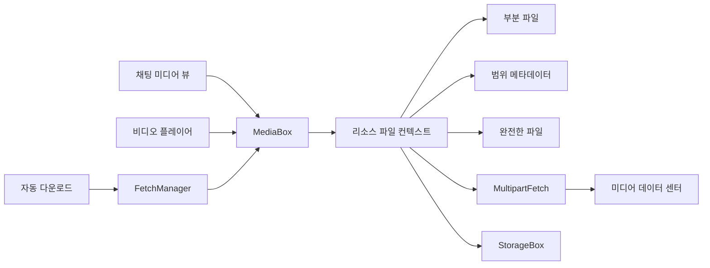
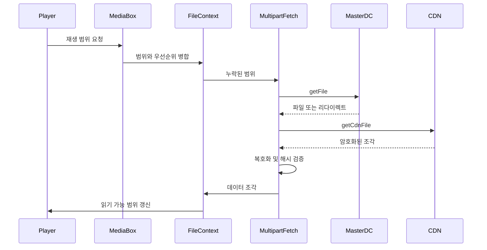
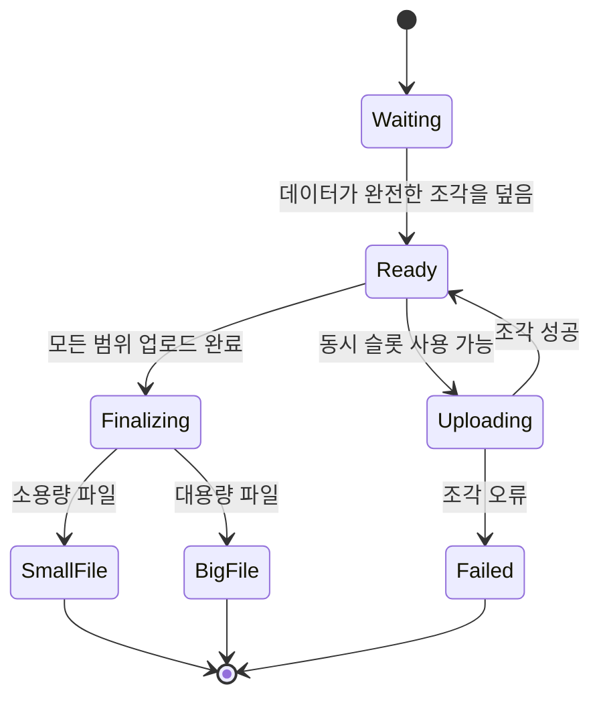
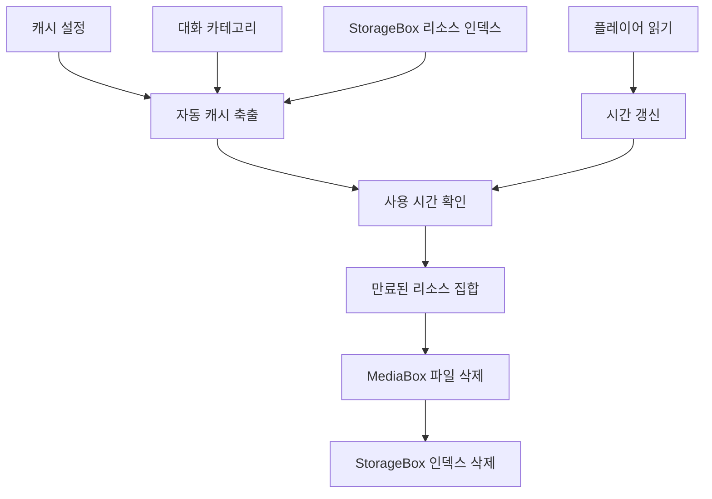

# 미디어 리소스, 다운로드/업로드, 캐시

웹: /docs/system/10-media-cache/ · Markdown: /docs/system/10-media-cache.md

> Telegram 클라이언트가 리소스 식별자와 분할 전송에서 캐시 축출까지 어떻게 구현하는지 따라가 봐요

> 시스템 설계 · 저장과 검색 · 10장 · 도표 4 · 코드 발췌 9 · 인용 32 · 소스 기준선: [TelegramMessenger/Telegram-iOS@f1dd7a2d](https://github.com/TelegramMessenger/Telegram-iOS/tree/f1dd7a2dbd02cbbf513e75d5695d8d36d1cf5838), [overtake/TelegramSwift@579cebbf](https://github.com/overtake/TelegramSwift/tree/579cebbf0c01fd41b712eff3647fa7f69db9665d)
>
> 관련 보충: [macOS fork 장별 검증(08–15장)](/docs/system/32-fork-verify-08-15/), [미디어 캐시의 용량 상한과 축출 순서](/docs/system/35-cache-eviction/)
>
> 핵심 소스 파일: [TelegramMessenger/Telegram-iOS/submodules/Postbox/Sources/MediaBox.swift](https://github.com/TelegramMessenger/Telegram-iOS/blob/f1dd7a2dbd02cbbf513e75d5695d8d36d1cf5838/submodules/Postbox/Sources/MediaBox.swift), [TelegramMessenger/Telegram-iOS/submodules/Postbox/Sources/MediaBoxFileContextV2Impl.swift](https://github.com/TelegramMessenger/Telegram-iOS/blob/f1dd7a2dbd02cbbf513e75d5695d8d36d1cf5838/submodules/Postbox/Sources/MediaBoxFileContextV2Impl.swift), [TelegramMessenger/Telegram-iOS/submodules/Postbox/Sources/StorageBox/StorageBox.swift](https://github.com/TelegramMessenger/Telegram-iOS/blob/f1dd7a2dbd02cbbf513e75d5695d8d36d1cf5838/submodules/Postbox/Sources/StorageBox/StorageBox.swift), [TelegramMessenger/Telegram-iOS/submodules/TelegramCore/Sources/Network/MultipartFetch.swift](https://github.com/TelegramMessenger/Telegram-iOS/blob/f1dd7a2dbd02cbbf513e75d5695d8d36d1cf5838/submodules/TelegramCore/Sources/Network/MultipartFetch.swift), [TelegramMessenger/Telegram-iOS/submodules/TelegramCore/Sources/Network/MultipartUpload.swift](https://github.com/TelegramMessenger/Telegram-iOS/blob/f1dd7a2dbd02cbbf513e75d5695d8d36d1cf5838/submodules/TelegramCore/Sources/Network/MultipartUpload.swift), [TelegramMessenger/Telegram-iOS/submodules/TelegramCore/Sources/State/CachedSentMediaReferences.swift](https://github.com/TelegramMessenger/Telegram-iOS/blob/f1dd7a2dbd02cbbf513e75d5695d8d36d1cf5838/submodules/TelegramCore/Sources/State/CachedSentMediaReferences.swift), [TelegramMessenger/Telegram-iOS/submodules/TelegramCore/Sources/PendingMessages/PendingMessageUploadedContent.swift](https://github.com/TelegramMessenger/Telegram-iOS/blob/f1dd7a2dbd02cbbf513e75d5695d8d36d1cf5838/submodules/TelegramCore/Sources/PendingMessages/PendingMessageUploadedContent.swift), [TelegramMessenger/Telegram-iOS/submodules/FetchManagerImpl/Sources/FetchManagerImpl.swift](https://github.com/TelegramMessenger/Telegram-iOS/blob/f1dd7a2dbd02cbbf513e75d5695d8d36d1cf5838/submodules/FetchManagerImpl/Sources/FetchManagerImpl.swift), [TelegramMessenger/Telegram-iOS/submodules/TelegramCore/Sources/Settings/AutodownloadSettings.swift](https://github.com/TelegramMessenger/Telegram-iOS/blob/f1dd7a2dbd02cbbf513e75d5695d8d36d1cf5838/submodules/TelegramCore/Sources/Settings/AutodownloadSettings.swift), [TelegramMessenger/Telegram-iOS/submodules/TelegramCore/Sources/SyncCore/SyncCore_CacheStorageSettings.swift](https://github.com/TelegramMessenger/Telegram-iOS/blob/f1dd7a2dbd02cbbf513e75d5695d8d36d1cf5838/submodules/TelegramCore/Sources/SyncCore/SyncCore_CacheStorageSettings.swift), [TelegramMessenger/Telegram-iOS/submodules/TelegramCore/Sources/Utils/AutomaticCacheEviction.swift](https://github.com/TelegramMessenger/Telegram-iOS/blob/f1dd7a2dbd02cbbf513e75d5695d8d36d1cf5838/submodules/TelegramCore/Sources/Utils/AutomaticCacheEviction.swift), [TelegramMessenger/Telegram-iOS/submodules/MediaPlayer/Sources/ChunkMediaPlayerDirectFetchSourceImpl.swift](https://github.com/TelegramMessenger/Telegram-iOS/blob/f1dd7a2dbd02cbbf513e75d5695d8d36d1cf5838/submodules/MediaPlayer/Sources/ChunkMediaPlayerDirectFetchSourceImpl.swift), [overtake/TelegramSwift/Telegram-Mac/AccountContext.swift](https://github.com/overtake/TelegramSwift/blob/579cebbf0c01fd41b712eff3647fa7f69db9665d/Telegram-Mac/AccountContext.swift), [overtake/TelegramSwift/Telegram-Mac/ClearCache.swift](https://github.com/overtake/TelegramSwift/blob/579cebbf0c01fd41b712eff3647fa7f69db9665d/Telegram-Mac/ClearCache.swift), [overtake/TelegramSwift/packages/FetchManager/Package.swift](https://github.com/overtake/TelegramSwift/blob/579cebbf0c01fd41b712eff3647fa7f69db9665d/packages/FetchManager/Package.swift), [overtake/TelegramSwift/packages/TelegramMedia/Package.swift](https://github.com/overtake/TelegramSwift/blob/579cebbf0c01fd41b712eff3647fa7f69db9665d/packages/TelegramMedia/Package.swift)
>
> 미검증 사항:
> - `AutodownloadSettings`가 읽는 서버의 active operations 필드가 다른 경로에서 iOS 다운로드 스케줄링에 영향을 주는지는 아직 미검증이에요.
> - macOS 툴체인에서 TelegramSwift를 아직 빌드하지 않았어요. `FetchManager`와 `TelegramMedia`의 패키지 그래프 해석과 컴파일 결과는 여전히 미검증이에요.

Telegram은 미디어 하나를 안정적으로 주소 지정할 수 있는 `MediaResource`로 추상화해요. 그리고 `MediaBox`(미디어 파일 캐시를 관리하는 객체)가 리소스 식별자로 디스크 파일, 이미 도착한 바이트 범위, 모든 읽기 주체를 한데 모아요.

이 설계의 핵심은 “다운로드가 끝나면 파일로 저장한다”가 아니에요. 이미지 디코더, 비디오 플레이어, 자동 다운로더, 수동 다운로드 진입점이 같은 부분 파일 위에서 함께 일하게 하는 거예요. 호출자는 원하는 범위를 선언하고, 하위 계층은 빈틈만 채워요. 완전한 파일이 아직 없을 때도 읽을 수 있는 연속 구간을 줄 수 있어요.[\[1\]](https://github.com/TelegramMessenger/Telegram-iOS/blob/f1dd7a2dbd02cbbf513e75d5695d8d36d1cf5838/submodules/Postbox/Sources/MediaBox.swift#L601-L637) [\[2\]](https://github.com/TelegramMessenger/Telegram-iOS/blob/f1dd7a2dbd02cbbf513e75d5695d8d36d1cf5838/submodules/Postbox/Sources/MediaBoxFileContextV2Impl.swift#L320-L610)

## 리소스 식별자, 파일 형태, 공유 읽기 [#리소스-식별자-파일-형태-공유-읽기]

### 리소스 식별자 하나가 로컬 상태 한 벌에 대응 [#리소스-식별자-하나가-로컬-상태-한-벌에-대응]

미디어 캐시가 먼저 풀어야 할 난제는 중복 제거예요. 문서 하나가 채팅 기록, 전달된 메시지, 미디어 라이브러리, 플레이어에 동시에 나타날 수 있어요. 메시지 인스턴스마다 따로 다운로드하면 네트워크, 디스크, 디코딩 캐시가 모두 중복으로 쓰여요.

`MediaResourceId`가 이 계층의 중복 제거 키예요. `MediaBox`는 `fileContexts` 딕셔너리를 유지해요. 키는 리소스 식별자이고 값은 `MediaBoxFileContext`예요.

- 첫 요청이 컨텍스트를 만들어요.
- 이후 요청은 같은 객체를 얻어요.
- 호출마다 참조가 하나 늘고, 마지막 참조가 해제되어야 딕셔너리에서 제거돼요.

그러니까 **같은 시점에 같은 리소스에는 부분 파일 컨텍스트와 하위 fetch가 하나뿐**이에요. 읽는 쪽마다 다운로드를 하나씩 여는 게 아니에요.[\[1\]](https://github.com/TelegramMessenger/Telegram-iOS/blob/f1dd7a2dbd02cbbf513e75d5695d8d36d1cf5838/submodules/Postbox/Sources/MediaBox.swift#L601-L637)

`MediaBox`는 리소스마다 이름은 같지만 역할이 다른 디스크 객체 세 가지를 유지해요.

- 완전한 파일
- `_partial`로 끝나는 희소 부분 파일(빈 구간을 디스크에 실제로 할당하지 않는 파일)
- `_partial.meta` 메타데이터 파일

파일의 주 이름은 `id.stringRepresentation`이에요. 완전한 파일은 `basePath` 아래에 두고, 부분 파일은 뒤에 `_partial`만 덧붙여요.[\[22\]](https://github.com/TelegramMessenger/Telegram-iOS/blob/f1dd7a2dbd02cbbf513e75d5695d8d36d1cf5838/submodules/Postbox/Sources/MediaBox.swift#L234-L258) 컨텍스트를 만들 때 세 경로를 touch(접근·수정 시각 갱신)해서, 시간 기반 정리가 이 파일들이 아직 쓰이고 있다는 걸 알게 해요.[\[1\]](https://github.com/TelegramMessenger/Telegram-iOS/blob/f1dd7a2dbd02cbbf513e75d5695d8d36d1cf5838/submodules/Postbox/Sources/MediaBox.swift#L601-L637)

읽기와 쓰기는 이렇게 파일을 골라요.

- 완전한 파일이 있으면 읽기는 바로 그 파일을 써요.
- 완전한 파일이 없으면 읽기와 쓰기는 부분 파일과 그 메타데이터를 써요.

이 이름 짓기 방식은 리소스 식별자에 별도의 해시를 적용하지 않아요. 그래서 리소스 식별자로 캐시 파일을 거꾸로 찾기 쉬워요. 대신 리소스 식별자 자체가 파일 이름 제약을 만족해야 해요.

`fileSizeForId`는 완전한 파일은 논리 크기로, 부분 파일은 할당된 크기로 집계해요.[\[21\]](https://github.com/overtake/TelegramSwift/blob/579cebbf0c01fd41b712eff3647fa7f69db9665d/Telegram-Mac/AccountContext.swift#L703-L713) 그래서 설정 화면에 보이는 부분 다운로드 점유량은 논리적인 파일 끝이 아니라 희소 파일이 실제로 차지하는 블록을 반영해요.

완료 상태와 다운로드 진행을 분리해서 “현재까지 기록된 바이트 수”를 “파일의 접두사 길이”로 오해하는 일을 피해요. 비디오는 아무 곳으로 점프하면 오프셋 0부터 이어서 받지 않고 중간 구간을 먼저 얻는 경우가 많아요.

`StorageBox`는 “이 바이트가 누구의 것인가”라는 의미를 보충해요. `fetchedResource`는 리소스 식별자를 메시지 위치에 있는 peer, 네임스페이스, 메시지 식별자와 연결하고 콘텐츠 유형을 덧붙여요. 메시지 위치가 없으면 peer가 0인 참조를 써요.[\[4\]](https://github.com/TelegramMessenger/Telegram-iOS/blob/f1dd7a2dbd02cbbf513e75d5695d8d36d1cf5838/submodules/Postbox/Sources/MediaBox.swift#L643-L696)

파일 경로는 내용만 나타내고, `StorageBox`의 인덱스는 그 내용을 어느 대화 기준으로 집계, 표시, 삭제할 수 있는지를 나타내요. 이렇게 콘텐츠 주소와 비즈니스 귀속을 분리하기 때문에 같은 리소스를 여러 메시지가 참조할 수 있고, 대화별 보존 정책도 가능해져요.

아래 도표는 리소스 하나에 여러 읽기 주체가 같은 부분 파일 컨텍스트로 들어가는 관계를 보여 줘요.



### 바이트 카운터가 아닌 범위 맵 [#바이트-카운터가-아닌-범위-맵]

부분 파일의 난제는 이어지지 않는 내용을 표현하는 거예요. `MediaBoxFileContextV2Impl`은 `RangeSet<Int64>`로 이미 있는 범위를 표현해요. 요청이 들어오면 이렇게 처리해요.

1. 읽기 주체마다 범위와 `MediaBoxFetchPriority`를 모아 우선순위로 정렬해요.
2. 처음부터 있던 범위를 빼요.
3. 남은 구간을 `PendingFetch` 하나에 넘겨요.
4. 요청 집합이 비면 그 fetch를 취소하고, 그렇지 않으면 같은 `PendingFetch`의 ranges 신호를 갱신해요.[\[2\]](https://github.com/TelegramMessenger/Telegram-iOS/blob/f1dd7a2dbd02cbbf513e75d5695d8d36d1cf5838/submodules/Postbox/Sources/MediaBoxFileContextV2Impl.swift#L320-L610)

덕분에 같은 리소스의 썸네일 프리페치와 재생 위치 읽기를 병합할 수 있고, 우선순위가 높은 범위를 전송 계층이 먼저 골라요.

범위 메타데이터는 크래시 복구 역할도 맡아요. 부분 파일의 데이터만으로는 어떤 구멍이 이미 채워졌는지 믿을 수 없어요. 그래서 메타데이터가 `fileMap`을 영속화하고, 여기에 ranges, 총 바이트, 선택적 진행률을 기록해요. 다음에 컨텍스트를 만들 때 희소 파일의 논리 길이를 믿지 않고 아직 비어 있는 구간부터 계속 요청할 수 있어요.

구현은 쓰기 실패도 재시도할 수 있는 Remote 상태로 바꿔요. 반쪽짜리 결과물을 로컬에서 완전한 콘텐츠로 선언하지 않아요.[\[2\]](https://github.com/TelegramMessenger/Telegram-iOS/blob/f1dd7a2dbd02cbbf513e75d5695d8d36d1cf5838/submodules/Postbox/Sources/MediaBoxFileContextV2Impl.swift#L320-L610)

이 설계의 대가는 두 가지예요. 리소스마다 메타데이터 파일이 적어도 하나 더 생겨요. 그리고 데이터 쓰기, 범위 병합, 메타데이터 디스크 기록 사이의 순서를 지켜야 해요.

`submodules/Postbox/Sources/MediaBoxFileContextV2Impl.swift` 320–386행 발췌.

```swift
var materializedRangeRequests: [MaterializedRangeRequest] = []
for (priority, ranges) in rangesByPriority.sorted(by: { $0.key.rawValue < $1.key.rawValue }) {
    let filteredRanges = ranges.subtracting(initialFilterRanges)
    for range in filteredRanges.ranges {
        materializedRangeRequests.append(MaterializedRangeRequest(range: range, priority: priority))
    }
}

if self.materializedRangeRequests != materializedRangeRequests {
    self.materializedRangeRequests = materializedRangeRequests
    // ...
    pendingFetch.ranges.set(.single(materializedRangeRequests.map { request -> (Range<Int64>, MediaBoxFetchPriority) in
        return (request.range, request.priority)
    }))
}
```

리소스 상태는 불리언이 아니에요. 컨텍스트는 구독자에게 `MediaResourceStatus`를 발행해요.

- 완전한 파일은 `Local`이에요.
- 부분 파일은 총 길이를 알면 `범위의 합 ÷ 총 길이`를 진행률로 줘요. 활성 fetch가 있으면 `Fetching`, 없으면 `Remote`예요.
- 총 길이를 모르면 기록된 진행률이나 0을 써요.[\[3\]](https://github.com/TelegramMessenger/Telegram-iOS/blob/f1dd7a2dbd02cbbf513e75d5695d8d36d1cf5838/submodules/Postbox/Sources/MediaBoxFileContextV2Impl.swift#L632-L729)

`resourceData`는 지정된 범위 하나를 “완전히 읽을 수 있음” 또는 “아직 읽을 수 없음”으로 보고할 수도 있어요.

- 완전한 파일이면 전체 경로와 잘라낸 범위를 반환해요.
- 부분 파일은 `fileMap.contains`가 요청 구간을 덮을 때만 읽을 수 있는 상태를 반환해요. 그렇지 않으면 size 0과 `complete: false`를 반환해요.[\[3\]](https://github.com/TelegramMessenger/Telegram-iOS/blob/f1dd7a2dbd02cbbf513e75d5695d8d36d1cf5838/submodules/Postbox/Sources/MediaBoxFileContextV2Impl.swift#L632-L729)

`submodules/Postbox/Sources/MediaBoxFileContextV2Impl.swift` 632–718행 발췌.

```swift
private func updatePartialDataRequest(request: PartialDataRequest) -> Bool {
    if self.isComplete, let size = fileSize(self.fullPath) {
        var clampedLowerBound = request.range.lowerBound
        var clampedUpperBound = request.range.upperBound
        if clampedUpperBound > size {
            clampedUpperBound = size
        }
        if clampedLowerBound > clampedUpperBound {
            clampedLowerBound = clampedUpperBound
        }
        let updatedStatus = MediaResourceData(path: self.fullPath, offset: clampedLowerBound, size: clampedUpperBound - clampedLowerBound, complete: true)
        // ...
    } else if self.fileMap.contains(request.range) != nil {
        let updatedStatus = MediaResourceData(path: self.partialPath, offset: request.range.lowerBound, size: request.range.upperBound - request.range.lowerBound, complete: true)
        if request.reportedStatus != updatedStatus {
            request.reportedStatus = updatedStatus
            request.next(updatedStatus)
        }
        return true
    }
    // ...
}
```

여기서 `complete`에는 두 층위가 있어요.

- `MediaResourceData.complete`: 그 **요청 범위**를 이미 읽을 수 있는지를 나타내요.
- `MediaResourceStatus.Local`: 리소스 전체가 이미 완전한 파일임을 나타내요.

호출자는 둘을 구분해야 해요. 전자를 파일 전체의 완료로 취급하면, 스트림 플레이어가 키프레임 주변만 캐시된 상태에서 순차 파일 읽기로 잘못 전환해요. 반대로 파일 전체가 완료된 뒤에만 읽게 하면 첫 프레임 시간과 드래그 경험이 나빠져요.

완료된 파일을 커밋하는 일도 플래그만 바꾸는 게 아니라 하나의 상태 전환이에요. `processMovedFile`은 순서대로 이렇게 해요.

1. `fullPath`의 크기를 확인해요.
2. `isComplete`를 설정해요.
3. `StorageBox`의 크기를 갱신해요.
4. `_partial`과 `.meta`를 지워요.[\[2\]](https://github.com/TelegramMessenger/Telegram-iOS/blob/f1dd7a2dbd02cbbf513e75d5695d8d36d1cf5838/submodules/Postbox/Sources/MediaBoxFileContextV2Impl.swift#L320-L610)

fetch가 완료를 보고했는데 완전한 파일이 없으면, 대기 중인 요청을 generic 오류로 마무리하도록 기다려요. 이렇게 해서 폐기된 범위 맵이 더 이상 데이터를 보관하지 않는 부분 파일을 계속 설명하는 일을 막아요. 대가는 완전한 커밋이 같은 큐를 거쳐야 한다는 점이에요. 그렇지 않으면 읽기 주체가 파일을 옮긴 뒤에도 오래된 meta를 볼 수 있어요.

### 임의 읽기가 파일에 닿는 과정 [#임의-읽기가-파일에-닿는-과정]

`MediaBox.internal_resourceData`는 읽기 경로에서 이렇게 동작해요.

1. 먼저 완전한 파일 열기를 시도해요. 범위를 파일 경계로 자르고 한 번에 읽는 상한은 64 MiB로 둬요.
2. 완전한 파일이 없으면 `MediaBoxPartialFile.internal_extractPartialData`를 호출해서 meta로 그 범위에 대한 부분 파일의 커버리지를 검증해요.[\[23\]](https://github.com/overtake/TelegramSwift/blob/579cebbf0c01fd41b712eff3647fa7f69db9665d/Telegram-Mac/ClearCache.swift#L42-L218)

그래서 읽기 경로 자체는 네트워크 요청을 시작하지 않아요. 범위를 가져오는 것과 범위를 읽는 것은 독립된 두 인터페이스예요. 전자는 취소할 수 있고 우선순위를 줄 수 있어요. 후자는 지금 연속 데이터가 있는지만 답해요. 덕분에 디스크 읽기가 네트워크에 막히지 않고, 플레이어가 자신의 프리패치 정책으로 다운로드를 움직일 수 있어요.

`fetchedResourceData`에서 `MediaResourceFetchParameters.isRandomAccessAllowed`가 거짓이면 `MediaBox`는 임의의 범위를 0부터 상한까지의 범위로 바꿔요.[\[4\]](https://github.com/TelegramMessenger/Telegram-iOS/blob/f1dd7a2dbd02cbbf513e75d5695d8d36d1cf5838/submodules/Postbox/Sources/MediaBox.swift#L643-L696)

이건 플레이어 계층의 추측이 아니라 능력 제약이에요. 임의 접근을 지원하는 리소스는 정확한 구간을 요청할 수 있고, 지원하지 않으면 순차적 파일 쓰기의 일관성을 보장해요. 이 선택은 일부 리소스의 임의 seek를 포기하는 대신, 서버의 임의 범위 의미에 기대지 않는 안전한 폴백을 얻어요.

`submodules/Postbox/Sources/MediaBox.swift` 704–734행 발췌.

```swift
public func internal_resourceData(id: MediaResourceId, size: Int64,
    in range: Range<Int64>) -> (file: ManagedFile, length: Int)? {
    let paths = self.storePathsForId(id)
    self.timeBasedCleanup.touch(paths: [paths.complete])
    if let file = ManagedFile(queue: nil, path: paths.complete, mode: .read),
       let completeSize = file.getSize() {
        let clippedLowerBound = min(completeSize, max(0, range.lowerBound))
        let clippedUpperBound = min(completeSize, max(0, range.upperBound))
        if clippedLowerBound < clippedUpperBound &&
            (clippedUpperBound - clippedLowerBound) <= 64 * 1024 * 1024 {
            let _ = file.seek(position: clippedLowerBound)
            return (file, Int(clippedUpperBound - clippedLowerBound))
        } else {
            return nil
        }
    } else {
        let tempManager = MediaBoxFileManager(queue: nil)
        return MediaBoxPartialFile.internal_extractPartialData(
            manager: tempManager, path: paths.partial,
            metaPath: paths.partial + ".meta", range: range)
    }
}
```

## 다운로드: 구간, 동시성, 신뢰할 수 없는 CDN [#다운로드-구간-동시성-신뢰할-수-없는-cdn]

### 읽기 주체의 의도에서 MTProto 요청까지 [#읽기-주체의-의도에서-mtproto-요청까지]

다운로드가 풀어야 할 문제는 단순한 HTTP 순차 스트림이 아니에요. 취소될 수 있는 참조가 가리키는 파일을 서로 다른 데이터 센터에서 가져오면서 미리 보기, 온라인 재생, 오프라인 저장을 동시에 만족시켜야 해요.

`multipartFetch`는 다음 입력을 받아요.

- 리소스
- 데이터 센터
- 선택적 총 크기
- 구간과 우선순위를 담은 `Signal`(비동기로 값을 내보내는 스트림)
- 선택적 암호화 정보

`network.useExperimentalFeatures`와 리소스 유형에 따라 V2와 V1 구현 중에서 골라요.[\[7\]](https://github.com/TelegramMessenger/Telegram-iOS/blob/f1dd7a2dbd02cbbf513e75d5695d8d36d1cf5838/submodules/TelegramCore/Sources/Network/MultipartFetch.swift#L1018-L1168)

`MediaBox`가 채워지지 않은 구간을 여기에 넘기면 `MultipartFetchManager`가 현재 미완성 구간에 맞춰 분할 조각을 투입해요. 먼저 도착한 뒤쪽 조각은 `fetchedParts`에 임시로 보관해요. 앞쪽에 요청 중인 조각이 없을 때만 오프셋 순서대로 전달해서, 단일 연속 구간의 쓰기 순서를 유지해요.[\[6\]](https://github.com/TelegramMessenger/Telegram-iOS/blob/f1dd7a2dbd02cbbf513e75d5695d8d36d1cf5838/submodules/TelegramCore/Sources/Network/MultipartFetch.swift#L760-L990)

조각 크기와 동시성은 리소스 크기에 따라 달라요. 일률적이지 않아요.

- 크기가 알려져 있고 512 KiB 이하인 일반 리소스: 16 KiB 조각과 16개의 병렬 part를 써요.
- 더 큰 일반 리소스: 512 KiB 조각과 8개의 병렬 part를 써요.
- 크기를 모르는 리소스: 128 KiB와 병렬 part 1개를 써요.
- 스토리 미디어: 512 KiB로 고정이고, 파일이 조각 하나를 넘으면 병렬 part 4개, 아니면 1개예요.[\[5\]](https://github.com/TelegramMessenger/Telegram-iOS/blob/f1dd7a2dbd02cbbf513e75d5695d8d36d1cf5838/submodules/TelegramCore/Sources/Network/MultipartFetch.swift#L1-L760)

이 값들은 프로토콜의 하드 제한이 아니라 클라이언트의 혼잡과 시작 지연 정책을 나타내요. 작은 리소스는 동시성을 키워 꼬리 지연을 줄이고, 큰 리소스는 요청 수를 줄여 요청 오버헤드를 통제해요. 길이를 모르면 EOF 전에 투기적 요청이 대량으로 생기는 것을 피해요. (추론)

다운로더는 비밀 채팅 파일을 위해 AES key, 가변 IV, 이미 복호화한 바이트 수, 선택적 평문 크기도 저장해요. `MultipartDownloadState.transform`은 key와 IV가 모두 32바이트일 때만 복호화하고, 전달된 오프셋이 이미 복호화한 크기와 정확히 같다고 단언해요.[\[5\]](https://github.com/TelegramMessenger/Telegram-iOS/blob/f1dd7a2dbd02cbbf513e75d5695d8d36d1cf5838/submodules/TelegramCore/Sources/Network/MultipartFetch.swift#L1-L760)

그래서 이 구현의 비밀 파일 경로는 연속 처리예요. CDN의 일반 파일처럼 중간으로 마음대로 점프한 뒤 독립적으로 변환할 수 없어요. 상위 범위 스케줄링은 이 제약을 지켜야 해요. 그 대가로 part마다 CBC IV를 갱신하는 단순화된 상태 머신을 얻어요.

서버 프로토콜은 업로드와 다운로드를 모두 조각 단위로 처리하도록 요구해요.

- 업로드: 공식 파일 규격은 part size가 1 KiB의 배수이면서 512 KiB를 나누어떨어지게 해야 한다고 정하고, 10 MiB를 넘으면 `upload.saveBigFilePart`를 쓰라고 해요.
- 다운로드: `upload.getFile`의 `offset`과 `limit`을 쓰고, `precise`와 CDN 지원을 선언할 수 있어요.[\[8\]](https://core.telegram.org/api/files)

클라이언트 코드는 CDN 경로에서 요청 길이를 4 KiB 단위로 올림하고, 1 MiB를 나누어떨어지게 하는 값까지 계속 조정해서 CDN의 정렬 제한을 맞춰요.[\[5\]](https://github.com/TelegramMessenger/Telegram-iOS/blob/f1dd7a2dbd02cbbf513e75d5695d8d36d1cf5838/submodules/TelegramCore/Sources/Network/MultipartFetch.swift#L1-L760) CDN이 아닌 정밀 범위에서는 전송 계층이 `MediaBox`가 넘긴 구간을 그대로 받아요. 그래서 재생 헤드 근처를 먼저 완료할 수 있고, 비디오 전체를 먼저 받을 필요가 없어요.

범위 우선순위와 네트워크 연결 우선순위는 달라요.

- `MediaBoxFileContextV2Impl`은 이미 캐시된 범위를 먼저 제거한 뒤 `MediaBoxFetchPriority.rawValue`로 정렬해요.
- `MultipartFetchManager`는 내부에서 아직 채워지지 않았거나 요청 중인 범위를 보고 다음 part를 정해요.[\[2\]](https://github.com/TelegramMessenger/Telegram-iOS/blob/f1dd7a2dbd02cbbf513e75d5695d8d36d1cf5838/submodules/Postbox/Sources/MediaBoxFileContextV2Impl.swift#L320-L610) [\[6\]](https://github.com/TelegramMessenger/Telegram-iOS/blob/f1dd7a2dbd02cbbf513e75d5695d8d36d1cf5838/submodules/TelegramCore/Sources/Network/MultipartFetch.swift#L760-L990)

이렇게 하면 같은 미디어의 재생 헤드, 첫 프레임, 백그라운드 전체 다운로드가 전송 상태 하나를 공유해요. 서로를 모르는 세 작업이 파일 쓰기를 다투는 일이 없어요. 대가는 관리자가 `currentFilledRanges`, `fetchingParts`, 임시 보관 결과를 유지해야 하고, 구독자가 요청 범위를 바꿀 때 작업 집합을 다시 계산해야 한다는 점이에요.

아래 도표는 범위 요청이 병합된 뒤 메인 DC 또는 CDN 다운로드가 부분 파일로 들어가는 호출 흐름을 보여 줘요.



### CDN 전환을 보증하는 것은 신뢰가 아니라 암호학 [#cdn-전환을-보증하는-것은-신뢰가-아니라-암호학]

CDN(콘텐츠 전송 네트워크)은 인기 있는 공개 미디어의 지역 간 전송 지연 문제를 풀어 줘요. 하지만 “엣지 노드를 믿으면 안 된다”는 문제도 따라와요. 공식 프로토콜은 CDN 파일이 AES-256-CTR을 쓰고, 각 조각은 기록하기 전에 메인 DC가 준 SHA-256 `FileHash`로 검증해야 한다고 분명히 적고 있어요. 대응하는 해시가 없으면 클라이언트는 `upload.getCdnFileHashes`를 호출해야 해요.[\[9\]](https://core.telegram.org/cdn)

이 장에서 고정한 업스트림 Telegram iOS는 메인 DC가 `fileCdnRedirect`를 반환하면 이렇게 처리해요. CDN DC, 토큰, 키, IV, hashes를 꺼내고 먼저 `cdnRedirectKeyMaterialIsValid`를 호출해요. 코드는 128 KiB로 단언되는 초기 hash 범위만 받아들인 뒤 CDN source로 전환해요.[\[5\]](https://github.com/TelegramMessenger/Telegram-iOS/blob/f1dd7a2dbd02cbbf513e75d5695d8d36d1cf5838/submodules/TelegramCore/Sources/Network/MultipartFetch.swift#L1-L760)

macOS fork의 차이: TelegramSwift가 고정한 `a24bbe45` fork도 리다이렉트를 파싱하고 초기 hash를 비우지만, `cdnRedirectKeyMaterialIsValid`를 호출하지 않고 곧바로 `.switchToCdn`을 반환해요. 그래서 키와 IV를 거부하는 로직은 이 장에서 읽은 더 새로운 업스트림에만 해당해요. fork의 동작으로 적으면 안 돼요. 자세한 내용은 [macOS fork 장별 검증(08–15장)](/docs/system/32-fork-verify-08-15/)을 참고하세요.[\[25\]](https://github.com/overtake/Telegram-iOS/blob/a24bbe45f9861f736a79916a50898512f751e0dc/submodules/TelegramCore/Sources/Network/MultipartFetch.swift#L370-L380)

`submodules/TelegramCore/Sources/Network/MultipartFetch.swift` 360–390행 발췌.

```swift
case let .fileCdnRedirect(fileCdnRedirectData):
    let (dcId, fileToken, encryptionKey, encryptionIv, partHashes) = (
        fileCdnRedirectData.dcId, fileCdnRedirectData.fileToken,
        fileCdnRedirectData.encryptionKey, fileCdnRedirectData.encryptionIv,
        fileCdnRedirectData.fileHashes)
    var parsedPartHashes: [Int64: Data] = [:]
    for part in partHashes {
        switch part {
        case let .fileHash(fileHashData):
            let (offset, limit, bytes) = (
                fileHashData.offset, fileHashData.limit, fileHashData.hash)
            assert(limit == 128 * 1024)
            parsedPartHashes[offset] = bytes.makeData()
        }
    }
    parsedPartHashes.removeAll()
    let key = encryptionKey.makeData()
    let iv = encryptionIv.makeData()
    if !cdnRedirectKeyMaterialIsValid(encryptionKey: key, encryptionIv: iv) {
        return .fail(.fatal)
    }
    return .fail(.switchToCdn(id: dcId, token: fileToken.makeData(),
        key: key, iv: iv, partHashes: parsedPartHashes))
```

위 코드는 `parsedPartHashes`를 만든 직후 비워요. 이것이 실제 구현이에요. 이걸 근거로 초기 리다이렉트의 해시가 그대로 보존된다고 주장하면 안 돼요. `MultipartCdnHashSource`의 초기화도 `hashes` 파라미터를 쓰지 않아요. 1 MiB cluster를 키로 `getCdnFileHashes` 요청을 공유하고, 반환된 128 KiB hash를 오프셋 딕셔너리에 넣어요.[\[5\]](https://github.com/TelegramMessenger/Telegram-iOS/blob/f1dd7a2dbd02cbbf513e75d5695d8d36d1cf5838/submodules/TelegramCore/Sources/Network/MultipartFetch.swift#L1-L760)

다시 말해 현재 소스는 필요할 때 메인 DC에서 해시를 가져와요. 리다이렉트에 들어 있던, 이미 파싱된 초기 hash는 믿지도 재사용하지도 않아요. 이 동작은 컨트롤 플레인 왕복을 늘리지만 hash가 없을 때의 처리 경로를 통일해요. (추론)

CDN 데이터 요청은 `upload.getCdnFile`을 써요. 암호문을 받으면 코드는 이렇게 처리해요.

1. 요청 offset을 16으로 나눈 빅 엔디언 값으로 IV의 마지막 네 바이트를 바꾼 뒤 `MTAesCtrDecrypt`를 호출해요.
2. 평문을 128 KiB 블록으로 잘라 블록마다 `MTSha256`을 계산해요.
3. 딕셔너리에 hash가 없거나 hash가 맞지 않으면 모두 generic 오류를 반환해요.[\[5\]](https://github.com/TelegramMessenger/Telegram-iOS/blob/f1dd7a2dbd02cbbf513e75d5695d8d36d1cf5838/submodules/TelegramCore/Sources/Network/MultipartFetch.swift#L1-L760)

그래서 `MediaBox`에 기록되는 것은 해시를 통과한 평문이에요. CDN의 원본 바이트가 아니에요. 공식 자료도 CDN의 보안 모델에 같은 요구를 하며, CDN을 신뢰할 수 있는 엔드포인트로 보면 안 된다고 설명해요.[\[9\]](https://core.telegram.org/cdn)

CDN이 `cdnFileReuploadNeeded`를 반환해도 클라이언트는 토큰을 CDN에 넘겨 재시도하지 않아요. 원래의 메인 DC에서 `upload.reuploadCdnFile` 요청으로 CDN 내용을 갱신하게 한 뒤 다시 `checkState`를 해요. 이 요청이 실패하면 빈 hash 목록으로 바뀌어서 상태 머신이 동기적으로 막히지 않고 계속 진행해요.[\[6\]](https://github.com/TelegramMessenger/Telegram-iOS/blob/f1dd7a2dbd02cbbf513e75d5695d8d36d1cf5838/submodules/TelegramCore/Sources/Network/MultipartFetch.swift#L760-L990)

CDN token이나 request token이 유효하지 않으면 공식 규격은 메인 DC의 `upload.getFile`로 돌아가라고 요구해요.[\[9\]](https://core.telegram.org/cdn) 소스의 source 이벤트는 이런 조건을 일반 조각 실패와 구분해요. 나중에 신뢰성 통계에서 엣지 캐시 무효화와 원본 미디어 읽기 불가를 구별할 때 유리해요.

### 파일 참조가 만료된 뒤의 재검증 [#파일-참조가-만료된-뒤의-재검증]

클라우드 문서와 사진의 위치에는 `file_reference`가 들어 있어요. 이 값은 서버 객체의 수명 주기에 따라 무효가 될 수 있어요. 그래서 다운로더는 입력 위치를 한 번만 저장해 두고 계속 쓸 수 없어요.

`multipartFetchV1`은 리소스마다 위치 클로저를 만들어요.

- 리소스가 주어진 file reference로 `apiInputLocation`을 만들 수 있으면 `.location`을 반환해요.
- 일부 아바타와 스티커 썸네일처럼 컨텍스트가 필요한데 유효한 위치를 얻지 못하면 `.revalidate`를 반환해요.[\[7\]](https://github.com/TelegramMessenger/Telegram-iOS/blob/f1dd7a2dbd02cbbf513e75d5695d8d36d1cf5838/submodules/TelegramCore/Sources/Network/MultipartFetch.swift#L1018-L1168)

만료가 일어나면 이렇게 복구해요.

1. 네트워크 계층이 `FILE_REFERENCE_EXPIRED` 계열 오류를 reference invalidation 이벤트로 바꿔요.
2. 이벤트를 받으면, 아직 재검증하지 않았고 `MediaReferenceRevalidationContext`가 있을 때 `revalidateMediaResourceReference`를 호출해요.
3. 반환된 `updatedResource`와 `updatedReference`로 현재 리소스와 참조를 바꾸고 다시 `checkState`에 들어가요.[\[6\]](https://github.com/TelegramMessenger/Telegram-iOS/blob/f1dd7a2dbd02cbbf513e75d5695d8d36d1cf5838/submodules/TelegramCore/Sources/Network/MultipartFetch.swift#L760-L990)

상태 머신은 `revalidatedMediaReference`와 `revalidatingMediaReference`로 재검증을 “아직 하지 않음”, “하는 중”, “이미 함”으로 구분해요.[\[5\]](https://github.com/TelegramMessenger/Telegram-iOS/blob/f1dd7a2dbd02cbbf513e75d5695d8d36d1cf5838/submodules/TelegramCore/Sources/Network/MultipartFetch.swift#L1-L760) [\[6\]](https://github.com/TelegramMessenger/Telegram-iOS/blob/f1dd7a2dbd02cbbf513e75d5695d8d36d1cf5838/submodules/TelegramCore/Sources/Network/MultipartFetch.swift#L760-L990) 재검증을 시작하기 전에 현재 `fetchingParts`를 비워요. 이전 참조의 응답과 새 참조의 응답이 같은 부분 파일에 섞여 기록되는 일을 막기 위해서예요.

컨텍스트가 없으면 코드는 reference invalidation 요청에 유효한 참조가 없다는 사실만 기록하고 무작정 재시도하지 않아요.[\[6\]](https://github.com/TelegramMessenger/Telegram-iOS/blob/f1dd7a2dbd02cbbf513e75d5695d8d36d1cf5838/submodules/TelegramCore/Sources/Network/MultipartFetch.swift#L760-L990) 이 실패 경로 때문에 상위 계층은 참조를 복구하기에 충분한 미디어 출처를 갖고 있어야 해요. API 모델에서 리소스 참조가 단순한 file id만 남을 수 없는 이유이기도 해요.

`submodules/TelegramCore/Sources/Network/MultipartFetch.swift` 927–978행 발췌.

```swift
// ...
strongSelf.revalidateMediaReferenceDisposable.set((revalidateMediaResourceReference(accountPeerId: strongSelf.accountPeerId, postbox: strongSelf.postbox, network: strongSelf.network, revalidationContext: revalidationContext, info: info, resource: strongSelf.resource)
|> deliverOn(strongSelf.queue)).start(next: { validationResult in
    if let strongSelf = self {
        strongSelf.revalidatingMediaReference = false
        strongSelf.revalidatedMediaReference = true
        if let validatedResource = validationResult.updatedResource as?
            TelegramCloudMediaResourceWithFileReference,
            let reference = validatedResource.fileReference {
            strongSelf.fileReference = reference
        }
        strongSelf.resource = validationResult.updatedResource
        if let reference = validationResult.updatedReference {
            strongSelf.resourceReference = .reference(reference)
        } else {
            strongSelf.resourceReference = .empty
        }
        strongSelf.checkState()
    }
}))
```

이 복구 경로의 경계는 중요해요. 오래된 메시지를 추측하거나 파일 위치를 위조해서 재시도하는 게 아니에요. 상위 계층이 미디어를 다시 찾아낼 수 있는 참조 컨텍스트를 제공해 주는 데 기대요.

업데이트 동기화가 메시지와 미디어 참조를 어떻게 최신으로 유지하는지는 [업데이트 동기화](/docs/system/06-update-sync/)를 참고하세요. TL 입력 위치와 그 생성 코드는 API 계층에 속해요. [TL 직렬화와 API 호출 계층](/docs/system/05-tl-api-layer/)을 참고하세요.

## 업로드: 스트리밍 입력을 받는 다중 조각 세션 [#업로드-스트리밍-입력을-받는-다중-조각-세션]

### 조각 상태 머신과 크기 경계 [#조각-상태-머신과-크기-경계]

업로드는 두 가지 충돌을 풀어야 해요. 호출자는 가능한 한 빨리 메시지를 보내고 싶어 해요. 하지만 프로토콜은 결국 part 수, 대용량 파일 여부, 소용량 파일의 MD5를 필요로 해요.

`MultipartUploadManager`는 완전한 `Data`만이 아니라 `Signal` 데이터 소스를 받아요. 기존 `MediaResource`, 메모리 데이터, 임시 파일, 커스텀 신호에서 올 수 있어요.[\[12\]](https://github.com/TelegramMessenger/Telegram-iOS/blob/f1dd7a2dbd02cbbf513e75d5695d8d36d1cf5838/submodules/TelegramCore/Sources/Network/MultipartUpload.swift#L406-L530) 덕분에 로컬 미디어가 아직 만들어지는 중에도 준비된 완전한 조각을 업로드할 수 있어요. 구현은 데이터가 완전하거나 지금 쓸 수 있는 길이가 기본 조각 하나를 딱 덮을 때만 요청을 보내요. 계속 자랄 수 있는 꼬리 부분을 최종 part로 취급하는 일을 피하려는 거예요.[\[11\]](https://github.com/TelegramMessenger/Telegram-iOS/blob/f1dd7a2dbd02cbbf513e75d5695d8d36d1cf5838/submodules/TelegramCore/Sources/Network/MultipartUpload.swift#L290-L376)

조각 크기는 생성 단계에서 파일 크기를 얼마나 아는지에 따라 달라요.

- 파일이 10 MiB보다 크다는 것을 알면 업로더는 512 KiB part를 고르고, 총 part 수를 미리 계산하며 `bigParts`를 표시해요.
- “아마 클 것”이라고만 알 때도 512 KiB를 고르지만 total part count는 미뤄요.
- 기본 스트리밍 업로드는 128 KiB를 쓰고, `useLargerParts`이면 256 KiB로 바꿔요.[\[10\]](https://github.com/TelegramMessenger/Telegram-iOS/blob/f1dd7a2dbd02cbbf513e75d5695d8d36d1cf5838/submodules/TelegramCore/Sources/Network/MultipartUpload.swift#L118-L241)
- 처음에 hint가 없다가 나중에 완전한 데이터를 받으면, 일반 소용량 파일은 part size를 16 KiB로 바꾸고, 10 MiB를 넘어야 대용량 파일의 512 KiB로 바꿔요.[\[10\]](https://github.com/TelegramMessenger/Telegram-iOS/blob/f1dd7a2dbd02cbbf513e75d5695d8d36d1cf5838/submodules/TelegramCore/Sources/Network/MultipartUpload.swift#L118-L241)

그래서 호출자가 size hint를 주는 것은 진행률 표시 최적화에 그치지 않아요. 업로드를 시작하는 단계의 조각 전략을 바꿔요.

병렬도도 생성자에 분명하게 인코딩되어 있어요. 기본은 업로드 슬롯 3개이고, `increaseParallelParts`이면 30개예요.[\[10\]](https://github.com/TelegramMessenger/Telegram-iOS/blob/f1dd7a2dbd02cbbf513e75d5695d8d36d1cf5838/submodules/TelegramCore/Sources/Network/MultipartUpload.swift#L118-L241) 이 30은 프로토콜의 약속이 아니라 호출 시나리오가 고른 상한이에요.

슬롯마다 같은 무작위 64비트 `fileId`와 증가하는 `partIndex`로 전송하고, 파일 식별자는 `arc4random_buf`로 만들어요.[\[10\]](https://github.com/TelegramMessenger/Telegram-iOS/blob/f1dd7a2dbd02cbbf513e75d5695d8d36d1cf5838/submodules/TelegramCore/Sources/Network/MultipartUpload.swift#L118-L241) 프로토콜은 클라이언트가 고유한 file id를 제공하기만 요구하고, 여러 로컬 큐와 연결이 병렬로 업로드하는 것을 허용해요.[\[8\]](https://core.telegram.org/api/files) 클라이언트가 동시성 제한을 manager에 두면 상위 계층은 의도만 선언하면 돼요. 실패도 `completed(nil)`로 일관되게 모을 수 있어요.

업로드 상태는 `uploadingParts`와 `uploadedParts`를 유지하고, 루프에서 업로드 중인 수를 `parallelParts`보다 작게 유지해요. 다음 part는 커밋된 오프셋, 업로드 중인 오프셋, 완료된 오프셋 중 최댓값을 취해 구해요. 성공하면 in-flight 기록을 지우고 업로드 완료 기록에 쓴 뒤 `checkState`를 호출해 빈자리를 채워요.[\[11\]](https://github.com/TelegramMessenger/Telegram-iOS/blob/f1dd7a2dbd02cbbf513e75d5695d8d36d1cf5838/submodules/TelegramCore/Sources/Network/MultipartUpload.swift#L290-L376)

0번 조각은 `headerPartState`도 구동해요. 그래서 커스텀 스트림의 데이터가 완전한 part 하나에 못 미치면 코드는 첫 구간의 특수 상태를 먼저 유지해요.[\[11\]](https://github.com/TelegramMessenger/Telegram-iOS/blob/f1dd7a2dbd02cbbf513e75d5695d8d36d1cf5838/submodules/TelegramCore/Sources/Network/MultipartUpload.swift#L290-L376) 이건 스트리밍 프로토콜 어댑터의 일종이에요. 임의의 꼬리를 전달할 수는 없지만 중간 구간은 동시에 진행할 수 있어요.

공식 프로토콜은 10 MiB를 넘는 파일을 big file로 분류하고, `saveBigFilePart`가 총 part 수를 추가로 담도록 요구해요. 소용량 파일의 최종 `InputFile`은 MD5를 담고, 대용량 파일의 `InputFileBig`은 MD5를 담지 않아요.[\[8\]](https://core.telegram.org/api/files)

iOS 업로더가 완료 지점에서 고르는 타입은 이래요.

- 일반 파일: `bigParts`와 `bigTotalParts`에 따라 `inputFileBig` 또는 `inputFile`을 골라요.
- 암호화 파일: 그에 맞춰 `inputEncryptedFileBigUploaded` 또는 `inputEncryptedFileUploaded`를 골라요. 암호화 파일의 핑거프린트는 AES key와 IV의 MD5 파생에서 나와요.[\[12\]](https://github.com/TelegramMessenger/Telegram-iOS/blob/f1dd7a2dbd02cbbf513e75d5695d8d36d1cf5838/submodules/TelegramCore/Sources/Network/MultipartUpload.swift#L406-L530)

이렇게 서버 프로토콜의 차이를 업로드 완료 지점에 모으기 때문에 상위 메시지 전송은 `InputFile` 또는 `InputEncryptedFile`만 쓰면 돼요. 메시지 전송이 이 결과를 대기 작업에 어떻게 넣는지는 [메시지 전송 파이프라인과 오프라인 작업 큐](/docs/system/07-message-send-pipeline/)를 참고하세요.

암호화 업로드는 바이트 수의 의미도 바꿔요. `MultipartUploadState.transform`은 AES key가 있으면 조각을 이렇게 처리해요.

- 조각에 무작위 바이트를 16바이트 정렬까지 채워요.
- 제자리에서 AES 암호화하며 IV를 갱신해요.
- 동시에 암호화 후의 `effectiveSize`를 누적해요.[\[10\]](https://github.com/TelegramMessenger/Telegram-iOS/blob/f1dd7a2dbd02cbbf513e75d5695d8d36d1cf5838/submodules/TelegramCore/Sources/Network/MultipartUpload.swift#L118-L241)

완료할 때는 이 유효 크기로 part 수를 계산해요. 키가 없으면 데이터 길이를 그대로 누적해요.[\[10\]](https://github.com/TelegramMessenger/Telegram-iOS/blob/f1dd7a2dbd02cbbf513e75d5695d8d36d1cf5838/submodules/TelegramCore/Sources/Network/MultipartUpload.swift#L118-L241) 그래서 암호화된 미디어의 전송 길이는 원본 파일 길이보다 클 수 있어요. 일반 파일의 MD5 로직을 비밀 파일에 그대로 옮길 수 없어요. 이 상태는 업로드 세션 안에만 저장돼요. 키의 수명 주기는 [종단 간 암호화와 로컬 보안](/docs/system/11-secret-chats-security/)을 참고하세요.

아래 도표는 스트리밍할 수 있는 데이터에서 업로더의 상태 전환을 보여 줘요.



`submodules/TelegramCore/Sources/Network/MultipartUpload.swift` 315–376행 발췌.

```swift
let partOffset = nextOffset
let partSize = min(resourceData.size - partOffset, self.defaultPartSize)
if nextOffset < resourceData.size && partSize > 0 && (resourceData.complete || partSize == self.defaultPartSize) {
    let partIndex = Int(partOffset / self.defaultPartSize)
    let partData: Data?
    // ...
    if let partData = partData {
        let partData = self.state.transform(data: partData)
        var currentBigTotalParts = self.bigTotalParts
        if self.bigParts && resourceData.complete && partOffset + partSize == resourceData.size {
            currentBigTotalParts = Int(resourceData.size / self.defaultPartSize) + (resourceData.size % self.defaultPartSize == 0 ? 0 : 1)
        }
        let part = self.uploadPart(UploadPart(fileId: self.fileId, index: partIndex, data: partData, bigTotalParts: currentBigTotalParts, bigPart: self.bigParts))
        |> deliverOn(self.queue)
        // ...
	}
}
```

### 전송된 미디어 참조 캐시로 중복 업로드 피하기 [#전송된-미디어-참조-캐시로-중복-업로드-피하기]

“캐시된 미디어”에는 헷갈리기 쉬운 층위가 하나 더 있어요. 파일 바이트를 캐시하는 게 아니라 서버가 이미 받아들인 미디어 참조를 캐시해요. `CachedSentMediaReferenceKey`는 이미지나 파일의 hash로 `ItemCacheEntryId`를 구성하고, 값은 `PostboxEncoder`로 인코딩한 `Media`예요.[\[13\]](https://github.com/TelegramMessenger/Telegram-iOS/blob/f1dd7a2dbd02cbbf513e75d5695d8d36d1cf5838/submodules/TelegramCore/Sources/State/CachedSentMediaReferences.swift#L1-L53)

파일을 보낼 때 `uploadedMediaFileContent`는 `forceReupload`가 없고 `fileReference`가 있는 `CloudDocumentMediaResource`를 얻으면, multipart upload에 다시 들어가지 않고 곧바로 `inputMediaDocument`를 만들어요. 이때 진행률은 1이 돼요.[\[14\]](https://github.com/TelegramMessenger/Telegram-iOS/blob/f1dd7a2dbd02cbbf513e75d5695d8d36d1cf5838/submodules/TelegramCore/Sources/PendingMessages/PendingMessageUploadedContent.swift#L1248-L1304)

이런 재사용은 중복 전달이나 같은 로컬 파일의 반복 전송에 드는 대역폭과 대기 시간을 줄여요. (추론)

캐시 키는 image와 file을 구분하고, 각각 `cachedSentMediaReferences` item collection에 기록해요.[\[13\]](https://github.com/TelegramMessenger/Telegram-iOS/blob/f1dd7a2dbd02cbbf513e75d5695d8d36d1cf5838/submodules/TelegramCore/Sources/State/CachedSentMediaReferences.swift#L1-L53) 그러니 여기에 저장되는 것은 전송에 성공한 뒤 API 입력을 다시 구성할 수 있는 미디어 모델이에요. 로컬 바이너리를 두 번째 파일 캐시로 저장하는 게 아니에요.

대가는 참조가 만료되므로 캐시만으로는 전송 가능성을 보장할 수 없다는 점이에요. 전송 경로는 `forceReupload`를 유지하고 다운로드 경로에는 media reference revalidation이 있어요. 이 둘을 함께 보면, “콘텐츠 hash가 같다”와 “지금 쓸 수 있는 서버 file reference가 있다”는 같은 사실이 아니라는 것을 인정하고 있어요.

`applyUpdateMessage`는 서버가 확인한 업데이트에서만 `storeMedia`를 이 캐시에 되써 넣어요.[\[13\]](https://github.com/TelegramMessenger/Telegram-iOS/blob/f1dd7a2dbd02cbbf513e75d5695d8d36d1cf5838/submodules/TelegramCore/Sources/State/CachedSentMediaReferences.swift#L1-L53) [\[14\]](https://github.com/TelegramMessenger/Telegram-iOS/blob/f1dd7a2dbd02cbbf513e75d5695d8d36d1cf5838/submodules/TelegramCore/Sources/PendingMessages/PendingMessageUploadedContent.swift#L1248-L1304) 그래서 캐시 쓰기는 서버가 메시지를 받아들인 뒤에 일어나요. 임의의 조각 몇 개를 올린 뒤에는 일어나지 않아요. 종단 간 암호화 파일의 업로드와 로컬 키 캡슐화에는 별도의 보안 경계가 있어요. [종단 간 암호화와 로컬 보안](/docs/system/11-secret-chats-security/)을 참고하세요.

## 스케줄링: 사용자 의도를 유한한 네트워크 작업으로 바꾸기 [#스케줄링-사용자-의도를-유한한-네트워크-작업으로-바꾸기]

### FetchManager가 상호작용 다운로드를 한데 모으는 방식 [#fetchmanager가-상호작용-다운로드를-한데-모으는-방식]

스케줄링 계층이 없으면 스크롤하는 목록이 한순간에 수백 개의 fetch를 일으킬 수 있어요. `FetchManagerImpl`은 category 단위로 컨텍스트를 가지고, `location`, 리소스 식별자, `locationKey`로 entry 식별자를 구성해요.

`interactiveFetch`를 호출할 때마다 reference, 범위, 우선순위가 하나씩 늘어요. 호출이 elevated로 표시되어 있으면 `elevatedPriorityReferenceCount`가 늘고, 취소할 때는 이 참조들을 대칭적으로 제거해요.[\[15\]](https://github.com/TelegramMessenger/Telegram-iOS/blob/f1dd7a2dbd02cbbf513e75d5695d8d36d1cf5838/submodules/FetchManagerImpl/Sources/FetchManagerImpl.swift#L1-L570) 그래서 같은 위치의 여러 UI 구독자가 entry 하나를 공유하고, 마지막 구독자가 떠난 뒤에 entry를 해제할 수 있어요.

`FetchManager`의 역할은 `MediaBox`를 대체하는 게 아니에요. 두 객체는 책임이 달라요.

- `FetchManager`: 사용자 동작 기준의 우선순위와 일시 정지를 관리해요.
- `MediaBox`: 바이트 범위 기준의 공유와 영속화를 맡아요.

interactive fetch를 취소한 뒤 관리자는 `mediaBox.cancelInteractiveResourceFetch`도 호출해요.[\[15\]](https://github.com/TelegramMessenger/Telegram-iOS/blob/f1dd7a2dbd02cbbf513e75d5695d8d36d1cf5838/submodules/FetchManagerImpl/Sources/FetchManagerImpl.swift#L1-L570) 이렇게 계층을 나누면 UI는 “이 다운로드 작업”을 취소할 수 있으면서도 플레이어나 자동 다운로더가 이미 등록한 다른 범위를 해치지 않아요. 대가는 리소스 상태가 관리자의 합성 상태와 `MediaBox.resourceStatus`에 동시에 영향을 받아서 전용 `fetchStatus` 브리지가 필요하다는 점이에요.

각 category context는 `priorityKey`가 가장 작고 일시 정지되지 않은 entry 하나를 top entry로 골라요. `priorityKey`에는 `locationKey`, elevated 여부, 마지막 사용자 발의 순번, 참조 집합 중 최고 우선순위가 들어 있어요.[\[15\]](https://github.com/TelegramMessenger/Telegram-iOS/blob/f1dd7a2dbd02cbbf513e75d5695d8d36d1cf5838/submodules/FetchManagerImpl/Sources/FetchManagerImpl.swift#L1-L570)

top entry가 활성화되면 요청 범위는 이렇게 정해져요.

- 사용자가 발의한 entry는 전체 범위를 요청해요.
- 다른 entry는 자신의 ranges를 합쳐서 요청해요.
- 특수 규칙 하나가 0부터 2 MiB까지의 두 구간을 비디오 프리로드로 알아보고 `preloadVideoResource`에 넘겨요. 프리로드 시간 파라미터는 4초예요.[\[15\]](https://github.com/TelegramMessenger/Telegram-iOS/blob/f1dd7a2dbd02cbbf513e75d5695d8d36d1cf5838/submodules/FetchManagerImpl/Sources/FetchManagerImpl.swift#L1-L570)

이걸 보면 manager의 큐는 단순한 FIFO가 아니에요. 사용자의 명시적 동작, 보이는 위치, 범위 유형을 정렬 키로 인코딩했어요.

entry를 일시 정지하면 관리자는 이렇게 처리해요.

1. top 표시를 제거해요.
2. 활성 다운로드를 dispose(구독 해제)해요.
3. 활성 컨텍스트에서 그 entry를 지워요.
4. 다음 작업을 다시 골라요.[\[15\]](https://github.com/TelegramMessenger/Telegram-iOS/blob/f1dd7a2dbd02cbbf513e75d5695d8d36d1cf5838/submodules/FetchManagerImpl/Sources/FetchManagerImpl.swift#L1-L570)

그래서 일시 정지는 UI 상태만 바꾸는 게 아니라 실제로 네트워크 구독을 거둬들여요. 리소스 상태 브리지는 원래의 Remote 상태를 `Paused` 또는 비활성 `Fetching`으로 바꿔요. 그래서 UI가 큐에서 대기 중인 상태를 스스로 추측할 필요가 없어요.[\[15\]](https://github.com/TelegramMessenger/Telegram-iOS/blob/f1dd7a2dbd02cbbf513e75d5695d8d36d1cf5838/submodules/FetchManagerImpl/Sources/FetchManagerImpl.swift#L1-L570) 이렇게 상태를 명시적으로 합성하는 방식은 “저장 상태”와 “스케줄링 상태”를 분리해야 하는 모든 다운로드 시스템에 적용할 수 있어요.

`submodules/FetchManagerImpl/Sources/FetchManagerImpl.swift` 788–834행 발췌.

```swift
assignedEpisode = entry.episode
if userInitiated {
    entry.userInitiated = true
}
let wasPaused = entry.isPaused
entry.isPaused = false
if let peerId = storeToDownloadsPeerId {
    entry.storeToDownloadsPeerId = peerId
}
assignedReferenceIndex = entry.references.add(priority)
if elevatedPriority {
    entry.elevatedPriorityReferenceCount += 1
}
assignedRangeIndex = entry.ranges.add(ranges)
if userInitiated && !wasPaused {
    let userInitiatedIndex = strongSelf.takeNextUserInitiatedIndex()
    assignedUserInitiatedIndex = userInitiatedIndex
    entry.userInitiatedPriorityIndices.removeAll()
    entry.userInitiatedPriorityIndices.append(userInitiatedIndex)
    entry.userInitiatedPriorityIndices.sort()
}
```

자동 다운로드 정책은 fetch manager에 하드코딩하지 않고 `AutodownloadSettings`가 처리해요. 서버 설정은 low, medium, high 세 가지 `AutodownloadPresetSettings`로 매핑되고, photo, video, file의 최대 크기와 `preloadLargeVideo`, 통화 데이터 절약 플래그를 포함해요.[\[16\]](https://github.com/TelegramMessenger/Telegram-iOS/blob/f1dd7a2dbd02cbbf513e75d5695d8d36d1cf5838/submodules/TelegramCore/Sources/Settings/AutodownloadSettings.swift#L21-L52)

같은 매핑은 서버가 반환하는 active operations 필드 두 개도 읽지만, 지금은 `AutodownloadPresetSettings`를 구성할 때 이 값을 보존하지 않아요.[\[16\]](https://github.com/TelegramMessenger/Telegram-iOS/blob/f1dd7a2dbd02cbbf513e75d5695d8d36d1cf5838/submodules/TelegramCore/Sources/Settings/AutodownloadSettings.swift#L21-L52) 그래서 이 파일을 근거로 서버의 크기별 큐 동시성 수가 iOS 클라이언트 스케줄링을 직접 움직인다고 단언할 수 없어요. (미검증)

이렇게 정책을 분리한 덕분에 네트워크 유형, 계정 설정, 제품 정책이 “다운로드를 등록할지”의 결정을 바꿀 수 있고, `FetchManager`는 등록된 작업의 정렬만 맡아요.

자동 다운로드 판단이 비디오를 프리로드할 가치가 있다고 보면 유한한 첫 구간 범위만 생기고, 전체 다운로드를 선언하지 않아요. 이후 FetchManager의 2 MiB 규칙과 플레이어 자신의 elevated 범위가 실행 방식을 더 정해요.[\[15\]](https://github.com/TelegramMessenger/Telegram-iOS/blob/f1dd7a2dbd02cbbf513e75d5695d8d36d1cf5838/submodules/FetchManagerImpl/Sources/FetchManagerImpl.swift#L1-L570) 이 2단계 설계는 제품의 “다운로드를 허용하는가”라는 문제와 런타임의 “지금 무엇을 다운로드하는가”라는 문제를 분리해요. 자동 다운로드 설정과 계정 공유 설정의 동기화는 [다중 계정, 로그인, 구성 동기화](/docs/system/14-accounts-auth-config/)를 참고하세요.

## 플레이어: 다운로드와 읽기를 분리한 스트리밍 비디오 [#플레이어-다운로드와-읽기를-분리한-스트리밍-비디오]

미디어 플레이어는 현재 재생 지점 주변의 바이트를 빠르게 얻어야 하고, 디코더가 쓰게 될 미래 데이터를 미리 요청해야 해요. `ChunkMediaPlayerDirectFetchSourceImpl`은 `FFMpegLookahead`를 만들 때 클로저 세 개를 연결해요.

- `fetchInRange`: `fetchedMediaResource`에 연결하고 elevated 우선순위를 표시해요.
- `getDataInRange`: `mediaBox.resourceData`에 연결해요.
- `isDataCachedInRange`: `internal_resourceDataIsCached`에 연결해요.[\[19\]](https://github.com/TelegramMessenger/Telegram-iOS/blob/f1dd7a2dbd02cbbf513e75d5695d8d36d1cf5838/submodules/MediaPlayer/Sources/ChunkMediaPlayerDirectFetchSourceImpl.swift#L620-L648)

이 세 클로저는 “신청”, “읽기”, “조회”라는 서로 다른 세 동작에 정확히 대응해요.

`submodules/MediaPlayer/Sources/ChunkMediaPlayerDirectFetchSourceImpl.swift` 620–648행 발췌.

```swift
self.lookahead = FFMpegLookahead(
    seekToTimestamp: position,
    lookaheadDuration: 10.0,
    updateState: updateState,
    fetchInRange: { range in
        return fetchedMediaResource(
            mediaBox: resource.postbox.mediaBox,
            userLocation: resource.userLocation,
            userContentType: resource.userContentType,
            reference: resource.reference,
            range: (range, .elevated),
            statsCategory: resource.statsCategory,
            preferBackgroundReferenceRevalidation: true
        ).startStrict()
    },
    getDataInRange: { range, completion in
        return resource.postbox.mediaBox.resourceData(resource.reference.resource, size: resourceSize, in: range, mode: .complete).start(next: { result, isComplete in
            completion(isComplete ? result : nil)
        })
    },
    // ...
)
```

lookahead(재생 위치 앞쪽을 미리 읽는 것)의 고정 프리패치 시간은 10초예요.[\[19\]](https://github.com/TelegramMessenger/Telegram-iOS/blob/f1dd7a2dbd02cbbf513e75d5695d8d36d1cf5838/submodules/MediaPlayer/Sources/ChunkMediaPlayerDirectFetchSourceImpl.swift#L620-L648) 이건 “10초 분량의 미디어 바이트를 다운로드한다”는 하드코딩이 아니에요. 실제 바이트 수는 비트레이트, 컨테이너 인덱스, seek 위치에 따라 달라지기 때문이에요.

플레이어는 `resourceData`가 범위가 완전하다고 답할 때만 `Data`를 디코더에 넘기고, 그렇지 않으면 콜백에 nil을 줘요. 이렇게 해서 FFmpeg가 구멍 뒤의 쓰레기 값이나 0으로 채워진 부분을 미디어 데이터로 잘못 읽는 것을 막아요. 대가는 비트레이트가 높거나 키프레임이 멀리 있는 비디오는 드래그한 뒤 잠깐 멈칫할 수 있다는 점이에요. 구현은 불완전한 범위를 완전한 버퍼처럼 꾸미기보다 정확성을 우선하는 쪽을 택했어요. (추론)

## 캐시 용량, 보존 기간, 축출 [#캐시-용량-보존-기간-축출]

### LRU만이 아니라 비즈니스 귀속으로 관리하기 [#lru만이-아니라-비즈니스-귀속으로-관리하기]

파일 시스템은 경로와 크기만 알지만, 사용자 설정은 보통 개인 채팅, 그룹, 채널, 스토리에 따라 보존 기간을 정해요. `CacheStorageSettings`는 기본 타임아웃, 기본 크기 상한, 각 `PeerStorageCategory`의 타임아웃 딕셔너리를 저장하고, 계정마다 peer 단위 예외가 따로 있어요.[\[17\]](https://github.com/TelegramMessenger/Telegram-iOS/blob/f1dd7a2dbd02cbbf513e75d5695d8d36d1cf5838/submodules/TelegramCore/Sources/SyncCore/SyncCore_CacheStorageSettings.swift#L4-L91)

기본값은 이래요.

- 개인 채팅: 영구
- 그룹: 31일
- 채널: 7일
- 스토리: 2일
- 기본 크기 상한: `Int32.max`[\[17\]](https://github.com/TelegramMessenger/Telegram-iOS/blob/f1dd7a2dbd02cbbf513e75d5695d8d36d1cf5838/submodules/TelegramCore/Sources/SyncCore/SyncCore_CacheStorageSettings.swift#L4-L91)

사용자 설정은 Codable 데이터로 저장돼요. 읽을 때 어떤 카테고리가 빠져 있으면 그 카테고리의 기본값으로 채워서, 이전 버전의 설정이 나중에 추가된 분류를 빠뜨리지 않아요.[\[17\]](https://github.com/TelegramMessenger/Telegram-iOS/blob/f1dd7a2dbd02cbbf513e75d5695d8d36d1cf5838/submodules/TelegramCore/Sources/SyncCore/SyncCore_CacheStorageSettings.swift#L4-L91)

`AutomaticCacheEviction`은 공유 설정과 계정별 설정을 구독한 뒤 peer를 열거해요. 채널은 채널 정보에 따라 groups 또는 channels 카테고리로도 매핑돼요.[\[18\]](https://github.com/TelegramMessenger/Telegram-iOS/blob/f1dd7a2dbd02cbbf513e75d5695d8d36d1cf5838/submodules/TelegramCore/Sources/Utils/AutomaticCacheEviction.swift#L79-L257) 먼저 peer마다 계정별 예외가 있는지 확인하고, 예외가 없을 때만 개인 채팅, 그룹, 채널 네임스페이스에 따라 카테고리 타임아웃을 골라요.[\[18\]](https://github.com/TelegramMessenger/Telegram-iOS/blob/f1dd7a2dbd02cbbf513e75d5695d8d36d1cf5838/submodules/TelegramCore/Sources/Utils/AutomaticCacheEviction.swift#L79-L257)

스토리는 같은 peer의 일반 미디어에서 분리되어 stories 타임아웃으로 따로 스캔돼요.[\[18\]](https://github.com/TelegramMessenger/Telegram-iOS/blob/f1dd7a2dbd02cbbf513e75d5695d8d36d1cf5838/submodules/TelegramCore/Sources/Utils/AutomaticCacheEviction.swift#L79-L257) 그래서 “같은 채팅 안의 수명이 짧은 story와 일반 첨부 파일”을 서로 다른 기한으로 회수할 수 있어요.

축출 작업은 그 peer의 스토리가 아닌 모든 리소스 식별자를 얻어 각 항목의 사용 타임스탬프를 읽고, 타임아웃 하한보다 이른 식별자를 삭제 목록에 넣어요. 루프는 리소스 100개를 처리할 때마다 취소 플래그를 확인해서, 대량의 캐시 정리를 멈출 수 없게 되는 일을 막아요.[\[18\]](https://github.com/TelegramMessenger/Telegram-iOS/blob/f1dd7a2dbd02cbbf513e75d5695d8d36d1cf5838/submodules/TelegramCore/Sources/Utils/AutomaticCacheEviction.swift#L79-L257)

이어서 순서대로 지워요.

1. 먼저 `mediaBox.removeCachedResourcesWithResult`로 캐시 파일을 지워요.
2. 실제로 지워진 식별자를 `StorageBox`에서 제거해요.[\[18\]](https://github.com/TelegramMessenger/Telegram-iOS/blob/f1dd7a2dbd02cbbf513e75d5695d8d36d1cf5838/submodules/TelegramCore/Sources/Utils/AutomaticCacheEviction.swift#L79-L257)

파일을 먼저 지우고 인덱스를 나중에 지우는 순서는, 인덱스는 사라졌는데 파일이 디스크에 남는 흔한 누수를 피해요. (추론) 스토리는 별도의 콘텐츠 유형과 타임아웃 경로를 쓰고, 기본값으로는 2일로 폴백해요.[\[17\]](https://github.com/TelegramMessenger/Telegram-iOS/blob/f1dd7a2dbd02cbbf513e75d5695d8d36d1cf5838/submodules/TelegramCore/Sources/SyncCore/SyncCore_CacheStorageSettings.swift#L4-L91) [\[18\]](https://github.com/TelegramMessenger/Telegram-iOS/blob/f1dd7a2dbd02cbbf513e75d5695d8d36d1cf5838/submodules/TelegramCore/Sources/Utils/AutomaticCacheEviction.swift#L79-L257)

아래 도표는 캐시 설정이 peer별 실제 축출을 어떻게 움직이는지 보여 줘요.



`submodules/TelegramCore/Sources/Utils/AutomaticCacheEviction.swift` 143–180행 발췌.

```swift
let id = MediaResourceId(String(data: resourceId, encoding: .utf8)!)
let resourceTimestamp = mediaBox.resourceUsageWithInfo(id: id)
if resourceTimestamp != 0 && resourceTimestamp < minPeerTimestamp {
    removeIds.append(id)
}

// ...
if !removeIds.isEmpty {
    let _ = mediaBox.removeCachedResourcesWithResult(removeIds).start(next: { actualIds in
        var actualRawIds: [Data] = []
        for id in actualIds {
            if let data = id.stringRepresentation.data(using: .utf8) {
                actualRawIds.append(data)
            }
        }
        mediaBox.storageBox.remove(ids: actualRawIds)
        subscriber.putCompletion()
    })
}
```

peer별 보존 기간 경로와 용량 경로는 활성 리소스를 다르게 다뤄요.

- peer별 보존 기간 경로는 `fileContexts`나 `keepResourceContexts`가 있는 리소스를 건너뛰어요.
- 용량 경로는 스캔한 파일을 곧바로 `unlink`해요. 갱신 시간이라는 간접적인 보호만 있을 뿐, 활성 리소스를 제외하는 동등한 보장은 없어요.[\[29\]](https://github.com/TelegramMessenger/Telegram-iOS/blob/f1dd7a2dbd02cbbf513e75d5695d8d36d1cf5838/submodules/Postbox/Sources/TimeBasedCleanup.swift#L367-L579) [\[30\]](https://github.com/TelegramMessenger/Telegram-iOS/blob/f1dd7a2dbd02cbbf513e75d5695d8d36d1cf5838/submodules/Postbox/Sources/MediaBox.swift#L1911-L1951)

용량 기반 정리와 시간 기반 정리는 서로를 대체할 수 없어요.

- 시간 정책은 “최근 N일만 보존한다”는 사용자의 기대에는 맞지만, 대형 그룹에서 비디오가 쏟아질 때 디스크를 통제하지 못해요.
- 용량 스캔은 한 번 실행에서 스캔한 논리 크기를 설정값 아래로 지울 수 있지만, 쓰기 시점의 하드 쿼터는 아니에요.

계정이 공유 설정을 처음 읽을 때 `setMaxStoreTimes`를 호출해요. 임계값이 바뀌면 정리기는 10초 지연 후 백그라운드 스캔을 한 번 시작해요. 주기적으로 반복하지 않고, 쓰기마다 총량을 검사하지도 않아요.[\[17\]](https://github.com/TelegramMessenger/Telegram-iOS/blob/f1dd7a2dbd02cbbf513e75d5695d8d36d1cf5838/submodules/TelegramCore/Sources/SyncCore/SyncCore_CacheStorageSettings.swift#L4-L91) [\[26\]](https://github.com/TelegramMessenger/Telegram-iOS/blob/f1dd7a2dbd02cbbf513e75d5695d8d36d1cf5838/submodules/TelegramCore/Sources/Account/Account.swift#L1558-L1567) [\[29\]](https://github.com/TelegramMessenger/Telegram-iOS/blob/f1dd7a2dbd02cbbf513e75d5695d8d36d1cf5838/submodules/Postbox/Sources/TimeBasedCleanup.swift#L367-L579)

스캔은 이 순서로 지워요.

1. 먼저 만료된 파일을 지워요.
2. 스캔 후의 논리 크기가 여전히 한도를 넘으면 파일 수정 시간이 오래된 것부터 임계값을 넘지 않을 때까지 지워요.

스캔은 `st_size`를 쓰고 타임스탬프와 증가하는 번호로 정렬해요. 크기, peer, 유형, 접근 횟수로는 정렬하지 않아요. 대략 최근 사용 시간 순으로 축출하는 방식이고, 엄격한 LRU(가장 오래 안 쓴 것부터 제거)도 LFU(가장 적게 쓴 것부터 제거)도 아니에요. 자세한 내용은 [미디어 캐시의 용량 상한과 축출 순서](/docs/system/35-cache-eviction/)를 참고하세요.[\[27\]](https://github.com/TelegramMessenger/Telegram-iOS/blob/f1dd7a2dbd02cbbf513e75d5695d8d36d1cf5838/submodules/Postbox/Sources/TimeBasedCleanup.swift#L89-L185) [\[28\]](https://github.com/TelegramMessenger/Telegram-iOS/blob/f1dd7a2dbd02cbbf513e75d5695d8d36d1cf5838/submodules/Postbox/Sources/TimeBasedCleanup.swift#L192-L303) [\[29\]](https://github.com/TelegramMessenger/Telegram-iOS/blob/f1dd7a2dbd02cbbf513e75d5695d8d36d1cf5838/submodules/Postbox/Sources/TimeBasedCleanup.swift#L367-L579)

Postbox의 하위 트랜잭션과 파일 관리 기초는 [Postbox 스토리지 엔진](/docs/system/08-postbox-storage/)을, 히스토리 뷰가 미디어 참조를 어떻게 유지하는지는 [Postbox 뷰와 메시지 이력 모델](/docs/system/09-postbox-views/)을 참고하세요.

macOS fork의 차이: `a24bbe45`에도 `TimeBasedCleanup`이 있고 지연 스캔과 파일 수정 시간 후보 표를 써요. 하지만 용량 구현은 현재 업스트림과 같지 않아요.

- fork는 short cache를 `totalLimitSize`에 넣지 않고, `general`이 무제한이면 general cache도 스캔하지 않아요.
- 중지 조건도 남은 크기가 여전히 임계값 이상일 때 false를 반환하는데, 업스트림과 반대예요.

그래서 “한 번 스캔으로 설정값 아래까지 지운다”는 말은 이 장에서 읽은 업스트림에만 해당해요. 해당 fork로 외삽할 수 없어요. 자세한 내용은 [미디어 캐시의 용량 상한과 축출 순서](/docs/system/35-cache-eviction/)를 참고하세요.[\[31\]](https://github.com/overtake/Telegram-iOS/blob/a24bbe45f9861f736a79916a50898512f751e0dc/submodules/Postbox/Sources/TimeBasedCleanup.swift#L78-L129) [\[32\]](https://github.com/overtake/Telegram-iOS/blob/a24bbe45f9861f736a79916a50898512f751e0dc/submodules/Postbox/Sources/TimeBasedCleanup.swift#L338-L513)

### macOS: 코어는 재사용하고 앱 계층의 작업 래퍼는 교체 [#macos-코어는-재사용하고-앱-계층의-작업-래퍼는-교체]

TelegramSwift의 `submodules/telegram-ios`는 overtake/Telegram-iOS의 `a24bbe45f9861f736a79916a50898512f751e0dc`로 체크아웃되어 있어요. 이 commit은 이 장에서 읽은 업스트림 commit보다 앞서요. 그래서 둘을 같은 구현으로 볼 수 없어요.

TelegramSwift는 이 fork로 Postbox, TelegramCore, FetchManager, 미디어 코어를 재사용해요. `packages/FetchManager/Package.swift`는 fork의 Postbox, SSignalKit, TelegramCore에 의존하지만 자체는 macOS의 `FetchManager` library target이에요.[\[20\]](https://github.com/overtake/TelegramSwift/blob/579cebbf0c01fd41b712eff3647fa7f69db9665d/packages/FetchManager/Package.swift#L6-L34) macOS 앱 계층은 `Telegram-Mac/AccountContext.swift`에서 `FetchManagerImpl`을 직접 만들고 `DownloadedMediaStoreManagerImpl`을 전달해요.[\[21\]](https://github.com/overtake/TelegramSwift/blob/579cebbf0c01fd41b712eff3647fa7f69db9665d/Telegram-Mac/AccountContext.swift#L703-L713) 이걸 보면 다운로드 우선순위와 리소스 공유는 여전히 같은 FetchManager 인터페이스를 따르고, “다운로드된 콘텐츠”는 데스크톱에서 독립된 store manager에 연결돼요. 자세한 내용은 [macOS fork 장별 검증(08–15장)](/docs/system/32-fork-verify-08-15/)을 참고하세요.[\[25\]](https://github.com/overtake/Telegram-iOS/blob/a24bbe45f9861f736a79916a50898512f751e0dc/submodules/TelegramCore/Sources/Network/MultipartFetch.swift#L370-L380)

macOS에는 `Telegram-Mac/ClearCache.swift`의 `AccountClearCache`도 따로 있어요. 큐 로컬 `CCContext`를 가지고, `run`과 `cancel`을 공개해서 정리 작업을 만들거나 멈춰요. `AccountContext`는 초기화할 때 이 cleaner를 보유해요.[\[21\]](https://github.com/overtake/TelegramSwift/blob/579cebbf0c01fd41b712eff3647fa7f69db9665d/Telegram-Mac/AccountContext.swift#L703-L713) [\[23\]](https://github.com/overtake/TelegramSwift/blob/579cebbf0c01fd41b712eff3647fa7f69db9665d/Telegram-Mac/ClearCache.swift#L42-L218)

정리 작업은 먼저 `MediaBox`의 활성 파일 컨텍스트를 얻고, `basePath`와 `basePath/cache`를 열거한 뒤, 리소스와 활성 컨텍스트에 없는 만료 파일을 지워요.[\[23\]](https://github.com/overtake/TelegramSwift/blob/579cebbf0c01fd41b712eff3647fa7f69db9665d/Telegram-Mac/ClearCache.swift#L42-L218) 이건 iOS의 peer별 자동 축출과 달라요. 여기서는 취소할 수 있는 계정 단위 정리 작업이에요.

`packages/TelegramMedia/Package.swift`는 독립된 macOS `TelegramMedia` library를 실제로 정의해요. 이 library는 다음에 의존해요.

- fork의 SSignalKit, TelegramCore, Postbox
- 같은 fork의 `MediaPlayer` 제품 `TelegramMediaPlayer`
- 데스크톱 쪽 TGUIKit, CallVideoLayer, WebP 바인딩[\[24\]](https://github.com/overtake/TelegramSwift/blob/579cebbf0c01fd41b712eff3647fa7f69db9665d/packages/TelegramMedia/Package.swift#L6-L56)

패키지 매니페스트는 배포 플랫폼을 macOS 10.13으로 제한해요. 미디어 표시에 필요한 데스크톱 UI 바인딩과 공유 전송 모듈을 target 하나로 조립하고, MultipartFetch나 MediaBox의 구현은 복사하지 않아요.[\[24\]](https://github.com/overtake/TelegramSwift/blob/579cebbf0c01fd41b712eff3647fa7f69db9665d/packages/TelegramMedia/Package.swift#L6-L56)

이 package의 의존성 선언은 경계의 위치도 보여 줘요. 네트워크와 캐시 관련 의존성은 모두 `submodules/telegram-ios/submodules` 아래의 공유 모듈을 가리켜요. TGUIKit과 CallVideoLayer는 macOS의 `packages` 디렉터리에서 와요.[\[24\]](https://github.com/overtake/TelegramSwift/blob/579cebbf0c01fd41b712eff3647fa7f69db9665d/packages/TelegramMedia/Package.swift#L6-L56)

그러니 데스크톱의 미디어 기능은 원격 서비스를 단순히 호출하는 게 아니에요. 로컬 Swift Package 그래프가 크로스 플랫폼 코어와 macOS 표시 코드를 조합한 거예요.

여기서 분명한 진화 경계가 생겨요. 다운로드 프로토콜, 범위 맵, 완전한 파일 전환은 fork의 공유 코어에서 업그레이드해야 해요. macOS는 `TelegramMedia`의 렌더링, 키보드 상호작용, 통화 화면 의존성을 독립적으로 진화시킬 수 있어요. (추론)

상대 경로 의존성은 지금은 바로 읽을 수 있지만, 이 글은 macOS 툴체인에서 이 package들을 빌드하지 않았어요. 그래서 패키지 그래프가 해석되고 컴파일을 통과하는지는 여전히 미검증이에요. macOS의 프로세스, 샌드박스, 시스템 통합 차이는 [macOS 클라이언트의 시스템 계층](/docs/system/15-macos-system-layer/)을 참고하세요.

## 설계 트레이드오프 [#설계-트레이드오프]

Telegram의 미디어 계층은 네 가지 질문을 네 객체로 나눠요.

- “리소스가 무엇인가”: `MediaResource`
- “어느 바이트를 읽을 수 있는가”: `MediaBoxFileContext`
- “누가 요청하는가”: `FetchManager`
- “얼마나 보존해야 하는가”: `StorageBox`

이렇게 나누면 상태, 신호, 메타데이터가 더 많이 생겨요. 대신 스트리밍 재생, 중복 참조, 대화별 정리가 같은 단일 사실 출처를 공유해요.[\[1\]](https://github.com/TelegramMessenger/Telegram-iOS/blob/f1dd7a2dbd02cbbf513e75d5695d8d36d1cf5838/submodules/Postbox/Sources/MediaBox.swift#L601-L637) [\[2\]](https://github.com/TelegramMessenger/Telegram-iOS/blob/f1dd7a2dbd02cbbf513e75d5695d8d36d1cf5838/submodules/Postbox/Sources/MediaBoxFileContextV2Impl.swift#L320-L610)

재사용할 수 있는 시스템에서 가장 중요한 경계는 이거예요. 범위를 읽을 수 있다고 파일이 완성된 것은 아니고, 서버 참조를 쓸 수 있다고 콘텐츠 hash가 같은 것은 아니며, 캐시 파일이 있다고 계속 보존해야 하는 것도 아니에요.

다운로더는 CDN의 키, 해시, 재업로드를 처리하는 수고를 마다하지 않아요. 엣지 노드를 신뢰할 수 있는 출처로 취급하지 않아요.[\[5\]](https://github.com/TelegramMessenger/Telegram-iOS/blob/f1dd7a2dbd02cbbf513e75d5695d8d36d1cf5838/submodules/TelegramCore/Sources/Network/MultipartFetch.swift#L1-L760) [\[9\]](https://core.telegram.org/cdn) 업로더는 small 파일과 big 파일의 두 프로토콜 출구를 유지하는 쪽을 택하고, MD5와 총 part 수를 상위 메시지 로직이 추측하게 하지 않아요.[\[8\]](https://core.telegram.org/api/files) [\[12\]](https://github.com/TelegramMessenger/Telegram-iOS/blob/f1dd7a2dbd02cbbf513e75d5695d8d36d1cf5838/submodules/TelegramCore/Sources/Network/MultipartUpload.swift#L406-L530)

이런 선택은 구현 복잡도를 높여요. 대신 네트워크 장애, 참조 만료, 캐시 축출의 복구 경계를 충분한 컨텍스트를 가진 계층에 둬요.

엔지니어링 팀이 가장 재사용할 만한 것은 16 KiB나 512 KiB 같은 구체적인 파라미터가 아니에요. 더 중요한 것은 범위, 우선순위, 리소스 귀속, 무결성 검증을 관찰할 수 있는 독립 상태로 만드는 거예요. 그러면 튜닝할 때 다운로드 동시성이나 보존 기간을 바꾸더라도 플레이어가 파일을 읽는 정확성 조건은 고치지 않아도 돼요. 반대로 이런 결정을 다운로드 함수 하나에 밀어 넣으면 장애 복구와 제품 정책이 서로 얽혀서 결국 테스트하기 어려워져요. (추론)

반대로 이런 결정을 다운로드 함수 하나에 밀어 넣으면 장애 복구와 제품 정책이 서로 얽혀서 결국 테스트하기 어려워져요. (추론)

## 미검증 사항 [#미검증-사항]

- `AutodownloadSettings`가 읽는 서버의 active operations 필드가 다른 경로에서 iOS 다운로드 스케줄링에 영향을 주는지는 아직 미검증이에요.
- macOS 툴체인에서 TelegramSwift를 아직 빌드하지 않았어요. `FetchManager`와 `TelegramMedia`의 패키지 그래프 해석과 컴파일 결과는 여전히 미검증이에요.

## 참고 자료 [#references]

- \[1\] [Postbox MediaBox.swift L601-637](https://github.com/TelegramMessenger/Telegram-iOS/blob/f1dd7a2dbd02cbbf513e75d5695d8d36d1cf5838/submodules/Postbox/Sources/MediaBox.swift#L601-L637)
- \[2\] [Postbox MediaBoxFileContextV2Impl.swift L320-610](https://github.com/TelegramMessenger/Telegram-iOS/blob/f1dd7a2dbd02cbbf513e75d5695d8d36d1cf5838/submodules/Postbox/Sources/MediaBoxFileContextV2Impl.swift#L320-L610)
- \[3\] [Postbox MediaBoxFileContextV2Impl.swift L632-729](https://github.com/TelegramMessenger/Telegram-iOS/blob/f1dd7a2dbd02cbbf513e75d5695d8d36d1cf5838/submodules/Postbox/Sources/MediaBoxFileContextV2Impl.swift#L632-L729)
- \[4\] [Postbox MediaBox.swift L643-696](https://github.com/TelegramMessenger/Telegram-iOS/blob/f1dd7a2dbd02cbbf513e75d5695d8d36d1cf5838/submodules/Postbox/Sources/MediaBox.swift#L643-L696)
- \[5\] [TelegramCore MultipartFetch.swift L1-760](https://github.com/TelegramMessenger/Telegram-iOS/blob/f1dd7a2dbd02cbbf513e75d5695d8d36d1cf5838/submodules/TelegramCore/Sources/Network/MultipartFetch.swift#L1-L760)
- \[6\] [TelegramCore MultipartFetch.swift L760-990](https://github.com/TelegramMessenger/Telegram-iOS/blob/f1dd7a2dbd02cbbf513e75d5695d8d36d1cf5838/submodules/TelegramCore/Sources/Network/MultipartFetch.swift#L760-L990)
- \[7\] [TelegramCore MultipartFetch.swift L1018-1168](https://github.com/TelegramMessenger/Telegram-iOS/blob/f1dd7a2dbd02cbbf513e75d5695d8d36d1cf5838/submodules/TelegramCore/Sources/Network/MultipartFetch.swift#L1018-L1168)
- \[8\] [Telegram API files](https://core.telegram.org/api/files)
- \[9\] [Telegram CDN](https://core.telegram.org/cdn)
- \[10\] [TelegramCore MultipartUpload.swift L118-241](https://github.com/TelegramMessenger/Telegram-iOS/blob/f1dd7a2dbd02cbbf513e75d5695d8d36d1cf5838/submodules/TelegramCore/Sources/Network/MultipartUpload.swift#L118-L241)
- \[11\] [TelegramCore MultipartUpload.swift L290-376](https://github.com/TelegramMessenger/Telegram-iOS/blob/f1dd7a2dbd02cbbf513e75d5695d8d36d1cf5838/submodules/TelegramCore/Sources/Network/MultipartUpload.swift#L290-L376)
- \[12\] [TelegramCore MultipartUpload.swift L406-530](https://github.com/TelegramMessenger/Telegram-iOS/blob/f1dd7a2dbd02cbbf513e75d5695d8d36d1cf5838/submodules/TelegramCore/Sources/Network/MultipartUpload.swift#L406-L530)
- \[13\] [TelegramCore CachedSentMediaReferences.swift L1-53](https://github.com/TelegramMessenger/Telegram-iOS/blob/f1dd7a2dbd02cbbf513e75d5695d8d36d1cf5838/submodules/TelegramCore/Sources/State/CachedSentMediaReferences.swift#L1-L53)
- \[14\] [TelegramCore PendingMessageUploadedContent.swift L1248-1304](https://github.com/TelegramMessenger/Telegram-iOS/blob/f1dd7a2dbd02cbbf513e75d5695d8d36d1cf5838/submodules/TelegramCore/Sources/PendingMessages/PendingMessageUploadedContent.swift#L1248-L1304)
- \[15\] [FetchManagerImpl FetchManagerImpl.swift L1-570](https://github.com/TelegramMessenger/Telegram-iOS/blob/f1dd7a2dbd02cbbf513e75d5695d8d36d1cf5838/submodules/FetchManagerImpl/Sources/FetchManagerImpl.swift#L1-L570)
- \[16\] [TelegramCore AutodownloadSettings.swift L21-52](https://github.com/TelegramMessenger/Telegram-iOS/blob/f1dd7a2dbd02cbbf513e75d5695d8d36d1cf5838/submodules/TelegramCore/Sources/Settings/AutodownloadSettings.swift#L21-L52)
- \[17\] [TelegramCore SyncCore CacheStorageSettings.swift L4-91](https://github.com/TelegramMessenger/Telegram-iOS/blob/f1dd7a2dbd02cbbf513e75d5695d8d36d1cf5838/submodules/TelegramCore/Sources/SyncCore/SyncCore_CacheStorageSettings.swift#L4-L91)
- \[18\] [TelegramCore AutomaticCacheEviction.swift L79-257](https://github.com/TelegramMessenger/Telegram-iOS/blob/f1dd7a2dbd02cbbf513e75d5695d8d36d1cf5838/submodules/TelegramCore/Sources/Utils/AutomaticCacheEviction.swift#L79-L257)
- \[19\] [MediaPlayer ChunkMediaPlayerDirectFetchSourceImpl.swift L620-648](https://github.com/TelegramMessenger/Telegram-iOS/blob/f1dd7a2dbd02cbbf513e75d5695d8d36d1cf5838/submodules/MediaPlayer/Sources/ChunkMediaPlayerDirectFetchSourceImpl.swift#L620-L648)
- \[20\] [TelegramSwift FetchManager Package.swift L6-34](https://github.com/overtake/TelegramSwift/blob/579cebbf0c01fd41b712eff3647fa7f69db9665d/packages/FetchManager/Package.swift#L6-L34)
- \[21\] [TelegramSwift AccountContext.swift L703-713](https://github.com/overtake/TelegramSwift/blob/579cebbf0c01fd41b712eff3647fa7f69db9665d/Telegram-Mac/AccountContext.swift#L703-L713)
- \[22\] [Postbox MediaBox.swift L234-258](https://github.com/TelegramMessenger/Telegram-iOS/blob/f1dd7a2dbd02cbbf513e75d5695d8d36d1cf5838/submodules/Postbox/Sources/MediaBox.swift#L234-L258)
- \[23\] [TelegramSwift ClearCache.swift L42-218](https://github.com/overtake/TelegramSwift/blob/579cebbf0c01fd41b712eff3647fa7f69db9665d/Telegram-Mac/ClearCache.swift#L42-L218)
- \[24\] [TelegramSwift TelegramMedia Package.swift L6-56](https://github.com/overtake/TelegramSwift/blob/579cebbf0c01fd41b712eff3647fa7f69db9665d/packages/TelegramMedia/Package.swift#L6-L56)
- \[25\] [fork CDN redirect without key-material validation](https://github.com/overtake/Telegram-iOS/blob/a24bbe45f9861f736a79916a50898512f751e0dc/submodules/TelegramCore/Sources/Network/MultipartFetch.swift#L370-L380)
- \[26\] [upstream account initial cache-settings read](https://github.com/TelegramMessenger/Telegram-iOS/blob/f1dd7a2dbd02cbbf513e75d5695d8d36d1cf5838/submodules/TelegramCore/Sources/Account/Account.swift#L1558-L1567)
- \[27\] [upstream size candidate time ordering](https://github.com/TelegramMessenger/Telegram-iOS/blob/f1dd7a2dbd02cbbf513e75d5695d8d36d1cf5838/submodules/Postbox/Sources/TimeBasedCleanup.swift#L89-L185)
- \[28\] [upstream scan logical file size and modification time](https://github.com/TelegramMessenger/Telegram-iOS/blob/f1dd7a2dbd02cbbf513e75d5695d8d36d1cf5838/submodules/Postbox/Sources/TimeBasedCleanup.swift#L192-L303)
- \[29\] [upstream one-shot delayed cleanup and capacity eviction](https://github.com/TelegramMessenger/Telegram-iOS/blob/f1dd7a2dbd02cbbf513e75d5695d8d36d1cf5838/submodules/Postbox/Sources/TimeBasedCleanup.swift#L367-L579)
- \[30\] [MediaBox active-resource exclusion for explicit cache deletion](https://github.com/TelegramMessenger/Telegram-iOS/blob/f1dd7a2dbd02cbbf513e75d5695d8d36d1cf5838/submodules/Postbox/Sources/MediaBox.swift#L1911-L1951)
- \[31\] [fork modification-time candidate table](https://github.com/overtake/Telegram-iOS/blob/a24bbe45f9861f736a79916a50898512f751e0dc/submodules/Postbox/Sources/TimeBasedCleanup.swift#L78-L129)
- \[32\] [fork delayed scan and divergent capacity loop](https://github.com/overtake/Telegram-iOS/blob/a24bbe45f9861f736a79916a50898512f751e0dc/submodules/Postbox/Sources/TimeBasedCleanup.swift#L338-L513)
