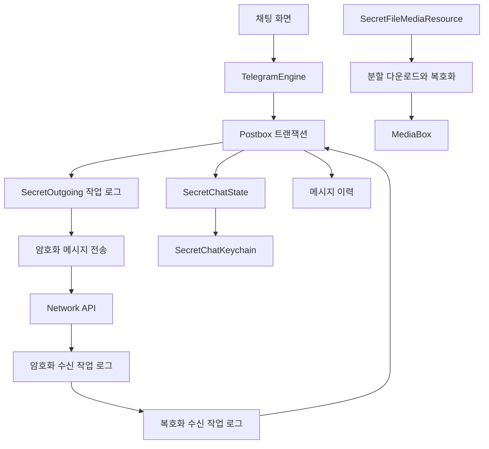
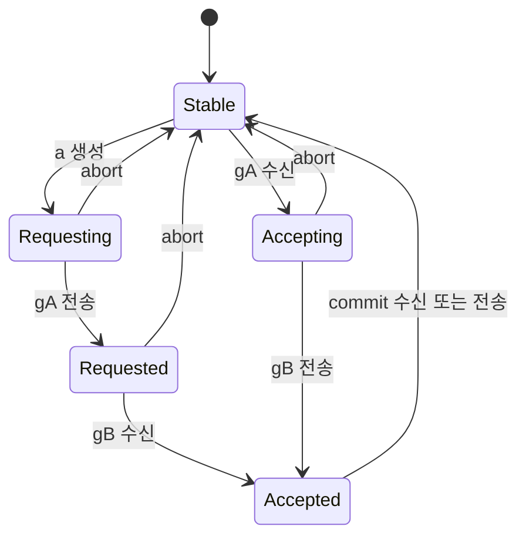
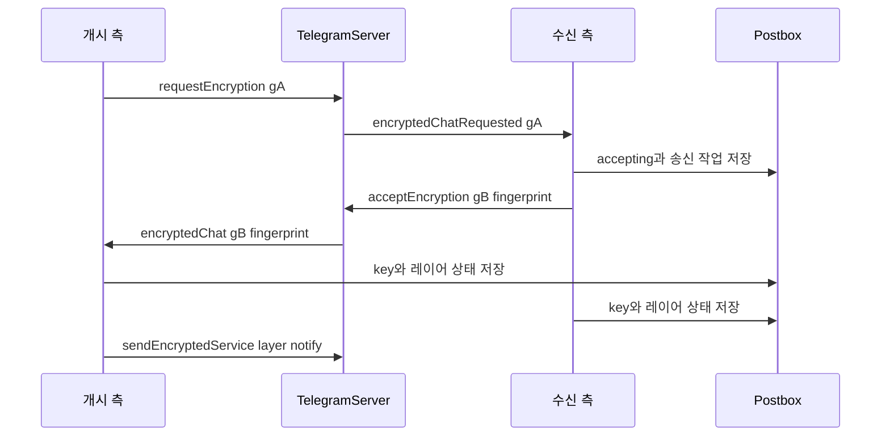

# 종단 간 암호화와 로컬 보안

웹: /docs/system/11-secret-chats-security/ · Markdown: /docs/system/11-secret-chats-security.md

> 비밀 채팅의 키 상태, 메시지 암호화, 로컬 데이터 보호 설계.

> 시스템 설계 · 보안과 시스템 통합 · 11장 · 도표 3 · 코드 발췌 10 · 인용 32 · 소스 기준선: [TelegramMessenger/Telegram-iOS@f1dd7a2d](https://github.com/TelegramMessenger/Telegram-iOS/tree/f1dd7a2dbd02cbbf513e75d5695d8d36d1cf5838), [overtake/TelegramSwift@579cebbf](https://github.com/overtake/TelegramSwift/tree/579cebbf0c01fd41b712eff3647fa7f69db9665d)
>
> 관련 보충: [macOS fork 장별 검증(08–15장)](/docs/system/32-fork-verify-08-15/), [비밀 채팅 자동 키 교체의 트리거 지점](/docs/system/36-auto-pfs/)
>
> 핵심 소스 파일: [TelegramMessenger/Telegram-iOS/submodules/TelegramCore/Sources/SyncCore/SyncCore_SecretChatState.swift](https://github.com/TelegramMessenger/Telegram-iOS/blob/f1dd7a2dbd02cbbf513e75d5695d8d36d1cf5838/submodules/TelegramCore/Sources/SyncCore/SyncCore_SecretChatState.swift), [TelegramMessenger/Telegram-iOS/submodules/TelegramCore/Sources/SyncCore/SyncCore_SecretChatKeychain.swift](https://github.com/TelegramMessenger/Telegram-iOS/blob/f1dd7a2dbd02cbbf513e75d5695d8d36d1cf5838/submodules/TelegramCore/Sources/SyncCore/SyncCore_SecretChatKeychain.swift), [TelegramMessenger/Telegram-iOS/submodules/TelegramCore/Sources/SecretChats/UpdateSecretChat.swift](https://github.com/TelegramMessenger/Telegram-iOS/blob/f1dd7a2dbd02cbbf513e75d5695d8d36d1cf5838/submodules/TelegramCore/Sources/SecretChats/UpdateSecretChat.swift), [TelegramMessenger/Telegram-iOS/submodules/TelegramCore/Sources/SecretChats/SecretChatEncryption.swift](https://github.com/TelegramMessenger/Telegram-iOS/blob/f1dd7a2dbd02cbbf513e75d5695d8d36d1cf5838/submodules/TelegramCore/Sources/SecretChats/SecretChatEncryption.swift), [TelegramMessenger/Telegram-iOS/submodules/TelegramCore/Sources/SecretChats/SecretChatIncomingEncryptedOperation.swift](https://github.com/TelegramMessenger/Telegram-iOS/blob/f1dd7a2dbd02cbbf513e75d5695d8d36d1cf5838/submodules/TelegramCore/Sources/SecretChats/SecretChatIncomingEncryptedOperation.swift), [TelegramMessenger/Telegram-iOS/submodules/TelegramCore/Sources/State/ManagedSecretChatOutgoingOperations.swift](https://github.com/TelegramMessenger/Telegram-iOS/blob/f1dd7a2dbd02cbbf513e75d5695d8d36d1cf5838/submodules/TelegramCore/Sources/State/ManagedSecretChatOutgoingOperations.swift), [TelegramMessenger/Telegram-iOS/submodules/TelegramCore/Sources/State/ProcessSecretChatIncomingEncryptedOperations.swift](https://github.com/TelegramMessenger/Telegram-iOS/blob/f1dd7a2dbd02cbbf513e75d5695d8d36d1cf5838/submodules/TelegramCore/Sources/State/ProcessSecretChatIncomingEncryptedOperations.swift), [TelegramMessenger/Telegram-iOS/submodules/TelegramCore/Sources/State/ProcessSecretChatIncomingDecryptedOperations.swift](https://github.com/TelegramMessenger/Telegram-iOS/blob/f1dd7a2dbd02cbbf513e75d5695d8d36d1cf5838/submodules/TelegramCore/Sources/State/ProcessSecretChatIncomingDecryptedOperations.swift), [TelegramMessenger/Telegram-iOS/submodules/TelegramCore/Sources/State/FetchSecretFileResource.swift](https://github.com/TelegramMessenger/Telegram-iOS/blob/f1dd7a2dbd02cbbf513e75d5695d8d36d1cf5838/submodules/TelegramCore/Sources/State/FetchSecretFileResource.swift), [TelegramMessenger/Telegram-iOS/submodules/TelegramCore/Sources/State/ManagedAutoremoveMessageOperations.swift](https://github.com/TelegramMessenger/Telegram-iOS/blob/f1dd7a2dbd02cbbf513e75d5695d8d36d1cf5838/submodules/TelegramCore/Sources/State/ManagedAutoremoveMessageOperations.swift), [TelegramMessenger/Telegram-iOS/submodules/TelegramCore/Sources/SecretChats/SetSecretChatMessageAutoremoveTimeoutInteractively.swift](https://github.com/TelegramMessenger/Telegram-iOS/blob/f1dd7a2dbd02cbbf513e75d5695d8d36d1cf5838/submodules/TelegramCore/Sources/SecretChats/SetSecretChatMessageAutoremoveTimeoutInteractively.swift), [TelegramMessenger/Telegram-iOS/submodules/BuildConfig/Sources/BuildConfig.m](https://github.com/TelegramMessenger/Telegram-iOS/blob/f1dd7a2dbd02cbbf513e75d5695d8d36d1cf5838/submodules/BuildConfig/Sources/BuildConfig.m), [TelegramMessenger/Telegram-iOS/submodules/PasscodeCore/Sources/PasscodeKeychainScope.swift](https://github.com/TelegramMessenger/Telegram-iOS/blob/f1dd7a2dbd02cbbf513e75d5695d8d36d1cf5838/submodules/PasscodeCore/Sources/PasscodeKeychainScope.swift), [TelegramMessenger/Telegram-iOS/submodules/AppLock/Sources/AppLock.swift](https://github.com/TelegramMessenger/Telegram-iOS/blob/f1dd7a2dbd02cbbf513e75d5695d8d36d1cf5838/submodules/AppLock/Sources/AppLock.swift), [TelegramMessenger/Telegram-iOS/submodules/Postbox/Sources/TempBox.swift](https://github.com/TelegramMessenger/Telegram-iOS/blob/f1dd7a2dbd02cbbf513e75d5695d8d36d1cf5838/submodules/Postbox/Sources/TempBox.swift), [overtake/TelegramSwift/Telegram-Mac/SecretChatKeyViewController.swift](https://github.com/overtake/TelegramSwift/blob/579cebbf0c01fd41b712eff3647fa7f69db9665d/Telegram-Mac/SecretChatKeyViewController.swift)
>
> 미검증 사항:
> - TelegramSwift의 telegram-ios fork는 체크아웃돼 있지만, 이 fork가 현재 PasscodeCore를 호출하는 전체 경로는 아직 구간별로 추적하지 않았어요.

비밀 채팅은 일대일 종단 간 암호화 채팅이에요. 서버는 암호문과 파일 참조를 전달하지만, 다음 세 가지는 양쪽 기기가 보관해요.

- 세션 키
- 메시지 순서
- 키 교체 상태

iOS는 이 상태를 계정별 Postbox(로컬 저장 계층)에 넣어요. 그리고 작업 로그(처리 단계를 순서대로 남기는 기록)로 네트워크 도착, 복호화, 저장, 부수 효과를 복구할 수 있는 단계로 나눠요. [\[1\]](https://github.com/TelegramMessenger/Telegram-iOS/blob/f1dd7a2dbd02cbbf513e75d5695d8d36d1cf5838/submodules/TelegramCore/Sources/SyncCore/SyncCore_SecretChatState.swift#L180-L646) [\[2\]](https://github.com/TelegramMessenger/Telegram-iOS/blob/f1dd7a2dbd02cbbf513e75d5695d8d36d1cf5838/submodules/TelegramCore/Sources/SecretChats/UpdateSecretChat.swift#L94-L150)

## 경계와 구성 요소 [#경계와-구성-요소]

여기서 종단 간 암호화 레이어는 일반 MTProto(Telegram의 전송 프로토콜) 전송 위에 놓여요. 이 레이어는 비밀 채팅의 복호화된 메시지와 미디어 키를 보호해요. 클라이언트에서 데이터 센터까지의 전송 인증 키를 대신하지는 않아요. 이 장 밖의 주제는 다른 장을 참고하세요.

- 전송 인증 키: [인증 키와 다중 데이터 센터](/docs/system/04-auth-keys-datacenters/)
- 음성·영상 통화의 종단 간 암호화: [통화 시스템](/docs/system/13-calls/)
- TL(Telegram의 타입 언어) 객체를 어떻게 만들고 호출하는지: [TL 직렬화와 API 호출 계층](/docs/system/05-tl-api-layer/)

프로토콜은 비밀 채팅을 두 참여자가 가진 공유 키로 한정해요. 각 비밀 채팅은 계정의 모든 기기가 아니라 특정 기기에 묶여요. [\[3\]](https://core.telegram.org/api/end-to-end) 그래서 이 상태는 클라우드 이력에 기댈 수 없고, 일반 비공개 채팅처럼 다중 기기 사본으로 다룰 수도 없어요. 비밀 채팅은 요청을 수락한 기기만 쓸 수 있는 비밀 세션 상태를 가져요. [\[3\]](https://core.telegram.org/api/end-to-end)

아래 도표는 iOS의 주요 경계와 영속화 경계를 보여 줘요.



`SecretChatState`는 세션의 원자적 스냅샷이에요. 다음을 담아요.

- 개시자(요청한 쪽) 또는 참여자(수락한 쪽) 역할
- 내장 프로토콜 상태
- 키체인
- 사용자 검증 지문
- 기본 자동 삭제 초

`PeerChatState`와 `PostboxCoding`을 구현해서 peer chat state와 함께 영속화되고, UI 메모리에 흩어져 있지 않아요. [\[1\]](https://github.com/TelegramMessenger/Telegram-iOS/blob/f1dd7a2dbd02cbbf513e75d5695d8d36d1cf5838/submodules/TelegramCore/Sources/SyncCore/SyncCore_SecretChatState.swift#L180-L646)

`submodules/TelegramCore/Sources/SyncCore/SyncCore_SecretChatState.swift` 581–601행 발췌.

```swift
public final class SecretChatState: PeerChatState, SecretChatKeyState, Equatable {
    public let role: SecretChatRole
    public let embeddedState: SecretChatEmbeddedState
    public let keychain: SecretChatKeychain
    public let keyFingerprint: SecretChatKeyFingerprint?
    public let messageAutoremoveTimeout: Int32?
    
    public init(role: SecretChatRole, embeddedState: SecretChatEmbeddedState, keychain: SecretChatKeychain, keyFingerprint: SecretChatKeyFingerprint?, messageAutoremoveTimeout: Int32?) {
        self.role = role
        self.embeddedState = embeddedState
        self.keychain = keychain
        self.keyFingerprint = keyFingerprint
        self.messageAutoremoveTimeout = messageAutoremoveTimeout
    }
    
    public init(decoder: PostboxDecoder) {
        self.role = SecretChatRole(rawValue: decoder.decodeInt32ForKey("r", orElse: 0))!
        self.embeddedState = decoder.decodeObjectForKey("s", decoder: { return SecretChatEmbeddedState(decoder: $0) }) as! SecretChatEmbeddedState
        self.keychain = decoder.decodeObjectForKey("k", decoder: { return SecretChatKeychain(decoder: $0) }) as! SecretChatKeychain
        self.keyFingerprint = decoder.decodeObjectForKey("f", decoder: { return SecretChatKeyFingerprint(decoder: $0) }) as? SecretChatKeyFingerprint
        self.messageAutoremoveTimeout = decoder.decodeOptionalInt32ForKey("a")
```

`embeddedState`는 네 가지뿐이에요.

- `terminated`
- `handshake`
- `basicLayer`
- `sequenceBasedLayer`

마지막 종류인 `sequenceBasedLayer`는 다음을 추가로 저장해요.

- 협상된 레이어
- 키 교체 세션
- 수신과 송신 기준 인덱스
- 처리를 마친 최고 정규 수신 인덱스(기록된 기준과 로컬 작업 인덱스로 계산하는 안정적인 순번) [\[1\]](https://github.com/TelegramMessenger/Telegram-iOS/blob/f1dd7a2dbd02cbbf513e75d5695d8d36d1cf5838/submodules/TelegramCore/Sources/SyncCore/SyncCore_SecretChatState.swift#L180-L646)

덕분에 재시작한 클라이언트는 상태 하나와 작업 로그 둘로 프로토콜 위치를 복구할 수 있어요. 대가는 상태 전이가 로그 갱신과 같은 Postbox 트랜잭션 안에 있어야 한다는 점이에요.

`SecretChatKeychain`은 iOS Keychain이 아니에요. 세션 개인 키의 프로토콜 키 집합이에요. 각 `SecretChatKey`는 다음을 저장해요.

- 지문
- 원본 key
- 유효 구간
- 사용 횟수

`latestKey`는 정규 작업 인덱스를 기준으로 가장 늦게 유효한 key를 고르고, 필요하면 영구 key로 폴백(대체)해요. [\[4\]](https://github.com/TelegramMessenger/Telegram-iOS/blob/f1dd7a2dbd02cbbf513e75d5695d8d36d1cf5838/submodules/TelegramCore/Sources/SyncCore/SyncCore_SecretChatKeychain.swift#L1-L184)

이 설계 덕분에 키를 교체하기 전에 남은 순서 공백(hole)도 옛 key로 풀 수 있어요. 또 옛 key가 살아 있는 범위가 믿을 수 없는 벽시계 시간(시스템 시계의 시간)이 아니라 프로토콜 인덱스가 돼요.

비밀 채팅도 TelegramCore, Postbox, MediaBox, Network를 재사용해요.

- iOS 앱 target: `AppDelegate`에서 암호화 매개변수를 얻은 뒤 계정을 만들어요.
- macOS 코드: `submodules/telegram-ios`에서 `TelegramCore`, `Postbox`, `SSignalKit` 같은 같은 이름의 코어 패키지를 참조해요. [\[5\]](https://github.com/overtake/TelegramSwift/blob/579cebbf0c01fd41b712eff3647fa7f69db9665d/packages/InputView/Package.swift#L17-L37) 이 서브모듈은 overtake 포크의 `a24bbe45f9861f736a79916a50898512f751e0dc`로 체크아웃돼 있어요. 이 커밋은 이 장의 업스트림 iOS 커밋보다 앞서 있어요.

그래서 macOS 동작은 fork 기준으로 검증해야 하고, 더 새로운 업스트림으로 곧바로 넓혀 짐작할 수 없어요. [macOS fork 장별 검증(08–15장)](/docs/system/32-fork-verify-08-15/)

## 초기 키 협상 [#초기-키-협상]

초기 협상에서는 두 가지를 해결해야 해요.

1. 양쪽이 같은 256바이트 비밀을 만들어야 해요.
2. DH(Diffie-Hellman 키 교환) 매개변수나 계산 구현이 맞지 않는 경우를 최대한 일찍 발견해야 해요.

공식 흐름은 이래요. 먼저 DH 설정을 가져와요. 안전 소수와 공개값 범위를 검사한 뒤, `g_a` 또는 `g_b`를 보내도록 요구해요. [\[3\]](https://core.telegram.org/api/end-to-end)

`encryptedChatRequested`를 받으면, iOS는 이 기기에서 수락이 허용되고 로컬에 같은 peer가 없을 때만 참여자 상태를 만들어요. 순서는 이래요.

1. 256바이트 난수 `b`를 만들어요.
2. `initialHandshakeAccept`를 SecretOutgoing 로그에 넣어요.
3. peer와 chat state를 기록해요. [\[2\]](https://github.com/TelegramMessenger/Telegram-iOS/blob/f1dd7a2dbd02cbbf513e75d5695d8d36d1cf5838/submodules/TelegramCore/Sources/SecretChats/UpdateSecretChat.swift#L94-L150)

그래서 UI의 수락 동작이 네트워크 RPC를 직접 하지 않아요. 먼저 다시 재생할 수 있는 로컬 의도를 얻어요. 일반 메시지 오프라인 큐의 원칙과 같아요. 메시지 큐의 일반 설계는 [메시지 전송 파이프라인과 오프라인 작업 큐](/docs/system/07-message-send-pipeline/)를 참고하세요.

`submodules/TelegramCore/Sources/SecretChats/UpdateSecretChat.swift` 102–122행 발췌.

```swift
                if settings.acceptOnThisDevice {
                    let state = SecretChatState(role: .participant, embeddedState: .handshake(.accepting), keychain: SecretChatKeychain(keys: []), keyFingerprint: nil, messageAutoremoveTimeout: nil)
                    
                    let bBytes = malloc(256)!
                    let randomStatus = SecRandomCopyBytes(nil, 256, bBytes.assumingMemoryBound(to: UInt8.self))
                    let b = MemoryBuffer(memory: bBytes, capacity: 256, length: 256, freeWhenDone: true)
                    if randomStatus == 0 {
                        let updatedState = addSecretChatOutgoingOperation(transaction: transaction, peerId: chat.peerId, operation: .initialHandshakeAccept(gA: MemoryBuffer(gA), accessHash: accessHash, b: b), state: state)
                        transaction.setPeerChatState(chat.peerId, state: updatedState)
                        
                        let peer = TelegramSecretChat(id: chat.peerId, creationDate: date, regularPeerId: PeerId(namespace: Namespaces.Peer.CloudUser, id: PeerId.Id._internalFromInt64Value(adminId)), accessHash: accessHash, role: updatedState.role, embeddedState: updatedState.embeddedState.peerState, messageAutoremoveTimeout: nil)
                        updatePeersCustom(transaction: transaction, peers: [peer], update: { _, updated in return updated })
                        if folderId != nil {
                            transaction.updatePeerChatListInclusion(peer.id, inclusion: .ifHasMessagesOrOneOf(groupId: Namespaces.PeerGroup.archive, pinningIndex: nil, minTimestamp: date))
                        }
                        
                        transaction.resetIncomingReadStates([peer.id: [
                            Namespaces.Message.SecretIncoming: .indexBased(maxIncomingReadIndex: MessageIndex.lowerBound(peerId: peer.id), maxOutgoingReadIndex: MessageIndex.lowerBound(peerId: peer.id), count: 0, markedUnread: false),
                            Namespaces.Message.Local: .indexBased(maxIncomingReadIndex: MessageIndex.lowerBound(peerId: peer.id), maxOutgoingReadIndex: MessageIndex.lowerBound(peerId: peer.id), count: 0, markedUnread: false)
                            ]
                        ])
```

개시자는 waiting 업데이트를 받으면 `.handshake(.requested(g:p:a:))`를 저장해요. 참여자의 송신 처리기는 검증된 DH 설정을 얻고 `MTExp`로 공개값과 공유 key를 계산해요. [\[2\]](https://github.com/TelegramMessenger/Telegram-iOS/blob/f1dd7a2dbd02cbbf513e75d5695d8d36d1cf5838/submodules/TelegramCore/Sources/SecretChats/UpdateSecretChat.swift#L94-L150) [\[6\]](https://github.com/TelegramMessenger/Telegram-iOS/blob/f1dd7a2dbd02cbbf513e75d5695d8d36d1cf5838/submodules/TelegramCore/Sources/State/ManagedSecretChatOutgoingOperations.swift#L113-L2236)

공유 key를 다루는 과정은 이래요.

1. 상대의 공개값을 `MTCheckIsSafeGAOrB`로 검사해요.
2. 공유값이 256바이트보다 길면 자르고, 짧으면 앞쪽을 0으로 채워요.
3. SHA1의 마지막 8바이트를 `keyFingerprint`로 기록해요. 이게 바로 프로토콜의 협상 일관성 검사예요. [\[3\]](https://core.telegram.org/api/end-to-end) [\[6\]](https://github.com/TelegramMessenger/Telegram-iOS/blob/f1dd7a2dbd02cbbf513e75d5695d8d36d1cf5838/submodules/TelegramCore/Sources/State/ManagedSecretChatOutgoingOperations.swift#L113-L2236)

`submodules/TelegramCore/Sources/State/ManagedSecretChatOutgoingOperations.swift` 340–362행 발췌.

```swift
        let gb = MTExp(network.encryptionProvider, g, bData, p)!
        
        if !MTCheckIsSafeGAOrB(network.encryptionProvider, gb, p) {
            return .complete()
        }
        
        var key = MTExp(network.encryptionProvider, gA.makeData(), bData, p)!
        
        if key.count > 256 {
            key.count = 256
        } else  {
            while key.count < 256 {
                key.insert(0, at: 0)
            }
        }
        
        let keyHash = MTSha1(key)
        
        var keyFingerprint: Int64 = 0
        keyHash.withUnsafeBytes { rawBytes -> Void in
            let bytes = rawBytes.baseAddress!.assumingMemoryBound(to: UInt8.self)
            memcpy(&keyFingerprint, bytes.advanced(by: keyHash.count - 8), 8)
        }
```

수락에 성공하면 처리기는 이 순서로 처리해요.

1. 초기 key를 `.indefinite`로 설정해요.
2. 활성 레이어를 `layer73`으로 지정해요.
3. 두 작업 로그의 현재 기준을 기록해요.
4. 초기 key로 SHA1과 SHA256 지문을 계산해요.
5. 레이어 지원 공지 `reportLayerSupport`를 큐에 넣어요. [\[6\]](https://github.com/TelegramMessenger/Telegram-iOS/blob/f1dd7a2dbd02cbbf513e75d5695d8d36d1cf5838/submodules/TelegramCore/Sources/State/ManagedSecretChatOutgoingOperations.swift#L113-L2236)

이 순서는 로컬에 key가 영속화되기 전에 상대가 받을 수 있는 데이터를 먼저 보내는 일을 막아요.

실패하는 경우는 이래요.

- DH 값이 안전하지 않을 때 처리기는 전송 없이 끝나요.
- 서버의 `ENCRYPTION_DECLINED`는 `chatCancelled`로 매핑돼요. [\[6\]](https://github.com/TelegramMessenger/Telegram-iOS/blob/f1dd7a2dbd02cbbf513e75d5695d8d36d1cf5838/submodules/TelegramCore/Sources/State/ManagedSecretChatOutgoingOperations.swift#L113-L2236)

키 지문에는 두 가지 의미가 있어요.

- 네트워크 패킷 앞의 64비트 `keyFingerprint`: key를 고르고 협상을 검사하는 데 써요.
- `SecretChatKeyFingerprint`: 초기 key의 SHA1과 SHA256 요약을 저장하고, 사람이 검증하는 데 써요.

공식 문서는 이 둘을 분명히 구분해요. [\[3\]](https://core.telegram.org/api/end-to-end)

사람이 검증하는 쪽은 이렇게 보여 줘요. iOS는 `secretChatKeyImage`로 두 요약을 Objective C 드로어에 넘겨요. 드로어는 두 요약이 모두 있을 때 12×12 색 블록을 만들고, key를 복사할 수 있는 텍스트로 보여 주지 않아요. [\[7\]](https://github.com/TelegramMessenger/Telegram-iOS/blob/f1dd7a2dbd02cbbf513e75d5695d8d36d1cf5838/submodules/EncryptionKeyVisualization/Impl/Sources/SecretChatKeyVisualization.m#L16-L110) 이 색 블록은 서로 비교할 수 있는 시각적 약속이지 새로운 키 파생 함수가 아니에요.

macOS는 `SecretChatKeyViewController`에서 `SecretChatState.keyFingerprint`를 읽어요. SHA1과 SHA256을 이어 붙여서 identicon(키를 시각화한 그림)과 네 줄의 16진수 블록으로 보여 줘요. [\[8\]](https://github.com/overtake/TelegramSwift/blob/579cebbf0c01fd41b712eff3647fa7f69db9665d/Telegram-Mac/SecretChatKeyViewController.swift#L38-L123) iOS와 시각적 목표가 같아요. 양쪽 사용자는 믿을 수 있는 대역 외 채널(이 통신과 별개의 믿을 수 있는 경로)에서 이 그림이나 텍스트를 비교해야 해요. 코드가 신원 인증을 자동으로 끝내 주지 않아서, 이 단계는 여전히 사람의 판단에 달려 있어요.

## 레이어 협상과 순서 의미론 [#레이어-협상과-순서-의미론]

종단 간 메시지 포맷은 클라이언트 능력에 맞춰 발전해야 해요. 비밀 채팅은 `decryptedMessageLayer`로 더 새로운 TL 메시지를 감싸요. 상태에는 활성 레이어와, 로컬과 원격이 요청한 레이어가 기록돼요. 현재 공유 코어는 46, 73, 101, 144의 네 시퀀스 레이어를 열거해요. [\[1\]](https://github.com/TelegramMessenger/Telegram-iOS/blob/f1dd7a2dbd02cbbf513e75d5695d8d36d1cf5838/submodules/TelegramCore/Sources/SyncCore/SyncCore_SecretChatState.swift#L180-L646) [\[9\]](https://github.com/TelegramMessenger/Telegram-iOS/blob/f1dd7a2dbd02cbbf513e75d5695d8d36d1cf5838/submodules/TelegramCore/Sources/SecretChats/SecretChatLayerNegotiation.swift#L1-L63)

더 높은 레이어 번호를 받으면 수신 암호화 처리기는 `basicLayer`에서 `sequenceBasedLayer`로 넘어가요. 이때 기준을 이렇게 기록해요.

- 수신 기준: 현재 수신 항목의 로컬 인덱스
- 송신 기준: 다음 송신 항목 인덱스 [\[10\]](https://github.com/TelegramMessenger/Telegram-iOS/blob/f1dd7a2dbd02cbbf513e75d5695d8d36d1cf5838/submodules/TelegramCore/Sources/State/ProcessSecretChatIncomingEncryptedOperations.swift#L1-L147)

이렇게 하면 이후의 모든 로그 항목을 안정적인 정규 인덱스로 환산할 수 있어요.

프로토콜은 더 높은 레이어의 패킷을 받으면 바로 원격 레이어를 갱신하고, 새 세션이 성공하면 로컬 레이어를 공지하도록 요구해요. [\[3\]](https://core.telegram.org/api/end-to-end)

순번은 서버의 재정렬, 중복, 누락, 반사를 다뤄야 해요. 일반 클라우드 메시지의 `pts`에는 기대지 않아요. 클라이언트는 로컬의 원시 수신·송신 카운트를 홀짝이 서로 다른 선형 순번으로 매핑해요. 홀짝 규칙은 이래요.

- 개시자의 송신 순번: 홀수
- 참여자의 송신 순번: 짝수 [\[11\]](https://core.telegram.org/api/end-to-end/seq_no)

모든 서비스 메시지도 순번을 차지해서, 레이어 공지, 재전송, 키 교체가 이 검사를 피해 갈 수 없어요.

`submodules/TelegramCore/Sources/State/ManagedSecretChatOutgoingOperations.swift` 388–405행 발췌.

```swift
    func serialize(_ buffer: Buffer, role: SecretChatRole, sequenceInfo: SecretChatOperationSequenceInfo?) {
        switch self {
        case let .layer8(message):
            let _ = message.serialize(buffer, true)
        case let .layer46(message):
            buffer.appendInt32(0x1be31789)
            let randomBytes = malloc(15)!
            arc4random_buf(randomBytes, 15)
            serializeBytes(Buffer(memory: randomBytes, size: 15, capacity: 15, freeWhenDone: false), buffer: buffer, boxed: false)
            free(randomBytes)
            buffer.appendInt32(46)
            
            if let sequenceInfo = sequenceInfo {
                let inSeqNo = (sequenceInfo.topReceivedOperationIndex + 1) * 2 + (role == .creator ? 0 : 1)
                let outSeqNo = sequenceInfo.operationIndex * 2 + (role == .creator ? 1 : 0)
                buffer.appendInt32(inSeqNo)
                buffer.appendInt32(outSeqNo)
            } else {
```

구체적인 구현은 네트워크 패킷을 메시지 테이블에 곧바로 쓰지 않아요. 수신은 두 단계로 나뉘어요.

1. `ProcessSecretChatIncomingEncryptedOperations`가 먼저 패킷 헤더 8바이트에서 key fingerprint를 꺼내요. 상태 keychain에서 대응하는 key를 고르고 복호화 함수를 호출해요. 검증이 통과하면 평문 TL bytes, 레이어, 시퀀스 정보, 파일 참조를 `SecretIncomingDecrypted` 로그에 기록해요. [\[10\]](https://github.com/TelegramMessenger/Telegram-iOS/blob/f1dd7a2dbd02cbbf513e75d5695d8d36d1cf5838/submodules/TelegramCore/Sources/State/ProcessSecretChatIncomingEncryptedOperations.swift#L1-L147)
2. 이후 `processSecretChatIncomingDecryptedOperations`가 레이어 전용 `SecretApi` 객체를 성공적으로 파싱해야만 `StoreMessage`를 만들거나 서비스 동작을 실행해요. [\[12\]](https://github.com/TelegramMessenger/Telegram-iOS/blob/f1dd7a2dbd02cbbf513e75d5695d8d36d1cf5838/submodules/TelegramCore/Sources/State/ProcessSecretChatIncomingDecryptedOperations.swift#L1-L1668)

`submodules/TelegramCore/Sources/State/ProcessSecretChatIncomingEncryptedOperations.swift` 82–101행 발췌.

```swift
                                switch updatedState.embeddedState {
                                    case .terminated:
                                        throw MessagePreParsingError.invalidChatState
                                    case .handshake:
                                        throw MessagePreParsingError.invalidChatState
                                    case .basicLayer:
                                        if parsedLayer >= 46 {
                                            guard let sequenceInfo = sequenceInfo else {
                                                throw MessagePreParsingError.protocolViolation
                                            }
                                            
                                            let sequenceBasedLayerState = SecretChatSequenceBasedLayerState(layerNegotiationState: SecretChatLayerNegotiationState(activeLayer: secretChatCommonSupportedLayer(remoteLayer: parsedLayer), locallyRequestedLayer: nil, remotelyRequestedLayer: nil), rekeyState: nil, baseIncomingOperationIndex: entry.tagLocalIndex, baseOutgoingOperationIndex: transaction.operationLogGetNextEntryLocalIndex(peerId: peerId, tag: OperationLogTags.SecretOutgoing), topProcessedCanonicalIncomingOperationIndex: nil)
                                            updatedState = updatedState.withUpdatedEmbeddedState(.sequenceBasedLayer(sequenceBasedLayerState))
                                            transaction.setPeerChatState(peerId, state: updatedState)
                                            entryTagLocalIndex = .manual(sequenceBasedLayerState.baseIncomingOperationIndex + sequenceInfo.operationIndex)
                                        } else {
                                            if parsedLayer != 8 && parsedLayer != 17 {
                                                throw MessagePreParsingError.protocolViolation
                                            }
                                            entryTagLocalIndex = .automatic
```

이 2단계 로그가 장애를 가두는 지점이에요. 복호화는 성공했는데 메시지를 쓰기 전에 프로세스가 종료되면, 복호화 로그는 다시 시도할 수 있어요. 다음 경우에는 메시지를 만들지 않아요.

- TL을 파싱할 수 없을 때
- 레이어가 유효하지 않을 때
- 순번 구조가 유효하지 않을 때

결국 이미 소비한 암호화 로그 항목을 삭제해요. [\[10\]](https://github.com/TelegramMessenger/Telegram-iOS/blob/f1dd7a2dbd02cbbf513e75d5695d8d36d1cf5838/submodules/TelegramCore/Sources/State/ProcessSecretChatIncomingEncryptedOperations.swift#L1-L147)

(추론) 암호문 입구와 비즈니스 부수 효과를 분리하면, 재시작할 때 같은 메시지가 다시 삽입되는 것을 막을 수 있어요. 비용이 큰 미디어 처리가 네트워크 업데이트 보관을 막지 않게 할 수도 있어요.

공백(hole)이 생기면 처리기는 `decryptedMessageActionResend`를 우선 서비스 동작으로 삼아요. 처리는 이래요.

1. 요청 순번의 홀짝이 이쪽 역할에 맞는지 검사해요.
2. 정규 순번을 송신 로그 인덱스로 거꾸로 계산하고, 해당 항목에 다시 전달해야 한다고 표시해요.
3. 요청된 항목이 없으면 `couldNotResendRequestedMessages`가 이후의 정상 처리를 막아요. [\[12\]](https://github.com/TelegramMessenger/Telegram-iOS/blob/f1dd7a2dbd02cbbf513e75d5695d8d36d1cf5838/submodules/TelegramCore/Sources/State/ProcessSecretChatIncomingDecryptedOperations.swift#L1-L1668)

공식 프로토콜은 재전송 요청이 있으면 자신에게 공백이 남아 있더라도 바로 해석하도록 요구해요. 재전송을 충족할 수 없으면 대개 세션을 중단하라고 해요. [\[11\]](https://core.telegram.org/api/end-to-end/seq_no)

서비스 동작의 매핑은 `SecretChatServiceAction`에 모여 있어요. 입력에는 다음이 있어요.

- 삭제
- 기록 지우기
- 읽음 확인
- 레이어 공지
- 자동 삭제 초
- 재전송 범위
- request, accept, commit, abort, noop 키 교체 동작 [\[12\]](https://github.com/TelegramMessenger/Telegram-iOS/blob/f1dd7a2dbd02cbbf513e75d5695d8d36d1cf5838/submodules/TelegramCore/Sources/State/ProcessSecretChatIncomingDecryptedOperations.swift#L1-L1668)

덕분에 프로토콜 제어 메시지를 일반 텍스트로 위장하지 않아도 돼요. 상태 변경, 메시지 삽입, 작업 로그 확인은 여전히 트랜잭션 안에서 일어나요. 업데이트 큐가 `qts`로 암호화 업데이트를 보충해서 가져오는 전체 메커니즘은 [업데이트 동기화](/docs/system/06-update-sync/)를 참고하세요.

## 메시지와 파일 암호화 [#메시지와-파일-암호화]

메시지 암호화는 기밀성과 함께 잘못된 key나 변조를 찾아내는 검증도 줘야 해요. 공식 MTProto 2.0은 이렇게 규정해요.

- 평문은 길이 접두사에 TL bytes를 붙이고 12~1024바이트의 무작위 패딩을 더한 것이에요.
- `msg_key`는 공유 key의 일부와 패딩된 평문의 SHA256에서 나와요.
- AES key와 IV는 `msg_key`와 공유 key에서 다시 파생돼요.
- 방향에 따라 오프셋 값이 0 또는 8로 정해져요. [\[3\]](https://core.telegram.org/api/end-to-end)

iOS의 `SecretChatEncryption`은 옛 레이어를 처리하려고 v1 분기를 여전히 유지해요. 새 전송 매개변수가 `.v2(role)`에 들어가면 이렇게 처리해요.

1. 먼저 무작위 데이터를 최소 12바이트 넣어요.
2. 16바이트 경계까지 채워요.
3. 추가 무작위 블록을 덧붙여요.

개시 역할은 오프셋 0을, 참여 역할은 오프셋 8을 써요. 패킷 헤더에는 다음이 차례로 기록돼요.

- 8바이트 key fingerprint
- 16바이트 `msgKey`
- AES IGE 암호문 [\[13\]](https://github.com/TelegramMessenger/Telegram-iOS/blob/f1dd7a2dbd02cbbf513e75d5695d8d36d1cf5838/submodules/TelegramCore/Sources/SecretChats/SecretChatEncryption.swift#L1-L367)

`submodules/TelegramCore/Sources/SecretChats/SecretChatEncryption.swift` 303–325행 발췌.

```swift
        case let .v2(role):
            var randomBytes = Data(count: 128)
            let randomBytesCount = randomBytes.count
            randomBytes.withUnsafeMutableBytes { rawBytes -> Void in
                let bytes = rawBytes.baseAddress!.assumingMemoryBound(to: Int8.self)

                arc4random_buf(bytes, randomBytesCount)
            }
            
            var decryptedData = payloadData
            var take = 0
            while take < 12 {
                decryptedData.append(randomBytes.subdata(in: take ..< (take + 1)))
                take += 1
            }
            
            while decryptedData.count % 16 != 0 {
                decryptedData.append(randomBytes.subdata(in: take ..< (take + 1)))
                take += 1
            }
            
            var remainingCount = Int(arc4random_uniform(UInt32(72 + 1 - take)))
            while remainingCount % 16 != 0 {
```

송신 측은 먼저 현재 정규 송신 인덱스를 기준으로 `SecretChatKeychain`에서 key를 골라요. 레이어와 순번이 붙은 `BoxedDecryptedMessage`를 직렬화한 뒤 암호화해요. 호출하는 API는 상황에 따라 달라요.

- 파일이 없으면: `messages.sendEncrypted`
- 업로드했거나 원격에서 암호화된 파일 참조가 있으면: `messages.sendEncryptedFile`
- 서비스 동작: `messages.sendEncryptedService` [\[6\]](https://github.com/TelegramMessenger/Telegram-iOS/blob/f1dd7a2dbd02cbbf513e75d5695d8d36d1cf5838/submodules/TelegramCore/Sources/State/ManagedSecretChatOutgoingOperations.swift#L113-L2236)

전송 RPC가 실패하면 큐는 작업을 보존하고, 서버가 명시적으로 거부하면 채팅 취소로 매핑돼요. [\[6\]](https://github.com/TelegramMessenger/Telegram-iOS/blob/f1dd7a2dbd02cbbf513e75d5695d8d36d1cf5838/submodules/TelegramCore/Sources/State/ManagedSecretChatOutgoingOperations.swift#L113-L2236)

파일은 채팅 공유 key를 재사용하지 않아요. 프로토콜은 파일마다 독립된 무작위 AES key와 IV를 요구하고, 복호화 재료를 메시지 안에 담아 보내라고 해요. 파일 지문은 `md5(key + iv)`의 4바이트 두 부분을 XOR해서 얻어요. [\[3\]](https://core.telegram.org/api/end-to-end)

TelegramCore는 `SecretFileMediaResource`에 다음을 저장해요.

- 리소스의 데이터 센터
- 크기
- `key`
- 복호화 후 크기

`fetchSecretFileResource`는 이 값을 `multipartFetch`의 `encryptionKey`와 `decryptedSize` 매개변수로 넘겨요. [\[14\]](https://github.com/TelegramMessenger/Telegram-iOS/blob/f1dd7a2dbd02cbbf513e75d5695d8d36d1cf5838/submodules/TelegramCore/Sources/State/FetchSecretFileResource.swift#L1-L30)

`submodules/TelegramCore/Sources/State/FetchSecretFileResource.swift` 6–30행 발췌.

```swift
func fetchSecretFileResource(
    accountPeerId: PeerId,
    postbox: Postbox,
    network: Network,
    mediaReferenceRevalidationContext: MediaReferenceRevalidationContext,
    networkStatsContext: NetworkStatsContext,
    resource: SecretFileMediaResource,
    intervals: Signal<[(Range<Int64>, MediaBoxFetchPriority)], NoError>,
    parameters: MediaResourceFetchParameters?
) -> Signal<MediaResourceDataFetchResult, MediaResourceDataFetchError> {
    return multipartFetch(
        accountPeerId: accountPeerId,
        postbox: postbox,
        network: network,
        mediaReferenceRevalidationContext: mediaReferenceRevalidationContext,
        networkStatsContext: networkStatsContext,
        resource: resource,
        datacenterId: resource.datacenterId,
        size: resource.size,
        intervals: intervals,
        parameters: parameters,
        encryptionKey: resource.key,
        decryptedSize: resource.decryptedSize
    )
}
```

덕분에 미디어 캐시 시스템은 범위 단위로 다운로드하면서 읽기 경로에서 복호화할 수 있어요. 파일 키는 여전히 메시지 암호문과 함께 종단 간 보호를 받아요. 미디어 분할, 캐시 축출, 리소스 참조의 생명주기는 [미디어 리소스, 다운로드/업로드, 캐시](/docs/system/10-media-cache/)를 참고하세요.

## 키 교체와 전방 비밀성 [#키-교체와-전방-비밀성]

같은 공유 key를 오래 쓰면 유출됐을 때 영향 범위가 커져요. 공식 규격은 Layer 20부터 PFS(전방 비밀성, 키가 유출돼도 과거 통신을 보호하는 성질) 지원을 요구해요. 다음 중 하나이면 재협상을 시작하라고 권장해요.

- key로 암호화·복호화한 메시지가 100개를 넘을 때
- key를 일주일 넘게 썼고 그동안 메시지를 암호화한 적이 있을 때 [\[15\]](https://core.telegram.org/api/end-to-end/pfs)

고정 iOS와 macOS fork의 실제 자동 개시 정책은 로컬 송신 작업 카운트만 검사해요. 저장소 안의 TDLib 독립 `SecretChatActor`에는 일주일 조건이 있지만, iOS는 그 조건이 들어 있는 `tdcore`를 링크하지 않아요. [자동 PFS 키 교체 트리거 지점](/docs/system/36-auto-pfs/)

옛 key는 공백이 채워진 뒤 삭제되고, 초기 key의 SHA1은 시각화 용도로 남겨 둬요. [\[15\]](https://core.telegram.org/api/end-to-end/pfs)

공유 코어는 키 교체 세션을 네 상태로 영속화해요.

- `requesting`
- `requested`: 이쪽의 개인 `a`와 검증된 암호화 설정을 저장해요.
- `accepting`
- `accepted`: 후보 key와 fingerprint를 저장해요. [\[1\]](https://github.com/TelegramMessenger/Telegram-iOS/blob/f1dd7a2dbd02cbbf513e75d5695d8d36d1cf5838/submodules/TelegramCore/Sources/SyncCore/SyncCore_SecretChatState.swift#L180-L646)

이 구분은 불리언 하나보다 정밀해요. 프로세스를 재시작해도 다음을 구별할 수 있어요.

- 원격 공개값을 기다리는 중인지
- 이미 후보 key를 가지고 있는지
- 이미 commit할 수 있는지

아래 상태도는 코드와 프로토콜이 함께 쓰는 키 교체 단계를 보여 줘요.



키 교체는 이렇게 진행돼요.

- 이쪽에서 개시할 때: `pfsRequestKey`가 검증된 DH 설정을 얻어 `gA`를 계산하고, 공개값을 다시 검사한 뒤, 상태를 `requesting`에서 `requested`로 기록해요. 그리고 정상적인 암호화 서비스 메시지로 `decryptedMessageActionRequestKey`를 보내요. [\[6\]](https://github.com/TelegramMessenger/Telegram-iOS/blob/f1dd7a2dbd02cbbf513e75d5695d8d36d1cf5838/submodules/TelegramCore/Sources/State/ManagedSecretChatOutgoingOperations.swift#L113-L2236)
- 수락 측: 난수 `b`를 만들고 `pfsAcceptKey`를 보내요. 후보 key와 지문은 `accepted`로 기록해요. [\[6\]](https://github.com/TelegramMessenger/Telegram-iOS/blob/f1dd7a2dbd02cbbf513e75d5695d8d36d1cf5838/submodules/TelegramCore/Sources/State/ManagedSecretChatOutgoingOperations.swift#L113-L2236)

commit을 받으면 처리기는 이 순서로 처리해요.

1. 세션 ID와 후보 지문을 검증해요.
2. “다음 송신 로그 항목”의 정규 인덱스에서 새 key의 유효 범위를 시작해요.
3. rekey state를 지우고 noop을 큐에 넣어서, 상대편이 새 key를 쓰기 시작했음을 알아챌 수 있게 해요. [\[12\]](https://github.com/TelegramMessenger/Telegram-iOS/blob/f1dd7a2dbd02cbbf513e75d5695d8d36d1cf5838/submodules/TelegramCore/Sources/State/ProcessSecretChatIncomingDecryptedOperations.swift#L1-L1668)

이 인덱스 경계가 순서가 뒤섞여 도착하는 경우를 처리하는 핵심이에요. 도착 시간만으로 메시지가 옛 key를 쓸지 새 key를 쓸지 정하는 일을 막아 줘요.

양쪽이 동시에 개시하면 처리기는 `rekeySessionId`를 비교해요.

- 더 작은 ID를 받으면: 현재의 `requesting` 또는 `requested`는 abort를 큐에 넣어요.
- 그렇지 않으면: 원격 세션의 수락을 거부해요. [\[12\]](https://github.com/TelegramMessenger/Telegram-iOS/blob/f1dd7a2dbd02cbbf513e75d5695d8d36d1cf5838/submodules/TelegramCore/Sources/State/ProcessSecretChatIncomingDecryptedOperations.swift#L1-L1668)

이 동작은 공식 규격에서 더 작은 ID 쪽이 물러난다는 동시 개시 해결 규칙에 대응해요. [\[15\]](https://core.telegram.org/api/end-to-end/pfs) 대가는 추가 제어 패킷과 옛 key가 잠깐 함께 있는 것이에요. 이득은 양쪽이 서로 키 교체를 끝없이 중단하지 않는다는 점이에요.

이 체크아웃은 다음을 명시적으로 구현해요.

- rekey 상태
- DH 값 검증
- accept, commit, abort
- key 유효 구간 [\[1\]](https://github.com/TelegramMessenger/Telegram-iOS/blob/f1dd7a2dbd02cbbf513e75d5695d8d36d1cf5838/submodules/TelegramCore/Sources/SyncCore/SyncCore_SecretChatState.swift#L180-L646) [\[6\]](https://github.com/TelegramMessenger/Telegram-iOS/blob/f1dd7a2dbd02cbbf513e75d5695d8d36d1cf5838/submodules/TelegramCore/Sources/State/ManagedSecretChatOutgoingOperations.swift#L113-L2236) [\[12\]](https://github.com/TelegramMessenger/Telegram-iOS/blob/f1dd7a2dbd02cbbf513e75d5695d8d36d1cf5838/submodules/TelegramCore/Sources/State/ProcessSecretChatIncomingDecryptedOperations.swift#L1-L1668)

자동 개시는 이렇게 동작해요.

1. `addSecretChatOutgoingOperation`이 현재 key의 영속 `useCount`를 증가시켜요.
2. 키 교체 판정을 호출해요.
3. 카운트가 100에 이르면 고정 iOS와 macOS fork 모두 `.pfsRequestKey`를 곧바로 기록하고 상태를 `.requesting`으로 설정해요. [\[29\]](https://github.com/overtake/Telegram-iOS/blob/a24bbe45f9861f736a79916a50898512f751e0dc/submodules/TelegramCore/Sources/SecretChats/SecretChatRekeySession.swift#L7-L29) [\[30\]](https://github.com/overtake/Telegram-iOS/blob/a24bbe45f9861f736a79916a50898512f751e0dc/submodules/TelegramCore/Sources/State/ManagedSecretChatOutgoingOperations.swift#L8-L24) [\[31\]](https://github.com/overtake/Telegram-iOS/blob/a24bbe45f9861f736a79916a50898512f751e0dc/submodules/TelegramCore/Sources/SyncCore/SyncCore_SecretChatKeychain.swift#L48-L77)

카운트 단위는 이 helper(`addSecretChatOutgoingOperation`)를 지나는 로컬 `SecretOutgoing` 작업이고, 사용자 텍스트만 세는 게 아니에요. 이 경로에는 일주일 타이머가 없어요. 자세한 내용은 [자동 PFS 키 교체 트리거 지점](/docs/system/36-auto-pfs/)을 참고하세요.

## 자동 삭제, 읽음, 스크린샷 이벤트 [#자동-삭제-읽음-스크린샷-이벤트]

자동 삭제 메시지는 로컬에서 읽을 수 있는 이력이 계속 남는 문제를 해결해요. 양의 `ttl`이 붙은 비밀 채팅 메시지를 받으면, 파서는 `AutoremoveTimeoutMessageAttribute`를 추가하고 이 속성의 `countdownBeginTime` 초기값은 `nil`이에요. [\[12\]](https://github.com/TelegramMessenger/Telegram-iOS/blob/f1dd7a2dbd02cbbf513e75d5695d8d36d1cf5838/submodules/TelegramCore/Sources/State/ProcessSecretChatIncomingDecryptedOperations.swift#L1-L1668) 이렇게 “설정된 초”와 “카운트다운 시작”을 분리한 거예요. 그래서 카운트다운이 단순히 네트워크에 도착한 시점이 아니라, 콘텐츠를 소비하는 등 특정 이벤트에서 시작할 수 있어요.

`ManagedAutoremoveMessageOperations`는 이렇게 동작해요.

- Postbox의 만료 시간 항목을 구독해요.
- 네트워크 전역 시간 차이로 다음 만료까지의 지연을 계산하고 `suspendAwareDelay`를 써요.
- 만료 트랜잭션이 메시지와 속성을 삭제하거나 갱신해요. [\[16\]](https://github.com/TelegramMessenger/Telegram-iOS/blob/f1dd7a2dbd02cbbf513e75d5695d8d36d1cf5838/submodules/TelegramCore/Sources/State/ManagedAutoremoveMessageOperations.swift#L1-L201)

그래서 일시 정지나 백그라운드에 갔다가 돌아와도, 단순한 프로세스 타이머를 정확한 시계로 착각하지 않아요. 대가는 자동 삭제의 최종 시각이 스케줄링 복구의 영향을 받는다는 점이에요.

기본 자동 삭제 초를 설정할 때 인터랙션 함수는 새 설정과 옛 설정을 먼저 비교한 뒤 `TelegramSecretChat`과 `SecretChatState`를 함께 갱신해요. [\[17\]](https://github.com/TelegramMessenger/Telegram-iOS/blob/f1dd7a2dbd02cbbf513e75d5695d8d36d1cf5838/submodules/TelegramCore/Sources/SecretChats/SetSecretChatMessageAutoremoveTimeoutInteractively.swift#L1-L40) 상대편이 `decryptedMessageActionSetMessageTTL`을 받으면 로컬 `.messageAutoremoveTimeoutUpdated` 동작으로 파싱해요. [\[12\]](https://github.com/TelegramMessenger/Telegram-iOS/blob/f1dd7a2dbd02cbbf513e75d5695d8d36d1cf5838/submodules/TelegramCore/Sources/State/ProcessSecretChatIncomingDecryptedOperations.swift#L1-L1668) 이 기본값은 현재 UI에만 영향을 주는 환경 설정이 아니라, 채팅 상태이자 프로토콜 서비스 동작이라는 걸 보여 줘요.

iOS는 비밀 채팅에 `ScreenCaptureDetectionManager`를 설치해요.

- UIKit의 스크린샷 알림을 듣고 화면 녹화 상태도 폴링(주기적으로 확인)해요.
- UIKit은 한 번의 스크린샷에서 알림을 중복으로 전달할 수 있어서, 관찰자는 인스턴스마다 0.5초의 중복 제거 창을 써요. [\[18\]](https://github.com/TelegramMessenger/Telegram-iOS/blob/f1dd7a2dbd02cbbf513e75d5695d8d36d1cf5838/submodules/ScreenCaptureDetection/Sources/ScreenCaptureDetection.swift#L53-L160)

채팅이 포그라운드에 있고 실제로 보일 때만 `ChatController`가 `TelegramEngine.messages.addSecretChatMessageScreenshot`으로 이벤트를 큐에 넣어요. [\[19\]](https://github.com/TelegramMessenger/Telegram-iOS/blob/f1dd7a2dbd02cbbf513e75d5695d8d36d1cf5838/submodules/TelegramUI/Sources/ChatController.swift#L7786-L7804)

`addSecretChatMessageScreenshot`은 이력 스크린샷 동작을 큐에 넣을 뿐, RPC를 바로 보내지 않아요. 이후 일반 비밀 채팅 송신 처리가 이를 스크린샷 서비스 메시지로 인코딩해요. [\[6\]](https://github.com/TelegramMessenger/Telegram-iOS/blob/f1dd7a2dbd02cbbf513e75d5695d8d36d1cf5838/submodules/TelegramCore/Sources/State/ManagedSecretChatOutgoingOperations.swift#L113-L2236) [\[17\]](https://github.com/TelegramMessenger/Telegram-iOS/blob/f1dd7a2dbd02cbbf513e75d5695d8d36d1cf5838/submodules/TelegramCore/Sources/SecretChats/SetSecretChatMessageAutoremoveTimeoutInteractively.swift#L1-L40) 스크린샷 알림은 iOS가 관찰한 시스템 이벤트를 보고할 수 있을 뿐, 촬영을 막거나 다른 플랫폼에서도 똑같이 보고되도록 보장하지는 못해요. 코드는 스크린샷 방지를 제공한다고 주장하지 않아요. (추론) 그 보안 가치는 감지할 수 있는 로컬 화면 캡처를 상대편에게 드러내는 데 있어요. 콘텐츠가 유출될 위험을 없애 주는 건 아니에요.

## 로컬 데이터베이스와 임시 데이터 [#로컬-데이터베이스와-임시-데이터]

종단 간 키도 결국에는 오프라인 로컬 읽기를 견뎌야 해요. 데이터베이스 key는 이렇게 만들어져요.

1. 메인 앱이 `BuildConfig.deviceSpecificEncryptionParameters`에서 32바이트 key와 16바이트 salt를 얻어 `ValueBoxEncryptionParameters`를 구성해요.
2. 계정이 열릴 때 이 매개변수를 `openPostbox`에 넘겨요. [\[20\]](https://github.com/TelegramMessenger/Telegram-iOS/blob/f1dd7a2dbd02cbbf513e75d5695d8d36d1cf5838/submodules/BuildConfig/Sources/BuildConfig.m#L374-L466) [\[21\]](https://github.com/TelegramMessenger/Telegram-iOS/blob/f1dd7a2dbd02cbbf513e75d5695d8d36d1cf5838/submodules/TelegramCore/Sources/Account/Account.swift#L268-L279)
3. `SqliteValueBox`가 두 길이를 검증하고, 이어 붙인 결과를 16진수로 인코딩해서 SQLCipher(SQLite 암호화 확장)의 `PRAGMA key`를 실행해요. [\[22\]](https://github.com/TelegramMessenger/Telegram-iOS/blob/f1dd7a2dbd02cbbf513e75d5695d8d36d1cf5838/submodules/Postbox/Sources/SqliteValueBox.swift#L450-L603)

Postbox의 테이블, 트랜잭션, 암호화 저장 세부 사항은 [Postbox 스토리지 엔진](/docs/system/08-postbox-storage/)을 참고하세요.

더 새로운 업스트림의 `deviceSpecificEncryptionParameters`는 이렇게 동작해요.

1. 이미 있는 48바이트 데이터를 읽어요.
2. 길이가 유효하지 않거나 데이터가 없으면 `SecRandomCopyBytes`로 48바이트를 만들어요. 생성에 실패해야 `arc4random_buf`로 물러나요.
3. 원자적 쓰기로 파일을 교체하고, 앞 32바이트를 key로, 나머지 16바이트를 salt로 돌려줘요. [\[20\]](https://github.com/TelegramMessenger/Telegram-iOS/blob/f1dd7a2dbd02cbbf513e75d5695d8d36d1cf5838/submodules/BuildConfig/Sources/BuildConfig.m#L374-L466)

또 약 2초를 넘지 않는 자문(advisory) 락(지키도록 강제하지는 않는 락)도 써서, 메인 앱과 확장 프로세스가 동시에 처음 생성할 때 반쯤 쓰인 데이터를 볼 위험을 줄여요. [\[20\]](https://github.com/TelegramMessenger/Telegram-iOS/blob/f1dd7a2dbd02cbbf513e75d5695d8d36d1cf5838/submodules/BuildConfig/Sources/BuildConfig.m#L374-L466)

macOS fork 차이: fork는 같은 48바이트 데이터를 root path의 `.tempkey`에 쓰지만, `writeToFile`을 호출할 때 `atomically:false`를 넘기고 이 함수에는 자문 락이 없어요. [\[32\]](https://github.com/overtake/Telegram-iOS/blob/a24bbe45f9861f736a79916a50898512f751e0dc/submodules/BuildConfig/Sources/BuildConfig.m#L361-L406) 그래서 원자적 쓰기와 자문 락은 더 새로운 업스트림에만 해당해요. fork의 동작으로 써서는 안 돼요. [macOS fork 장별 검증(08–15장)](/docs/system/32-fork-verify-08-15/)

`submodules/BuildConfig/Sources/BuildConfig.m` 407–426행 발췌.

```objc
    NSData *currentData = [NSData dataWithContentsOfFile:filePath];
    NSData *resultData = nil;
    if (currentData != nil && currentData.length == 32 + 16) {
        resultData = currentData;
    }
    if (resultData == nil) {
        NSMutableData *randomData = [[NSMutableData alloc] initWithLength:32 + 16];
        if (SecRandomCopyBytes(kSecRandomDefault, randomData.length, randomData.mutableBytes) != errSecSuccess) {
            // This buffer becomes the database key and is persisted; it must never
            // be left at the all-zero contents initWithLength: gave it. arc4random_buf
            // cannot fail.
            arc4random_buf(randomData.mutableBytes, randomData.length);
        }
        if (currentData != nil && currentData.length == 32) { // upgrade key with salt
            [currentData getBytes:randomData.mutableBytes length:32];
        }
        resultData = randomData;
        // Atomic: a reader that does not take the lock (older builds) must never see a
        // torn write, which is indistinguishable from "no key yet".
        [resultData writeToFile:filePath atomically:true];
```

이 함수에는 중요한 경계가 있어요. 더 새로운 업스트림의 데이터베이스 매개변수 함수는 key와 salt를 root path 아래 파일로 영속화해요. 로컬 Keychain 개인 키로 이 파일을 감싸려는 코드는 주석 블록 안에 있어요. [\[20\]](https://github.com/TelegramMessenger/Telegram-iOS/blob/f1dd7a2dbd02cbbf513e75d5695d8d36d1cf5838/submodules/BuildConfig/Sources/BuildConfig.m#L374-L466) fork도 대응하는 감싸기 코드를 주석 블록 안에 두었어요. [\[32\]](https://github.com/overtake/Telegram-iOS/blob/a24bbe45f9861f736a79916a50898512f751e0dc/submodules/BuildConfig/Sources/BuildConfig.m#L361-L406) 그래서 어느 커밋도 다음처럼 설명하면 안 돼요.

- “데이터베이스 key를 Keychain에 저장한다”
- “앱 passcode가 데이터베이스 key를 파생한다”

SQLCipher는 Postbox 데이터베이스를 덮어요. 시스템의 데이터 보호와 파일 권한은 실행 플랫폼 설정에 속하고, 이 함수에서 명시적으로 설정하지 않아요.

PasscodeCore와 AppLock이 해결하는 건 앱 접근 제어이고, 위의 SQLCipher key 파생이 아니에요. `PasscodeKeychainScope`는 generic password 항목을 동기화할 수 없게 두고 `kSecAttrAccessibleWhenUnlockedThisDeviceOnly`로 표시해요. [\[23\]](https://github.com/TelegramMessenger/Telegram-iOS/blob/f1dd7a2dbd02cbbf513e75d5695d8d36d1cf5838/submodules/PasscodeCore/Sources/PasscodeKeychainScope.swift#L182-L251) Keychain의 인증 실패나 상호작용 불허는 읽을 수 없음 또는 시스템 잠금으로 구분해요. 덕분에 상위 계층은 기기 잠금 화면을 “암호 오류”로 잘못 보고하는 일을 피할 수 있어요.

`submodules/PasscodeCore/Sources/PasscodeKeychainScope.swift` 198–212행 발췌.

```swift
    private static func query(service: String, account: String) -> [String: Any] {
        return [
            kSecClass as String: kSecClassGenericPassword,
            kSecAttrService as String: service,
            kSecAttrAccount as String: account,
            kSecAttrSynchronizable as String: false,
            kSecUseDataProtectionKeychain as String: false
        ]
    }

    private static func addIfMissing(_ data: Data, service: String, account: String) -> OSStatus {
        var insert = Self.query(service: service, account: account)
        insert[kSecAttrAccessible as String] = kSecAttrAccessibleWhenUnlockedThisDeviceOnly
        insert[kSecValueData as String] = data
        return SecItemAdd(insert as CFDictionary, nil)
```

`AppLockContextImpl`은 `appLockStatePath`에서 JSON 상태를 불러오고, 갱신분은 원자적으로 다시 써요. 관리하는 상태는 다음과 같아요.

- 수동 잠금 플래그
- 실패 횟수
- 단조 활동 시간(되돌아가지 않고 계속 늘어나는 시간)
- 자동 잠금 타임아웃

`lock`은 `PasscodeSession.setApplicationAvailable(false)`도 호출해서 이 세션이 제약하는 접근을 불가능하게 만들어요. [\[24\]](https://github.com/TelegramMessenger/Telegram-iOS/blob/f1dd7a2dbd02cbbf513e75d5695d8d36d1cf5838/submodules/AppLock/Sources/AppLock.swift#L140-L462) 잠금을 해제하면 실패 카운트를 비우고 단조 타임스탬프를 갱신해요. [\[24\]](https://github.com/TelegramMessenger/Telegram-iOS/blob/f1dd7a2dbd02cbbf513e75d5695d8d36d1cf5838/submodules/AppLock/Sources/AppLock.swift#L140-L462) 이 상태 머신은 표시 오버레이와 자격 증명 검증을 분리하지만, 잠금 상태 파일은 비밀을 담는 컨테이너가 아니에요.

LocalAuthentication의 생체 인식 경로는 PasscodeCore의 자격 증명 세션에 속해요.

- 활성화할 때: 기존 암호 세션을 요구하고, 독립된 biometric account를 만들고, 세션 key를 저장 계층으로 기록해요.
- 인증할 때: Keychain에서 32바이트 key를 읽어 오고, `.biometrics`로 표시된 `PasscodeSession`을 만든 뒤 그 세션을 검증해요. [\[25\]](https://github.com/TelegramMessenger/Telegram-iOS/blob/f1dd7a2dbd02cbbf513e75d5695d8d36d1cf5838/submodules/PasscodeCore/Sources/Passcode.swift#L670-L720)

(추론) 독립된 account와 revision 덕분에 암호를 바꾸거나 생체 인식을 끈 뒤 옛 자격 증명을 폐기할 수 있어요. 옛 권한이 계속 유효한 일도 막아 줘요.

macOS에는 자체 `Telegram-Mac/LocalAuth.swift`, `PasscodeLockController.swift`, `PasscodeControllers.swift`가 있어요. 이 파일들은 Cocoa UI와 로컬 인증 어댑터 레이어에 속해요. `SecretChatKeyViewController`는 공유 `SecretChatState`에서 검증 재료를 읽어요. [\[8\]](https://github.com/overtake/TelegramSwift/blob/579cebbf0c01fd41b712eff3647fa7f69db9665d/Telegram-Mac/SecretChatKeyViewController.swift#L38-L123) macOS가 가리키는 Telegram-iOS fork는 체크아웃돼 있지만, 이 fork가 현재 PasscodeCore를 호출하는 전체 경로는 아직 구간별로 추적하지 않았어요. 이 호출 경로는 여전히 미검증이에요. [자동 PFS 키 교체 트리거 지점](/docs/system/36-auto-pfs/)

`TempBox`는 영속 미디어 라이브러리에 들어가면 안 되는 중간 파일을 처리해요. 동작은 이래요.

- 초기화할 때 process type과 실행마다의 무작위 ID로 `temp` 하위 디렉터리를 만들어요.
- 같은 process type의 이전 실행 디렉터리는 백그라운드에서 삭제해요.
- 임시 파일이나 디렉터리 참조마다 컨텍스트의 구독자 집합이 개수를 세요.
- 마지막 참조가 해제되면 백그라운드에서 비동기로 그 디렉터리를 삭제해요. [\[26\]](https://github.com/TelegramMessenger/Telegram-iOS/blob/f1dd7a2dbd02cbbf513e75d5695d8d36d1cf5838/submodules/Postbox/Sources/TempBox.swift#L146-L229)

`submodules/Postbox/Sources/TempBox.swift` 164–184행 발췌.

```swift
    private init(basePath: String, processType: String, launchSpecificId: Int64) {
        self.basePath = basePath
        self.processType = processType
        self.launchSpecificId = launchSpecificId
        
        self.currentBasePath = basePath + "/temp/" + processType + "/temp-" + String(UInt64(bitPattern: launchSpecificId), radix: 16)
        self.cleanupPreviousLaunches(path: basePath + "/temp/" + processType, currentLaunchSpecificId: launchSpecificId)
    }
    
    private func cleanupPreviousLaunches(path: String, currentLaunchSpecificId: Int64) {
        DispatchQueue.global(qos: .background).async {
            let currentName = "temp-" + String(UInt64(bitPattern: currentLaunchSpecificId), radix: 16)
            if let files = try? FileManager.default.contentsOfDirectory(at: URL(fileURLWithPath: path), includingPropertiesForKeys: [], options: []) {
                for url in files {
                    if url.lastPathComponent.hasPrefix("temp-") && url.lastPathComponent != currentName {
                        let _ = try? FileManager.default.removeItem(atPath: url.path)
                    }
                }
            }
        }
    }
```

이 방식은 실행 간 청소와 프로세스 간 디렉터리 격리를 제공해요. 암호화된 삭제(소거)는 아니에요. `FileManager.removeItem`은 파일 시스템에 삭제를 요청할 뿐이에요. 데이터베이스 행을 강하게 삭제해야 할 때는, `SqliteValueBox.remove`가 `secure` 매개변수가 바뀌면 SQLite의 `secure_delete` pragma를 설정해요. [\[22\]](https://github.com/TelegramMessenger/Telegram-iOS/blob/f1dd7a2dbd02cbbf513e75d5695d8d36d1cf5838/submodules/Postbox/Sources/SqliteValueBox.swift#L450-L603) 설계하는 사람은 평문 비밀 채팅 미디어를 임시 디렉터리에 오래 두지 않도록 하고, “논리적 삭제”와 “매체에서 복구 불가”를 따로 평가해야 해요.

## 상태 복구와 거부 경로 [#상태-복구와-거부-경로]

비밀 채팅의 진짜 어려움은 AES 호출 한 번이 아니에요. 어려운 점은 네트워크, 디스크, 프로세스가 어느 단계에서든 실패할 수 있다는 거예요. 그래서 TelegramCore는 수신 암호문, 수신 평문, 송신 의도에 서로 다른 `OperationLogTags`를 써요.

- 암호화된 수신 기록: 서버 payload를 보존해요.
- 복호화된 수신 기록: 검증을 마친 평문 TL bytes를 저장해요.
- 송신 기록: 아직 확인되지 않은 사용자 메시지나 서비스 동작을 저장해요. [\[6\]](https://github.com/TelegramMessenger/Telegram-iOS/blob/f1dd7a2dbd02cbbf513e75d5695d8d36d1cf5838/submodules/TelegramCore/Sources/State/ManagedSecretChatOutgoingOperations.swift#L113-L2236) [\[10\]](https://github.com/TelegramMessenger/Telegram-iOS/blob/f1dd7a2dbd02cbbf513e75d5695d8d36d1cf5838/submodules/TelegramCore/Sources/State/ProcessSecretChatIncomingEncryptedOperations.swift#L1-L147) [\[12\]](https://github.com/TelegramMessenger/Telegram-iOS/blob/f1dd7a2dbd02cbbf513e75d5695d8d36d1cf5838/submodules/TelegramCore/Sources/State/ProcessSecretChatIncomingDecryptedOperations.swift#L1-L1668)

이 세 기록 계층의 순서가 중요해요. 네트워크 업데이트는 먼저 `SecretChatIncomingEncryptedOperation`으로 변환돼요. `SecretChatIncomingEncryptedOperation`은 encrypted message bytes의 앞에서 8바이트 fingerprint를 읽고 선택적인 `SecretChatFileReference`를 보존해요. [\[27\]](https://github.com/TelegramMessenger/Telegram-iOS/blob/f1dd7a2dbd02cbbf513e75d5695d8d36d1cf5838/submodules/TelegramCore/Sources/SecretChats/SecretChatIncomingEncryptedOperation.swift#L1-L26) 처리기는 대응하는 세션 key를 찾아야만 복호화를 시도해요. key를 찾지 못하면 로그를 남기고 이 암호화 기록을 소비하지 않아요. [\[10\]](https://github.com/TelegramMessenger/Telegram-iOS/blob/f1dd7a2dbd02cbbf513e75d5695d8d36d1cf5838/submodules/TelegramCore/Sources/State/ProcessSecretChatIncomingEncryptedOperations.swift#L1-L147) 방금 새 key로 전환했거나 아직 공백을 채우는 중인 상태에 재시도할 기회를 남겨 두는 거예요.

복호화 함수가 돌려주는 건 바로 표시할 수 있는 텍스트가 아니에요. message contents, 파싱된 layer, 선택적인 sequence info를 돌려줘요. 이어서 처리기는 현재 세션 상태를 검사해요.

- `terminated`와 `handshake`: 모두 메시지를 거부해요.
- `basicLayer`: 예상되는 옛 레이어만 허용하거나, 새 레이어가 처음 도착할 때 상태를 전환해요.
- 이미 sequence layer일 때: 46 미만의 레이어를 거부해요. [\[10\]](https://github.com/TelegramMessenger/Telegram-iOS/blob/f1dd7a2dbd02cbbf513e75d5695d8d36d1cf5838/submodules/TelegramCore/Sources/State/ProcessSecretChatIncomingEncryptedOperations.swift#L1-L147)

이렇게 해서 “어떤 wire format을 언제 허용하는가”가 영속 상태 머신의 명시적 조건이 돼요.

아래 시퀀스 도표는 초기 키 수립 이후의 영속화와 전송 순서를 보여 줘요.



개시자와 참여자는 초기 핸드셰이크의 로컬 상태가 달라요.

- 개시 측: waiting 업데이트에서 `g`, `p`, 개인 `a`를 저장해요.
- 참여 측: 먼저 `accepting`을 저장한 뒤 개인 `b`를 대기 중인 작업 안에 감싸 둬요. [\[2\]](https://github.com/TelegramMessenger/Telegram-iOS/blob/f1dd7a2dbd02cbbf513e75d5695d8d36d1cf5838/submodules/TelegramCore/Sources/SecretChats/UpdateSecretChat.swift#L94-L150)

덕분에 재시작해도 공유 key 계산에 필요한 비밀을 잃지 않아요. 개인 지수를 UI나 임시 클로저에 넘기는 일도 피해요. 대가는 Postbox의 기밀성이 종단 간 키 보호의 일부가 된다는 점이에요.

초기 협상을 마친 뒤 초기 key, 지문, 활성 레이어, 레이어 공지를 만드는 일도 하나의 트랜잭션 경로에서 일어나요. [\[6\]](https://github.com/TelegramMessenger/Telegram-iOS/blob/f1dd7a2dbd02cbbf513e75d5695d8d36d1cf5838/submodules/TelegramCore/Sources/State/ManagedSecretChatOutgoingOperations.swift#L113-L2236) 이 경로의 원자성은 네트워크 원자성과 같지 않아요. 서버가 이미 RPC를 받아들였는데 로컬 프로세스가 확인 전에 종료될 수 있어요. 작업 로그의 `delivered` 상태와 안정적인 전역 난수 ID 덕분에 재시도도 프로토콜이 해석할 수 있어요. 서비스 동작은 이미 전달된 뒤에 재전송하면 새 동작 난수 ID를 골라요. [\[6\]](https://github.com/TelegramMessenger/Telegram-iOS/blob/f1dd7a2dbd02cbbf513e75d5695d8d36d1cf5838/submodules/TelegramCore/Sources/State/ManagedSecretChatOutgoingOperations.swift#L113-L2236) (추론) 이렇게 하면 서버 재시도 의미론과 로컬 크래시 복구가 서로 충돌할 가능성이 낮아져요.

다음 경우에는 실패를 기록하고 경로에 따라 작업을 제거하거나 보존해요.

- payload를 복호화할 수 없을 때
- 레이어가 지원되지 않을 때
- 사전 파싱 조건을 어길 때 [\[10\]](https://github.com/TelegramMessenger/Telegram-iOS/blob/f1dd7a2dbd02cbbf513e75d5695d8d36d1cf5838/submodules/TelegramCore/Sources/State/ProcessSecretChatIncomingEncryptedOperations.swift#L1-L147)

읽어 본 구현은 실패한 암호문을 일반 텍스트로 강등해서 표시하지 않아요. `handshake` 상태에서는 일반 암호화 메시지도 받아들이지 않아요. 보안 시스템은 읽기 쉬움을 최대로 끌어올리려 하기보다, 구조가 올바르다고 증명할 수 없는 데이터를 우선 거부해야 해요.

순서 검사도 복구의 일부예요. 정규 인덱스는 기록된 기준과 로컬 작업 인덱스로 계산해요. `topProcessedCanonicalIncomingOperationIndex`는 순서대로 해석을 마친 위치를 나타내요. [\[1\]](https://github.com/TelegramMessenger/Telegram-iOS/blob/f1dd7a2dbd02cbbf513e75d5695d8d36d1cf5838/submodules/TelegramCore/Sources/SyncCore/SyncCore_SecretChatState.swift#L180-L646) 그래서 클라이언트는 재시작한 뒤에도 중복 패킷, 현재 패킷, 먼 미래의 패킷을 구분할 수 있어요. 서버의 전달 순서를 믿을 필요가 없어요. 프로토콜은 원격이 보고한 `in_seq_no`가 이쪽이 보낸 위치에 1을 더한 값을 넘지 않는지도 검사하라고 요구해요. [\[11\]](https://core.telegram.org/api/end-to-end/seq_no)

정상 재전송은 이미 있는 송신 로그 항목을 다시 활성화할 뿐이에요. 같은 순번에 새 메시지를 다시 구성하지 않아요. [\[12\]](https://github.com/TelegramMessenger/Telegram-iOS/blob/f1dd7a2dbd02cbbf513e75d5695d8d36d1cf5838/submodules/TelegramCore/Sources/State/ProcessSecretChatIncomingDecryptedOperations.swift#L1-L1668) 이 점이 핵심 차이예요. 상대가 요청한 범위 안의 로컬 항목 하나가 없으면, 처리기는 `couldNotResendRequestedMessages`를 참으로 설정해요. 이후의 파싱은 이 플래그의 제약을 받아요. [\[12\]](https://github.com/TelegramMessenger/Telegram-iOS/blob/f1dd7a2dbd02cbbf513e75d5695d8d36d1cf5838/submodules/TelegramCore/Sources/State/ProcessSecretChatIncomingDecryptedOperations.swift#L1-L1668) 이 방식은 가용성의 일부를 희생하지만, 클라이언트가 이미 약속한 순번을 다른 내용으로 채우는 일을 막아요.

확인되지 않은 비밀 메시지를 삭제할 때도 원래 항목을 그냥 버릴 수 없어요. 공식 규격은 원래 메시지를 자체 삭제 동작으로 바꾸고, 순번의 연속성을 유지하려고 삭제 메시지를 따로 보내라고 요구해요. [\[11\]](https://core.telegram.org/api/end-to-end/seq_no) 이 장에서는 읽은 범위에서 이 특수 삭제 변환의 호출 지점을 일일이 추적하지 않았어요. 여기서는 프로토콜 정의만으로, 비밀 채팅의 삭제 경로가 왜 순번의 제약을 받아야 하는지 설명해요. 메시지 이력 인덱스와 뷰의 저장 표현은 [Postbox 뷰와 메시지 이력 모델](/docs/system/09-postbox-views/)을 참고하세요.

## 인증 패딩과 복호화 선택 [#인증-패딩과-복호화-선택]

MTProto 2.0의 `msg_key`는 복호화된 길이 접두사, TL 내용, 무작위 패딩에 대한 무결성 검사 입력이에요. [\[3\]](https://core.telegram.org/api/end-to-end) 수신자는 `msg_key`를 다시 계산해서 암호문 헤더에 실려 온 16바이트 값과 비교해야 해요. 일치할 때만 평문을 받아들일 수 있어요. 이 비교는 잘못된 공유 key와 대부분의 payload 변조를 함께 찾아내요. 독립적인 표준 AEAD 태그가 아니라 프로토콜이 규정한 조합 검증 방식이에요. [\[3\]](https://core.telegram.org/api/end-to-end)

iOS 송신 측은 역할에 따라 공유 key의 서로 다른 바이트 위치에서 데이터를 가져와요. creator에는 오프셋 0을, participant에는 오프셋 8을 골라요. [\[13\]](https://github.com/TelegramMessenger/Telegram-iOS/blob/f1dd7a2dbd02cbbf513e75d5695d8d36d1cf5838/submodules/TelegramCore/Sources/SecretChats/SecretChatEncryption.swift#L1-L367) 양쪽이 같은 공유 key를 가지고 있어도, 반대 방향에서는 서로 다른 AES key와 IV를 얻어요. 이렇게 하면 한쪽 방향의 암호문을 원래 송신자에게 되돌려 보내는 단순한 공격을 막아요. 이 보안 동기는 프로토콜의 방향 매개변수에서 나와요. iOS 소스는 오프셋 선택만 보여 주기 때문에, 여기서의 공격 설명은 추론이에요. [\[3\]](https://core.telegram.org/api/end-to-end) [\[13\]](https://github.com/TelegramMessenger/Telegram-iOS/blob/f1dd7a2dbd02cbbf513e75d5695d8d36d1cf5838/submodules/TelegramCore/Sources/SecretChats/SecretChatEncryption.swift#L1-L367)

무작위 패딩은 16바이트 정렬만 맡는 게 아니에요. 프로토콜은 12~1024바이트의 패딩을 요구해요. [\[3\]](https://core.telegram.org/api/end-to-end) 현재 송신 코드는 이렇게 패딩을 만들어요.

1. 128바이트 무작위 캐시에서 먼저 최소 12바이트를 가져와요.
2. 정렬하도록 채워요.
3. 16의 배수인 무작위 여분을 덧붙여요. [\[13\]](https://github.com/TelegramMessenger/Telegram-iOS/blob/f1dd7a2dbd02cbbf513e75d5695d8d36d1cf5838/submodules/TelegramCore/Sources/SecretChats/SecretChatEncryption.swift#L1-L367)

이 구현의 추가 패딩은 아무 크기나 되는 게 아니라 로컬 알고리즘의 제약을 받는다는 뜻이에요. 이 코드를 교체한다면 프로토콜 범위와 패딩에 대한 `msg_key`의 포함 범위를 유지해야 해요.

해시 알고리즘은 용도마다 달라요.

- 초기 핸드셰이크 fingerprint: SHA1을 써요. 프로토콜 호환성 때문에 생긴 예외예요.
- 메시지 레이어의 MTProto 2.0: SHA256을 써요.
- 파일 key fingerprint: MD5 조합으로 계산해요. [\[3\]](https://core.telegram.org/api/end-to-end)

이 알고리즘들을 이름만 보고 하나의 “통일된 해시 정책”으로 합칠 수 없어요. 각각 다른 wire format과 호환성 위치에 있어요. 구현을 감사할 때는 특정 해시 함수를 검색하는 데서 그치지 말고 호출 지점과 바이트 절단을 검사해야 해요.

미디어의 무결성 경계도 달라요. 비밀 파일 다운로드 함수는 리소스 key를 범용 `multipartFetch`에 넘기고 평문 길이도 함께 전달해요. [\[14\]](https://github.com/TelegramMessenger/Telegram-iOS/blob/f1dd7a2dbd02cbbf513e75d5695d8d36d1cf5838/submodules/TelegramCore/Sources/State/FetchSecretFileResource.swift#L1-L30) 그래서 네트워크 계층은 데이터 센터와 구간 단위로 암호화된 바이트를 내려받을 수 있어요. 리소스 계층은 언제 어떻게 평문으로 바꿀지 알고 있어요. 파일 참조와 실제 key를 분리하면 서버 파일 ID 자체가 복호화 능력이 되는 일을 막아요. 대가는 캐시 무효화, 이어받기, 파일 전달이 모두 올바른 resource 메타데이터를 보존해야 한다는 점이에요.

## 로컬 보호의 책임 분리 [#로컬-보호의-책임-분리]

`ValueBoxEncryptionParameters`는 Postbox를 여는 매개변수예요. 계정의 영속 상태를 덮기 때문에, 저장된 `SecretChatState`와 키 집합도 덮어요. [\[20\]](https://github.com/TelegramMessenger/Telegram-iOS/blob/f1dd7a2dbd02cbbf513e75d5695d8d36d1cf5838/submodules/BuildConfig/Sources/BuildConfig.m#L374-L466) [\[21\]](https://github.com/TelegramMessenger/Telegram-iOS/blob/f1dd7a2dbd02cbbf513e75d5695d8d36d1cf5838/submodules/TelegramCore/Sources/Account/Account.swift#L268-L279) 이 보호 범위는 코드상의 사실이고 종단 간 프로토콜의 약속은 아니에요. 종단 간 프로토콜은 서버가 채팅 key를 얻어서는 안 된다는 것만 제한해요. 기기가 잠금 해제된 경우, 탈옥된 경우, 백업이 복원되는 경우의 위험은 여전히 로컬 암호화, 운영체제, 접근 제어가 함께 정해요.

메인 앱과 확장이 데이터 루트 디렉터리를 공유할 때는 같은 데이터베이스 매개변수를 얻어야 해요. `AppDelegate`는 같은 root path에서 device-specific 매개변수를 얻어요. 알림 콘텐츠 확장도 app group 경로에서 같은 key와 salt 쌍을 얻어요. [\[20\]](https://github.com/TelegramMessenger/Telegram-iOS/blob/f1dd7a2dbd02cbbf513e75d5695d8d36d1cf5838/submodules/BuildConfig/Sources/BuildConfig.m#L374-L466) [\[28\]](https://github.com/TelegramMessenger/Telegram-iOS/blob/f1dd7a2dbd02cbbf513e75d5695d8d36d1cf5838/Telegram/NotificationContent/NotificationViewController.swift#L30-L43) 덕분에 확장은 필요한 계정 데이터를 열 수 있어요. 대가는 확장 프로세스도 로컬 비밀의 공격 표면에 들어온다는 점이에요. 푸시 서비스, 확장 프로세스, 프로세스 간 락의 전체 설계는 [푸시, 확장 프로세스와 다중 프로세스 협업](/docs/system/12-push-extensions/)을 참고하세요.

데이터베이스를 열 때 `SqliteValueBox`는 salt가 16바이트이고 key가 32바이트인지 검사한 다음, 둘을 이어 붙여 SQLCipher key 매개변수로 써요. [\[22\]](https://github.com/TelegramMessenger/Telegram-iOS/blob/f1dd7a2dbd02cbbf513e75d5695d8d36d1cf5838/submodules/Postbox/Sources/SqliteValueBox.swift#L450-L603) WAL, 메모리 임시 저장소, 동기화 정책도 설정해요. [\[22\]](https://github.com/TelegramMessenger/Telegram-iOS/blob/f1dd7a2dbd02cbbf513e75d5695d8d36d1cf5838/submodules/Postbox/Sources/SqliteValueBox.swift#L450-L603) 이 설정들은 각각 동시성, 임시 디스크 쓰기, 성능에 영향을 줘요. 비밀 채팅의 종단 간 암호학은 바꾸지 않아요. 데이터베이스 암호화를 전송 암호화나 채팅 암호화와 같은 계층으로 뭉뚱그리면 서로 다른 키 교체와 위협 모델이 가려져요.

더 새로운 업스트림의 데이터베이스 key 생성 함수에는 하드웨어 개인 키를 읽고 쓰는 능력이 들어 있어요. Keychain access group에서 EC 개인 키를 찾고, 앱 비밀을 암호화·복호화하는 API를 제공할 수 있어요. [\[20\]](https://github.com/TelegramMessenger/Telegram-iOS/blob/f1dd7a2dbd02cbbf513e75d5695d8d36d1cf5838/submodules/BuildConfig/Sources/BuildConfig.m#L374-L466) 하지만 데이터베이스 매개변수 경로의 감싸기 코드는 주석 처리돼 있어요. 유효한 경로는 매개변수 파일을 읽거나 원자적으로 써요. [\[20\]](https://github.com/TelegramMessenger/Telegram-iOS/blob/f1dd7a2dbd02cbbf513e75d5695d8d36d1cf5838/submodules/BuildConfig/Sources/BuildConfig.m#L374-L466) fork의 대응하는 유효 경로는 비원자적 쓰기예요. [\[32\]](https://github.com/overtake/Telegram-iOS/blob/a24bbe45f9861f736a79916a50898512f751e0dc/submodules/BuildConfig/Sources/BuildConfig.m#L361-L406) 그래서 “하드웨어 감싸기 인터페이스를 제공한다”와 “현재 데이터베이스 key가 이미 하드웨어로 감싸져 있다”를 엄격히 구분해야 해요. 후자의 결론은 읽어 본 코드가 뒷받침하지 않아요.

PasscodeCore의 Keychain 항목은 동기화를 명시적으로 꺼요. 기기 잠금이 풀렸을 때만, 그리고 이 기기에서만 접근할 수 있게 제한해요. [\[23\]](https://github.com/TelegramMessenger/Telegram-iOS/blob/f1dd7a2dbd02cbbf513e75d5695d8d36d1cf5838/submodules/PasscodeCore/Sources/PasscodeKeychainScope.swift#L182-L251) 기기에 로컬로 있어야 하는 접근 자격 증명을 저장하기에 알맞아요. 모든 Postbox 데이터나 모든 비밀 채팅 미디어가 같은 Keychain 속성을 가진다는 뜻은 아니에요. `AppLock`은 상태 JSON도 root path에 비동기 원자적으로 기록해서 잠금 화면, 실패 횟수, 자동 잠금 정보를 복원하는 데 써요. [\[24\]](https://github.com/TelegramMessenger/Telegram-iOS/blob/f1dd7a2dbd02cbbf513e75d5695d8d36d1cf5838/submodules/AppLock/Sources/AppLock.swift#L140-L462)

AppLock은 5초마다 앱 활동 타임스탬프를 갱신하고, 단조 시작 시간을 기록의 기준으로 삼아요. [\[24\]](https://github.com/TelegramMessenger/Telegram-iOS/blob/f1dd7a2dbd02cbbf513e75d5695d8d36d1cf5838/submodules/AppLock/Sources/AppLock.swift#L140-L462) 수동 잠금을 하면 `PasscodeSession`을 더 이상 쓸 수 없게 해요. 잠금을 해제하면 실패 시도를 지우고 활동 시간을 갱신해요. [\[24\]](https://github.com/TelegramMessenger/Telegram-iOS/blob/f1dd7a2dbd02cbbf513e75d5695d8d36d1cf5838/submodules/AppLock/Sources/AppLock.swift#L140-L462) (추론) 단조 시간 덕분에 사용자가 벽시계 시간을 조정해도 자동 잠금 판정이 곧바로 바뀌지 않아요. 대가는 재시작한 뒤 시작 식별자를 연결해야 하고, 절대 초 하나만 영속화해서는 안 된다는 점이에요.

생체 인식은 암호를 곧바로 대체하지 않아요. `enableBiometrics`는 암호가 있는 settings 세션이 이미 있어야 해요. 새 biometric account를 기록한 다음, 같은 32바이트 session key를 다시 읽어 대조해요. 인증에 성공하면 scope와 lifetime이 제한된 세션을 만들어요. [\[25\]](https://github.com/TelegramMessenger/Telegram-iOS/blob/f1dd7a2dbd02cbbf513e75d5695d8d36d1cf5838/submodules/PasscodeCore/Sources/Passcode.swift#L670-L720) “현재 기기가 인증하려 한다”와 “현재 작업이 어느 리소스에 접근할 권한이 있는가”를 분리하는 거예요. 사용자가 생체 인식을 끄면 정리해야 할 옛 account 목록도 관리해요. [\[25\]](https://github.com/TelegramMessenger/Telegram-iOS/blob/f1dd7a2dbd02cbbf513e75d5695d8d36d1cf5838/submodules/PasscodeCore/Sources/Passcode.swift#L670-L720)

임시 파일 정책에도 솔직한 경계가 필요해요. TempBox는 시작 ID에 따라 옛 디렉터리를 삭제해요. 참조 카운트에 따라 현재 디렉터리를 삭제해요. [\[26\]](https://github.com/TelegramMessenger/Telegram-iOS/blob/f1dd7a2dbd02cbbf513e75d5695d8d36d1cf5838/submodules/Postbox/Sources/TempBox.swift#L146-L229) 크래시로 파일이 남을 확률은 낮추지만, 플래시 블록이 바로 덮어쓰였다는 걸 증명하지는 못해요. `secure_delete`는 특정 `ValueBox` 삭제 호출이 요청할 때만 켜져요. [\[22\]](https://github.com/TelegramMessenger/Telegram-iOS/blob/f1dd7a2dbd02cbbf513e75d5695d8d36d1cf5838/submodules/Postbox/Sources/SqliteValueBox.swift#L450-L603) 기밀 데이터를 다룰 때는 사후 삭제보다 짧은 수명, 최소한의 사본 수, OS 파일 보호가 여전히 더 믿을 만해요. (추론)

키 집합의 유효 구간은 복구 제약도 나타내요. 초기 key는 영구 유효 항목이에요. 키 교체 뒤의 key는 어떤 정규 송신 인덱스부터 유효해요. [\[4\]](https://github.com/TelegramMessenger/Telegram-iOS/blob/f1dd7a2dbd02cbbf513e75d5695d8d36d1cf5838/submodules/TelegramCore/Sources/SyncCore/SyncCore_SecretChatKeychain.swift#L1-L184) key는 방향에 따라 이렇게 골라요.

- 송신할 때: 그 송신 인덱스를 덮는 가장 최신 key를 골라요.
- 수신할 때: payload의 fingerprint로 집합에서 key를 찾아요. [\[4\]](https://github.com/TelegramMessenger/Telegram-iOS/blob/f1dd7a2dbd02cbbf513e75d5695d8d36d1cf5838/submodules/TelegramCore/Sources/SyncCore/SyncCore_SecretChatKeychain.swift#L1-L184) [\[10\]](https://github.com/TelegramMessenger/Telegram-iOS/blob/f1dd7a2dbd02cbbf513e75d5695d8d36d1cf5838/submodules/TelegramCore/Sources/State/ProcessSecretChatIncomingEncryptedOperations.swift#L1-L147)

이 두 조회는 차원이 달라요. 하나는 이쪽이 이미 약속한 송신 순서를 향하고, 다른 하나는 상대의 암호문이 선언한 key 신원을 향해요.

이렇게 양방향으로 설계해서 “현재 key”만 저장하는 일을 피해요. 한쪽이 전환한 뒤에 옛 key의 늦게 도착한 암호문을 받더라도, fingerprint 조회로 옛 항목을 찾을 수 있어요. 새 key의 첫 로컬 작업이 이미 로그에 기록됐다면, 정규 인덱스 선택이 옛 항목을 잘못 쓰지 않아요. [\[4\]](https://github.com/TelegramMessenger/Telegram-iOS/blob/f1dd7a2dbd02cbbf513e75d5695d8d36d1cf5838/submodules/TelegramCore/Sources/SyncCore/SyncCore_SecretChatKeychain.swift#L1-L184) (추론) 그래서 구현은 “옛 key를 잠시 둘 수 있다”를 순서를 채우는 데 필요한 구간으로 한정하고, 모든 과거 key를 장기 복호화 보관소로 삼지 않아요.

`SecretChatIncomingEncryptedOperation`은 서버의 두 종류 API 업데이트를 하나로 정규화해요.

- 일반 encrypted message: file reference를 저장해요.
- encrypted service message: file reference를 저장하지 않아요.

둘 다 `randomId`, chat ID, 시간, 종류, fingerprint, 암호화된 bytes를 저장해요. [\[27\]](https://github.com/TelegramMessenger/Telegram-iOS/blob/f1dd7a2dbd02cbbf513e75d5695d8d36d1cf5838/submodules/TelegramCore/Sources/SecretChats/SecretChatIncomingEncryptedOperation.swift#L1-L26) 이렇게 정규화해서 이후의 복호화기는 API 생성자를 분기 처리할 필요가 없어요. 재생 로그의 입력도 간결하게 유지돼요.

복호화 이후 단계에서 파서는 `SecretApi8`, `SecretApi46`, `SecretApi73`, `SecretApi101`, `SecretApi144` 중에서 구체적인 schema를 골라요. [\[12\]](https://github.com/TelegramMessenger/Telegram-iOS/blob/f1dd7a2dbd02cbbf513e75d5695d8d36d1cf5838/submodules/TelegramCore/Sources/State/ProcessSecretChatIncomingDecryptedOperations.swift#L1-L1668) “먼저 업그레이드하고 옛 메시지는 무시한다”는 전략이 아니에요. 새 클라이언트도 과거 레이어의 파싱 분기를 유지해요. 대가는 레이어마다 미디어, 엔티티, 서비스 동작 매핑이 중복된다는 점이에요. 이득은 업그레이드하는 동안에도 옛 세션에 이미 저장된 메시지를 계속 해석할 수 있다는 점이에요.

현재 레이어의 협상 상태는 이쪽이 요청한 레이어와 원격이 요청한 레이어를 함께 저장해요. [\[1\]](https://github.com/TelegramMessenger/Telegram-iOS/blob/f1dd7a2dbd02cbbf513e75d5695d8d36d1cf5838/submodules/TelegramCore/Sources/SyncCore/SyncCore_SecretChatState.swift#L180-L646) `secretChatCommonSupportedLayer`는 받은 원격 레이어를 바탕으로 공통 지원 레이어를 골라요. [\[10\]](https://github.com/TelegramMessenger/Telegram-iOS/blob/f1dd7a2dbd02cbbf513e75d5695d8d36d1cf5838/submodules/TelegramCore/Sources/State/ProcessSecretChatIncomingEncryptedOperations.swift#L1-L147) 덕분에 협상이 끝나기 전에도 양쪽의 의도를 계속 저장할 수 있어요. 단일 값을 곧바로 덮어쓰는 것보다 복구하기 쉽지만, 모든 수정 경로가 이쪽의 공지와 상대의 능력을 혼동하지 않아야 해요.

메시지 자동 삭제도 뷰 타이머가 아니라 영속 속성에 기대요. 수신 파싱은 `ttl`을 `AutoremoveTimeoutMessageAttribute`로 기록해요. 서비스 동작이 기본 타임아웃을 바꾸면 채팅 상태에 기록돼요. [\[12\]](https://github.com/TelegramMessenger/Telegram-iOS/blob/f1dd7a2dbd02cbbf513e75d5695d8d36d1cf5838/submodules/TelegramCore/Sources/State/ProcessSecretChatIncomingDecryptedOperations.swift#L1-L1668) [\[17\]](https://github.com/TelegramMessenger/Telegram-iOS/blob/f1dd7a2dbd02cbbf513e75d5695d8d36d1cf5838/submodules/TelegramCore/Sources/SecretChats/SetSecretChatMessageAutoremoveTimeoutInteractively.swift#L1-L40) 만료 관리자는 다시 Postbox 뷰에서 곧 만료될 항목을 가져와요. [\[16\]](https://github.com/TelegramMessenger/Telegram-iOS/blob/f1dd7a2dbd02cbbf513e75d5695d8d36d1cf5838/submodules/TelegramCore/Sources/State/ManagedAutoremoveMessageOperations.swift#L1-L201) 이렇게 계층을 나눠서 채팅에 다시 들어가거나, 기기 방향을 바꾸거나, UI를 재시작해도 이미 확정된 로컬 카운트다운이 다시 시작되지 않아요.

스크린샷 경로도 같은 원칙을 보여 줘요. 시스템 스크린샷 알림은 먼저 로컬 관찰자가 중복을 제거해요. 보이는 비밀 채팅은 일반 전송 대기 메시지를 만들고 `historyScreenshot` 동작을 붙여요. [\[17\]](https://github.com/TelegramMessenger/Telegram-iOS/blob/f1dd7a2dbd02cbbf513e75d5695d8d36d1cf5838/submodules/TelegramCore/Sources/SecretChats/SetSecretChatMessageAutoremoveTimeoutInteractively.swift#L1-L40) [\[18\]](https://github.com/TelegramMessenger/Telegram-iOS/blob/f1dd7a2dbd02cbbf513e75d5695d8d36d1cf5838/submodules/ScreenCaptureDetection/Sources/ScreenCaptureDetection.swift#L53-L160) [\[19\]](https://github.com/TelegramMessenger/Telegram-iOS/blob/f1dd7a2dbd02cbbf513e75d5695d8d36d1cf5838/submodules/TelegramUI/Sources/ChatController.swift#L7786-L7804) 그래서 네트워크 재시도, 순번 할당, 종단 간 암호화는 일반 송신 파이프라인을 재사용해요. 대가는 상대편 알림이 로컬 API 이벤트에 대한 동기적 확인이 아니라는 점이에요. 네트워크가 오프라인이면 작업이 성공적으로 전송된 뒤에야 도착해요.

더 새로운 업스트림의 데이터베이스 매개변수 파일 동시성 락은 자문 락이에요. 100번 시도하며 시도 사이마다 20밀리초를 기다리고, 락을 얻지 못해도 계속 읽고 써요. [\[20\]](https://github.com/TelegramMessenger/Telegram-iOS/blob/f1dd7a2dbd02cbbf513e75d5695d8d36d1cf5838/submodules/BuildConfig/Sources/BuildConfig.m#L374-L466) 중단된 프로세스 하나가 시작을 영원히 막는 일을 피하려는 거예요. 옛 버전이 락을 지키지 않을 수 있다는 점도 인정해요. 원자적 파일 쓰기는 두 번째 방어선이에요. 락 없는 독자가 찢어진 key 데이터를 보지 않게 해 줘요. [\[20\]](https://github.com/TelegramMessenger/Telegram-iOS/blob/f1dd7a2dbd02cbbf513e75d5695d8d36d1cf5838/submodules/BuildConfig/Sources/BuildConfig.m#L374-L466) fork에는 이 자문 락이 없고 비원자적 쓰기를 써요. [\[32\]](https://github.com/overtake/Telegram-iOS/blob/a24bbe45f9861f736a79916a50898512f751e0dc/submodules/BuildConfig/Sources/BuildConfig.m#L361-L406) 이 차이는 버전 차이이고, fork의 호환성 절충이 아니에요.

SQLite의 `secure_delete`는 호출마다 동적으로 설정되는 연결 옵션이에요. `SqliteValueBox.remove`는 목표 `secure` 값과 캐시된 값을 비교해서 변했을 때만 pragma를 실행해요. [\[22\]](https://github.com/TelegramMessenger/Telegram-iOS/blob/f1dd7a2dbd02cbbf513e75d5695d8d36d1cf5838/submodules/Postbox/Sources/SqliteValueBox.swift#L450-L603) 삭제할 때마다 데이터베이스 옵션을 반복해서 설정하는 일을 피해요. 또 호출하는 쪽이 기밀 삭제를 올바르게 표시해야 한다는 뜻이기도 해요. 데이터베이스 암호화에만 기대서는 삭제 의미론의 감사를 대신할 수 없어요.

## 설계 절충 [#설계-절충]

Telegram은 비밀 프로토콜을 영속화할 수 있는 상태 머신으로 모델링하고, 모든 네트워크 입력과 출력을 작업 로그로 모델링해요. 그 이득은 크래시 복구, 오프라인 전송, 엄격한 순번이 함께 있을 수 있다는 점이에요. 비용은 상태, 로그, 메시지 테이블, 리소스 캐시의 트랜잭션 경계를 올바르게 유지해야 한다는 점이에요.

키 교체는 시간만이 아니라 정규 작업 인덱스로 유효 구간을 나눠요. 그래서 네트워크 재정렬과 늦게 도착한 패킷을 견딜 수 있어요. 비용은 옛 key를 공백이 채워질 때까지 보관해야 하고, 키 교체 서비스 패킷도 정상적인 순서에 들어가야 한다는 점이에요.

메시지 본문과 미디어는 서로 다른 key를 써요. 세션 key는 작은 TL 메시지와 미디어 복호화 재료만 보호해요. 파일마다 key를 두면 독립적인 캐시와 분할 다운로드를 지원할 수 있어요. 비용은 모든 미디어 유형이 추가 키 재료를 올바르게 싣고, 검증하고, 지워야 한다는 점이에요.

로컬 방어는 SQLCipher 데이터베이스 암호화, 시스템 Keychain 자격 증명, AppLock 세션, 임시 파일 회수로 나뉘어요. 계층을 나누면 UI 잠금 하나가 모든 비밀 보호를 떠맡는 일을 피하는 데 도움이 돼요. 비용은 이들이 같은 루트 키 체인이 아니라는 점이에요. 감사할 때는 key 파일, 데이터베이스, Keychain, 확장 공유 디렉터리, 임시 파일을 각각 검증해야 해요.

## 미검증 사항 [#미검증-사항]

- TelegramSwift의 telegram-ios fork는 체크아웃돼 있지만, 이 fork가 현재 PasscodeCore를 호출하는 전체 경로는 아직 구간별로 추적하지 않았어요.

## 참고 자료 [#references]

- \[1\] [SecretChatState protocol state](https://github.com/TelegramMessenger/Telegram-iOS/blob/f1dd7a2dbd02cbbf513e75d5695d8d36d1cf5838/submodules/TelegramCore/Sources/SyncCore/SyncCore_SecretChatState.swift#L180-L646)
- \[2\] [Secret chat update handling](https://github.com/TelegramMessenger/Telegram-iOS/blob/f1dd7a2dbd02cbbf513e75d5695d8d36d1cf5838/submodules/TelegramCore/Sources/SecretChats/UpdateSecretChat.swift#L94-L150)
- \[3\] [Telegram end to end encryption](https://core.telegram.org/api/end-to-end)
- \[4\] [Secret chat keychain state](https://github.com/TelegramMessenger/Telegram-iOS/blob/f1dd7a2dbd02cbbf513e75d5695d8d36d1cf5838/submodules/TelegramCore/Sources/SyncCore/SyncCore_SecretChatKeychain.swift#L1-L184)
- \[5\] [macOS shared TelegramCore package](https://github.com/overtake/TelegramSwift/blob/579cebbf0c01fd41b712eff3647fa7f69db9665d/packages/InputView/Package.swift#L17-L37)
- \[6\] [Secret chat outgoing operations](https://github.com/TelegramMessenger/Telegram-iOS/blob/f1dd7a2dbd02cbbf513e75d5695d8d36d1cf5838/submodules/TelegramCore/Sources/State/ManagedSecretChatOutgoingOperations.swift#L113-L2236)
- \[7\] [Secret chat key visualization](https://github.com/TelegramMessenger/Telegram-iOS/blob/f1dd7a2dbd02cbbf513e75d5695d8d36d1cf5838/submodules/EncryptionKeyVisualization/Impl/Sources/SecretChatKeyVisualization.m#L16-L110)
- \[8\] [macOS secret chat key view](https://github.com/overtake/TelegramSwift/blob/579cebbf0c01fd41b712eff3647fa7f69db9665d/Telegram-Mac/SecretChatKeyViewController.swift#L38-L123)
- \[9\] [Secret chat layer negotiation](https://github.com/TelegramMessenger/Telegram-iOS/blob/f1dd7a2dbd02cbbf513e75d5695d8d36d1cf5838/submodules/TelegramCore/Sources/SecretChats/SecretChatLayerNegotiation.swift#L1-L63)
- \[10\] [Secret chat encrypted input processing](https://github.com/TelegramMessenger/Telegram-iOS/blob/f1dd7a2dbd02cbbf513e75d5695d8d36d1cf5838/submodules/TelegramCore/Sources/State/ProcessSecretChatIncomingEncryptedOperations.swift#L1-L147)
- \[11\] [Telegram secret chat sequence numbers](https://core.telegram.org/api/end-to-end/seq_no)
- \[12\] [Secret chat decrypted input processing](https://github.com/TelegramMessenger/Telegram-iOS/blob/f1dd7a2dbd02cbbf513e75d5695d8d36d1cf5838/submodules/TelegramCore/Sources/State/ProcessSecretChatIncomingDecryptedOperations.swift#L1-L1668)
- \[13\] [Secret chat message encryption](https://github.com/TelegramMessenger/Telegram-iOS/blob/f1dd7a2dbd02cbbf513e75d5695d8d36d1cf5838/submodules/TelegramCore/Sources/SecretChats/SecretChatEncryption.swift#L1-L367)
- \[14\] [Secret file resource fetching](https://github.com/TelegramMessenger/Telegram-iOS/blob/f1dd7a2dbd02cbbf513e75d5695d8d36d1cf5838/submodules/TelegramCore/Sources/State/FetchSecretFileResource.swift#L1-L30)
- \[15\] [Telegram secret chat perfect forward secrecy](https://core.telegram.org/api/end-to-end/pfs)
- \[16\] [Managed message autoremove operations](https://github.com/TelegramMessenger/Telegram-iOS/blob/f1dd7a2dbd02cbbf513e75d5695d8d36d1cf5838/submodules/TelegramCore/Sources/State/ManagedAutoremoveMessageOperations.swift#L1-L201)
- \[17\] [Secret chat autoremove and screenshot](https://github.com/TelegramMessenger/Telegram-iOS/blob/f1dd7a2dbd02cbbf513e75d5695d8d36d1cf5838/submodules/TelegramCore/Sources/SecretChats/SetSecretChatMessageAutoremoveTimeoutInteractively.swift#L1-L40)
- \[18\] [Screen capture detection](https://github.com/TelegramMessenger/Telegram-iOS/blob/f1dd7a2dbd02cbbf513e75d5695d8d36d1cf5838/submodules/ScreenCaptureDetection/Sources/ScreenCaptureDetection.swift#L53-L160)
- \[19\] [Secret chat screen capture reporting](https://github.com/TelegramMessenger/Telegram-iOS/blob/f1dd7a2dbd02cbbf513e75d5695d8d36d1cf5838/submodules/TelegramUI/Sources/ChatController.swift#L7786-L7804)
- \[20\] [Device specific encryption parameters](https://github.com/TelegramMessenger/Telegram-iOS/blob/f1dd7a2dbd02cbbf513e75d5695d8d36d1cf5838/submodules/BuildConfig/Sources/BuildConfig.m#L374-L466)
- \[21\] [Account Postbox encryption setup](https://github.com/TelegramMessenger/Telegram-iOS/blob/f1dd7a2dbd02cbbf513e75d5695d8d36d1cf5838/submodules/TelegramCore/Sources/Account/Account.swift#L268-L279)
- \[22\] [SQLCipher database encryption setup](https://github.com/TelegramMessenger/Telegram-iOS/blob/f1dd7a2dbd02cbbf513e75d5695d8d36d1cf5838/submodules/Postbox/Sources/SqliteValueBox.swift#L450-L603)
- \[23\] [Passcode Keychain scope](https://github.com/TelegramMessenger/Telegram-iOS/blob/f1dd7a2dbd02cbbf513e75d5695d8d36d1cf5838/submodules/PasscodeCore/Sources/PasscodeKeychainScope.swift#L182-L251)
- \[24\] [Application lock state](https://github.com/TelegramMessenger/Telegram-iOS/blob/f1dd7a2dbd02cbbf513e75d5695d8d36d1cf5838/submodules/AppLock/Sources/AppLock.swift#L140-L462)
- \[25\] [Passcode biometric session](https://github.com/TelegramMessenger/Telegram-iOS/blob/f1dd7a2dbd02cbbf513e75d5695d8d36d1cf5838/submodules/PasscodeCore/Sources/Passcode.swift#L670-L720)
- \[26\] [Temporary file box](https://github.com/TelegramMessenger/Telegram-iOS/blob/f1dd7a2dbd02cbbf513e75d5695d8d36d1cf5838/submodules/Postbox/Sources/TempBox.swift#L146-L229)
- \[27\] [Secret chat encrypted operation](https://github.com/TelegramMessenger/Telegram-iOS/blob/f1dd7a2dbd02cbbf513e75d5695d8d36d1cf5838/submodules/TelegramCore/Sources/SecretChats/SecretChatIncomingEncryptedOperation.swift#L1-L26)
- \[28\] [Notification content encryption parameters](https://github.com/TelegramMessenger/Telegram-iOS/blob/f1dd7a2dbd02cbbf513e75d5695d8d36d1cf5838/Telegram/NotificationContent/NotificationViewController.swift#L30-L43)
- \[29\] [fork 자동 키 교체 임계값과 큐 삽입](https://github.com/overtake/Telegram-iOS/blob/a24bbe45f9861f736a79916a50898512f751e0dc/submodules/TelegramCore/Sources/SecretChats/SecretChatRekeySession.swift#L7-L29)
- \[30\] [fork 송신 작업 카운트와 트리거 호출](https://github.com/overtake/Telegram-iOS/blob/a24bbe45f9861f736a79916a50898512f751e0dc/submodules/TelegramCore/Sources/State/ManagedSecretChatOutgoingOperations.swift#L8-L24)
- \[31\] [fork 영속 key 사용 카운트](https://github.com/overtake/Telegram-iOS/blob/a24bbe45f9861f736a79916a50898512f751e0dc/submodules/TelegramCore/Sources/SyncCore/SyncCore_SecretChatKeychain.swift#L48-L77)
- \[32\] [fork 기기 전용 매개변수 파일](https://github.com/overtake/Telegram-iOS/blob/a24bbe45f9861f736a79916a50898512f751e0dc/submodules/BuildConfig/Sources/BuildConfig.m#L361-L406)
