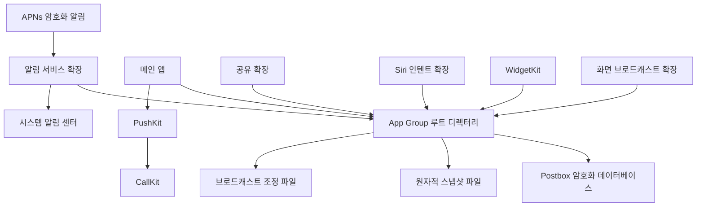
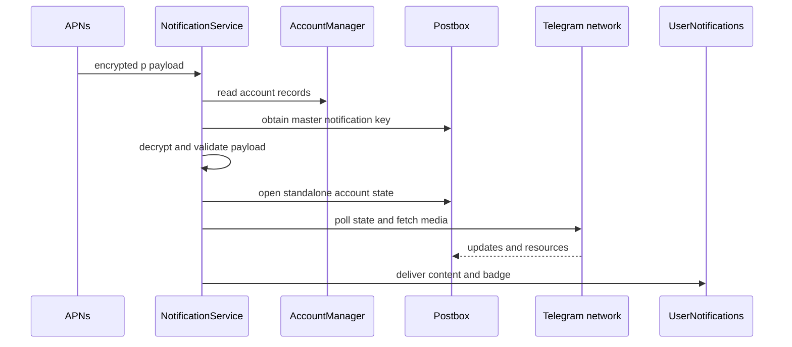
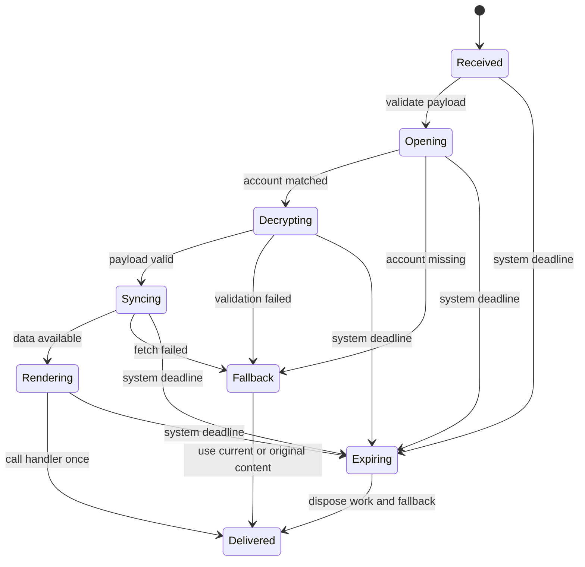

# 푸시, 확장 프로세스와 다중 프로세스 협업

웹: /docs/system/12-push-extensions/ · Markdown: /docs/system/12-push-extensions.md

> Telegram iOS가 제약이 많은 확장 프로세스에서 푸시와 공유 상태를 안전하게 처리하는 방법

> 시스템 설계 · 보안과 시스템 통합 · 12장 · 도표 3 · 코드 발췌 10 · 인용 39 · 소스 기준선: [TelegramMessenger/Telegram-iOS@f1dd7a2d](https://github.com/TelegramMessenger/Telegram-iOS/tree/f1dd7a2dbd02cbbf513e75d5695d8d36d1cf5838), [overtake/TelegramSwift@579cebbf](https://github.com/overtake/TelegramSwift/tree/579cebbf0c01fd41b712eff3647fa7f69db9665d)
>
> 관련 보충: [macOS fork 장별 검증(08–15장)](/docs/system/32-fork-verify-08-15/)
>
> 핵심 소스 파일: [TelegramMessenger/Telegram-iOS/Telegram/NotificationService/Sources/NotificationService.swift](https://github.com/TelegramMessenger/Telegram-iOS/blob/f1dd7a2dbd02cbbf513e75d5695d8d36d1cf5838/Telegram/NotificationService/Sources/NotificationService.swift), [TelegramMessenger/Telegram-iOS/Telegram/NotificationService/Sources/NotificationRecipientAccount.swift](https://github.com/TelegramMessenger/Telegram-iOS/blob/f1dd7a2dbd02cbbf513e75d5695d8d36d1cf5838/Telegram/NotificationService/Sources/NotificationRecipientAccount.swift), [TelegramMessenger/Telegram-iOS/submodules/TelegramCore/Sources/Account/Account.swift](https://github.com/TelegramMessenger/Telegram-iOS/blob/f1dd7a2dbd02cbbf513e75d5695d8d36d1cf5838/submodules/TelegramCore/Sources/Account/Account.swift), [TelegramMessenger/Telegram-iOS/submodules/TelegramCore/Sources/TelegramEngine/AccountData/RegisterNotificationToken.swift](https://github.com/TelegramMessenger/Telegram-iOS/blob/f1dd7a2dbd02cbbf513e75d5695d8d36d1cf5838/submodules/TelegramCore/Sources/TelegramEngine/AccountData/RegisterNotificationToken.swift), [TelegramMessenger/Telegram-iOS/submodules/TelegramUI/Sources/AppDelegate.swift](https://github.com/TelegramMessenger/Telegram-iOS/blob/f1dd7a2dbd02cbbf513e75d5695d8d36d1cf5838/submodules/TelegramUI/Sources/AppDelegate.swift), [TelegramMessenger/Telegram-iOS/submodules/TelegramUI/Sources/SharedWakeupManager.swift](https://github.com/TelegramMessenger/Telegram-iOS/blob/f1dd7a2dbd02cbbf513e75d5695d8d36d1cf5838/submodules/TelegramUI/Sources/SharedWakeupManager.swift), [TelegramMessenger/Telegram-iOS/submodules/Postbox/Sources/SqliteValueBox.swift](https://github.com/TelegramMessenger/Telegram-iOS/blob/f1dd7a2dbd02cbbf513e75d5695d8d36d1cf5838/submodules/Postbox/Sources/SqliteValueBox.swift), [TelegramMessenger/Telegram-iOS/submodules/Postbox/Sources/IpcPipe.swift](https://github.com/TelegramMessenger/Telegram-iOS/blob/f1dd7a2dbd02cbbf513e75d5695d8d36d1cf5838/submodules/Postbox/Sources/IpcPipe.swift), [TelegramMessenger/Telegram-iOS/submodules/Postbox/Sources/Postbox.swift](https://github.com/TelegramMessenger/Telegram-iOS/blob/f1dd7a2dbd02cbbf513e75d5695d8d36d1cf5838/submodules/Postbox/Sources/Postbox.swift), [TelegramMessenger/Telegram-iOS/submodules/TelegramCore/Sources/SyncCore/SyncCore_StandaloneAccountTransaction.swift](https://github.com/TelegramMessenger/Telegram-iOS/blob/f1dd7a2dbd02cbbf513e75d5695d8d36d1cf5838/submodules/TelegramCore/Sources/SyncCore/SyncCore_StandaloneAccountTransaction.swift), [TelegramMessenger/Telegram-iOS/Telegram/Share/ShareRootController.swift](https://github.com/TelegramMessenger/Telegram-iOS/blob/f1dd7a2dbd02cbbf513e75d5695d8d36d1cf5838/Telegram/Share/ShareRootController.swift), [TelegramMessenger/Telegram-iOS/submodules/TelegramUI/Components/ShareExtensionContext/Sources/ShareExtensionContext.swift](https://github.com/TelegramMessenger/Telegram-iOS/blob/f1dd7a2dbd02cbbf513e75d5695d8d36d1cf5838/submodules/TelegramUI/Components/ShareExtensionContext/Sources/ShareExtensionContext.swift), [TelegramMessenger/Telegram-iOS/Telegram/SiriIntents/IntentHandler.swift](https://github.com/TelegramMessenger/Telegram-iOS/blob/f1dd7a2dbd02cbbf513e75d5695d8d36d1cf5838/Telegram/SiriIntents/IntentHandler.swift), [TelegramMessenger/Telegram-iOS/submodules/TelegramUI/Sources/WidgetDataContext.swift](https://github.com/TelegramMessenger/Telegram-iOS/blob/f1dd7a2dbd02cbbf513e75d5695d8d36d1cf5838/submodules/TelegramUI/Sources/WidgetDataContext.swift), [TelegramMessenger/Telegram-iOS/Telegram/WidgetKitWidget/TodayViewController.swift](https://github.com/TelegramMessenger/Telegram-iOS/blob/f1dd7a2dbd02cbbf513e75d5695d8d36d1cf5838/Telegram/WidgetKitWidget/TodayViewController.swift), [TelegramMessenger/Telegram-iOS/Telegram/BroadcastUpload/BroadcastUploadExtension.swift](https://github.com/TelegramMessenger/Telegram-iOS/blob/f1dd7a2dbd02cbbf513e75d5695d8d36d1cf5838/Telegram/BroadcastUpload/BroadcastUploadExtension.swift), [TelegramMessenger/Telegram-iOS/submodules/TelegramVoip/Sources/IpcGroupCallContext.swift](https://github.com/TelegramMessenger/Telegram-iOS/blob/f1dd7a2dbd02cbbf513e75d5695d8d36d1cf5838/submodules/TelegramVoip/Sources/IpcGroupCallContext.swift), [TelegramMessenger/Telegram-iOS/Telegram/NotificationContent/NotificationViewController.swift](https://github.com/TelegramMessenger/Telegram-iOS/blob/f1dd7a2dbd02cbbf513e75d5695d8d36d1cf5838/Telegram/NotificationContent/NotificationViewController.swift)
>
> 미검증 사항:
> - 알림 서비스 확장(Notification Service Extension)의 시스템 수준 메모리 할당량은 얼마일까요? 현재 소스 코드에는 정의되어 있지 않아요. 대상 iOS 버전과 실기기 조건에서 검증해야 해요.

Telegram iOS는 푸시, 공유, Siri, 위젯, 화면 브로드캐스트를 독립된 프로세스에 둬요. 이 프로세스들은 App Group(같은 앱 그룹의 앱과 확장이 파일을 공유하는 iOS 컨테이너) 안의 암호화된 데이터 루트 디렉터리를 함께 쓰지만, 메모리나 앱 생명주기는 함께 쓰지 않아요. 핵심 설계는 두 가지예요.

- 확장은 작업을 마치는 데 필요한 최소한의 런타임만 열어요.
- 영속화 동시성은 Postbox의 SQLite WAL 트랜잭션에 맡겨요.

메인 앱은 `SharedWakeupManager`로 시스템이 주는 짧은 백그라운드 시간 창을 계정 작업과 연결 임대(lease)로 바꿔요. [\[1\]](https://github.com/TelegramMessenger/Telegram-iOS/blob/f1dd7a2dbd02cbbf513e75d5695d8d36d1cf5838/Telegram/NotificationService/Sources/NotificationService.swift#L758-L818) [\[10\]](https://github.com/TelegramMessenger/Telegram-iOS/blob/f1dd7a2dbd02cbbf513e75d5695d8d36d1cf5838/submodules/Postbox/Sources/SqliteValueBox.swift#L444-L475)

## 프로세스 경계와 공유 루트 디렉터리 [#프로세스-경계와-공유-루트-디렉터리]

iOS 확장은 메인 앱이 실행 중이라고 가정할 수 없어요.

- 알림 서비스: APNs 알림 하나로 콜드 스타트될 수 있어요.
- Share extension: 다른 앱에서 곧바로 시작될 수 있어요.
- WidgetKit: 시스템 자신의 타임라인 프로세스에서 데이터를 읽기도 해요.

그래서 Telegram은 이 진입점들을 `AppDelegate`나 싱글턴에 대한 원격 호출로 설계할 수 없어요.

이 진입점들은 모두 먼저 이렇게 App Group 컨테이너를 찾아요.

1. 각자의 bundle id에서 기본 앱 id를 도출해요.
2. `group.`에 기본 id를 붙여 App Group 컨테이너를 얻어요.

논리적 루트 디렉터리는 이 컨테이너 아래의 `telegram-data`예요. 알림 서비스는 루트 디렉터리에서 `accounts-metadata`를 열고, 같은 루트 디렉터리로 기기 전용 ValueBox 키와 salt를 도출해요. [\[1\]](https://github.com/TelegramMessenger/Telegram-iOS/blob/f1dd7a2dbd02cbbf513e75d5695d8d36d1cf5838/Telegram/NotificationService/Sources/NotificationService.swift#L758-L818) 알림 콘텐츠 확장도 같은 컨테이너, 비밀번호 환경, 키 파라미터를 써요. [\[18\]](https://github.com/TelegramMessenger/Telegram-iOS/blob/f1dd7a2dbd02cbbf513e75d5695d8d36d1cf5838/Telegram/NotificationContent/NotificationViewController.swift#L10-L59)

아래 도표는 iOS 쪽의 프로세스, 공유 매체, 시스템 경계를 보여 줘요.



App Group이 해결하는 건 네임스페이스와 접근 권한뿐이에요. 쓰기 순서, 데이터베이스 잠금, 프로세스 깨우기는 해결하지 않아요. 그래서 Telegram은 공유 디렉터리를 제약 없는 폴더처럼 쓰지 않았어요.

- 계정 메타데이터와 메시지 상태: 여전히 `AccountManager`, `Postbox`, 트랜잭션 API로 접근해요.
- 짧은 프로세스 간 스냅샷: 독립된 파일로 쓰고, 원자적 교체를 써요.

이렇게 나눈 덕분에 위젯이 표시용으로 읽기만 해도 메인 데이터베이스에 부담이 커지지 않아요. [\[1\]](https://github.com/TelegramMessenger/Telegram-iOS/blob/f1dd7a2dbd02cbbf513e75d5695d8d36d1cf5838/Telegram/NotificationService/Sources/NotificationService.swift#L758-L818) [\[11\]](https://github.com/TelegramMessenger/Telegram-iOS/blob/f1dd7a2dbd02cbbf513e75d5695d8d36d1cf5838/Telegram/WidgetKitWidget/TodayViewController.swift#L133-L217)

알림 서비스는 `setupAccountManager`를 호출할 때 `isTemporary: true`, `isReadOnly: false`, `useCaches: false`, `removeDatabaseOnError: false`를 넘겨요. [\[1\]](https://github.com/TelegramMessenger/Telegram-iOS/blob/f1dd7a2dbd02cbbf513e75d5695d8d36d1cf5838/Telegram/NotificationService/Sources/NotificationService.swift#L758-L818) 이 파라미터에는 두 가지 의미가 있어요.

- 임시 연결이라서 메인 앱의 캐시 전략을 유지하지 않아요.
- 데이터베이스의 소유자가 아니라서, 열기에 실패해도 메인 앱이 아직 쥐고 있을 수 있는 데이터베이스를 삭제하지 않아요.

이 선택은 푸시 한 건을 처리하는 도중에 스스로 저장소를 복구하려 하기보다, 기존 채팅 데이터를 지키는 쪽을 우선해요.

`Telegram/NotificationService/Sources/NotificationService.swift` 810–844행 발췌.

```swift
initializeAccountManagement()

let appVersion = (Bundle.main.infoDictionary?["CFBundleShortVersionString"] as? String) ?? "unknown"

self.accountManager = setupAccountManager(basePath: rootPath + "/accounts-metadata", isTemporary: true, isReadOnly: false, useCaches: false, removeDatabaseOnError: false)

let deviceSpecificEncryptionParameters = BuildConfig.deviceSpecificEncryptionParameters(rootPath, baseAppBundleId: baseAppBundleId)
self.encryptionParameters = ValueBoxEncryptionParameters(forceEncryptionIfNoSet: false, key: ValueBoxEncryptionParameters.Key(data: deviceSpecificEncryptionParameters.key)!, salt: ValueBoxEncryptionParameters.Salt(data: deviceSpecificEncryptionParameters.salt)!)
// ...
```

이 방식은 잠금 해제 키를 평문으로 확장에 복사해 주는 게 아니에요. `BuildConfig.deviceSpecificEncryptionParameters`의 결과를 `ValueBoxEncryptionParameters`로 감싸서 독립적인 계정 상태 관리자에 넘겨요. [\[1\]](https://github.com/TelegramMessenger/Telegram-iOS/blob/f1dd7a2dbd02cbbf513e75d5695d8d36d1cf5838/Telegram/NotificationService/Sources/NotificationService.swift#L758-L818) 계정, 로그인, 설정의 장기 모델은 [다중 계정, 로그인, 구성 동기화](/docs/system/14-accounts-auth-config/)에서 다뤄요. 여기서 요점은 수명이 짧은 프로세스들이 모두 같은 규칙으로 같은 암호화 저장소를 열 수 있다는 거예요.

## 알림 서비스의 제한된 동기화 경로 [#알림-서비스의-제한된-동기화-경로]

`p`를 포함한 암호화 푸시 경로에서 알림 서비스는 APS alert가 아니라 `p`를 메시지의 사실 출처로 삼아요. 처리 순서는 이래요.

1. URL 안전 Base64 문자열을 바이너리 데이터로 복원해요.
2. 앞 8바이트에서 키 식별자를 꺼내요.
3. 계정 레코드의 `backupData`에서 `notificationEncryptionKeyId`와 일치하는 것을 찾아요.
4. 일치하면 그 계정에 대해서만 `standaloneStateManager`를 만들어요.

[\[3\]](https://github.com/TelegramMessenger/Telegram-iOS/blob/f1dd7a2dbd02cbbf513e75d5695d8d36d1cf5838/Telegram/NotificationService/Sources/NotificationService.swift#L870-L1028)

여기서는 두 종류의 키를 정확히 구분해야 해요. 소스 코드는 MTProto 데이터 센터의 `auth_key`로 알림을 직접 복호화하지 않아요. 계정 Postbox keychain 항목 `master-notification-secret`에서 만든 `MasterNotificationKey`를 써요.

- 이 비밀은 256바이트 난수예요.
- 그 SHA-1의 마지막 8바이트가 식별자예요.
- 클라이언트가 APS나 VoIP token을 등록할 때 같은 `masterKey.data`를 `account.registerDevice`의 `secret`으로 업로드해요. [\[2\]](https://github.com/TelegramMessenger/Telegram-iOS/blob/f1dd7a2dbd02cbbf513e75d5695d8d36d1cf5838/submodules/TelegramCore/Sources/Account/Account.swift#L1034-L1107) [\[4\]](https://github.com/TelegramMessenger/Telegram-iOS/blob/f1dd7a2dbd02cbbf513e75d5695d8d36d1cf5838/submodules/TelegramCore/Sources/TelegramEngine/AccountData/RegisterNotificationToken.swift#L25-L55)

따라서 `MasterNotificationKey`는 계정에 묶인 푸시 암호화 키예요. 전송 계층의 인증 키가 아니에요. 인증 키와 데이터 센터 선택은 [인증 키와 다중 데이터 센터](/docs/system/04-auth-keys-datacenters/)를 참고하세요.

`submodules/TelegramCore/Sources/Account/Account.swift` 1034–1058행 발췌.

```swift
func masterNotificationsKey(transaction: Transaction, createIfNotExists: Bool) -> MasterNotificationKey? {
    if let value = transaction.keychainEntryForKey("master-notification-secret"), !value.isEmpty {
        let authKeyHash = sha1Digest(value)
        let authKeyId = authKeyHash.subdata(in: authKeyHash.count - 8 ..< authKeyHash.count)
        let keyData = MasterNotificationKey(id: authKeyId, data: value)
        return keyData
    } else if createIfNotExists {
        var secretData = Data(count: 256)
        let secretDataCount = secretData.count
        if !secretData.withUnsafeMutableBytes({ rawBytes -> Bool in
            let bytes = rawBytes.baseAddress!.assumingMemoryBound(to: Int8.self)
            let copyResult = SecRandomCopyBytes(nil, secretDataCount, bytes)
            return copyResult == errSecSuccess
        }) {
            assertionFailure()
        }

        transaction.setKeychainEntry(secretData, forKey: "master-notification-secret")
        let authKeyHash = sha1Digest(secretData)
        let authKeyId = authKeyHash.subdata(in: authKeyHash.count - 8 ..< authKeyHash.count)
        return MasterNotificationKey(id: authKeyId, data: secretData)
    }
}
```

복호화 함수는 이 순서로 검증하고 풀어요.

1. 8바이트 key id를 비교해요.
2. 푸시에서 16바이트 `msgKey`를 꺼내요.
3. 알림 비밀의 서로 다른 구간에서 SHA-256 값 두 개를 계산해 AES key와 IV를 이어 붙여요.
4. 복호화한 뒤에는 4바이트 길이를 검사하고 `msgKey`를 다시 계산해요.

검사가 하나라도 실패하면 `nil`을 돌려줘요. [\[2\]](https://github.com/TelegramMessenger/Telegram-iOS/blob/f1dd7a2dbd02cbbf513e75d5695d8d36d1cf5838/submodules/TelegramCore/Sources/Account/Account.swift#L1034-L1107)

덕분에 확장은 메시지 내용을 열기 전에 잘못된 계정, 잘린 페이로드, 변조된 페이로드를 거부할 수 있어요. 코드는 이 알고리즘을 고른 이유를 설명하지 않아요. key id로 먼저 계정을 고르고 메시지 키를 다시 검증하는 방식은, 계정마다 복호화를 시도하는 비용도 피하는 것으로 보여요(추론).

`submodules/TelegramCore/Sources/Account/Account.swift` 1069–1107행 발췌.

```swift
public func decryptedNotificationPayload(key: MasterNotificationKey, data: Data) -> Data? {
    if data.count < 8 {
        return nil
    }
    if data.subdata(in: 0 ..< 8) != key.id {
        return nil
    }
    let x = 8
    let msgKey = data.subdata(in: 8 ..< (8 + 16))
    let rawData = data.subdata(in: (8 + 16) ..< data.count)
    let sha256_a = sha256Digest(msgKey + key.data.subdata(in: x ..< (x + 36)))
    let sha256_b = sha256Digest(key.data.subdata(in: (40 + x) ..< (40 + x + 36)) + msgKey)
    let aesKey = sha256_a.subdata(in: 0 ..< 8) + sha256_b.subdata(in: 8 ..< (8 + 16)) + sha256_a.subdata(in: 24 ..< (24 + 8))
    let aesIv = sha256_b.subdata(in: 0 ..< 8) + sha256_a.subdata(in: 8 ..< (8 + 16)) + sha256_b.subdata(in: 24 ..< (24 + 8))

    guard let data = MTAesDecrypt(rawData, aesKey, aesIv), data.count > 4 else {
        return nil
    }
    // 길이와 다시 계산한 msgKey를 검사한다
}
```

아래 시퀀스 도표는 알림 서비스가 암호문을 최종 알림으로 바꾸는 주 경로를 보여 줘요.



핸들러는 먼저 이 순서로 설정을 읽어요.

1. 공유된 알림 설정, 통화 설정, 로그 설정을 읽어요.
2. 루트 디렉터리의 잠금 화면 상태 파일도 읽어요. 앱이 잠겨 있으면 미리 기록해 둔 잠금 화면 문자열을 로드하고, 실제 본문은 표시하지 않아요. [\[1\]](https://github.com/TelegramMessenger/Telegram-iOS/blob/f1dd7a2dbd02cbbf513e75d5695d8d36d1cf5838/Telegram/NotificationService/Sources/NotificationService.swift#L758-L818)
3. 알림 소리 목록과 Lottie 설정을 읽어요.
4. 다중 계정일 때만 현재 계정의 peer 이름을 추가로 읽어요.

코드 주석은 이 읽기가 데이터베이스 쓰기 잠금을 두고 경쟁하기 때문에 읽기 횟수를 한 번으로 줄였다고 분명히 밝혀요. [\[3\]](https://github.com/TelegramMessenger/Telegram-iOS/blob/f1dd7a2dbd02cbbf513e75d5695d8d36d1cf5838/Telegram/NotificationService/Sources/NotificationService.swift#L870-L1028)

복호화된 JSON이 이후의 동작을 결정해요. 핸들러는 `msg_id`, `story_id`, `from_id`, `chat_id`로 메시지나 스토리의 위치를 구성할 수 있어요. 삭제, 읽음, 리액션, 수신 통화 같은 제어 페이로드도 파싱해요.

메시지와 스토리에 대해서는 핸들러가 상태 관리자를 만들고, 상태를 폴링하거나 대상 미디어를 가져와요. 업데이트의 pts, qts, seq와 차이 가져오기 방식은 [업데이트 동기화](/docs/system/06-update-sync/)에서 설명해요. 알림 확장은 그 상태 경로를 다시 쓰는, 시간 제한이 걸린 트리거일 뿐이에요. [\[3\]](https://github.com/TelegramMessenger/Telegram-iOS/blob/f1dd7a2dbd02cbbf513e75d5695d8d36d1cf5838/Telegram/NotificationService/Sources/NotificationService.swift#L870-L1028)

폴링은 채널과 그 밖의 peer 두 갈래로 나뉘어요.

- 채널: `standalonePollChannelOnce`를 한 번 호출해요.
- 그 밖의 peer: `standalonePollDifference`를 호출해요. 이 함수는 자체 규칙에 따라 상태가 따라잡힐 때까지 페이지를 나누고 다시 시작해요.

그래서 확장은 바깥에 `timeout`을 씌우고, 시간이 초과되면 폴링과 재연결을 dispose해요. [\[19\]](https://github.com/TelegramMessenger/Telegram-iOS/blob/f1dd7a2dbd02cbbf513e75d5695d8d36d1cf5838/Telegram/NotificationService/Sources/NotificationService.swift#L1521-L1600) 이게 중요해요. 차이 동기화를 평범한 RPC 한 번으로 취급하면, 오프라인이거나 프록시가 죽었을 때 알림 전체 기한을 새 연결을 시도하는 데 다 써 버리게 돼요.

비교적 새로운 업스트림의 소스 주석은 iOS가 보통 `didReceive` 약 30초 뒤에 확장을 만료시킨다고 설명해요. 시간 예산은 이렇게 잡아요.

- 네트워크 연결 마감 시한: 핸들러를 시작하고 25초로 둬요.
- poll: 15초로 제한하고, 남은 시간이 있으면 최소 0.5초는 돌려줘요.

[\[38\]](https://github.com/TelegramMessenger/Telegram-iOS/blob/f1dd7a2dbd02cbbf513e75d5695d8d36d1cf5838/Telegram/NotificationService/Sources/NotificationService.swift#L1521-L1543) 30초가 아니라 25초로 둔 건 이후의 Postbox 쿼리, 읽지 않은 수 계산, 콘텐츠 생성에 여유를 남기기 위해서예요. 이 이유는 같은 소스 주석이 직접 설명해요.

이 연결과 poll 예산은 업스트림에만 적용돼요. macOS fork에는 `connectionDeadline`이나 `pollBudget`이 없어요. fork에서 보이는 건 미디어와 알림 소리에 각각 10초 `timeout`이 있다는 점이에요. [\[37\]](https://github.com/overtake/Telegram-iOS/blob/a24bbe45f9861f736a79916a50898512f751e0dc/Telegram/NotificationService/Sources/NotificationService.swift#L1534-L1645) 자세한 내용은 [macOS fork 장별 검증(08–15장)](/docs/system/32-fork-verify-08-15/)을 참고하세요.

복호화된 payload가 모두 동기화를 거쳐야 하는 건 아니에요. payload에 `aps`와 `url`이 있으면 핸들러는 곧바로 `NotificationContent`를 만들어요.

- URL, 고정된 서비스 peer, 계정 id를 저장해요.
- `aps`에서 소리, title, subtitle, body를 꺼내요.
- alert가 없으면 범용 새 메시지 텍스트를 써요.

[\[32\]](https://github.com/TelegramMessenger/Telegram-iOS/blob/f1dd7a2dbd02cbbf513e75d5695d8d36d1cf5838/Telegram/NotificationService/Sources/NotificationService.swift#L1386-L1415) 이 경로는 비용이 적게 드는 폴백이에요. 대상 메시지를 가져오지 못했거나 payload가 원래 이동 정보만 담고 있을 때도 조작할 수 있는 알림을 내놓을 수 있어요. 이 분기가 있어서, APS에 표시할 텍스트가 없다고 뭉뚱그려 말할 수 없어요.

이 버전의 알림 서비스 코드에는 고정된 메모리 상한이 선언되어 있지 않아요. 미디어 다운로드 경로는 받은 조각을 `Data`로 모은 뒤 첨부 데이터를 만들어요. [\[19\]](https://github.com/TelegramMessenger/Telegram-iOS/blob/f1dd7a2dbd02cbbf513e75d5695d8d36d1cf5838/Telegram/NotificationService/Sources/NotificationService.swift#L1521-L1600) 구현은 실제로 세 겹으로 부하를 덜어요.

- 첫째, 이미지 표현, 비디오 미리보기, 음성, 스티커 리소스만 골라요.
- 둘째, 가져오기 단계마다 최대 10초만 기다려요.
- 셋째, 시스템 만료 콜백에서 핸들러 전체를 dispose해요. [\[6\]](https://github.com/TelegramMessenger/Telegram-iOS/blob/f1dd7a2dbd02cbbf513e75d5695d8d36d1cf5838/Telegram/NotificationService/Sources/NotificationService.swift#L2391-L2430) [\[7\]](https://github.com/TelegramMessenger/Telegram-iOS/blob/f1dd7a2dbd02cbbf513e75d5695d8d36d1cf5838/Telegram/NotificationService/Sources/NotificationService.swift#L2692-L2766)

이 세 장치는 작업 지속 시간과 일반적인 첨부 규모를 제어해요. 하지만 메모리 할당량은 아니에요. 제품 엔지니어링에서는 시스템이 정하는 메모리 제한을 런타임 제약으로 보고, 큰 이미지, Lottie 렌더링, 동시 알림에 대해 실기기에서 스트레스 테스트를 해야 해요.

리소스 선택에는 성능이 떨어지는 순서도 드러나요. 확장은 먼저 `MediaBox`에 완료된 리소스가 있는지 확인해요. 로컬에 없을 때만 최고 우선순위로 독립적인 multipart fetch를 만들고, `continueInBackground: false`와 `useMainConnection: true`를 명시적으로 넘겨요. [\[19\]](https://github.com/TelegramMessenger/Telegram-iOS/blob/f1dd7a2dbd02cbbf513e75d5695d8d36d1cf5838/Telegram/NotificationService/Sources/NotificationService.swift#L1521-L1600) 그래서 알림 첨부는 알림 서비스가 살아 있는 기간을 벗어나 장기 백그라운드 다운로드로 이어지지 않아요. 네트워크를 쓸 수 없을 때는 비용이 timeout 안으로 제한되고, 사용자는 적어도 이미 복호화된 기본 알림 내용은 받아요.

폴링이 끝나면 확장은 Postbox에서 대상 메시지를 다시 읽어요. secret media가 아니고 `MediaSpoilerMessageAttribute`가 없는 메시지에서만 첫 번째 미디어를 뽑아요. 종류별로 고르는 리소스는 이래요.

- 이미지: 가장 큰 표현
- 스티커: 파일 리소스
- 비디오: 첫 미리보기 표현
- 음성: 파일 리소스
- 그 밖의 파일: 파일 타입만 남기고, 여기서 다운로드 리소스를 만들지 않아요.

[\[19\]](https://github.com/TelegramMessenger/Telegram-iOS/blob/f1dd7a2dbd02cbbf513e75d5695d8d36d1cf5838/Telegram/NotificationService/Sources/NotificationService.swift#L1521-L1600) 이 목록은 알림 첨부의 화이트리스트(허용 목록)예요. 제한된 시간과 메모리 안에서 아무 큰 원본 파일이나 내려받을 가능성을 줄여요. 잠금 화면 알림에서 비밀 미디어나 스포일러 미디어를 꺼내는 일도 막아요.

메시지 알림은 최선의 노력으로 전달 보고를 할 수도 있어요. payload가 보고를 요구하고 이미 메시지 id가 있을 때만 확장이 `_internal_reportMessageDelivery`를 호출하고 `fromPushNotification: true`를 붙여요. 이 요청은 연결 남은 시간과 같은 timeout을 써요. [\[33\]](https://github.com/TelegramMessenger/Telegram-iOS/blob/f1dd7a2dbd02cbbf513e75d5695d8d36d1cf5838/Telegram/NotificationService/Sources/NotificationService.swift#L2026-L2207) 보고가 실패해도 콘텐츠 전달은 막지 않아요. 이 설계는 사용자에게 보이는 알림과 서버의 전달 확인을 분리해요. 서버의 전달 확인이 실패해도 알림은 payload 내용으로 폴백할 수 있어요.

스토리 경로는 메시지 경로와 달라요. peer stories를 폴링해서, 읽지 않았고 id가 일치하는 story를 찾아 이미지의 가장 큰 표현이나 파일 리소스를 골라요. 비디오는 `Video` 속성의 `preloadSize`를 읽을 수 있어요. 하지만 여기서 실제로 가져오는 경로는 여전히 스토리 fetch의 deadline에 제약을 받아요. [\[6\]](https://github.com/TelegramMessenger/Telegram-iOS/blob/f1dd7a2dbd02cbbf513e75d5695d8d36d1cf5838/Telegram/NotificationService/Sources/NotificationService.swift#L2391-L2430)

같은 스토리 알림이 이미 displayed로 표시되어 있으면 확장은 콘텐츠를 비워요. 그렇지 않으면 displayed 표시를 써요. [\[6\]](https://github.com/TelegramMessenger/Telegram-iOS/blob/f1dd7a2dbd02cbbf513e75d5695d8d36d1cf5838/Telegram/NotificationService/Sources/NotificationService.swift#L2391-L2430) 시스템이 재시도하거나 여러 번 깨워도 같은 스토리 알림이 거듭 나타나지 않도록 막아요.

이 경로는 미디어를 무한히 기다리지 않아요. 미디어, 알림 소리, 스토리 가져오기는 각각 10초 `timeout`을 거쳐요. 시간이 초과된 뒤의 대체 값은 빈 미디어, 빈 소리, 빈 완료 신호예요. [\[6\]](https://github.com/TelegramMessenger/Telegram-iOS/blob/f1dd7a2dbd02cbbf513e75d5695d8d36d1cf5838/Telegram/NotificationService/Sources/NotificationService.swift#L2391-L2430) 알림에 반드시 썸네일이 붙는다고 보장하는 설계가 아니에요. 확장의 예산이 바닥나기 전에 시스템이 표시할 수 있는 텍스트를 받는 걸 우선해요. 리소스 다운로드, 캐시 명명, 업로드의 전체 메커니즘은 [미디어 리소스, 다운로드/업로드, 캐시](/docs/system/10-media-cache/)에서 다뤄요.

알림 내용은 내부 `NotificationContent`로 모여요. 제목, 본문, 첨부, 소리, 배지, 카테고리, `userInfo`를 한꺼번에 `UNMutableNotificationContent`에 써요. payload에 thread id가 명시되어 있으면 `threadIdentifier`에 써요. [\[5\]](https://github.com/TelegramMessenger/Telegram-iOS/blob/f1dd7a2dbd02cbbf513e75d5695d8d36d1cf5838/Telegram/NotificationService/Sources/NotificationService.swift#L673-L728) 덕분에 시스템이 그 안정적인 문자열로 알림을 묶을 수 있어요. 대화나 주제를 이 식별자에 매핑하는 구체적인 규칙은 이 생성 코드에 없어요. 그러니 서버의 collapse 규칙과 같다고 보면 안 돼요.

메인 앱은 알림 카테고리 아홉 종류를 미리 등록해요.

- `r`, `m`: 비공개 채팅의 텍스트와 미디어예요.
- `gr`, `gm`: 그룹의 텍스트와 미디어예요.
- `c`, `t`, `st`, `str`: 각각 채널, 리액션, 스토리, 스토리 리액션을 담당해요.

`r`, `m`, `gr`, `gm`에는 모두 `reply` 텍스트 입력 동작이 있어요. `r`과 `gr`은 `INSearchForMessagesIntentIdentifier`도 선언해요. [\[21\]](https://github.com/TelegramMessenger/Telegram-iOS/blob/f1dd7a2dbd02cbbf513e75d5695d8d36d1cf5838/submodules/TelegramUI/Sources/AppDelegate.swift#L3138-L3181) 알림 서비스는 category id만 채워요. 시스템 동작을 쓸 수 있는지와 숨겨진 미리보기는 메인 앱이 한곳에서 등록해요. 덕분에 확장이 권한 상태와 현지화 텍스트를 복제할 필요가 없어요.

`Telegram/NotificationService/Sources/NotificationService.swift` 673–728행 발췌.

```swift
if let threadId = self.threadId {
    content.threadIdentifier = threadId
}
if let sound = self.sound {
    content.sound = UNNotificationSound(named: UNNotificationSoundName(rawValue: sound))
}
if let badge = self.badge {
    content.badge = badge as NSNumber
}
if let category = self.category {
    content.categoryIdentifier = category
}
if !self.userInfo.isEmpty {
    content.userInfo = self.userInfo
}
if self.isLockedMessage == nil {
    if !self.attachments.isEmpty {
        content.attachments = self.attachments
    }
}
```

`userInfo`에는 account, peer, 메시지 네임스페이스, 메시지 id가 저장돼요. 알림 콘텐츠 확장은 이 값들로 공유 계정을 열고 미디어를 가져와 리치 콘텐츠를 보여 줘요. [\[18\]](https://github.com/TelegramMessenger/Telegram-iOS/blob/f1dd7a2dbd02cbbf513e75d5695d8d36d1cf5838/Telegram/NotificationContent/NotificationViewController.swift#L10-L59) [\[29\]](https://github.com/TelegramMessenger/Telegram-iOS/blob/f1dd7a2dbd02cbbf513e75d5695d8d36d1cf5838/submodules/TelegramUI/Sources/NotificationContentContext.swift#L150-L172) 메인 앱도 이 식별자로 탭, 답장, 지우기 동작을 찾아내요. 카테고리 등록과 탭 처리는 앱 UI 계층의 일이에요. 알림 서비스가 이걸 다시 정의하면 안 돼요.

배지 업데이트는 대상 계정이 현재 계정일 때만 `content.badge`에 써요. 메시지가 삭제되거나 읽힌 경우 확장은 먼저 `UNUserNotificationCenter`에서 이미 전달된 알림을 나열해요. `peerId`와 `msg_id`로 옛 요청을 찾아 그 식별자들을 제거해요. 그런 다음 렌더링된 읽지 않은 총 수를 읽고, 현재 계정 조건에서 새 배지를 설정해요. [\[20\]](https://github.com/TelegramMessenger/Telegram-iOS/blob/f1dd7a2dbd02cbbf513e75d5695d8d36d1cf5838/Telegram/NotificationService/Sources/NotificationService.swift#L2483-L2627) 덕분에 백그라운드 확장이 포그라운드가 아닌 계정을 위해 앱 아이콘 배지를 덮어쓰는 일이 없어요.

읽음 분기는 `transaction.applyIncomingReadMaxId`도 호출해요. 같은 peer에서 id가 읽음 id 이하인, 이미 전달된 알림을 삭제해요. 삭제 분기는 정확히 일치하는 메시지 묶음을 삭제하고, 관련 미디어도 삭제할 수 있어요. 리액션 분기는 카테고리 `t`만 처리해요. [\[20\]](https://github.com/TelegramMessenger/Telegram-iOS/blob/f1dd7a2dbd02cbbf513e75d5695d8d36d1cf5838/Telegram/NotificationService/Sources/NotificationService.swift#L2483-L2627) 따라서 같은 확장이 새 상태를 새 알림으로 바꿀 수도 있고, 원격 제어 이벤트를 알림 센터의 철회로 바꿔 보여 줄 수도 있어요. 알림 센터는 기준이 되는 메시지 저장소가 아니에요. Postbox 상태를 잠깐 보여 주는 시스템 뷰예요.

알림 서비스는 완료 콜백을 정확히 한 번만 호출해야 해요. `NotificationService`는 가변 결과를 `Atomic`에 저장해요. 정상으로 끝나면 새 콘텐츠를 먼저 전달하고, 그렇지 않으면 시스템이 준 초기 콘텐츠를 전달해요. `serviceExtensionTimeWillExpire`는 큐 로컬 handler를 해제해요. 해제할 때 진행 중인 폴링을 dispose하고, 유지용 네트워크 연결을 끊어요. 그런 다음 마찬가지로 마지막 콘텐츠나 원본 콘텐츠로 폴백해요. [\[7\]](https://github.com/TelegramMessenger/Telegram-iOS/blob/f1dd7a2dbd02cbbf513e75d5695d8d36d1cf5838/Telegram/NotificationService/Sources/NotificationService.swift#L2692-L2766) 시스템이 아무 때나 작업을 종료하도록 놔두지 않는, 명시적인 성능 저하 상태 머신이에요.

아래 도표는 이 상태 머신의 완료 분기와 시간 초과 분기를 보여 줘요.



소스 코드에는 알림 서비스의 초 단위 제한이나 메모리 상한이 박혀 있지 않아요. 코드로 검증할 수 있는 제한은 두 가지예요.

- 미디어 관련 fetch마다 걸린 10초 시간 초과
- 시스템이 `serviceExtensionTimeWillExpire`를 호출할 때의 능동적 취소

[\[6\]](https://github.com/TelegramMessenger/Telegram-iOS/blob/f1dd7a2dbd02cbbf513e75d5695d8d36d1cf5838/Telegram/NotificationService/Sources/NotificationService.swift#L2391-L2430) [\[7\]](https://github.com/TelegramMessenger/Telegram-iOS/blob/f1dd7a2dbd02cbbf513e75d5695d8d36d1cf5838/Telegram/NotificationService/Sources/NotificationService.swift#L2692-L2766) 따라서 흔히 알려진 플랫폼 예산을 이 버전의 하드코딩된 동작으로 볼 수 없어요. 구현하는 사람은 실기기에서 Instruments와 시스템 로그로 실제 예산을 검증해야 해요.

## PushKit과 CallKit의 시스템 경계 [#pushkit과-callkit의-시스템-경계]

수신 통화는 일반 알림보다 더 빨리 시스템에 보고해야 해요. 메인 앱은 시작할 때 `PKPushRegistry`를 만들고, `desiredPushTypes`를 `.voIP`로 설정하고, 자신을 delegate로 지정해요. [\[8\]](https://github.com/TelegramMessenger/Telegram-iOS/blob/f1dd7a2dbd02cbbf513e75d5695d8d36d1cf5838/submodules/TelegramUI/Sources/AppDelegate.swift#L1097-L1102) PushKit이 페이로드를 받으면 completion이 달린 delegate를 호출해요. Telegram의 구현은 일반 푸시와 같은 형식의 암호화된 `p` 데이터를 파싱해요. key id로 `accountManagerState.notificationKeys`에서 대응하는 계정과 `MasterNotificationKey`를 찾아 JSON을 복호화해요. [\[9\]](https://github.com/TelegramMessenger/Telegram-iOS/blob/f1dd7a2dbd02cbbf513e75d5695d8d36d1cf5838/submodules/TelegramUI/Sources/AppDelegate.swift#L2245-L2542)

그다음 코드는 JSON에서 `updates`를 꺼내 디코딩하고 수신 통화 update를 뽑아요. 이후 순서는 이래요.

1. 먼저 `CallKitIntegration.reportIncomingCall`을 호출해요.
2. 활성화된 같은 계정의 `AccountContext`를 찾아 원본 update를 `stateManager.processIncomingCallUpdate`에 넘겨요.

계정이 없거나 상태가 terminated가 되면 CallKit이 안정적인 UUID에 대응하는 통화를 버리게 해요. [\[9\]](https://github.com/TelegramMessenger/Telegram-iOS/blob/f1dd7a2dbd02cbbf513e75d5695d8d36d1cf5838/submodules/TelegramUI/Sources/AppDelegate.swift#L2245-L2542) 먼저 보고하고 나중에 비즈니스 상태를 마치는 순서 덕분에, PushKit 깨우기에서 시스템 수신 통화 화면까지의 경로가 짧아져요. 이 이유는 호출 순서에서 나온 것이고, 소스 주석에 있는 게 아니에요(추론).

`submodules/TelegramUI/Sources/AppDelegate.swift` 2471–2535행 발췌.

```swift
callKitIntegration.reportIncomingCall(
    uuid: CallSessionManager.getStableIncomingUUID(stableId: callUpdate.callId),
    stableId: callUpdate.callId,
    handle: "\(callUpdate.peer.id.id._internalGetInt64Value())",
    phoneNumber: phoneNumber.flatMap(formatPhoneNumber),
    isVideo: callUpdate.isVideo,
    displayTitle: callUpdate.peer.debugDisplayTitle,
    completion: { error in
        if let error = error {
            Logger.shared.log("PresentationCall", "reportIncomingCall error \(error)")
        }
    }
)
// ...
context.account.stateManager.processIncomingCallUpdate(data: updateData, completion: { _ in
})
// ...
sharedApplicationContext.wakeupManager.allowBackgroundTimeExtension(timeout: 2.0)
```

수신 통화 업데이트 처리가 끝났는지와 상관없이 delegate의 끝에서는 PushKit completion을 호출해요. VoIP 타입이면 payload를 `notificationManager`에 추가하고, 깨우기 관리자에 2초 연장도 신청해요. [\[9\]](https://github.com/TelegramMessenger/Telegram-iOS/blob/f1dd7a2dbd02cbbf513e75d5695d8d36d1cf5838/submodules/TelegramUI/Sources/AppDelegate.swift#L2245-L2542) CallKit의 응답, 미디어 협상, 오디오 세션, 종료 상태는 [통화 시스템](/docs/system/13-calls/)에서 다뤄요. 이 장은 PushKit이 시스템이 관리하는 깨우기 기회를 한 번 만들어 주는 방식만 다뤄요.

알림 서비스 자체에도 CallKit으로 넘기는 경로가 하나 있어요. 복호화된 동작이 1:1 통화나 그룹 통화이면 먼저 Postbox에서 발신자 번호를 조회해요. iOS 14.5 이상이고 `enableSystemIntegration`이 참이면 `CXProvider.reportNewIncomingVoIPPushPayload`를 호출해요. call id, access hash, 발신자, updates, 계정 id, 선택적인 번호를 시스템에 넘겨요. [\[31\]](https://github.com/TelegramMessenger/Telegram-iOS/blob/f1dd7a2dbd02cbbf513e75d5695d8d36d1cf5838/Telegram/NotificationService/Sources/NotificationService.swift#L1419-L1515) 시스템 통합이 활성화되어 있지 않으면 일반 수신 알림을 대신 만들어요. 여기서 알림 서비스는 미디어 세션을 직접 만들지 않아요. 이미 검증된 수신 통화 사실을 Apple의 VoIP 알림 경계에 넘길 뿐이에요.

두 수신 통화 진입점은 서로 다른 문제를 풀어요.

- PushKit delegate: 시스템이 앱에 보낸 VoIP push를 처리하고 CallKit에 즉시 보고해요.
- 알림 서비스: 수신 통화 동작이 담긴 암호화 알림을 처리하고, `CXProvider`에 요청해 VoIP payload를 시스템에 넘길 수 있어요.

[\[9\]](https://github.com/TelegramMessenger/Telegram-iOS/blob/f1dd7a2dbd02cbbf513e75d5695d8d36d1cf5838/submodules/TelegramUI/Sources/AppDelegate.swift#L2245-L2542) [\[31\]](https://github.com/TelegramMessenger/Telegram-iOS/blob/f1dd7a2dbd02cbbf513e75d5695d8d36d1cf5838/Telegram/NotificationService/Sources/NotificationService.swift#L1419-L1515) 둘 다 결국 계정 상태 머신이 update를 검증해야 해요. 그래서 계정이 없거나 페이로드가 올바르지 않거나 통화가 이미 종료된 경우에는 시스템 쪽 표시를 완료하거나 철회해요. 이 경계를 Telegram 통화 프로토콜 자체로 오해하면 안 돼요.

일반 원격 알림이 메인 앱에 들어올 때도 백그라운드에서 무한정 실행되는 건 아니에요. `didReceiveRemoteNotification`은 즉시 `SharedWakeupManager`에 2초 연장을 신청해요. 이어서 Firebase 검증이나 외부 검증 필드를 처리하고 `fetchCompletionHandler`를 호출해요. [\[17\]](https://github.com/TelegramMessenger/Telegram-iOS/blob/f1dd7a2dbd02cbbf513e75d5695d8d36d1cf5838/submodules/TelegramUI/Sources/AppDelegate.swift#L2036-L2080) Telegram이 푸시를 트리거로 보고, APNs 콜백을 장기 동기화 스케줄러로 다루지 않는다는 걸 보여 줘요.

## 다른 확장의 최소 데이터 면 [#다른-확장의-최소-데이터-면]

### Share extension [#share-extension]

공유 확장이 하는 일은 보낼 파일 하나를 메인 앱에 써 주는 것이 전부가 아니에요. `ShareRootController`는 App Group 아래에 임시 `AccountManager`를 만들고, `TelegramApplicationBindings`를 구성해요. 그다음 `makeTempContext`로 메인 계정의 `AccountContext`를 얻어요. [\[14\]](https://github.com/TelegramMessenger/Telegram-iOS/blob/f1dd7a2dbd02cbbf513e75d5695d8d36d1cf5838/submodules/TelegramUI/Components/ShareExtensionContext/Sources/ShareExtensionContext.swift#L272-L310) 이 컨텍스트가 연결하는 건 같은 TelegramCore, Postbox, 네트워크 구현이에요. 그래서 공유 UI는 대화 선택기를 보여 줄 수 있고, 확장 프로세스 안에서 실제 전송 경로를 타요. 메시지가 대기 중인 작업이 되는 과정과 업로드 뒤의 동작은 [메시지 전송 파이프라인과 오프라인 작업 큐](/docs/system/07-message-send-pipeline/)를 참고하세요.

대상이 선택되면 공유 컨트롤러는 다음 값을 `sentItems`에 넘겨요.

- `peerIds`
- `threadIds`
- 유료 메시지에 필요한 `requireStars`
- 파싱된 `contents`
- `account`
- 무음 표시
- 추가 텍스트

콘텐츠에 사용자 상호작용이 필요하면 먼저 상호작용 결과를 얻은 뒤 전송해요. [\[22\]](https://github.com/TelegramMessenger/Telegram-iOS/blob/f1dd7a2dbd02cbbf513e75d5695d8d36d1cf5838/submodules/TelegramUI/Components/ShareExtensionContext/Sources/ShareExtensionContext.swift#L600-L745) 이 호출 지점을 보면 확장이 제출하는 단위는 도메인 객체예요. 임시 디렉터리에 놓인, 해석되지 않은 첨부 목록이 아니에요. 구체적인 메시지가 언제 pending operation으로 영속화되는지는 여전히 TelegramCore가 결정해요.

공유 진입점은 `NSExtensionItem`의 attachments를 읽어요. file URL을 먼저 처리하고, 이미지와 비디오 표현도 로드해요.

- 스토리를 가져올 때: 파일을 App Group의 임시 스토리 디렉터리에 복사한 뒤 `tg://shareStory?session=`을 열어요.
- 일반 공유: 첨부를 공유 컨트롤러에 넘겨요.

사용자가 취소하거나 완료하면 확장은 `completeRequest`를 호출해 시스템에 제어권을 돌려줘요. [\[14\]](https://github.com/TelegramMessenger/Telegram-iOS/blob/f1dd7a2dbd02cbbf513e75d5695d8d36d1cf5838/submodules/TelegramUI/Components/ShareExtensionContext/Sources/ShareExtensionContext.swift#L272-L310)

`Telegram/Share/ShareRootController.swift` 262–303행 발췌.

```swift
let rootPath = rootPathForBasePath(self.initializationData.appGroupPath)
performAppGroupUpgrades(appGroupPath: self.initializationData.appGroupPath, rootPath: rootPath)

TempBox.initializeShared(
    basePath: rootPath,
    processType: "share",
    launchSpecificId: Int64.random(in: Int64.min ... Int64.max)
)

let logsPath = rootPath + "/logs/share-logs"
let _ = try? FileManager.default.createDirectory(
    atPath: logsPath,
    withIntermediateDirectories: true,
    attributes: nil
)
setupSharedLogger(rootPath: rootPath, path: logsPath)
// ...
let accountManager: AccountManager<TelegramAccountManagerTypes> = setupAccountManager(
    basePath: rootPath + "/accounts-metadata",
    isTemporary: true,
    isReadOnly: false,
    useCaches: false,
    removeDatabaseOnError: false
)
```

이 설계의 대가는 공유 확장도 많은 코어 의존성을 로드해야 한다는 점이에요. 이득은 직렬화된 또 다른 “공유 작업 프로토콜”을 설계할 필요가 없다는 점이에요. 네트워크 작업 전에 시스템이 확장을 종료하더라도, 작업을 영속화하는 책임은 `NSExtensionContext`의 완료 콜백이 아니라 코어의 전송 대기 큐에 있어요. [\[14\]](https://github.com/TelegramMessenger/Telegram-iOS/blob/f1dd7a2dbd02cbbf513e75d5695d8d36d1cf5838/submodules/TelegramUI/Components/ShareExtensionContext/Sources/ShareExtensionContext.swift#L272-L310) 메인 프로세스를 다시 쓰는 방식이 아니라, 도메인 상태 머신을 다시 쓰는 방식이에요.

스토리 공유는 다른 경계를 써요. 확장은 아무 `sessionId`를 위해 `share/stories` 하위 디렉터리를 만들어요. 이미지 데이터는 번호가 붙은 jpg로 쓰고, 비디오 파일은 번호가 붙은 mp4로 복사해요. 모든 첨부가 끝난 뒤에야 session 파라미터가 붙은 `tg://shareStory` URL을 열어요. [\[22\]](https://github.com/TelegramMessenger/Telegram-iOS/blob/f1dd7a2dbd02cbbf513e75d5695d8d36d1cf5838/submodules/TelegramUI/Components/ShareExtensionContext/Sources/ShareExtensionContext.swift#L600-L745) 여기서 파일은 한 번만 쓰는 입력 인수물이에요. 일반 메시지의 데이터베이스 커밋 경로와 다르고, 장기 공유 상태로 오해해도 안 돼요.

### SiriIntents [#siriintents]

Siri 확장은 먼저 App Group의 잠금 상태를 검사해요. 잠겨 있으면 빈 연락처를 돌려주거나 앱 시작을 요구해요. 잠겨 있지 않으면 활성 계정마다 `accountTransaction`을 호출해 `isReadOnly: true`로 Postbox를 열어요. 결과 개수 상한은 이래요.

- 연락처 검색: 최대 30개 결과를 돌려줘요.
- 기본 연락처: 최근 peer에서 최대 8개를 뽑아요.

[\[23\]](https://github.com/TelegramMessenger/Telegram-iOS/blob/f1dd7a2dbd02cbbf513e75d5695d8d36d1cf5838/Telegram/SiriIntents/IntentHandler.swift#L887-L1115) 이 상한들은 Siri의 데이터베이스 스캔과 시스템 표시 부담을 직접 제한해요.

메시지 보내기는 예외예요. `INSendMessageIntent`를 처리할 때 코드는 이렇게 해요.

1. 독립 계정을 만들고, `shouldBeServiceTaskMaster`를 잠깐 `.always`로 설정해요.
2. peer에 쓸 수 있는지 먼저 확인한 다음 `standaloneSendMessage`를 호출해요.
3. dispose한 뒤에는 master를 다시 `.never`로 설정해요.

서버가 전송을 거부하면 Siri의 실패 응답으로 매핑하고, 전송됐다고 보고하지 않아요. [\[13\]](https://github.com/TelegramMessenger/Telegram-iOS/blob/f1dd7a2dbd02cbbf513e75d5695d8d36d1cf5838/Telegram/SiriIntents/IntentHandler.swift#L592-L622)

`Telegram/SiriIntents/IntentHandler.swift` 592–622행 발췌.

```swift
return account.postbox.transaction { transaction -> Bool in
    return transaction.getPeer(peerId) != nil
}
|> castError(IntentHandlingError.self)
|> mapToSignal { accepted -> Signal<Void, IntentHandlingError> in
    guard accepted else {
        return .fail(.generic)
    }
    return standaloneSendMessage(
        account: account,
        peerId: peerId,
        text: intent.content ?? "",
        attributes: [],
        media: nil,
        replyToMessageId: nil
    )
}
|> afterDisposed {
    account.shouldBeServiceTaskMaster.set(.single(.never))
}
```

Siri의 읽기 권한과 쓰기 권한이 다르다는 건 중요한 보안 경계예요. 연락처, 메시지 검색, 기본 제안은 쓰기 트랜잭션을 만들지 않아요. 전송할 때만 서비스 작업 주도권을 잠깐 얻어요. 종단 간 암호화 대화와 로컬 보안 모델은 [종단 간 암호화와 로컬 보안](/docs/system/11-secret-chats-security/)에서 다뤄요.

이 읽기 경로는 `TelegramSecretChat`과 삭제된 peer도 걸러내요. [\[23\]](https://github.com/TelegramMessenger/Telegram-iOS/blob/f1dd7a2dbd02cbbf513e75d5695d8d36d1cf5838/Telegram/SiriIntents/IntentHandler.swift#L887-L1115) Siri가 전체 기록을 미러링한 게 아니에요. 시스템 인텐트를 위한 제한된 인덱스 뷰예요. `accountTransaction`은 `isMainProcess: false`, `isTemporary: true`, 읽기/쓰기 모드, 사본 사용 여부 등의 파라미터를 `openPostbox`에 넘겨요. 그리고 이후 `postbox.transaction` 클로저 안에서만 데이터를 드러내요. [\[28\]](https://github.com/TelegramMessenger/Telegram-iOS/blob/f1dd7a2dbd02cbbf513e75d5695d8d36d1cf5838/submodules/TelegramCore/Sources/SyncCore/SyncCore_StandaloneAccountTransaction.swift#L287-L305) 따라서 확장이 크래시해도 메인 앱의 메모리에 있던 커밋되지 않은 객체를 물려받지 않아요.

### WidgetItems와 WidgetKit [#widgetitems와-widgetkit]

위젯은 계정 데이터베이스를 직접 오래 쥐고 있지 않아요. 메인 앱의 `WidgetDataContext`가 이렇게 스냅샷을 만들어요.

1. `WidgetCenter`에서 현재 위젯 설정을 얻고, 각 `Friend.identifier`를 계정 id와 peer id로 분해해요. [\[12\]](https://github.com/TelegramMessenger/Telegram-iOS/blob/f1dd7a2dbd02cbbf513e75d5695d8d36d1cf5838/submodules/TelegramUI/Sources/WidgetDataContext.swift#L288-L301)
2. 관련 계정의 Postbox 데이터를 구독하고, 이름, 아바타 경로, 읽지 않은 badge, 음소거 상태, 최상단 메시지를 추출해요.
3. `WidgetPresentationData`를 JSON으로 인코딩해 App Group 경로에 원자적으로 써요.
4. 쓰기에 성공하면 `WidgetCenter.reloadAllTimelines()`를 호출해요. [\[12\]](https://github.com/TelegramMessenger/Telegram-iOS/blob/f1dd7a2dbd02cbbf513e75d5695d8d36d1cf5838/submodules/TelegramUI/Sources/WidgetDataContext.swift#L288-L301)

`WidgetDataPeer`와 `WidgetDataPeers`는 이 스냅샷의 Codable 값 타입이에요. 표시 확장이 읽을 때는 설정에 있는 peer에 대해 읽기 전용 `accountTransaction`을 호출해요. 선택된 peer, 최상단 메시지, 리소스 경로만 읽어요. 타임라인 항목의 정책은 `.atEnd`예요. [\[11\]](https://github.com/TelegramMessenger/Telegram-iOS/blob/f1dd7a2dbd02cbbf513e75d5695d8d36d1cf5838/Telegram/WidgetKitWidget/TodayViewController.swift#L133-L217) 따라서 위젯이 새로 고쳐지는 시점은 데이터베이스 변경 알림을 프로세스 간에 브로드캐스트하는 방식이 아니라, 메인 앱의 명시적인 reload와 시스템 타임라인이 함께 정해요.

`submodules/TelegramUI/Sources/WidgetDataContext.swift` 288–301행 발췌.

```swift
|> distinctUntilChanged).startStrict(next: { value in
    let path = widgetPresentationDataPath(rootPath: basePath)
    if let data = try? JSONEncoder().encode(value) {
        let _ = try? data.write(
            to: URL(fileURLWithPath: path),
            options: [.atomic]
        )
    } else {
        let _ = try? FileManager.default.removeItem(atPath: path)
    }

    if #available(iOSApplicationExtension 14.0, iOS 14.0, *) {
        WidgetCenter.shared.reloadAllTimelines()
    }
})
```

이 구조는 스냅샷 우선 프로토콜이에요. 위젯 읽기가 실패하면 데이터베이스를 복구하려 하지 않고 빈 컬렉션이나 자리 표시 데이터를 보여 줘요. [\[11\]](https://github.com/TelegramMessenger/Telegram-iOS/blob/f1dd7a2dbd02cbbf513e75d5695d8d36d1cf5838/Telegram/WidgetKitWidget/TodayViewController.swift#L133-L217)

`WidgetReloadManager`는 포그라운드에서는 요청된 reload를 즉시 실행해요. 백그라운드에서는 reload 간격을 25분 초과로 제한해요. [\[12\]](https://github.com/TelegramMessenger/Telegram-iOS/blob/f1dd7a2dbd02cbbf513e75d5695d8d36d1cf5838/submodules/TelegramUI/Sources/WidgetDataContext.swift#L288-L301) 대가는 다음 reload 전까지 내용이 낡을 수 있다는 점이에요. 이득은 위젯 렌더링이 공유 데이터베이스의 긴 트랜잭션 때문에 메인 앱을 막지 않는다는 점이에요. 표시 모델과 Postbox 뷰에 대한 배경은 [Postbox 뷰와 메시지 이력 모델](/docs/system/09-postbox-views/)을 참조하세요.

### BroadcastUpload와 알림 콘텐츠 확장 [#broadcastupload와-알림-콘텐츠-확장]

ReplayKit의 `BroadcastUploadSampleHandler`는 App Group에서 `broadcast-coordination-type-v2`를 읽어요. 내용이 `ipc`이면 `IpcGroupCallEmbeddedBroadcastContext`를 만들어요. 그렇지 않으면 프로세스 내 구현을 써요. 확장은 비디오 샘플을 현재 구현에 곧바로 넘겨요. 오디오 샘플은 입력 ASBD에 따라 변환기를 만들거나 재사용한 뒤 구현에 넘겨요. [\[15\]](https://github.com/TelegramMessenger/Telegram-iOS/blob/f1dd7a2dbd02cbbf513e75d5695d8d36d1cf5838/Telegram/BroadcastUpload/BroadcastUploadExtension.swift#L325-L404)

브로드캐스트 IPC는 App Group 아래의 `embedded-broadcast-coordination`을 써요. 앱 쪽의 `ScreencastEmbeddedIPCContext`는 같은 경로로 `IpcGroupCallEmbeddedAppContext`를 만들어요. [\[24\]](https://github.com/TelegramMessenger/Telegram-iOS/blob/f1dd7a2dbd02cbbf513e75d5695d8d36d1cf5838/submodules/TelegramCallsUI/Sources/GroupCallScreencast.swift#L123-L154) 이 컨텍스트는 원자적으로 쓰는 keepalive JSON으로 상태를 유지하고, 1초 타이머로 새로 고쳐요. [\[25\]](https://github.com/TelegramMessenger/Telegram-iOS/blob/f1dd7a2dbd02cbbf513e75d5695d8d36d1cf5838/submodules/TelegramVoip/Sources/IpcGroupCallContext.swift#L1072-L1107) 이 IPC는 전용 미디어 제어 채널이에요. 범용 데이터베이스 변경에는 맞지 않아요.

알림 콘텐츠 확장의 목표는 더 좁아요. `viewDidLoad`에서 app-extension 비밀번호 환경을 구성하고, App Group을 열고, 알림 `userInfo`의 계정, peer, 메시지, 미디어 식별자로 보여 줄 콘텐츠를 찾아요. [\[18\]](https://github.com/TelegramMessenger/Telegram-iOS/blob/f1dd7a2dbd02cbbf513e75d5695d8d36d1cf5838/Telegram/NotificationContent/NotificationViewController.swift#L10-L59) 이 확장은 이미 전달된 알림의 리치 뷰를 맡아요. 알림 서비스는 전달하기 전의 복호화, 동기화, 기본 콘텐츠 생성을 맡아요. 둘이 서로 상대의 시간 제한 작업을 떠맡으면 안 돼요.

## 데이터베이스 동시성과 프로세스 간 가시성 [#데이터베이스-동시성과-프로세스-간-가시성]

공유 루트 디렉터리의 정확성을 받쳐 주는 건 `ManagedFile`이 아니라 SQLite예요. `ManagedFile`은 저장소에서 미디어 조각, 로그, 일반 파일 I/O에 쓰여요. 이 장의 확장들이 Postbox 쓰기를 조정하는 뮤텍스가 아니에요. Postbox의 `SqliteValueBox`는 journal mode를 WAL(변경을 로그에 먼저 적는 SQLite 방식)로 설정하고 5초 SQLite busy timeout을 설정해요. [\[10\]](https://github.com/TelegramMessenger/Telegram-iOS/blob/f1dd7a2dbd02cbbf513e75d5695d8d36d1cf5838/submodules/Postbox/Sources/SqliteValueBox.swift#L444-L475) WAL은 읽는 쪽과 커밋된 쓰는 쪽이 더 쉽게 함께 있게 해 줘요. 하지만 즉시 쓰기 트랜잭션은 여전히 하나만 허용해요.

단일 독립 계정 트랜잭션은 이 순서로 진행돼요.

1. 계정 레코드 id로 계정 디렉터리를 계산해요.
2. `openPostbox`로 그 디렉터리 안의 `postbox`를 여는데, `isMainProcess: false`와 `isTemporary: true`를 명시적으로 줘요.
3. 성공한 뒤에야 전달받은 transaction 클로저를 실행해요.

열기에 실패하면 `AccountTransactionError.couldNotOpen`으로 매핑해요. [\[28\]](https://github.com/TelegramMessenger/Telegram-iOS/blob/f1dd7a2dbd02cbbf513e75d5695d8d36d1cf5838/submodules/TelegramCore/Sources/SyncCore/SyncCore_StandaloneAccountTransaction.swift#L287-L305) 이 API는 프로세스의 역할을 연결을 만드는 지점에 기록해요. 호출한 쪽이 데이터베이스를 삭제해도 되는지, 메인 프로세스 캐시를 쥘 수 있는지 스스로 짐작할 필요가 없어요.

`submodules/Postbox/Sources/SqliteValueBox.swift` 670–707행 발췌.

```swift
public func begin() {
    precondition(self.queue.isCurrent())
    if self.isReadOnly {
        let resultCode = self.database.execute("BEGIN DEFERRED")
        checkTransactionResult(resultCode, database: self.database, operation: "BEGIN DEFERRED")
    } else {
        let resultCode = self.database.execute("BEGIN IMMEDIATE")
        checkTransactionResult(resultCode, database: self.database, operation: "BEGIN IMMEDIATE")
    }
}

public func commit() {
    precondition(self.queue.isCurrent())
    let resultCode = self.database.execute("COMMIT")
    checkTransactionResult(resultCode, database: self.database, operation: "COMMIT")
}

public func checkpoint() {
    precondition(self.queue.isCurrent())
    let resultCode = self.database.execute("PRAGMA wal_checkpoint(PASSIVE)")
    assert(resultCode)
}
```

읽기 전용 연결은 `BEGIN DEFERRED`를 써요. 쓰기 가능 연결은 `BEGIN IMMEDIATE`를 써요. [\[26\]](https://github.com/TelegramMessenger/Telegram-iOS/blob/f1dd7a2dbd02cbbf513e75d5695d8d36d1cf5838/submodules/Postbox/Sources/SqliteValueBox.swift#L670-L789) 따라서 알림 서비스, 공유, Siri의 쓰기 작업은 각자 파일 잠금을 따로 만들지 않고, SQLite 계층에서 쓰기 상호 배제를 얻어요.

데이터베이스 탐색이 `SQLITE_BUSY`, `SQLITE_LOCKED`, `SQLITE_PROTOCOL`을 만나면 5초를 기다린 뒤 한 번 더 시도해요. 소유하지 않은 연결이 그래도 사용할 수 없으면 데이터베이스가 없다고 돌려주고, 파일은 그대로 둬요. [\[26\]](https://github.com/TelegramMessenger/Telegram-iOS/blob/f1dd7a2dbd02cbbf513e75d5695d8d36d1cf5838/submodules/Postbox/Sources/SqliteValueBox.swift#L670-L789)

이 방식이 다루는 건 무결성이에요. 낮은 지연을 보장하지는 않아요. 알림 서비스가 여러 계정의 이름을 읽을 때도 메인 앱의 쓰기 잠금을 기다릴 수 있어요. [\[3\]](https://github.com/TelegramMessenger/Telegram-iOS/blob/f1dd7a2dbd02cbbf513e75d5695d8d36d1cf5838/Telegram/NotificationService/Sources/NotificationService.swift#L870-L1028) Siri의 전송 한 번도 다른 쓰기 작업을 기다릴 수 있어요. Telegram은 짧은 작업, 제한된 쿼리, 리소스 fetch 시간 초과, 폴백 알림으로 이 비용을 통제해요. 데이터 레이아웃, WAL 이외의 인덱스와 복구 전략은 [Postbox 스토리지 엔진](/docs/system/08-postbox-storage/)을 참조하세요.

이 장이 추적한 경로는 데이터베이스가 바뀌었다고 알리는 범용 Darwin notification에 기대지 않았어요. 소비하는 쪽마다 자기만의 가시성 경계가 있어요.

- 알림 서비스: 최종 결과를 `UNUserNotificationCenter`에 넘겨요.
- 위젯: 원자적 스냅샷 쓰기와 `WidgetCenter` reload로 새 콘텐츠를 얻어요.
- 공유와 Siri: 자신의 코어 계정 컨텍스트로 네트워크 작업을 제출해요.
- 메인 앱: 포그라운드로 돌아오거나 연결을 이어 가면 같은 Postbox와 서버 업데이트 스트림에서 상태를 읽어요.

메인 앱에 대한 마지막 항목은 공유 데이터베이스와 독립 계정 트랜잭션의 호출 관계에서 얻은 결론이에요(추론). [\[12\]](https://github.com/TelegramMessenger/Telegram-iOS/blob/f1dd7a2dbd02cbbf513e75d5695d8d36d1cf5838/submodules/TelegramUI/Sources/WidgetDataContext.swift#L288-L301) [\[13\]](https://github.com/TelegramMessenger/Telegram-iOS/blob/f1dd7a2dbd02cbbf513e75d5695d8d36d1cf5838/Telegram/SiriIntents/IntentHandler.swift#L592-L622) [\[14\]](https://github.com/TelegramMessenger/Telegram-iOS/blob/f1dd7a2dbd02cbbf513e75d5695d8d36d1cf5838/submodules/TelegramUI/Components/ShareExtensionContext/Sources/ShareExtensionContext.swift#L272-L310) [\[28\]](https://github.com/TelegramMessenger/Telegram-iOS/blob/f1dd7a2dbd02cbbf513e75d5695d8d36d1cf5838/submodules/TelegramCore/Sources/SyncCore/SyncCore_StandaloneAccountTransaction.swift#L287-L305)

Postbox 소스에는 또 다른 범용 신호 프리미티브 `IpcPipe`가 있어요. 생산하는 쪽은 `basePath.ipc`를 비동기로 열어 8바이트 `Int64`를 쓰고 닫아요. 소비하는 쪽은 같은 경로에 `DispatchSource` 파일 시스템 `.write` 이벤트를 걸고 `Signal`에 값 하나를 내보내요. [\[34\]](https://github.com/TelegramMessenger/Telegram-iOS/blob/f1dd7a2dbd02cbbf513e75d5695d8d36d1cf5838/submodules/Postbox/Sources/IpcPipe.swift#L4-L54)

`IpcPipe`는 Darwin notification이 아니라 파일 이벤트 신호예요. 믿을 수 있는 작업 로그를 담지도 않아요. 소스 파일에서 옛 값을 읽던 코드는 이미 주석 처리되어 있어요. 현재 소비하는 쪽은 “다시 읽어야 함”이라는 힌트로 `Int64.max`만 내보내요. 이 장에서 나열한 확장 호출 체인에 대해, 저장소를 검색해도 이 프리미티브의 호출자는 나타나지 않았어요. 따라서 알림, 위젯, 공유가 이걸 믿고 새로 고친다고 주장할 수 없어요.

`AccountManager`는 계정 레코드와 현재 계정 id도 `atomic-state` 파일로 인코딩하고 `.atomic` 쓰기를 써요. 트랜잭션을 커밋하기 전에 원자 상태가 갱신됐다면 먼저 그 파일을 동기화해요. 그런 다음 같은 프로세스의 records, shared data, notice views를 로컬 pipe로 푸시해요. [\[35\]](https://github.com/TelegramMessenger/Telegram-iOS/blob/f1dd7a2dbd02cbbf513e75d5695d8d36d1cf5838/submodules/TelegramCore/Sources/AccountManager/AccountManagerImpl.swift#L419-L495) 원자적 파일 덕분에 새로 시작한 확장이 계정 레코드의 완전한 스냅샷을 얻을 수 있어요. 이 파일은 SQLite 쓰기 트랜잭션을 대신하지 않아요. 실행 중인 프로세스의 메모리 뷰를 자동으로 프로세스 간 구독으로 바꿔 주지도 않아요. 설계상으로는 실시간 메시지 버스가 아니라 시작할 때 쓰는 부트스트랩 상태로 봐야 해요.

메인 앱에는 논리적인 주 클라이언트 개념도 있어요. `Postbox.becomeMasterClient`는 트랜잭션 안에서 `metadataTable.masterClientId`와 현재 `sessionClientId`를 비교하고, 다를 때만 새 id를 커밋해요. `isMasterClient`는 이 값을 불리언 Signal로 매핑해요. [\[36\]](https://github.com/TelegramMessenger/Telegram-iOS/blob/f1dd7a2dbd02cbbf513e75d5695d8d36d1cf5838/submodules/Postbox/Sources/Postbox.swift#L4556-L4571)

`SharedWakeupManager`는 계정 작업 조건으로 언제 계정을 서비스 작업 주도자로 만들지 결정해요. [\[16\]](https://github.com/TelegramMessenger/Telegram-iOS/blob/f1dd7a2dbd02cbbf513e75d5695d8d36d1cf5838/submodules/TelegramUI/Sources/SharedWakeupManager.swift#L1062-L1156) 이 주 클라이언트 개념은 SQLite의 쓰기 잠금과 달라요.

- 주 클라이언트: 지속적인 서비스 작업을 누가 맡을지 조정해요.
- SQLite 쓰기 잠금: 같은 시점의 데이터베이스 쓰기를 보호해요.

둘을 혼동하면 백그라운드 작업을 데이터베이스 소유권으로 잘못 해석하게 돼요.

브로드캐스트는 또 다른 경우예요. 앱과 확장이 실시간 세션을 동시에 유지해야 해요. 그래서 Postbox가 오디오·비디오 샘플의 조정을 맡도록 강요하지 않고, 전용 IPC 컨텍스트, 경로 규약, keepalive 파일을 써요. [\[15\]](https://github.com/TelegramMessenger/Telegram-iOS/blob/f1dd7a2dbd02cbbf513e75d5695d8d36d1cf5838/Telegram/BroadcastUpload/BroadcastUploadExtension.swift#L325-L404) 덕분에 자주 오가는 미디어 조정과 영속화된 메시지 상태가 분리돼요.

## 메인 앱의 백그라운드 깨우기 관리 [#메인-앱의-백그라운드-깨우기-관리]

`SharedWakeupManager`는 메인 앱이 시스템 생명주기를 계정 정책으로 번역하는 집중 지점이에요. `AppDelegate`는 `beginBackgroundTask`, `endBackgroundTask`, `backgroundTimeRemaining` 클로저를 주입해요. [\[30\]](https://github.com/TelegramMessenger/Telegram-iOS/blob/f1dd7a2dbd02cbbf513e75d5695d8d36d1cf5838/submodules/TelegramUI/Sources/AppDelegate.swift#L1226-L1241) 관리자는 이런 상태를 수집해요.

- 포그라운드 상태
- 오디오 세션
- 백그라운드 다운로드
- 위치
- 전송 대기 메시지
- 전송 대기 스토리
- 시스템 처리 작업

[\[16\]](https://github.com/TelegramMessenger/Telegram-iOS/blob/f1dd7a2dbd02cbbf513e75d5695d8d36d1cf5838/submodules/TelegramUI/Sources/SharedWakeupManager.swift#L1062-L1156)

네트워크 계층은 `shouldKeepConnection`을 구독해요. 값이 참이면 메인 MTProto session을 재개하고, 거짓이면 일시 중지해요. [\[27\]](https://github.com/TelegramMessenger/Telegram-iOS/blob/f1dd7a2dbd02cbbf513e75d5695d8d36d1cf5838/submodules/TelegramCore/Sources/Network/Network.swift#L1032-L1064)

앱이 백그라운드로 들어가면 `AppDelegate`는 `allowBackgroundTimeExtension`을 호출한 뒤 각 계정의 캐시를 정리할 수 있어요. 또 이름이 `lock`인 백그라운드 작업을 만들고 5초 뒤에 끝내요. [\[17\]](https://github.com/TelegramMessenger/Telegram-iOS/blob/f1dd7a2dbd02cbbf513e75d5695d8d36d1cf5838/submodules/TelegramUI/Sources/AppDelegate.swift#L2036-L2080) 이건 로컬 잠금으로 전환하기 위한 짧은 시간 창이에요. 백그라운드 동기화 서비스가 아니에요.

연장이 필요한 작업이 있으면 관리자는 이름이 `background-wakeup`인 백그라운드 작업을 만들어요. 타이머는 `min(30.0, backgroundTimeRemaining - 5.0)`이에요. 만료 handler는 작업을 끝내고, 상태를 지우고, 작업을 다시 확인해요. 작업이 없으면 관리자는 백그라운드 시간을 계속 점유하지 않아요. [\[16\]](https://github.com/TelegramMessenger/Telegram-iOS/blob/f1dd7a2dbd02cbbf513e75d5695d8d36d1cf5838/submodules/TelegramUI/Sources/SharedWakeupManager.swift#L1062-L1156) 이 타이머 값은 연장 한 번마다 상한을 정하면서, 종료에 필요한 5초의 여유를 남겨요.

관리자는 불리언 하나만 관리하지 않아요. 계정마다 다음을 설정해요.

- `shouldBeServiceTaskMaster`
- `shouldExplicitelyKeepWorkerConnections`
- `shouldKeepOnlinePresence`
- `shouldKeepBackgroundDownloadConnections`

포그라운드의 주 계정이나 작업이 있는 계정이 master가 될 수 있어요. 백그라운드 오디오, 위치, 전송 대기 메시지, 전송 대기 스토리가 있을 때만 worker 연결을 명시적으로 유지해요. [\[16\]](https://github.com/TelegramMessenger/Telegram-iOS/blob/f1dd7a2dbd02cbbf513e75d5695d8d36d1cf5838/submodules/TelegramUI/Sources/SharedWakeupManager.swift#L1062-L1156) MTProto 연결 계층 자체는 [MTProto 전송 계층](/docs/system/03-mtproto-transport/)에서, TL request 구성은 [TL 직렬화와 API 호출 계층](/docs/system/05-tl-api-layer/)에서 다뤄요.

`submodules/TelegramUI/Sources/SharedWakeupManager.swift` 1062–1100행 발췌.

```swift
if let taskId = self.beginBackgroundTask("background-wakeup", {
    handleExpiration()
}) {
    actualTaskId = taskId
    let timer = SwiftSignalKit.Timer(
        timeout: min(30.0, max(0.0, self.backgroundTimeRemaining() - 5.0)),
        repeat: false,
        completion: {
            handleExpiration()
        },
        queue: .mainQueue()
    )
    self.currentTask = (taskId, currentTime, timer)
    timer.start()
    endTaskId.flatMap(self.endBackgroundTask)
    self.isInBackgroundExtension = true
}
// ...
self.updateAccounts(
    hasTasks: hasTasksForBackgroundExtension,
    endTaskAfterTransactionsComplete: endTaskAfterTransactionsComplete
)
```

처리할 작업이 없을 때 관리자는 모든 걸 곧바로 거칠게 끝내지 않아요. `postbox.setCanBeginTransactions`를 false로 만들고, 계정마다 실행 중인 트랜잭션이 끝난 뒤의 콜백을 전달할 수 있어요. 모든 계정이 확인한 뒤에야 연장된 백그라운드 작업을 끝내요. [\[16\]](https://github.com/TelegramMessenger/Telegram-iOS/blob/f1dd7a2dbd02cbbf513e75d5695d8d36d1cf5838/submodules/TelegramUI/Sources/SharedWakeupManager.swift#L1062-L1156) 이건 전형적인 경쟁 상태를 다뤄요. iOS 백그라운드 작업을 먼저 끝내고 이미 시작된 로컬 쓰기를 기다리면, 시스템이 transaction을 커밋하기 전에 프로세스를 일시 중지할 수 있어요. 새 트랜잭션을 계속 허용하면 백그라운드 작업이 모두 비워졌다는 걸 증명할 수 없어요.

작업이 있으면 관리자는 `setCanBeginTransactions`를 true로 설정해요. 나머지 설정은 이래요.

- `.always` 서비스 주도권: 포그라운드 primary 계정, 작업이 있는 계정, 또는 명시적 연장 창 안의 primary 계정에만 설정해요.
- 온라인 presence: 포그라운드 primary 계정에만 남겨요.
- 백그라운드 다운로드 연결: `backgroundDownloads` 표시로만 켜요.

[\[16\]](https://github.com/TelegramMessenger/Telegram-iOS/blob/f1dd7a2dbd02cbbf513e75d5695d8d36d1cf5838/submodules/TelegramUI/Sources/SharedWakeupManager.swift#L1062-L1156) 이렇게 세밀한 스위치가 있다는 건, 백그라운드의 “깨어 있음 유지”가 모든 계정, 모든 네트워크를 활성 상태로 유지하는 게 아니라는 걸 보여 줘요. 한정된 시스템 시간을 분명한 작업 사유가 있는 계정에 나눠 주는 거예요.

이 집중 지점은 기능마다 제각기 연결을 연장하는 일도 막아요. 네트워크 계층의 주석은 web proxy carrier가 `shouldKeepConnection`에 따라 시작·중지되고, 깨우기 관리자가 다루는 포그라운드, 오디오, 백그라운드 확장, 처리 작업, grace timer를 이어받는다고 분명히 밝혀요. [\[27\]](https://github.com/TelegramMessenger/Telegram-iOS/blob/f1dd7a2dbd02cbbf513e75d5695d8d36d1cf5838/submodules/TelegramCore/Sources/Network/Network.swift#L1032-L1064) 통합된 중재는 미디어 다운로드, 전송 큐, 통화가 동시에 백그라운드 시간을 신청할 때의 경쟁 상태를 줄여 줘요. 하지만 백그라운드 동작이 비교적 큰 정책 객체 하나에 기대게 되기도 해요. 새 작업 유형을 수정할 때는 이 객체의 카운트, 만료, 계정 정책을 함께 검토해야 해요.

## 설계 트레이드오프 [#설계-트레이드오프]

Telegram은 같은 프로세스가 아니라 같은 데이터 루트를 택했어요. 이 결정 덕분에 계정, 네트워크, 작업 큐를 다시 쓸 수 있어요. 대신 각 확장이 짧은 수명, 콜드 스타트, 잠금 경쟁을 올바르게 처리해야 해요. 알림 서비스는 계정 전용 알림 비밀로 복호화한 뒤 필요에 따라 데이터를 동기화해요. 평문이 드러나는 면은 줄어들지만, 어떤 실패에도 원래 알림으로 폴백할 준비를 해야 해요. [\[2\]](https://github.com/TelegramMessenger/Telegram-iOS/blob/f1dd7a2dbd02cbbf513e75d5695d8d36d1cf5838/submodules/TelegramCore/Sources/Account/Account.swift#L1034-L1107) [\[7\]](https://github.com/TelegramMessenger/Telegram-iOS/blob/f1dd7a2dbd02cbbf513e75d5695d8d36d1cf5838/Telegram/NotificationService/Sources/NotificationService.swift#L2692-L2766)

모든 확장을 위해 명시적 파일 잠금과 프로세스 메시지 버스를 만드는 대신 SQLite WAL과 데이터베이스 트랜잭션을 택했어요. 이 방안은 일관성을 잘 다져진 저장 계층에 맡기고, 읽기 전용 위젯과 Siri 쿼리도 동시에 진행할 수 있게 해요. 대가는 쓰기 경쟁이 시스템이 확장에 허락한 한정된 시간을 여전히 써 버릴 수 있다는 점이에요. [\[10\]](https://github.com/TelegramMessenger/Telegram-iOS/blob/f1dd7a2dbd02cbbf513e75d5695d8d36d1cf5838/submodules/Postbox/Sources/SqliteValueBox.swift#L444-L475)

데이터를 공유하는 형태도 두 가지를 택했어요. Postbox는 기준이 되는 가변 상태를 보관해요. 원자적 JSON 스냅샷은 위젯 같은 표시 소비자를 위한 거예요. 전용 IPC 파일은 브로드캐스트 같은 실시간 소비자를 위한 거예요. 이 셋을 하나의 인터페이스로 합치면 안 돼요. 지연 시간, 실패 모델, 데이터 소유권이 서로 다르기 때문이에요. [\[11\]](https://github.com/TelegramMessenger/Telegram-iOS/blob/f1dd7a2dbd02cbbf513e75d5695d8d36d1cf5838/Telegram/WidgetKitWidget/TodayViewController.swift#L133-L217) [\[12\]](https://github.com/TelegramMessenger/Telegram-iOS/blob/f1dd7a2dbd02cbbf513e75d5695d8d36d1cf5838/submodules/TelegramUI/Sources/WidgetDataContext.swift#L288-L301) [\[15\]](https://github.com/TelegramMessenger/Telegram-iOS/blob/f1dd7a2dbd02cbbf513e75d5695d8d36d1cf5838/Telegram/BroadcastUpload/BroadcastUploadExtension.swift#L325-L404)

백그라운드 실행도 `SharedWakeupManager`에 모았어요. 장점은 연결과 계정 역할이 작업에 따라 한 곳으로 통일된다는 점이에요. 대가는 이곳이 모든 백그라운드 기능의 정책이 만나는 결합점이 된다는 점이에요. 확장이나 백그라운드 작업을 새로 추가할 때는 트랜잭션 권한, worker 연결, 시스템 시간 창이 필요한지를 먼저 정의해야 해요. [\[16\]](https://github.com/TelegramMessenger/Telegram-iOS/blob/f1dd7a2dbd02cbbf513e75d5695d8d36d1cf5838/submodules/TelegramUI/Sources/SharedWakeupManager.swift#L1062-L1156)

`TelegramSwift`는 `submodules/telegram-ios`를 통해 `overtake/Telegram-iOS` fork의 공유 코어 모듈을 써요. [\[39\]](https://github.com/overtake/TelegramSwift/blob/579cebbf0c01fd41b712eff3647fa7f69db9665d/packages/PrivateCallScreen/Package.swift#L18-L37) 이 서브모듈은 `a24bbe45f9861f736a79916a50898512f751e0dc`로 체크아웃되어 있고, 이 장이 인용한 iOS 커밋보다 이전 것이에요. 따라서 더 새로운 업스트림의 알림 시간 제한을 이 fork에 그대로 끌어다 쓸 수 없어요. 구체적인 차이는 [macOS fork 장별 검증(08–15장)](/docs/system/32-fork-verify-08-15/)을 참고하세요. 이 장은 macOS의 알림 구현을 다루지 않아요. [macOS 클라이언트의 시스템 계층](/docs/system/15-macos-system-layer/)을 참조하세요.

## 열린 문제 [#열린-문제]

- 알림 서비스 확장의 시스템 수준 메모리 할당량은 얼마일까요? 현재 소스 코드에는 정의되어 있지 않아요. 대상 iOS 버전과 실기기 조건에서 검증해야 해요.

## 참고 [#references]
- \[1\] [NotificationService.swift L758-818](https://github.com/TelegramMessenger/Telegram-iOS/blob/f1dd7a2dbd02cbbf513e75d5695d8d36d1cf5838/Telegram/NotificationService/Sources/NotificationService.swift#L758-L818)
- \[2\] [Account.swift L1034-1107](https://github.com/TelegramMessenger/Telegram-iOS/blob/f1dd7a2dbd02cbbf513e75d5695d8d36d1cf5838/submodules/TelegramCore/Sources/Account/Account.swift#L1034-L1107)
- \[3\] [NotificationService.swift L870-1028](https://github.com/TelegramMessenger/Telegram-iOS/blob/f1dd7a2dbd02cbbf513e75d5695d8d36d1cf5838/Telegram/NotificationService/Sources/NotificationService.swift#L870-L1028)
- \[4\] [RegisterNotificationToken.swift L25-55](https://github.com/TelegramMessenger/Telegram-iOS/blob/f1dd7a2dbd02cbbf513e75d5695d8d36d1cf5838/submodules/TelegramCore/Sources/TelegramEngine/AccountData/RegisterNotificationToken.swift#L25-L55)
- \[5\] [NotificationService.swift L673-728](https://github.com/TelegramMessenger/Telegram-iOS/blob/f1dd7a2dbd02cbbf513e75d5695d8d36d1cf5838/Telegram/NotificationService/Sources/NotificationService.swift#L673-L728)
- \[6\] [NotificationService.swift L2391-2430](https://github.com/TelegramMessenger/Telegram-iOS/blob/f1dd7a2dbd02cbbf513e75d5695d8d36d1cf5838/Telegram/NotificationService/Sources/NotificationService.swift#L2391-L2430)
- \[7\] [NotificationService.swift L2692-2766](https://github.com/TelegramMessenger/Telegram-iOS/blob/f1dd7a2dbd02cbbf513e75d5695d8d36d1cf5838/Telegram/NotificationService/Sources/NotificationService.swift#L2692-L2766)
- \[8\] [AppDelegate.swift L1097-1102](https://github.com/TelegramMessenger/Telegram-iOS/blob/f1dd7a2dbd02cbbf513e75d5695d8d36d1cf5838/submodules/TelegramUI/Sources/AppDelegate.swift#L1097-L1102)
- \[9\] [AppDelegate.swift L2245-2542](https://github.com/TelegramMessenger/Telegram-iOS/blob/f1dd7a2dbd02cbbf513e75d5695d8d36d1cf5838/submodules/TelegramUI/Sources/AppDelegate.swift#L2245-L2542)
- \[10\] [SqliteValueBox.swift L444-475](https://github.com/TelegramMessenger/Telegram-iOS/blob/f1dd7a2dbd02cbbf513e75d5695d8d36d1cf5838/submodules/Postbox/Sources/SqliteValueBox.swift#L444-L475)
- \[11\] [TodayViewController.swift L133-217](https://github.com/TelegramMessenger/Telegram-iOS/blob/f1dd7a2dbd02cbbf513e75d5695d8d36d1cf5838/Telegram/WidgetKitWidget/TodayViewController.swift#L133-L217)
- \[12\] [WidgetDataContext.swift L288-301](https://github.com/TelegramMessenger/Telegram-iOS/blob/f1dd7a2dbd02cbbf513e75d5695d8d36d1cf5838/submodules/TelegramUI/Sources/WidgetDataContext.swift#L288-L301)
- \[13\] [IntentHandler.swift L592-622](https://github.com/TelegramMessenger/Telegram-iOS/blob/f1dd7a2dbd02cbbf513e75d5695d8d36d1cf5838/Telegram/SiriIntents/IntentHandler.swift#L592-L622)
- \[14\] [ShareExtensionContext.swift L272-310](https://github.com/TelegramMessenger/Telegram-iOS/blob/f1dd7a2dbd02cbbf513e75d5695d8d36d1cf5838/submodules/TelegramUI/Components/ShareExtensionContext/Sources/ShareExtensionContext.swift#L272-L310)
- \[15\] [BroadcastUploadExtension.swift L325-404](https://github.com/TelegramMessenger/Telegram-iOS/blob/f1dd7a2dbd02cbbf513e75d5695d8d36d1cf5838/Telegram/BroadcastUpload/BroadcastUploadExtension.swift#L325-L404)
- \[16\] [SharedWakeupManager.swift L1062-1156](https://github.com/TelegramMessenger/Telegram-iOS/blob/f1dd7a2dbd02cbbf513e75d5695d8d36d1cf5838/submodules/TelegramUI/Sources/SharedWakeupManager.swift#L1062-L1156)
- \[17\] [AppDelegate.swift L2036-2080](https://github.com/TelegramMessenger/Telegram-iOS/blob/f1dd7a2dbd02cbbf513e75d5695d8d36d1cf5838/submodules/TelegramUI/Sources/AppDelegate.swift#L2036-L2080)
- \[18\] [NotificationViewController.swift L10-59](https://github.com/TelegramMessenger/Telegram-iOS/blob/f1dd7a2dbd02cbbf513e75d5695d8d36d1cf5838/Telegram/NotificationContent/NotificationViewController.swift#L10-L59)
- \[19\] [NotificationService.swift L1521-1600](https://github.com/TelegramMessenger/Telegram-iOS/blob/f1dd7a2dbd02cbbf513e75d5695d8d36d1cf5838/Telegram/NotificationService/Sources/NotificationService.swift#L1521-L1600)
- \[20\] [NotificationService.swift L2483-2627](https://github.com/TelegramMessenger/Telegram-iOS/blob/f1dd7a2dbd02cbbf513e75d5695d8d36d1cf5838/Telegram/NotificationService/Sources/NotificationService.swift#L2483-L2627)
- \[21\] [AppDelegate.swift L3138-3181](https://github.com/TelegramMessenger/Telegram-iOS/blob/f1dd7a2dbd02cbbf513e75d5695d8d36d1cf5838/submodules/TelegramUI/Sources/AppDelegate.swift#L3138-L3181)
- \[22\] [ShareExtensionContext.swift L600-745](https://github.com/TelegramMessenger/Telegram-iOS/blob/f1dd7a2dbd02cbbf513e75d5695d8d36d1cf5838/submodules/TelegramUI/Components/ShareExtensionContext/Sources/ShareExtensionContext.swift#L600-L745)
- \[23\] [IntentHandler.swift L887-1115](https://github.com/TelegramMessenger/Telegram-iOS/blob/f1dd7a2dbd02cbbf513e75d5695d8d36d1cf5838/Telegram/SiriIntents/IntentHandler.swift#L887-L1115)
- \[24\] [GroupCallScreencast.swift L123-154](https://github.com/TelegramMessenger/Telegram-iOS/blob/f1dd7a2dbd02cbbf513e75d5695d8d36d1cf5838/submodules/TelegramCallsUI/Sources/GroupCallScreencast.swift#L123-L154)
- \[25\] [IpcGroupCallContext.swift L1072-1107](https://github.com/TelegramMessenger/Telegram-iOS/blob/f1dd7a2dbd02cbbf513e75d5695d8d36d1cf5838/submodules/TelegramVoip/Sources/IpcGroupCallContext.swift#L1072-L1107)
- \[26\] [SqliteValueBox.swift L670-789](https://github.com/TelegramMessenger/Telegram-iOS/blob/f1dd7a2dbd02cbbf513e75d5695d8d36d1cf5838/submodules/Postbox/Sources/SqliteValueBox.swift#L670-L789)
- \[27\] [Network.swift L1032-1064](https://github.com/TelegramMessenger/Telegram-iOS/blob/f1dd7a2dbd02cbbf513e75d5695d8d36d1cf5838/submodules/TelegramCore/Sources/Network/Network.swift#L1032-L1064)
- \[28\] [SyncCore_StandaloneAccountTransaction.swift L287-305](https://github.com/TelegramMessenger/Telegram-iOS/blob/f1dd7a2dbd02cbbf513e75d5695d8d36d1cf5838/submodules/TelegramCore/Sources/SyncCore/SyncCore_StandaloneAccountTransaction.swift#L287-L305)
- \[29\] [NotificationContentContext.swift L150-172](https://github.com/TelegramMessenger/Telegram-iOS/blob/f1dd7a2dbd02cbbf513e75d5695d8d36d1cf5838/submodules/TelegramUI/Sources/NotificationContentContext.swift#L150-L172)
- \[30\] [AppDelegate.swift L1226-1241](https://github.com/TelegramMessenger/Telegram-iOS/blob/f1dd7a2dbd02cbbf513e75d5695d8d36d1cf5838/submodules/TelegramUI/Sources/AppDelegate.swift#L1226-L1241)
- \[31\] [NotificationService.swift L1419-1515](https://github.com/TelegramMessenger/Telegram-iOS/blob/f1dd7a2dbd02cbbf513e75d5695d8d36d1cf5838/Telegram/NotificationService/Sources/NotificationService.swift#L1419-L1515)
- \[32\] [NotificationService.swift L1386-1415](https://github.com/TelegramMessenger/Telegram-iOS/blob/f1dd7a2dbd02cbbf513e75d5695d8d36d1cf5838/Telegram/NotificationService/Sources/NotificationService.swift#L1386-L1415)
- \[33\] [NotificationService.swift L2026-2207](https://github.com/TelegramMessenger/Telegram-iOS/blob/f1dd7a2dbd02cbbf513e75d5695d8d36d1cf5838/Telegram/NotificationService/Sources/NotificationService.swift#L2026-L2207)
- \[34\] [IpcPipe.swift L4-54](https://github.com/TelegramMessenger/Telegram-iOS/blob/f1dd7a2dbd02cbbf513e75d5695d8d36d1cf5838/submodules/Postbox/Sources/IpcPipe.swift#L4-L54)
- \[35\] [AccountManagerImpl.swift L419-495](https://github.com/TelegramMessenger/Telegram-iOS/blob/f1dd7a2dbd02cbbf513e75d5695d8d36d1cf5838/submodules/TelegramCore/Sources/AccountManager/AccountManagerImpl.swift#L419-L495)
- \[36\] [Postbox.swift L4556-4571](https://github.com/TelegramMessenger/Telegram-iOS/blob/f1dd7a2dbd02cbbf513e75d5695d8d36d1cf5838/submodules/Postbox/Sources/Postbox.swift#L4556-L4571)
- \[37\] [fork notification media and sound timeouts](https://github.com/overtake/Telegram-iOS/blob/a24bbe45f9861f736a79916a50898512f751e0dc/Telegram/NotificationService/Sources/NotificationService.swift#L1534-L1645)
- \[38\] [upstream notification poll budgets](https://github.com/TelegramMessenger/Telegram-iOS/blob/f1dd7a2dbd02cbbf513e75d5695d8d36d1cf5838/Telegram/NotificationService/Sources/NotificationService.swift#L1521-L1543)
- \[39\] [macOS fork core dependencies](https://github.com/overtake/TelegramSwift/blob/579cebbf0c01fd41b712eff3647fa7f69db9665d/packages/PrivateCallScreen/Package.swift#L18-L37)
