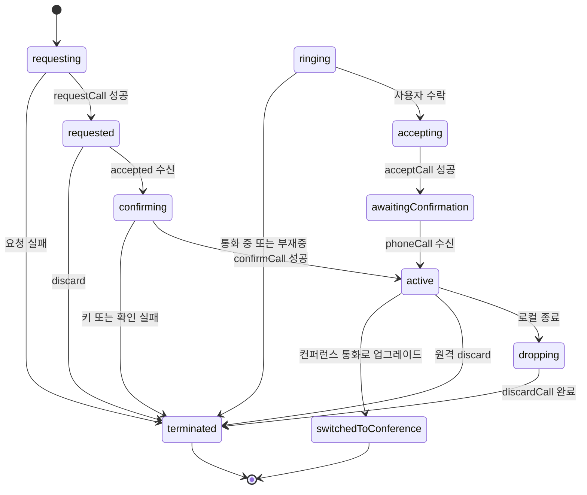
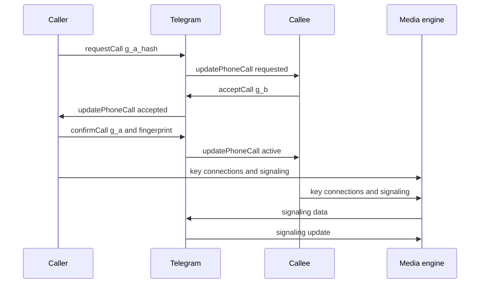
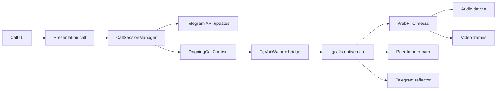
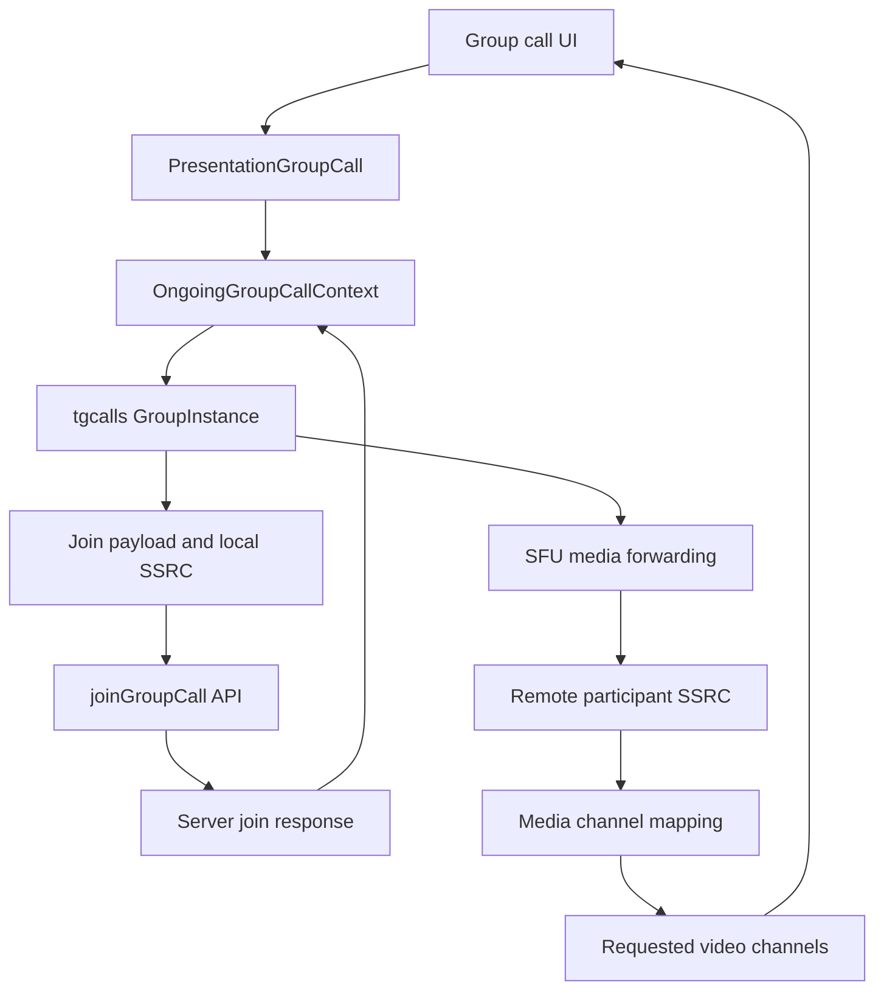

# 통화 시스템

웹: /docs/system/13-calls/ · Markdown: /docs/system/13-calls.md

> Telegram iOS와 macOS의 통화 상태 머신, 미디어 엔진, 컨퍼런스 통화 암호화 설계

> 시스템 설계 · 통화 · 13장 · 도표 4 · 코드 발췌 10 · 인용 44 · 소스 기준선: [TelegramMessenger/Telegram-iOS@f1dd7a2d](https://github.com/TelegramMessenger/Telegram-iOS/tree/f1dd7a2dbd02cbbf513e75d5695d8d36d1cf5838), [overtake/TelegramSwift@579cebbf](https://github.com/overtake/TelegramSwift/tree/579cebbf0c01fd41b712eff3647fa7f69db9665d)
>
> 관련 보충: [macOS fork 장별 검증(08–15장)](/docs/system/32-fork-verify-08-15/), [비공개 통화 키에서 네 개의 이모지로의 매핑](/docs/system/38-call-emoji/)
>
> 핵심 소스 파일: [TelegramMessenger/Telegram-iOS/submodules/TelegramCore/Sources/State/CallSessionManager.swift](https://github.com/TelegramMessenger/Telegram-iOS/blob/f1dd7a2dbd02cbbf513e75d5695d8d36d1cf5838/submodules/TelegramCore/Sources/State/CallSessionManager.swift), [TelegramMessenger/Telegram-iOS/submodules/TelegramCore/Sources/State/ConferenceCallE2EContext.swift](https://github.com/TelegramMessenger/Telegram-iOS/blob/f1dd7a2dbd02cbbf513e75d5695d8d36d1cf5838/submodules/TelegramCore/Sources/State/ConferenceCallE2EContext.swift), [TelegramMessenger/Telegram-iOS/submodules/TelegramVoip/Sources/OngoingCallContext.swift](https://github.com/TelegramMessenger/Telegram-iOS/blob/f1dd7a2dbd02cbbf513e75d5695d8d36d1cf5838/submodules/TelegramVoip/Sources/OngoingCallContext.swift), [TelegramMessenger/Telegram-iOS/submodules/TelegramVoip/Sources/GroupCallContext.swift](https://github.com/TelegramMessenger/Telegram-iOS/blob/f1dd7a2dbd02cbbf513e75d5695d8d36d1cf5838/submodules/TelegramVoip/Sources/GroupCallContext.swift), [TelegramMessenger/Telegram-iOS/submodules/TgVoipWebrtc/Sources/OngoingCallThreadLocalContext.mm](https://github.com/TelegramMessenger/Telegram-iOS/blob/f1dd7a2dbd02cbbf513e75d5695d8d36d1cf5838/submodules/TgVoipWebrtc/Sources/OngoingCallThreadLocalContext.mm), [TelegramMessenger/Telegram-iOS/submodules/TgVoipWebrtc/PublicHeaders/TgVoipWebrtc/OngoingCallThreadLocalContext.h](https://github.com/TelegramMessenger/Telegram-iOS/blob/f1dd7a2dbd02cbbf513e75d5695d8d36d1cf5838/submodules/TgVoipWebrtc/PublicHeaders/TgVoipWebrtc/OngoingCallThreadLocalContext.h), [TelegramMessenger/Telegram-iOS/submodules/TelegramCallsUI/Sources/PresentationGroupCall.swift](https://github.com/TelegramMessenger/Telegram-iOS/blob/f1dd7a2dbd02cbbf513e75d5695d8d36d1cf5838/submodules/TelegramCallsUI/Sources/PresentationGroupCall.swift), [TelegramMessenger/Telegram-iOS/submodules/TelegramCallsUI/Sources/SharedCallAudioContext.swift](https://github.com/TelegramMessenger/Telegram-iOS/blob/f1dd7a2dbd02cbbf513e75d5695d8d36d1cf5838/submodules/TelegramCallsUI/Sources/SharedCallAudioContext.swift), [TelegramMessenger/Telegram-iOS/Telegram/NotificationService/Sources/NotificationService.swift](https://github.com/TelegramMessenger/Telegram-iOS/blob/f1dd7a2dbd02cbbf513e75d5695d8d36d1cf5838/Telegram/NotificationService/Sources/NotificationService.swift), [overtake/TelegramSwift/Telegram-Mac/PCallSession.swift](https://github.com/overtake/TelegramSwift/blob/579cebbf0c01fd41b712eff3647fa7f69db9665d/Telegram-Mac/PCallSession.swift), [overtake/TelegramSwift/Telegram-Mac/OngoingCallContext.swift](https://github.com/overtake/TelegramSwift/blob/579cebbf0c01fd41b712eff3647fa7f69db9665d/Telegram-Mac/OngoingCallContext.swift), [overtake/TelegramSwift/Telegram-Mac/AccountContext.swift](https://github.com/overtake/TelegramSwift/blob/579cebbf0c01fd41b712eff3647fa7f69db9665d/Telegram-Mac/AccountContext.swift), [overtake/TelegramSwift/packages/PrivateCallScreen/Package.swift](https://github.com/overtake/TelegramSwift/blob/579cebbf0c01fd41b712eff3647fa7f69db9665d/packages/PrivateCallScreen/Package.swift), [overtake/TelegramSwift/packages/PrivateCallScreen/Sources/PeerCallArguments.swift](https://github.com/overtake/TelegramSwift/blob/579cebbf0c01fd41b712eff3647fa7f69db9665d/packages/PrivateCallScreen/Sources/PeerCallArguments.swift), [overtake/TelegramSwift/.gitmodules](https://github.com/overtake/TelegramSwift/blob/579cebbf0c01fd41b712eff3647fa7f69db9665d/.gitmodules)
>
> 미검증 사항:
> - `ConferenceCallE2EContextState`의 Td 계층 암호 프리미티브, 폴링 간격, 블록 보존 정책은 여전히 미검증이에요.
> - macOS 클라이언트를 빌드하거나 실행하지 않았어요. 그래서 fork와 iOS 미디어 스택 사이의 `tgcalls` ABI 또는 프로토콜 호환성은 여전히 미검증이에요.

Telegram은 1:1 통화를 컨트롤 플레인(신원, 상태, 키를 해결하는 쪽)과 미디어 플레인(코덱, 네트워크, 오디오 기기, 비디오 프레임을 해결하는 쪽)으로 나눠요.

- `CallSessionManager`: 통화 요청, Diffie Hellman 키 협상(양쪽이 같은 키를 만드는 방식), 시그널링(연결을 맺기 위해 주고받는 제어 메시지), 종료 사유를 맡아요.
- `TelegramVoip`: 협상이 끝난 키, 후보 연결, 기기 상태를 `tgcalls`(네이티브 통화 라이브러리)와 WebRTC에 넘겨요.

이렇게 나눈 덕분에 UI는 프로토콜 세부 사항을 알 필요가 없고, 미디어 구현도 라이브러리 버전에 따라 바꿔 끼울 수 있어요. [\[1\]](https://github.com/TelegramMessenger/Telegram-iOS/blob/f1dd7a2dbd02cbbf513e75d5695d8d36d1cf5838/submodules/TelegramCore/Sources/State/CallSessionManager.swift#L82-L116) [\[8\]](https://github.com/TelegramMessenger/Telegram-iOS/blob/f1dd7a2dbd02cbbf513e75d5695d8d36d1cf5838/submodules/TelegramVoip/Sources/OngoingCallContext.swift#L170-L230)

## 개인 채팅 통화의 컨트롤 플레인 [#개인-채팅-통화의-컨트롤-플레인]

1:1 통화는 먼저 두 가지 문제를 풀어야 해요.

- 클라이언트는 사용자 동작을 복구할 수 있는 프로토콜 상태로 바꿔야 해요. 비동기 RPC(서버에 보내는 원격 호출), 푸시 업데이트, 미디어 콜백을 화면 계층에 흩어 놓아서는 안 돼요.
- 미디어 경로가 아직 만들어지지 않았을 때도 양쪽이 같은 임시 키를 확인하게 해야 해요. 그리고 실패를 통화 중, 부재중, 네트워크 끊김으로 정확하게 나눠 담을 수 있어야 해요.

`TelegramCore`는 프로세스 안의 `CallSessionManagerContext` 하나로 세션을 보관해요. 각 세션은 로컬 `UUID` 타입인 `CallSessionInternalId`와 서버의 `Int64` 타입 안정 ID를 함께 가져요. 안정 ID에서 로컬 ID로 가는 인덱스가 있어서, 나중에 도착한 `updatePhoneCall`도 기존 상태를 찾을 수 있어요.

`CallSessionInternalState`는 DH 개인 지수, 공개 값 커밋먼트(미리 값을 못 박아 두는 약속 값), 협상된 키, 버전, 연결 집합을 담아요. 요청, 수락, 확인, 폐기 상태에는 `Disposable`도 넣어 둬요. 그래서 상태가 바뀔 때 아직 진행 중인 비동기 작업을 취소할 수 있어요. [\[1\]](https://github.com/TelegramMessenger/Telegram-iOS/blob/f1dd7a2dbd02cbbf513e75d5695d8d36d1cf5838/submodules/TelegramCore/Sources/State/CallSessionManager.swift#L82-L116)

아래 도표는 개인 채팅의 컨트롤 상태예요. WebRTC의 연결 상태가 아니에요. 주요 상태의 뜻은 이래요.

- `requested`: 이쪽에서 요청을 이미 보냈다는 뜻이에요.
- `ringing`: 수신 전화를 표시할 수 있다는 뜻이에요.
- `active`: 키, 프로토콜 계층, 연결 기술이 모두 갖춰진 뒤에만 나타나요.



`submodules/TelegramCore/Sources/State/CallSessionManager.swift` 82–116행 발췌.

```swift
enum CallSessionInternalState {
    case ringing(id: Int64, accessHash: Int64, gAHash: Data, b: Data, versions: [String])
    case accepting(id: Int64, accessHash: Int64, gAHash: Data, b: Data, disposable: Disposable)
    case awaitingConfirmation(id: Int64, accessHash: Int64, gAHash: Data, b: Data, config: SecretChatEncryptionConfig)
    case requesting(a: Data, disposable: Disposable)
    case requested(id: Int64, accessHash: Int64, a: Data, gA: Data, config: SecretChatEncryptionConfig, remoteConfirmationTimestamp: Int32?)
    case confirming(id: Int64, accessHash: Int64, key: Data, keyId: Int64, keyVisualHash: Data, disposable: Disposable)
    case active(id: Int64, accessHash: Int64, beginTimestamp: Int32, key: Data, keyId: Int64, keyVisualHash: Data, connections: CallSessionConnectionSet, maxLayer: Int32, version: String, customParameters: String?, allowsP2P: Bool, supportsConferenceCalls: Bool)
    case switchedToConference(slug: String)
    case dropping(reason: CallSessionTerminationReason, disposable: Disposable)
    case terminated(id: Int64?, accessHash: Int64?, reason: CallSessionTerminationReason, reportRating: Bool, sendDebugLogs: Bool)
}
```

### 발신, 수신, 멱등 업데이트 [#발신-수신-멱등-업데이트]

발신 측은 이 순서로 움직여요.

1. `SecRandomCopyBytes`로 256바이트 지수 `a`를 만들어요.
2. 곧바로 `requesting`으로 들어가고, `requestCallSession`으로 서버가 돌려주는 통화 ID를 받아요.
3. 성공하면 상태를 `requested`로 바꾸고 `deliverCallSignalingData`를 호출해요. 그래서 시그널링 업데이트가 화면의 구독보다 먼저 도착하더라도, 대기열에 쌓인 데이터를 뒤이어 등록되는 수신자에게 전달할 수 있어요. [\[2\]](https://github.com/TelegramMessenger/Telegram-iOS/blob/f1dd7a2dbd02cbbf513e75d5695d8d36d1cf5838/submodules/TelegramCore/Sources/State/CallSessionManager.swift#L1406-L1429) [\[3\]](https://github.com/TelegramMessenger/Telegram-iOS/blob/f1dd7a2dbd02cbbf513e75d5695d8d36d1cf5838/submodules/TelegramCore/Sources/State/CallSessionManager.swift#L1372-L1403)

수신 측은 `acceptCallSession`에서 `g_b`를 계산하고 안전성을 먼저 검사한 뒤 `phone.acceptCall`을 보내요. 서버의 응답은 둘 중 하나예요.

- `phoneCallWaiting`을 즉시 돌려줘요.
- 이미 완전한 `phoneCall`을 돌려줘요. 여기에는 연결, 협상 계층, 선택적 커스텀 파라미터, P2P 허용 여부가 들어 있어요.

공통 버전을 고르는 로직은 같은 함수의 뒤쪽 분기에 있어요. 이 설계는 네트워크 이벤트와 UI의 수락 동작을 직렬화해요. 그래서 같은 수신 전화가 여러 기기에서 미디어 플레인을 중복 초기화하는 일을 막아요. [\[4\]](https://github.com/TelegramMessenger/Telegram-iOS/blob/f1dd7a2dbd02cbbf513e75d5695d8d36d1cf5838/submodules/TelegramCore/Sources/State/CallSessionManager.swift#L1609-L1679)

아래 도표는 프로토콜 제어 메시지와 미디어 시그널링이 갈라지는 모습을 보여 줘요. 데이터 종류마다 가는 길이 달라요.

- 통화 상태와 협상 데이터: Telegram API 업데이트로 흘러요.
- WebRTC가 만든 후보나 재협상 데이터: `phone.sendSignalingData`의 추상을 거쳐 상대에게 돌아가요.
- 미디어 패킷: 연결이 만들어진 뒤 P2P 또는 reflector(중계 서버) 경로로 흘러요.



### DH 커밋먼트, 지문, 이모지 검증 [#dh-커밋먼트-지문-이모지-검증]

일반적인 2메시지 DH에서는 먼저 시작한 쪽이 상대의 공개 값을 본 뒤 다른 지수를 고를 수 있어요. 그래서 Telegram의 음성 프로토콜은 이 순서로 값을 보내요.

1. 시작한 쪽이 `SHA256 g_a`를 먼저 보내요.
2. 수신 측이 `g_b`를 돌려줘요.
3. 마지막에 시작한 쪽이 `g_a`를 공개해요.

공식 사양은 양쪽이 안전 소수 조건, 공개 값의 유효성, 키 지문을 검사하도록 요구해요. 또 이모지 검증의 입력을 키에 `g_a`를 이어 붙인 값의 SHA256으로 정해 둬요. [\[5\]](https://core.telegram.org/api/end-to-end/voice-calls)

코드는 이 순서를 엄격하게 따라요.

- 요청: `requestCallSession`은 로컬 암호화 설정으로 `g_a`를 계산하고, 먼저 `MTCheckIsSafeGAOrB`를 호출한 다음 `MTSha256 ga`를 `phone.requestCall`에 넣어요. 최소 계층, 최대 계층, 지원하는 구현 버전도 함께 제출해요.
- 수락: 수신 측도 `g_b`에 안전성 검사를 해요.
- 확인: 확인 측은 `g_a`와 `keyFingerprint`로 `phone.confirmCall`을 호출해요. [\[4\]](https://github.com/TelegramMessenger/Telegram-iOS/blob/f1dd7a2dbd02cbbf513e75d5695d8d36d1cf5838/submodules/TelegramCore/Sources/State/CallSessionManager.swift#L1609-L1679) [\[5\]](https://core.telegram.org/api/end-to-end/voice-calls)

`submodules/TelegramCore/Sources/State/CallSessionManager.swift` 1372–1403행 발췌.

```swift
private func makeSessionEncryptionKey(
    config: SecretChatEncryptionConfig, gAHash: Data, b: Data, gA: Data
) -> (key: Data, keyId: Int64, keyVisualHash: Data)? {
    let p = config.p.makeData()
    if !MTCheckIsSafeGAOrB(self.network.encryptionProvider, gA, p) {
        return nil
    }
    var key = MTExp(self.network.encryptionProvider, gA, b, p)!
    // ...
    let keyHash = MTSha1(key)
    var keyId: Int64 = 0
    keyHash.withUnsafeBytes { rawBytes -> Void in
        let bytes = rawBytes.baseAddress!.assumingMemoryBound(to: UInt8.self)
        memcpy(&keyId, bytes.advanced(by: keyHash.count - 8), 8)
    }
    if MTSha256(gA) != gAHash {
        return nil
    }
    let keyVisualHash = MTSha256(key + gA)
    return (key, keyId, keyVisualHash)
}
```

이 함수의 동작은 이래요.

- 공유 값의 왼쪽을 0으로 채우거나 잘라서 256바이트로 맞춘 뒤, SHA1의 하위 64비트를 `keyId`로 써요.
- 받은 `g_a`를 요청 시점의 `g_a_hash`와 먼저 대조하고, 그다음 `keyVisualHash`를 만들어요.

UI는 이 값으로 이모지 집합에서 서로 비교할 수 있는 시각 지문을 뽑아낼 수 있어요.

`TelegramCallsUI`의 `CallsEmoji`는 32바이트 입력을 요구해요. 이모지 네 개를 고르는 계산은 이래요.

1. `keyVisualHash`를 연속된 8바이트 빅 엔디언(큰 자릿수 바이트가 앞에 오는 순서) 값 네 개로 잘라요.
2. 각 구간의 첫 바이트 최상위 비트를 지워요.
3. 고정된 333개 항목 표에 대해 나머지 연산을 해요.

iOS의 개인 채팅 화면은 이 매핑을 그대로 써요. 고정 커밋의 macOS `ObjcUtils`도 같은 표 항목, 분할 순서, 인덱스 공식을 써요. [\[36\]](https://github.com/TelegramMessenger/Telegram-iOS/blob/f1dd7a2dbd02cbbf513e75d5695d8d36d1cf5838/submodules/TelegramCallsUI/CallsEmoji/Sources/CallsEmoji.m#L6-L53) [\[37\]](https://github.com/TelegramMessenger/Telegram-iOS/blob/f1dd7a2dbd02cbbf513e75d5695d8d36d1cf5838/submodules/TelegramCallsUI/Sources/CallControllerNodeV2.swift#L443-L496) [\[40\]](https://github.com/overtake/TelegramSwift/blob/579cebbf0c01fd41b712eff3647fa7f69db9665d/Telegram-Mac/CallScreenController.swift#L22-L60) [\[41\]](https://github.com/overtake/TelegramSwift/blob/579cebbf0c01fd41b712eff3647fa7f69db9665d/packages/ObjcUtils/Sources/ObjcUtils/ObjcUtils.m#L650-L700) [비공개 통화 키에서 네 개의 이모지로의 매핑](/docs/system/38-call-emoji/)

`submodules/TelegramCore/Sources/State/CallSessionManager.swift` 1681–1718행 발췌.

```swift
let ga = MTExp(network.encryptionProvider, g, a, p)!
if !MTCheckIsSafeGAOrB(network.encryptionProvider, ga, p) {
    return .single(.failed(.generic))
}
let gAHash = MTSha256(ga)
return network.request(Api.functions.phone.requestCall(
    flags: callFlags,
    userId: inputUser,
    randomId: Int32(bitPattern: arc4random()),
    gAHash: Buffer(data: gAHash),
    protocol: .phoneCallProtocol(.init(
        flags: (1 << 0) | (1 << 1),
        minLayer: minLayer,
        maxLayer: maxLayer,
        libraryVersions: versions
    ))
))
```

이 3단계 교환에는 대가와 이득이 있어요.

- 대가: API 왕복이 한 번 더 늘고, 양쪽이 동시에 온라인이어야 해요.
- 이득: `g_a_hash`가 나중에 바꿔치기할 수 없는 커밋먼트가 되고, 이모지 네 개가 33비트가 넘는 검증 엔트로피를 대표할 수 있어요.

이 보안 목적은 공식 프로토콜 설명이 정해 두었고, 소스는 그 안의 계산과 비교를 구현해요. [\[3\]](https://github.com/TelegramMessenger/Telegram-iOS/blob/f1dd7a2dbd02cbbf513e75d5695d8d36d1cf5838/submodules/TelegramCore/Sources/State/CallSessionManager.swift#L1372-L1403) [\[5\]](https://core.telegram.org/api/end-to-end/voice-calls)

### 시그널링, 종료, 시간 경계 [#시그널링-종료-시간-경계]

미디어 엔진이 만든 데이터가 Core의 상태를 직접 바꿀 수는 없어요. 대신 시그널링 데이터는 대기열을 거쳐 가요.

1. `addCallSignalingData`가 안정 ID를 기준으로 `enqueuedSignalingData`에 먼저 넣어요.
2. 세션과 `signalingReceiver`가 모두 있을 때만 `deliverCallSignalingData`가 한 번에 전달하고 대기열을 비워요.

이 버퍼는 업데이트가 먼저 도착하고 엔진이 나중에 만들어지는 경쟁 상황을 해결해요. 하지만 이 지점에서 용량이나 만료 시간을 두지는 않아요. [\[6\]](https://github.com/TelegramMessenger/Telegram-iOS/blob/f1dd7a2dbd02cbbf513e75d5695d8d36d1cf5838/submodules/TelegramCore/Sources/State/CallSessionManager.swift#L1321-L1339)

`submodules/TelegramCore/Sources/State/CallSessionManager.swift` 1321–1339행 발췌.

```swift
func addCallSignalingData(id: Int64, data: Data) {
    if self.enqueuedSignalingData[id] == nil {
        self.enqueuedSignalingData[id] = []
    }
    self.enqueuedSignalingData[id]?.append(data)
    self.deliverCallSignalingData(id: id)
}

private func deliverCallSignalingData(id: Int64) {
    guard let internalId = self.contextIdByStableId[id],
          let context = self.contexts[internalId] else {
        return
    }
    if let signalingReceiver = context.signalingReceiver,
       let data = self.enqueuedSignalingData.removeValue(forKey: id) {
        signalingReceiver(data)
    }
}
```

이 파일은 개인 채팅의 요청, 벨 울림, 확인에 대해 `Timer`, `timeout`, 고정된 초 단위를 정의하지 않아요. 종료는 서버의 `phoneCallDiscarded`, 네트워크 요청 결과, 명시적인 `drop`이 이끌어요. 그래서 다음 두 가지는 이 상태 머신 파일만으로는 검증할 수 없어요.

- 서버가 부재중을 언제 `missed`로 바꾸는지
- 애플리케이션 계층에 별도의 UI 타이머가 있는지

이렇게 하면 클라이언트와 서버 두 곳의 카운트다운이 서로 부딪힐 위험은 줄어요. 대신 타임아웃의 의미를 프로토콜과 다른 계층에 맡기게 돼요. (추정)

로컬 종료는 `hangup`, `busy`, `disconnect`, `missed` 또는 컨퍼런스 통화 업그레이드로 매핑돼요. 종료 업데이트에 실리는 값은 이래요.

- 로컬에서 통화한 초 수: `hangup`과 `disconnect`에만 실려요.
- 플래그 두 개: `discardCall` 업데이트에는 평점 표시 여부와 디버그 로그 업로드 여부를 나타내는 플래그 두 개도 실려요.

이렇게 하면 UI에 표시되는 종료 의미와 서버가 받는 분석 또는 평점 요청이 하나의 종료 경로에서 나와요. [\[7\]](https://github.com/TelegramMessenger/Telegram-iOS/blob/f1dd7a2dbd02cbbf513e75d5695d8d36d1cf5838/submodules/TelegramCore/Sources/State/CallSessionManager.swift#L1760-L1830)

macOS fork 차이: fork는 `active` 상태에서 `duration`을 이렇게 계산해요.

1. 2001년 기원(시간 계산의 기준점)의 `CFAbsoluteTimeGetCurrent()`에서 서버 Unix `start_date`인 `beginTimestamp`를 빼요.
2. `max`로 음수를 잘라 내요.

두 기원이 달라서 정상 통화의 `duration`은 보통 0이 돼요. fork는 이 값을 `hangUp` 사유에만 넣고 `disconnect`에는 통화 시간을 싣지 않아요. 업스트림은 서버의 근사 Unix 시간을 쓰도록 바꿨고, `disconnect`에도 통화 시간을 넘겨요. [\[42\]](https://github.com/overtake/Telegram-iOS/blob/a24bbe45f9861f736a79916a50898512f751e0dc/submodules/TelegramCore/Sources/State/CallSessionManager.swift#L841-L856) [\[43\]](https://github.com/TelegramMessenger/Telegram-iOS/blob/f1dd7a2dbd02cbbf513e75d5695d8d36d1cf5838/submodules/TelegramCore/Sources/State/CallSessionManager.swift#L848-L863) [macOS fork 장별 검증(08–15장)](/docs/system/32-fork-verify-08-15/)

컨트롤 메시지는 TL API 계층에 속해요. 생성, 바이너리 직렬화, 네트워크 요청은 Telegram의 통합 API 메커니즘을 재사용해요. 자세한 내용은 [TL 직렬화와 API 호출 계층](/docs/system/05-tl-api-layer/)에서 다뤄요. `updatePhoneCall`을 안정적으로 처리하는 것도 전역 업데이트 동기화에 기대고 있어요. 자세한 내용은 [업데이트 동기화](/docs/system/06-update-sync/)에서 다뤄요.

### 순서가 뒤바뀐 이벤트와 실패 수렴 [#순서가-뒤바뀐-이벤트와-실패-수렴]

`CallSessionManager` 자체는 비동기 파사드(내부를 감싼 단일 창구)예요. 유일한 `CallSessionManagerContext`를 `Queue`에 두고 `Unmanaged`로 그 생명주기를 유지해요. 모든 공개 진입점은 `withContext`를 거쳐 이 큐에 비동기로 들어가요. 그래서 다음이 모두 같은 직렬 컨텍스트에서 처리돼요.

- `request`, `accept`, `drop`, `updateSession`
- 시그널링 송수신
- 버전 업데이트

이런 제약은 콜백마다 따로 락을 거는 것보다 상태 전이의 원자성을 유지하기 쉬워요. (추정) [\[23\]](https://github.com/TelegramMessenger/Telegram-iOS/blob/f1dd7a2dbd02cbbf513e75d5695d8d36d1cf5838/submodules/TelegramCore/Sources/State/CallSessionManager.swift#L1451-L1596)

서버 업데이트는 로컬 상태를 그냥 덮어쓰지 않아요. `phoneCallRequested`를 받으면 코드는 먼저 안정 ID가 이미 있는지 확인해요.

- 없으면: 수신 context를 만들고, 통화 프로토콜에 담긴 라이브러리 버전을 `ringing` 상태에 저장해요.
- 이미 있으면: 중복 요청이라서 두 번째 벨 울림 항목을 만들지 않아요.

다중 기기 푸시, 업데이트 재전송, API 응답과 업데이트가 겹치는 경우에 이 중복 제거는 꼭 필요한 규칙이에요. [\[24\]](https://github.com/TelegramMessenger/Telegram-iOS/blob/f1dd7a2dbd02cbbf513e75d5695d8d36d1cf5838/submodules/TelegramCore/Sources/State/CallSessionManager.swift#L1170-L1318)

같은 원칙이 발신 측 대기에도 쓰여요. `phoneCallWaiting`은 `requested` 상태를 초기화하지 않아요. 로컬에 상대의 확인 시각이 아직 저장되어 있지 않을 때만 `receiveDate`를 `remoteConfirmationTimestamp`에 기록해요.

`remoteConfirmationTimestamp`가 나타내는 건 상대가 요청을 받은 시점이에요. 미디어가 연결된 시점이 아니에요. 실제 미디어 시작 시각은 뒤이은 완전한 `phoneCall`의 `startDate`에서 나와요. [\[1\]](https://github.com/TelegramMessenger/Telegram-iOS/blob/f1dd7a2dbd02cbbf513e75d5695d8d36d1cf5838/submodules/TelegramCore/Sources/State/CallSessionManager.swift#L82-L116) [\[24\]](https://github.com/TelegramMessenger/Telegram-iOS/blob/f1dd7a2dbd02cbbf513e75d5695d8d36d1cf5838/submodules/TelegramCore/Sources/State/CallSessionManager.swift#L1170-L1318)

완전한 `phoneCall`이 도착하면 코드는 두 가지를 검사해요.

- DH 결과를 검증해요.
- 통화 프로토콜이 제시한 라이브러리 버전 목록이 비어 있지 않은지 확인해요.

공통 버전이 없거나 연결 집합 같은 다른 필수 데이터가 기대에 맞지 않으면, 분기는 `drop`을 호출하고 `disconnect`를 사용해요. 따라서 `active`는 성공 업데이트라면 무엇이든 받자마자 낙관적으로 들어가는 상태가 아니에요. 키, 버전, 연결 기술의 가드(조건 검사)를 통과한 뒤에 발행돼요.

여기서의 버전 선택은 컨트롤 플레인의 호환성 관문이에요. 그래서 미디어 라이브러리가 상대의 능력을 추측할 필요가 없어요. [\[24\]](https://github.com/TelegramMessenger/Telegram-iOS/blob/f1dd7a2dbd02cbbf513e75d5695d8d36d1cf5838/submodules/TelegramCore/Sources/State/CallSessionManager.swift#L1170-L1318)

요청 RPC의 오류도 네트워크 라이브러리 오류로 그대로 새어 나가지 않아요. 오류는 이렇게 매핑돼요.

- `PARTICIPANT_VERSION_OUTDATED`: 지원하지 않는 상대
- `USER_PRIVACY_RESTRICTED`: 개인정보 제한
- 오류 코드 406: 서버가 준 문구를 그대로 둬요.
- 나머지 오류: 일반 실패로 합쳐져요.

이렇게 하면 표현 계층은 사용자에게 안정적인 오류 분류를 보여 줄 수 있고, 디버깅 계층에는 서버 정보가 그대로 남아요. [\[31\]](https://github.com/TelegramMessenger/Telegram-iOS/blob/f1dd7a2dbd02cbbf513e75d5695d8d36d1cf5838/submodules/TelegramCore/Sources/State/CallSessionManager.swift#L1681-L1737)

이 모델의 복구 경계도 분명해요. Core 파일에는 개인 채팅의 벨 울림이나 확인에 대한 로컬 스톱워치가 없어요. 그래서 수신 전화가 특정한 초 수 안에 끝난다는 것을 이 파일만으로는 보장할 수 없어요. 종료는 요청 결과, `phoneCallDiscarded` 업데이트, 호출자의 명시적 폐기에 기대고 있어요.

한편 미디어 래퍼 안에는 독립적인 전송 keepalive 타이머(연결이 살아 있는지 확인하려고 주기적으로 보내는 신호)가 실제로 있어요. 두 계층의 시간 의미를 뒤섞어서는 안 돼요.

## 개인 채팅 미디어 플레인과 TelegramVoip [#개인-채팅-미디어-플레인과-telegramvoip]

컨트롤 플레인은 신원, 상태, 키를 해결해요. 미디어 플레인은 코덱, NAT, 네트워크 전환, 오디오 기기, 비디오 프레임, 실시간 통계를 해결해야 해요.

`OngoingCallContext`는 Swift 쪽 생명주기 래퍼예요. 하는 일은 이래요.

- 전용 큐에서 `OngoingCallThreadLocalContextProtocol`을 들고 있어요.
- UI에 `initializing`, `connected`, `reconnecting`, `failed` 같은 상태를 내보내요.
- 음소거, 저전력, 비디오 전환, 오디오 라우팅, 시그널링은 네이티브 컨텍스트로 전달해요. [\[8\]](https://github.com/TelegramMessenger/Telegram-iOS/blob/f1dd7a2dbd02cbbf513e75d5695d8d36d1cf5838/submodules/TelegramVoip/Sources/OngoingCallContext.swift#L170-L230)

아래 도표는 이 계층 구조를 보여 줘요. 도표에서 키는 `CallSessionManager`에서 미디어 엔진으로만 들어가요. UI는 DH 개인 지수를 직접 쥐지 않아요. `tgcalls`에 Telegram API 요청을 조립해서 넘기지도 않아요.



`CallSessionConnection`에는 두 종류가 있어요.

- 전통적인 reflector: 네이티브 연결로 변환할 때 연결 ID, IPv4, IPv6, 포트, `peerTag`를 유지해요.
- WebRTC reflector: WebRTC 기술로 변환할 때 STUN, TURN(NAT를 통과하기 위한 서버), TCP, 사용자 이름, 비밀번호를 넘겨요.

비어 있지 않은 IP 주소마다 독립된 기술이 하나씩 생겨요. 그래서 IPv4와 IPv6는 서로 배타적인 설정이 아니라 후보 경로예요. [\[9\]](https://github.com/TelegramMessenger/Telegram-iOS/blob/f1dd7a2dbd02cbbf513e75d5695d8d36d1cf5838/submodules/TelegramVoip/Sources/OngoingCallContext.swift#L64-L106)

`allowP2P`는 UI 설정이 아니라 개인 채팅 세션의 협상 상태에서 나와요. 그래서 엔진은 허용 여부와 여러 relay 정보를 함께 받고, 네이티브 네트워크 정책에 따라 직접 연결할지 중계할지 정해요. 이렇게 프라이버시나 상대 제한은 컨트롤 플레인에 두고, 연결성 정책은 실시간 라이브러리에 맡겨요. (추정) 공식 구형 음성 프로토콜도 직접 연결과 reflector를 모두 협상된 키의 전송 경로로 명시해요. [\[5\]](https://core.telegram.org/api/end-to-end/voice-calls) [\[9\]](https://github.com/TelegramMessenger/Telegram-iOS/blob/f1dd7a2dbd02cbbf513e75d5695d8d36d1cf5838/submodules/TelegramVoip/Sources/OngoingCallContext.swift#L64-L106)

`TgVoipWebrtc`의 Objective C++ 어댑터 계층은 Swift의 의미를 `tgcalls` C++ 콜백으로 바꿔요. 현재 소스 주석이 표시하는 버전은 이래요.

- 네이티브 코어가 알리는 버전: `18.0.0`
- 내장 wasm 참조 코어: `19.0.0`

`versionsWithIncludeReference`는 참조 구현 버전을 협상 목록에 넣을지 정해요. 버전 번호는 클라이언트가 선언하는 값이에요. 아무 두 버전의 라이브러리가 무조건 서로 통신할 수 있다는 뜻은 아니에요. 실제로는 상대와의 공통 버전과 `minLayer` 제한도 받아요. [\[10\]](https://github.com/TelegramMessenger/Telegram-iOS/blob/f1dd7a2dbd02cbbf513e75d5695d8d36d1cf5838/submodules/TgVoipWebrtc/Sources/OngoingCallThreadLocalContext.mm#L1856-L2196)

네이티브 계층은 `signalingDataEmitted` 콜백을 자기 큐로 다시 보낸 뒤 Swift가 제공한 시그널링 클로저를 호출해요. WebRTC `AudioDeviceModule`도 만들거나 재사용해요. 덕분에 WebRTC 스레드와 오디오 기기의 소유 관계는 C++ 계층에 남고, Swift 계층은 상태와 자원 해제만 관리해요. [\[10\]](https://github.com/TelegramMessenger/Telegram-iOS/blob/f1dd7a2dbd02cbbf513e75d5695d8d36d1cf5838/submodules/TgVoipWebrtc/Sources/OngoingCallThreadLocalContext.mm#L1856-L2196)

종료할 때 네이티브 종료 결과는 WiFi와 모바일 네트워크 각각의 송수신 바이트 수를 돌려줘요. Swift 래퍼는 이 네 값(WiFi와 모바일 네트워크의 송신·수신 바이트 수)을 `NetworkUsageStatsConnectionsEntry`로 합쳐서 계정의 `call` 카테고리에 반영해요. 디버그 로그는 계정의 calls 디렉터리에 쓸 수도 있어요. `saveCallDebugLog`에 대한 서버 응답에 따라 전체 로그를 제출할지 정해요. [\[11\]](https://github.com/TelegramMessenger/Telegram-iOS/blob/f1dd7a2dbd02cbbf513e75d5695d8d36d1cf5838/submodules/TgVoipWebrtc/Sources/OngoingCallThreadLocalContext.mm#L2238-L2245) [\[12\]](https://github.com/TelegramMessenger/Telegram-iOS/blob/f1dd7a2dbd02cbbf513e75d5695d8d36d1cf5838/submodules/TelegramVoip/Sources/OngoingCallContext.swift#L1278-L1318)

`submodules/TelegramVoip/Sources/OngoingCallContext.swift` 1278–1318행 발췌.

```swift
self.withContext { context in
    context.nativeStop { debugLog, bytesSentWifi, bytesReceivedWifi,
                         bytesSentMobile, bytesReceivedMobile in
        let delta = NetworkUsageStatsConnectionsEntry(
            cellular: NetworkUsageStatsDirectionsEntry(
                incoming: bytesReceivedMobile, outgoing: bytesSentMobile),
            wifi: NetworkUsageStatsDirectionsEntry(
                incoming: bytesReceivedWifi, outgoing: bytesSentWifi)
        )
        updateAccountNetworkUsageStats(account: self.account,
                                       category: .call, delta: delta)
        // ... 통계 로그를 옮기고 필요하면 디버그 정보를 업로드한다
    }
}
```

미디어 전송의 MTProto 패킷 형식, 세션 계층, 데이터 센터 정책은 이 래퍼에서 정의하지 않아요. MTProto 전송과의 경계는 [MTProto 전송 계층](/docs/system/03-mtproto-transport/)을 참고해요. 통화의 음성·영상은 메시지 미디어 다운로드 큐를 재사용하지 않아요. 메시지 리소스 캐시 설계는 [미디어 리소스, 다운로드/업로드, 캐시](/docs/system/10-media-cache/)에서 다뤄요.

### 컨텍스트 생명주기와 이중 경로 시그널링 [#컨텍스트-생명주기와-이중-경로-시그널링]

`OngoingCallContext`는 네이티브 객체를 만든 뒤 세 종류의 입력을 구독해요.

1. 미디어 상태 콜백: 래퍼는 네이티브의 연결, 비디오, 원격 오디오, 원격 배터리, 신호 세기를 Swift 값으로 번역해요.
2. 애플리케이션 상태: `audioSessionActive` 구독을 `nativeSetIsAudioSessionActive`로 전달하고, 네트워크 타입 스트림을 `nativeSetNetworkType`으로 전달해요.
3. 컨트롤 플레인 시그널링: `CallSessionManager.beginReceivingCallSignalingData`로 데이터 배열을 받아서 항목마다 네이티브 `addSignaling`을 호출해요. [\[25\]](https://github.com/TelegramMessenger/Telegram-iOS/blob/f1dd7a2dbd02cbbf513e75d5695d8d36d1cf5838/submodules/TelegramVoip/Sources/OngoingCallContext.swift#L1196-L1235)

이렇게 하면 변화마다 권위 있는 방향(값을 정하는 쪽)이 하나뿐이에요.

- WebRTC 상태: 네이티브 계층에서 UI로 흘러요.
- 오디오 세션과 네트워크 가용성: 시스템 계층에서 네이티브 계층으로 흘러요.
- 통화 API의 시그널링: Core에서 네이티브 계층으로 흘러요.

UI가 네이티브 상태를 관찰하면서 동시에 고치게 하면, 네트워크 전환과 CallKit 활성화 때 순환 업데이트가 아주 쉽게 생겨요. (추정) [\[25\]](https://github.com/TelegramMessenger/Telegram-iOS/blob/f1dd7a2dbd02cbbf513e75d5695d8d36d1cf5838/submodules/TelegramVoip/Sources/OngoingCallContext.swift#L1196-L1235)

개인 채팅에는 선택적인 TCP 시그널링 연결 관리자도 있어요. 동작은 이래요.

- `hasTcp`인 WebRTC 서버에 대해서만 연결을 만들어요.
- 연결이 준비되기 전에는 0.15초마다 빈 페이로드를 보내 keepalive를 해요. 연결이 확인된 뒤에는 주기를 2초로 바꿔요.
- 수신 측은 길이가 2 MiB 이상인 페이로드를 거부해요.
- 애플리케이션이 내보내는 시그널링은 연결이 아직 확인되지 않았을 때 `queuedPayloads`에 들어가고, 확인되면 차례로 나가요. [\[26\]](https://github.com/TelegramMessenger/Telegram-iOS/blob/f1dd7a2dbd02cbbf513e75d5695d8d36d1cf5838/submodules/TelegramVoip/Sources/OngoingCallContext.swift#L1639-L1824)

이 TCP 파이프가 `CallSessionManager`의 API 시그널링을 대체하지는 않아요. `sendSignalingData`는 먼저 이 연결 관리자에게 데이터를 보내고, 그다음 `callSessionManager.sendSignalingData`를 호출해요. 따라서 소스가 보여 주는 건 병렬로 동작하는 로컬 전송 보조 채널과 Telegram API 시그널링 채널이에요. 이 TCP 채널을 언제 켤지는 연결 기술에 달려 있어요. 모든 통화가 이 채널을 쓴다고 가정해서는 안 돼요. [\[25\]](https://github.com/TelegramMessenger/Telegram-iOS/blob/f1dd7a2dbd02cbbf513e75d5695d8d36d1cf5838/submodules/TelegramVoip/Sources/OngoingCallContext.swift#L1196-L1235) [\[26\]](https://github.com/TelegramMessenger/Telegram-iOS/blob/f1dd7a2dbd02cbbf513e75d5695d8d36d1cf5838/submodules/TelegramVoip/Sources/OngoingCallContext.swift#L1639-L1824)

네이티브 WebRTC 래퍼는 세션이 끝날 때의 바이트 카운트를 Swift로 돌려줘요. 이 카운트는 WiFi와 모바일 네트워크로 나뉘어 계정의 네트워크 사용량에 기록돼요. 네트워크 품질 지표가 아니고, 그룹 비디오의 수신 품질도 아니에요. 그룹 비디오의 수신 품질은 그룹의 `GroupInstanceStats`가 제공하는 endpoint 수준 필드에서 나와요. 과금용 통계와 렌더링 적응 지표를 분리해 두면 UI가 잘못된 측정 척도를 쓰는 일을 피할 수 있어요. (추정) [\[11\]](https://github.com/TelegramMessenger/Telegram-iOS/blob/f1dd7a2dbd02cbbf513e75d5695d8d36d1cf5838/submodules/TgVoipWebrtc/Sources/OngoingCallThreadLocalContext.mm#L2238-L2245) [\[12\]](https://github.com/TelegramMessenger/Telegram-iOS/blob/f1dd7a2dbd02cbbf513e75d5695d8d36d1cf5838/submodules/TelegramVoip/Sources/OngoingCallContext.swift#L1278-L1318) [\[16\]](https://github.com/TelegramMessenger/Telegram-iOS/blob/f1dd7a2dbd02cbbf513e75d5695d8d36d1cf5838/submodules/TgVoipWebrtc/Sources/OngoingCallThreadLocalContext.mm#L3088-L3141)

통화가 끝난 뒤의 로그 경로도 마찬가지로 계층으로 나뉘어 있어요.

- `OngoingCallContext`는 calls 디렉터리에 로그 파일을 최대 40개까지 보관해요.
- 종료할 때는 임시 통계 JSON을 최종 경로로 옮기고, Engine을 통해 디버그 로그를 업로드해야 하는지 물어요.

로그 파일 보존 정책은 로컬 진단 데이터가 늘어나는 것을 제한할 수 있어요. 하지만 코드는 이 지점에서 개별 로그 파일의 크기 상한을 설명하지 않아요. [\[12\]](https://github.com/TelegramMessenger/Telegram-iOS/blob/f1dd7a2dbd02cbbf513e75d5695d8d36d1cf5838/submodules/TelegramVoip/Sources/OngoingCallContext.swift#L1278-L1318) [\[34\]](https://github.com/TelegramMessenger/Telegram-iOS/blob/f1dd7a2dbd02cbbf513e75d5695d8d36d1cf5838/submodules/TelegramVoip/Sources/OngoingCallContext.swift#L128-L159)

## 그룹 통화와 서버 미디어 포워딩 [#그룹-통화와-서버-미디어-포워딩]

그룹 통화가 마주하는 건 두 끝점이 아니라 이런 것들이에요.

- 동적인 참가자
- 여러 오디오·비디오 SSRC(미디어 스트림을 구분하는 식별자)
- 발언자 활동
- 비디오 구독 품질

참가자 쌍마다 각자 미디어 연결을 만들면 연결 수가 인원의 제곱으로 늘고, 모바일 클라이언트마다 업링크 부담도 지나치게 커져요. Telegram의 코드는 그룹 미디어를 `OngoingGroupCallContext`와 `tgcalls::GroupInstance`에 맡겨요. 서버 측 미디어 협상은 join payload(참가 요청에 담아 보내는 데이터)와 join response(서버의 응답)라는 두 경계로 한정해요. (추정)

`OngoingGroupCallContext`는 실시간 엔진을 `Signal`로 노출해요. 내보내는 값은 이래요.

- join payload
- 로컬 네트워크 상태
- 음량 레벨
- 활성 SSRC
- 신호 세기
- 음소거 상태
- 노이즈 억제 상태

호출자는 `setConnectionMode`에서 `none`, `rtc`, `broadcast`를 고를 수 있어요. RTC가 아닌 모드로 들어갈 때 코드는 `joinPayload`를 `never`로 설정해요. 그래서 RTC 참가 데이터를 브로드캐스트 재생 경로에 잘못 쓰는 일을 막아요. [\[13\]](https://github.com/TelegramMessenger/Telegram-iOS/blob/f1dd7a2dbd02cbbf513e75d5695d8d36d1cf5838/submodules/TelegramVoip/Sources/GroupCallContext.swift#L940-L1030)

실시간 엔진의 join payload는 문자열과 로컬 `UInt32` SSRC의 튜플(값 묶음)이에요. 연결 모드를 바꾸거나 비디오를 시작하거나 끌 때마다 네이티브 컨텍스트에서 새 payload를 받아 같은 `Promise`를 갱신해요.

상위 계층은 payload를 파싱하지 않고 내용을 그대로 `TelegramEngine.calls.joinGroupCall`에 제출해요. 서버가 돌려주는 `jsonParams`는 이후 파싱되어 로컬 비디오 endpoint를 뽑아내고, 참가 응답으로서 통화 컨텍스트에 되돌려져요. [\[13\]](https://github.com/TelegramMessenger/Telegram-iOS/blob/f1dd7a2dbd02cbbf513e75d5695d8d36d1cf5838/submodules/TelegramVoip/Sources/GroupCallContext.swift#L940-L1030) [\[14\]](https://github.com/TelegramMessenger/Telegram-iOS/blob/f1dd7a2dbd02cbbf513e75d5695d8d36d1cf5838/submodules/TelegramCallsUI/Sources/PresentationGroupCall.swift#L2034-L2145)

아래 도표는 일반 그룹 통화에서 협상 경계를 보여 줘요. 도표의 SFU는 서버가 미디어를 선택적으로 포워딩하는 역할을 뜻해요. 소스의 타입 이름에는 SFU가 직접 쓰여 있지 않아요. 하지만 `GroupInstance`의 단일 join payload, SSRC 매핑, 비디오 스트림별 품질 구독이 이 역할 분담에 들어맞아요. 그래서 여기서의 SFU라는 이름은 추정이에요. [\[13\]](https://github.com/TelegramMessenger/Telegram-iOS/blob/f1dd7a2dbd02cbbf513e75d5695d8d36d1cf5838/submodules/TelegramVoip/Sources/GroupCallContext.swift#L940-L1030) [\[14\]](https://github.com/TelegramMessenger/Telegram-iOS/blob/f1dd7a2dbd02cbbf513e75d5695d8d36d1cf5838/submodules/TelegramCallsUI/Sources/PresentationGroupCall.swift#L2034-L2145)



`submodules/TelegramVoip/Sources/GroupCallContext.swift` 967–1025행 발췌.

```swift
func setConnectionMode(_ connectionMode: ConnectionMode,
                       keepBroadcastConnectedIfWasEnabled: Bool,
                       isUnifiedBroadcast: Bool) {
    let mappedConnectionMode: OngoingCallConnectionMode
    switch connectionMode {
    case .none: mappedConnectionMode = .none
    case .rtc: mappedConnectionMode = .rtc
    case .broadcast: mappedConnectionMode = .broadcast
    }
    self.context.setConnectionMode(mappedConnectionMode,
        keepBroadcastConnectedIfWasEnabled: keepBroadcastConnectedIfWasEnabled,
        isUnifiedBroadcast: isUnifiedBroadcast)
    if mappedConnectionMode != .rtc {
        self.joinPayload.set(.never())
    } else {
        self.context.getJoinPayload { [weak self] payload, ssrc in
            self?.joinPayload.set(.single((payload, ssrc)))
        }
    }
}
```

`PresentationGroupCall`은 payload를 받은 뒤 로컬 SSRC를 보관해요. 그리고 다음 값을 함께 Engine에 넘겨요.

- 음소거 설정
- 초대 hash
- 누구 이름으로 참가하는지를 나타내는 peer
- 스트림 모드
- 관리자 집합

성공하면 서버의 참가자 목록을 순회하며 오디오 SSRC를 peer에 연결해요. 이후 어떤 SSRC의 기술이 없으면 최대 100개까지 참가자 데이터를 요청해요. UI의 신원 모델과 RTP의 신원 모델이 만나는 곳이 바로 여기예요. [\[14\]](https://github.com/TelegramMessenger/Telegram-iOS/blob/f1dd7a2dbd02cbbf513e75d5695d8d36d1cf5838/submodules/TelegramCallsUI/Sources/PresentationGroupCall.swift#L2034-L2145) [\[15\]](https://github.com/TelegramMessenger/Telegram-iOS/blob/f1dd7a2dbd02cbbf513e75d5695d8d36d1cf5838/submodules/TelegramCallsUI/Sources/PresentationGroupCall.swift#L2821-L2875)

`submodules/TelegramCallsUI/Sources/PresentationGroupCall.swift` 2034–2089행 발췌.

```swift
var generateE2EData: ((Data?) -> JoinGroupCallE2E?)?
if let keyPair = self.keyPair {
    if let mappedKeyPair = TdKeyPair(keyId: keyPair.id, publicKey: keyPair.publicKey.data) {
    let userId = self.joinAsPeerId.id._internalGetInt64Value()
    generateE2EData = { block -> JoinGroupCallE2E? in
        if let block {
            guard let resultBlock = tdGenerateSelfAddBlock(mappedKeyPair, userId, block) else {
                return nil
            }
            return JoinGroupCallE2E(publicKey: keyPair.publicKey, block: resultBlock)
        } else {
            guard let resultBlock = tdGenerateZeroBlock(mappedKeyPair, userId) else {
                return nil
            }
            return JoinGroupCallE2E(publicKey: keyPair.publicKey, block: resultBlock)
        }
    }
}
```

비디오 수신은 모든 품질을 무작정 구독하는 게 아니에요. 네이티브 브리지는 요청마다 `tgcalls::VideoChannelDescription`으로 매핑해요. 이 설명 객체에는 다음이 들어 있어요.

- 오디오 SSRC
- 사용자 ID
- endpoint ID
- SSRC 그룹
- 최소·최대 품질

품질은 thumbnail, medium, full의 세 단계를 지원해요. 그룹 통계는 `GroupInstanceStats.incomingVideoStats`에서 endpoint별 receiving quality와 available quality를 뽑아 Swift로 돌려줘요. 덕분에 UI는 C++ 객체를 읽지 않고도 품질을 설명할 수 있어요. [\[16\]](https://github.com/TelegramMessenger/Telegram-iOS/blob/f1dd7a2dbd02cbbf513e75d5695d8d36d1cf5838/submodules/TgVoipWebrtc/Sources/OngoingCallThreadLocalContext.mm#L3088-L3141)

`submodules/TgVoipWebrtc/Sources/OngoingCallThreadLocalContext.mm` 3258–3269행 발췌.

```objc
- (void)getStats:(void (^ _Nonnull)(OngoingGroupCallStats * _Nonnull))completion {
    if (_instance) {
        _instance->getStats([completion](tgcalls::GroupInstanceStats stats) {
            NSMutableDictionary<NSString *, OngoingGroupCallIncomingVideoStats *> *incoming =
                [[NSMutableDictionary alloc] init];
            for (const auto &it : stats.incomingVideoStats) {
                incoming[[NSString stringWithUTF8String:it.first.c_str()]] =
                    [[OngoingGroupCallIncomingVideoStats alloc]
                        initWithReceivingQuality:it.second.receivingQuality
                        availableQuality:it.second.availableQuality];
            }
            completion([[OngoingGroupCallStats alloc]
                initWithIncomingVideoStats:incoming]);
        });
    }
}
```

설계 관점에서 참가 페이로드와 참가 응답은 앞으로 발전시킬 수 있는 명시적 프로토콜 경계예요.

- 장점: Swift UI가 SDP(연결 조건을 기술하는 세션 설명 형식)나 후보 형식에 기대지 않고, 같은 엔진으로 iOS와 macOS를 모두 지원할 수 있어요.
- 대가: 문제를 추적할 때 Engine 로그, 네이티브 미디어 로그, 서버 JSON을 함께 읽어야 해요.

`OngoingGroupCallContext`는 외부 오디오 데이터, 화면 공유, 브로드캐스트 컨텍스트도 같은 엔진에 들어오게 해요. 그래서 생명주기와 오디오 기기 소유권은 상위 계층이 엄격하게 관리해야 해요. [\[13\]](https://github.com/TelegramMessenger/Telegram-iOS/blob/f1dd7a2dbd02cbbf513e75d5695d8d36d1cf5838/submodules/TelegramVoip/Sources/GroupCallContext.swift#L940-L1030) [\[16\]](https://github.com/TelegramMessenger/Telegram-iOS/blob/f1dd7a2dbd02cbbf513e75d5695d8d36d1cf5838/submodules/TgVoipWebrtc/Sources/OngoingCallThreadLocalContext.mm#L3088-L3141)

### 브로드캐스트, RTC, 미디어 신원 [#브로드캐스트-rtc-미디어-신원]

그룹 컨텍스트의 `networkState`와 개인 채팅의 `connected`는 같은 입도(세분화 정도)를 나타내지 않아요. 그룹 상태에는 브로드캐스트에서 RTC로 이전했는지, 브로드캐스트인지 여부라는 의미도 담겨 있어요. UI는 이를 보고 재생 경로와 상호작용 경로 중 하나를 고를 수 있어요. 네이티브 연결 오류로 모드를 추측할 필요가 없어요.

음량과 활동 정보는 이렇게 나뉘어요.

- `audioLevels`: 키가 오디오 SSRC와 선택적인 발표 스트림 표시로 구성돼요. 발언자 표시에 쓰여요.
- `ssrcActivities`: 활성 SSRC만 내보내요. 더 가벼운 활동 알림에 쓰여요. [\[27\]](https://github.com/TelegramMessenger/Telegram-iOS/blob/f1dd7a2dbd02cbbf513e75d5695d8d36d1cf5838/submodules/TelegramVoip/Sources/GroupCallContext.swift#L1144-L1239)

미디어 SSRC를 Telegram 사용자 ID로 곧바로 볼 수는 없어요. `PresentationGroupCall`은 네이티브가 요청한 SSRC 집합을 받으면 이렇게 처리해요.

1. 먼저 기존 members 상태에서 기술을 찾아요.
2. 아직 풀리지 않은 부분에 대해서만 `getGroupCallParticipants`를 호출하고, 조회 상한은 100으로 둬요.

결과에는 peer ID, 오디오 SSRC, 선택적 비디오 기술, 발표 기술이 들어 있어요. 덕분에 참가자 데이터를 나중에 불러와도 이미 알려진 미디어 스트림의 렌더링은 막히지 않아요. [\[15\]](https://github.com/TelegramMessenger/Telegram-iOS/blob/f1dd7a2dbd02cbbf513e75d5695d8d36d1cf5838/submodules/TelegramCallsUI/Sources/PresentationGroupCall.swift#L2821-L2875)

컨퍼런스 통화 모드에서 `OngoingGroupCallContext`를 만들 때는 `ConferenceCallE2EContext`의 원자 상태와 `channelId`를 `OngoingGroupCallEncryptionContextImpl`에 넘겨요. `isConference`가 참인데 E2E(종단 간 암호화) context가 없으면, 코드는 그래도 빈 암호화 컨텍스트를 만들어요. 주석은 이 동작이 암호화되지 않은 컨퍼런스 통화를 막기 위한 것이라고 설명해요. 이 빈 상태는 미디어 플레인에 유효한 E2E 키가 없게 만들 뿐, 일반 통화로 슬며시 강등되지 않아요. [\[28\]](https://github.com/TelegramMessenger/Telegram-iOS/blob/f1dd7a2dbd02cbbf513e75d5695d8d36d1cf5838/submodules/TelegramCallsUI/Sources/PresentationGroupCall.swift#L1840-L1910)

같은 생성 지점에서 참조 구현도 처리해요. 설정은 `PeerConnection` 기반 참조 그룹 통화 엔진을 요청할 수 있지만, 스트리밍 모드는 이를 강제로 꺼요. 소스 주석이 드는 이유는 참조 구현이 broadcast를 지원하지 않고 영영 나타나지 않을 RTC answer를 기다린다는 거예요. 이 예외는 추상화 계층이 엔진 교체를 허용하더라도, 제품 모드에서는 호환되지 않는 조합을 명시적으로 제한해야 한다는 걸 보여 줘요. [\[28\]](https://github.com/TelegramMessenger/Telegram-iOS/blob/f1dd7a2dbd02cbbf513e75d5695d8d36d1cf5838/submodules/TelegramCallsUI/Sources/PresentationGroupCall.swift#L1840-L1910)

그룹 비디오 품질 요청에도 컨트롤과 미디어의 분리가 드러나요. 상위 계층은 `VideoChannel`마다 허용 품질 범위를 골라요. 브리지는 Swift 열거형을 C++의 `Thumbnail`, `Medium`, `Full`로 변환해요. 서버나 포워더가 실제 계층을 어떻게 고르는지는 이 클라이언트 코드에서 검증하지 못했어요. 그러니 `availableQuality`를 로컬이 이미 구독한 품질로 봐서는 안 돼요. [\[16\]](https://github.com/TelegramMessenger/Telegram-iOS/blob/f1dd7a2dbd02cbbf513e75d5695d8d36d1cf5838/submodules/TgVoipWebrtc/Sources/OngoingCallThreadLocalContext.mm#L3088-L3141)

## 컨퍼런스 통화의 종단 간 암호화 [#컨퍼런스-통화의-종단-간-암호화]

일반 그룹 통화의 미디어 포워딩과 컨퍼런스 통화의 종단 간 암호화를 혼동해서는 안 돼요. 컨퍼런스 통화 모드에서는 동적인 멤버가 일관된 멤버 집합, 권한, 공유 키에 합의해야 해요. `ConferenceCallE2EContext`는 원자 `ContextStateHolder`를 하나 갖고 있고, 그 안의 구체적 상태는 `ConferenceCallE2EContextState` 구현이 제공해요. 이 컨텍스트는 `e2eEncryptionKeyHash`, 블록체인 참가자, 실패 상태를 UI에 함께 발행해요. [\[17\]](https://github.com/TelegramMessenger/Telegram-iOS/blob/f1dd7a2dbd02cbbf513e75d5695d8d36d1cf5838/submodules/TelegramCore/Sources/State/ConferenceCallE2EContext.swift#L15-L504)

공식 컨퍼런스 통화 프로토콜은 공유되는 체인 블록을 통화 상태의 출처로 삼아요. 흐름은 이래요.

1. 참가자는 현재 블록을 가져와요.
2. 자신의 멤버 변경과 새 공유 키를 포함한 블록을 제안하고 서버에 제출해요.
3. 미디어 패킷은 활성 epoch에 따라 암호화되고, 수신 측은 블록 상태에서 복호화 재료를 얻어요.

이 프로토콜은 재전송을 막기 위해 증가하는 시퀀스 번호와 서명 검증도 요구해요. [\[18\]](https://core.telegram.org/api/end-to-end/group-calls)

iOS 코드는 암호 상태 구현을 Td 계층에 맡겨요. 컨퍼런스 통화를 만들 때 `PresentationGroupCall`은 `keyPair`로 `TdKeyPair`를 구성하고, 앞선 블록 유무에 따라 블록을 만들어요.

- 앞선 블록이 있으면: `tdGenerateSelfAddBlock`을 호출해요.
- 앞선 블록이 없으면: `tdGenerateZeroBlock`을 호출해요.

만들어진 공개 키와 직렬화된 블록은 `JoinGroupCallE2E`로서 일반 join payload와 함께 Engine에 들어가요. 다시 말해 미디어 연결의 참가와 컨퍼런스 통화 멤버십의 암호학적 제출이 같은 참가 동작 안에서 묶여요. [\[14\]](https://github.com/TelegramMessenger/Telegram-iOS/blob/f1dd7a2dbd02cbbf513e75d5695d8d36d1cf5838/submodules/TelegramCallsUI/Sources/PresentationGroupCall.swift#L2034-L2145)

`ConferenceCallE2EContext`는 시작된 뒤 이렇게 동작해요.

1. 체인 블록 폴링을 유지하고, 업데이트를 `addChainBlocksUpdate`에 넘겨요.
2. 체인상의 참가자와 서버의 참가자 목록을 대조해요.
3. 체인에는 있지만 서버 목록에는 없는 사용자를 발견하면 제거 블록을 만들고 `removeGroupCallBlockchainParticipants`를 호출해요.
4. 결과가 재폴링을 요구하면 코드는 다시 `e2ePoll`로 들어가요.

이렇게 하면 멤버가 나갔을 때 그 사실이 미디어 계층에만 머무르지 않아요. 이후 공유 키 상태가 수렴하도록 이끌어요. [\[17\]](https://github.com/TelegramMessenger/Telegram-iOS/blob/f1dd7a2dbd02cbbf513e75d5695d8d36d1cf5838/submodules/TelegramCore/Sources/State/ConferenceCallE2EContext.swift#L15-L504)

`submodules/TelegramCore/Sources/State/ConferenceCallE2EContext.swift` 386–439행 발췌.

```swift
let blockchainPeerIds = state.with { state -> [Int64] in
    guard let state = state.state else { return [] }
    return state.getParticipantIds()
}
var removedPeerIds = blockchainPeerIds.filter { blockchainPeerId in
    !result.participants.contains { participant in
        if case let .peer(id) = participant.id {
            return id.id._internalGetInt64Value() == blockchainPeerId
        }
        return false
    }
}
removedPeerIds.removeAll(where: { $0 == accountPeerId.id._internalGetInt64Value() })
guard let removeBlock = state.with({ state in
    state.state?.generateRemoveParticipantsBlock(participantIds: removedPeerIds)
}) else { return .single(false) }
return engine.calls.removeGroupCallBlockchainParticipants(
    callId: callId, accessHash: accessHash, mode: .cleanup,
    participantIds: removedPeerIds, block: removeBlock
)
```

이 설계에는 장점과 대가가 있어요.

- 장점: 서버 참가자 목록과 E2E 상태가 어긋났을 때 복구 경로가 있어서, 떠난 사람이 영구히 남지 않아요.
- 대가: 클라이언트가 두 가지 사실의 출처를 함께 유지해야 하고, 정리 요청이 `pollBlocksAndRetry`를 돌려줄 수 있어요.

코드는 이 결과를 명시적으로 처리해요. 하지만 읽은 코드로는 폴링 간격, 블록 보존 시간, Td 암호 프리미티브의 내부 구현을 확인할 수 없어요. 따라서 이 파라미터들은 미검증이에요. [\[17\]](https://github.com/TelegramMessenger/Telegram-iOS/blob/f1dd7a2dbd02cbbf513e75d5695d8d36d1cf5838/submodules/TelegramCore/Sources/State/ConferenceCallE2EContext.swift#L15-L504)

컨퍼런스 통화 E2E의 검증 이모지, epoch, 체인 상태는 개인 채팅의 시각 지문보다 복잡해요. 공식 문서는 2단계 커밋 공개 프로토콜로 이모지를 만들고, 체인 상태 해시를 검증에 포함시켜요. 현재 iOS 상위 계층은 `e2eEncryptionKeyHash`만 공개해요. 실제 이모지 매핑과 Td 상태 구현은 이 장에서 읽은 Swift 파일에 없어서, 구체적인 UI 알고리즘은 확인할 수 없어요. [\[17\]](https://github.com/TelegramMessenger/Telegram-iOS/blob/f1dd7a2dbd02cbbf513e75d5695d8d36d1cf5838/submodules/TelegramCore/Sources/State/ConferenceCallE2EContext.swift#L15-L504) [\[18\]](https://core.telegram.org/api/end-to-end/group-calls)

## iOS 시스템 연동 [#ios-시스템-연동]

애플리케이션 계층이 풀어야 하는 건 시스템 전화 경험과 실시간 엔진 사이의 소유권 충돌이에요. `SharedCallAudioContext`는 `ManagedAudioSession`과 선택적인 `CallKitIntegration`(통화를 시스템 전화 UI에 연동하는 Apple의 CallKit 연동 객체)을 받아요. 오디오 세션은 CallKit 통합이 있는지에 따라 다르게 활성화돼요.

- CallKit 통합이 있으면: 오디오 세션을 직접 유효로 표시하지 않고 `callKitIntegration.audioSessionActive`를 구독해요.
- 통합이 없으면: 오디오 세션 컨트롤러의 `activate`를 호출하고 `isAudioSessionActivePromise`를 `true`로 채워요.

그룹 통화와 개인 채팅의 컨텍스트 모두 이 불리언 스트림을 구독한 뒤 캡처를 시작하거나 일시 중지할 수 있어요. [\[19\]](https://github.com/TelegramMessenger/Telegram-iOS/blob/f1dd7a2dbd02cbbf513e75d5695d8d36d1cf5838/submodules/TelegramCallsUI/Sources/SharedCallAudioContext.swift#L195-L285)

`submodules/TelegramCallsUI/Sources/SharedCallAudioContext.swift` 203–217행 발췌.

```swift
let audioSessionActive: Signal<Bool, NoError>
if let callKitIntegration = self.callKitIntegration {
    audioSessionActive = callKitIntegration.audioSessionActive
} else {
    audioSessionControl.activate({ [weak self] state in
        Queue.mainQueue().async {
            self?.resolveInitialOutput(isHeadsetConnected: state.isHeadsetConnected)
        }
    })
    audioSessionActive = .single(true)
}
self.isAudioSessionActivePromise.set(audioSessionActive)
```

이 분기는 CallKit이 이미 활성화한 시스템 오디오 세션을 Telegram이 다시 자체 순서로 활성화하는 일을 막아요. 코드는 스피커가 처음 보고될 때 실제 라우팅의 복원을 1초 늦춰서 출력 기기 정보를 기다려요. 여기서의 1초는 오디오 라우팅 표현 계층의 타이밍이에요. 개인 채팅 프로토콜의 타임아웃이 아니에요. [\[19\]](https://github.com/TelegramMessenger/Telegram-iOS/blob/f1dd7a2dbd02cbbf513e75d5695d8d36d1cf5838/submodules/TelegramCallsUI/Sources/SharedCallAudioContext.swift#L195-L285)

알림 서비스는 VoIP 푸시를 `CXProvider`에 보고할 수 있어요. 통화 UI는 수락, 음소거, 비디오, 종료 같은 동작을 표현 계층과 `CallSessionManager`로 향하게 해요. 푸시 확장과 메인 앱 사이의 프로세스 경계, 공유 데이터, 실행 제한은 [푸시, 확장 프로세스와 다중 프로세스 협업](/docs/system/12-push-extensions/)에서 자세히 다뤄요. 이 장은 오디오 활성화 흐름과 CallKit 통합이 있다는 점만 확인해요. 이를 근거로 모든 `CXProvider` 트랜잭션의 세부 사항을 추정하지는 않아요.

오디오 기기의 네이티브 시작 경로는 초기화한 뒤 재생과 녹음을 시작해요. 어느 한 단계라도 실패하면 두 방향을 모두 멈추고 `Terminate`해요. 그래서 다음 통화는 새로운 `AudioDeviceIOS`에서 시작돼요. 코드 주석은 이전 분기가 시작 결과를 무시하고 작업 스레드를 최대 3초까지 막았다고 설명해요. 이 롤백은 기기 장애 처리에 속해요. 통화 상태 머신의 `disconnect`와는 다른 계층이에요. [\[20\]](https://github.com/TelegramMessenger/Telegram-iOS/blob/f1dd7a2dbd02cbbf513e75d5695d8d36d1cf5838/submodules/TgVoipWebrtc/Sources/OngoingCallThreadLocalContext.mm#L659-L711)

## macOS 비교 [#macos-비교]

macOS 프로젝트는 UI를 Swift Package로 나눠요. `PrivateCallScreen`은 macOS 10.13부터 쓸 수 있다고 선언해요. 같은 저장소 경로의 `SSignalKit`, `TelegramCore`, `Postbox`, `MetalEngine`과 데스크톱 UI 패키지에 의존해요.

`PeerCallArguments`는 수락, 재발신, 음소거, 카메라, 화면 전송, 종료, 비디오 프레임, 컨퍼런스 통화 업그레이드 등의 동작을 클로저로 받아요. 패키지 자체는 DH나 미디어 프로토콜을 구현하지 않아요. [\[21\]](https://github.com/overtake/TelegramSwift/blob/579cebbf0c01fd41b712eff3647fa7f69db9665d/packages/PrivateCallScreen/Package.swift#L6-L45) [\[22\]](https://github.com/overtake/TelegramSwift/blob/579cebbf0c01fd41b712eff3647fa7f69db9665d/Telegram-Mac/PCallSession.swift#L320-L1050)

`Telegram-Mac/PCallSession.swift`는 `CallSessionManager`를 갖고 있고, 그 세션 상태를 macOS `OngoingCallContext` 상태와 합쳐서 데스크톱 상태로 만들어요. 세션이 연결된 경로로 들어서면 `OngoingCallContext`를 구성해요. 이때 넘기는 값은 이래요.

- 프록시 서버
- 네트워크 타입 스트림
- 직렬화된 데이터
- 데이터 절약 설정
- 내보낸 키
- 후보 연결
- P2P 허용 여부
- TCP 옵션
- STUN marking
- 로그 이름
- 비디오 기기 ID
- 출력 기기 ID

데스크톱 구현은 컨트롤 플레인의 의미를 재사용하되 AppKit의 기기와 뷰 객체로 바꿔요. [\[22\]](https://github.com/overtake/TelegramSwift/blob/579cebbf0c01fd41b712eff3647fa7f69db9665d/Telegram-Mac/PCallSession.swift#L320-L1050)

macOS 루트 저장소는 `submodules/tgcalls`를 선언하고 `TelegramVoip`과 `TgVoipWebrtc`를 함께 임포트해요. 공통 코어는 `submodules/telegram-ios`를 통해 `overtake/Telegram-iOS`의 `a24bbe45f9861f736a79916a50898512f751e0dc`를 가리켜요. 현재 작업 사본에는 이 fork와 `5ddc3ccf2086127722a06e3d836698fcd717f11b`에 고정된 `tgcalls`가 체크아웃되어 있어서 그 소스를 직접 읽을 수 있어요. [\[21\]](https://github.com/overtake/TelegramSwift/blob/579cebbf0c01fd41b712eff3647fa7f69db9665d/packages/PrivateCallScreen/Package.swift#L6-L45) [\[29\]](https://github.com/overtake/TelegramSwift/blob/579cebbf0c01fd41b712eff3647fa7f69db9665d/.gitmodules#L1-L24) [\[44\]](https://github.com/overtake/tgcalls/blob/5ddc3ccf2086127722a06e3d836698fcd717f11b/README.md#L1-L6) [macOS fork 장별 검증(08–15장)](/docs/system/32-fork-verify-08-15/)

이 fork의 개인 채팅 시각 해시 공식은 여전히 `MTSha256(key + gA)`예요. 하지만 fork의 `makeSessionEncryptionKey`에는 iOS 현재 커밋이 함수 첫머리에서 실행하는 `MTCheckIsSafeGAOrB`가 없어요. 따라서 fork의 직접 소스는 macOS 동작의 근거가 될 수 있어요. 하지만 더 최신인 iOS의 구체적인 동작을 macOS에서 검증된 사실로 자동으로 볼 수는 없어요. [\[3\]](https://github.com/TelegramMessenger/Telegram-iOS/blob/f1dd7a2dbd02cbbf513e75d5695d8d36d1cf5838/submodules/TelegramCore/Sources/State/CallSessionManager.swift#L1372-L1403) [\[38\]](https://github.com/overtake/Telegram-iOS/blob/a24bbe45f9861f736a79916a50898512f751e0dc/submodules/TelegramCore/Sources/State/CallSessionManager.swift#L1351-L1376) [비공개 통화 키에서 네 개의 이모지로의 매핑](/docs/system/38-call-emoji/)

데스크톱 시스템 윈도우, AppKit 오디오 기기 선택, `PrivateCallScreen`의 시각 상태는 macOS 클라이언트가 맡아요. 이들은 iOS의 CallKit 같은 시스템 API를 갖지 않아요. macOS 프로세스 계층과 패키지 의존성의 경계는 [macOS 클라이언트의 시스템 계층](/docs/system/15-macos-system-layer/)에서 자세히 다뤄요.

macOS도 계정 컨텍스트에서 `OngoingCallContext.versions`로 `CallSessionManagerImplementationVersion`을 만들고, 실험 구현과 참조 구현 플래그를 버전 열거형에 넘겨요. 애플리케이션 초기화 위치에서도 이 버전 집합으로 네트워크 초기화 파라미터를 설정해요. 이를 보면 버전 협상은 데스크톱 클라이언트의 시작과 계정 구성 경로에 속하는 일부예요. `PrivateCallScreen`이 스스로 결정하는 UI 능력이 아니에요. [\[30\]](https://github.com/overtake/TelegramSwift/blob/579cebbf0c01fd41b712eff3647fa7f69db9665d/Telegram-Mac/AccountContext.swift#L1081-L1083)

데스크톱 `PCallSession`은 `CallSession`이 `active`로 들어서고 이전에 활성화된 적이 없을 때만 미디어 컨텍스트를 만들어요. 이후 `ongoingContext.state`를 구독하고, 저장된 Core 세션 상태와 함께 데스크톱 표시 상태를 계산해요. 이렇게 생성을 미루는 데는 이득과 대가가 있어요.

- 이득: DH, 연결 집합, 협상된 버전이 준비된 상태가 보장돼요.
- 대가: 데스크톱 UI는 `requesting`, `ringing`, `accepting` 같은 초기 상태에서 컨트롤 플레인의 피드백만 표시해야 해요. 기기 캡처를 미리 시작할 수도 없어요. [\[22\]](https://github.com/overtake/TelegramSwift/blob/579cebbf0c01fd41b712eff3647fa7f69db9665d/Telegram-Mac/PCallSession.swift#L320-L1050)

`submodules/tgcalls`는 `5ddc3ccf2086127722a06e3d836698fcd717f11b`에 고정되어 체크아웃되어 있어요. 그래서 미디어 소스가 초기화되지 않은 서브모듈 때문에 제한받지는 않아요. 이 문서는 macOS 클라이언트를 빌드하거나 실행하지 않았어요. fork와 iOS 미디어 스택 사이의 ABI나 프로토콜 호환성도 테스트하지 않았어요. [\[29\]](https://github.com/overtake/TelegramSwift/blob/579cebbf0c01fd41b712eff3647fa7f69db9665d/.gitmodules#L1-L24) [\[44\]](https://github.com/overtake/tgcalls/blob/5ddc3ccf2086127722a06e3d836698fcd717f11b/README.md#L1-L6) [macOS fork 장별 검증(08–15장)](/docs/system/32-fork-verify-08-15/)

## 협상, 타임아웃, 관측 가능성 [#협상-타임아웃-관측-가능성]

통화 라이브러리 버전은 두 끝점이 각자 하나씩 고르는 방식으로 정하지 않아요. `selectVersionOnAccept`가 이 순서로 골라요.

1. 로컬 `versions`의 순서에 따라 원격의 문자열 목록을 걸러요.
2. 교집합이 비어 있으면 빈 값을 돌려줘요.
3. 그렇지 않으면 로컬 우선순위가 가장 높은 공통 버전 하나만 돌려줘요.

`CallSessionManagerImplementationVersion`은 버전과 `supportsVideo`도 묶어 두어요. 그래서 컨트롤 플레인은 같은 협상 데이터 안에서 오디오 호환성과 비디오 능력을 구분할 수 있어요. [\[32\]](https://github.com/TelegramMessenger/Telegram-iOS/blob/f1dd7a2dbd02cbbf513e75d5695d8d36d1cf5838/submodules/TelegramCore/Sources/State/CallSessionManager.swift#L512-L555)

단일 버전을 고르면 미디어 세션 도중에 버전 후보가 여럿이라 모호해질 가능성이 줄어요. 대가는 로컬 버전 배열의 순서가 호환성 정책의 일부가 된다는 점이에요. 관리하는 사람이 `tgcalls`를 업그레이드할 때는 다음을 함께 고려해야 해요.

- 서버가 내려 주는 상대 버전
- 최소 통화 계층
- 로컬 순서

소스는 `selectVersionOnAccept`에서 버전 번호의 의미 비교를 하지 않고 문자열 교집합만 구해요. 그래서 버전 이름의 순서 의미는 여기의 파서가 아니라 호출자의 설정에서 나와요. [\[32\]](https://github.com/TelegramMessenger/Telegram-iOS/blob/f1dd7a2dbd02cbbf513e75d5695d8d36d1cf5838/submodules/TelegramCore/Sources/State/CallSessionManager.swift#L512-L555)

컨트롤 플레인은 관찰자 컨테이너도 세 가지 유지해요.

- `ringingSubscribers`: 모든 벨 울림 항목을 대상으로 해요.
- `futureContextSubscribers`: 아직 나타나지 않았거나 외부에서 아직 가져가지 않은 내부 ID의 상태 구독을 임시로 보관해요.
- `contexts`: 내부 ID에서 세션 context로 가는 딕셔너리예요.
- `contextIdByStableId`: 서버의 통화 ID(안정 ID)와 내부 ID를 이어 줘요.

이렇게 인덱스를 둘로 나눈 덕분에 UI는 먼저 로컬 UUID로 구독하고, 안정 ID는 네트워크 업데이트가 나중에 제공해도 돼요. [\[32\]](https://github.com/TelegramMessenger/Telegram-iOS/blob/f1dd7a2dbd02cbbf513e75d5695d8d36d1cf5838/submodules/TelegramCore/Sources/State/CallSessionManager.swift#L512-L555)

컨퍼런스 통화 초대의 대기 경로에는 검증할 수 있는 로컬 타임아웃이 하나 있어요. `IncomingConferenceInvitationContext`는 메시지 뷰를 기다릴 때 5.0초 `timeout`을 적용해요. 타임아웃 대체 신호는 로그를 남기고, 그다음에도 Postbox의 조합 뷰를 읽어 메시지 동작에 따라 `ringing`인지 `stopped`인지 결정해요. 이 타임아웃은 로컬 메시지가 보이기를 기다리다 막히는 것을 방지하는 조치예요. 상대가 전화를 받는 프로토콜 카운트다운과는 달라요. [\[35\]](https://github.com/TelegramMessenger/Telegram-iOS/blob/f1dd7a2dbd02cbbf513e75d5695d8d36d1cf5838/submodules/TelegramCore/Sources/State/CallSessionManager.swift#L430-L510)

이 차이는 중요해요. 개인 채팅의 `CallSessionManager`는 `phoneCallDiscarded`와 명시적 `drop`으로 통화의 종료를 표현해요. 컨퍼런스 통화 초대는 동기화된 메시지에서 컨퍼런스 통화 동작을 먼저 얻어야 해요. 전자는 통화의 안정 ID가 중심이에요. 후자는 `MessageId`가 중심이에요. 두 진입점은 마지막에 같은 벨 울림 UI 체계로 보고하지만, 기다리는 외부 사실이 서로 달라요. [\[1\]](https://github.com/TelegramMessenger/Telegram-iOS/blob/f1dd7a2dbd02cbbf513e75d5695d8d36d1cf5838/submodules/TelegramCore/Sources/State/CallSessionManager.swift#L82-L116) [\[24\]](https://github.com/TelegramMessenger/Telegram-iOS/blob/f1dd7a2dbd02cbbf513e75d5695d8d36d1cf5838/submodules/TelegramCore/Sources/State/CallSessionManager.swift#L1170-L1318) [\[35\]](https://github.com/TelegramMessenger/Telegram-iOS/blob/f1dd7a2dbd02cbbf513e75d5695d8d36d1cf5838/submodules/TelegramCore/Sources/State/CallSessionManager.swift#L430-L510)

관측 가능성(내부에서 무슨 일이 일어나는지 밖에서 알아볼 수 있는 정도)도 계층을 따라 배치돼요.

- Core: 세션 객체에 통화 ID, 연결 선택, 종료 옵션을 보관해요.
- `TelegramVoip`: 미디어 세션마다 로그와 통계 JSON을 써요.
- TgVoipWebrtc: 네이티브 상태, 음량, 비디오 데이터를 콜백으로 바꿔요.
- iOS UI: 신호를 소비하고 시스템 오디오를 조율하기만 해요.

이렇게 하면 계층별로 실패를 기록할 수 있고, 원시 미디어 통계를 `CallSession`의 공개 상태에 밀어 넣지 않아도 돼요. (추정) [\[8\]](https://github.com/TelegramMessenger/Telegram-iOS/blob/f1dd7a2dbd02cbbf513e75d5695d8d36d1cf5838/submodules/TelegramVoip/Sources/OngoingCallContext.swift#L170-L230) [\[12\]](https://github.com/TelegramMessenger/Telegram-iOS/blob/f1dd7a2dbd02cbbf513e75d5695d8d36d1cf5838/submodules/TelegramVoip/Sources/OngoingCallContext.swift#L1278-L1318) [\[25\]](https://github.com/TelegramMessenger/Telegram-iOS/blob/f1dd7a2dbd02cbbf513e75d5695d8d36d1cf5838/submodules/TelegramVoip/Sources/OngoingCallContext.swift#L1196-L1235)

문제를 추적해야 할 때는 먼저 실패가 어느 계층에서 일어났는지 구분해야 해요.

- Core: 공통 구현 버전이 없거나, DH 검증이 실패하거나, 서버가 요청을 거부하면 미디어 계층에 넘기지 않아요.
- 네이티브 기기 계층: 네이티브 인스턴스가 만들어진 뒤 오디오 기기 시작이 실패하면 재생과 녹음을 롤백해요.
- 그룹 미디어: 비디오 품질 통계가 수신 품질 부족을 나타낼 수 있어요. 하지만 이것이 통화 API가 끊겼다는 뜻은 아니에요.

이 분류는 모듈별로 분리된 상태와 콜백 경로에서 나온 것이에요. 하나의 오류 코드 표가 아니에요. [\[20\]](https://github.com/TelegramMessenger/Telegram-iOS/blob/f1dd7a2dbd02cbbf513e75d5695d8d36d1cf5838/submodules/TgVoipWebrtc/Sources/OngoingCallThreadLocalContext.mm#L659-L711) [\[24\]](https://github.com/TelegramMessenger/Telegram-iOS/blob/f1dd7a2dbd02cbbf513e75d5695d8d36d1cf5838/submodules/TelegramCore/Sources/State/CallSessionManager.swift#L1170-L1318) [\[16\]](https://github.com/TelegramMessenger/Telegram-iOS/blob/f1dd7a2dbd02cbbf513e75d5695d8d36d1cf5838/submodules/TgVoipWebrtc/Sources/OngoingCallThreadLocalContext.mm#L3088-L3141)

이런 구성은 테스트 경계도 결정해요.

- 상태 머신 테스트: `phoneCallRequested`, `phoneCallAccepted`, `phoneCall`, `phoneCallDiscarded`가 순서가 뒤바뀌거나 중복되어 도착하는 상황을 모의해야 해요.
- 미디어 통합 테스트: 오디오 세션 활성화, 네트워크 타입 전환, TCP 시그널링 큐, native stop 콜백을 따로 검증해야 해요.
- 컨퍼런스 통화 테스트: 블록 폴링이 `pollBlocksAndRetry`를 돌려준 뒤의 멤버 정리까지 다뤄야 해요.

이 세 가지를 한데 섞어 종단 간 UI 테스트로 만들면 컨트롤 플레인과 미디어 플레인 중 어디서 실패했는지가 가려져요. (추정) [\[6\]](https://github.com/TelegramMessenger/Telegram-iOS/blob/f1dd7a2dbd02cbbf513e75d5695d8d36d1cf5838/submodules/TelegramCore/Sources/State/CallSessionManager.swift#L1321-L1339) [\[17\]](https://github.com/TelegramMessenger/Telegram-iOS/blob/f1dd7a2dbd02cbbf513e75d5695d8d36d1cf5838/submodules/TelegramCore/Sources/State/ConferenceCallE2EContext.swift#L15-L504) [\[25\]](https://github.com/TelegramMessenger/Telegram-iOS/blob/f1dd7a2dbd02cbbf513e75d5695d8d36d1cf5838/submodules/TelegramVoip/Sources/OngoingCallContext.swift#L1196-L1235) [\[26\]](https://github.com/TelegramMessenger/Telegram-iOS/blob/f1dd7a2dbd02cbbf513e75d5695d8d36d1cf5838/submodules/TelegramVoip/Sources/OngoingCallContext.swift#L1639-L1824)

## 설계 트레이드오프 [#설계-트레이드오프]

`CallSessionManager`는 명시적 유니온 상태와 `Disposable`로 컨트롤 플레인을 표현해요. 순서가 뒤바뀐 업데이트 속에서도 읽기 쉽고 취소하기 쉬워요. 다만 상태 열거형이 프로토콜 필드를 많이 담고 있어서 새 기능을 추가할 때 마이그레이션 비용이 늘어나요. 안정 ID와 내부 UUID를 분리하면 서버 업데이트와 UI 생명주기가 서로 얽힐 위험이 줄어요.

DH 커밋먼트는 보안 검사를 미디어 초기화 이전에 둬요. 대가는 연결 수립 속도가 컨트롤 메시지 하나만큼 느려진다는 점과, 일치하지 않는 공개 값을 엄격하게 폐기해야 한다는 점이에요. `keyVisualHash`로 검증 입력을 미디어 라이브러리에서 UI로 노출하면 사람의 검증과 암호 구현이 분리돼요. 고정 커밋의 iOS와 macOS 개인 채팅 클라이언트는 이미 같은 표 항목, 분할 순서, 인덱스 공식을 쓰고 있어요. [\[36\]](https://github.com/TelegramMessenger/Telegram-iOS/blob/f1dd7a2dbd02cbbf513e75d5695d8d36d1cf5838/submodules/TelegramCallsUI/CallsEmoji/Sources/CallsEmoji.m#L6-L53) [\[39\]](https://github.com/overtake/TelegramSwift/blob/579cebbf0c01fd41b712eff3647fa7f69db9665d/Telegram-Mac/PCallSession.swift#L838-L865) [\[41\]](https://github.com/overtake/TelegramSwift/blob/579cebbf0c01fd41b712eff3647fa7f69db9665d/packages/ObjcUtils/Sources/ObjcUtils/ObjcUtils.m#L650-L700) [비공개 통화 키에서 네 개의 이모지로의 매핑](/docs/system/38-call-emoji/)

개인 채팅은 API 컨트롤, WebRTC 시그널링, UDP 미디어 사이에서 계층이 나뉘어요. 장점은 네이티브 통화 라이브러리를 독립적으로 교체할 수 있고 P2P나 relay를 지원할 수 있다는 점이에요. 대가는 실패 하나가 로그 도메인 세 곳에 걸칠 수 있어서, 디버깅할 때 안정적인 call ID, 네이티브 디버그 로그, 서버 업데이트를 연관 지어야 한다는 점이에요.

그룹 통화는 참가 협상을 payload와 response로 캡슐화하고 SSRC로 참가자를 매핑해요. 덕분에 UI는 SDP와 네트워크 후보에서 벗어나고, 품질에 따라 비디오를 구독할 수도 있어요. 대가는 서버 협상 형식이 핵심 호환성 경계가 된다는 점이에요. 컨퍼런스 통화 E2E는 체인 블록 상태와 멤버 정리를 더해요. 동적 멤버 환경에서 키가 수렴하는 대신 폴링, 재시도, 이중 상태의 복잡도가 늘어나요.

## 미검증 사항 [#미검증-사항]

- `ConferenceCallE2EContextState`의 Td 계층 암호 프리미티브, 폴링 간격, 블록 보존 정책은 여전히 미검증이에요.
- macOS 클라이언트를 빌드하거나 실행하지 않았어요. 그래서 fork와 iOS 미디어 스택 사이의 `tgcalls` ABI 또는 프로토콜 호환성은 여전히 미검증이에요.

## 참고 [#references]

- \[1\] [CallSessionManager state definitions](https://github.com/TelegramMessenger/Telegram-iOS/blob/f1dd7a2dbd02cbbf513e75d5695d8d36d1cf5838/submodules/TelegramCore/Sources/State/CallSessionManager.swift#L82-L116)
- \[2\] [CallSessionManager request transition](https://github.com/TelegramMessenger/Telegram-iOS/blob/f1dd7a2dbd02cbbf513e75d5695d8d36d1cf5838/submodules/TelegramCore/Sources/State/CallSessionManager.swift#L1406-L1429)
- \[3\] [CallSessionManager session encryption key](https://github.com/TelegramMessenger/Telegram-iOS/blob/f1dd7a2dbd02cbbf513e75d5695d8d36d1cf5838/submodules/TelegramCore/Sources/State/CallSessionManager.swift#L1372-L1403)
- \[4\] [CallSessionManager accept call](https://github.com/TelegramMessenger/Telegram-iOS/blob/f1dd7a2dbd02cbbf513e75d5695d8d36d1cf5838/submodules/TelegramCore/Sources/State/CallSessionManager.swift#L1609-L1679)
- \[5\] [End to End Encrypted Voice Calls](https://core.telegram.org/api/end-to-end/voice-calls)
- \[6\] [CallSessionManager signaling queue](https://github.com/TelegramMessenger/Telegram-iOS/blob/f1dd7a2dbd02cbbf513e75d5695d8d36d1cf5838/submodules/TelegramCore/Sources/State/CallSessionManager.swift#L1321-L1339)
- \[7\] [CallSessionManager discard call](https://github.com/TelegramMessenger/Telegram-iOS/blob/f1dd7a2dbd02cbbf513e75d5695d8d36d1cf5838/submodules/TelegramCore/Sources/State/CallSessionManager.swift#L1760-L1830)
- \[8\] [OngoingCallContext states](https://github.com/TelegramMessenger/Telegram-iOS/blob/f1dd7a2dbd02cbbf513e75d5695d8d36d1cf5838/submodules/TelegramVoip/Sources/OngoingCallContext.swift#L170-L230)
- \[9\] [OngoingCallContext reflector mapping](https://github.com/TelegramMessenger/Telegram-iOS/blob/f1dd7a2dbd02cbbf513e75d5695d8d36d1cf5838/submodules/TelegramVoip/Sources/OngoingCallContext.swift#L64-L106)
- \[10\] [OngoingCallThreadLocalContext WebRTC bridge](https://github.com/TelegramMessenger/Telegram-iOS/blob/f1dd7a2dbd02cbbf513e75d5695d8d36d1cf5838/submodules/TgVoipWebrtc/Sources/OngoingCallThreadLocalContext.mm#L1856-L2196)
- \[11\] [OngoingCallThreadLocalContext termination traffic](https://github.com/TelegramMessenger/Telegram-iOS/blob/f1dd7a2dbd02cbbf513e75d5695d8d36d1cf5838/submodules/TgVoipWebrtc/Sources/OngoingCallThreadLocalContext.mm#L2238-L2245)
- \[12\] [OngoingCallContext usage and logs](https://github.com/TelegramMessenger/Telegram-iOS/blob/f1dd7a2dbd02cbbf513e75d5695d8d36d1cf5838/submodules/TelegramVoip/Sources/OngoingCallContext.swift#L1278-L1318)
- \[13\] [GroupCallContext join payload](https://github.com/TelegramMessenger/Telegram-iOS/blob/f1dd7a2dbd02cbbf513e75d5695d8d36d1cf5838/submodules/TelegramVoip/Sources/GroupCallContext.swift#L940-L1030)
- \[14\] [PresentationGroupCall group join](https://github.com/TelegramMessenger/Telegram-iOS/blob/f1dd7a2dbd02cbbf513e75d5695d8d36d1cf5838/submodules/TelegramCallsUI/Sources/PresentationGroupCall.swift#L2034-L2145)
- \[15\] [PresentationGroupCall SSRC mapping](https://github.com/TelegramMessenger/Telegram-iOS/blob/f1dd7a2dbd02cbbf513e75d5695d8d36d1cf5838/submodules/TelegramCallsUI/Sources/PresentationGroupCall.swift#L2821-L2875)
- \[16\] [Ongoing group call video channels](https://github.com/TelegramMessenger/Telegram-iOS/blob/f1dd7a2dbd02cbbf513e75d5695d8d36d1cf5838/submodules/TgVoipWebrtc/Sources/OngoingCallThreadLocalContext.mm#L3088-L3141)
- \[17\] [ConferenceCallE2EContext state synchronization](https://github.com/TelegramMessenger/Telegram-iOS/blob/f1dd7a2dbd02cbbf513e75d5695d8d36d1cf5838/submodules/TelegramCore/Sources/State/ConferenceCallE2EContext.swift#L15-L504)
- \[18\] [E2E Group Calls](https://core.telegram.org/api/end-to-end/group-calls)
- \[19\] [SharedCallAudioContext CallKit activation](https://github.com/TelegramMessenger/Telegram-iOS/blob/f1dd7a2dbd02cbbf513e75d5695d8d36d1cf5838/submodules/TelegramCallsUI/Sources/SharedCallAudioContext.swift#L195-L285)
- \[20\] [Shared audio device startup](https://github.com/TelegramMessenger/Telegram-iOS/blob/f1dd7a2dbd02cbbf513e75d5695d8d36d1cf5838/submodules/TgVoipWebrtc/Sources/OngoingCallThreadLocalContext.mm#L659-L711)
- \[21\] [PrivateCallScreen package](https://github.com/overtake/TelegramSwift/blob/579cebbf0c01fd41b712eff3647fa7f69db9665d/packages/PrivateCallScreen/Package.swift#L6-L45)
- \[22\] [PCallSession media context](https://github.com/overtake/TelegramSwift/blob/579cebbf0c01fd41b712eff3647fa7f69db9665d/Telegram-Mac/PCallSession.swift#L320-L1050)
- \[23\] [CallSessionManager serialized entry points](https://github.com/TelegramMessenger/Telegram-iOS/blob/f1dd7a2dbd02cbbf513e75d5695d8d36d1cf5838/submodules/TelegramCore/Sources/State/CallSessionManager.swift#L1451-L1596)
- \[24\] [CallSessionManager phone call updates](https://github.com/TelegramMessenger/Telegram-iOS/blob/f1dd7a2dbd02cbbf513e75d5695d8d36d1cf5838/submodules/TelegramCore/Sources/State/CallSessionManager.swift#L1170-L1318)
- \[25\] [OngoingCallContext system and signaling subscriptions](https://github.com/TelegramMessenger/Telegram-iOS/blob/f1dd7a2dbd02cbbf513e75d5695d8d36d1cf5838/submodules/TelegramVoip/Sources/OngoingCallContext.swift#L1196-L1235)
- \[26\] [OngoingCallContext TCP signaling](https://github.com/TelegramMessenger/Telegram-iOS/blob/f1dd7a2dbd02cbbf513e75d5695d8d36d1cf5838/submodules/TelegramVoip/Sources/OngoingCallContext.swift#L1639-L1824)
- \[27\] [OngoingGroupCallContext observable interface](https://github.com/TelegramMessenger/Telegram-iOS/blob/f1dd7a2dbd02cbbf513e75d5695d8d36d1cf5838/submodules/TelegramVoip/Sources/GroupCallContext.swift#L1144-L1239)
- \[28\] [PresentationGroupCall encryption context](https://github.com/TelegramMessenger/Telegram-iOS/blob/f1dd7a2dbd02cbbf513e75d5695d8d36d1cf5838/submodules/TelegramCallsUI/Sources/PresentationGroupCall.swift#L1840-L1910)
- \[29\] [TelegramSwift submodule declarations](https://github.com/overtake/TelegramSwift/blob/579cebbf0c01fd41b712eff3647fa7f69db9665d/.gitmodules#L1-L24)
- \[30\] [TelegramSwift call version update](https://github.com/overtake/TelegramSwift/blob/579cebbf0c01fd41b712eff3647fa7f69db9665d/Telegram-Mac/AccountContext.swift#L1081-L1083)
- \[31\] [CallSessionManager request errors](https://github.com/TelegramMessenger/Telegram-iOS/blob/f1dd7a2dbd02cbbf513e75d5695d8d36d1cf5838/submodules/TelegramCore/Sources/State/CallSessionManager.swift#L1681-L1737)
- \[32\] [CallSessionManager version and state indexes](https://github.com/TelegramMessenger/Telegram-iOS/blob/f1dd7a2dbd02cbbf513e75d5695d8d36d1cf5838/submodules/TelegramCore/Sources/State/CallSessionManager.swift#L512-L555)
- \[33\] [OngoingCallContext version declarations](https://github.com/TelegramMessenger/Telegram-iOS/blob/f1dd7a2dbd02cbbf513e75d5695d8d36d1cf5838/submodules/TelegramVoip/Sources/OngoingCallContext.swift#L920-L965)
- \[34\] [OngoingCallContext log retention](https://github.com/TelegramMessenger/Telegram-iOS/blob/f1dd7a2dbd02cbbf513e75d5695d8d36d1cf5838/submodules/TelegramVoip/Sources/OngoingCallContext.swift#L128-L159)
- \[35\] [Incoming conference invitation timeout](https://github.com/TelegramMessenger/Telegram-iOS/blob/f1dd7a2dbd02cbbf513e75d5695d8d36d1cf5838/submodules/TelegramCore/Sources/State/CallSessionManager.swift#L430-L510)
- \[36\] [iOS call emoji table and mapping](https://github.com/TelegramMessenger/Telegram-iOS/blob/f1dd7a2dbd02cbbf513e75d5695d8d36d1cf5838/submodules/TelegramCallsUI/CallsEmoji/Sources/CallsEmoji.m#L6-L53)
- \[37\] [iOS private call emoji rendering](https://github.com/TelegramMessenger/Telegram-iOS/blob/f1dd7a2dbd02cbbf513e75d5695d8d36d1cf5838/submodules/TelegramCallsUI/Sources/CallControllerNodeV2.swift#L443-L496)
- \[38\] [fork call visual hash derivation](https://github.com/overtake/Telegram-iOS/blob/a24bbe45f9861f736a79916a50898512f751e0dc/submodules/TelegramCore/Sources/State/CallSessionManager.swift#L1351-L1376)
- \[39\] [macOS private call visual hash forwarding](https://github.com/overtake/TelegramSwift/blob/579cebbf0c01fd41b712eff3647fa7f69db9665d/Telegram-Mac/PCallSession.swift#L838-L865)
- \[40\] [macOS private call emoji display](https://github.com/overtake/TelegramSwift/blob/579cebbf0c01fd41b712eff3647fa7f69db9665d/Telegram-Mac/CallScreenController.swift#L22-L60)
- \[41\] [macOS call emoji table and mapping](https://github.com/overtake/TelegramSwift/blob/579cebbf0c01fd41b712eff3647fa7f69db9665d/packages/ObjcUtils/Sources/ObjcUtils/ObjcUtils.m#L650-L700)
- \[42\] [fork call duration](https://github.com/overtake/Telegram-iOS/blob/a24bbe45f9861f736a79916a50898512f751e0dc/submodules/TelegramCore/Sources/State/CallSessionManager.swift#L841-L856)
- \[43\] [upstream call duration fix](https://github.com/TelegramMessenger/Telegram-iOS/blob/f1dd7a2dbd02cbbf513e75d5695d8d36d1cf5838/submodules/TelegramCore/Sources/State/CallSessionManager.swift#L848-L863)
- \[44\] [tgcalls source at fixed commit](https://github.com/overtake/tgcalls/blob/5ddc3ccf2086127722a06e3d836698fcd717f11b/README.md#L1-L6)
