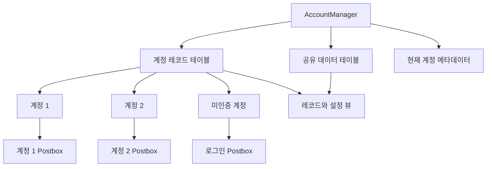
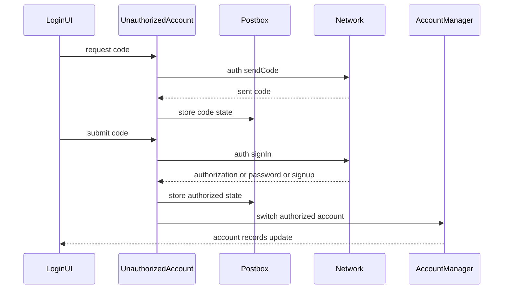
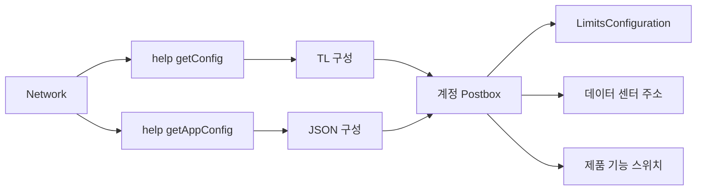
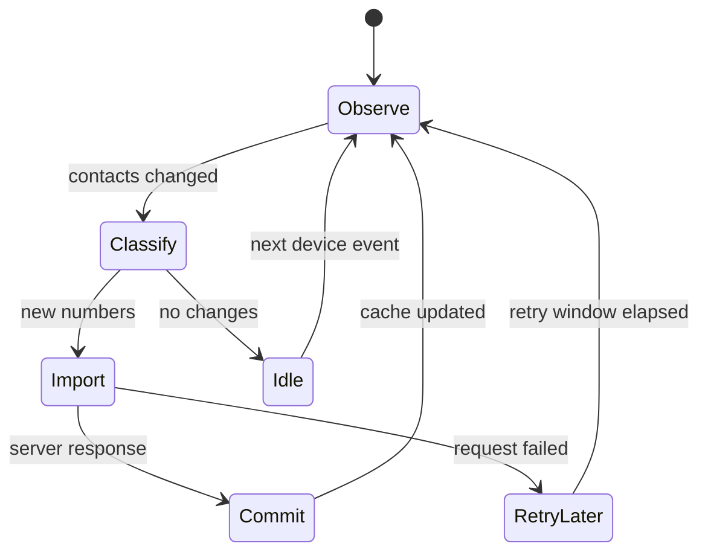

# 다중 계정, 로그인, 구성 동기화

웹: /docs/system/14-accounts-auth-config/ · Markdown: /docs/system/14-accounts-auth-config.md

> Telegram은 계정 디렉터리, 복구 가능한 상태, 해시 폴링으로 로컬 데이터와 서버 데이터를 조율해요.

> 시스템 설계 · 계정과 플랫폼 · 14장 · 도표 4 · 코드 발췌 10 · 인용 35 · 소스 기준선: [TelegramMessenger/Telegram-iOS@f1dd7a2d](https://github.com/TelegramMessenger/Telegram-iOS/tree/f1dd7a2dbd02cbbf513e75d5695d8d36d1cf5838), [overtake/TelegramSwift@579cebbf](https://github.com/overtake/TelegramSwift/tree/579cebbf0c01fd41b712eff3647fa7f69db9665d)
>
> 관련 보충: [macOS fork 장별 검증(08–15장)](/docs/system/32-fork-verify-08-15/), [계정 로그아웃 cleanupAccount 정리 단계](/docs/system/37-cleanup-account/)
>
> 핵심 소스 파일: [TelegramMessenger/Telegram-iOS/submodules/TelegramCore/Sources/AccountManager/AccountRecord.swift](https://github.com/TelegramMessenger/Telegram-iOS/blob/f1dd7a2dbd02cbbf513e75d5695d8d36d1cf5838/submodules/TelegramCore/Sources/AccountManager/AccountRecord.swift), [TelegramMessenger/Telegram-iOS/submodules/TelegramCore/Sources/AccountManager/AccountManagerImpl.swift](https://github.com/TelegramMessenger/Telegram-iOS/blob/f1dd7a2dbd02cbbf513e75d5695d8d36d1cf5838/submodules/TelegramCore/Sources/AccountManager/AccountManagerImpl.swift), [TelegramMessenger/Telegram-iOS/submodules/TelegramCore/Sources/AccountManager/AccountManagerRecordTable.swift](https://github.com/TelegramMessenger/Telegram-iOS/blob/f1dd7a2dbd02cbbf513e75d5695d8d36d1cf5838/submodules/TelegramCore/Sources/AccountManager/AccountManagerRecordTable.swift), [TelegramMessenger/Telegram-iOS/submodules/TelegramCore/Sources/AccountManager/AccountManagerSharedDataTable.swift](https://github.com/TelegramMessenger/Telegram-iOS/blob/f1dd7a2dbd02cbbf513e75d5695d8d36d1cf5838/submodules/TelegramCore/Sources/AccountManager/AccountManagerSharedDataTable.swift), [TelegramMessenger/Telegram-iOS/submodules/TelegramCore/Sources/Account/Account.swift](https://github.com/TelegramMessenger/Telegram-iOS/blob/f1dd7a2dbd02cbbf513e75d5695d8d36d1cf5838/submodules/TelegramCore/Sources/Account/Account.swift), [TelegramMessenger/Telegram-iOS/submodules/TelegramCore/Sources/Account/AccountManager.swift](https://github.com/TelegramMessenger/Telegram-iOS/blob/f1dd7a2dbd02cbbf513e75d5695d8d36d1cf5838/submodules/TelegramCore/Sources/Account/AccountManager.swift), [TelegramMessenger/Telegram-iOS/submodules/TelegramCore/Sources/Authorization.swift](https://github.com/TelegramMessenger/Telegram-iOS/blob/f1dd7a2dbd02cbbf513e75d5695d8d36d1cf5838/submodules/TelegramCore/Sources/Authorization.swift), [TelegramMessenger/Telegram-iOS/submodules/TelegramCore/Sources/TelegramEngine/Auth/AuthTransfer.swift](https://github.com/TelegramMessenger/Telegram-iOS/blob/f1dd7a2dbd02cbbf513e75d5695d8d36d1cf5838/submodules/TelegramCore/Sources/TelegramEngine/Auth/AuthTransfer.swift), [TelegramMessenger/Telegram-iOS/submodules/TelegramCore/Sources/State/InitializeAccountAfterLogin.swift](https://github.com/TelegramMessenger/Telegram-iOS/blob/f1dd7a2dbd02cbbf513e75d5695d8d36d1cf5838/submodules/TelegramCore/Sources/State/InitializeAccountAfterLogin.swift), [TelegramMessenger/Telegram-iOS/submodules/TelegramCore/Sources/State/ManagedConfigurationUpdates.swift](https://github.com/TelegramMessenger/Telegram-iOS/blob/f1dd7a2dbd02cbbf513e75d5695d8d36d1cf5838/submodules/TelegramCore/Sources/State/ManagedConfigurationUpdates.swift), [TelegramMessenger/Telegram-iOS/submodules/TelegramCore/Sources/State/ManagedAppConfigurationUpdates.swift](https://github.com/TelegramMessenger/Telegram-iOS/blob/f1dd7a2dbd02cbbf513e75d5695d8d36d1cf5838/submodules/TelegramCore/Sources/State/ManagedAppConfigurationUpdates.swift), [TelegramMessenger/Telegram-iOS/submodules/TelegramCore/Sources/State/ManagedRecentStickers.swift](https://github.com/TelegramMessenger/Telegram-iOS/blob/f1dd7a2dbd02cbbf513e75d5695d8d36d1cf5838/submodules/TelegramCore/Sources/State/ManagedRecentStickers.swift), [TelegramMessenger/Telegram-iOS/submodules/TelegramCore/Sources/State/ContactSyncManager.swift](https://github.com/TelegramMessenger/Telegram-iOS/blob/f1dd7a2dbd02cbbf513e75d5695d8d36d1cf5838/submodules/TelegramCore/Sources/State/ContactSyncManager.swift), [TelegramMessenger/Telegram-iOS/submodules/TelegramCore/Sources/State/ManagedGlobalNotificationSettings.swift](https://github.com/TelegramMessenger/Telegram-iOS/blob/f1dd7a2dbd02cbbf513e75d5695d8d36d1cf5838/submodules/TelegramCore/Sources/State/ManagedGlobalNotificationSettings.swift), [TelegramMessenger/Telegram-iOS/submodules/TelegramCore/Sources/TelegramEngine/Privacy/UpdatedAccountPrivacySettings.swift](https://github.com/TelegramMessenger/Telegram-iOS/blob/f1dd7a2dbd02cbbf513e75d5695d8d36d1cf5838/submodules/TelegramCore/Sources/TelegramEngine/Privacy/UpdatedAccountPrivacySettings.swift), [overtake/TelegramSwift/Telegram-Mac/AuthController.swift](https://github.com/overtake/TelegramSwift/blob/579cebbf0c01fd41b712eff3647fa7f69db9665d/Telegram-Mac/AuthController.swift)
>
> 미검증 사항:
> - 서버가 `auth.logOut`을 받은 뒤, 이 계정의 APS 및 VoIP `registerDevice` 등록을 자동으로 취소하는지 여부.
> - 최종적으로 미인증 또는 업그레이드 중 상태로만 열 수 있는 `.loggedOut` 레코드를 다른 시작 복구 경로가 재시도하거나 삭제하는지 여부.

Telegram은 “어떤 계정이 있는가”와 “한 계정이 어떻게 동작하는가”를 두 계층의 영속 객체로 나눠요.

- 계정 디렉터리: 독립된 `AccountManager`가 계정 목록, 현재 계정, 계정 간 설정을 저장해요.
- 계정별 데이터: 계정마다 자체 `Postbox`(계정마다 가진 로컬 저장소)가 인증 상태, 캐시, 작업 큐를 저장해요.

이 경계 덕분에 같은 프로세스가 이미 인증된 여러 계정을 동시에 보유할 수 있고, 아직 끝나지 않은 로그인도 복구 가능한 계정 실행으로 다룰 수 있어요.

iOS의 핵심 구현은 `Telegram-iOS`에 있으며, macOS의 `TelegramSwift`는 체크아웃된 `submodules/telegram-ios` fork를 통해 이 모듈들을 재사용해요. 이 fork는 더 이른 커밋에 고정되어 있어 이 장의 iOS 체크아웃과 버전이 다를 수 있어요. [\[1\]](https://github.com/TelegramMessenger/Telegram-iOS/blob/f1dd7a2dbd02cbbf513e75d5695d8d36d1cf5838/submodules/TelegramCore/Sources/AccountManager/AccountRecord.swift#L28-L43) [\[4\]](https://github.com/TelegramMessenger/Telegram-iOS/blob/f1dd7a2dbd02cbbf513e75d5695d8d36d1cf5838/submodules/TelegramCore/Sources/Account/AccountManager.swift#L12-L102) [\[28\]](https://github.com/overtake/TelegramSwift/blob/579cebbf0c01fd41b712eff3647fa7f69db9665d/Telegram-Mac/AuthController.swift#L248-L266)

## 비즈니스 데이터베이스가 아닌 계정 디렉터리 [#비즈니스-데이터베이스가-아닌-계정-디렉터리]

### 두 계층 저장소와 레코드 속성 [#두-계층-저장소와-레코드-속성]

다중 계정의 첫 번째 문제는 화면 전환이 아니라, 전역 설정, 계정 신원, 계정 전용 데이터를 하나의 SQLite 데이터베이스에 섞지 않는 거예요. 그래서 `AccountManager`는 자체 `ValueBox` 테이블 그룹을 가지며, 각 `Account`가 보유한 `Postbox`와 분리되어 있어요.

`AccountRecordId`는 무작위 64비트 값이며 Telegram 사용자 ID가 아니에요. 생성 함수는 `arc4random_buf`로 8바이트를 채워요. `AccountRecord` 하나는 아래 세 가지를 저장해요. [\[1\]](https://github.com/TelegramMessenger/Telegram-iOS/blob/f1dd7a2dbd02cbbf513e75d5695d8d36d1cf5838/submodules/TelegramCore/Sources/AccountManager/AccountRecord.swift#L28-L43)

- 이 ID
- 속성 배열
- 선택적 임시 세션 ID

`TelegramAccountRecordAttribute`는 상위 계층이 범용 레코드에 의미를 부여하는 어댑터 계층이에요. 코드는 아래 다섯 가지 속성을 정의해요.

- `backupData`
- `environment`
- `sortOrder`
- `loggedOut`
- `supportUserInfo`

즉 계정 디렉터리는 특정 계정의 데이터베이스를 열지 않고도 계정을 정렬하고, 실행 환경을 식별하고, 복구 정보를 저장할 수 있어요. 속성은 이종 열거형(서로 다른 종류의 값을 담는 열거형)을 영속화하는 운반체이며, 계정의 사용자, 세션 상태, 메시지는 여전히 그 계정의 `Postbox`에 속해요. [\[4\]](https://github.com/TelegramMessenger/Telegram-iOS/blob/f1dd7a2dbd02cbbf513e75d5695d8d36d1cf5838/submodules/TelegramCore/Sources/Account/AccountManager.swift#L12-L102)

속성 디코딩은 형식 마이그레이션도 맡아요. 현재의 인코딩은 이름 있는 키로 열거형 내용을 저장하지만, 디코더는 이전의 `legacyRootObject`와도 호환되며 `typeHash`를 근거로 백업, 환경, 정렬, 로그아웃 속성을 복원해요. [\[4\]](https://github.com/TelegramMessenger/Telegram-iOS/blob/f1dd7a2dbd02cbbf513e75d5695d8d36d1cf5838/submodules/TelegramCore/Sources/Account/AccountManager.swift#L12-L102)

덕분에 계정 디렉터리의 구조가 진화해도 모든 사용자가 한 번의 업그레이드에서 디렉터리를 다시 만들 필요가 없어요. 대가는 옛 유형의 분기가 코어에 오래 남고, 새 속성마다 이전 버전이 식별하지 못할 때의 강등 동작을 고려해야 한다는 거예요. (추론)

`submodules/TelegramCore/Sources/AccountManager/AccountRecord.swift` 28–43행 발췌.

```swift
public func generateAccountRecordId() -> AccountRecordId {
    var id: Int64 = 0
    arc4random_buf(&id, 8)
    return AccountRecordId(rawValue: id)
}

public final class AccountRecord<Attribute: AccountRecordAttribute>: Equatable, Codable {
    enum CodingKeys: String, CodingKey {
        case id
        case attributes
        case temporarySessionId
    }

    public let id: AccountRecordId
    public let attributes: [Attribute]
    public let temporarySessionId: Int64?
```

레코드 테이블은 계정 ID의 8바이트 이진 키로 읽고 쓰며, `AdaptedPostboxEncoder`로 레코드 전체를 인코딩해요. 레코드를 삭제하면 디렉터리 테이블에서 키만 제거되며, 매개변수 `secure`는 `false`이에요. 따라서 “다중 계정 목록에서 삭제”와 디스크 파일의 안전 삭제는 같은 동작이 아니며, 호출자는 계정 디렉터리와 파일 수명 주기를 따로 처리해야 해요. (추론) [\[2\]](https://github.com/TelegramMessenger/Telegram-iOS/blob/f1dd7a2dbd02cbbf513e75d5695d8d36d1cf5838/submodules/TelegramCore/Sources/AccountManager/AccountManagerRecordTable.swift#L19-L50)

`submodules/TelegramCore/Sources/AccountManager/AccountManagerRecordTable.swift` 19–50행 발췌.

```swift
func getRecords() -> [AccountRecord<Attribute>] {
    var records: [AccountRecord<Attribute>] = []
    self.valueBox.scan(self.table, values: { _, value in
        if let record = try? AdaptedPostboxDecoder().decode(AccountRecord<Attribute>.self, from: value.makeData()) {
            records.append(record)
        }
        return true
    })
    return records
}

func setRecord(id: AccountRecordId, record: AccountRecord<Attribute>?, operations: inout [AccountManagerRecordOperation<Attribute>]) {
    if let record = record {
        let data = try! AdaptedPostboxEncoder().encode(record)
        self.valueBox.set(self.table, key: self.key(id), value: ReadBuffer(data: data))
    } else {
        self.valueBox.remove(self.table, key: self.key(id), secure: false)
    }
    operations.append(.set(id: id, record: record))
}
```

공유 데이터 테이블은 또 다른 문제를 해결해요. 자동 다운로드, 프록시, 언어 같은 설정이 계정 전환 때문에 갈라져서는 안 돼요. 이 테이블은 이렇게 움직여요.

- `ValueBoxKey`로 `PreferencesEntry`를 저장하고, 메모리 딕셔너리를 읽은 키의 캐시로 써요.
- 쓰기 전에 이전 값과 비교해서, 변경이 있을 때만 디스크에 쓰고 키를 `updatedKeys`에 추가해요.
- `sharedData(keys:)`를 구독하는 뷰는 자신이 관심 있는 교집합 키만 재생해요. 그래서 전역 설정이 바뀔 때마다 모든 구독자가 디렉터리 뷰 전체를 다시 만드는 일을 피해요. [\[3\]](https://github.com/TelegramMessenger/Telegram-iOS/blob/f1dd7a2dbd02cbbf513e75d5695d8d36d1cf5838/submodules/TelegramCore/Sources/AccountManager/AccountManagerSharedDataTable.swift#L12-L37) [\[5\]](https://github.com/TelegramMessenger/Telegram-iOS/blob/f1dd7a2dbd02cbbf513e75d5695d8d36d1cf5838/submodules/TelegramCore/Sources/AccountManager/AccountManagerImpl.swift#L498-L590)

`submodules/TelegramCore/Sources/AccountManager/AccountManagerSharedDataTable.swift` 12–37행 발췌.

```swift
func set(key: ValueBoxKey, value: PreferencesEntry?, updatedKeys: inout Set<ValueBoxKey>) {
    if let value = value {
        if let current = self.get(key: key), current == value {
            return
        }
        self.valueBox.set(self.table, key: key, value: ReadBuffer(data: value.data))
        updatedKeys.insert(key)
        self.values[key] = value
    } else if self.get(key: key) != nil {
        self.valueBox.remove(self.table, key: key, secure: false)
        updatedKeys.insert(key)
        self.values.removeValue(forKey: key)
    }
}
```

디렉터리는 메타데이터 슬롯 두 개도 저장해요.

- `currentAccountId`: 일반 앱 시작 시 계정을 고르는 데 쓰여요.
- `currentAuthAccount`: 인증 중인 계정 레코드를 저장해요.

`AccountManagerImpl`은 직렬 `Queue`에서 트랜잭션을 실행하며, 레코드 변경과 공유 키 변경을 증분 작업으로 변환한 뒤 `accountRecords()`와 `sharedData(keys:)` 뷰에 재생해요. [\[5\]](https://github.com/TelegramMessenger/Telegram-iOS/blob/f1dd7a2dbd02cbbf513e75d5695d8d36d1cf5838/submodules/TelegramCore/Sources/AccountManager/AccountManagerImpl.swift#L498-L590) [\[6\]](https://github.com/TelegramMessenger/Telegram-iOS/blob/f1dd7a2dbd02cbbf513e75d5695d8d36d1cf5838/submodules/TelegramCore/Sources/AccountManager/AccountManagerMetadataTable.swift#L178-L249)

트랜잭션의 핵심은 `Signal` 껍데기가 아니라 단일 커밋 지점에 있어요. 구현은 이 순서로 움직여요.

1. 레코드 테이블, 공유 테이블, 메타데이터 테이블에 작업을 먼저 수집해요.
2. `beforeCommit`을 호출해요.
3. `ValueBox`를 커밋해요.

공개 `transaction`은 동기 트랜잭션을 그 비공개 큐에 디스패치하고, 마지막으로 next와 completion을 한 번만 보내요. [\[5\]](https://github.com/TelegramMessenger/Telegram-iOS/blob/f1dd7a2dbd02cbbf513e75d5695d8d36d1cf5838/submodules/TelegramCore/Sources/AccountManager/AccountManagerImpl.swift#L498-L590)

이 덕분에 관찰자는 같은 디렉터리 트랜잭션의 절반짜리 결과를 보지 못하며, UI도 락 없이 레코드를 읽을 수 있어요. 대가는 트랜잭션 클로저가 블로킹 네트워크 I/O를 해서는 안 된다는 거예요. 그렇지 않으면 그 계정 디렉터리의 이후 전환과 설정 쓰기가 모두 기다려야 해요. (추론)

`AccountManager` 자체에도 무작위 `temporarySessionId`가 하나 있어요. 생성할 때 8바이트 난수로 이 세션 ID를 초기화하고 하위 구현에 넘겨요.

정리기는 레코드의 임시 세션 ID와 현재 프로세스 ID를 비교하여 오래된 임시 레코드를 발견하면 제거해요. 이 메커니즘은 인증 흐름이나 임시 인스턴스가 이전 프로세스에 남긴 디렉터리 레코드를 장기 계정으로 오인하지 않도록 처리해요. (추론) [\[5\]](https://github.com/TelegramMessenger/Telegram-iOS/blob/f1dd7a2dbd02cbbf513e75d5695d8d36d1cf5838/submodules/TelegramCore/Sources/AccountManager/AccountManagerImpl.swift#L498-L590) [\[26\]](https://github.com/TelegramMessenger/Telegram-iOS/blob/f1dd7a2dbd02cbbf513e75d5695d8d36d1cf5838/submodules/TelegramCore/Sources/Account/AccountManager.swift#L368-L470)

뷰로 디렉터리를 노출하는 이 방식은 가변 배열을 직접 노출하는 것보다 여러 UI와 확장이 동시에 구독하기에 적합하지만, 대가로 새 기능은 속성과 공유 키의 귀속을 명확히 정의해야 해요. (추론)

아래 도표는 디렉터리와 계정별 데이터베이스의 경계, 그리고 각각의 관찰자를 보여 줘요.



### 생성, 복구, 병렬 실행 [#생성-복구-병렬-실행]

`accountWithId`는 디렉터리 레코드를 실행 객체로 바꾸는 팩토리예요.

1. 레코드 ID로 계정 경로를 만들어요.
2. 그 경로의 `Postbox`를 열어요.
3. 상태 테이블에서 `UnauthorizedAccountState` 또는 `AuthorizedAccountState`를 읽어요.

읽은 상태에 따라 결과가 달라요.

- `UnauthorizedAccountState`(미인증): 상태 안의 주 데이터 센터와 `isTestingEnvironment`로 네트워크를 초기화하고 `UnauthorizedAccount`를 반환해요.
- `AuthorizedAccountState`(인증): 로컬 사용자 전화번호를 읽어 `Account`를 만들어요.

따라서 끝나지 않은 로그인은 UI의 임시 객체가 아니라 재시작을 넘어 복구할 수 있는 실행 인스턴스예요. [\[7\]](https://github.com/TelegramMessenger/Telegram-iOS/blob/f1dd7a2dbd02cbbf513e75d5695d8d36d1cf5838/submodules/TelegramCore/Sources/Account/Account.swift#L268-L365)

기본 주 데이터 센터(DC)는 빌드에 따라 달라요.

- 프로덕션 빌드: 2
- `DEBUG` 빌드: 1

계정 상태가 없으면 함수는 `beginWithTestingEnvironment`에 따라 미인증 상태에 쓸 테스트 표지를 정하고, 그다음 네트워크 객체를 만들어요. 이 표지는 상태, 네트워크, 계정 팩토리를 가로지르므로, 테스트 계정은 요청 인자에 붙는 일회성 스위치에 그치지 않아요. [\[7\]](https://github.com/TelegramMessenger/Telegram-iOS/blob/f1dd7a2dbd02cbbf513e75d5695d8d36d1cf5838/submodules/TelegramCore/Sources/Account/Account.swift#L268-L365)

데이터 센터와 인증 키가 어떻게 수립되는지는 [인증 키와 다중 데이터 센터](/docs/system/04-auth-keys-datacenters/)를 참고해요.

`submodules/TelegramCore/Sources/Account/Account.swift` 338–353행 발췌.

```swift
if let accountState = accountState {
    switch accountState {
    case let unauthorizedState as UnauthorizedAccountState:
        return initializedNetwork(accountId: id, arguments: networkArguments, supplementary: supplementary, datacenterId: Int(unauthorizedState.masterDatacenterId), keychain: keychain, basePath: path, testingEnvironment: unauthorizedState.isTestingEnvironment, languageCode: localizationSettings?.primaryComponent.languageCode, proxySettings: proxySettings, networkSettings: networkSettings, networkEngineSettings: networkEngineSettings, phoneNumber: nil, useRequestTimeoutTimers: useRequestTimeoutTimers, appConfiguration: appConfig)
        |> map { network -> AccountResult in
            return .unauthorized(UnauthorizedAccount(accountManager: accountManager, networkArguments: networkArguments, id: id, rootPath: rootPath, basePath: path, testingEnvironment: unauthorizedState.isTestingEnvironment, postbox: postbox, network: network, shouldKeepAutoConnection: shouldKeepAutoConnection))
        }
    case let authorizedState as AuthorizedAccountState:
        return postbox.transaction { transaction -> String? in
            return (transaction.getPeer(authorizedState.peerId) as? TelegramUser)?.phone
        }
        |> mapToSignal { phoneNumber in
```

코어에서 “다중 계정 동시 실행”은 각 `Account`가 독립된 `Postbox`, `Network`, `AccountStateManager`, `AccountTaskManager`를 가진다는 뜻이에요. 싱글턴 전환이 아니에요.

팩토리의 `supplementary`와 `shouldKeepAutoConnection` 매개변수는 호출자가 백그라운드나 보조 용도로 인스턴스를 만들게 해 줘요. 인증된 계정의 작업 관리자는 계정 상태를 쓸 수 있게 되면 많은 장기 신호를 시작해요. 예를 들면 이런 것들이에요.

- `managedConfigurationUpdates`
- 전역 알림
- 전송 대기 세션 알림
- 저장된 미디어와 스티커 동기화기 [\[8\]](https://github.com/TelegramMessenger/Telegram-iOS/blob/f1dd7a2dbd02cbbf513e75d5695d8d36d1cf5838/submodules/TelegramCore/Sources/State/AccountTaskManager.swift#L55-L175)

이 설계의 장점은 계정마다의 차이, 재시도, 캐시가 자연스럽게 격리된다는 거예요. 단점은 활성 계정마다 네트워크, 데이터베이스 뷰, 동기화 작업을 보유하게 되므로, 모바일에서는 어떤 계정의 연결을 유지할지 앱 계층이 신중하게 정해야 한다는 거예요. (추론)

관련 내용은 이 장들을 참고해요.

- 메시지 업데이트가 계정별로 어떻게 수렴하는지: [업데이트 동기화](/docs/system/06-update-sync/)
- 메시지 작업이 계정별 큐에서 어떻게 제출되는지: [메시지 전송 파이프라인과 오프라인 작업 큐](/docs/system/07-message-send-pipeline/)

시작 시의 선택기는 `currentAccount`이에요. `manager.currentAccountRecord`를 구독하여 그 레코드의 계정을 만들고, 그 `Postbox`의 상태 유형을 계속 관찰해요. 상태가 미인증에서 인증으로, 또는 그 반대로 바뀌면 선택기는 reload 플래그를 설정하고 결과를 다시 만들어요. [\[7\]](https://github.com/TelegramMessenger/Telegram-iOS/blob/f1dd7a2dbd02cbbf513e75d5695d8d36d1cf5838/submodules/TelegramCore/Sources/Account/Account.swift#L268-L365)

이 동작은 현재 계정이 영원히 하나의 객체 인스턴스에 묶인 정적 전역 변수가 아님을 보여 줘요. 계정 상태의 변화가 네트워크, 상태 관리자, 작업 집합을 재구성하는 명확한 경계가 돼요. (추론)

`currentAccountRecord`의 `allocateIfNotExists` 매개변수도 중요해요. 호출자가 할당을 허용하면, 디렉터리에 정상 계정이 없을 때 새 인증 레코드 슬롯을 얻을 수 있고, 이어서 `accountWithId`가 미인증 실행 인스턴스를 만들어요. [\[7\]](https://github.com/TelegramMessenger/Telegram-iOS/blob/f1dd7a2dbd02cbbf513e75d5695d8d36d1cf5838/submodules/TelegramCore/Sources/Account/Account.swift#L268-L365)

이렇게 해서 최초 시작, 계정 추가, 로그인 페이지로의 복귀가 “먼저 레코드가 있고, 그다음 계정 객체가 있다”는 동일한 경로를 탈 수 있어요.

한편 로그인 컨트롤러는 전화번호만 보유해서는 안 돼요. 아래도 복구해야 하기 때문이에요.

- 주 DC
- 인증 코드 hash
- 선택적인 이전 코드 페이지
- 연락처 동기화 선호도 [\[7\]](https://github.com/TelegramMessenger/Telegram-iOS/blob/f1dd7a2dbd02cbbf513e75d5695d8d36d1cf5838/submodules/TelegramCore/Sources/Account/Account.swift#L268-L365) [\[10\]](https://github.com/TelegramMessenger/Telegram-iOS/blob/f1dd7a2dbd02cbbf513e75d5695d8d36d1cf5838/submodules/TelegramCore/Sources/SyncCore/SyncCore_UnauthorizedAccountState.swift#L90-L290)

할당 동작은 `AccountManagerImpl.currentAccountRecord`의 디렉터리 트랜잭션 안에서 완료돼요. 순서는 이래요.

1. 무작위 레코드 ID를 생성해요.
2. `setCurrentId`를 호출해요.
3. 속성이 비어 있고 임시 세션 ID가 nil인 `AccountRecord`를 써요.
4. 레코드 뷰에서 현재 결과를 도출해요.

반환 스트림은 ID와 속성을 항목별로 비교하여 중복을 제거해요. [\[29\]](https://github.com/TelegramMessenger/Telegram-iOS/blob/f1dd7a2dbd02cbbf513e75d5695d8d36d1cf5838/submodules/TelegramCore/Sources/AccountManager/AccountManagerImpl.swift#L648-L690)

따라서 “현재 계정” 자체가 구독 가능한 디렉터리 투영이며, 앱 계층이 시작할 때마다 직접 스캔해서 만든 캐시가 아니에요. 속성이 바뀌어도 투영이 다시 방출되므로, 화면이 정렬이나 로그아웃 표지를 동기화하기 쉬워요. (추론)

계정 팩토리는 `Postbox`를 열 때 아래를 읽어요.

- 현지화
- 프록시
- 네트워크 설정
- `AppConfiguration`(서버가 내려 주는 JSON 구성)

그다음 JSON에 `ios_killswitch_disable_request_timeout`이 있는지에 따라 요청 타임아웃 타이머의 사용 여부를 정해요. [\[7\]](https://github.com/TelegramMessenger/Telegram-iOS/blob/f1dd7a2dbd02cbbf513e75d5695d8d36d1cf5838/submodules/TelegramCore/Sources/Account/Account.swift#L268-L365)

이 읽기 지점은 원격 구성이 UI 기능만이 아니라 계정별 네트워크 구성 인자에도 영향을 줄 수 있음을 보여 줘요. 타이머 사용 여부의 결정을 계정 `Postbox`에 저장하면, 재시작 뒤의 네트워크도 마지막으로 사용 가능했던 구성을 이어 쓸 수 있어요. (추론)

macOS 플랫폼 계층은 이 인증 상태 머신을 복제하지 않았어요. `Telegram-Mac/AuthController.swift`는 이렇게 해요. [\[28\]](https://github.com/overtake/TelegramSwift/blob/579cebbf0c01fd41b712eff3647fa7f69db9665d/Telegram-Mac/AuthController.swift#L248-L266)

- `UnauthorizedAccount`를 보관해요.
- 그 `postbox.stateView()`를 화면 상태의 출처로 삼아요.
- 공유 코어의 `authorizeWithCode`와 `authorizeWithPassword`를 호출해요.

macOS fork 차이: `submodules/telegram-ios`는 `a24bbe45f9861f736a79916a50898512f751e0dc`로 체크아웃되어 있어요. 여기에는 아래가 보여요.

- `AccountRecord`
- `AccountManager` 트랜잭션
- `authorizeWithCode`
- hash 기반의 시간당 앱 구성 가져오기

이 메커니즘들은 그 고정된 fork에 적용되며, 더 새로운 업스트림의 증분을 자동으로 외삽할 수 없어요. [\[31\]](https://github.com/overtake/Telegram-iOS/blob/a24bbe45f9861f736a79916a50898512f751e0dc/submodules/TelegramCore/Sources/AccountManager/AccountRecord.swift#L28-L71) [\[32\]](https://github.com/overtake/Telegram-iOS/blob/a24bbe45f9861f736a79916a50898512f751e0dc/submodules/TelegramCore/Sources/AccountManager/AccountManagerImpl.swift#L174-L266) [\[33\]](https://github.com/overtake/Telegram-iOS/blob/a24bbe45f9861f736a79916a50898512f751e0dc/submodules/TelegramCore/Sources/Authorization.swift#L998-L1128) [\[34\]](https://github.com/overtake/Telegram-iOS/blob/a24bbe45f9861f736a79916a50898512f751e0dc/submodules/TelegramCore/Sources/State/ManagedAppConfigurationUpdates.swift#L7-L55) [macOS fork 장별 검증(08–15장)](/docs/system/32-fork-verify-08-15/)

로그아웃에는 두 층의 의미가 있어요.

- 서버의 계정 삭제: `TelegramEngine.Auth.deleteAccount`는 필요하면 먼저 `InputCheckPasswordSRP`를 만든 뒤 `account.deleteAccount`를 호출해요. 이 삭제는 본 기기의 계정 로그아웃과 달라요. [\[9\]](https://github.com/TelegramMessenger/Telegram-iOS/blob/f1dd7a2dbd02cbbf513e75d5695d8d36d1cf5838/submodules/TelegramCore/Sources/TelegramEngine/Auth/TelegramEngineAuth.swift#L105-L140)
- 본 기기의 로그아웃: `logoutFromAccount`는 서버가 아직 로그아웃하지 않았다면 이 레코드에 `.loggedOut` 속성만 덧붙여요. 서버가 이미 로그아웃했다면 곧바로 레코드를 제거해요. [\[26\]](https://github.com/TelegramMessenger/Telegram-iOS/blob/f1dd7a2dbd02cbbf513e75d5695d8d36d1cf5838/submodules/TelegramCore/Sources/Account/AccountManager.swift#L368-L470)

`managedCleanupAccounts`는 계정 레코드를 구독해요. `.loggedOut`을 보면 `cleanupAccount`를 시작해요. 인증된 계정의 정리기는 이렇게 움직여요.

1. 보조 모드로 계정을 열고 `auth.logOut`을 호출해요.
2. 요청 오류는 `nil`로 변환돼요. 오류가 나도 그 뒤에 서비스 작업의 주도권을 멈추고 계정 디렉터리 트랜잭션에서 레코드를 삭제해요.

이 함수는 `unregisterNotificationToken`을 직접 호출하지 않아요. 따라서 원격 로그아웃이 실패해도 로컬 레코드 삭제는 막히지 않으며, 이 정리 체인에서 APS(Apple 푸시 알림)나 VoIP 토큰이 명시적으로 등록 해제되지도 않아요. [\[26\]](https://github.com/TelegramMessenger/Telegram-iOS/blob/f1dd7a2dbd02cbbf513e75d5695d8d36d1cf5838/submodules/TelegramCore/Sources/Account/AccountManager.swift#L368-L470) [\[35\]](https://github.com/overtake/Telegram-iOS/blob/a24bbe45f9861f736a79916a50898512f751e0dc/submodules/TelegramCore/Sources/Account/AccountManager.swift#L356-L517)

레코드가 삭제된 뒤의 디렉터리 정리는 이렇게 이어져요.

- 다음 디렉터리 뷰가 여전히 유효한 `account-` 디렉터리 이름 집합을 만들어요.
- 정리기가 utility 큐에서 루트 디렉터리를 비동기로 순회하며, 집합에 없는 `account-레코드ID` 루트 디렉터리를 삭제해요.
- `temporarySessionId`가 현재 세션과 다른 임시 레코드도 삭제해요.

이 루트 디렉터리에는 아래가 들어 있어요.

- 계정의 Postbox
- 데이터베이스
- WAL
- SHM
- 미디어
- 논리 키체인 테이블

그래서 로그아웃은 UI를 클릭하는 시점에 파일을 하나씩 동기적으로 삭제하는 것이 아니에요. 프로세스가 레코드 삭제와 디렉터리 스캔 사이에 종료되더라도 다음 시작 때 다시 스캔할 수 있어요. 디렉터리 열거나 삭제의 실패는 무시돼요. (추론) [\[26\]](https://github.com/TelegramMessenger/Telegram-iOS/blob/f1dd7a2dbd02cbbf513e75d5695d8d36d1cf5838/submodules/TelegramCore/Sources/Account/AccountManager.swift#L368-L470) [\[35\]](https://github.com/overtake/Telegram-iOS/blob/a24bbe45f9861f736a79916a50898512f751e0dc/submodules/TelegramCore/Sources/Account/AccountManager.swift#L356-L517) [계정 로그아웃 cleanupAccount 정리 단계](/docs/system/37-cleanup-account/)

macOS fork 차이: 고정 fork의 `managedCleanupAccounts`와 `cleanupAccount`는 아래 순서를 그대로 유지해요.

1. 같은 표지
2. 오류를 삼키는 로그아웃
3. 레코드 삭제
4. 비동기 디렉터리 스캔

fork는 `loggedOut` 응답을 연관 값 두 개의 패턴 매칭으로 쓴 것뿐이며, 위의 정리 의미론은 바꾸지 않았어요. [\[35\]](https://github.com/overtake/Telegram-iOS/blob/a24bbe45f9861f736a79916a50898512f751e0dc/submodules/TelegramCore/Sources/Account/AccountManager.swift#L356-L517)

디렉터리 레코드의 삭제는 여전히 `secure: false`로 테이블 항목을 조작해요. 위의 디렉터리 정리는 일반 `FileManager.removeItem`을 쓰며, 이 코드에서 보이는 다중 패스 덮어쓰기 삭제가 아니에요. 따라서 “로그아웃”을 검증 가능한 안전 삭제 약속으로 해석해서는 안 돼요. 계정 루트 경로는 실제로 앱 그룹 경로 아래의 `telegram-data`에서 파생돼요. [\[2\]](https://github.com/TelegramMessenger/Telegram-iOS/blob/f1dd7a2dbd02cbbf513e75d5695d8d36d1cf5838/submodules/TelegramCore/Sources/AccountManager/AccountManagerRecordTable.swift#L19-L50) [\[7\]](https://github.com/TelegramMessenger/Telegram-iOS/blob/f1dd7a2dbd02cbbf513e75d5695d8d36d1cf5838/submodules/TelegramCore/Sources/Account/Account.swift#L268-L365) [\[26\]](https://github.com/TelegramMessenger/Telegram-iOS/blob/f1dd7a2dbd02cbbf513e75d5695d8d36d1cf5838/submodules/TelegramCore/Sources/Account/AccountManager.swift#L368-L470)

## 영속 상태 머신으로서의 로그인 [#영속-상태-머신으로서의-로그인]

### 미인증 계정과 코드 전달 [#미인증-계정과-코드-전달]

로그인이 처리해야 하는 실패 모드가 여럿 있어요.

- 앱 강제 종료
- 데이터 센터 간 이동
- 인증 코드 전달 방식 변경
- 아직 가입하지 않음
- 2단계 인증
- 이메일 인증

Telegram은 이런 분기를 컨트롤러 메모리에 넣지 않고 `UnauthorizedAccountState`를 미인증 계정의 `Postbox`에 써요. 그 내용 열거형에는 전화번호 입력, 인증 코드 입력, 비밀번호 입력, 비밀번호 복구, 리셋 대기, 가입, 결제 상태가 있어요. 인증 코드 상태에는 아래 값을 저장해요.

- 전화번호
- `phoneCodeHash`
- 타임아웃
- 다음 전달 유형
- 연락처 동기화 여부
- 이전 코드 페이지로 돌아갈 수 있는지 여부 [\[10\]](https://github.com/TelegramMessenger/Telegram-iOS/blob/f1dd7a2dbd02cbbf513e75d5695d8d36d1cf5838/submodules/TelegramCore/Sources/SyncCore/SyncCore_UnauthorizedAccountState.swift#L90-L290)

전화 코드를 보낼 때 `requestAuthorizationCode`는 이렇게 움직여요.

1. 계정 관리자에서 이미 저장된 미래 로그인 토큰을 읽어요.
2. `auth.sendCode`의 `CodeSettings`를 조립해요.
3. 서버의 `SentCode`를 로컬 상태로 매핑해요.

전달 유형은 SMS에 한정되지 않아요. `SentAuthorizationCodeType`과 `AuthorizationCodeNextType`은 API가 반환하는 유형을 포괄해요. 예를 들면 앱 내, SMS, 전화, 플래시 콜, 조각(fragment), 이메일 설정, Firebase 등이에요.

코드는 `nextType`과 `timeout`을 함께 보존하므로, UI는 추측하지 않고 서버 프로토콜에 근거해 카운트다운과 다음 채널로의 전환을 표시할 수 있어요. [\[11\]](https://github.com/TelegramMessenger/Telegram-iOS/blob/f1dd7a2dbd02cbbf513e75d5695d8d36d1cf5838/submodules/TelegramCore/Sources/Authorization.swift#L135-L260) [\[10\]](https://github.com/TelegramMessenger/Telegram-iOS/blob/f1dd7a2dbd02cbbf513e75d5695d8d36d1cf5838/submodules/TelegramCore/Sources/SyncCore/SyncCore_UnauthorizedAccountState.swift#L90-L290)

재전달과 되돌아가기도 상태 레코드가 제어해요. 인증 모듈은 이런 함수를 제공해요.

- `resendAuthorizationCode`
- `resetAuthorizationState`
- `togglePreviousCodeEntry`
- 코드를 받지 못했음을 보고하는 함수

인증 코드 상태는 `previousCodeEntry`와 `usePrevious`를 보유하므로, 전달 방식을 바꾼 뒤에도 이전 페이지의 번호와 상태를 복원할 수 있으며, 서버에 일관되지 않은 코드 hash를 다시 요청할 필요가 없어요. [\[10\]](https://github.com/TelegramMessenger/Telegram-iOS/blob/f1dd7a2dbd02cbbf513e75d5695d8d36d1cf5838/submodules/TelegramCore/Sources/SyncCore/SyncCore_UnauthorizedAccountState.swift#L90-L290) [\[11\]](https://github.com/TelegramMessenger/Telegram-iOS/blob/f1dd7a2dbd02cbbf513e75d5695d8d36d1cf5838/submodules/TelegramCore/Sources/Authorization.swift#L135-L260)

이 구조는 특히 “UI의 되돌아가기”와 “서버에서 실제로 유효한 코드”가 어긋나는 것을 피하게 해 주지만, 클라이언트는 서버가 반환한 만료와 속도 제한 오류를 강제로 다시 시작하거나 기다리는 것으로 표시해야 해요. (추론)

`submodules/TelegramCore/Sources/Authorization.swift` 174–205행 발췌.

```swift
var flags: Int32 = 0
if syncContacts {
    flags |= 1 << 0
}
if appSandbox {
    flags |= 1 << 1
}
if let token = token {
    flags |= 1 << 2
}

let sendCode = Api.functions.auth.sendCode(phoneNumber: phoneNumber, apiId: apiId, apiHash: apiHash, settings: .codeSettings(.init(flags: flags, logoutTokens: authTokens.map { Buffer(data: $0) }, token: token, appSandbox: appSandbox)))
return account.network.request(sendCode, automaticFloodWait: false)
|> mapError { error -> AuthorizationCodeRequestError in
    if error.errorDescription.hasPrefix("FLOOD_WAIT") {
        return .limitExceeded
    } else if error.errorDescription == "PHONE_NUMBER_INVALID" {
        return .invalidPhoneNumber
    } else if error.errorDescription == "PHONE_NUMBER_BANNED" {
        return .phoneBanned
    } else if error.errorDescription == "PHONE_NUMBER_FLOOD" {
        return .phoneLimitExceeded
    }
```

인증 코드 검증은 `auth.signIn`을 호출해요. 서버의 응답에 따라 갈라져요.

- `SESSION_PASSWORD_NEEDED`를 반환하면: 곧바로 `account.getPassword`를 요청하고, hint를 추출하여 상태를 `.passwordEntry`로 전환해요.
- 번호 미등록을 보고하면: 원래 번호, 해시, 인증 코드, 서비스 약관, 연락처 동기화 선택이 담긴 `.signUp` 데이터를 반환해요.

이렇게 해서 로그인 컨트롤러는 `PostboxStateView`만 관찰하며 페이지를 구동하고, 프로토콜 분기는 코어 계층에 남아요. [\[12\]](https://github.com/TelegramMessenger/Telegram-iOS/blob/f1dd7a2dbd02cbbf513e75d5695d8d36d1cf5838/submodules/TelegramCore/Sources/Authorization.swift#L1017-L1080) [\[13\]](https://github.com/TelegramMessenger/Telegram-iOS/blob/f1dd7a2dbd02cbbf513e75d5695d8d36d1cf5838/submodules/TelegramCore/Sources/Authorization.swift#L1082-L1125)

QR 코드 로그인도 미인증 계정을 쓰지만, 토큰 구현은 `TelegramEngine.Auth.AuthTransfer`에 있어요. `auth.exportLoginToken`을 호출한 결과에 따라 갈라져요.

- 일반 토큰이 반환되면: UI에 바이트열과 `validUntil`을 줘요.
- 서버가 `loginTokenMigrateTo`를 반환하면: 먼저 `changedMasterDatacenterId`로 새 미인증 계정을 얻은 다음, 새 DC에서 `auth.importLoginToken`을 호출해요.

`auth.importLoginToken` 뒤에는 세 가지 결과를 처리해요. 인증 성공, 비밀번호 요구, 재시도 계속이에요. [\[27\]](https://github.com/TelegramMessenger/Telegram-iOS/blob/f1dd7a2dbd02cbbf513e75d5695d8d36d1cf5838/submodules/TelegramCore/Sources/TelegramEngine/Auth/AuthTransfer.swift#L6-L170)

QR 확인은 이미 인증된 기기가 `auth.acceptLoginToken`을 호출해요. 내보내기나 가져오기 과정에서 `SESSION_PASSWORD_NEEDED`를 만나면, 비밀번호 hint를 요청하고 미인증 계정을 `.passwordEntry`로 영속화하며, 토큰 흐름을 실패로 강등하지 않아요.

토큰이 성공하면 전화 코드 성공과 같은 순서를 실행해요.

1. future token을 저장해요.
2. `AuthorizedAccountState`를 써요.
3. 로그인 설정을 초기화해요.
4. 계정 디렉터리를 전환해요. [\[27\]](https://github.com/TelegramMessenger/Telegram-iOS/blob/f1dd7a2dbd02cbbf513e75d5695d8d36d1cf5838/submodules/TelegramCore/Sources/TelegramEngine/Auth/AuthTransfer.swift#L6-L170)

이런 재사용 덕분에 QR 코드, 인증 코드, 비밀번호 복구가 모두 “계정 데이터베이스가 먼저 인증으로 전환되고, 디렉터리가 나중에 발행된다”는 같은 복구 경계를 따라요. (추론)

이메일 흐름도 웹 페이지 이동이 아니에요. `sendLoginEmailCode`는 이메일 입력 상태를 쓰고, `verifyLoginEmailSetup`은 Google 또는 일반 인증 코드를 `EmailVerification`으로 인코딩하여 `account.verifyEmail`을 호출하며, 서버가 새 `SentCode`를 반환하면 같은 `.confirmationCodeEntry` 상태를 갱신해요. [\[14\]](https://github.com/TelegramMessenger/Telegram-iOS/blob/f1dd7a2dbd02cbbf513e75d5695d8d36d1cf5838/submodules/TelegramCore/Sources/Authorization.swift#L360-L950) 이런 통합 상태 모델 덕분에 전화번호, QR 코드, 이메일의 세 진입점이 이후의 인증 전환으로 합쳐지며, 계정 생성 로직을 복제하지 않아요. (추론)

아래 도표는 전화 코드, 비밀번호, 가입이 어떻게 인증된 계정으로 합쳐지는지 보여 줘요.



### 비밀번호, SRP, 가입, 인증 완료 [#비밀번호-srp-가입-인증-완료]

2단계 인증은 평문 비밀번호를 RPC로 보낼 수 없어요. `authorizeWithPassword`는 이 순서로 움직여요.

1. `TwoStepAuthData`를 가져와요.
2. 현재 비밀번호 파생 매개변수와 SRP(비밀번호 자체를 보내지 않고 증명하는 프로토콜) 세션이 모두 있을 것을 요구해요.
3. `passwordKDF`(비밀번호에서 키를 파생하는 함수)로 `A`, `M1`, 세션 ID를 계산해요.
4. `inputCheckPasswordSRP`를 구성하여 `auth.checkPassword`를 호출해요.

오류는 이렇게 처리해요. [\[15\]](https://github.com/TelegramMessenger/Telegram-iOS/blob/f1dd7a2dbd02cbbf513e75d5695d8d36d1cf5838/submodules/TelegramCore/Sources/Authorization.swift#L1142-L1215)

- KDF가 실패하거나 파생 데이터가 없으면: `.generic` 오류가 돼요.
- 네트워크 오류: 속도 제한, 잘못된 비밀번호, 만료된 세션 등의 인증 오류로 매핑돼요.

구체적인 비밀번호 파생과 로컬 키 보호의 경계는 [종단 간 암호화와 로컬 보안](/docs/system/11-secret-chats-security/)을 참고해요.

코드 구조로 보면 비밀번호, 인증 코드, 복구 오류는 하위의 `MTRpcError`를 UI에 직접 노출하지 않아요. 함수마다 유한한 도메인 오류 열거형을 정의해요. 예를 들면 `AuthorizationCodeVerificationError`, `AuthorizationPasswordVerificationError`, `PasswordRecoveryError`예요. 서버 오류 설명에 따라 만료, 무효, 속도 제한, 일반 실패로 매핑해요. [\[12\]](https://github.com/TelegramMessenger/Telegram-iOS/blob/f1dd7a2dbd02cbbf513e75d5695d8d36d1cf5838/submodules/TelegramCore/Sources/Authorization.swift#L1017-L1080) [\[15\]](https://github.com/TelegramMessenger/Telegram-iOS/blob/f1dd7a2dbd02cbbf513e75d5695d8d36d1cf5838/submodules/TelegramCore/Sources/Authorization.swift#L1142-L1215)

이 경계 덕분에 UI는 표시할 수 있고 재시도할 수 있는 상태만 처리하면 돼요. 하지만 오류 설명 문자열은 여전히 프로토콜 결합 지점이며, 서버가 새 오류 코드를 추가하면 클라이언트가 업데이트될 때까지 일반 실패로 퇴화해요. (추론)

복구 흐름은 일반 로그인과 같은 계정 전환 규칙을 유지해요. 코드는 이 순서로 움직여요.

1. 복구 인증 코드를 검사해요.
2. 이메일 매개변수가 있으면 해당 flag를 설정해요.
3. 새 KDF 파생을 기반으로 비밀번호 설정을 구성하여 `auth.recoverPassword`를 호출해요.

복구에 성공한 계정 데이터는 `loginWithRecoveredAccountData`가 인증 상태에 쓰고 디렉터리 전환에 들어가요. [\[14\]](https://github.com/TelegramMessenger/Telegram-iOS/blob/f1dd7a2dbd02cbbf513e75d5695d8d36d1cf5838/submodules/TelegramCore/Sources/Authorization.swift#L360-L950) [\[15\]](https://github.com/TelegramMessenger/Telegram-iOS/blob/f1dd7a2dbd02cbbf513e75d5695d8d36d1cf5838/submodules/TelegramCore/Sources/Authorization.swift#L1142-L1215)

이로써 복구 경로가 로그인 후 초기화를 우회하는 일은 피하지만, 복구 UI도 미인증 계정의 영속 컨텍스트를 보존해야 한다는 뜻이 돼요. (추론)

인증 코드 성공 후의 커밋은 경계가 있는 두 번의 트랜잭션이에요.

1. 계정 `Postbox` 트랜잭션: `AuthorizedAccountState`를 구성하고, `initializedAppSettingsAfterLogin`을 호출하며, 상태와 선택적인 강제 비밀번호 설정 안내를 써요.
2. `AccountManager.transaction`: `switchToAuthorizedAccount`가 디렉터리의 미인증 레코드를 인증 레코드로 바꾸고 현재 계정을 갱신해요.

계정 내부 상태를 먼저 영속화하고 디렉터리 전환을 나중에 발행하면, 프로세스가 중간에 멈췄을 때 “디렉터리는 인증되었다고 가리키는데 계정 데이터베이스는 미인증”인 위험이 줄어들어요. (추론) [\[13\]](https://github.com/TelegramMessenger/Telegram-iOS/blob/f1dd7a2dbd02cbbf513e75d5695d8d36d1cf5838/submodules/TelegramCore/Sources/Authorization.swift#L1082-L1125) [\[16\]](https://github.com/TelegramMessenger/Telegram-iOS/blob/f1dd7a2dbd02cbbf513e75d5695d8d36d1cf5838/submodules/TelegramCore/Sources/State/InitializeAccountAfterLogin.swift#L1-L17)

`submodules/TelegramCore/Sources/Authorization.swift` 1082–1112행 발췌.

```swift
|> mapToSignal { result -> Signal<AuthorizeWithCodeResult, AuthorizationCodeVerificationError> in
    return account.postbox.transaction { transaction -> Signal<AuthorizeWithCodeResult, NoError> in
        switch result {
            case .signUp:
                return .single(.signUp(AuthorizationSignUpData(number: number, codeHash: hash, code: code, termsOfService: termsOfService, syncContacts: syncContacts)))
            case let .password(hint):
                transaction.setState(UnauthorizedAccountState(isTestingEnvironment: account.testingEnvironment, masterDatacenterId: account.masterDatacenterId, contents: .passwordEntry(hint: hint, number: number, code: code, suggestReset: false, syncContacts: syncContacts)))
                return .single(.loggedIn)
            case let .authorization(authorizationOuter):
                switch authorizationOuter {
                case let .authorization(authorizationData):
                    let (otherwiseReloginDays, futureAuthToken, apiUser) = (authorizationData.otherwiseReloginDays, authorizationData.futureAuthToken, authorizationData.user)
                    if let futureAuthToken = futureAuthToken {
                        storeFutureLoginToken(accountManager: accountManager, token: futureAuthToken.makeData())
                    }

                    let user = TelegramUser(user: apiUser)
                    var isSupportUser = false
                    if let phone = user.phone, phone.hasPrefix("42") {
                        isSupportUser = true
                    }
                    let state = AuthorizedAccountState(isTestingEnvironment: account.testingEnvironment, masterDatacenterId: account.masterDatacenterId, peerId: user.id, state: nil, invalidatedChannels: [])
                    initializedAppSettingsAfterLogin(transaction: transaction, appVersion: account.networkArguments.appVersion, syncContacts: syncContacts)
                    transaction.setState(state)
```

가입 경로는 먼저 `beginSignUp`이 가입 대기 데이터를 상태에 되쓰고, 그다음 `signUpWithName`이 `auth.signUp`을 호출해요. 계정 복구 경로는 복구 코드를 검증하고, 비밀번호 설정을 갱신하며, 같은 인증 전환을 거쳐요.

`InitializeAccountAfterLogin`은 모든 데이터를 가져오지 않아요. 하는 일은 이 두 가지예요.

- 변경 로그 버전을 갱신해요.
- `PreferencesKeys.contactsSettings`의 동기화 스위치를 사용자가 로그인 흐름에서 선택한 값으로 갱신해요.

완전한 연락처 가져오기는 이후 실행 중인 계정 작업이 트리거하므로, 최초 사용 가능 시점과 백그라운드 보충이 분리돼요. [\[16\]](https://github.com/TelegramMessenger/Telegram-iOS/blob/f1dd7a2dbd02cbbf513e75d5695d8d36d1cf5838/submodules/TelegramCore/Sources/State/InitializeAccountAfterLogin.swift#L1-L17)

## 두 평면으로 나뉜 원격 구성 [#두-평면으로-나뉜-원격-구성]

### 전송 구성과 제품 구성 [#전송-구성과-제품-구성]

서버 구성이 해결하는 문제는 JSON 스위치 하나가 아니라, 클라이언트가 릴리스 없이 데이터 센터 주소, 프로토콜 제한, 언어 제안, 기본 리액션, 기능 제한을 갱신하게 하는 거예요. 코드에는 상호 보완적인 두 경로가 있어요.

그중 `managedConfigurationUpdates`는 `help.getConfig`를 호출하고 `messages.getDefaultHistoryTTL`과 병합해요. DC 주소를 `network.context`에 쓰고, 이어서 아래를 이 `Postbox` 환경 설정에 써요.

- 네트워크 설정
- 원격 저장소
- 언어 제안
- `LimitsConfiguration`
- 검색 봇
- 링크 자동 로그인 토큰
- 빠른 리액션
- 기본 자동 삭제 시간 [\[17\]](https://github.com/TelegramMessenger/Telegram-iOS/blob/f1dd7a2dbd02cbbf513e75d5695d8d36d1cf5838/submodules/TelegramCore/Sources/State/ManagedConfigurationUpdates.swift#L8-L120)

`help.getConfig`가 반환하는 것은 구조화된 TL(Telegram의 프로토콜 타입 언어) `Config`이므로 연결 계층과 코어 상한에 적합해요. `AppConfiguration`은 `PreferencesKeys.appConfiguration`에 있는 인코딩 가능한 객체로, 선택적 JSON 딕셔너리와 Int32 `hash`를 포함해요.

`managedAppConfigurationUpdates`는 이렇게 움직여요.

1. 트랜잭션에서 이전 hash를 읽어요.
2. `help.getAppConfig(hash:)`를 호출해요.
3. 서버가 수정되지 않았다고 반환하면 쓰지 않아요. 새 JSON을 반환하면 그때 로컬 JSON으로 변환하여 같은 트랜잭션에서 data와 hash를 갱신해요.

오류는 빈 결과로 삼켜지며 이전 캐시를 계속 쓸 수 있어요. [\[18\]](https://github.com/TelegramMessenger/Telegram-iOS/blob/f1dd7a2dbd02cbbf513e75d5695d8d36d1cf5838/submodules/TelegramCore/Sources/State/ManagedAppConfigurationUpdates.swift#L7-L56) [\[19\]](https://github.com/TelegramMessenger/Telegram-iOS/blob/f1dd7a2dbd02cbbf513e75d5695d8d36d1cf5838/submodules/TelegramCore/Sources/SyncCore/SyncCore_AppConfiguration.swift#L4-L30)

`AppConfiguration.defaultValue`의 JSON은 nil이고 hash는 0이에요. `currentAppConfiguration`은 환경 설정 항목이 없을 때 이 기본값을 반환하며, 갱신 함수는 새 값과 이전 값이 같지 않을 때만 `PreferencesEntry`에 써요. [\[19\]](https://github.com/TelegramMessenger/Telegram-iOS/blob/f1dd7a2dbd02cbbf513e75d5695d8d36d1cf5838/submodules/TelegramCore/Sources/SyncCore/SyncCore_AppConfiguration.swift#L4-L30) 따라서 첫 요청은 자연스럽게 hash 0을 쓰며, 캐시가 없거나 JSON 파싱이 실패해도 읽는 쪽이 옵셔널 구성 객체를 반드시 처리해야 하는 일은 없어요. 이 설계는 “원격 오버라이드 없음”을 예외 상태가 아니라 평범한 구성 값으로 표현해요. (추론)

`submodules/TelegramCore/Sources/State/ManagedAppConfigurationUpdates.swift` 7–55행 발췌.

```swift
func updateAppConfigurationOnce(postbox: Postbox, network: Network) -> Signal<Void, NoError> {
    return postbox.transaction { transaction -> Int32 in
        return currentAppConfiguration(transaction: transaction).hash
    }
    |> mapToSignal { hash -> Signal<Void, NoError> in
        return network.request(Api.functions.help.getAppConfig(hash: hash))
        |> map { result -> (data: Api.JSONValue, hash: Int32)? in
            switch result {
            case let .appConfig(appConfigData):
                let (updatedHash, config) = (appConfigData.hash, appConfigData.config)
                return (config, updatedHash)
            case .appConfigNotModified:
                return nil
            }
        }
        |> `catch` { _ -> Signal<(data: Api.JSONValue, hash: Int32)?, NoError> in
            return .single(nil)
        }
        |> mapToSignal { result -> Signal<Void, NoError> in
            guard let result = result else {
                return .complete()
            }
```

이 JSON 평면(`help.getAppConfig` 경로)은 1시간짜리 `suspendAwareDelay`로 폴링하고 `restart`해요. 따라서 앱이 일시 중지된 동안에는 일반 지연 타이머로 계속 폴링하지 않으며, 재개된 뒤 신호가 다시 이어져요. 네트워크의 일시적 장애가 로컬 구성을 비우지도 않아요. (추론)

`AccountTaskManager.reloadAppConfiguration`이 이 관리자를 시작하므로, 그 수명 주기는 전역 `AccountManager`가 아니라 개별 계정의 실행을 따라요. [\[18\]](https://github.com/TelegramMessenger/Telegram-iOS/blob/f1dd7a2dbd02cbbf513e75d5695d8d36d1cf5838/submodules/TelegramCore/Sources/State/ManagedAppConfigurationUpdates.swift#L7-L56) [\[8\]](https://github.com/TelegramMessenger/Telegram-iOS/blob/f1dd7a2dbd02cbbf513e75d5695d8d36d1cf5838/submodules/TelegramCore/Sources/State/AccountTaskManager.swift#L55-L175)

두 구성 경로는 캐시 위치도 달라요.

- `help.getConfig`: 파생 결과를 비즈니스 영역별로 여러 환경 설정 항목과 `network.context`에 써요. 그중 DC 주소는 다음 앱 시작을 기다릴 필요가 없어요. 응답이 올 때마다 주소 딕셔너리를 다시 만들어 `performBatchUpdates`로 각 DC의 주소 집합에 써요.
- `help.getAppConfig`: `PreferencesKeys.appConfiguration`의 `AppConfiguration` 값만 갱신해요. hash로 변경 없는 쓰기를 피해요. [\[17\]](https://github.com/TelegramMessenger/Telegram-iOS/blob/f1dd7a2dbd02cbbf513e75d5695d8d36d1cf5838/submodules/TelegramCore/Sources/State/ManagedConfigurationUpdates.swift#L8-L120) [\[18\]](https://github.com/TelegramMessenger/Telegram-iOS/blob/f1dd7a2dbd02cbbf513e75d5695d8d36d1cf5838/submodules/TelegramCore/Sources/State/ManagedAppConfigurationUpdates.swift#L7-L56)

이 분리는 지나치게 큰 “만능 구성 blob” 하나를 피하게 해 주지만, 어떤 설정을 호출하는 코드는 그것이 속한 구성 영역을 알아야 해요. (추론)

`help.getConfig`가 언어를 갱신할 때는 두 저장 영역을 넘나들어요. 계정 `Postbox`에서 주 언어 팩 버전과 보조 언어 팩의 기반 버전을 비교하고, 불일치를 발견하면 계정 데이터베이스에 현지화 동기화 작업을 추가해요. 즉 계정 네트워크 구성의 반환이 계정 디렉터리의 언어 설정이 후속 동기화를 구동하게 만들 수 있어요. [\[17\]](https://github.com/TelegramMessenger/Telegram-iOS/blob/f1dd7a2dbd02cbbf513e75d5695d8d36d1cf5838/submodules/TelegramCore/Sources/State/ManagedConfigurationUpdates.swift#L8-L120) 이 흐름은 네트워크 콜백 안에서 언어 팩을 직접 내려받지 않도록 의도했으며, 따라서 영속화된 작업의 재시도 의미론을 재사용할 수 있어요. (추론)

구성의 flags도 명확한 비즈니스 동작으로 매핑돼요. 예를 들면 이래요.

- bit 8: `reducedBackupDiscoveryTimeout`을 제어해요.
- bit 6: “철회 가능한 개인 채팅 수신 메시지”의 제한 구성에 들어가요.
- 기본 자동 삭제 시간이 0이면: 0초 타임아웃이 아니라 nil로 변환돼요.

이런 정규화 덕분에 상위 계층은 TL의 flags와 보초 정수(0처럼 특별한 의미를 가진 값)를 반복해서 해석하지 않고 Swift 의미 값을 소비해요. [\[17\]](https://github.com/TelegramMessenger/Telegram-iOS/blob/f1dd7a2dbd02cbbf513e75d5695d8d36d1cf5838/submodules/TelegramCore/Sources/State/ManagedConfigurationUpdates.swift#L8-L120)

`UserLimitsConfiguration`은 JSON에 대한 두 번째 층의 해석이에요. 초기화기는 `AppConfiguration.defaultValue`의 정적 값을 폴백으로 삼고, `isPremium`에 따라 일반 키 또는 premium 키에서 정수를 가져와요. 예를 들면 이런 상한이에요.

- 채팅 수
- 고정 수
- 즐겨찾기 스티커 수
- 그룹 수
- 채널 수
- 사용자 이름 수
- 스토리와 메시지 길이

따라서 호출 지점이 각자 문자열 키를 파싱할 필요가 없고, 서버가 필드를 누락해도 0 값을 얻지 않아요. [\[20\]](https://github.com/TelegramMessenger/Telegram-iOS/blob/f1dd7a2dbd02cbbf513e75d5695d8d36d1cf5838/submodules/TelegramCore/Sources/State/UserLimitsConfiguration.swift#L1-L190) 대가는 새 구성 키를 추가할 때 서버 계약, 기본값, 이 매핑을 동시에 고쳐야 하며, 키 철자 오류를 Swift 타입 시스템이 발견하지 못한다는 거예요. (추론)

아래 도표는 두 종류의 구성이 서버에서 캐시와 소비자까지 가는 경로를 보여 줘요.



### 해시 증분 동기화와 로컬 작업 큐 [#해시-증분-동기화와-로컬-작업-큐]

스티커, 이모지, 저장된 GIF, 최근 항목의 어려움은 이들이 순서가 있는 집합이며 여러 기기에서 바뀔 수 있다는 점이에요. 전체 가져오기는 간단하지만, 시작할 때마다 문서, 썸네일 참조, 순서를 한 묶음씩 전송하게 돼요.

Telegram의 흔한 해법은 먼저 hash를 보내 변경 여부를 확인하는 거예요. 순서는 이래요. [\[21\]](https://github.com/TelegramMessenger/Telegram-iOS/blob/f1dd7a2dbd02cbbf513e75d5695d8d36d1cf5838/submodules/TelegramCore/Sources/State/ManagedRecentStickers.swift#L7-L82)

1. 로컬의 순서 있는 목록에서 Int64 항목 ID를 추출해요.
2. 순서대로 `combineInt64Hash`로 누적한 뒤 `finalizeInt64Hash`해요.
3. 호출자가 `forceFetch`를 명시하지 않는 한 이 hash를 RPC에 전달해요.
4. 서버가 not modified를 반환하면 쓰지 않아요. 새 항목이 반환되면 중복을 제거한 뒤 `replaceOrderedItemListItems`를 호출해요.

`submodules/TelegramCore/Sources/State/ManagedRecentStickers.swift` 7–42행 발췌.

```swift
private func hashForIds(_ ids: [Int64]) -> Int64 {
    var acc: UInt64 = 0

    for id in ids {
        combineInt64Hash(&acc, with: UInt64(bitPattern: id))
    }
    return finalizeInt64Hash(acc)
}

private func managedRecentMedia(postbox: Postbox, network: Network, collectionId: Int32, extractItemId: @escaping (MemoryBuffer) -> Int64?, reverseHashOrder: Bool, forceFetch: Bool, fetch: @escaping (Int64) -> Signal<[OrderedItemListEntry]?, NoError>) -> Signal<Void, NoError> {
    return postbox.transaction { transaction -> Signal<Void, NoError> in
        var itemIds = transaction.getOrderedListItemIds(collectionId: collectionId).compactMap(extractItemId)
        if reverseHashOrder {
            itemIds.reverse()
        }
        return fetch(forceFetch ? 0 : hashForIds(itemIds))
        |> mapToSignal { sourceItems in
            var items: [OrderedItemListEntry] = []
            if let sourceItems = sourceItems {
                var existingIds = Set<Data>()
                for item in sourceItems {
                    let id = item.id.makeData()
                    if !existingIds.contains(id) {
```

같은 범용 함수가 이 항목들을 담당해요.

- 최근 스티커
- 저장된 GIF
- 즐겨찾기 스티커
- 최근 이모지 상태
- 기본 이모지 상태
- 최근 리액션
- 인기 리액션

저장된 GIF는 `messages.getSavedGifs(hash:)`를, 최근 스티커는 `messages.getRecentStickers`를 사용하며, 각각 `NotModified` 결과를 명시적으로 식별해요. [\[21\]](https://github.com/TelegramMessenger/Telegram-iOS/blob/f1dd7a2dbd02cbbf513e75d5695d8d36d1cf5838/submodules/TelegramCore/Sources/State/ManagedRecentStickers.swift#L7-L82) 일부 상태 이모지와 리액션 관리자는 다시 3시간짜리 suspend-aware 지연 루프로 새로 고쳐요. 이렇게 hash는 저비용의 일상적 검증을 제공하고, 주기적 새로 고침은 업데이트를 받지 못한 경우와 장기 오프라인의 두 경우를 포괄해요. (추론) [\[21\]](https://github.com/TelegramMessenger/Telegram-iOS/blob/f1dd7a2dbd02cbbf513e75d5695d8d36d1cf5838/submodules/TelegramCore/Sources/State/ManagedRecentStickers.swift#L7-L82)

설치된 스티커, 마스크 스티커, 이모지 팩에는 작업 큐를 갖춘 경로도 있어요. `ManagedSynchronizeInstalledStickerPacksOperations`는 로컬 `ItemCollectionInfo`에서 `initialLocalHash`를 계산하고, `messages.getAllStickers`, `getMaskStickers`, `getEmojiStickers`를 각각 호출해요.

사용자의 설치, 삭제, 보관 의도는 먼저 동기화 작업으로 영속화되고, 관리자가 서버 반환에 따라 처리해요. 덕분에 네트워크 실패가 로컬 의도를 먼저 잃게 하지 않아요. 구체적인 미디어 파일 다운로드와 캐시 축출은 [미디어 리소스, 다운로드/업로드, 캐시](/docs/system/10-media-cache/)를 참고해요. [\[22\]](https://github.com/TelegramMessenger/Telegram-iOS/blob/f1dd7a2dbd02cbbf513e75d5695d8d36d1cf5838/submodules/TelegramCore/Sources/State/ManagedSynchronizeInstalledStickerPacksOperations.swift#L129-L545)

두 종류의 집합은 “언제 새로 고칠 것인가”에 서로 다른 전략을 써요.

- 최근 미디어와 상태 이모지·리액션 집합:
  - 최근 미디어 관리자는 로컬 목록 읽기로 시작하는 일회성 신호예요. 작업 관리자가 계정이 살아 있는 동안 이를 시작해요.
  - 상태 이모지와 리액션 관리자는 3시간 suspend-aware 지연 뒤에 재시작해요. [\[8\]](https://github.com/TelegramMessenger/Telegram-iOS/blob/f1dd7a2dbd02cbbf513e75d5695d8d36d1cf5838/submodules/TelegramCore/Sources/State/AccountTaskManager.swift#L55-L175) [\[21\]](https://github.com/TelegramMessenger/Telegram-iOS/blob/f1dd7a2dbd02cbbf513e75d5695d8d36d1cf5838/submodules/TelegramCore/Sources/State/ManagedRecentStickers.swift#L7-L82)
- 설치 팩 동기화: 로컬 작업 테이블이 추가로 구동해요. 설치, 보관, 삭제가 사용자 동작 순서대로 큐에 들어가야 하기 때문이에요.

이렇게 주기적 검증은 원격의 변경을 담당하고, 로컬 작업은 오프라인 의도를 담당해요. 둘 다 단순한 주기적 전체 가져오기로 만들면 작업 순서를 잃어요. (추론)

중복 제거는 되쓰기 전에 일어나요. 구현은 `OrderedItemListEntry.id`마다 `Data`로 바꿔 집합에 넣고, 처음 만난 ID만 남긴 뒤 순서 있는 목록 전체를 교체해요. [\[21\]](https://github.com/TelegramMessenger/Telegram-iOS/blob/f1dd7a2dbd02cbbf513e75d5695d8d36d1cf5838/submodules/TelegramCore/Sources/State/ManagedRecentStickers.swift#L7-L82) 따라서 서버가 중복 문서를 반환해도 클라이언트는 중복 항목을 UI에 노출하지 않아요. 한편 되쓰기는 위치별 diff가 아니라 교체이므로, 로컬 캐시는 서버 목록 밖의 임시 항목을 보존할 수 없어요. 이 선택은 서버의 최종 권위와 구현의 결정성에 치우쳐 있어요. (추론)

hash는 버전 힌트이지 보안 검증이 아니에요. 이 동기화기가 선택한 ID와 순서만 포괄하며, 파일 내용이나 권한 참조가 같음을 증명할 수 없어요. (추론) 따라서 서버는 여전히 권위 있는 사본이며, 클라이언트는 완전한 응답이 있을 때 순서 있는 목록의 교체로 수렴하고, 알 수 없는 두 버전을 병합하려 시도하지 않아요. [\[21\]](https://github.com/TelegramMessenger/Telegram-iOS/blob/f1dd7a2dbd02cbbf513e75d5695d8d36d1cf5838/submodules/TelegramCore/Sources/State/ManagedRecentStickers.swift#L7-L82)

## 연락처, 개인정보, 알림 설정 동기화 [#연락처-개인정보-알림-설정-동기화]

### 일괄 가져오기와 재시도 표지를 쓰는 기기 연락처 [#일괄-가져오기와-재시도-표지를-쓰는-기기-연락처]

시스템 주소록과 Telegram 연락처 사이의 매핑에는 개인정보와 용량 문제가 있어요. `ContactSyncManager`는 이렇게 움직여요.

- 기기 연락처 신호를 비공개 직렬 큐에 보내요.
- 가져올 수 있는 최신 전화번호부를 저장해요.
- 가져와야 할 정규화된 번호를 계산해요.
- 이미 있는 일치, 지연 재시도, 푸시 대기 번호를 분리해요. 같은 번호가 지난 24시간 안에 이미 재시도되었다면 즉시 다시 보내지 않아요. [\[23\]](https://github.com/TelegramMessenger/Telegram-iOS/blob/f1dd7a2dbd02cbbf513e75d5695d8d36d1cf5838/submodules/TelegramCore/Sources/State/ContactSyncManager.swift#L63-L397)

업로드는 연락처 500개 단위로 나눠요. 배치마다 번호, 이름, 성, 배치 내 `clientId`로 `inputPhoneContact`를 구성하여 `contacts.importContacts`를 호출해요.

응답의 `imported`, `retryContacts`, `popularInvites`는 `Postbox`에 되써져요.

- 성공 항목: 계정 내 `PeerId` 및 가져온 인원 수와 연결돼요.
- 재시도가 필요한 항목: `retryLater`로 표시되며, 연락처 peer 집합과 병합돼요.

오류는 빈 결과로 매핑되고 배치 내 번호도 나중에 재시도할 것으로 기록되므로, 네트워크 호출이 무한히 재시도되지 않아요. [\[23\]](https://github.com/TelegramMessenger/Telegram-iOS/blob/f1dd7a2dbd02cbbf513e75d5695d8d36d1cf5838/submodules/TelegramCore/Sources/State/ContactSyncManager.swift#L63-L397)

`submodules/TelegramCore/Sources/State/ContactSyncManager.swift` 320–335행 발췌.

```swift
private let importBatchCount: Int = 500

private func pushDeviceContactData(accountPeerId: PeerId, postbox: Postbox, network: Network, contacts: [(DeviceContactNormalizedPhoneNumber, ImportableDeviceContactData)]) -> Signal<PushDeviceContactsResult, NoError> {
    var batches: Signal<PushDeviceContactsResult, NoError> = .single(PushDeviceContactsResult(addedReimportAttempts: [:]))
    for s in stride(from: 0, to: contacts.count, by: importBatchCount) {
        let batch = Array(contacts[s ..< min(s + importBatchCount, contacts.count)])
        batches = batches
        |> mapToSignal { intermediateResult -> Signal<PushDeviceContactsResult, NoError> in
            return network.request(Api.functions.contacts.importContacts(contacts: zip(0 ..< batch.count, batch).map { index, item -> Api.InputContact in
                return .inputPhoneContact(.init(flags: 0, clientId: Int64(index), phone: item.0.rawValue, firstName: item.1.firstName, lastName: item.1.lastName, note: nil))
            }))
            |> map(Optional.init)
            |> `catch` { _ -> Signal<Api.contacts.ImportedContacts?, NoError> in
                return .single(nil)
            }
            |> mapToSignal { result -> Signal<PushDeviceContactsResult, NoError> in
                return postbox.transaction { transaction -> PushDeviceContactsResult in
```

로그인 페이지가 전달한 `syncContacts` 선택은 최종적으로 `PreferencesKeys.contactsSettings`에 쓰이므로, 연락처 권한과 선호도는 앱 계층이 먼저 얻은 뒤 `beginSync`를 시작해야 해요. 코어는 여기서 iOS Contacts 프레임워크를 읽지 않으며, 정규화된 연락처 스트림만 소비해요. 이 분리는 시스템 권한, UI, Telegram RPC를 격리하지만, 플랫폼 셸 계층이 그 스트림을 올바르게 유지해야 한다는 뜻이기도 해요. (추론) [\[16\]](https://github.com/TelegramMessenger/Telegram-iOS/blob/f1dd7a2dbd02cbbf513e75d5695d8d36d1cf5838/submodules/TelegramCore/Sources/State/InitializeAccountAfterLogin.swift#L1-L17) [\[23\]](https://github.com/TelegramMessenger/Telegram-iOS/blob/f1dd7a2dbd02cbbf513e75d5695d8d36d1cf5838/submodules/TelegramCore/Sources/State/ContactSyncManager.swift#L63-L397)

연락처 결과의 쓰기는 동기화기가 왜 자체 상태를 필요로 하는지도 설명해 줘요. `contacts.importContacts`의 반환에는 서버 사용자, 가져오기 결과, 재시도가 필요한 인덱스, popular invite 수가 들어 있을 수 있어요. 구현은 이 순서로 써요.

1. 반환된 사용자로 peer 테이블을 갱신해요.
2. 배치 내 `clientId`에서 `PeerId`로의 매핑을 만들어요.
3. 번호마다 `TelegramDeviceContactImportedData`를 써요. “동기화 완료”라는 불리언 하나만 쓰지 않아요. [\[23\]](https://github.com/TelegramMessenger/Telegram-iOS/blob/f1dd7a2dbd02cbbf513e75d5695d8d36d1cf5838/submodules/TelegramCore/Sources/State/ContactSyncManager.swift#L63-L397)

이렇게 하면 다음 라운드에서 이미 가져온 번호, 나중에 재시도할 번호, 초대만 가능한 번호를 구분할 수 있으며, 이름이 바뀌지 않았고 같은 휴대폰 번호의 사용자가 이미 있을 때 중복 가져오기를 피할 수도 있어요. [\[23\]](https://github.com/TelegramMessenger/Telegram-iOS/blob/f1dd7a2dbd02cbbf513e75d5695d8d36d1cf5838/submodules/TelegramCore/Sources/State/ContactSyncManager.swift#L63-L397)

동기화기는 입력 스트림을 매번 자신의 큐에 `deliverOn`하고, `MetaDisposable`로 이전 구독을 교체해요. 처리하는 것은 주소록 스냅샷 사이의 범용 diff 알고리즘이 아니라, 현재의 정규화된 번호 딕셔너리와 `Postbox`의 가져오기 정보를 대조하는 거예요. (추론) 이런 직렬화는 두 주소록 변경이 같은 계정에 동시에 겹치는 가져오기 배치를 보내는 일을 피하며, 대가로 대량 가져오기가 가능한 한 동시에 처리되는 대신 순차 배치로 완료돼요. [\[23\]](https://github.com/TelegramMessenger/Telegram-iOS/blob/f1dd7a2dbd02cbbf513e75d5695d8d36d1cf5838/submodules/TelegramCore/Sources/State/ContactSyncManager.swift#L63-L397)

아래 도표는 연락처 동기화 한 번의 상태 변화를 설명해요.



### 로컬 동기화 대기 사본을 쓰는 개인정보와 알림 [#로컬-동기화-대기-사본을-쓰는-개인정보와-알림]

개인정보 설정은 `TelegramEngine.Privacy`가 노출해요.

- 읽기 경로: 서버 `account.getPrivacy`의 규칙을 `AccountPrivacySettings`로 변환해요.
- 선택적 갱신 경로: 사용자, 그룹, 연락처, 봇 등에 대한 로컬 선택을 `InputPrivacyRule` 배열로 바꿔 `account.setPrivacy`를 호출하며 `retryRequest`를 사용해요. [\[24\]](https://github.com/TelegramMessenger/Telegram-iOS/blob/f1dd7a2dbd02cbbf513e75d5695d8d36d1cf5838/submodules/TelegramCore/Sources/TelegramEngine/Privacy/UpdatedAccountPrivacySettings.swift#L272-L610)

이 구조는 개인정보 값이 카테고리별 서버 상태이며 `AccountManager`의 공유 설정이 아님을 보여 줘요. 다중 계정이 누가 전화번호나 온라인 상태를 볼 수 있는지를 공유하지는 않아요. [\[24\]](https://github.com/TelegramMessenger/Telegram-iOS/blob/f1dd7a2dbd02cbbf513e75d5695d8d36d1cf5838/submodules/TelegramCore/Sources/TelegramEngine/Privacy/UpdatedAccountPrivacySettings.swift#L272-L610)

선택적 규칙의 인코딩 순서도 눈여겨볼 만해요. “연락처만 허용” 또는 “모두 허용” 분기에서 코드는 이 순서로 움직여요.

1. 예외 사용자와 그룹의 allow 또는 disallow 규칙을 먼저 넣어요.
2. `inputPrivacyValueAllowAll` 같은 기본 규칙을 넣어요.
3. `Postbox`에서 peer ID를 API input user와 chat participant ID로 변환해요.
4. 그다음에야 `setPrivacy`를 보내요. [\[24\]](https://github.com/TelegramMessenger/Telegram-iOS/blob/f1dd7a2dbd02cbbf513e75d5695d8d36d1cf5838/submodules/TelegramCore/Sources/TelegramEngine/Privacy/UpdatedAccountPrivacySettings.swift#L272-L610)

따라서 UI가 저장하는 것은 도메인 선택 집합이며, 네트워크 계층이 마지막에야 이를 TL 규칙으로 펼쳐요. 이 변환은 같은 peer 캐시를 재사용할 수 있지만, 로컬에 사용 가능한 input peer가 없으면 표현할 수 있는 예외가 제한돼요. (추론)

전역 알림 동기화는 로컬 쓰기 우선을 명시적으로 구현해요. 먼저 `PreferencesKeys.globalNotifications`를 관찰하고, 상태에 따라 하는 일이 달라요.

- 캐시가 없으면: fetch를 실행해요.
- `toBeSynchronized`가 있으면: push를 실행해요.
- 그렇지 않으면: 아무것도 하지 않아요.

가져오기는 chats, users, channels, 연락처 가입 알림, 리액션 알림을 병렬로 요청한 뒤, 원격 데이터를 아직 업로드되지 않은 로컬 값과 함께 환경 설정에 되써요. 푸시에 성공한 뒤에야 `toBeSynchronized`를 지워요. [\[25\]](https://github.com/TelegramMessenger/Telegram-iOS/blob/f1dd7a2dbd02cbbf513e75d5695d8d36d1cf5838/submodules/TelegramCore/Sources/State/ManagedGlobalNotificationSettings.swift#L57-L115)

이 방식은 아주 작은 영속 outbox(보낼 변경을 로컬에 남겨 두는 대기열)에 해당해요. 앱이 강제 종료되거나 요청이 실패해도 로컬 수정은 동기화 대기로 표시된 채 남아요. 개별 대화의 알림 설정에는 별도의 대기 처리 관리자가 있어서, 모든 대화 업데이트를 전역 설정에 합치는 일을 피해요. [\[8\]](https://github.com/TelegramMessenger/Telegram-iOS/blob/f1dd7a2dbd02cbbf513e75d5695d8d36d1cf5838/submodules/TelegramCore/Sources/State/AccountTaskManager.swift#L55-L175) [\[25\]](https://github.com/TelegramMessenger/Telegram-iOS/blob/f1dd7a2dbd02cbbf513e75d5695d8d36d1cf5838/submodules/TelegramCore/Sources/State/ManagedGlobalNotificationSettings.swift#L57-L115)

push와 fetch 중 무엇을 고를지의 판정은 환경 설정 뷰에서 나오며 `distinctUntilChanged`를 거쳐요. 따라서 같은 동기화 대기 값이 무관한 환경 설정 변화 때문에 반복 제출되지 않아요. 처음 읽을 때 값이 없으면 읽기 RPC 다섯 개를 `combineLatest`로 집계하며, 모두 값을 얻은 뒤에야 `remote` 필드에 들어가요. [\[25\]](https://github.com/TelegramMessenger/Telegram-iOS/blob/f1dd7a2dbd02cbbf513e75d5695d8d36d1cf5838/submodules/TelegramCore/Sources/State/ManagedGlobalNotificationSettings.swift#L57-L115) 이 방식은 일부 원격 설정이 완전한 캐시를 덮어쓸 기회를 줄이지만, 그중 하나의 읽기가 오래 실패하면 새로운 완전한 원격 스냅샷을 만들 수 없다는 뜻이기도 해요. (추론)

푸시할 때는 다섯 가지 요청을 보내요.

- 세 그룹의 채팅 카테고리: 각각 `account.updateNotifySettings`를 호출해요.
- 연락처 가입 알림: `account.setContactSignUpNotification`을 호출해요.
- 리액션 알림: 독립된 설정으로 제출해요.

각 요청은 이 계층에서 `boolFalse`로 catch되므로, 네트워크의 개별 실패가 신호를 오류로 종료시키지 않아요. [\[30\]](https://github.com/TelegramMessenger/Telegram-iOS/blob/f1dd7a2dbd02cbbf513e75d5695d8d36d1cf5838/submodules/TelegramCore/Sources/State/ManagedGlobalNotificationSettings.swift#L371-L435) 다섯 요청을 `combineLatest`로 합친 뒤 그 푸시 신호가 완료돼요. [\[30\]](https://github.com/TelegramMessenger/Telegram-iOS/blob/f1dd7a2dbd02cbbf513e75d5695d8d36d1cf5838/submodules/TelegramCore/Sources/State/ManagedGlobalNotificationSettings.swift#L371-L435)

읽은 제출 함수는 이 불리언 결과를 검사하지 않으므로, `managedGlobalNotificationSettings`의 후속 트랜잭션은 신호가 완료되는 대로 `toBeSynchronized`를 지워요. 이는 부분 실패가 이번 라운드에서 완료된 것으로 취급될 수 있음을 뜻해요. 서버의 멱등성이나 이후의 가져오기로 수렴하는지는 코드가 설명하지 않아요. (추론) [\[25\]](https://github.com/TelegramMessenger/Telegram-iOS/blob/f1dd7a2dbd02cbbf513e75d5695d8d36d1cf5838/submodules/TelegramCore/Sources/State/ManagedGlobalNotificationSettings.swift#L57-L115) [\[30\]](https://github.com/TelegramMessenger/Telegram-iOS/blob/f1dd7a2dbd02cbbf513e75d5695d8d36d1cf5838/submodules/TelegramCore/Sources/State/ManagedGlobalNotificationSettings.swift#L371-L435)

이 알림 모델의 경계는 분명해요. 동기화하는 것은 계정 수준의 기본 설정이에요. 아래는 동기화 대상이 아니에요.

- 푸시 토큰 등록
- 확장 프로세스의 수신 알림 처리
- peer별 무음 상태

확장 프로세스의 수신 알림 처리와 peer별 무음 상태는 각각 전용 상태와 관리자가 있어요. 그 덕분에 전역 설정의 읽기와 되쓰기가 작은 상태 머신 하나로 유지돼요. 대가는 제품 개발자가 아무 알림 선호도를 `globalNotifications`에 그대로 밀어 넣을 수 없다는 거예요. 그렇게 하면 원격 스냅샷과 동기화 대기 사본의 제약이 깨져요. (추론) [\[8\]](https://github.com/TelegramMessenger/Telegram-iOS/blob/f1dd7a2dbd02cbbf513e75d5695d8d36d1cf5838/submodules/TelegramCore/Sources/State/AccountTaskManager.swift#L55-L175) [\[25\]](https://github.com/TelegramMessenger/Telegram-iOS/blob/f1dd7a2dbd02cbbf513e75d5695d8d36d1cf5838/submodules/TelegramCore/Sources/State/ManagedGlobalNotificationSettings.swift#L57-L115)

이 관리자들은 모두 복구 가능한 상태를 계정 `Postbox`나 계정 디렉터리에 남겨요. 네트워크 요청은 재시도할 수 있지만, 복구의 근거는 언제나 커밋된 로컬 상태이며 메모리에 남아 있는 어떤 콜백이 아니에요. (추론) [\[5\]](https://github.com/TelegramMessenger/Telegram-iOS/blob/f1dd7a2dbd02cbbf513e75d5695d8d36d1cf5838/submodules/TelegramCore/Sources/AccountManager/AccountManagerImpl.swift#L498-L590) [\[18\]](https://github.com/TelegramMessenger/Telegram-iOS/blob/f1dd7a2dbd02cbbf513e75d5695d8d36d1cf5838/submodules/TelegramCore/Sources/State/ManagedAppConfigurationUpdates.swift#L7-L56) [\[25\]](https://github.com/TelegramMessenger/Telegram-iOS/blob/f1dd7a2dbd02cbbf513e75d5695d8d36d1cf5838/submodules/TelegramCore/Sources/State/ManagedGlobalNotificationSettings.swift#L57-L115)

`submodules/TelegramCore/Sources/State/ManagedGlobalNotificationSettings.swift` 57–105행 발췌.

```swift
func managedGlobalNotificationSettings(postbox: Postbox, network: Network) -> Signal<Void, NoError> {
    let data = postbox.preferencesView(keys: [PreferencesKeys.globalNotifications])
    |> map { view -> SynchronizeGlobalSettingsData in
        if let preferences = view.values[PreferencesKeys.globalNotifications]?.get(GlobalNotificationSettings.self) {
            if let settings = preferences.toBeSynchronized {
                return .push(settings)
            } else {
                return .none
            }
        } else {
            return .fetch
        }
    }
    let action = data
    |> distinctUntilChanged
    |> mapToSignal { data -> Signal<Void, NoError> in
        switch data {
            case .none:
                return .complete()
            case .fetch:
                return fetchedNotificationSettings(network: network)
                |> mapToSignal { settings -> Signal<Void, NoError> in
                    return postbox.transaction { transaction -> Void in
                        transaction.updatePreferencesEntry(key: PreferencesKeys.globalNotifications, { current in
```

## 설계 트레이드오프 [#설계-트레이드오프]

- **디렉터리와 계정 데이터베이스의 분리**: 계정 간 선호도와 계정별 상태를 격리하며, 미인증 계정의 복구를 허용해요. 대가는 두 계층의 상태를 가로지르는 전환이 커밋 순서를 유지해야 한다는 거예요.
- **상태 머신의 영속화**: 인증 코드, 비밀번호, 가입, 이메일 등의 중단 지점을 포괄해요. 대가는 인증 상태 열거형이 진화할 때 이전 인코딩과 호환되어야 한다는 거예요.
- **hash와 주기적 새로 고침**: 변경되지 않은 집합을 반복해서 내려받는 것을 피하고, 푸시가 누락된 뒤에도 수렴할 수 있어요. 대가는 hash가 내용의 일치를 증명하지 않으며, 완전한 응답이 여전히 로컬 목록을 덮어써야 한다는 거예요.
- **환경 설정 안의 동기화 대기 필드**: 연락처 이외의 알림 수정을 오프라인에서도 보존할 수 있게 해요. 대가는 설정 영역마다 충돌 전략과 성공 후 삭제 로직을 구현해야 한다는 거예요.

## 미검증 사항 [#미검증-사항]

- 서버가 `auth.logOut`을 받은 뒤, 이 계정의 APS 및 VoIP `registerDevice` 등록을 자동으로 취소하는지 여부.
- 최종적으로 미인증 또는 업그레이드 중 상태로만 열 수 있는 `.loggedOut` 레코드를 다른 시작 복구 경로가 재시도하거나 삭제하는지 여부.

## 참고 [#references]

- \[1\] [AccountRecord.swift L28-43](https://github.com/TelegramMessenger/Telegram-iOS/blob/f1dd7a2dbd02cbbf513e75d5695d8d36d1cf5838/submodules/TelegramCore/Sources/AccountManager/AccountRecord.swift#L28-L43)
- \[2\] [AccountManagerRecordTable.swift L19-50](https://github.com/TelegramMessenger/Telegram-iOS/blob/f1dd7a2dbd02cbbf513e75d5695d8d36d1cf5838/submodules/TelegramCore/Sources/AccountManager/AccountManagerRecordTable.swift#L19-L50)
- \[3\] [AccountManagerSharedDataTable.swift L12-37](https://github.com/TelegramMessenger/Telegram-iOS/blob/f1dd7a2dbd02cbbf513e75d5695d8d36d1cf5838/submodules/TelegramCore/Sources/AccountManager/AccountManagerSharedDataTable.swift#L12-L37)
- \[4\] [AccountManager.swift L12-102](https://github.com/TelegramMessenger/Telegram-iOS/blob/f1dd7a2dbd02cbbf513e75d5695d8d36d1cf5838/submodules/TelegramCore/Sources/Account/AccountManager.swift#L12-L102)
- \[5\] [AccountManagerImpl.swift L498-590](https://github.com/TelegramMessenger/Telegram-iOS/blob/f1dd7a2dbd02cbbf513e75d5695d8d36d1cf5838/submodules/TelegramCore/Sources/AccountManager/AccountManagerImpl.swift#L498-L590)
- \[6\] [AccountManagerMetadataTable.swift L178-249](https://github.com/TelegramMessenger/Telegram-iOS/blob/f1dd7a2dbd02cbbf513e75d5695d8d36d1cf5838/submodules/TelegramCore/Sources/AccountManager/AccountManagerMetadataTable.swift#L178-L249)
- \[7\] [Account.swift L268-365](https://github.com/TelegramMessenger/Telegram-iOS/blob/f1dd7a2dbd02cbbf513e75d5695d8d36d1cf5838/submodules/TelegramCore/Sources/Account/Account.swift#L268-L365)
- \[8\] [AccountTaskManager.swift L55-175](https://github.com/TelegramMessenger/Telegram-iOS/blob/f1dd7a2dbd02cbbf513e75d5695d8d36d1cf5838/submodules/TelegramCore/Sources/State/AccountTaskManager.swift#L55-L175)
- \[9\] [TelegramEngineAuth.swift L105-140](https://github.com/TelegramMessenger/Telegram-iOS/blob/f1dd7a2dbd02cbbf513e75d5695d8d36d1cf5838/submodules/TelegramCore/Sources/TelegramEngine/Auth/TelegramEngineAuth.swift#L105-L140)
- \[10\] [SyncCore_UnauthorizedAccountState.swift L90-290](https://github.com/TelegramMessenger/Telegram-iOS/blob/f1dd7a2dbd02cbbf513e75d5695d8d36d1cf5838/submodules/TelegramCore/Sources/SyncCore/SyncCore_UnauthorizedAccountState.swift#L90-L290)
- \[11\] [Authorization.swift L135-260](https://github.com/TelegramMessenger/Telegram-iOS/blob/f1dd7a2dbd02cbbf513e75d5695d8d36d1cf5838/submodules/TelegramCore/Sources/Authorization.swift#L135-L260)
- \[12\] [Authorization.swift L1017-1080](https://github.com/TelegramMessenger/Telegram-iOS/blob/f1dd7a2dbd02cbbf513e75d5695d8d36d1cf5838/submodules/TelegramCore/Sources/Authorization.swift#L1017-L1080)
- \[13\] [Authorization.swift L1082-1125](https://github.com/TelegramMessenger/Telegram-iOS/blob/f1dd7a2dbd02cbbf513e75d5695d8d36d1cf5838/submodules/TelegramCore/Sources/Authorization.swift#L1082-L1125)
- \[14\] [Authorization.swift L360-950](https://github.com/TelegramMessenger/Telegram-iOS/blob/f1dd7a2dbd02cbbf513e75d5695d8d36d1cf5838/submodules/TelegramCore/Sources/Authorization.swift#L360-L950)
- \[15\] [Authorization.swift L1142-1215](https://github.com/TelegramMessenger/Telegram-iOS/blob/f1dd7a2dbd02cbbf513e75d5695d8d36d1cf5838/submodules/TelegramCore/Sources/Authorization.swift#L1142-L1215)
- \[16\] [InitializeAccountAfterLogin.swift L1-17](https://github.com/TelegramMessenger/Telegram-iOS/blob/f1dd7a2dbd02cbbf513e75d5695d8d36d1cf5838/submodules/TelegramCore/Sources/State/InitializeAccountAfterLogin.swift#L1-L17)
- \[17\] [ManagedConfigurationUpdates.swift L8-120](https://github.com/TelegramMessenger/Telegram-iOS/blob/f1dd7a2dbd02cbbf513e75d5695d8d36d1cf5838/submodules/TelegramCore/Sources/State/ManagedConfigurationUpdates.swift#L8-L120)
- \[18\] [ManagedAppConfigurationUpdates.swift L7-56](https://github.com/TelegramMessenger/Telegram-iOS/blob/f1dd7a2dbd02cbbf513e75d5695d8d36d1cf5838/submodules/TelegramCore/Sources/State/ManagedAppConfigurationUpdates.swift#L7-L56)
- \[19\] [SyncCore_AppConfiguration.swift L4-30](https://github.com/TelegramMessenger/Telegram-iOS/blob/f1dd7a2dbd02cbbf513e75d5695d8d36d1cf5838/submodules/TelegramCore/Sources/SyncCore/SyncCore_AppConfiguration.swift#L4-L30)
- \[20\] [UserLimitsConfiguration.swift L1-190](https://github.com/TelegramMessenger/Telegram-iOS/blob/f1dd7a2dbd02cbbf513e75d5695d8d36d1cf5838/submodules/TelegramCore/Sources/State/UserLimitsConfiguration.swift#L1-L190)
- \[21\] [ManagedRecentStickers.swift L7-82](https://github.com/TelegramMessenger/Telegram-iOS/blob/f1dd7a2dbd02cbbf513e75d5695d8d36d1cf5838/submodules/TelegramCore/Sources/State/ManagedRecentStickers.swift#L7-L82)
- \[22\] [ManagedSynchronizeInstalledStickerPacksOperations.swift L129-545](https://github.com/TelegramMessenger/Telegram-iOS/blob/f1dd7a2dbd02cbbf513e75d5695d8d36d1cf5838/submodules/TelegramCore/Sources/State/ManagedSynchronizeInstalledStickerPacksOperations.swift#L129-L545)
- \[23\] [ContactSyncManager.swift L63-397](https://github.com/TelegramMessenger/Telegram-iOS/blob/f1dd7a2dbd02cbbf513e75d5695d8d36d1cf5838/submodules/TelegramCore/Sources/State/ContactSyncManager.swift#L63-L397)
- \[24\] [UpdatedAccountPrivacySettings.swift L272-610](https://github.com/TelegramMessenger/Telegram-iOS/blob/f1dd7a2dbd02cbbf513e75d5695d8d36d1cf5838/submodules/TelegramCore/Sources/TelegramEngine/Privacy/UpdatedAccountPrivacySettings.swift#L272-L610)
- \[25\] [ManagedGlobalNotificationSettings.swift L57-115](https://github.com/TelegramMessenger/Telegram-iOS/blob/f1dd7a2dbd02cbbf513e75d5695d8d36d1cf5838/submodules/TelegramCore/Sources/State/ManagedGlobalNotificationSettings.swift#L57-L115)
- \[26\] [AccountManager.swift L368-470](https://github.com/TelegramMessenger/Telegram-iOS/blob/f1dd7a2dbd02cbbf513e75d5695d8d36d1cf5838/submodules/TelegramCore/Sources/Account/AccountManager.swift#L368-L470)
- \[27\] [AuthTransfer.swift L6-170](https://github.com/TelegramMessenger/Telegram-iOS/blob/f1dd7a2dbd02cbbf513e75d5695d8d36d1cf5838/submodules/TelegramCore/Sources/TelegramEngine/Auth/AuthTransfer.swift#L6-L170)
- \[28\] [AuthController.swift L248-266](https://github.com/overtake/TelegramSwift/blob/579cebbf0c01fd41b712eff3647fa7f69db9665d/Telegram-Mac/AuthController.swift#L248-L266)
- \[29\] [AccountManagerImpl.swift L648-690](https://github.com/TelegramMessenger/Telegram-iOS/blob/f1dd7a2dbd02cbbf513e75d5695d8d36d1cf5838/submodules/TelegramCore/Sources/AccountManager/AccountManagerImpl.swift#L648-L690)
- \[30\] [ManagedGlobalNotificationSettings.swift L371-435](https://github.com/TelegramMessenger/Telegram-iOS/blob/f1dd7a2dbd02cbbf513e75d5695d8d36d1cf5838/submodules/TelegramCore/Sources/State/ManagedGlobalNotificationSettings.swift#L371-L435)
- \[31\] [fork AccountRecord](https://github.com/overtake/Telegram-iOS/blob/a24bbe45f9861f736a79916a50898512f751e0dc/submodules/TelegramCore/Sources/AccountManager/AccountRecord.swift#L28-L71)
- \[32\] [fork AccountManager transaction](https://github.com/overtake/Telegram-iOS/blob/a24bbe45f9861f736a79916a50898512f751e0dc/submodules/TelegramCore/Sources/AccountManager/AccountManagerImpl.swift#L174-L266)
- \[33\] [fork authorizeWithCode](https://github.com/overtake/Telegram-iOS/blob/a24bbe45f9861f736a79916a50898512f751e0dc/submodules/TelegramCore/Sources/Authorization.swift#L998-L1128)
- \[34\] [fork app configuration polling](https://github.com/overtake/Telegram-iOS/blob/a24bbe45f9861f736a79916a50898512f751e0dc/submodules/TelegramCore/Sources/State/ManagedAppConfigurationUpdates.swift#L7-L55)
- \[35\] [fork account cleanup](https://github.com/overtake/Telegram-iOS/blob/a24bbe45f9861f736a79916a50898512f751e0dc/submodules/TelegramCore/Sources/Account/AccountManager.swift#L356-L517)
