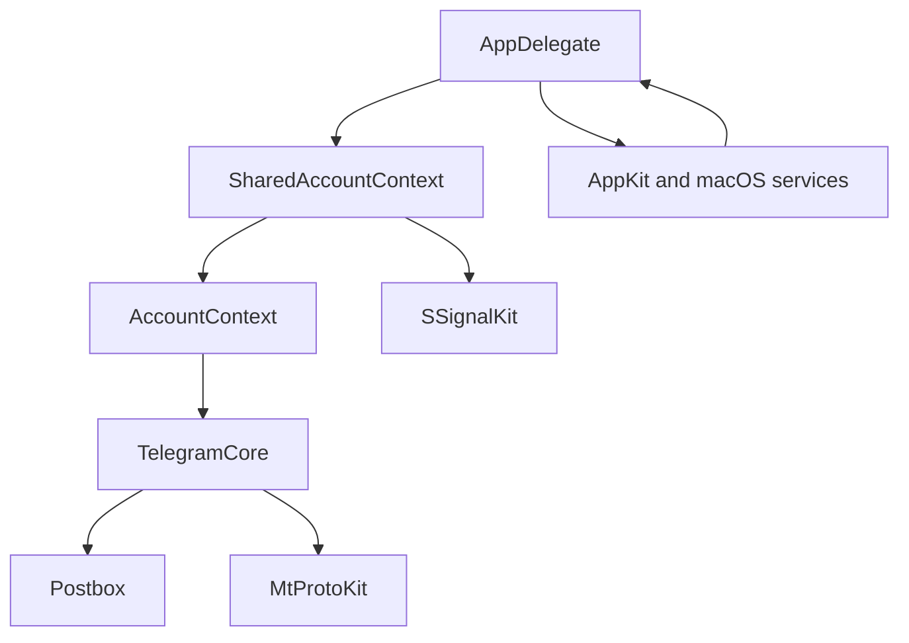
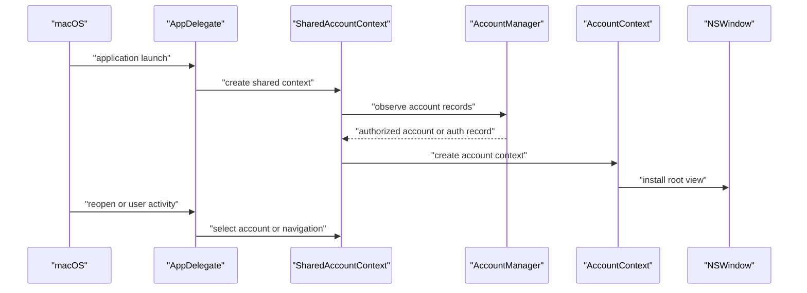
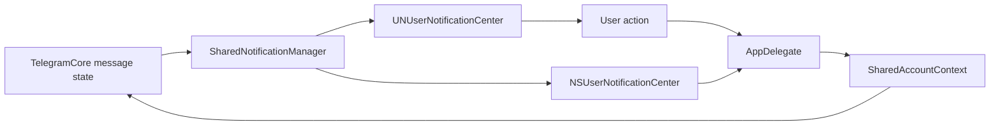
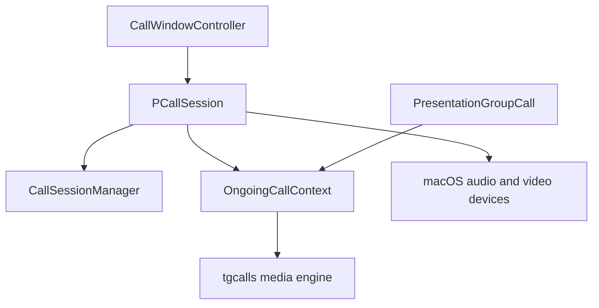

# macOS 클라이언트의 시스템 계층

웹: /docs/system/15-macos-system-layer/ · Markdown: /docs/system/15-macos-system-layer.md

> TelegramSwift가 공유 코어를 macOS 시스템 기능에 어떻게 연결하는지 설명해요.

> 시스템 설계 · 계정과 플랫폼 · 15장 · 도표 4 · 코드 발췌 9 · 인용 44 · 소스 기준선: [TelegramMessenger/Telegram-iOS@f1dd7a2d](https://github.com/TelegramMessenger/Telegram-iOS/tree/f1dd7a2dbd02cbbf513e75d5695d8d36d1cf5838), [overtake/TelegramSwift@579cebbf](https://github.com/overtake/TelegramSwift/tree/579cebbf0c01fd41b712eff3647fa7f69db9665d)
>
> 관련 보충: [macOS fork 장별 검증(08–15장)](/docs/system/32-fork-verify-08-15/), [macOS 알림 동작과 Dock 배지](/docs/system/40-mac-notification-badge/)
>
> 핵심 소스 파일: [overtake/TelegramSwift/Telegram-Mac/AppDelegate.swift](https://github.com/overtake/TelegramSwift/blob/579cebbf0c01fd41b712eff3647fa7f69db9665d/Telegram-Mac/AppDelegate.swift), [overtake/TelegramSwift/Telegram-Mac/SharedAccountContext.swift](https://github.com/overtake/TelegramSwift/blob/579cebbf0c01fd41b712eff3647fa7f69db9665d/Telegram-Mac/SharedAccountContext.swift), [overtake/TelegramSwift/Telegram-Mac/SupportAccountContext.swift](https://github.com/overtake/TelegramSwift/blob/579cebbf0c01fd41b712eff3647fa7f69db9665d/Telegram-Mac/SupportAccountContext.swift), [overtake/TelegramSwift/Telegram-Mac/UNUserNotifications.swift](https://github.com/overtake/TelegramSwift/blob/579cebbf0c01fd41b712eff3647fa7f69db9665d/Telegram-Mac/UNUserNotifications.swift), [overtake/TelegramSwift/Telegram-Mac/AppUpdateViewController.swift](https://github.com/overtake/TelegramSwift/blob/579cebbf0c01fd41b712eff3647fa7f69db9665d/Telegram-Mac/AppUpdateViewController.swift), [overtake/TelegramSwift/packages/ApiCredentials/Sources/ApiCredentials/Config.swift](https://github.com/overtake/TelegramSwift/blob/579cebbf0c01fd41b712eff3647fa7f69db9665d/packages/ApiCredentials/Sources/ApiCredentials/Config.swift), [overtake/TelegramSwift/packages/CrashHandler/Sources/CrashHandler/CrashHandler.swift](https://github.com/overtake/TelegramSwift/blob/579cebbf0c01fd41b712eff3647fa7f69db9665d/packages/CrashHandler/Sources/CrashHandler/CrashHandler.swift), [overtake/TelegramSwift/Telegram-Mac/PCallSession.swift](https://github.com/overtake/TelegramSwift/blob/579cebbf0c01fd41b712eff3647fa7f69db9665d/Telegram-Mac/PCallSession.swift), [TelegramMessenger/Telegram-iOS/submodules/TelegramCore/Sources/Account/AccountManager.swift](https://github.com/TelegramMessenger/Telegram-iOS/blob/f1dd7a2dbd02cbbf513e75d5695d8d36d1cf5838/submodules/TelegramCore/Sources/Account/AccountManager.swift)
>
> 미검증 사항:
> - 실제 macOS 잠금 화면 환경에서 리액션 알림에 남겨 둔 답장 액션을 실행할 수 있는지는 미검증이에요.
> - tgcalls의 오디오 장치 스레드, 비디오 렌더링 스레드, 그룹 통화의 전체 미디어 생성 체인, 계정 간 중재 정책은 항목별로 추적하지 않았고 미검증이에요.

TelegramSwift는 프로토콜, 데이터베이스, 화면을 각각 다시 작성한 macOS 클라이언트가 아니에요. Telegram의 공유 코어를 애플리케이션 계층 아래에 두고, 다음 요소로 호스트 적응(macOS에 맞추는 작업)을 마무리해요.

- AppKit 윈도우
- 시스템 알림
- 업데이터
- 데스크톱 장치 인터페이스

이 글은 소스를 따라 이 경계를 설명해요. 로컬 macOS 트리와 고정 fork에서 확인된 구현과, 미검증인 빌드 세부 사항을 구분해요. [\[1\]](https://github.com/overtake/TelegramSwift/blob/579cebbf0c01fd41b712eff3647fa7f69db9665d/.gitmodules#L1-L24)[\[2\]](https://github.com/overtake/TelegramSwift/blob/579cebbf0c01fd41b712eff3647fa7f69db9665d/Telegram-Mac/AppDelegate.swift#L1-L120)[\[26\]](https://github.com/overtake/TelegramSwift/blob/579cebbf0c01fd41b712eff3647fa7f69db9665d/packages/PrivateCallScreen/Package.swift#L18-L37)

이 장에서 살펴본 데스크톱 저장소는 `overtake/TelegramSwift`의 `579cebbf0c01fd41b712eff3647fa7f69db9665d`예요. 이 저장소의 서브모듈은 이렇게 체크아웃되어 있어요.

- `submodules/telegram-ios`: Gitlink가 가리키는 `a24bbe45f9861f736a79916a50898512f751e0dc`
- `submodules/tgcalls`: `5ddc3ccf2086127722a06e3d836698fcd717f11b`

`TelegramSwift`의 Package 매니페스트는 이 fork의 `TelegramCore`, `Postbox`(메시지 데이터베이스), `SwiftSignalKit`(`Signal` 기반 리액티브 라이브러리)을 상대 경로로 직접 끌어와요. 그래서 이 장의 핵심 결론은 고정 fork로 직접 다시 검증할 수 있어요. 더 새로운 `TelegramMessenger/Telegram-iOS`는 이후 업스트림 차이를 설명할 때만 쓰고, fork 증거를 대신할 수 없어요. [\[1\]](https://github.com/overtake/TelegramSwift/blob/579cebbf0c01fd41b712eff3647fa7f69db9665d/.gitmodules#L1-L24)[\[26\]](https://github.com/overtake/TelegramSwift/blob/579cebbf0c01fd41b712eff3647fa7f69db9665d/packages/PrivateCallScreen/Package.swift#L18-L37)[\[27\]](https://github.com/overtake/Telegram-iOS/blob/a24bbe45f9861f736a79916a50898512f751e0dc/submodules/TelegramCore/Sources/AccountManager/AccountManagerImpl.swift#L174-L266) [macOS fork 장별 검증(08–15장)](/docs/system/32-fork-verify-08-15/)

## 코드 경계: 데스크톱 셸과 공유 코어 [#코드-경계-데스크톱-셸과-공유-코어]

`Telegram-Mac`은 데스크톱 애플리케이션 타깃의 주 소스 디렉터리예요. 여기의 `AppDelegate`, 윈도우 컨트롤러, 계정 컨텍스트, 알림 관리자가 AppKit 이벤트를 처리해요. 이 객체들은 `TelegramCore`, `Postbox`, `MtProtoKit`(Telegram의 MTProto 프로토콜 구현), `SwiftSignalKit` 등의 모듈을 직접 import해요. macOS 계층에서는 다음을 다시 구현하지 않아요.

- MTProto 세션
- 메시지 동기화
- 로컬 메시지 저장소 [\[2\]](https://github.com/overtake/TelegramSwift/blob/579cebbf0c01fd41b712eff3647fa7f69db9665d/Telegram-Mac/AppDelegate.swift#L1-L120)[\[5\]](https://github.com/overtake/TelegramSwift/blob/579cebbf0c01fd41b712eff3647fa7f69db9665d/Telegram-Mac/SharedAccountContext.swift#L1-L140)

저장소는 공유 의존성을 서브모듈과 패키지 타깃으로 조합해요. `telegram-ios` 서브모듈에 코어 소스 트리가 들어 있고, `tgcalls`, `tg_owt`, `libtgvoip`, Sparkle(macOS 앱용 자동 업데이트 프레임워크)도 각각 서브모듈로 기록되어 있어요. 현재 작업 디렉터리에서는 `telegram-ios`와 `tgcalls`의 고정 커밋을 직접 읽을 수 있어요. 아직 빌드를 실행하지 않았어요. 그래서 “어떤 릴리스 산출물이 실제로 컴파일하고 링크한 버전”은 소스 디렉터리만으로는 여전히 증명할 수 없어요. [\[1\]](https://github.com/overtake/TelegramSwift/blob/579cebbf0c01fd41b712eff3647fa7f69db9665d/.gitmodules#L1-L24)[\[26\]](https://github.com/overtake/TelegramSwift/blob/579cebbf0c01fd41b712eff3647fa7f69db9665d/packages/PrivateCallScreen/Package.swift#L18-L37)

아키텍처 관점에서 일을 이렇게 나눠요.

- 코어: 계정 디렉터리, 계정별 `Postbox`, 네트워크, 동기화, Telegram Engine 작업을 맡아요.
- 데스크톱 계층: 이 객체들이 언제 시작하는지, 어떤 객체를 어느 `NSWindow`에 표시하는지, macOS의 콜백을 코어 작업으로 어떻게 옮기는지를 정해요.

공유 `AccountManager`는 디렉터리 레코드와 공유 설정을 직렬화하고, 계정별 `Account`는 구체적인 세션과 데이터베이스를 가져요. 이렇게 나눈 덕분에 계정 데이터 모델은 플랫폼을 넘어 다시 쓸 수 있고, 윈도우 모델은 macOS 전용 코드로 남아요. [\[5\]](https://github.com/overtake/TelegramSwift/blob/579cebbf0c01fd41b712eff3647fa7f69db9665d/Telegram-Mac/SharedAccountContext.swift#L1-L140)[\[27\]](https://github.com/overtake/Telegram-iOS/blob/a24bbe45f9861f736a79916a50898512f751e0dc/submodules/TelegramCore/Sources/AccountManager/AccountManagerImpl.swift#L174-L266)



이 도표는 의존성 그래프를 전부 펼친 게 아니라 제어 방향을 강조해요. 흐름은 이래요.

1. 시스템 이벤트는 먼저 `AppDelegate`나 데스크톱 관리자에 들어간 뒤 컨텍스트를 거쳐 코어를 호출해요.
2. 반대로 코어 상태는 `Signal`, 콜백, 관찰자로 컨텍스트에 흘러와요.
3. 마지막으로 컨트롤러가 윈도우, Dock, 알림을 갱신해요. [\[2\]](https://github.com/overtake/TelegramSwift/blob/579cebbf0c01fd41b712eff3647fa7f69db9665d/Telegram-Mac/AppDelegate.swift#L1-L120)[\[5\]](https://github.com/overtake/TelegramSwift/blob/579cebbf0c01fd41b712eff3647fa7f69db9665d/Telegram-Mac/SharedAccountContext.swift#L1-L140)

### 공유 코어와 공유 화면은 다른 문제 [#공유-코어와-공유-화면은-다른-문제]

`TelegramCore`의 API는 계정, 세션, 메시지, 설정을 대상으로 해요. 특정 뷰 트리는 대상이 아니에요. 그 위의 두 컨텍스트는 역할이 달라요.

- `SharedAccountContext`: 계정 간 통화 세션, 전역 설정, 캐시 관련 서비스 같은 공유 서비스를 프로세스 수준 객체 하나에 둬요.
- `AccountContext`: 이 공유 서비스를 계정 하나, 윈도우 하나와 묶어요.

그래서 계정을 바꿔도 프로세스 전체를 다시 만들지 않아요. 하위 동기화를 멈추라고 요구하지도 않아요. [\[5\]](https://github.com/overtake/TelegramSwift/blob/579cebbf0c01fd41b712eff3647fa7f69db9665d/Telegram-Mac/SharedAccountContext.swift#L1-L140)[\[6\]](https://github.com/overtake/TelegramSwift/blob/579cebbf0c01fd41b712eff3647fa7f69db9665d/Telegram-Mac/SharedAccountContext.swift#L634-L700)

`SwiftSignalKit`은 여기서 수명 주기 도구예요. 컨텍스트는 `MetaDisposable`, `DisposableSet`, `DisposableDict`를 들고 있다가, 이 객체들로 계정 레코드, 인증 상태, 알림 상태를 구독해요. 설계의 핵심은 소유자가 구독을 해제하는 거예요. 윈도우가 닫힌 뒤에도 옛 계정의 상태를 계속 받는 일이 없게 해요. 리액티브 API를 오래 도는 데스크톱 프로그램에서 쓸 때 꼭 지켜야 하는 제약이에요. [\[6\]](https://github.com/overtake/TelegramSwift/blob/579cebbf0c01fd41b712eff3647fa7f69db9665d/Telegram-Mac/SharedAccountContext.swift#L634-L700)[\[8\]](https://github.com/overtake/TelegramSwift/blob/579cebbf0c01fd41b712eff3647fa7f69db9665d/Telegram-Mac/SupportAccountContext.swift#L18-L122)

공유 계층은 플랫폼을 옮길 때의 위험도 줄여요. 메시지 색인, 차분 동기화(바뀐 부분만 받아 오는 동기화), 리소스 색인, 프로토콜 요청에는 각자의 순서와 실패 처리가 있어요. macOS 뷰가 이 저수준 객체에 직접 접근하면 윈도우 컨트롤러가 네트워크 복구와 그리기를 함께 책임지게 돼요. 지금 구조에서는 데스크톱 코드가 “어느 계정을 표시할지, 어느 채팅을 열지, 알림 액션을 누구에게 넘길지”를 표현하고, “최신 메시지를 어떻게 얻을지”는 코어에 맡겨요. 이 판단은 모듈 경계와 컨텍스트 조립 관계에서 나온 거예요. 모든 코어 호출 경로를 완전히 증명한 건 아니에요. [\[2\]](https://github.com/overtake/TelegramSwift/blob/579cebbf0c01fd41b712eff3647fa7f69db9665d/Telegram-Mac/AppDelegate.swift#L1-L120)[\[5\]](https://github.com/overtake/TelegramSwift/blob/579cebbf0c01fd41b712eff3647fa7f69db9665d/Telegram-Mac/SharedAccountContext.swift#L1-L140)

이런 계층 구조 때문에 코드에 `Account`, `AccountContext`, `AuthorizedApplicationContext`, `SharedApplicationContext`가 함께 나와요. 역할은 이래요.

- `Account`: 코어 세션 객체예요.
- `AccountContext`: `Account`를 윈도우 및 표시 의존성과 결합해요.
- `AuthorizedApplicationContext`: 인증된 메인 화면의 루트 뷰와 준비 신호를 제공해요.
- `SharedApplicationContext`: 계정 간 리소스를 담아요.

이름은 비슷하지만 소유권의 층위가 달라요. 유지보수자가 `AuthorizedApplicationContext`와 `SharedApplicationContext`를 모두 계정 데이터베이스로 보면 해제 시점을 잘못 판단하게 돼요. [\[4\]](https://github.com/overtake/TelegramSwift/blob/579cebbf0c01fd41b712eff3647fa7f69db9665d/Telegram-Mac/ApplicationContext.swift#L1-L120)[\[7\]](https://github.com/overtake/TelegramSwift/blob/579cebbf0c01fd41b712eff3647fa7f69db9665d/Telegram-Mac/AccountContext.swift#L1-L100)[\[8\]](https://github.com/overtake/TelegramSwift/blob/579cebbf0c01fd41b712eff3647fa7f69db9665d/Telegram-Mac/SupportAccountContext.swift#L18-L122)

모듈을 공유해도 버전 경계는 남아요. 데스크톱 저장소가 고정한 건 더 이른 시점의 fork 커밋이고, 더 새로운 업스트림 체크아웃은 다른 커밋, 다른 조직에서 온 거예요. 인터페이스 이름이 같다고 구현이 바이트 단위로 같다는 증거가 되지는 않아요. 그래서 이 글은 fork 소스로 `AccountManager`의 트랜잭션과 디렉터리 책임을 확인하고, 업스트림 차이로 명시한 내용에만 더 새로운 업스트림을 인용해요. 다음 작업은 모두 고정 fork로 다시 컴파일해서 검증해야 해요.

- ABI(컴파일된 코드끼리 맞물리는 바이너리 규약)를 바꾸는 작업
- 코어 버그를 고치는 작업
- 서브모듈을 올리는 작업 [\[1\]](https://github.com/overtake/TelegramSwift/blob/579cebbf0c01fd41b712eff3647fa7f69db9665d/.gitmodules#L1-L24)[\[26\]](https://github.com/overtake/TelegramSwift/blob/579cebbf0c01fd41b712eff3647fa7f69db9665d/packages/PrivateCallScreen/Package.swift#L18-L37)[\[27\]](https://github.com/overtake/Telegram-iOS/blob/a24bbe45f9861f736a79916a50898512f751e0dc/submodules/TelegramCore/Sources/AccountManager/AccountManagerImpl.swift#L174-L266)

## 시작, 데이터 루트 디렉터리, 애플리케이션 수명 주기 [#시작-데이터-루트-디렉터리-애플리케이션-수명-주기]

`AppDelegate`는 프로세스 수준의 진입점이에요. 시작할 때 순서대로 이렇게 해요.

1. 외관, 로그, 메뉴, 애플리케이션 서비스를 초기화해요.
2. 공유 컨텍스트를 만들어요.
3. 처음으로 인증 중이거나 인증된 계정을 메인 화면에 연결해요.

소스에는 현재 컨텍스트, 인증 컨텍스트, 일회성 공유 컨텍스트 신호도 들어 있어요. 덕분에 시작 단계가 “아직 로그인하지 않음”과 “이미 계정이 있음”의 두 경로 사이를 오갈 수 있어요. [\[2\]](https://github.com/overtake/TelegramSwift/blob/579cebbf0c01fd41b712eff3647fa7f69db9665d/Telegram-Mac/AppDelegate.swift#L1-L120)[\[4\]](https://github.com/overtake/TelegramSwift/blob/579cebbf0c01fd41b712eff3647fa7f69db9665d/Telegram-Mac/ApplicationContext.swift#L1-L120)

디렉터리를 고를 때는 편의보다 격리 경계가 먼저예요. `ApiEnvironment.containerURL`은 `FileManager.default.containerURL(forSecurityApplicationGroupIdentifier:)`를 호출하고 그룹 컨테이너에 애플리케이션 접두사를 덧붙여요.

- 시스템이 컨테이너를 돌려주면 디렉터리를 만들어요.
- 컨테이너가 없으면 함수는 `nil`을 반환해요.

이 동작은 App Store 또는 App Group을 켠 빌드가 공유되는 영속 데이터를 시스템이 관리하는 컨테이너에 둘 수 있다는 뜻이에요. [\[3\]](https://github.com/overtake/TelegramSwift/blob/579cebbf0c01fd41b712eff3647fa7f69db9665d/packages/ApiCredentials/Sources/ApiCredentials/Config.swift#L3-L57)

직접 배포 빌드는 다른 쓰기 가능 경로와 서명 구성을 써요. 소스에는 `AppStore` 조건 분기와 `containerURL`의 옵셔널 반환이 있어요. 비샌드박스 루트 경로를 구체적으로 어떻게 고르는지는 `AppDelegate`와 빌드 설정을 항목별로 다시 검증해야 해요. 이 장은 “직접 배포판은 반드시 어떤 고정 경로를 쓴다”를 사실로 삼지 않았어요. 특히 실제 서명, App Group entitlement(App Group 사용 권한을 앱 서명에 담은 선언), 런타임 경로는 모두 미검증이에요. [\[2\]](https://github.com/overtake/TelegramSwift/blob/579cebbf0c01fd41b712eff3647fa7f69db9665d/Telegram-Mac/AppDelegate.swift#L1-L120)[\[3\]](https://github.com/overtake/TelegramSwift/blob/579cebbf0c01fd41b712eff3647fa7f69db9665d/packages/ApiCredentials/Sources/ApiCredentials/Config.swift#L3-L57)

`ApiEnvironment.migrate()`를 보면 경로가 시작 매개변수에 그치지 않는다는 걸 알 수 있어요. 이 함수는 이렇게 동작해요.

- 새 컨테이너가 비어 있을 때만 옛 컨테이너를 훑어요.
- 접두사 제외 표에 있는 항목은 건너뛰어요.
- 나머지 옛 파일은 옮기려고 시도해요.

“새 컨테이너가 비어 있을 때만”이라는 조건은 시작할 때마다 새 데이터를 덮어쓰는 일을 막아요. 그리고 디렉터리 마이그레이션(옛 위치의 데이터를 새 위치로 옮기는 일)이 계정 화면 컨트롤러 여기저기에 흩어지지 않고 공유 환경이 정의된 곳에 있게 해요. [\[3\]](https://github.com/overtake/TelegramSwift/blob/579cebbf0c01fd41b712eff3647fa7f69db9665d/packages/ApiCredentials/Sources/ApiCredentials/Config.swift#L3-L57)

`packages/ApiCredentials/Sources/ApiCredentials/Config.swift` 3–24행 발췌.
```swift
public final class ApiEnvironment {
    public static var apiId:Int32 {
        return 9
    }
    public static var apiHash:String {
        return "3975f648bb682ee889f35483bc618d1c"
    }
    
    public static var bundleId: String {
        return "ru.keepcoder.Telegram"
    }
    public static var intentsBundleId: String {
        return teamId + "." + bundleId + ".FocusIntents"
    }
    public static var teamId: String {
        return "6N38VWS5BX"
    }
    
    
    
    public static var containerURL: URL? {
        let appGroupName = ApiEnvironment.group
```

위 코드는 경계 하나를 더 보여 줘요. API 식별자, 해시, Bundle ID, 팀 ID, 컨테이너 이름은 데스크톱 패키지의 일부인데도 `ApiEnvironment`를 통해 한곳에 드러나요. 계정과 네트워크 생성 로직은 이 값들을 읽을 수 있어요. 각 화면 컨트롤러가 자기만의 API 상수를 들고 있으면 안 돼요. `ApiEnvironment`를 정적으로 접근하면 시작이 편해지지만, 배포 채널마다 빌드할 때 올바른 값을 넣어야 한다는 요구도 생겨요. [\[3\]](https://github.com/overtake/TelegramSwift/blob/579cebbf0c01fd41b712eff3647fa7f69db9665d/packages/ApiCredentials/Sources/ApiCredentials/Config.swift#L3-L57)[\[4\]](https://github.com/overtake/TelegramSwift/blob/579cebbf0c01fd41b712eff3647fa7f69db9665d/Telegram-Mac/ApplicationContext.swift#L1-L120)

### 윈도우와 계정은 별개 [#윈도우와-계정은-별개]

데스크톱 클라이언트는 “계정”과 “윈도우”를 일부러 분리해요. 한 계정의 `AccountContext`가 윈도우에 표시될 수 있지만, 윈도우를 닫는다고 계정이 자동으로 로그아웃되지는 않아요. 반대로 계정의 인증 상태가 바뀌면, 윈도우 객체를 다시 쓸 수 있는 상황에서도 컨텍스트를 해제하라고 요구할 수 있어요. 이 모델은 macOS에 잘 맞아요. 사용자는 윈도우를 닫고, 최소화하고, 다시 활성화하지만, 동기화, 다운로드, 계정 로그인 상태가 윈도우가 사라질 때마다 같이 사라지길 바라지 않기 때문이에요. [\[6\]](https://github.com/overtake/TelegramSwift/blob/579cebbf0c01fd41b712eff3647fa7f69db9665d/Telegram-Mac/SharedAccountContext.swift#L634-L700)[\[8\]](https://github.com/overtake/TelegramSwift/blob/579cebbf0c01fd41b712eff3647fa7f69db9665d/Telegram-Mac/SupportAccountContext.swift#L18-L122)

`AppDelegate`는 Spotlight(macOS 시스템 검색)의 `continue userActivity` 콜백을 구현해요. 처리 순서는 이래요.

1. 시스템 검색 식별자를 파싱해요.
2. 대상 계정이 이미 표시되어 있는지 판단해요.
3. 다르면 `switchToAccount`를 호출하면서 대상 채팅으로 이동하는 내비게이션도 함께 전달해요.

이 흐름은 시스템이 외부 의도를 공유 계정 계층에 돌려주는 실제 사례예요. 검색 색인이 화면 데이터베이스를 직접 건드리는 게 아니에요. [\[2\]](https://github.com/overtake/TelegramSwift/blob/579cebbf0c01fd41b712eff3647fa7f69db9665d/Telegram-Mac/AppDelegate.swift#L1-L120)[\[22\]](https://github.com/overtake/TelegramSwift/blob/579cebbf0c01fd41b712eff3647fa7f69db9665d/Telegram-Mac/Spotlight.swift#L1-L160)

`Telegram-Mac/AppDelegate.swift` 1596–1605행 발췌.
```swift
    func application(_ application: NSApplication, continue userActivity: NSUserActivity, restorationHandler: @escaping ([NSUserActivityRestoring]) -> Void) -> Bool {
        if userActivity.activityType == CSSearchableItemActionType {
            if let uniqueIdentifier = userActivity.userInfo?[CSSearchableItemActivityIdentifier] as? String {
                if let identifier = parseSpotlightIdentifier(uniqueIdentifier) {
                    self.processSpotlightAction(identifier)
                }
            }
        }
        
        return true
```

이 Spotlight 경로에는 중요한 지연 처리가 있어요. 컨텍스트가 아직 만들어지지 않았다면 `AppDelegate`는 `spotlightAction`을 보관했다가, 계정 초기화가 끝난 뒤에 처리해요. 빈 컨텍스트에서 내비게이션하는 일을 피하는 거예요. 대가가 있어요.

- 외부 활동은 안정적이고 파싱할 수 있는 식별자를 가져야 해요.
- 시작 코드는 대기 중인 액션이 결국 소비되도록 보장해야 해요.

소비하는 시점의 전체 순서는 이 절에서 따로 검증하지 않았어요. [\[2\]](https://github.com/overtake/TelegramSwift/blob/579cebbf0c01fd41b712eff3647fa7f69db9665d/Telegram-Mac/AppDelegate.swift#L1-L120)

`applicationShouldHandleReopen`, 활성화, 윈도우 델리게이트 메서드는 함께 Dock(macOS의 앱 실행 막대) 클릭, 재오픈, 전후면 전환을 처리해요. 소스에는 애플리케이션 컨텍스트를 훑는 메서드도 있어서, 빠른 전환기 같은 명령이 현재 키 윈도우를 고르도록 도와요. 이 부분이 단일 윈도우 정책과 다중 윈도우 정책이 실제로 갈리는 지점이에요.

- 일반적인 메인 흐름: 메인 윈도우 하나를 다시 쓰는 쪽으로 기울어요.
- 계정 컨텍스트를 지원하는 쪽: 다중 윈도우 목록을 명시적으로 유지해요. [\[2\]](https://github.com/overtake/TelegramSwift/blob/579cebbf0c01fd41b712eff3647fa7f69db9665d/Telegram-Mac/AppDelegate.swift#L1-L120)[\[8\]](https://github.com/overtake/TelegramSwift/blob/579cebbf0c01fd41b712eff3647fa7f69db9665d/Telegram-Mac/SupportAccountContext.swift#L18-L122)

시스템 설계 관점에서 애플리케이션을 다시 여는 일은 `makeKeyAndOrderFront`만 하면 끝나는 게 아니에요. 마지막 윈도우가 닫혀도 프로세스, 계정 관찰, 백그라운드 다운로드는 여전히 살아 있을 수 있어요. 다시 열 때 애플리케이션은 먼저 인증 컨텍스트가 이미 있는지 판단한 뒤, 다음 중 하나를 골라야 해요.

- 기존 윈도우를 앞으로 가져오기
- 루트 뷰를 복원하기
- 인증 화면으로 들어가기

이 선택을 계정 객체가 아니라 `AppDelegate`에 두면, Dock 이벤트 하나 때문에 계정이 AppKit 의존성을 갖는 일이 없어요. [\[2\]](https://github.com/overtake/TelegramSwift/blob/579cebbf0c01fd41b712eff3647fa7f69db9665d/Telegram-Mac/AppDelegate.swift#L1-L120)[\[4\]](https://github.com/overtake/TelegramSwift/blob/579cebbf0c01fd41b712eff3647fa7f69db9665d/Telegram-Mac/ApplicationContext.swift#L1-L120)

소스의 “현재 컨텍스트”와 “인증 컨텍스트”는 임계 기간에 상태가 뒤섞이는 일도 막아 줘요. 각 상태에서는 이렇게 해야 해요.

- 인증 과정이 아직 끝나지 않았을 때는 메인 채팅 루트 뷰가 있다고 가정할 수 없어요.
- 인증된 계정의 준비가 끝난 뒤에는 인증 컨트롤러가 일반 세션의 내비게이션까지 계속 맡으면 안 돼요.

옵셔널 참조와 일회성 신호로 이 두 상태를 표현하면, 시작 경로가 빈 디렉터리, 임시 인증 레코드, 기존 다중 계정 레코드에서 단계적으로 한곳으로 모여요. 모든 분기가 구체적으로 몇 개인지는 `AppDelegate`에서 발췌하지 않은 부분에 달려 있어요. 이 단락이 설명하는 건 이 객체의 보유 관계에 드러난 설계 의도예요. [\[2\]](https://github.com/overtake/TelegramSwift/blob/579cebbf0c01fd41b712eff3647fa7f69db9665d/Telegram-Mac/AppDelegate.swift#L1-L120)[\[4\]](https://github.com/overtake/TelegramSwift/blob/579cebbf0c01fd41b712eff3647fa7f69db9665d/Telegram-Mac/ApplicationContext.swift#L1-L120)[\[5\]](https://github.com/overtake/TelegramSwift/blob/579cebbf0c01fd41b712eff3647fa7f69db9665d/Telegram-Mac/SharedAccountContext.swift#L1-L140)

윈도우를 다시 쓰면 자원 면에서도 이득이에요. 윈도우에는 레이어, 텍스트 레이아웃, 메뉴 추적, 입력 포커스 같은 AppKit 상태가 들어 있어서, 자주 없애고 새로 만들면 다시 만드는 비용이 늘어요. 계정 컨텍스트를 지원하는 쪽은 닫힌 윈도우를 `windows` 배열에 돌려놓고, 다음 `open` 때 먼저 되찾아 가요. 동시에 옛 콘텐츠 뷰를 지워서 새 계정이 옛 루트 뷰를 보지 않게 해요. 이 순서 덕분에 “윈도우 셸 재사용”과 “계정 화면 재사용”은 서로 다른 두 연산이 돼요. [\[8\]](https://github.com/overtake/TelegramSwift/blob/579cebbf0c01fd41b712eff3647fa7f69db9665d/Telegram-Mac/SupportAccountContext.swift#L18-L122)



## 데스크톱 계정: 공유 서비스, 단일 계정 컨텍스트, 지원 윈도우 [#데스크톱-계정-공유-서비스-단일-계정-컨텍스트-지원-윈도우]

`SharedAccountContext`는 macOS 계층에서 계정을 총괄하는 조정자예요. `AccountManager`, 네트워크 매개변수, 루트 경로, 암호화 매개변수를 받아서 계정 디렉터리와 현재 인증 레코드를 관찰해요. 그리고 표시해야 할 계정마다 `AccountContext`를 만들어요. 그래서 이 객체는 `TelegramCore`를 대신하는 게 아니라 코어 객체와 데스크톱 객체를 조립하는 계층이에요. [\[5\]](https://github.com/overtake/TelegramSwift/blob/579cebbf0c01fd41b712eff3647fa7f69db9665d/Telegram-Mac/SharedAccountContext.swift#L1-L140)[\[6\]](https://github.com/overtake/TelegramSwift/blob/579cebbf0c01fd41b712eff3647fa7f69db9665d/Telegram-Mac/SharedAccountContext.swift#L634-L700)

`switchToAccount(id:action:)`를 보면 전환이 명시적인 상태 이전이라는 걸 알 수 있어요. 이 메서드는 먼저 대상 계정을 찾고, 기존 컨텍스트에 따라 다음 중 무엇을 할지 정해요.

- 곧바로 활성화
- 컨텍스트 만들기
- 지정된 `LaunchNavigation` 처리

호출하는 쪽이 전역 싱글턴의 계정 필드를 직접 바꾸지 않아서, 전환, 윈도우 전면화, 채팅 딥링크를 진입점 하나에 둘 수 있어요. [\[6\]](https://github.com/overtake/TelegramSwift/blob/579cebbf0c01fd41b712eff3647fa7f69db9665d/Telegram-Mac/SharedAccountContext.swift#L634-L700)

`Telegram-Mac/SharedAccountContext.swift` 634–657행 발췌.
```swift
    public func switchToAccount(id: AccountRecordId, action: LaunchNavigation?) {
        
        #if !SHARE
        if let value = appDelegate?.supportAccountContextValue?.find(id) {
            value.focus()
            return;
        }
        #endif
        
        if self.activeAccountsValue?.primary?.id == id {
            return
        }
        if let action = action {
            setLaunchAction(action, for: id)
        }
        
        
        assert(Queue.mainQueue().isCurrent())
        
        #if SHARE
        if let activeAccountsValue = self.activeAccountsValue, let account = activeAccountsValue.accounts.first(where: {$0.0 == id}) {
            var activeAccountsValue = activeAccountsValue
            activeAccountsValue.primary = account.1
            self.activeAccountsPromise.set(.single(activeAccountsValue))
```

위 코드에는 서로 다른 두 값이 있어요.

- `action`: 데스크톱 계층이 덧붙인 의도예요.
- `AccountRecordId`: 코어 디렉터리에서의 신원이에요.

둘을 나눠 놓은 덕분에 “계정 A로 전환”과 “계정 A로 전환한 뒤 채팅 B 열기”를 따로따로 표현할 수 있어요. Spotlight, 알림, 계정 메뉴가 이 진입점을 함께 쓸 수 있고, 계정 조회 규칙을 복제할 필요가 없어요. 계정이 아직 인증되지 않았거나 전환하는 도중에 레코드가 삭제됐을 때 구체적으로 어떻게 물러서는지는 메서드 안의 조건이 정해요. [\[2\]](https://github.com/overtake/TelegramSwift/blob/579cebbf0c01fd41b712eff3647fa7f69db9665d/Telegram-Mac/AppDelegate.swift#L1-L120)[\[6\]](https://github.com/overtake/TelegramSwift/blob/579cebbf0c01fd41b712eff3647fa7f69db9665d/Telegram-Mac/SharedAccountContext.swift#L634-L700)

`SupportAccountContext`는 눈에 보이는 다중 윈도우의 특수 사례예요. `contexts`와 놀고 있는 `windows`를 유지하고, 이미 열려 있는 지원 계정을 계정 ID로 찾아요. `open(account:)`는 먼저 채팅 목록 폴더와 태그 관련 데이터를 읽어요. 그다음 갈라져요.

- 계정에 이미 컨텍스트가 있으면: 원래 윈도우를 앞으로 가져오고 최소화를 풀어요.
- 없으면: `Window`를 만들거나 다시 쓰고, 지원용 `AccountContext`를 만든 뒤 `AuthorizedApplicationContext`의 루트 뷰를 설치해요. [\[8\]](https://github.com/overtake/TelegramSwift/blob/579cebbf0c01fd41b712eff3647fa7f69db9665d/Telegram-Mac/SupportAccountContext.swift#L18-L122)

폴더와 태그 구성을 먼저 읽고 뷰를 만드는 건 단순한 UI 최적화가 아니에요. 루트 뷰를 처음 구성하려면 채팅 목록이 어떤 구조로 표시될지 알아야 해요. 먼저 표시한 뒤 비동기 설정을 기다리면 사용자가 불필요한 레이아웃 튐을 한 번 보게 될 수 있어요. `take(1)`은 이 시작 읽기가 조합 결과 하나만 소비하도록 제한해요. 이후 윈도우는 정상적인 장기 관찰 스트림에 들어가요. 이 해석은 `combineLatest`, `deliverOnMainQueue`, `take(1)`을 호출하는 순서가 눈에 보인다는 점에 근거해요. [\[8\]](https://github.com/overtake/TelegramSwift/blob/579cebbf0c01fd41b712eff3647fa7f69db9665d/Telegram-Mac/SupportAccountContext.swift#L18-L122)

이미 열린 계정은 더 가벼운 경로를 타요. 코드는 기존 윈도우를 앞으로 가져와 `deminiaturize`를 호출하고, 같은 계정의 두 번째 `AccountContext`는 만들지 않아요. 같은 계정이 서로 독립된 루트 뷰 두 곳에서 내비게이션 상태, 읽지 않음 해제, 통화 표시를 두고 다투는 일을 피하려는 거예요. 애플리케이션에 다른 다중 윈도우 진입점이 없다는 뜻은 아니에요. 지원 계정 관리자가 “같은 계정에는 활성 지원 컨텍스트 하나”를 자기 불변식으로 삼고 있다는 설명이에요. [\[8\]](https://github.com/overtake/TelegramSwift/blob/579cebbf0c01fd41b712eff3647fa7f69db9665d/Telegram-Mac/SupportAccountContext.swift#L18-L122)

윈도우를 만들 때 `isReleasedWhenClosed`를 거짓으로 설정해요. 그러면 AppKit의 닫기 이벤트가 객체를 바로 없애지 않아서, 관리자가 닫기를 가로채 윈도우를 풀에 되돌려 놓을 수 있어요. 윈도우 자체를 보관하는 것만으로는 잔류를 막기에 부족해요. 코드는 `contentView`의 하위 뷰도 지워요. 컨텍스트 객체는 닫힐 때 배열에서 빠지지만 윈도우 객체는 임시로 보관돼요. 이렇게 수명 주기가 비대칭인 부분이야말로 데스크톱 애플리케이션이 모바일의 단일 장면 인터페이스보다 더 분명하게 표현해야 하는 부분이에요. [\[8\]](https://github.com/overtake/TelegramSwift/blob/579cebbf0c01fd41b712eff3647fa7f69db9665d/Telegram-Mac/SupportAccountContext.swift#L18-L122)

`Telegram-Mac/SupportAccountContext.swift` 45–68행 발췌.
```swift
    func open(account: Account) {
        let showTags = TelegramEngine(account: account).data.get(TelegramEngine.EngineData.Item.ChatList.FiltersDisplayTags())

        let data = combineLatest(TelegramEngine(account: account).peers.updatedChatListFilters(), chatListFolderSettings(account.postbox), showTags) |> map {
            return ChatListFolders(list: $0, sidebar: $1.sidebar, showTags: $2)
        }
        |> deliverOnMainQueue
        |> take(1)
        
        _ = data.start(next: { folders in
            if let value = self.contexts.first(where: { $0.context.account.id == account.id }) {
                value.context.window.makeKeyAndOrderFront(nil)
                value.context.window.deminiaturize(nil)
                return
            }
            
            let sharedContext = self.applicationContext.sharedContext
            
            let window: Window
            if self.windows.isEmpty {
                window = Window(contentRect: NSMakeRect(0, 0, 400, 400), styleMask: [.closable, .miniaturizable, .resizable, .titled], backing: .buffered, defer: true)
                window.isReleasedWhenClosed = false
            } else {
                window = self.windows.removeFirst()
```

지원 컨텍스트는 만들어진 뒤 `account.loggedOut`을 구독해요. 로그아웃 스트림이 처음 참이 되면 관리자는 그 계정의 윈도우 컨텍스트를 닫아요. 닫기 로직은 순서대로 이렇게 해요.

1. `contexts`에서 객체를 빼요.
2. 윈도우를 재사용 배열에 넣어요.
3. 윈도우를 숨겨요.
4. 콘텐츠 뷰를 지워요.

해제되는 건 표시 바인딩이라는 걸 알 수 있어요. 계정 디스크 디렉터리와 코어 계정 레코드를 삭제하는 일은 여전히 상위의 로그아웃 흐름에 속해요. 여기의 `removeAllSubviews()`를 데이터 삭제로 오해하면 안 돼요. [\[8\]](https://github.com/overtake/TelegramSwift/blob/579cebbf0c01fd41b712eff3647fa7f69db9665d/Telegram-Mac/SupportAccountContext.swift#L18-L122)[\[24\]](https://github.com/TelegramMessenger/Telegram-iOS/blob/f1dd7a2dbd02cbbf513e75d5695d8d36d1cf5838/submodules/TelegramCore/Sources/Account/AccountManager.swift#L1-L180)

`Telegram-Mac/SupportAccountContext.swift` 99–121행 발췌.
```swift
    func close(account: Account) {
        guard let index = self.contexts.firstIndex(where: { $0.context.account.id == account.id }) else {
            return
        }
        let value = self.contexts.remove(at: index)
        self.windows.append(value.context.window)
        value.context.window.orderOut(nil)
        value.context.window.contentView?.removeAllSubviews()
    }
    
    func enumerateAccountContext(_ f:(AccountContext)->Void) {
        for context in contexts {
            f(context.context)
        }
    }
    func enumerateApplicationContext(_ f:(AuthorizedApplicationContext)->Void) {
        for context in contexts {
            f(context)
        }
    }
    
    deinit {
        disposable.dispose()
```

일반 계정과 지원 계정의 차이에는 macOS에서 어디까지 타협했는지가 드러나요. 일반 Telegram 세션에는 안정적인 메인 화면과 계정 간 조율이 필요해요. 지원 계정은 독립된 윈도우를 허용하고, 윈도우 셸을 회수해서 반복 할당을 줄여요. 코드만으로는 모든 일반 계정이 항상 윈도우 하나만 열 수 있다는 걸 증명할 수 없어서 “엄격한 단일 윈도우”는 미검증이에요. 확인할 수 있는 건 `SupportAccountContext`가 다중 컨텍스트, 다중 윈도우, 윈도우 풀을 명시적으로 구현했다는 점이에요. [\[8\]](https://github.com/overtake/TelegramSwift/blob/579cebbf0c01fd41b712eff3647fa7f69db9665d/Telegram-Mac/SupportAccountContext.swift#L18-L122)

### 수명 주기 소유권 [#수명-주기-소유권]

계정 컨텍스트는 네트워크 관찰, 윈도우, 뷰, 통화, 임시 작업을 동시에 소유해야 해요. `SupportAccountContext`는 `DisposableDict`로 계정 ID별 로그아웃 구독을 보관하고, `deinit`에서 한꺼번에 `dispose()`해요. 이렇게 계정 키별로 관리하면 A 계정이 로그아웃할 때 B 계정의 구독을 잘못 취소하는 일이 없어요. 같은 계정을 중복해서 열 때 옛 관찰자가 남는 일도 없어요. [\[8\]](https://github.com/overtake/TelegramSwift/blob/579cebbf0c01fd41b712eff3647fa7f69db9665d/Telegram-Mac/SupportAccountContext.swift#L18-L122)

해제 순서는 바깥에서 안쪽으로 이해해야 해요.

1. 계정 로그아웃 스트림이 닫기 진입점을 일으켜요.
2. 관리자가 그 계정의 관찰 구독을 해제하고 활성 컨텍스트 배열에서 참조를 빼요.
3. 윈도우가 표시에서 물러나고 하위 뷰가 정리돼요.
4. 마지막으로 관리자 자신이 사라지면 `DisposableDict`가 남은 구독을 모두 취소해요.

소스는 `AccountContext` 안의 모든 리소스가 `deinit`에서 어떻게 정리되는지는 보여 주지 않아요. 그래서 윈도우를 닫으면 네트워크 세션이 곧바로 끝난다고 주장할 수는 없어요. [\[8\]](https://github.com/overtake/TelegramSwift/blob/579cebbf0c01fd41b712eff3647fa7f69db9665d/Telegram-Mac/SupportAccountContext.swift#L18-L122)

구독을 계정 ID를 소유한 관리자에 두면 감사 측면의 가치도 있어요. 다중 계정 버그는 대개 신호 하나를 취소하지 않아서가 아니라 엉뚱한 계정의 신호를 취소해서 생겨요. 키가 있는 `DisposableDict`는 설정과 교체를 모두 같은 `AccountRecordId`를 중심으로 검토할 수 있게 해 줘요. 배열 인덱스로 구독을 보관하는 방식과 비교하면 계정 표시 순서에 기대지 않아서, 계정 정렬이 바뀔 때 어긋나기도 어려워요. 이 단락의 뒷부분(배열 인덱스와 비교한 설명)은 데이터 구조를 바탕으로 한 설계상의 추론이에요. [\[8\]](https://github.com/overtake/TelegramSwift/blob/579cebbf0c01fd41b712eff3647fa7f69db9665d/Telegram-Mac/SupportAccountContext.swift#L18-L122)

계정 간 리소스의 수명 주기는 반대예요. 통화 세션과 인라인 플레이어는 각 `AuthorizedApplicationContext`에 전달돼요. 그래서 호출한 윈도우가 이것들의 유일한 인스턴스를 소유하지 않아요. 윈도우마다 자기 오디오 세션을 구성하면 마이크 선택, 출력 장치 선점, 수신 전화 안내에서 충돌이 생겨요. 공유 소유권은 이런 충돌을 줄여요. 하지만 계정 간 요청에도 분명한 중재가 필요해요. 그 중재의 전체 알고리즘은 이 장에서 읽은 범위로는 확인하지 못했어요. [\[8\]](https://github.com/overtake/TelegramSwift/blob/579cebbf0c01fd41b712eff3647fa7f69db9665d/Telegram-Mac/SupportAccountContext.swift#L18-L122)[\[18\]](https://github.com/overtake/TelegramSwift/blob/579cebbf0c01fd41b712eff3647fa7f69db9665d/Telegram-Mac/PCallSession.swift#L261-L285)

공유 컨텍스트는 계정 간 통화 세션, 그룹 통화, 인라인 플레이어도 `AuthorizedApplicationContext`에 드러내요. “리소스는 인스턴스 하나만 있을 수 있다”는 규칙을 계정 윈도우 밖에 두는 거예요. 예를 들어 오디오 장치와 통화 전면 상태를 여러 계정 윈도우가 제각각 다투게 하면 안 돼요. 구체적인 중재 정책은 관련 통화 세션 코드에 있어요. 이 장은 조립 관계만 확인했어요. [\[8\]](https://github.com/overtake/TelegramSwift/blob/579cebbf0c01fd41b712eff3647fa7f69db9665d/Telegram-Mac/SupportAccountContext.swift#L18-L122)[\[18\]](https://github.com/overtake/TelegramSwift/blob/579cebbf0c01fd41b712eff3647fa7f69db9665d/Telegram-Mac/PCallSession.swift#L261-L285)

## 시스템 알림, Dock 배지, 액션이 돌아오는 길 [#시스템-알림-dock-배지-액션이-돌아오는-길]

`SharedNotificationManager`는 코어 알림 이벤트와 macOS 알림 센터를 잇는 다리예요. 하는 일은 이래요.

- 계정 컨텍스트나 공유 구성을 소유해요.
- 구체적인 알림 구현을 골라요.
- 메시지, 소리, 첨부, 읽지 않음 상태를 시스템이 전달할 수 있는 요청으로 바꿔요.

실제로 `UNUserNotificationCenter`와 주고받는 구현은 `UNUserNotifications.swift`에 있어요. 덕분에 플랫폼 API와 더 높은 계층의 알림 정책이 분리돼요. [\[9\]](https://github.com/overtake/TelegramSwift/blob/579cebbf0c01fd41b712eff3647fa7f69db9665d/Telegram-Mac/SharedNotificationManager.swift#L1-L180)[\[10\]](https://github.com/overtake/TelegramSwift/blob/579cebbf0c01fd41b712eff3647fa7f69db9665d/Telegram-Mac/UNUserNotifications.swift#L1-L385)

알림 권한은 `requestAuthorization(options: [.alert, .badge, .sound])`를 써요. 이 세 가지 권한은 데스크톱 알림의 세 가지 효과를 나타내요.

- `.alert`: 배너 또는 알림 표시
- `.badge`: 앱 배지
- `.sound`: 소리

권한 콜백은 `completed`가 참일 때만 알림 구현을 호출한 쪽에 넘겨요. 실패하면 이 코드 구간에서는 사용자 안내를 주지 않아요. 화면에 오류가 표시되는지는 미검증이에요. [\[10\]](https://github.com/overtake/TelegramSwift/blob/579cebbf0c01fd41b712eff3647fa7f69db9665d/Telegram-Mac/UNUserNotifications.swift#L1-L385)

`Telegram-Mac/UNUserNotifications.swift` 340–364행 발췌.
```swift
    override func authorize(completion: @escaping (UNUserNotifications) -> Void) {
        UNUserNotificationCenter.current().requestAuthorization(options: [.alert, .badge, .sound], completionHandler: { [weak self] completed, error in
            if completed, let strongSelf = self {
                completion(strongSelf)
            }
        })
    }
    
    override func clearNotifies(_ peerId:PeerId, maxId:MessageId) {
        queue.async {
            let manager = UNUserNotificationCenter.current()
            manager.getDeliveredNotifications(completionHandler: { notifications in
                for notification in notifications {
                    let userInfo = notification.request.content.userInfo
                    if let notificationMessageId = getNotificationMessageId(userInfo: userInfo, for: "reply") {
                        let timestamp = userInfo["timestamp"] as? Int32 ?? 0
                        if notificationMessageId.peerId == peerId, notificationMessageId <= maxId {
                            manager.removeDeliveredNotifications(withIdentifiers: [notification.request.identifier])
                        } else if timestamp == 0 || timestamp + 24 * 60 * 60 < Int32(Date().timeIntervalSince1970) {
                            manager.removeDeliveredNotifications(withIdentifiers: [notification.request.identifier])
                        }
                    }
                }
            })
        }
```

정리 로직은 “대화 단위로 비우기”보다 세밀해요. 동작은 이래요.

- 이미 전달된 알림을 읽고, `userInfo`의 `reply` 메시지 ID로 peer(대화 대상)와 최대 메시지 ID를 비교해요.
- 같은 대화에서 읽은 위치보다 늦지 않은 알림은 삭제해요.
- 코드는 24시간이 지난 옛 알림도 삭제해서, 알림 센터가 무효한 항목을 오래 들고 있지 않게 해요. [\[10\]](https://github.com/overtake/TelegramSwift/blob/579cebbf0c01fd41b712eff3647fa7f69db9665d/Telegram-Mac/UNUserNotifications.swift#L1-L385)

알림 내용의 `userInfo`는 시스템에서 코어로 돌아오는 연관 키예요. 하지만 액션이 어떤 의미를 갖는지는 알림 API에 달려 있어요. 경로마다 달라요.

- macOS 10.14 이후의 `UNUserNotificationsNew`: 식별자가 `reply`인 텍스트 입력 액션만 등록해요. 기본 클릭은 대화로 이동하고, 알림을 닫아도 메시지를 읽음으로 처리하지 않아요.
- 옛 `NSUserNotificationCenter` 경로: `didDismissAlert`가 알림의 메시지 ID와 타임스탬프에 따라 읽음을 진행시키고, `didActivate`는 전달된 알림만 제거해요. [\[28\]](https://github.com/overtake/TelegramSwift/blob/579cebbf0c01fd41b712eff3647fa7f69db9665d/Telegram-Mac/UNUserNotifications.swift#L86-L129)[\[29\]](https://github.com/overtake/TelegramSwift/blob/579cebbf0c01fd41b712eff3647fa7f69db9665d/Telegram-Mac/UNUserNotifications.swift#L258-L285)[\[30\]](https://github.com/overtake/TelegramSwift/blob/579cebbf0c01fd41b712eff3647fa7f69db9665d/Telegram-Mac/UNUserNotifications.swift#L187-L199) [macOS 알림 동작과 Dock 배지](/docs/system/40-mac-notification-badge/)

알림 브리지는 “전달한 시점의 상태”와 “조작한 시점의 상태”가 다른 경우를 처리해야 해요. 사용자가 배너를 본 뒤 다른 기기에서 이미 메시지를 읽었을 수도 있고, 그 알림을 보낸 계정에서 이미 로그아웃했을 수도 있어요. 그래서 액션을 처리할 때 알림 텍스트를 명령으로 삼으면 안 돼요. 두 경로는 계정을 다르게 골라요.

- 새 버전의 답장 경로: 페이로드에서 `accountId`와 메시지 ID를 읽고, 활성 계정에서 해당 계정을 찾아 메시지를 큐에 넣어요.
- 옛 alert의 읽음 클로저: `accountId`를 읽지 않고 현재 메인 화면 계정의 엔진을 호출해요.

다중 계정에서 읽음 조작이 올바르게 라우팅된다는 보장은 없어요. [\[28\]](https://github.com/overtake/TelegramSwift/blob/579cebbf0c01fd41b712eff3647fa7f69db9665d/Telegram-Mac/UNUserNotifications.swift#L86-L129)[\[31\]](https://github.com/overtake/TelegramSwift/blob/579cebbf0c01fd41b712eff3647fa7f69db9665d/Telegram-Mac/AppDelegate.swift#L914-L925)[\[32\]](https://github.com/overtake/Telegram-iOS/blob/a24bbe45f9861f736a79916a50898512f751e0dc/submodules/TelegramCore/Sources/PendingMessages/EnqueueMessage.swift#L361-L374)[\[33\]](https://github.com/overtake/Telegram-iOS/blob/a24bbe45f9861f736a79916a50898512f751e0dc/submodules/TelegramCore/Sources/TelegramEngine/Messages/ApplyMaxReadIndexInteractively.swift#L7-L68)

첨부 처리에서도 시스템 계층이 어디까지 책임지는지 알 수 있어요. 알림 확장 코드는 이미지를 임시 JPEG 파일로 바꾼 뒤 로컬 URL로 `UNNotificationAttachment`를 만들어요. `UNUserNotificationCenter`는 알림을 한 번 표시하는 데 필요한 파일 참조만 받고, Telegram 미디어 캐시의 수명 주기는 소유하지 않아요. 임시 디렉터리, 캐시 리소스, 사용자가 내보낸 저장 파일은 각각 따로 정리해야 해요. 그러지 않으면 알림 이미지가 끝없이 남을 수 있어요. 현재 코드 구간에서 확인할 수 있는 건 임시 디렉터리와 첨부 생성이에요. 실제 정리 정책은 미검증이에요. [\[10\]](https://github.com/overtake/TelegramSwift/blob/579cebbf0c01fd41b712eff3647fa7f69db9665d/Telegram-Mac/UNUserNotifications.swift#L1-L385)

소리를 고를 때도 같은 계층 구조가 있어요. 소리는 두 가지 방식으로 정해질 수 있어요.

- 알림 내용이 시스템 이름의 소리를 가리켜요: 알림 센터가 스케줄해요.
- 앱 델리게이트가 커스텀 소리를 재생해요: 앱에 쓸 수 있는 프로세스 상태가 있어야 해요.

소스에는 두 가지 설정 경로가 있어요. 하지만 어떤 소리 설정이든 프로세스가 종료됐을 때 재생된다는 걸 증명하지는 않아요. 구현하는 사람은 데스크톱 로컬 알림의 소리 의미를 iOS 원격 푸시의 소리 의미와 같다고 보면 안 돼요. [\[10\]](https://github.com/overtake/TelegramSwift/blob/579cebbf0c01fd41b712eff3647fa7f69db9665d/Telegram-Mac/UNUserNotifications.swift#L1-L385)

알림 답장은 계정 선택을 건너뛸 수 없어요. 데스크톱 프로세스 하나가 여러 계정을 가질 수 있어서, 새 버전의 액션 델리게이트는 페이로드의 `accountId`로 계정을 고른 뒤 fork 코어의 `enqueueMessages`를 호출해요. `enqueueMessages`는 해당 계정의 `Postbox` 트랜잭션에서 메시지를 큐에 넣고, 이후 전송 파이프라인이 네트워크 전송을 맡아요. 옛 alert를 닫을 때의 읽음 경로는 현재 메인 화면 계정을 써요. 그 코어 읽기 작업은 해당 계정의 `Postbox` 트랜잭션에서 읽기 위치를 갱신하고 `AccountStateManager`에 알려요. [\[28\]](https://github.com/overtake/TelegramSwift/blob/579cebbf0c01fd41b712eff3647fa7f69db9665d/Telegram-Mac/UNUserNotifications.swift#L86-L129)[\[31\]](https://github.com/overtake/TelegramSwift/blob/579cebbf0c01fd41b712eff3647fa7f69db9665d/Telegram-Mac/AppDelegate.swift#L914-L925)[\[32\]](https://github.com/overtake/Telegram-iOS/blob/a24bbe45f9861f736a79916a50898512f751e0dc/submodules/TelegramCore/Sources/PendingMessages/EnqueueMessage.swift#L361-L374)[\[33\]](https://github.com/overtake/Telegram-iOS/blob/a24bbe45f9861f736a79916a50898512f751e0dc/submodules/TelegramCore/Sources/TelegramEngine/Messages/ApplyMaxReadIndexInteractively.swift#L7-L68)

Dock 배지와 읽지 않은 개수는 같은 표시면에 속하지만 시스템 알림과 같은 게 아니에요. `TabBadgeItem`이 `dockTile: true`로 만든 `GlobalBadgeNode`는 현재 `Account`의 루트 채팅 그룹 총 읽지 않음을 구독하고, `collectAllAccounts: true`는 전달하지 않아요. 그래서 Dock에는 계정 하나의 개수가 표시되고, 프로세스의 모든 계정을 합산한 값이 아니에요. 계정 메뉴의 다중 계정 노드는 Dock에 쓰지 않아요. [\[34\]](https://github.com/overtake/TelegramSwift/blob/579cebbf0c01fd41b712eff3647fa7f69db9665d/Telegram-Mac/GlobalBadgeNode.swift#L118-L205)[\[35\]](https://github.com/overtake/TelegramSwift/blob/579cebbf0c01fd41b712eff3647fa7f69db9665d/Telegram-Mac/TabBadgeItem.swift#L77-L94)

기본 배지 설정은 `filtered`, `chats`, `all`, 활성화예요. 동작은 이래요.

- 루트 채팅 그룹에서 각 태그의 읽지 않은 채팅 수를 집계하고, 기본적으로 채널을 포함해요.
- `filtered`는 음소거된 대화를 제외하고, `raw`로 바꾸면 음소거된 대화를 유지해요.
- 보관함은 독립된 채팅 그룹이라서 루트 그룹의 공식에 들어가지 않아요.
- 읽지 않음 상태나 배지, 그룹, 채널, 카운트 유형 설정이 바뀌면 노드가 다시 계산해서 `NSDockTile.badgeLabel`에 써요.
- 사이드바 조건은 탭 배지만 숨기고 Dock 숫자는 지우지 않아요. [\[34\]](https://github.com/overtake/TelegramSwift/blob/579cebbf0c01fd41b712eff3647fa7f69db9665d/Telegram-Mac/GlobalBadgeNode.swift#L118-L205)[\[36\]](https://github.com/overtake/TelegramSwift/blob/579cebbf0c01fd41b712eff3647fa7f69db9665d/packages/InAppSettings/Sources/InAppSettings/RenderedTotalUnreadCount.swift#L11-L68)[\[37\]](https://github.com/overtake/TelegramSwift/blob/579cebbf0c01fd41b712eff3647fa7f69db9665d/packages/InAppSettings/Sources/InAppSettings/InAppNotificationSettings.swift#L99-L118)[\[38\]](https://github.com/overtake/Telegram-iOS/blob/a24bbe45f9861f736a79916a50898512f751e0dc/submodules/TelegramCore/Sources/SyncCore/SyncCore_TelegramPeerNotificationSettings.swift#L555-L574)[\[39\]](https://github.com/overtake/Telegram-iOS/blob/a24bbe45f9861f736a79916a50898512f751e0dc/submodules/TelegramCore/Sources/TelegramEngine/Messages/ChatList.swift#L424-L442)

이렇게 나눈 덕분에 사용자 조작을 더 예측하기 쉬워져요.

- 사용자가 알림 센터에서 “지우기”를 눌렀다고 앱이 메시지를 읽음으로 표시하면 안 돼요.
- 사용자가 앱 안에서 메시지를 읽으면 앱은 그 메시지에 해당하는 알림을 지워요. 하지만 다른 대화의 Dock 배지는 그대로 둘 수 있어요.

코어는 메시지 읽기 상태를 계산하고, 알림 계층은 전달된 사본이 그 상태에 되도록 수렴하게 해요. `clearNotifies`가 peer와 메시지 상한으로 동작하는 게 바로 이런 단방향 수렴의 사례예요. 알림이 데이터베이스를 구동하는 예가 아니에요. [\[5\]](https://github.com/overtake/TelegramSwift/blob/579cebbf0c01fd41b712eff3647fa7f69db9665d/Telegram-Mac/SharedAccountContext.swift#L1-L140)[\[10\]](https://github.com/overtake/TelegramSwift/blob/579cebbf0c01fd41b712eff3647fa7f69db9665d/Telegram-Mac/UNUserNotifications.swift#L1-L385)



새 알림의 `reply` 분기는 `accountId`로 대상 계정에 들어가요. 옛 알림의 `didDismissAlert` 분기는 현재 메인 화면 계정을 써요. 이 흐름을 보면 알림 계층이 전달에 필요한 사본만 보관하는 이유도 알 수 있어요. 메시지의 진실, 읽기 위치, 전송 큐는 여전히 `Postbox`와 코어 동기화 계층에 남아야 해요. 시스템 알림 API는 오프라인 메시지 데이터베이스를 대신할 수 없어요. [\[28\]](https://github.com/overtake/TelegramSwift/blob/579cebbf0c01fd41b712eff3647fa7f69db9665d/Telegram-Mac/UNUserNotifications.swift#L86-L129)[\[31\]](https://github.com/overtake/TelegramSwift/blob/579cebbf0c01fd41b712eff3647fa7f69db9665d/Telegram-Mac/AppDelegate.swift#L914-L925)[\[33\]](https://github.com/overtake/Telegram-iOS/blob/a24bbe45f9861f736a79916a50898512f751e0dc/submodules/TelegramCore/Sources/TelegramEngine/Messages/ApplyMaxReadIndexInteractively.swift#L7-L68)

## 업데이트, 배포, 인앱 구매 [#업데이트-배포-인앱-구매]

App Store 밖에서 배포하면 애플리케이션이 스스로 새 버전을 찾고, 내려받고, 설치해야 해요. `AppUpdateViewController.swift`는 Sparkle 비공개 인터페이스와 `TelegramUpdater`로 업데이트 상태를 감싸요. 화면 컨트롤러는 “확인, 다운로드, 설치” 같은 상태를 표시하고, 업데이트 드라이버가 appcast(Sparkle이 읽는 업데이트 목록), 다운로더, 설치 단계를 맡아요. 덕분에 컨트롤러가 Sparkle의 세부 사항을 직접 호출하는 일이 없어요. [\[12\]](https://github.com/overtake/TelegramSwift/blob/579cebbf0c01fd41b712eff3647fa7f69db9665d/Telegram-Mac/AppUpdateViewController.swift#L1-L116)[\[13\]](https://github.com/overtake/TelegramSwift/blob/579cebbf0c01fd41b712eff3647fa7f69db9665d/Telegram-Mac/AppUpdateViewController.swift#L265-L345)

`Telegram-Mac/AppUpdateViewController.swift` 21–45행 발췌.
```swift
final class TelegramUpdater : NSObject, SUUpdaterPrivate {
    var delegate: SUUpdaterDelegate!
    
    var userAgentString: String!
    
    var domain: String! = nil
    var host: String! = nil
    
    var httpHeaders: [AnyHashable : Any]!
    
    var decryptionPassword: String!
    
    var sparkleBundle: Bundle!
    
    override init() {
        self.sparkleBundle = Bundle(for: SUUpdateDriver.self)
    }
}

extension SUAppcastItem {
    var updateText: String {
        var updateText = (itemDescription.html2Attributed?.string ?? itemDescription).replacingOccurrences(of: "<[^>]+>", with: "", options: .regularExpression, range: nil)
        while let range = updateText.range(of: "   ") {
            updateText = updateText.replacingOccurrences(of: "   ", with: "  ", options: [], range: range)
        }
```

업데이트 경로에는 Telegram 내부 업데이트 소스도 있어요. `InternalUpdaterDownloader`는 appcast 항목에서 내부 URL을 얻은 뒤 `downloadAppUpdate`를 호출해서 Telegram 메시지 안의 설치 패키지를 내려받을 수 있어요. `InternalUpdateDriver`는 stable 또는 beta XML을 요청한 뒤 다운로드 진행률을 업데이트 상태에 써요. 그래서 업데이트 UI는 범용 Sparkle 껍데기에 그치지 않아요. 업데이트 배포를 계정 네트워크 기능과 연결할 수도 있어요. [\[13\]](https://github.com/overtake/TelegramSwift/blob/579cebbf0c01fd41b712eff3647fa7f69db9665d/Telegram-Mac/AppUpdateViewController.swift#L265-L345)[\[14\]](https://github.com/overtake/TelegramSwift/blob/579cebbf0c01fd41b712eff3647fa7f69db9665d/Telegram-Mac/AppUpdateViewController.swift#L347-L406)[\[15\]](https://github.com/overtake/TelegramSwift/blob/579cebbf0c01fd41b712eff3647fa7f69db9665d/Telegram-Mac/AppUpdateViewController.swift#L407-L521)

이건 배포상의 절충이에요. App Store 빌드는 스토어 업데이트와 샌드박스 규칙의 제약을 받아서 보통 자체 업데이트 설치 흐름을 쓸 수 없어요. 직접 배포판은 Sparkle을 쓸 수 있어요. 소스에는 채널과 조건부 컴파일의 증거가 있어요. 하지만 이 장은 두 가지 산출물을 실행하지 않았어요. 그래서 지금 어떤 빌드가 자체 업데이트를 켜 두었는지도, appcast 도메인의 프로덕션 구성도 확인할 수 없어요. [\[2\]](https://github.com/overtake/TelegramSwift/blob/579cebbf0c01fd41b712eff3647fa7f69db9665d/Telegram-Mac/AppDelegate.swift#L1-L120)[\[12\]](https://github.com/overtake/TelegramSwift/blob/579cebbf0c01fd41b712eff3647fa7f69db9665d/Telegram-Mac/AppUpdateViewController.swift#L1-L116)[\[15\]](https://github.com/overtake/TelegramSwift/blob/579cebbf0c01fd41b712eff3647fa7f69db9665d/Telegram-Mac/AppUpdateViewController.swift#L407-L521)

저장소에는 `InAppPurchaseManager` 패키지도 있어요. 이 패키지는 StoreKit(Apple의 인앱 구매 프레임워크)을 import하고, 하는 일은 이래요.

- `SKProductsRequest`, 제품 목록, 결제 컨텍스트, 거래 상태를 유지해요.
- 구매가 끝난 거래 ID를 상위로 넘겨요.

이 설계는 스토어 트랜잭션 상태를 독립 패키지에 두어서, 채팅이나 설정 컨트롤러가 직접 `SKPaymentQueue` 델리게이트가 되는 일을 피해요. [\[16\]](https://github.com/overtake/TelegramSwift/blob/579cebbf0c01fd41b712eff3647fa7f69db9665d/packages/InAppPurchaseManager/Sources/InAppPurchaseManager/InAppPurchaseManager.swift#L1-L239)

결제가 성공했는지를 화면 콜백만으로 판단하면 안 돼요. 관리자는 `purchased`, `restored`, `purchasing`, 실패, 보류, 할당 실패 같은 상태를 구분해요. 덕분에 상위 계층은 Telegram 백엔드가 권익 할당을 확인한 뒤에 사용자 흐름을 마칠 수 있어요. 구매 상품의 유형, 구체적인 호출 진입점, App Store 빌드가 이 패키지를 실제로 링크하는지는 미검증이에요. [\[16\]](https://github.com/overtake/TelegramSwift/blob/579cebbf0c01fd41b712eff3647fa7f69db9665d/packages/InAppPurchaseManager/Sources/InAppPurchaseManager/InAppPurchaseManager.swift#L1-L239)

업데이터와 구매 관리자는 공통된 경계를 가져요. 둘 다 macOS 시스템 서비스와 주고받고, 앱을 다시 시작하거나 네트워크가 실패한 뒤에도 복구될 수 있어요. 그래서 둘 다 임시 표시 상태를 권위 있는 사실로 다루면 안 돼요. 업데이터는 드라이버 상태를 표시할 수 있는 로딩 상태로 매핑하고, 구매 관리자는 거래 상태와 거래 ID를 처리할 수 있는 결과로 저장해요. 설치가 정말 성공했는지, 권익이 정말 귀속됐는지는 여전히 Sparkle, StoreKit, 서버가 확인해야 해요. [\[12\]](https://github.com/overtake/TelegramSwift/blob/579cebbf0c01fd41b712eff3647fa7f69db9665d/Telegram-Mac/AppUpdateViewController.swift#L1-L116)[\[15\]](https://github.com/overtake/TelegramSwift/blob/579cebbf0c01fd41b712eff3647fa7f69db9665d/Telegram-Mac/AppUpdateViewController.swift#L407-L521)[\[16\]](https://github.com/overtake/TelegramSwift/blob/579cebbf0c01fd41b712eff3647fa7f69db9665d/packages/InAppPurchaseManager/Sources/InAppPurchaseManager/InAppPurchaseManager.swift#L1-L239)

직접 배포판이 내부 업데이트 다운로더를 쓰면 관측 가능성 측면의 가치도 있어요. 다운로드 진행률, 기대 길이, 압축 해제, 설치 실패가 한곳에서 업데이트 상태로 바뀌어서, UI가 URLSession의 각 델리게이트 콜백을 구독할 필요가 없어요. 대가는 업데이트 체인이 appcast, 계정 네트워크 다운로드, Sparkle 드라이버에 동시에 의존한다는 점이에요. 어느 단계가 실패해도 분명한 상태를 표시할 수 있어야 해요. “새 버전 없음”과 “XML 읽기 실패”를 같은 결과로 합치면 안 돼요. [\[13\]](https://github.com/overtake/TelegramSwift/blob/579cebbf0c01fd41b712eff3647fa7f69db9665d/Telegram-Mac/AppUpdateViewController.swift#L265-L345)[\[14\]](https://github.com/overtake/TelegramSwift/blob/579cebbf0c01fd41b712eff3647fa7f69db9665d/Telegram-Mac/AppUpdateViewController.swift#L347-L406)[\[15\]](https://github.com/overtake/TelegramSwift/blob/579cebbf0c01fd41b712eff3647fa7f69db9665d/Telegram-Mac/AppUpdateViewController.swift#L407-L521)

## 자격 증명, 빌드 플레이버, 크래시 표시 [#자격-증명-빌드-플레이버-크래시-표시]

`ApiCredentials` 패키지는 환경 상수를 `ApiEnvironment`에 모아요. 이 파일이 제공하는 값은 이래요.

- API ID
- API hash
- Bundle ID
- Intents Bundle ID
- 팀 ID
- App Group(같은 개발 팀의 앱끼리 데이터를 공유하는 그룹)
- 컨테이너 경로

이 파일이 맡은 일은 암호화 키 관리가 아니에요. 애플리케이션과 공유 코어에 컴파일 시점 또는 패키지 내부의 환경 신원을 제공하는 거예요. 이 값들을 한곳에 모으면 구성이 제각각 어긋나는 일을 줄일 수 있어요. 하지만 API hash는 여전히 클라이언트 패키지 안에 있으니 사용자의 비밀 키라고 잘못 부르면 안 돼요. [\[3\]](https://github.com/overtake/TelegramSwift/blob/579cebbf0c01fd41b712eff3647fa7f69db9665d/packages/ApiCredentials/Sources/ApiCredentials/Config.swift#L3-L57)

컨테이너 마이그레이션은 한 번만 하고 병합하지 않는 전략이에요. 새 디렉터리에 이미 항목이 있으면 `migrate()`는 곧바로 반환해요. 새 디렉터리가 비어 있을 때만 함수가 옛 디렉터리를 훑으며 항목을 하나씩 옮겨요. 덕분에 업그레이드한 뒤 데이터베이스, 미디어 색인, 잠금 파일이 두 벌씩 루트 디렉터리 하나에 뒤섞이는 일을 피해요. 대가는 마이그레이션이 중간에 멈추면 새 위치와 옛 위치에 데이터가 모두 남을 수 있다는 점이에요. 개별 이동 작업은 오류를 무시해요. 그래서 복구 화면이나 마이그레이션 실패 안내가 있는지는 미검증이에요. [\[3\]](https://github.com/overtake/TelegramSwift/blob/579cebbf0c01fd41b712eff3647fa7f69db9665d/packages/ApiCredentials/Sources/ApiCredentials/Config.swift#L3-L57)

접두사 제외 표를 보면 루트 디렉터리가 아무 폴더나 되는 게 아니라는 걸 알 수 있어요. 애플리케이션은 그 안에 계정 데이터베이스, 캐시, 로그, 임시 상태, 시스템 통합 데이터를 저장할 수 있어요. 하지만 이 항목들이 마이그레이션 대상이 되는 자격이 완전히 같지는 않아요. 디렉터리 정책을 `ApiEnvironment`에 모으면 업그레이드 코드가 안정적인 데이터와 다시 만들 수 있는 데이터를 구분할 수 있어요. 경로 문자열을 다운로드, 알림, 계정 컨트롤러에 흩어 놓으면, 업그레이드할 때 데이터베이스는 이미 옮겼는데 리소스 색인은 여전히 옛 위치를 가리키는 식으로 상태가 어긋나기 쉬워요. 경로 문자열을 흩어 놓았을 때의 위험을 설명한 마지막 문장은 한곳에 모은 마이그레이션 코드를 바탕으로 한 설계상의 추론이에요. [\[3\]](https://github.com/overtake/TelegramSwift/blob/579cebbf0c01fd41b712eff3647fa7f69db9665d/packages/ApiCredentials/Sources/ApiCredentials/Config.swift#L3-L57)[\[5\]](https://github.com/overtake/TelegramSwift/blob/579cebbf0c01fd41b712eff3647fa7f69db9665d/Telegram-Mac/SharedAccountContext.swift#L1-L140)

공유 컨텍스트는 이어서 선택된 루트 경로를 계정 생성 보조 함수에 전달해요. 인증된 레코드와 진행 중인 인증 레코드는 같은 루트 경로를 따라 계정을 조립하지만, 두 레코드의 인증 상태는 달라요. 이런 구성 덕분에 계정 디렉터리가 같은 디스크 경계를 유지하고, 시작기가 아직 끝나지 않은 로그인 흐름을 복구할 수 있어요. 또 루트 경로를 `SharedAccountContext`를 만들기 전에 정해야 하는 이유도 알 수 있어요. 만든 뒤에 경로를 바꾸면 계정 디렉터리, 미디어 리소스, 인증 임시 상태가 각각 다른 위치에 놓일 수 있어요. [\[5\]](https://github.com/overtake/TelegramSwift/blob/579cebbf0c01fd41b712eff3647fa7f69db9665d/Telegram-Mac/SharedAccountContext.swift#L1-L140)

여기서 “공유”는 데스크톱 애플리케이션 인스턴스 하나 안에서 함께 접근할 수 있는 환경을 뜻할 뿐이에요. 여러 Telegram 계정이 같은 메시지 데이터베이스를 공유한다는 뜻이 아니에요. 계정 레코드는 계정 관리자가 한곳에서 유지해요. 인증된 각 `Account`는 여전히 이 레코드를 근거로 자기 영속 상태를 열어요. 컨테이너 루트 디렉터리는 애플리케이션을 다른 앱과 격리하고, 계정 레코드는 계정을 격리해요. 둘은 층위가 달라요. 둘 다 “공유”라는 단어를 쓴다고 합쳐서 이해하면 안 돼요. [\[3\]](https://github.com/overtake/TelegramSwift/blob/579cebbf0c01fd41b712eff3647fa7f69db9665d/packages/ApiCredentials/Sources/ApiCredentials/Config.swift#L3-L57)[\[24\]](https://github.com/TelegramMessenger/Telegram-iOS/blob/f1dd7a2dbd02cbbf513e75d5695d8d36d1cf5838/submodules/TelegramCore/Sources/Account/AccountManager.swift#L1-L180)[\[25\]](https://github.com/TelegramMessenger/Telegram-iOS/blob/f1dd7a2dbd02cbbf513e75d5695d8d36d1cf5838/submodules/TelegramCore/Sources/AccountManager/AccountManagerImpl.swift#L1-L180)

구성 상수는 배포 신원과도 묶여 있어요. Bundle ID, 팀 ID, Intents Bundle ID는 서명 및 entitlement와 맞아야 App Group이 컨테이너 URL을 돌려줄 수 있어요. 코드는 이 파생 값들을 제공하지만, 이 파일이 entitlements 자체를 검증하지는 않아요. 그래서 “컨테이너가 `nil`”인 원인을 조사할 때는 경로 생성만 확인하면 안 돼요. 현재 산출물의 서명, 팀, App Group이 구성과 일치하는지도 확인해야 해요. 구체적인 진단 절차는 빌드 환경에 속해요. 소스 트리에서 실행해 검증하지는 않았어요. [\[3\]](https://github.com/overtake/TelegramSwift/blob/579cebbf0c01fd41b712eff3647fa7f69db9665d/packages/ApiCredentials/Sources/ApiCredentials/Config.swift#L3-L57)

API ID와 API hash를 환경 타입에 두면, 테스트나 서로 다른 채널의 빌드가 계정 비즈니스 코드를 고치지 않고도 신원 전체를 바꿀 수 있어요. 코어가 네트워크 매개변수를 만들 때는 환경 제공자만 읽으면 돼요. 이 메커니즘이 키 순환을 자동으로 보장하지는 않아요. 변조도 막지 못해요. 클라이언트 바이너리 안의 상수는 여전히 분석될 수 있기 때문이에요. 이 방식의 가치는 엔지니어링 구성이 여기저기 흩어지는 걸 줄이는 데 있어요. 런타임 비밀 저장소를 제공하는 데 있지 않아요. [\[3\]](https://github.com/overtake/TelegramSwift/blob/579cebbf0c01fd41b712eff3647fa7f69db9665d/packages/ApiCredentials/Sources/ApiCredentials/Config.swift#L3-L57)[\[5\]](https://github.com/overtake/TelegramSwift/blob/579cebbf0c01fd41b712eff3647fa7f69db9665d/Telegram-Mac/SharedAccountContext.swift#L1-L140)

경로와 구성에 오류가 생겼을 때 가장 중요한 원칙은 UI가 아무도 모르게 비어 있는 두 번째 계정 디렉터리를 만들지 않게 하는 거예요. 애플리케이션이 컨테이너를 쓸 수 없는 상황을 “계정이 없음”으로 오인하면, 사용자가 로그인한 뒤 로컬 캐시가 사라진 것처럼 보이는 일이 생겨요. 소스에서 `containerURL`이 옵셔널 값이라는 건, 호출하는 쪽이 실패를 명시적으로 처리하거나 대체 경로를 골라야 한다는 뜻이에요. 대체 경로를 실제로 어떻게 고르는지와 데이터 마이그레이션 순서는 이 장에서 미검증이에요. 그래서 어떤 복구 동작도 확정된 사실로 쓰지 않았어요. [\[3\]](https://github.com/overtake/TelegramSwift/blob/579cebbf0c01fd41b712eff3647fa7f69db9665d/packages/ApiCredentials/Sources/ApiCredentials/Config.swift#L3-L57)[\[4\]](https://github.com/overtake/TelegramSwift/blob/579cebbf0c01fd41b712eff3647fa7f69db9665d/Telegram-Mac/ApplicationContext.swift#L1-L120)

`build flavour`의 구체적인 문자열과, 이 값이 코어로 전달되는 모든 호출 지점은 빌드 구성, `AppDelegate`의 네트워크 매개변수, 공유 서브모듈을 하나씩 비교해야 알 수 있어요. 소스에는 환경 상수와 채널 조건 분기가 실제로 나와요. 하지만 이 글은 값이 전파되는 그래프 전체를 로컬에서 확인하지는 못했어요. 그래서 “어떤 flavor가 MTProto 동작을 반드시 바꾼다”는 주장은 미검증이에요. [\[2\]](https://github.com/overtake/TelegramSwift/blob/579cebbf0c01fd41b712eff3647fa7f69db9665d/Telegram-Mac/AppDelegate.swift#L1-L120)[\[3\]](https://github.com/overtake/TelegramSwift/blob/579cebbf0c01fd41b712eff3647fa7f69db9665d/packages/ApiCredentials/Sources/ApiCredentials/Config.swift#L3-L57)[\[5\]](https://github.com/overtake/TelegramSwift/blob/579cebbf0c01fd41b712eff3647fa7f69db9665d/Telegram-Mac/SharedAccountContext.swift#L1-L140)

크래시 처리 패키지는 아주 작은 파일 프로토콜을 써요. `isCrashedLastTime`은 이렇게 판단해요.

- 루트 디렉터리 아래의 `crashhandler` 파일을 읽어 타임스탬프를 파싱해요.
- 종료 시각과 시작 시각의 차이가 10초 미만이면 함수는 지난번에 크래시했다고 봐요.
- 파싱할 수 있는 예상 형식이 없을 때도 보수적으로 참을 반환해요.

이 표시는 다음에 시작할 때 안전 모드, 로그 수집, 복구 정책을 일으킬 수 있어요. 하지만 이런 상위 동작은 호출하는 쪽이 정해요. [\[17\]](https://github.com/overtake/TelegramSwift/blob/579cebbf0c01fd41b712eff3647fa7f69db9665d/packages/CrashHandler/Sources/CrashHandler/CrashHandler.swift#L11-L51)

`packages/CrashHandler/Sources/CrashHandler/CrashHandler.swift` 11–27행 발췌.
```swift
public func isCrashedLastTime(_ folder: String) -> Bool {
    let url = folder + "/" + "crashhandler"
    
    if let dateString = try? String(contentsOf: URL(fileURLWithPath: url)) {
        let components = dateString.components(separatedBy: " ")
        if components.count == 2 {
            let initedDate = Int32(components[0]) ?? 0
            let lastSavedDate = Int32(components[1]) ?? 0
            return lastSavedDate - initedDate < 10
        } else {
            return true
        }
    }
    
    return FileManager.default.fileExists(atPath: url)
}
```

`crashIntermediateDate`는 실행 중에 두 번째 타임스탬프를 쓰고, `deinitCrashHandler`는 정상적으로 해제될 때 표시 파일을 삭제해요. 이 방식이 하지 않는 일이 있어요.

- 스택을 포착하지 않아요.
- macOS 크래시 리포트를 대신하지도 않아요.
- 프로세스가 강제 종료될 때 마지막 시각이 항상 기록된다고 보장하지도 않아요.

이건 의존성이 낮은 “지난번 종료가 비정상이었는가”라는 신호예요. 임계값 10초가 제품에서 갖는 의미와 호출 시점은 미검증이에요. [\[17\]](https://github.com/overtake/TelegramSwift/blob/579cebbf0c01fd41b712eff3647fa7f69db9665d/packages/CrashHandler/Sources/CrashHandler/CrashHandler.swift#L11-L51)

파일 표시는 정밀한 진단보다 내결함성을 택했어요. 읽기에 실패하거나 형식이 이상하면 크래시했을 수 있다고 반환해요. 비정상일 수 있는 시작을 정상으로 잘못 판단하느니, 상위 계층이 신중하게 처리하게 하는 쪽을 택한 거예요. 별도의 데몬 프로세스, 네트워크 업로드, 복잡한 크래시 SDK가 필요 없어서 시작 경로 초기에 판단하기에 알맞아요. 대가는 시계 변경, 파일 쓰기 실패, 비정상 종료의 유형이 모두 결과에 영향을 줘서 안정성 지표의 유일한 출처로 쓸 수 없다는 점이에요. [\[17\]](https://github.com/overtake/TelegramSwift/blob/579cebbf0c01fd41b712eff3647fa7f69db9665d/packages/CrashHandler/Sources/CrashHandler/CrashHandler.swift#L11-L51)

이 구현을 보면 호출 시점이 얼마나 중요한지도 알 수 있어요. 애플리케이션이 종료 직전에야 처음 표시를 만든다면 아주 짧은 크래시 구간은 빠질 수 있어요. 애플리케이션이 중간 시각을 너무 자주 갱신하면 디스크 쓰기가 늘어요. 소스는 읽기, 갱신, 삭제라는 세 가지 기본 동작을 보여 줘요. 하지만 `AppDelegate`가 이 동작들을 호출하는 위치를 전부 보여 주지는 않아요. 그래서 실제 정책과, 안전 모드에서 일부 기능을 끄는지는 미검증으로 남아요. [\[2\]](https://github.com/overtake/TelegramSwift/blob/579cebbf0c01fd41b712eff3647fa7f69db9665d/Telegram-Mac/AppDelegate.swift#L1-L120)[\[17\]](https://github.com/overtake/TelegramSwift/blob/579cebbf0c01fd41b712eff3647fa7f69db9665d/packages/CrashHandler/Sources/CrashHandler/CrashHandler.swift#L11-L51)

## 통화: 데스크톱 장치와 공유 통화 세션 [#통화-데스크톱-장치와-공유-통화-세션]

1:1 통화는 macOS 계층에서 `PCallSession`으로 표현해요. `CallSessionManager`, `OngoingCallContext`, 프록시와 네트워크 상태, 오디오 입출력 장치, 비디오 캡처러, 여러 상태 스트림을 가지고 있어요. 세션 상태는 코어의 통화 상태에서 오고, 이후 데스크톱 통화 윈도우와 컨트롤이 소비할 수 있는 `CallState`로 바뀌어요. [\[18\]](https://github.com/overtake/TelegramSwift/blob/579cebbf0c01fd41b712eff3647fa7f69db9665d/Telegram-Mac/PCallSession.swift#L261-L285)

통화가 active 상태가 되면 `PCallSession`은 서버 연결, 키, 프로토콜 계층, 사용자의 네트워크 선호도로 `OngoingCallContext`를 구성해요. 초기화 매개변수에는 오디오 입력 ID, 출력 ID, P2P 허용 여부, TCP와 STUN 표시 등이 들어 있어요. macOS 계층이 데스크톱 장치를 열거하고 고르는 일을 맡고, 하위의 실시간 미디어 세션이 이 매개변수로 전송을 구축한다는 걸 알 수 있어요. [\[18\]](https://github.com/overtake/TelegramSwift/blob/579cebbf0c01fd41b712eff3647fa7f69db9665d/Telegram-Mac/PCallSession.swift#L261-L285)

`Telegram-Mac/PCallSession.swift` 1017–1031행 발췌.
```swift
        case let .active(id, key, _, connections, maxLayer, version, customParameters, allowsP2P, supportsConferenceCalls):
            if !wasActive {
                let logName = "\(id.id)_\(id.accessHash)"
                
                let ongoingContext = OngoingCallContext(account: account, callSessionManager: self.callSessionManager, internalId: self.internalId, proxyServer: proxyServer, initialNetworkType: self.currentNetworkType, updatedNetworkType: self.updatedNetworkType, serializedData: self.serializedData, dataSaving: dataSaving, derivedState: self.derivedState, key: key, isOutgoing: sessionState.isOutgoing, video: self.videoCapturer, connections: connections, maxLayer: maxLayer, version: version, allowP2P: allowsP2P, enableTCP: self.enableTCP, enableStunMarking: self.enableStunMarking, logName: logName, preferredVideoCodec: self.preferredVideoCodec, inputDeviceId: self.devicesContext.currentMicroId, outputDeviceId: self.devicesContext.currentOutputId)
                self.ongoingContext = ongoingContext
                
                //                ongoingContext.switchAudioInput(self.devicesContext.currentMicroId ?? "")
                //                ongoingContext.switchAudioOutput(self.devicesContext.currentOutputId ?? "")
                
                self.audioLevelPromise.set(ongoingContext.audioLevel)
                
                if let requestedVideoAspect = self.requestedVideoAspect {
                    ongoingContext.setRequestedVideoAspect(requestedVideoAspect)
                }
```

`tgcalls`는 고정 커밋으로 체크아웃되어 있고, TelegramSwift의 패키지 타깃은 fork 코어에 직접 의존해요. macOS Swift 세션이 `OngoingCallContext`를 미디어 브리지 지점으로 삼는다는 건 이 글에서 확인할 수 있어요. 하지만 `tgcalls`의 오디오 장치 구현, 코덱, SRTP 세부 사항은 이 장에서 항목별로 추적하지 않았어요. `PCallSession`을 통화 미디어 엔진 전체와 같다고 보는 건 여전히 정확하지 않아요. [\[1\]](https://github.com/overtake/TelegramSwift/blob/579cebbf0c01fd41b712eff3647fa7f69db9665d/.gitmodules#L1-L24)[\[18\]](https://github.com/overtake/TelegramSwift/blob/579cebbf0c01fd41b712eff3647fa7f69db9665d/Telegram-Mac/PCallSession.swift#L261-L285)[\[26\]](https://github.com/overtake/TelegramSwift/blob/579cebbf0c01fd41b712eff3647fa7f69db9665d/packages/PrivateCallScreen/Package.swift#L18-L37) [macOS fork 장별 검증(08–15장)](/docs/system/32-fork-verify-08-15/)

`CallWindowController`와 `PhoneCallWindowController`는 1:1 통화를 독립된 AppKit 윈도우에 표시해요. 윈도우 컨트롤러는 데스크톱 계층에 속해서 가시성, 포커스, 화면 수명 주기를 맡고, `PCallSession`은 상태와 제어 동작을 한곳에서 유지해요. 이렇게 나눈 덕분에 같은 통화 상태가 수신 화면, 윈도우 제목, 메뉴 항목을 구동할 수 있어요. 뷰가 전송 객체를 직접 관리하지 않아도 돼요. [\[19\]](https://github.com/overtake/TelegramSwift/blob/579cebbf0c01fd41b712eff3647fa7f69db9665d/Telegram-Mac/CallWindowController.swift#L1-L120)

장치를 고르는 부분은 macOS와 모바일의 차이가 가장 두드러지는 곳 중 하나예요. 데스크톱 사용자는 실행 중에 입력 장치, 출력 장치, 카메라를 여러 개 연결할 수 있어요. 그래서 `PCallSession`은 장치 컨텍스트와 현재 장치 식별자를 보관하고, `OngoingCallContext`를 구축할 때 선택 결과를 전달해요. 윈도우는 “사용자가 어떤 장치를 골랐다”는 명령만 내려야 해요. 전환을 실행하고 음량을 보고하는 건 미디어 컨텍스트가 해야 해요. 이렇게 하면 UI 컨트롤러가 WebRTC나 네이티브 오디오 스레드 객체를 쥐는 일을 피해요. [\[18\]](https://github.com/overtake/TelegramSwift/blob/579cebbf0c01fd41b712eff3647fa7f69db9665d/Telegram-Mac/PCallSession.swift#L261-L285)

1:1 세션은 프록시, 네트워크 유형, 데이터 절약, 비디오, P2P, TCP 같은 매개변수도 유지해요. 이 매개변수들을 보면 상태 머신이 단순한 “울림 또는 끊기”의 불리언이 아니라는 걸 알 수 있어요. 연결을 구축하려면 Telegram의 통화 설명에서 키와 엔드포인트를 가져와야 할 수 있고, 네트워크가 바뀌면 다시 연결해야 해요. 코드의 상태 열거형은 `requesting`, `connecting`, `active`, `reconnecting`과 종료 상태를 구분해요. 구체적인 시그널링 교환은 코어와 미디어 계층이 처리해요. 이 장은 `tgcalls` 구현을 항목별로 풀어 설명하지 않아요. [\[18\]](https://github.com/overtake/TelegramSwift/blob/579cebbf0c01fd41b712eff3647fa7f69db9665d/Telegram-Mac/PCallSession.swift#L261-L285)

그룹 통화에서 데스크톱이 복잡한 이유는 주로 표시 때문이에요. 멤버 그리드, 발언 상태, 화면 공유, 녹화 또는 장치 메뉴는 끊임없이 바뀌어요. 그래서 모든 요소를 메인 채팅 윈도우에 밀어 넣는 것보다 전용 `GroupCallWindow`와 컨트롤러가 관리하는 편이 쉬워요. 공유 그룹 통화 관리자는 여전히 계정 간 리소스를 한곳에 모을 수 있어요. 소스에서 확인할 수 있는 건 이 타입들과 컨텍스트에서의 인계예요. 녹화 권한, 시스템 화면 캡처 권한, 각 비디오 렌더러의 스레드 모델은 확인할 수 없어요. [\[8\]](https://github.com/overtake/TelegramSwift/blob/579cebbf0c01fd41b712eff3647fa7f69db9665d/Telegram-Mac/SupportAccountContext.swift#L18-L122)[\[20\]](https://github.com/overtake/TelegramSwift/blob/579cebbf0c01fd41b712eff3647fa7f69db9665d/Telegram-Mac/PresentationGroupCall.swift#L1-L140)

그룹 통화는 `PresentationGroupCall`, `PresentationGroupCallManager`, `GroupCallWindow`, `GroupCallController` 같은 또 다른 객체 집합을 써요. 이들은 회의 멤버, 비디오 칸, 화면 공유, 독립 윈도우를 처리해요. 소스 이름과 인용으로 이들이 있다는 것과 공유 컨텍스트와 조립된다는 건 증명할 수 있어요. 하지만 그룹 통화의 전체 미디어 생성 체인, `tgcalls` 인터페이스, 계정 간 충돌 정책은 미검증이에요. [\[8\]](https://github.com/overtake/TelegramSwift/blob/579cebbf0c01fd41b712eff3647fa7f69db9665d/Telegram-Mac/SupportAccountContext.swift#L18-L122)[\[20\]](https://github.com/overtake/TelegramSwift/blob/579cebbf0c01fd41b712eff3647fa7f69db9665d/Telegram-Mac/PresentationGroupCall.swift#L1-L140)



도표에서 `OngoingCallContext`는 Swift 쪽의 연결 지점이에요. 모든 그룹 통화가 같은 1:1 세션 객체를 다시 쓴다는 뜻이 아니에요. 데스크톱 컨트롤러가 하위 미디어 엔진을 직접 건드리지 않는다는 경계를 나타내요. [\[18\]](https://github.com/overtake/TelegramSwift/blob/579cebbf0c01fd41b712eff3647fa7f69db9665d/Telegram-Mac/PCallSession.swift#L261-L285)[\[20\]](https://github.com/overtake/TelegramSwift/blob/579cebbf0c01fd41b712eff3647fa7f69db9665d/Telegram-Mac/PresentationGroupCall.swift#L1-L140)

## 그 밖에 확인된 데스크톱 통합 [#그-밖에-확인된-데스크톱-통합]

### Spotlight 딥링크 [#spotlight-딥링크]

`packages/Spotlight`와 `Telegram-Mac/Spotlight.swift`를 보면 클라이언트가 검색할 수 있는 항목을 Spotlight에 쓸 수 있다는 걸 알 수 있어요. 또 계정과 채팅의 출처를 복원할 수 있는 식별자도 정의해요. `AppDelegate`는 `CSSearchableItemActionType`을 받으면 식별자를 파싱해요. 현재 계정과 일치하면 곧바로 이동하고, 일치하지 않으면 먼저 계정을 전환해요. 이건 macOS에만 있는 시스템 검색 진입점이에요. [\[2\]](https://github.com/overtake/TelegramSwift/blob/579cebbf0c01fd41b712eff3647fa7f69db9665d/Telegram-Mac/AppDelegate.swift#L1-L120)[\[22\]](https://github.com/overtake/TelegramSwift/blob/579cebbf0c01fd41b712eff3647fa7f69db9665d/Telegram-Mac/Spotlight.swift#L1-L160)

보안 경계는 색인 내용과 시스템 검색에서 보이는 범위예요. 소스 파일이 있다고 해서 색인 필드에 메시지 본문이 들어가는지, 제한된 콘텐츠를 어떻게 처리하는지, 사용자가 색인을 끌 수 있는지가 검증된 건 아니에요. 이 글은 이런 개인정보 정책을 추론하지 않아요. [\[22\]](https://github.com/overtake/TelegramSwift/blob/579cebbf0c01fd41b712eff3647fa7f69db9665d/Telegram-Mac/Spotlight.swift#L1-L160)

### 암호와 Touch ID [#암호와-touch-id]

콜드 스타트(앱을 새로 시작하는 경우) 때 `AppDelegate`는 `AppEncryptionParameters.decrypt()`가 키와 솔트를 돌려준 뒤에야 `ValueBoxEncryptionParameters`를 구성하고 계정을 시작해요. 암호가 틀리면 콜드 스타트 잠금 화면 컨트롤러를 표시해요.

실행 중 잠금은 이래요.

- 자동 잠금의 기본값은 300초예요.
- 10초마다 포커스를 잃은 시간과 `SystemIdleTime`을 함께 확인해요.
- 수동 `Command L`도 같은 잠금 흐름에 들어가요. [\[23\]](https://github.com/overtake/TelegramSwift/blob/579cebbf0c01fd41b712eff3647fa7f69db9665d/Telegram-Mac/AppDelegate.swift#L1596-L1625)[\[40\]](https://github.com/overtake/TelegramSwift/blob/579cebbf0c01fd41b712eff3647fa7f69db9665d/Telegram-Mac/AppDelegate.swift#L519-L550)[\[41\]](https://github.com/overtake/TelegramSwift/blob/579cebbf0c01fd41b712eff3647fa7f69db9665d/Telegram-Mac/SharedNotificationManager.swift#L133-L223)[\[42\]](https://github.com/overtake/TelegramSwift/blob/579cebbf0c01fd41b712eff3647fa7f69db9665d/Telegram-Mac/ApplicationContext.swift#L445-L466) [macOS 알림 동작과 Dock 배지](/docs/system/40-mac-notification-badge/)

실행 중에 잠그면 이렇게 돼요.

- 페이지와 갤러리를 바로 닫아요.
- 오디오를 일시정지해요.
- 오버레이를 표시해요.
- 각 계정 윈도우의 `SplitView`를 숨겨요.

하지만 로그아웃하거나 계정 객체를 해제하지는 않아요. 채팅 컨트롤러는 잠금 중에 자동으로 읽음을 진행하지 못하게 막아요. Touch ID는 `LocalAuthentication`으로 앱 잠금 오버레이만 닫아요. Telegram에 다시 로그인하지 않고, 클라우드 2단계 인증도 바꾸지 않아요. 설정 화면은 시스템이 생체 인식을 지원할 때만 스위치를 표시해요. [\[41\]](https://github.com/overtake/TelegramSwift/blob/579cebbf0c01fd41b712eff3647fa7f69db9665d/Telegram-Mac/SharedNotificationManager.swift#L133-L223)[\[42\]](https://github.com/overtake/TelegramSwift/blob/579cebbf0c01fd41b712eff3647fa7f69db9665d/Telegram-Mac/ApplicationContext.swift#L445-L466)[\[43\]](https://github.com/overtake/TelegramSwift/blob/579cebbf0c01fd41b712eff3647fa7f69db9665d/Telegram-Mac/ChatController.swift#L3453-L3483)

잠금 중에는 일반 메시지 알림이 본문, 이미지, 소리를 숨기지만 Dock의 읽지 않음 숫자는 그대로 보여요. 리액션 알림은 제목을 대화 이름으로 다시 쓰고, 그룹 경로에서는 답장 버튼이 남을 수도 있어요. 알림 델리게이트는 답장하기 전에 잠금 상태를 검사하지 않아요. 실제 macOS 잠금 화면 환경에서 이 조작을 할 수 있는지는 여전히 미검증이에요. [\[34\]](https://github.com/overtake/TelegramSwift/blob/579cebbf0c01fd41b712eff3647fa7f69db9665d/Telegram-Mac/GlobalBadgeNode.swift#L118-L205)[\[44\]](https://github.com/overtake/TelegramSwift/blob/579cebbf0c01fd41b712eff3647fa7f69db9665d/Telegram-Mac/SharedNotificationManager.swift#L505-L633)

### 파일과 데스크톱 윈도우 동작 [#파일과-데스크톱-윈도우-동작]

`AppDelegate`는 `NSWorkspace.shared.activateFileViewerSelecting`으로 미디어를 저장한 뒤 Finder를 열고 파일을 선택 상태로 둬요. 이런 호출은 사용자가 명시적으로 요청한 뒤에 쓰는 데스크톱 편의 기능이에요. 미디어 캐시, 다운로드, 저장 위치 선택, Finder 표시는 여전히 서로 다른 계층이에요. 캐시 경로는 공유 미디어 리소스 관리가 제어하고, Finder는 최종 파일만 보여 줘요. [\[2\]](https://github.com/overtake/TelegramSwift/blob/579cebbf0c01fd41b712eff3647fa7f69db9665d/Telegram-Mac/AppDelegate.swift#L1-L120)[\[5\]](https://github.com/overtake/TelegramSwift/blob/579cebbf0c01fd41b712eff3647fa7f69db9665d/Telegram-Mac/SharedAccountContext.swift#L1-L140)

이번 검색에서는 메뉴 막대 상주 상태 항목, 로그인 항목, Handoff 이어서 하기 활동, 전역 단축키 설치를 확인할 만한 직접적인 구현 체인을 찾지 못했어요. 이런 기능은 macOS 클라이언트에서 흔하지만, 이 장은 파일 이름이나 화면 리소스만으로 그 존재를 추론하지 않아요. 이 기능들은 모두 미검증이에요.

## 설계상의 절충: iOS 시스템 계층과의 차이 [#설계상의-절충-ios-시스템-계층과의-차이]

iOS 장은 푸시 확장 프로세스, 제한된 백그라운드 시간, 확장 프로세스와 메인 앱 사이의 계정 협업을 강조해요. [푸시와 확장](/docs/system/12-push-extensions/)을 참고하세요. macOS 메인 프로세스는 보통 실행할 수 있는 시간이 더 길어요. 그래서 여기서 핵심 문제는 알림 서비스 확장에 주요 로직을 넣는 일이 아니에요. 윈도우 재사용, 다중 계정 병렬 표시, Dock, Spotlight, Sparkle, 데스크톱 오디오·비디오 장치로 문제가 옮겨 가요. [\[2\]](https://github.com/overtake/TelegramSwift/blob/579cebbf0c01fd41b712eff3647fa7f69db9665d/Telegram-Mac/AppDelegate.swift#L1-L120)[\[8\]](https://github.com/overtake/TelegramSwift/blob/579cebbf0c01fd41b712eff3647fa7f69db9665d/Telegram-Mac/SupportAccountContext.swift#L18-L122)[\[10\]](https://github.com/overtake/TelegramSwift/blob/579cebbf0c01fd41b712eff3647fa7f69db9665d/Telegram-Mac/UNUserNotifications.swift#L1-L385)

계정 디렉터리를 공유하는 원칙은 달라지지 않았어요. [계정, 인증과 설정](/docs/system/14-accounts-auth-config/)을 참고하세요. `AccountManager`는 여전히 계정 간 레코드와 공유 설정에 접근하는 권위 있는 진입점이에요. `Postbox`는 여전히 계정별로 메시지 상태를 담고, 네트워크와 MTProto는 여전히 공유 코어가 제공해요. macOS가 추가로 하는 일은 이 오래 사는 객체들을 AppKit 윈도우에 연결하는 거예요. 이 윈도우는 닫을 수 있고, 다시 열 수 있고, 가끔 나란히 놓을 수도 있어요. [\[5\]](https://github.com/overtake/TelegramSwift/blob/579cebbf0c01fd41b712eff3647fa7f69db9665d/Telegram-Mac/SharedAccountContext.swift#L1-L140)[\[6\]](https://github.com/overtake/TelegramSwift/blob/579cebbf0c01fd41b712eff3647fa7f69db9665d/Telegram-Mac/SharedAccountContext.swift#L634-L700)[\[27\]](https://github.com/overtake/Telegram-iOS/blob/a24bbe45f9861f736a79916a50898512f751e0dc/submodules/TelegramCore/Sources/AccountManager/AccountManagerImpl.swift#L174-L266)

여기서 분명한 절충이 세 가지 나와요.

1. 프로세스 수준의 `SharedAccountContext`는 윈도우마다 네트워크, 통화, 전역 서비스를 중복 초기화하는 일을 피해요.
2. `AccountContext`는 계정과 윈도우를 묶어서 내비게이션과 테마 동기화를 편하게 해요. 대신 구독을 엄격하게 해제해야 해요.
3. 새 알림의 답장 콜백은 먼저 `accountId`로 계정을 찾은 뒤 코어에 들어가요. 반면 옛 알림을 닫는 alert의 읽음 클로저는 현재 메인 화면 계정을 써요. 후자는 다중 계정에서 안전하게 라우팅하는 모범으로 삼을 수 없어요. [\[28\]](https://github.com/overtake/TelegramSwift/blob/579cebbf0c01fd41b712eff3647fa7f69db9665d/Telegram-Mac/UNUserNotifications.swift#L86-L129)[\[31\]](https://github.com/overtake/TelegramSwift/blob/579cebbf0c01fd41b712eff3647fa7f69db9665d/Telegram-Mac/AppDelegate.swift#L914-L925) [macOS 알림 동작과 Dock 배지](/docs/system/40-mac-notification-badge/)

마지막으로, 데스크톱 계층은 또 다른 Telegram 프로토콜 스택이 아니에요. 호스트에 맞추는 어댑터 한 겹이에요. macOS 전용 객체 몇 개로 수명 주기, 컨테이너, 알림, 업데이트, 윈도우, 장치를 받아내고, 영속화와 동기화는 공유 코어에 남겨요. 이 설계는 플랫폼 간 분기를 줄여요. 하지만 올바른 소유권 관리, 배포 채널 구성, 외부 의도 라우팅은 macOS 클라이언트가 계속 맡아야 하는 시스템 책임으로 남아요. [\[1\]](https://github.com/overtake/TelegramSwift/blob/579cebbf0c01fd41b712eff3647fa7f69db9665d/.gitmodules#L1-L24)[\[5\]](https://github.com/overtake/TelegramSwift/blob/579cebbf0c01fd41b712eff3647fa7f69db9665d/Telegram-Mac/SharedAccountContext.swift#L1-L140)[\[18\]](https://github.com/overtake/TelegramSwift/blob/579cebbf0c01fd41b712eff3647fa7f69db9665d/Telegram-Mac/PCallSession.swift#L261-L285)

## 미검증 사항 [#미검증-사항]

- 직접 배포판과 App Store 산출물의 실제 루트 경로, 서명, App Group entitlement, Sparkle 활성화 상태, 실제 컴파일·링크 결과는 미검증이에요.
- 실제 macOS 잠금 화면 환경에서 리액션 알림에 남겨 둔 답장 액션을 실행할 수 있는지는 미검증이에요.
- `tgcalls`의 오디오 장치 스레드, 비디오 렌더링 스레드, 그룹 통화의 전체 미디어 생성 체인, 계정 간 중재 정책은 항목별로 추적하지 않았고 미검증이에요.

## 참고 [#references]

- \[1\] [TelegramSwift .gitmodules L1-24](https://github.com/overtake/TelegramSwift/blob/579cebbf0c01fd41b712eff3647fa7f69db9665d/.gitmodules#L1-L24)
- \[2\] [AppDelegate.swift L1-120](https://github.com/overtake/TelegramSwift/blob/579cebbf0c01fd41b712eff3647fa7f69db9665d/Telegram-Mac/AppDelegate.swift#L1-L120)
- \[3\] [Config.swift L3-57](https://github.com/overtake/TelegramSwift/blob/579cebbf0c01fd41b712eff3647fa7f69db9665d/packages/ApiCredentials/Sources/ApiCredentials/Config.swift#L3-L57)
- \[4\] [ApplicationContext.swift L1-120](https://github.com/overtake/TelegramSwift/blob/579cebbf0c01fd41b712eff3647fa7f69db9665d/Telegram-Mac/ApplicationContext.swift#L1-L120)
- \[5\] [SharedAccountContext.swift L1-140](https://github.com/overtake/TelegramSwift/blob/579cebbf0c01fd41b712eff3647fa7f69db9665d/Telegram-Mac/SharedAccountContext.swift#L1-L140)
- \[6\] [SharedAccountContext.swift L634-700](https://github.com/overtake/TelegramSwift/blob/579cebbf0c01fd41b712eff3647fa7f69db9665d/Telegram-Mac/SharedAccountContext.swift#L634-L700)
- \[7\] [AccountContext.swift L1-100](https://github.com/overtake/TelegramSwift/blob/579cebbf0c01fd41b712eff3647fa7f69db9665d/Telegram-Mac/AccountContext.swift#L1-L100)
- \[8\] [SupportAccountContext.swift L18-122](https://github.com/overtake/TelegramSwift/blob/579cebbf0c01fd41b712eff3647fa7f69db9665d/Telegram-Mac/SupportAccountContext.swift#L18-L122)
- \[9\] [SharedNotificationManager.swift L1-180](https://github.com/overtake/TelegramSwift/blob/579cebbf0c01fd41b712eff3647fa7f69db9665d/Telegram-Mac/SharedNotificationManager.swift#L1-L180)
- \[10\] [UNUserNotifications.swift L1-385](https://github.com/overtake/TelegramSwift/blob/579cebbf0c01fd41b712eff3647fa7f69db9665d/Telegram-Mac/UNUserNotifications.swift#L1-L385)
- \[11\] [UNUserNotifications.swift L416-419](https://github.com/overtake/TelegramSwift/blob/579cebbf0c01fd41b712eff3647fa7f69db9665d/Telegram-Mac/UNUserNotifications.swift#L416-L419)
- \[12\] [AppUpdateViewController.swift L1-116](https://github.com/overtake/TelegramSwift/blob/579cebbf0c01fd41b712eff3647fa7f69db9665d/Telegram-Mac/AppUpdateViewController.swift#L1-L116)
- \[13\] [AppUpdateViewController.swift L265-345](https://github.com/overtake/TelegramSwift/blob/579cebbf0c01fd41b712eff3647fa7f69db9665d/Telegram-Mac/AppUpdateViewController.swift#L265-L345)
- \[14\] [AppUpdateViewController.swift L347-406](https://github.com/overtake/TelegramSwift/blob/579cebbf0c01fd41b712eff3647fa7f69db9665d/Telegram-Mac/AppUpdateViewController.swift#L347-L406)
- \[15\] [AppUpdateViewController.swift L407-521](https://github.com/overtake/TelegramSwift/blob/579cebbf0c01fd41b712eff3647fa7f69db9665d/Telegram-Mac/AppUpdateViewController.swift#L407-L521)
- \[16\] [InAppPurchaseManager.swift L1-239](https://github.com/overtake/TelegramSwift/blob/579cebbf0c01fd41b712eff3647fa7f69db9665d/packages/InAppPurchaseManager/Sources/InAppPurchaseManager/InAppPurchaseManager.swift#L1-L239)
- \[17\] [CrashHandler.swift L11-51](https://github.com/overtake/TelegramSwift/blob/579cebbf0c01fd41b712eff3647fa7f69db9665d/packages/CrashHandler/Sources/CrashHandler/CrashHandler.swift#L11-L51)
- \[18\] [PCallSession.swift L261-285](https://github.com/overtake/TelegramSwift/blob/579cebbf0c01fd41b712eff3647fa7f69db9665d/Telegram-Mac/PCallSession.swift#L261-L285)
- \[19\] [CallWindowController.swift L1-120](https://github.com/overtake/TelegramSwift/blob/579cebbf0c01fd41b712eff3647fa7f69db9665d/Telegram-Mac/CallWindowController.swift#L1-L120)
- \[20\] [PresentationGroupCall.swift L1-140](https://github.com/overtake/TelegramSwift/blob/579cebbf0c01fd41b712eff3647fa7f69db9665d/Telegram-Mac/PresentationGroupCall.swift#L1-L140)
- \[21\] [PasscodeLockController.swift L1-160](https://github.com/overtake/TelegramSwift/blob/579cebbf0c01fd41b712eff3647fa7f69db9665d/Telegram-Mac/PasscodeLockController.swift#L1-L160)
- \[22\] [Spotlight.swift L1-160](https://github.com/overtake/TelegramSwift/blob/579cebbf0c01fd41b712eff3647fa7f69db9665d/Telegram-Mac/Spotlight.swift#L1-L160)
- \[23\] [AppDelegate.swift L1596-1625](https://github.com/overtake/TelegramSwift/blob/579cebbf0c01fd41b712eff3647fa7f69db9665d/Telegram-Mac/AppDelegate.swift#L1596-L1625)
- \[24\] [Telegram-iOS AccountManager.swift L1-180](https://github.com/TelegramMessenger/Telegram-iOS/blob/f1dd7a2dbd02cbbf513e75d5695d8d36d1cf5838/submodules/TelegramCore/Sources/Account/AccountManager.swift#L1-L180)
- \[25\] [Telegram-iOS AccountManagerImpl.swift L1-180](https://github.com/TelegramMessenger/Telegram-iOS/blob/f1dd7a2dbd02cbbf513e75d5695d8d36d1cf5838/submodules/TelegramCore/Sources/AccountManager/AccountManagerImpl.swift#L1-L180)
- \[26\] [TelegramSwift fork core package dependencies](https://github.com/overtake/TelegramSwift/blob/579cebbf0c01fd41b712eff3647fa7f69db9665d/packages/PrivateCallScreen/Package.swift#L18-L37)
- \[27\] [fork AccountManager transaction](https://github.com/overtake/Telegram-iOS/blob/a24bbe45f9861f736a79916a50898512f751e0dc/submodules/TelegramCore/Sources/AccountManager/AccountManagerImpl.swift#L174-L266)
- \[28\] [notification reply account selection and enqueue](https://github.com/overtake/TelegramSwift/blob/579cebbf0c01fd41b712eff3647fa7f69db9665d/Telegram-Mac/UNUserNotifications.swift#L86-L129)
- \[29\] [new notification actions and reply category](https://github.com/overtake/TelegramSwift/blob/579cebbf0c01fd41b712eff3647fa7f69db9665d/Telegram-Mac/UNUserNotifications.swift#L258-L285)
- \[30\] [legacy alert dismissal read behavior](https://github.com/overtake/TelegramSwift/blob/579cebbf0c01fd41b712eff3647fa7f69db9665d/Telegram-Mac/UNUserNotifications.swift#L187-L199)
- \[31\] [legacy current-account read closure](https://github.com/overtake/TelegramSwift/blob/579cebbf0c01fd41b712eff3647fa7f69db9665d/Telegram-Mac/AppDelegate.swift#L914-L925)
- \[32\] [fork enqueue transaction](https://github.com/overtake/Telegram-iOS/blob/a24bbe45f9861f736a79916a50898512f751e0dc/submodules/TelegramCore/Sources/PendingMessages/EnqueueMessage.swift#L361-L374)
- \[33\] [fork interactive read transaction](https://github.com/overtake/Telegram-iOS/blob/a24bbe45f9861f736a79916a50898512f751e0dc/submodules/TelegramCore/Sources/TelegramEngine/Messages/ApplyMaxReadIndexInteractively.swift#L7-L68)
- \[34\] [badge aggregation and Dock write](https://github.com/overtake/TelegramSwift/blob/579cebbf0c01fd41b712eff3647fa7f69db9665d/Telegram-Mac/GlobalBadgeNode.swift#L118-L205)
- \[35\] [single-account Dock badge node](https://github.com/overtake/TelegramSwift/blob/579cebbf0c01fd41b712eff3647fa7f69db9665d/Telegram-Mac/TabBadgeItem.swift#L77-L94)
- \[36\] [root chat group unread formula](https://github.com/overtake/TelegramSwift/blob/579cebbf0c01fd41b712eff3647fa7f69db9665d/packages/InAppSettings/Sources/InAppSettings/RenderedTotalUnreadCount.swift#L11-L68)
- \[37\] [default badge settings](https://github.com/overtake/TelegramSwift/blob/579cebbf0c01fd41b712eff3647fa7f69db9665d/packages/InAppSettings/Sources/InAppSettings/InAppNotificationSettings.swift#L99-L118)
- \[38\] [muted chats excluded from filtered unread](https://github.com/overtake/Telegram-iOS/blob/a24bbe45f9861f736a79916a50898512f751e0dc/submodules/TelegramCore/Sources/SyncCore/SyncCore_TelegramPeerNotificationSettings.swift#L555-L574)
- \[39\] [root and archive chat groups](https://github.com/overtake/Telegram-iOS/blob/a24bbe45f9861f736a79916a50898512f751e0dc/submodules/TelegramCore/Sources/TelegramEngine/Messages/ChatList.swift#L424-L442)
- \[40\] [cold-start encryption parameter recovery](https://github.com/overtake/TelegramSwift/blob/579cebbf0c01fd41b712eff3647fa7f69db9665d/Telegram-Mac/AppDelegate.swift#L519-L550)
- \[41\] [runtime lock behavior](https://github.com/overtake/TelegramSwift/blob/579cebbf0c01fd41b712eff3647fa7f69db9665d/Telegram-Mac/SharedNotificationManager.swift#L133-L223)
- \[42\] [manual application lock](https://github.com/overtake/TelegramSwift/blob/579cebbf0c01fd41b712eff3647fa7f69db9665d/Telegram-Mac/ApplicationContext.swift#L445-L466)
- \[43\] [locked chat read suppression](https://github.com/overtake/TelegramSwift/blob/579cebbf0c01fd41b712eff3647fa7f69db9665d/Telegram-Mac/ChatController.swift#L3453-L3483)
- \[44\] [locked notification content and actions](https://github.com/overtake/TelegramSwift/blob/579cebbf0c01fd41b712eff3647fa7f69db9665d/Telegram-Mac/SharedNotificationManager.swift#L505-L633)
