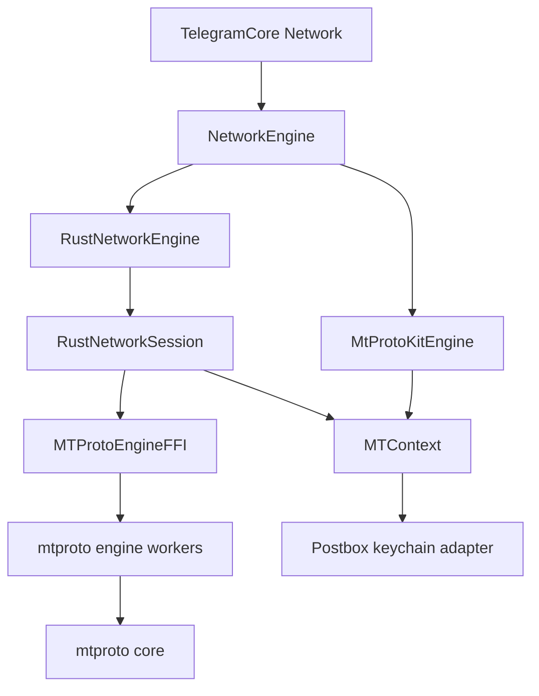
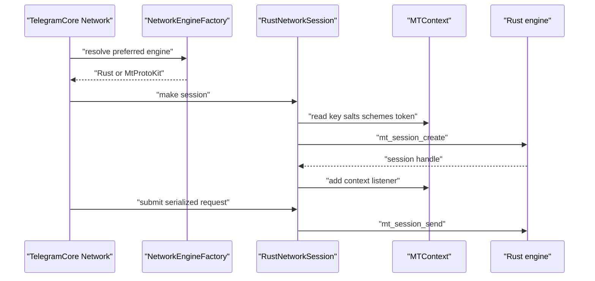
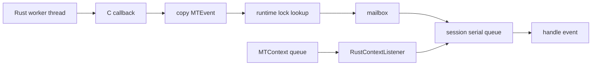
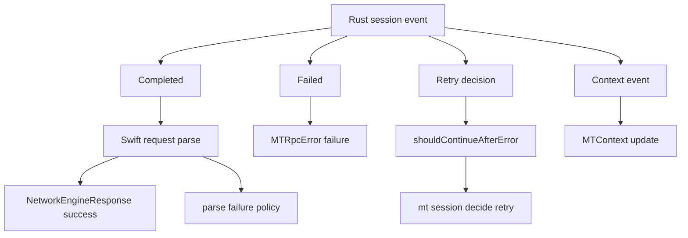

# Rust MTProto 엔진

웹: /docs/system/16-rust-mtproto-engine/ · Markdown: /docs/system/16-rust-mtproto-engine.md

> Rust MTProto 데이터 플레인이 C FFI를 거쳐 TelegramCore에 연결되는 방식과, MtProtoKit와의 공존 경계.

> 시스템 설계 · 네트워크와 프로토콜 · 16장 · 도표 4 · 코드 발췌 9 · 인용 32 · 소스 기준선: [TelegramMessenger/Telegram-iOS@f1dd7a2d](https://github.com/TelegramMessenger/Telegram-iOS/tree/f1dd7a2dbd02cbbf513e75d5695d8d36d1cf5838), [overtake/TelegramSwift@579cebbf](https://github.com/overtake/TelegramSwift/tree/579cebbf0c01fd41b712eff3647fa7f69db9665d)
>
> 핵심 소스 파일: [macosswift/mtproto-engine/crates/mtproto-core/src/lib.rs](https://github.com/macosswift/mtproto-engine/blob/0de759a36cbb50c1e98560c1ffa38590d317b0fc/crates/mtproto-core/src/lib.rs), [macosswift/mtproto-engine/crates/mtproto-core/src/message.rs](https://github.com/macosswift/mtproto-engine/blob/0de759a36cbb50c1e98560c1ffa38590d317b0fc/crates/mtproto-core/src/message.rs), [macosswift/mtproto-engine/crates/mtproto-core/src/handshake.rs](https://github.com/macosswift/mtproto-engine/blob/0de759a36cbb50c1e98560c1ffa38590d317b0fc/crates/mtproto-core/src/handshake.rs), [macosswift/mtproto-engine/crates/mtproto-core/src/session/mod.rs](https://github.com/macosswift/mtproto-engine/blob/0de759a36cbb50c1e98560c1ffa38590d317b0fc/crates/mtproto-core/src/session/mod.rs), [macosswift/mtproto-engine/crates/mtproto-ffi/include/mtproto_engine.h](https://github.com/macosswift/mtproto-engine/blob/0de759a36cbb50c1e98560c1ffa38590d317b0fc/crates/mtproto-ffi/include/mtproto_engine.h), [macosswift/mtproto-engine/crates/mtproto-ffi/src/lib.rs](https://github.com/macosswift/mtproto-engine/blob/0de759a36cbb50c1e98560c1ffa38590d317b0fc/crates/mtproto-ffi/src/lib.rs), [macosswift/mtproto-engine/BUILD](https://github.com/macosswift/mtproto-engine/blob/0de759a36cbb50c1e98560c1ffa38590d317b0fc/BUILD), [TelegramMessenger/Telegram-iOS/submodules/MTProtoRustEngine/Sources/MTProtoRustEngine/RustNetworkEngine.swift](https://github.com/TelegramMessenger/Telegram-iOS/blob/f1dd7a2dbd02cbbf513e75d5695d8d36d1cf5838/submodules/MTProtoRustEngine/Sources/MTProtoRustEngine/RustNetworkEngine.swift), [TelegramMessenger/Telegram-iOS/submodules/MTProtoRustEngine/Sources/MTProtoRustEngine/RustNetworkSession.swift](https://github.com/TelegramMessenger/Telegram-iOS/blob/f1dd7a2dbd02cbbf513e75d5695d8d36d1cf5838/submodules/MTProtoRustEngine/Sources/MTProtoRustEngine/RustNetworkSession.swift), [TelegramMessenger/Telegram-iOS/submodules/MTProtoRustEngine/Sources/MTProtoRustEngine/RustEngineRuntime.swift](https://github.com/TelegramMessenger/Telegram-iOS/blob/f1dd7a2dbd02cbbf513e75d5695d8d36d1cf5838/submodules/MTProtoRustEngine/Sources/MTProtoRustEngine/RustEngineRuntime.swift), [TelegramMessenger/Telegram-iOS/submodules/MTProtoRustEngine/Sources/MTProtoRustEngine/RustEngineArena.swift](https://github.com/TelegramMessenger/Telegram-iOS/blob/f1dd7a2dbd02cbbf513e75d5695d8d36d1cf5838/submodules/MTProtoRustEngine/Sources/MTProtoRustEngine/RustEngineArena.swift), [TelegramMessenger/Telegram-iOS/submodules/MTProtoRustEngine/Sources/MTProtoRustEngine/RustContextListener.swift](https://github.com/TelegramMessenger/Telegram-iOS/blob/f1dd7a2dbd02cbbf513e75d5695d8d36d1cf5838/submodules/MTProtoRustEngine/Sources/MTProtoRustEngine/RustContextListener.swift), [TelegramMessenger/Telegram-iOS/submodules/TelegramCore/Sources/Network/NetworkEngine.swift](https://github.com/TelegramMessenger/Telegram-iOS/blob/f1dd7a2dbd02cbbf513e75d5695d8d36d1cf5838/submodules/TelegramCore/Sources/Network/NetworkEngine.swift), [TelegramMessenger/Telegram-iOS/submodules/TelegramCore/Sources/Network/Network.swift](https://github.com/TelegramMessenger/Telegram-iOS/blob/f1dd7a2dbd02cbbf513e75d5695d8d36d1cf5838/submodules/TelegramCore/Sources/Network/Network.swift), [overtake/Telegram-iOS/submodules/TelegramCore/Sources/Network/Network.swift](https://github.com/overtake/Telegram-iOS/blob/a24bbe45f9861f736a79916a50898512f751e0dc/submodules/TelegramCore/Sources/Network/Network.swift), [overtake/Telegram-iOS/submodules/TelegramCore/Sources/Network/Download.swift](https://github.com/overtake/Telegram-iOS/blob/a24bbe45f9861f736a79916a50898512f751e0dc/submodules/TelegramCore/Sources/Network/Download.swift)
>
> 미검증 사항:
> - 지정된 macOS fork의 이후 커밋이 NetworkEngine 이음새, Rust archive, factory를 도입할지 여부.
> - MTProtoRustEngine의 iOS 종단 간 테스트가 주어진 체크아웃과 Apple 툴체인에서 어떤 결과를 내는지.
> - Rust core가 앞으로 나올 Telegram API의 알 수 없는 생성자를 만났을 때의 종단 간 비즈니스 파싱 호환 전략.
> - 여러 계정이나 백그라운드 확장이 동시에 MTContext를 갱신할 때 임시 key와 context 기록 반영의 부하 동작.

## 문제와 제약 [#문제와-제약]

이 장은 iOS 체크아웃의 `third-party/mtproto-engine`과 `submodules/MTProtoRustEngine`을 살펴봐요. 결론부터 말하면, 이건 AES만 바꾸는 라이브러리가 아니라 통째로 교체할 수 있는 MTProto 데이터 플레인(실제 패킷을 주고받는 계층)이에요. 역할은 이렇게 나뉘어요.

- Rust: 연결, 프레임, 암호화 패킷, 핸드셰이크, 세션 순서, 서비스 메시지, RPC 재시도, 임시 키 바인딩을 맡아요.
- Swift: Rust를 TelegramCore에 끼워 넣고, 계정의 영속 상태와 비즈니스 TL 파싱을 유지해요.

이건 점진적인 교체예요.

- `NetworkEngine`은 엔진이 세션만 만들도록 정해 두었어요.
- 주소, 인증 키, salt, 인증 토큰, 시간 차이의 영속 상태는 여전히 `MTContext`가 가지고 있어요.
- 엔진 factory는 컨텍스트를 거부할 수 있고, 그러면 TelegramCore는 곧바로 `MtProtoKitEngine`으로 폴백해요. [\[22\]](https://github.com/TelegramMessenger/Telegram-iOS/blob/f1dd7a2dbd02cbbf513e75d5695d8d36d1cf5838/submodules/TelegramCore/Sources/Network/NetworkEngine.swift#L248-L278)

이는 03장 「MTProto 전송 계층」과 04장 「인증 키와 다중 데이터 센터」에서 설명한 기존 경로와 공존하는 관계이고, 기존 객체를 삭제하는 것이 아니에요.

연구 결론은 Telegram-iOS 커밋 `f1dd7a2dbd02cbbf513e75d5695d8d36d1cf5838`, Rust 서브 저장소 커밋 `0de759a36cbb50c1e98560c1ffa38590d317b0fc`를 기준으로 해요. macOS 비교는 TelegramSwift 커밋 `579cebbf0c01fd41b712eff3647fa7f69db9665d`와 그 서브모듈 커밋 `a24bbe45f9861f736a79916a50898512f751e0dc`를 기준으로 해요.

먼저 두 TL(Telegram의 직렬화 스키마 언어) 계층을 구분해야 해요.

- Rust는 MTProto의 기본 TL 읽기와 쓰기를 구현하고, 이는 핸드셰이크, 컨테이너, 서비스 메시지, RPC 껍데기에 쓰여요.
- Telegram API의 요청 바이트는 Swift 쪽 `NetworkEngineRequest.payload`가 주고, 응답도 Swift 쪽 `parse` 클로저가 해석해요.

따라서 이건 TelegramApi 생성기나 TelegramCore의 비즈니스 객체 모델을 대체하지 않아요. [\[1\]](https://github.com/macosswift/mtproto-engine/blob/0de759a36cbb50c1e98560c1ffa38590d317b0fc/crates/mtproto-core/src/lib.rs#L1-L16) [\[20\]](https://github.com/TelegramMessenger/Telegram-iOS/blob/f1dd7a2dbd02cbbf513e75d5695d8d36d1cf5838/submodules/MTProtoRustEngine/Sources/MTProtoRustEngine/RustNetworkSession.swift#L419-L469) [\[21\]](https://github.com/TelegramMessenger/Telegram-iOS/blob/f1dd7a2dbd02cbbf513e75d5695d8d36d1cf5838/submodules/MTProtoRustEngine/Sources/MTProtoRustEngine/RustNetworkSession.swift#L649-L752)

## 모듈과 데이터 구조 [#모듈과-데이터-구조]

### 3계층 코드 구조 [#3계층-코드-구조]

`mtproto_core`는 프로토콜 코어예요. `auth_key`, `crypto`, `handshake`, `message`, `msg_id`, `rpc`, `session`, `tl`, `transport`의 열 개 모듈을 공개해요. 코어 라이브러리는 unsafe Rust를 금지해요. 이 경계가 테스트할 수 있는 프로토콜 상태를 Apple 플랫폼 API와 분리해요. [\[1\]](https://github.com/macosswift/mtproto-engine/blob/0de759a36cbb50c1e98560c1ffa38590d317b0fc/crates/mtproto-core/src/lib.rs#L1-L16)

```rust
#![forbid(unsafe_code)]

pub mod auth_key;
pub mod crypto;
pub mod handshake;
pub mod message;
pub mod msg_id;
pub mod rpc;
pub mod session;
pub mod tl;
pub mod transport;
```
[\[1\]](https://github.com/macosswift/mtproto-engine/blob/0de759a36cbb50c1e98560c1ffa38590d317b0fc/crates/mtproto-core/src/lib.rs#L1-L16)

`mtproto_engine`은 코어 바깥에서 네트워크 리액터(I/O 이벤트를 기다리며 처리하는 루프)를 제공해요. `mio`의 `Poll`과 `Waker`를 쓰며, 개수가 1에서 16 사이로 제한된 worker를 만들어요. 각 worker에는 다음이 하나씩 있어요.

- 명령 channel
- poller
- `mtproto-main` 또는 `mtproto-worker-N`이라는 이름의 스레드

세션 런타임은 활성 연결, 경합 연결, HTTP 상태, DNS 캐시, 핸드셰이크 상태, 대기 중인 RPC, 재연결 타이머를 가지고 있어요. [\[8\]](https://github.com/macosswift/mtproto-engine/blob/0de759a36cbb50c1e98560c1ffa38590d317b0fc/crates/mtproto-engine/src/lib.rs#L67-L107) [\[9\]](https://github.com/macosswift/mtproto-engine/blob/0de759a36cbb50c1e98560c1ffa38590d317b0fc/crates/mtproto-engine/src/session_runtime.rs#L143-L215)

세 번째 계층은 `mtproto-ffi`예요. FFI(다른 언어에서 호출하는 인터페이스) 계층으로, Rust 엔진을 정적 라이브러리로 빌드하고 `mtproto_engine.h`로 C ABI를 공개해요. Swift 패키지 `MTProtoRustEngine`이 다시 `NetworkEngine`을 구현해요. Bazel 타깃은 `MtProtoKit`, `TelegramCore`, `WebProxyTransport`, FFI 모듈에 모두 명시적으로 의존해요. 그래서 Rust가 ObjC 네트워크 스택에 대한 의존을 없애지는 않았어요. [\[25\]](https://github.com/TelegramMessenger/Telegram-iOS/blob/f1dd7a2dbd02cbbf513e75d5695d8d36d1cf5838/submodules/MTProtoRustEngine/BUILD#L15-L41) [\[26\]](https://github.com/macosswift/mtproto-engine/blob/0de759a36cbb50c1e98560c1ffa38590d317b0fc/BUILD#L1-L82)



### 전송과 암호학 경계 [#전송과-암호학-경계]

Rust 코어는 인증 전과 인증 후, 두 가지 패킷 형태를 다뤄요. `message.rs`는 다음을 정의해요.

- 24바이트 암호화 헤더
- 32바이트 내부 헤더
- 12~1024바이트 패딩
- 16 MiB 패킷 상한

보낼 때는 `auth_key_id`, salt, session id, msg id, seq no, body 길이를 쓰고, MTProto 2.0 `msg_key`를 계산한 뒤 AES IGE로 암호화해요. 받을 때는 이 순서로 처리해요.

1. 먼저 키 식별자를 검사해요.
2. 복호화해요.
3. `msg_key`를 상수 시간으로 비교해요.
4. 마지막으로 길이와 패딩을 검증해요. [\[2\]](https://github.com/macosswift/mtproto-engine/blob/0de759a36cbb50c1e98560c1ffa38590d317b0fc/crates/mtproto-core/src/message.rs#L6-L186)

```rust
let x = match side {
    Side::Client => 0,
    Side::Server => 8,
};
let key = auth_key.bytes();
let msg_key_large = sha256_parts(&[&key[88 + x..120 + x], &data[ENCRYPTED_HEADER_LEN..]]);
let msg_key: [u8; 16] = msg_key_large[8..24].try_into().expect("16 bytes");
let quick_ack_token = u32::from_le_bytes(msg_key_large[..4].try_into().expect("4 bytes")) | 0x8000_0000;
data[8..24].copy_from_slice(&msg_key);
let material = message_key_v2(key, &msg_key, side);
aes_ige_encrypt(&material.key, &material.iv, &mut data[ENCRYPTED_HEADER_LEN..]).expect("aligned by construction");
EncryptedPacket { data, quick_ack_token }
```
[\[2\]](https://github.com/macosswift/mtproto-engine/blob/0de759a36cbb50c1e98560c1ffa38590d317b0fc/crates/mtproto-core/src/message.rs#L6-L186)

따라서 Rust는 다음을 다뤄요.

- MTProto 2.0 암호화
- 구버전 수동 바인딩에 필요한 MTProto 1.0 암호화
- AES IGE
- 키 유도
- SHA1과 SHA256
- RSA 패딩
- DH 매개변수 검증
- `auth_key` 생성

핸드셰이크 상태 머신은 `req_pq_multi`에서 시작해 nonce와 서버 RSA 지문을 비교하고, 비정상적인 `pq`를 거부한 뒤, DH 매개변수를 검사하고 `dh_gen_retry` 횟수를 제한해요. [\[3\]](https://github.com/macosswift/mtproto-engine/blob/0de759a36cbb50c1e98560c1ffa38590d317b0fc/crates/mtproto-core/src/handshake.rs#L17-L185) 이 핸드셰이크는 MtProtoKit의 핸드셰이크 구현을 호출하는 것이 아니에요.

전송 계층은 다음을 다뤄요.

- abridged
- intermediate
- padded intermediate
- quick ack
- SOCKS5
- MTProxy secret
- 위장 TLS
- HTTP

프로토콜 커버리지 표는 HTTP와 자동 전송 모드도 기록해요. Rust는 TCP가 응답하지 않을 때 HTTP로 전환할 수 있어요. 악의적인 입력에 대한 제한도 코어의 일부예요. 예를 들어 인바운드 프레임, 컨테이너, gzip, 중복 제거, 서비스 큐에는 모두 상한이 있어요. [\[5\]](https://github.com/macosswift/mtproto-engine/blob/0de759a36cbb50c1e98560c1ffa38590d317b0fc/docs/protocol-coverage.md#L32-L58) [\[6\]](https://github.com/macosswift/mtproto-engine/blob/0de759a36cbb50c1e98560c1ffa38590d317b0fc/docs/protocol-coverage.md#L81-L120) [\[7\]](https://github.com/macosswift/mtproto-engine/blob/0de759a36cbb50c1e98560c1ffa38590d317b0fc/docs/protocol-coverage.md#L142-L174)

### 세션 장부와 RPC 상태 [#세션-장부와-rpc-상태]

`session` 모듈은 RPC와 서비스 메시지에 대해 하나의 순서 장부를 유지해요.

- 상수들이 다음을 제한해요.
  - 확인 응답 지연
  - 확인 대기 개수
  - 컨테이너 안의 쿼리 수
  - 전송 완료 식별자
  - 대기 중인 ping
  - 서비스 컨테이너
  - 중첩 깊이
  - 패킷당 처리 메시지 수
- `Query`는 body, `msg_id`, `seq_no`, 컨테이너 식별자, 의존 메시지, 확인 여부, 재전송 상태를 함께 저장해요.

이는 컨테이너, 재전송, `bad_server_salt`, `new_session_created`, `msgs_state_info`를 더는 `MTProto`와 여러 `MTMessageService`가 나눠 처리하지 않고 Rust 세션 안으로 모은다는 뜻이에요. [\[4\]](https://github.com/macosswift/mtproto-engine/blob/0de759a36cbb50c1e98560c1ffa38590d317b0fc/crates/mtproto-core/src/session/mod.rs#L18-L75)

이 모듈은 다음을 `SessionEvent`로 내보내요.

- RPC 결과
- 오류
- 확인 응답
- 업데이트
- 시간 차이
- salt
- pong
- 로컬 세션 리셋

프로토콜 커버리지 표는 서버 ping, `msgs_ack`, `future_salts`, `bad_server_salt`, `msg_resend_req`, `rpc_drop_answer`, `updatesTooLong`, 컨테이너, gzip을 처리한다는 것을 확인해 줘요. 여기서 “커버리지”는 현재 소스에 나열된 조건과 테스트를 가리켜요. 앞으로 나올 모든 Telegram 생성자에 대한 약속으로 받아들이면 안 돼요. [\[6\]](https://github.com/macosswift/mtproto-engine/blob/0de759a36cbb50c1e98560c1ffa38590d317b0fc/docs/protocol-coverage.md#L81-L120)

임시 키 경로는 따로 짚어 볼 만해요. Swift는 `setup.generate_key = 0`을 설정하므로 래퍼 계층은 Rust에게 영구 키를 따로 만들라고 요구하지 않아요.

다음 세 조건이 모두 맞으면 Swift는 PFS(순방향 비밀성) 공개 키, 유효 기간, 기존 임시 키를 채우고 `pfs_make_permanent_key = 0`을 설정해요.

- 세션이 CDN이 아니에요.
- `context.useTempAuthKeys`가 참이에요.
- 서버 공개 키가 있어요.

C ABI의 주석은 이 설정이 호스트에 영구 키를 요청하는 것이며 엔진이 직접 만드는 것이 아니라고 설명해요. [\[16\]](https://github.com/TelegramMessenger/Telegram-iOS/blob/f1dd7a2dbd02cbbf513e75d5695d8d36d1cf5838/submodules/MTProtoRustEngine/Sources/MTProtoRustEngine/RustNetworkSession.swift#L182-L251) [\[11\]](https://github.com/macosswift/mtproto-engine/blob/0de759a36cbb50c1e98560c1ffa38590d317b0fc/crates/mtproto-ffi/include/mtproto_engine.h#L290-L351)

여기서 정확한 역할 분담이 나와요.

- 초기 영구 키의 수명 주기는 여전히 `MTContext`와 MtProtoKit의 키 동작이 유지해요.
- Rust는 영구 키를 이미 얻은 뒤에 임시 키를 생성, 바인딩, 교체하고 보고할 수 있어요.
- 재사용할 수 있는 임시 키와 salt는 `MTContext`에 다시 기록해요.
- CDN 세션은 이 PFS 경로를 켜지 않고 계속 context에서 기존 키를 가져와요.

이 역할 분담은 모듈 이름에서 추론한 것이 아니라 소스로 확인된 사실이에요. [\[16\]](https://github.com/TelegramMessenger/Telegram-iOS/blob/f1dd7a2dbd02cbbf513e75d5695d8d36d1cf5838/submodules/MTProtoRustEngine/Sources/MTProtoRustEngine/RustNetworkSession.swift#L182-L251)

### FFI 데이터 모델 [#ffi-데이터-모델]

C ABI에는 프로세스 수준의 `MTEngine` 포인터 하나와 여러 개의 불투명 `MTSessionHandle`만 있어요. 호스트는 이렇게 써요.

- `MTSessionSetup`으로 세션을 만들어요.
- `MTRequest`로 직렬화된 body를 전달해요.
- `MTEvent`로 이벤트를 받아요.

인터페이스는 auth key, salt, 주소, 프록시, 온라인 상태, 일시 정지 상태, transport 선택, 인증 토큰, 시간 차이를 갱신하는 것도 허용해요. [\[10\]](https://github.com/macosswift/mtproto-engine/blob/0de759a36cbb50c1e98560c1ffa38590d317b0fc/crates/mtproto-ffi/include/mtproto_engine.h#L151-L248) [\[11\]](https://github.com/macosswift/mtproto-engine/blob/0de759a36cbb50c1e98560c1ffa38590d317b0fc/crates/mtproto-ffi/include/mtproto_engine.h#L290-L351)

```c
MTSessionHandle mt_session_create(MTEngine *engine, const MTSessionSetup *setup);
void mt_session_destroy(MTEngine *engine, MTSessionHandle session);
void mt_session_send(MTEngine *engine, MTSessionHandle session, const MTRequest *request);
void mt_session_cancel(MTEngine *engine, MTSessionHandle session, MTRequestId request);
void mt_session_set_paused(MTEngine *engine, MTSessionHandle session, uint8_t paused);
void mt_session_set_online(MTEngine *engine, MTSessionHandle session, uint8_t online);
void mt_session_set_auth_key(MTEngine *engine, MTSessionHandle session, MTBytes key, const MTSaltEntry *salts, size_t salt_count, uint8_t has_init_hash, MTString init_hash);
void mt_session_set_addresses(MTEngine *engine, MTSessionHandle session, const MTAddress *addresses, size_t count);
void mt_session_set_obfuscation_dc_id(MTEngine *engine, MTSessionHandle session, int16_t dc_id);
void mt_session_set_proxy(MTEngine *engine, MTSessionHandle session, const MTProxy *proxy);
```
[\[11\]](https://github.com/macosswift/mtproto-engine/blob/0de759a36cbb50c1e98560c1ffa38590d317b0fc/crates/mtproto-ffi/include/mtproto_engine.h#L290-L351)

`MTEventKind`에는 다음이 들어 있어요.

- 완료
- 실패
- 확인 응답
- 진행
- 인증
- 검증
- 업데이트
- 시간 차이
- salt
- 연결 상태
- 키 상태
- 주소 결과
- 재시도 결정
- 연결 끊김

이는 Rust 오류를 Objective-C 예외로 곧바로 바꾸는 것이 아니에요. error code, 텍스트, payload, 수치와 salt 배열을 가진 명시적인 이벤트 프로토콜이에요. [\[10\]](https://github.com/macosswift/mtproto-engine/blob/0de759a36cbb50c1e98560c1ffa38590d317b0fc/crates/mtproto-ffi/include/mtproto_engine.h#L151-L248)

## 핵심 흐름 [#핵심-흐름]

### 엔진 선택과 세션 생성 [#엔진-선택과-세션-생성]

TelegramCore는 이 순서로 확인해요.

1. `NetworkEngineSettings`의 선호를 읽어요.
2. `NetworkEngineFactory`가 주입되었는지 확인해요.
3. 앱 설정의 `mtproto_engine_rust_disabled`를 읽어요.

다음 중 하나이면 결과는 모두 `MtProtoKitEngine`이에요.

- factory가 없어요.
- 원격 스위치가 꺼져 있어요.
- 선호가 구 엔진이에요.
- factory가 빈 값을 반환해요.

따라서 Rust 소스가 앱에 컴파일되어 들어갔다고 해서 모든 계정이 반드시 그것을 쓰는 것은 아니에요. [\[23\]](https://github.com/TelegramMessenger/Telegram-iOS/blob/f1dd7a2dbd02cbbf513e75d5695d8d36d1cf5838/submodules/TelegramCore/Sources/Network/Network.swift#L408-L449)

```swift
if networkEngineRustDisabled(appConfiguration: appConfiguration) {
    Logger.shared.log("Network", "Account \(accountId.int64): engine mtProtoKit (mtproto_engine_rust_disabled, preferred \(preferredEngine.rawValue))")
    return MtProtoKitEngine(context: context)
}
switch preferredEngine {
case .mtProtoKit:
    Logger.shared.log("Network", "Account \(accountId.int64): engine mtProtoKit")
    return MtProtoKitEngine(context: context)
case .rust:
    if let engine = factory.makeEngine(context: context, isAppExtension: isAppExtension) {
        Logger.shared.log("Network", "Account \(accountId.int64): engine \(engine.kind.rawValue)")
        return engine
    } else {
        Logger.shared.log("Network", "Account \(accountId.int64): engine mtProtoKit (factory declined rust)")
        return MtProtoKitEngine(context: context)
    }
}
```
[\[23\]](https://github.com/TelegramMessenger/Telegram-iOS/blob/f1dd7a2dbd02cbbf513e75d5695d8d36d1cf5838/submodules/TelegramCore/Sources/Network/Network.swift#L408-L449)

현재 `RustNetworkEngineFactory`는 다음 세 경우에 빈 값을 반환해요.

- App Extension
- 데이터 센터 주소 오버라이드
- 런타임 생성 실패

`supportsWebProxy`를 참으로 선언하므로, 현재 래퍼 계층 자체는 엔진이 WEB proxy를 맡도록 요구해요. 추상 인터페이스에는 WEB proxy를 지원하지 않을 때 MtProtoKit로 되돌리는 통로가 여전히 남아 있고, 다른 factory가 쓸 수 있어요. [\[14\]](https://github.com/TelegramMessenger/Telegram-iOS/blob/f1dd7a2dbd02cbbf513e75d5695d8d36d1cf5838/submodules/MTProtoRustEngine/Sources/MTProtoRustEngine/RustNetworkEngine.swift#L21-L54) [\[22\]](https://github.com/TelegramMessenger/Telegram-iOS/blob/f1dd7a2dbd02cbbf513e75d5695d8d36d1cf5838/submodules/TelegramCore/Sources/Network/NetworkEngine.swift#L248-L278)

Rust가 선택되면 `RustNetworkEngine`은 전역 context를 만들지 않아요. 기존 `MTContext`와 데이터 센터, 역할, 트래픽 카운터, 델리게이트를 `RustNetworkSession`에 넘겨요. `RustNetworkSession`은 이렇게 동작해요.

- 자신의 직렬 `Queue`에 요청 딕셔너리, 업데이트 sink, 연결 옵저버, key 상태를 보관해요.
- 세션을 만들 때 주소와 auth info를 동기적으로 읽어요.
- `RustEngineArena`를 써서 이번 FFI 호출에만 쓰이는 C 구조체를 생성해요. [\[14\]](https://github.com/TelegramMessenger/Telegram-iOS/blob/f1dd7a2dbd02cbbf513e75d5695d8d36d1cf5838/submodules/MTProtoRustEngine/Sources/MTProtoRustEngine/RustNetworkEngine.swift#L21-L54) [\[15\]](https://github.com/TelegramMessenger/Telegram-iOS/blob/f1dd7a2dbd02cbbf513e75d5695d8d36d1cf5838/submodules/MTProtoRustEngine/Sources/MTProtoRustEngine/RustNetworkSession.swift#L62-L180) [\[16\]](https://github.com/TelegramMessenger/Telegram-iOS/blob/f1dd7a2dbd02cbbf513e75d5695d8d36d1cf5838/submodules/MTProtoRustEngine/Sources/MTProtoRustEngine/RustNetworkSession.swift#L182-L251)



비 CDN 세션은 생성 후 `MTTransportAuto`를 설정하고 HTTP 포트는 80이에요. 런타임 조건이 맞으면 Telegram Web endpoint도 설정해요. 이를 보면 Rust 경로가 경로를 고르는 능력이 기존 TCP socket의 래퍼에 그치지 않는다는 것을 알 수 있어요. 다만 HTTP, WebSocket, host stream 중 무엇을 쓸지는 런타임 네트워크 상황, 프록시, 엔드포인트 설정에 달려 있어요. [\[16\]](https://github.com/TelegramMessenger/Telegram-iOS/blob/f1dd7a2dbd02cbbf513e75d5695d8d36d1cf5838/submodules/MTProtoRustEngine/Sources/MTProtoRustEngine/RustNetworkSession.swift#L182-L251) [\[11\]](https://github.com/macosswift/mtproto-engine/blob/0de759a36cbb50c1e98560c1ffa38590d317b0fc/crates/mtproto-ffi/include/mtproto_engine.h#L290-L351)

### TelegramCore 요청에서 Rust RPC까지 [#telegramcore-요청에서-rust-rpc까지]

`RustNetworkSession.add`는 호출하는 쪽의 스레드에서 `RustPendingRequest`를 만들고, 바로 로컬 식별자를 생성한 다음 이 세션의 큐에 전달해요. 취소할 때는 먼저 `Atomic` 제어 필드에 취소 상태를 쓰고, 이어서 비동기로 같은 세션 큐에 들어가요. 이렇게 하면 SwiftSignalKit 호출자가 세션 딕셔너리를 직접 두고 경쟁하지 않아도 돼요. [\[20\]](https://github.com/TelegramMessenger/Telegram-iOS/blob/f1dd7a2dbd02cbbf513e75d5695d8d36d1cf5838/submodules/MTProtoRustEngine/Sources/MTProtoRustEngine/RustNetworkSession.swift#L419-L469)

큐에 들어가면 래퍼 계층은 이렇게 해요.

1. 의존 함수에 따라 활성 요청 중에서 가장 가까운, 의존할 수 있는 요청을 찾아 `invoke_after`를 만들어요.
2. `NetworkEngineRequest.payload`에서 bytes를 얻어요.
3. `MTRequest`의 식별자, flags, 예상 응답 크기, 의존 식별자를 채워요.
4. `mt_session_send`를 불러요.

따라서 Rust가 받는 것은 비즈니스 계층이 이미 인코딩한 Telegram API body이고, Swift 객체가 아니에요. [\[20\]](https://github.com/TelegramMessenger/Telegram-iOS/blob/f1dd7a2dbd02cbbf513e75d5695d8d36d1cf5838/submodules/MTProtoRustEngine/Sources/MTProtoRustEngine/RustNetworkSession.swift#L419-L469)

```swift
let payload = pending.request.payload
payload.withUnsafeBytes { bytes in
    var request = MTProtoEngineFFI.MTRequest()
    request.id = requestId
    request.body = MTBytes(data: bytes.baseAddress?.assumingMemoryBound(to: UInt8.self), length: bytes.count)
    request.flags = pending.flags
    request.expected_response_size = pending.expectedResponseSize
    request.invoke_after = invokeAfter
    mt_session_send(engine, self.handle, &request)
}
```
[\[20\]](https://github.com/TelegramMessenger/Telegram-iOS/blob/f1dd7a2dbd02cbbf513e75d5695d8d36d1cf5838/submodules/MTProtoRustEngine/Sources/MTProtoRustEngine/RustNetworkSession.swift#L419-L469)

이후 Rust는 다음을 맡아요.

- 요청 대기열
- `msg_id`, `seq_no`
- 컨테이너
- 암호화
- 소켓 쓰기
- quick ack, 확인 응답
- 응답 매칭
- 서비스 메시지
- 재전송

Rust는 완료, 실패, 진행, 재시도 결정을 `MTEvent`로 만들어요. Swift는 더는 `MTRequestMessageService`가 이 Rust 세션을 구동하게 두지 않아요.

성공 이벤트가 Swift로 돌아오면 래퍼 계층은 이렇게 처리해요.

1. `pendingById`에서 요청을 제거해요.
2. 기존 `parse` 클로저를 불러요. 이 클로저가 성공하면 `NetworkEngineResponse`를 만들어요.

파싱에 실패하면 래퍼 계층은 다음을 해요.

- 초기화 hash를 지워요.
- 파싱 실패 횟수를 누적해요.
- `shouldContinueAfterError`로 상위 계층에 결정을 요청해요.
- 허용되면 지연시켜 다시 전달해요.

최종 오류는 `MTRpcError`와 `NetworkEngineRequestFailure`로 매핑돼요. [\[21\]](https://github.com/TelegramMessenger/Telegram-iOS/blob/f1dd7a2dbd02cbbf513e75d5695d8d36d1cf5838/submodules/MTProtoRustEngine/Sources/MTProtoRustEngine/RustNetworkSession.swift#L649-L752)

```swift
let data = event.payload ?? Data()
if let result = pending.request.parse(data) {
    rustEngineLog("\(self.logPrefix) completed #\(event.requestId)")
    self.finish(pending)
    pending.request.completed(.success(NetworkEngineResponse(result: result, info: info)))
} else {
    self.handleParseFailure(pending, info: info)
}
```
[\[21\]](https://github.com/TelegramMessenger/Telegram-iOS/blob/f1dd7a2dbd02cbbf513e75d5695d8d36d1cf5838/submodules/MTProtoRustEngine/Sources/MTProtoRustEngine/RustNetworkSession.swift#L649-L752)

이 설계는 TelegramCore의 비즈니스 오류 게이팅을 유지해요. 이벤트 종류에 따라 처리가 달라요.

- 일반 Rust `Failed` 이벤트: 같은 error code와 텍스트의 `MTRpcError`로 곧바로 바뀌어요.
- 재시도 결정이 필요한 이벤트: `shouldContinueAfterError`를 부르고, 이어서 `mt_session_decide_retry`로 불리언 결과를 Rust에 돌려줘요.
- APNS나 reCAPTCHA 이벤트: Swift가 context의 검증 signal을 부르고, 마지막에 대응하는 FFI 해석 함수나 실패 함수를 불러요.

따라서 오류의 의미는 계층마다 나뉘어 귀속되고, Rust에서 Swift로 가는 단방향 변환이 아니에요. [\[10\]](https://github.com/macosswift/mtproto-engine/blob/0de759a36cbb50c1e98560c1ffa38590d317b0fc/crates/mtproto-ffi/include/mtproto_engine.h#L151-L248) [\[21\]](https://github.com/TelegramMessenger/Telegram-iOS/blob/f1dd7a2dbd02cbbf513e75d5695d8d36d1cf5838/submodules/MTProtoRustEngine/Sources/MTProtoRustEngine/RustNetworkSession.swift#L649-L752)

### 이벤트 콜백과 상태 되쓰기 [#이벤트-콜백과-상태-되쓰기]

`RustEngineRuntime.shared`는 프로세스 수준의 싱글턴이에요. 먼저 ABI 버전을 확인한 뒤, 매개변수 0으로 Rust 엔진을 만들어요. Rust 쪽은 0을 기본 worker 수로 해석해요. 런타임은 handle에서 mailbox(세션별 이벤트 수신함)로 가는 잠금 딕셔너리를 유지해요. 새 세션을 노출하기 전에 mailbox를 먼저 등록해서, 새 handle의 첫 이벤트가 라우팅 표보다 먼저 도착하는 일을 피해요. [\[13\]](https://github.com/macosswift/mtproto-engine/blob/0de759a36cbb50c1e98560c1ffa38590d317b0fc/crates/mtproto-ffi/src/lib.rs#L647-L674) [\[31\]](https://github.com/TelegramMessenger/Telegram-iOS/blob/f1dd7a2dbd02cbbf513e75d5695d8d36d1cf5838/submodules/MTProtoRustEngine/Sources/MTProtoRustEngine/RustEngineRuntime.swift#L130-L205) [\[32\]](https://github.com/TelegramMessenger/Telegram-iOS/blob/f1dd7a2dbd02cbbf513e75d5695d8d36d1cf5838/submodules/MTProtoRustEngine/Sources/MTProtoRustEngine/RustEngineRuntime.swift#L221-L242)

FFI 콜백은 `MTContext`를 직접 수정하거나 비즈니스 클로저를 부를 수 없어요. 콜백은 곧바로 `MTEvent`를 Swift 값으로 복사하고, payload를 `Data`로 감싼 다음, 그 값을 해당 mailbox에 전달해요. mailbox는 세션 직렬 큐에서만 순서대로 `handleEngineEvent`를 불러요. 서로 다른 세션은 병렬로 실행될 수 있지만, 한 세션의 Swift 관측 가능 상태를 고치는 주체는 하나뿐이에요. [\[18\]](https://github.com/TelegramMessenger/Telegram-iOS/blob/f1dd7a2dbd02cbbf513e75d5695d8d36d1cf5838/submodules/MTProtoRustEngine/Sources/MTProtoRustEngine/RustEngineRuntime.swift#L46-L115)

```swift
private func rustEngineEventCallback(context: UnsafeMutableRawPointer?, session: MTSessionHandle, event: UnsafePointer<MTEvent>?) {
    guard let event = event else {
        return
    }
    let copied = RustEngineEvent(event)
    guard let context = context else {
        return
    }
    let runtime = Unmanaged<RustEngineRuntime>.fromOpaque(context).takeUnretainedValue()
    runtime.dispatch(handle: session, event: copied)
}
```
[\[18\]](https://github.com/TelegramMessenger/Telegram-iOS/blob/f1dd7a2dbd02cbbf513e75d5695d8d36d1cf5838/submodules/MTProtoRustEngine/Sources/MTProtoRustEngine/RustEngineRuntime.swift#L46-L115)

`RustContextListener`는 반대 방향으로 가요. `MTContext`의 auth info, auth token, 주소 방안, API 환경이 바뀌면 먼저 원래의 큐에 도착하고, 그다음 listener가 `queue.async`로 Rust 세션 큐에 전달해요. 이렇게 해서 세션은 올바른 시점에 FFI를 불러 key를 교체하고, 주소를 갱신하고, 일시 정지하거나 재개해요. 큐를 넘나들며 Rust 세션 상태를 직접 바꾸지 않아요. [\[19\]](https://github.com/TelegramMessenger/Telegram-iOS/blob/f1dd7a2dbd02cbbf513e75d5695d8d36d1cf5838/submodules/MTProtoRustEngine/Sources/MTProtoRustEngine/RustContextListener.swift#L15-L56)

이벤트의 시간 차이와 salt는 `MTContext`에 다시 기록해요. 주소 결과는 `reportTransportSchemeSuccess` 또는 `reportTransportSchemeFailure`를 불러요. 키 이벤트는 래퍼 계층이 `MTContext`의 key를 요청, 교체, 삭제하게 할 수 있어요. 이렇게 Rust가 데이터 플레인을 교체하더라도 기존의 영속화 소유자를 건너뛸 수는 없어요. [\[15\]](https://github.com/TelegramMessenger/Telegram-iOS/blob/f1dd7a2dbd02cbbf513e75d5695d8d36d1cf5838/submodules/MTProtoRustEngine/Sources/MTProtoRustEngine/RustNetworkSession.swift#L62-L180) [\[16\]](https://github.com/TelegramMessenger/Telegram-iOS/blob/f1dd7a2dbd02cbbf513e75d5695d8d36d1cf5838/submodules/MTProtoRustEngine/Sources/MTProtoRustEngine/RustNetworkSession.swift#L182-L251)

## 스레드, 메모리, 소유권 [#스레드-메모리-소유권]

### 세 가지 동시성 영역 [#세-가지-동시성-영역]

동시성 영역은 세 가지예요.

1. Rust worker: `Engine::new`는 worker마다 poller, waker, channel, 스레드를 만들어요. 명령은 FFI에서 channel로 들어오고, 네트워크 readiness는 해당 worker의 poll loop 안에서 처리돼요.
2. 전역 Swift runtime: 잠금은 handle에서 mailbox로 가는 라우팅과 네트워크 가용성 상태를 보호하는 데만 쓰여요.
3. `RustNetworkSession`마다 있는 Swift 직렬 큐: 요청 딕셔너리, 콜백, 업데이트 sink, `MTContext` 쓰기, delegate 호출이 모두 이 영역에 있어요. [\[8\]](https://github.com/macosswift/mtproto-engine/blob/0de759a36cbb50c1e98560c1ffa38590d317b0fc/crates/mtproto-engine/src/lib.rs#L67-L107) [\[15\]](https://github.com/TelegramMessenger/Telegram-iOS/blob/f1dd7a2dbd02cbbf513e75d5695d8d36d1cf5838/submodules/MTProtoRustEngine/Sources/MTProtoRustEngine/RustNetworkSession.swift#L62-L180) [\[18\]](https://github.com/TelegramMessenger/Telegram-iOS/blob/f1dd7a2dbd02cbbf513e75d5695d8d36d1cf5838/submodules/MTProtoRustEngine/Sources/MTProtoRustEngine/RustEngineRuntime.swift#L46-L115)

이는 03장의 여러 ObjC 직렬 큐보다 FFI 콜백을 더 분명하게 격리해요. 그 대가로 이벤트마다 Rust 콜백, Swift 복사, mailbox 인큐, 세션 큐 처리, 이렇게 최소 네 단계를 거쳐요. 소스는 종단 간 지연 벤치마크를 주지 않으므로, 구조만으로 성능 이득을 추론할 수는 없어요.



### 입력, 출력, 해제 책임 [#입력-출력-해제-책임]

FFI 입력은 수명이 짧은 대여예요. Swift는 `RustEngineArena`로 문자열, bytes, 배열, 구조체를 복사해요. 호출이 끝나면 arena는 소멸할 때 각 할당 블록을 0으로 지우고 해제해요. 따라서 auth key, 프록시 secret, payload의 임시 C 사본이 Swift `Data` 내부 주소가 계속 유효하기를 요구하지 않아요. [\[17\]](https://github.com/TelegramMessenger/Telegram-iOS/blob/f1dd7a2dbd02cbbf513e75d5695d8d36d1cf5838/submodules/MTProtoRustEngine/Sources/MTProtoRustEngine/RustEngineArena.swift#L4-L25)

FFI 출력 payload는 소유권이 바뀌어요.

- Rust는 `Vec`를 힙에 할당된 `MTBuffer`로 감싸요.
- Swift는 주소와 길이를 읽은 뒤 `Data`의 커스텀 소멸자로 `mt_buffer_free`를 불러요.
- Rust `MTBuffer`의 소멸자는 `secret` 표시가 참이면 데이터를 0으로 지워요.

이 프로토콜은 알 수 없는 handle이나 이미 파괴된 세션의 이벤트에서도 payload를 해제하라고 요구해요. 현재 `RustEngineEvent`의 복사 경로는 이 요구를 만족해요. [\[12\]](https://github.com/macosswift/mtproto-engine/blob/0de759a36cbb50c1e98560c1ffa38590d317b0fc/crates/mtproto-ffi/src/lib.rs#L140-L260) [\[17\]](https://github.com/TelegramMessenger/Telegram-iOS/blob/f1dd7a2dbd02cbbf513e75d5695d8d36d1cf5838/submodules/MTProtoRustEngine/Sources/MTProtoRustEngine/RustEngineArena.swift#L4-L25) [\[18\]](https://github.com/TelegramMessenger/Telegram-iOS/blob/f1dd7a2dbd02cbbf513e75d5695d8d36d1cf5838/submodules/MTProtoRustEngine/Sources/MTProtoRustEngine/RustEngineRuntime.swift#L46-L115)

```swift
deinit {
    for (pointer, size) in self.allocations {
        memset(pointer, 0, size)
        pointer.deallocate()
    }
}
```
[\[17\]](https://github.com/TelegramMessenger/Telegram-iOS/blob/f1dd7a2dbd02cbbf513e75d5695d8d36d1cf5838/submodules/MTProtoRustEngine/Sources/MTProtoRustEngine/RustEngineArena.swift#L4-L25)

- 엔진 포인터는 `mt_engine_create`가 반환하고, `mt_engine_destroy`는 먼저 bridge를 닫힘으로 표시한 다음 worker를 닫고 join해요.
- 세션을 파괴할 때는 먼저 Swift runtime의 mailbox 표에서 handle을 제거한 뒤 `mt_session_destroy`를 불러요. 이렇게 하면 늦게 도착한 이벤트가 mailbox를 찾지 못해 안전하게 버려져요.
- 현재 iOS 래퍼 계층은 runtime을 싱글턴으로 설계했고, 정상적인 계정 종료는 session만 파괴하고 프로세스 엔진은 파괴하지 않아요. [\[13\]](https://github.com/macosswift/mtproto-engine/blob/0de759a36cbb50c1e98560c1ffa38590d317b0fc/crates/mtproto-ffi/src/lib.rs#L647-L674) [\[31\]](https://github.com/TelegramMessenger/Telegram-iOS/blob/f1dd7a2dbd02cbbf513e75d5695d8d36d1cf5838/submodules/MTProtoRustEngine/Sources/MTProtoRustEngine/RustEngineRuntime.swift#L130-L205) [\[32\]](https://github.com/TelegramMessenger/Telegram-iOS/blob/f1dd7a2dbd02cbbf513e75d5695d8d36d1cf5838/submodules/MTProtoRustEngine/Sources/MTProtoRustEngine/RustEngineRuntime.swift#L221-L242)

### 상태와 요청의 소유권 매트릭스 [#상태와-요청의-소유권-매트릭스]

상태는 이렇게 나뉘어 있어요.

- Rust: 네트워크 연결, 프레임 버퍼, 핸드셰이크 임시 비밀, 세션 순번, 확인 대기 메시지, RPC pending map, 재연결 상태를 독점해요.
- Swift 세션: `RustPendingRequest`, 비즈니스 클로저, 파싱 재시도 timer, 검증 signal, 업데이트 sink, 최종 UI에 보이는 결과를 독점해요.
- `MTContext`: 영속 auth info, salt 집합, 토큰, 주소 방안 통계, 시간 차이를 독점해요. [\[4\]](https://github.com/macosswift/mtproto-engine/blob/0de759a36cbb50c1e98560c1ffa38590d317b0fc/crates/mtproto-core/src/session/mod.rs#L18-L75) [\[15\]](https://github.com/TelegramMessenger/Telegram-iOS/blob/f1dd7a2dbd02cbbf513e75d5695d8d36d1cf5838/submodules/MTProtoRustEngine/Sources/MTProtoRustEngine/RustNetworkSession.swift#L62-L180) [\[16\]](https://github.com/TelegramMessenger/Telegram-iOS/blob/f1dd7a2dbd02cbbf513e75d5695d8d36d1cf5838/submodules/MTProtoRustEngine/Sources/MTProtoRustEngine/RustNetworkSession.swift#L182-L251)

공유는 같은 객체를 두 스레드에 넣는 것이 아니에요. 공유는 FFI 입력 복사와 명시적인 이벤트 회신으로 이루어져요. `MTContext` 갱신도 mutator를 거쳐야 해요. 덕분에 기존 `MtProtoKitEngine`과 `RustNetworkEngine`은 전환 전후에 같은 장기 상태를 볼 수 있지만, 같은 `Network` 세션을 동시에 구동해서는 안 돼요.

## 경계 사례와 실패 처리 [#경계-사례와-실패-처리]

### 키, 시간, 세션 복구 [#키-시간-세션-복구]

Rust는 crypto 계층에서 다음을 거부해요.

- 짧은 패킷
- 블록 정렬되지 않은 패킷
- 잘못된 key id
- `msg_key` 불일치
- 잘못된 길이
- 잘못된 패딩
- 외부 session
- 짝수인 서버 `msg_id`

세션 계층은 컨테이너, gzip, 중복 제거 윈도우도 제한해요. 프로토콜 커버리지 표를 보면 이 경로가 `bad_server_salt`, 시계 편차, `bad_msg_notification`, 중복 메시지, 서버의 재전송 요청, `new_session_created`를 처리한다는 것을 알 수 있어요. [\[2\]](https://github.com/macosswift/mtproto-engine/blob/0de759a36cbb50c1e98560c1ffa38590d317b0fc/crates/mtproto-core/src/message.rs#L6-L186) [\[5\]](https://github.com/macosswift/mtproto-engine/blob/0de759a36cbb50c1e98560c1ffa38590d317b0fc/docs/protocol-coverage.md#L32-L58) [\[6\]](https://github.com/macosswift/mtproto-engine/blob/0de759a36cbb50c1e98560c1ffa38590d317b0fc/docs/protocol-coverage.md#L81-L120)

- 영구 key가 없거나 거부되면 Rust는 이벤트로 Swift에게 key를 찾거나 다시 신청하라고 요구해요.
- temporary key가 실패하면 Rust는 요청을 보존하고, 다시 연결하고, 임시 키를 만들어 바인딩할 수 있어요. 래퍼 계층은 교체 key를 설치하는 일이 끝날 때까지 세션을 일시 정지해요.
- 다른 DC worker의 인증 토큰은 여전히 `MTContext`에 기존의 인증 가져오기 동작을 실행해 달라고 요청해요.

그래서 제어 플레인(키, 주소, 인증 같은 상태를 관리하는 쪽)의 이 부분은 Rust로 옮겨지지 않았어요. [\[10\]](https://github.com/macosswift/mtproto-engine/blob/0de759a36cbb50c1e98560c1ffa38590d317b0fc/crates/mtproto-ffi/include/mtproto_engine.h#L151-L248) [\[16\]](https://github.com/TelegramMessenger/Telegram-iOS/blob/f1dd7a2dbd02cbbf513e75d5695d8d36d1cf5838/submodules/MTProtoRustEngine/Sources/MTProtoRustEngine/RustNetworkSession.swift#L182-L251)

임시 key를 교체하는 데는 분명한 대가가 있어요. 엔진이 안전하지 않은 시점에 세션 key를 교체하면, 진행 중인 요청이 `TEMP_KEY_ROTATED`로 실패하거나 상위 정책에 따라 다시 제출될 수 있어요. 구현은 요청 의존성과 오류 상태를 저장해서, 연결 끊김을 단순히 비즈니스 성공과 같은 것으로 보는 일을 피해요. 구체적인 비즈니스 API를 다시 실행해도 되는지는 최종적으로 `shouldContinueAfterError`와 호출하는 쪽의 멱등성이 결정해요. [\[4\]](https://github.com/macosswift/mtproto-engine/blob/0de759a36cbb50c1e98560c1ffa38590d317b0fc/crates/mtproto-core/src/session/mod.rs#L18-L75) [\[21\]](https://github.com/TelegramMessenger/Telegram-iOS/blob/f1dd7a2dbd02cbbf513e75d5695d8d36d1cf5838/submodules/MTProtoRustEngine/Sources/MTProtoRustEngine/RustNetworkSession.swift#L649-L752)

### 연결 실패와 기능 강등 [#연결-실패와-기능-강등]

Rust는 연결 끊김 원인과 주소 성공 결과를 Swift에 돌려 보내요. 그래서 TelegramCore는 기존의 transport scheme 통계를 계속 유지해요. 원격 스위치 `mtproto_engine_rust_disabled`가 인식되면 생성 단계에서 MtProtoKit를 골라요. macOS 조건부 컴파일에서는 `switchEngine`이 5초 drain timeout으로 엔진을 교체하기도 해요. iOS 소스는 live-switch wrapper를 만들지 않는다고 분명히 적어 두었어요. 그래서 iOS의 전환은 이후 시작할 때나 디버그 설정을 선택할 때만 효력이 생겨요. [\[23\]](https://github.com/TelegramMessenger/Telegram-iOS/blob/f1dd7a2dbd02cbbf513e75d5695d8d36d1cf5838/submodules/TelegramCore/Sources/Network/Network.swift#L408-L449) [\[24\]](https://github.com/TelegramMessenger/Telegram-iOS/blob/f1dd7a2dbd02cbbf513e75d5695d8d36d1cf5838/submodules/TelegramCore/Sources/Network/Network.swift#L1086-L1166)

WEB proxy는 기능 경계의 일반적인 사례예요. `NetworkEngineFactory` 인터페이스는 `supportsWebProxy` 선언을 요구해요. 현재 factory가 아니오를 반환하면 네트워크는 WEB proxy가 켜졌을 때 MtProtoKit로 전환하고, 꺼진 뒤에 Rust를 시도해요. 현재 `RustNetworkEngineFactory`는 참을 반환해요. 이 체크아웃의 iOS Rust 래퍼 계층이 그 캐리어를 지원한다고 내세우는 거예요. 이전 장의 “WEB proxy는 반드시 폴백한다”는 서술을 이 커밋에 그대로 넓혀서 적용해서는 안 돼요. [\[14\]](https://github.com/TelegramMessenger/Telegram-iOS/blob/f1dd7a2dbd02cbbf513e75d5695d8d36d1cf5838/submodules/MTProtoRustEngine/Sources/MTProtoRustEngine/RustNetworkEngine.swift#L21-L54) [\[22\]](https://github.com/TelegramMessenger/Telegram-iOS/blob/f1dd7a2dbd02cbbf513e75d5695d8d36d1cf5838/submodules/TelegramCore/Sources/Network/NetworkEngine.swift#L248-L278) [\[24\]](https://github.com/TelegramMessenger/Telegram-iOS/blob/f1dd7a2dbd02cbbf513e75d5695d8d36d1cf5838/submodules/TelegramCore/Sources/Network/Network.swift#L1086-L1166)

App Extension과 데이터 센터 주소 오버라이드는 현재 factory가 무조건 거부하는 조건이에요. 런타임 ABI 버전 불일치나 `mt_engine_create`의 빈 값 반환도 무조건 거부하는 조건이에요. 폴백 대상에는 불확실성이 없고 모두 `MtProtoKitEngine`이에요. 이 조건들 덕분에 배포 실패가 엔진 선택 결과로 바뀌고, ABI 예외가 네트워크 콜백 시점까지 미뤄졌다가 드러나는 일이 없어요. [\[14\]](https://github.com/TelegramMessenger/Telegram-iOS/blob/f1dd7a2dbd02cbbf513e75d5695d8d36d1cf5838/submodules/MTProtoRustEngine/Sources/MTProtoRustEngine/RustNetworkEngine.swift#L21-L54) [\[23\]](https://github.com/TelegramMessenger/Telegram-iOS/blob/f1dd7a2dbd02cbbf513e75d5695d8d36d1cf5838/submodules/TelegramCore/Sources/Network/Network.swift#L408-L449) [\[31\]](https://github.com/TelegramMessenger/Telegram-iOS/blob/f1dd7a2dbd02cbbf513e75d5695d8d36d1cf5838/submodules/MTProtoRustEngine/Sources/MTProtoRustEngine/RustEngineRuntime.swift#L130-L205)

### 오류 매핑 경로 [#오류-매핑-경로]

아래 도표는 이벤트 유형별로 Rust에서 Swift로 가는 세 가지 결과를 보여 줘요. 또한 `MTRpcError`가 transport codec의 반환값이 아니라 Swift가 이벤트 계층에서 구성하는 객체라는 점도 설명해요.



이벤트별 처리는 이래요.

- 완료 이벤트: 먼저 요청의 `parse`에 넘어가요. 파싱에 성공해야 비즈니스 콜백이 완료돼요. 파싱에 실패하면 초기화 상태를 지우고 다시 전달할 수 있어요.
- 실패 이벤트: Rust가 준 code와 텍스트를 보존해요.
- 재시도 이벤트: 누적된 flood wait와 server error 정보가 실려 있고, Swift가 계속할지 실패 처리할지를 골라요.

인증, soft reset, auth token, verification, 업데이트, 시간 차이, salt, 연결 상태, 네트워크 사용량은 RPC error에 섞이지 않는 독립된 이벤트 분기예요. [\[10\]](https://github.com/macosswift/mtproto-engine/blob/0de759a36cbb50c1e98560c1ffa38590d317b0fc/crates/mtproto-ffi/include/mtproto_engine.h#L151-L248) [\[21\]](https://github.com/TelegramMessenger/Telegram-iOS/blob/f1dd7a2dbd02cbbf513e75d5695d8d36d1cf5838/submodules/MTProtoRustEngine/Sources/MTProtoRustEngine/RustNetworkSession.swift#L649-L752)

해결되지 않은 기술 문제가 하나 있어요. “비즈니스 API 디코딩 실패” 말고, 원격의 식별되지 않은 모든 Telegram API 생성자에 대해 Rust core가 앞으로의 호환 전략을 어떻게 정의하는지예요. 지금 읽을 수 있는 코드가 확인해 주는 것은 기본 MTProto TL이 알 수 없는 생성자를 업데이트 경로로 처리할 수 있다는 점이에요. 하지만 완전한 Telegram API parser는 여전히 Swift에 있고 이 Rust 서브 저장소 안에는 없어요.

## iOS와 macOS 비교 [#ios와-macos-비교]

### iOS 통합 상태 [#ios-통합-상태]

iOS 빌드는 Rust core, 네트워크 엔진, FFI archive를 Bazel Rust 타깃으로 정의해요. FFI archive는 `objc_library`를 거쳐 `MTProtoEngineFFI` 모듈 이름으로 Swift에 임포트돼요. 컴파일 옵션은 `-Cpanic=abort`를 쓰고 LTO는 일부러 켜지 않아요. 앱 안의 여러 Rust 정적 라이브러리가 표준 라이브러리 객체를 중복해서 복사하는 것을 피하기 위해서예요. [\[26\]](https://github.com/macosswift/mtproto-engine/blob/0de759a36cbb50c1e98560c1ffa38590d317b0fc/BUILD#L1-L82)

`MTProtoRustEngine`은 별도의 Swift library예요. MtProtoKit에 의존하고 그 컴파일 산출물을 대체하지 않아요. 이는 위에서 설명한 제어 플레인 구분과 맞아떨어지고, 폴백 구현이 새 엔진과 함께 링크될 수 있게 해 줘요. [\[25\]](https://github.com/TelegramMessenger/Telegram-iOS/blob/f1dd7a2dbd02cbbf513e75d5695d8d36d1cf5838/submodules/MTProtoRustEngine/BUILD#L15-L41)

### TelegramSwift의 고정 macOS fork [#telegramswift의-고정-macos-fork]

결론부터 말하면, 지정된 TelegramSwift macOS 코드에는 이 Rust 엔진이 없어요. 이 저장소는 `submodules/telegram-ios`를 `overtake/Telegram-iOS`로 가리켜요. [\[27\]](https://github.com/overtake/TelegramSwift/blob/579cebbf0c01fd41b712eff3647fa7f69db9665d/.gitmodules#L7-L9) 고정된 서브모듈 커밋의 Git 트리를 검사해도 `MTProtoRustEngine`이나 `mtproto-engine` 경로가 없어요. 이 부재는 저장소 이름에서 추론한 것이 아니라 소스 체크아웃의 결과예요.

더 강한 긍정적 증거도 있어요. macOS fork의 `NetworkInitializationArguments`에는 `networkEngineFactory` 필드가 없어요. 주 네트워크를 만들 때는 `MTProto`, `MTRequestMessageService`, 연결 상태 델리게이트를 직접 구성해요. 즉 지금 iOS `NetworkEngine` 추상화의 선택 이음새가 없어요. [\[28\]](https://github.com/overtake/Telegram-iOS/blob/a24bbe45f9861f736a79916a50898512f751e0dc/submodules/TelegramCore/Sources/Network/Network.swift#L429-L460) [\[29\]](https://github.com/overtake/Telegram-iOS/blob/a24bbe45f9861f736a79916a50898512f751e0dc/submodules/TelegramCore/Sources/Network/Network.swift#L621-L644)

```swift
let mtProto = MTProto(context: context, datacenterId: datacenterId, usageCalculationInfo: usageCalculationInfo(basePath: basePath, category: nil), requiredAuthToken: nil, authTokenMasterDatacenterId: 0)!
mtProto.useTempAuthKeys = context.useTempAuthKeys
mtProto.checkForProxyConnectionIssues = true

let connectionStatus = Promise<ConnectionStatus>(.waitingForNetwork)

let requestService = MTRequestMessageService(context: context)!
let connectionStatusDelegate = MTProtoConnectionStatusDelegate()
```
[\[29\]](https://github.com/overtake/Telegram-iOS/blob/a24bbe45f9861f736a79916a50898512f751e0dc/submodules/TelegramCore/Sources/Network/Network.swift#L621-L644)

미디어 worker도 `MTProto`와 `MTRequestMessageService`를 직접 가지고 있어요. CDN, 미디어, 임시 key, 다른 DC token을 설정한 뒤 `mtProto.add`를 부르고, 일시 정지와 재개도 `MTProto`를 직접 불러요. 그래서 “주 세션은 그대로이고 다운로드만 Rust”인 혼합 배포는 가능성에서 배제돼요. [\[30\]](https://github.com/overtake/Telegram-iOS/blob/a24bbe45f9861f736a79916a50898512f751e0dc/submodules/TelegramCore/Sources/Network/Download.swift#L40-L103)

TelegramSwift macOS AppDelegate는 구 시그니처의 `NetworkInitializationArguments`를 구성해요. 이 시그니처에는 그 매개변수가 없으므로 호출에는 Rust factory를 전달할 자리가 없어요. 따라서 지정된 커밋에서 주 세션과 다운로드는 모두 계속 MtProtoKit 경로를 타요. [\[28\]](https://github.com/overtake/Telegram-iOS/blob/a24bbe45f9861f736a79916a50898512f751e0dc/submodules/TelegramCore/Sources/Network/Network.swift#L429-L460) [\[30\]](https://github.com/overtake/Telegram-iOS/blob/a24bbe45f9861f736a79916a50898512f751e0dc/submodules/TelegramCore/Sources/Network/Download.swift#L40-L103)

`macosswift/mtproto-engine` 내부의 통합 설명을 잘못 읽지 않도록 주의해야 해요. 그 서드파티 저장소의 설명 파일은 다른 macOS 통합 대상이나 계획을 적어 두었을 수 있지만, `overtake/TelegramSwift`의 고정 커밋에 코드가 있다는 증거는 아니에요. 이 장의 macOS 결론은 실제로 지정된 TelegramSwift와 그 fork 체크아웃에만 근거해요.


## 교체 매트릭스와 교체하지 않는 항목 [#교체-매트릭스와-교체하지-않는-항목]

### Rust 선택 후 실제로 교체되는 대상 [#rust-선택-후-실제로-교체되는-대상]

교체는 `NetworkEngineSession` 계층에서 일어나고 계정 객체 계층에서는 일어나지 않아요. `Network`는 엔진에 main role 세션 하나, 또는 master DC, media, CDN 속성을 가진 worker role 세션을 요청해요. Rust가 선택되면 `RustNetworkEngine.makeSession`은 역할마다 `RustNetworkSession`을 만들어요. 각 세션은 `MTContext`, 주소 방안, 인증 자료, 역할 속성을 `MTSessionSetup`으로 변환해요. 그래서 주 연결, 다운로드, 업로드, 다른 데이터 센터 worker, CDN의 암호화된 데이터 패킷이 같은 Rust 세션 모델로 들어갈 수 있어요. [\[14\]](https://github.com/TelegramMessenger/Telegram-iOS/blob/f1dd7a2dbd02cbbf513e75d5695d8d36d1cf5838/submodules/MTProtoRustEngine/Sources/MTProtoRustEngine/RustNetworkEngine.swift#L21-L54) [\[15\]](https://github.com/TelegramMessenger/Telegram-iOS/blob/f1dd7a2dbd02cbbf513e75d5695d8d36d1cf5838/submodules/MTProtoRustEngine/Sources/MTProtoRustEngine/RustNetworkSession.swift#L62-L180) [\[16\]](https://github.com/TelegramMessenger/Telegram-iOS/blob/f1dd7a2dbd02cbbf513e75d5695d8d36d1cf5838/submodules/MTProtoRustEngine/Sources/MTProtoRustEngine/RustNetworkSession.swift#L182-L251)

교체되는 것은 구 데이터 플레인에서 `MTProto`와 `MTRequestMessageService`가 맡던 다음 책임들이에요.

- 네트워크 연결, TCP와 HTTP 전송 시도, 프록시 인코딩, 프레임 인코딩과 프레임 디코딩.
- MTProto message id, sequence number, salt 선택, 컨테이너, 확인 응답, ping, 재전송, 서비스 메시지.
- 인증 후 메시지의 키 유도, AES IGE, 패딩, 빠른 확인 token, 응답 연관.
- 전송된 RPC의 순서, 의존성, 타임아웃, 연결 끊김 후의 보존 또는 재전송.
- 임시 인증 키의 핸드셰이크, 바인딩, 교체, 무효화와 그에 따른 이벤트.

이 항목들은 파일 이름으로 짐작한 것이 아니에요. 요청 body는 Swift에서 bytes로만 `MTRequest`에 담기고, 이어서 `mt_session_send`를 거쳐 Rust에 넘어가요. 응답이 돌아오면 Swift는 저장해 둔 파싱 클로저로 bytes를 비즈니스 결과로 복원할 뿐이에요. 이 체인을 보면 중간의 MTProto 세션 작업을 Rust가 맡고 있다는 것을 알 수 있어요. [\[20\]](https://github.com/TelegramMessenger/Telegram-iOS/blob/f1dd7a2dbd02cbbf513e75d5695d8d36d1cf5838/submodules/MTProtoRustEngine/Sources/MTProtoRustEngine/RustNetworkSession.swift#L419-L469) [\[21\]](https://github.com/TelegramMessenger/Telegram-iOS/blob/f1dd7a2dbd02cbbf513e75d5695d8d36d1cf5838/submodules/MTProtoRustEngine/Sources/MTProtoRustEngine/RustNetworkSession.swift#L649-L752)

구 구현이 프로세스를 완전히 떠난 것은 아니에요. `Network`가 이미 Rust를 선택했더라도 `MtProtoKit`는 여전히 Swift 래퍼 계층에 `MTContext`, `MTDatacenterAuthInfo`, `MTTransportScheme`, 프록시 설정, 네트워크 가용성, 일부 ObjC 프로토콜을 제공해요. `RustNetworkSession`은 `MtProtoKit`를 임포트하고 context에 listener를 등록해요. 따라서 “Rust가 MtProtoKit를 대체한다”는 말은 이 장에서 선택된 각 세션의 데이터 플레인을 교체한다는 뜻일 뿐이에요. 이 프레임워크의 모든 타입이나 그것이 가지고 있는 계정 상태를 교체한다는 뜻일 수는 없어요. [\[15\]](https://github.com/TelegramMessenger/Telegram-iOS/blob/f1dd7a2dbd02cbbf513e75d5695d8d36d1cf5838/submodules/MTProtoRustEngine/Sources/MTProtoRustEngine/RustNetworkSession.swift#L62-L180) [\[19\]](https://github.com/TelegramMessenger/Telegram-iOS/blob/f1dd7a2dbd02cbbf513e75d5695d8d36d1cf5838/submodules/MTProtoRustEngine/Sources/MTProtoRustEngine/RustContextListener.swift#L15-L56) [\[25\]](https://github.com/TelegramMessenger/Telegram-iOS/blob/f1dd7a2dbd02cbbf513e75d5695d8d36d1cf5838/submodules/MTProtoRustEngine/BUILD#L15-L41)

### 항상 호스트에 남는 경로 [#항상-호스트에-남는-경로]

첫 번째로 남는 항목은 계정 상태예요. `MTContext`는 주소, 영구 auth key, salt, foreign auth token, 전역 시간 차이, API 환경을 오래도록 소유하는 주체예요. Rust는 처음 세션을 만들 때 이 자료를 읽고, 변경이 있으면 Swift listener를 거쳐 다시 기록해요. 그래서 엔진을 바꾸어도 계정이 모든 키와 데이터 센터 자료를 새로운 Rust 데이터베이스로 내보내야 하는 것은 아니에요. 그 대가로 언어 간 구조체가 정확히 동기화되어야 하며, 특히 key selector, init hash, 임시 key 유효 기간, salt 배열이 그래요. [\[15\]](https://github.com/TelegramMessenger/Telegram-iOS/blob/f1dd7a2dbd02cbbf513e75d5695d8d36d1cf5838/submodules/MTProtoRustEngine/Sources/MTProtoRustEngine/RustNetworkSession.swift#L62-L180) [\[16\]](https://github.com/TelegramMessenger/Telegram-iOS/blob/f1dd7a2dbd02cbbf513e75d5695d8d36d1cf5838/submodules/MTProtoRustEngine/Sources/MTProtoRustEngine/RustNetworkSession.swift#L182-L251) [\[19\]](https://github.com/TelegramMessenger/Telegram-iOS/blob/f1dd7a2dbd02cbbf513e75d5695d8d36d1cf5838/submodules/MTProtoRustEngine/Sources/MTProtoRustEngine/RustContextListener.swift#L15-L56)

두 번째로 남는 항목은 Telegram API 비즈니스 계층이에요. `NetworkEngineRequest`는 Rust에 도달하기 전에 이미 `payload`와 `parse`를 포함해요. 이는 메서드 생성자, TL schema 생성 코드, 객체 역직렬화, Postbox 트랜잭션, 업데이트의 계정 상태 분배, UI 렌더링이 계속 Swift에 있다는 뜻이에요. Rust는 MTProto service constructors를 식별할 수 있지만 비즈니스 API의 완전한 객체 디코더를 대체하지는 않아요. 비즈니스 parser가 결과를 거부하면 Swift는 여전히 기존의 실패 정책으로 다시 제출할지를 결정해요. [\[1\]](https://github.com/macosswift/mtproto-engine/blob/0de759a36cbb50c1e98560c1ffa38590d317b0fc/crates/mtproto-core/src/lib.rs#L1-L16) [\[20\]](https://github.com/TelegramMessenger/Telegram-iOS/blob/f1dd7a2dbd02cbbf513e75d5695d8d36d1cf5838/submodules/MTProtoRustEngine/Sources/MTProtoRustEngine/RustNetworkSession.swift#L419-L469) [\[21\]](https://github.com/TelegramMessenger/Telegram-iOS/blob/f1dd7a2dbd02cbbf513e75d5695d8d36d1cf5838/submodules/MTProtoRustEngine/Sources/MTProtoRustEngine/RustNetworkSession.swift#L649-L752)

세 번째로 남는 항목은 사용자 상호작용과 시스템 서비스예요. 인증 코드, APNS 검증, reCAPTCHA, 포그라운드/백그라운드 상태, 네트워크 가용성 알림, 트래픽 통계, 연결 상태 표시는 래퍼 계층이 이벤트를 받아 TelegramCore의 signal과 델리게이트로 바꿔요. Rust FFI에는 `MTEventKindVerificationRequired`, `MTEventKindNetworkUsage`, `MTEventKindConnectionState`가 있지만 iOS나 macOS UI 객체는 없어요. 이렇게 계층을 나눠서 Rust worker가 UIKit, AppKit, SwiftSignalKit을 부르는 일을 막아요. [\[10\]](https://github.com/macosswift/mtproto-engine/blob/0de759a36cbb50c1e98560c1ffa38590d317b0fc/crates/mtproto-ffi/include/mtproto_engine.h#L151-L248) [\[18\]](https://github.com/TelegramMessenger/Telegram-iOS/blob/f1dd7a2dbd02cbbf513e75d5695d8d36d1cf5838/submodules/MTProtoRustEngine/Sources/MTProtoRustEngine/RustEngineRuntime.swift#L46-L115)

네 번째로 남는 항목은 의도적으로 만든 대비 통로예요. factory가 없거나, 설정이 구 엔진을 고르거나, 서버가 Rust를 비활성화하거나, factory가 거부하거나, 런타임을 쓸 수 없을 때 `resolveNetworkEngine`은 곧바로 `MtProtoKitEngine`을 만들어요. 따라서 구 구현은 마이그레이션 데이터 전용의 죽은 코드가 아니라 지금의 오류 격리 설계에 속해요. [\[22\]](https://github.com/TelegramMessenger/Telegram-iOS/blob/f1dd7a2dbd02cbbf513e75d5695d8d36d1cf5838/submodules/TelegramCore/Sources/Network/NetworkEngine.swift#L248-L278) [\[23\]](https://github.com/TelegramMessenger/Telegram-iOS/blob/f1dd7a2dbd02cbbf513e75d5695d8d36d1cf5838/submodules/TelegramCore/Sources/Network/Network.swift#L408-L449)

### 전송 호스트와 언어 간 경계 [#전송-호스트와-언어-간-경계]

Rust는 FFI 안에서 Apple socket 객체를 직접 얻지 않아요. 엔진 자체가 일반 연결을 처리할 수 있으면서, Swift가 host stream 콜백을 제공하는 것도 허용해요. C ABI는 `open`, `write`, `close`, `resume`, 네 가지 콜백을 정의하고, stream은 그것을 연 호스트가 가지고 있도록 정해 두었어요. 엔진과 호스트는 이렇게 주고받아요.

- 엔진이 쓰기를 요청하면 호스트는 받아들인 바이트 수를 확인해 줘요.
- 엔진이 읽기 일시 정지를 요구하면 호스트는 resume을 받을 때까지 읽기를 멈춰요.

이 프로토콜 덕분에 Telegram Web endpoint의 TLS나 WEB proxy carrier는 플랫폼 쪽에 남을 수 있고, MTProto 내용은 여전히 Rust 안에서 암호화돼요. [\[11\]](https://github.com/macosswift/mtproto-engine/blob/0de759a36cbb50c1e98560c1ffa38590d317b0fc/crates/mtproto-ffi/include/mtproto_engine.h#L290-L351)

이 경계에는 보안과 관련된 의미가 두 가지 있어요.

- host stream은 시스템 TLS 외관을 쓸 수 있고, MTProto의 무결성과 기밀성은 TLS에 맡기지 않아요.
- `mt_engine_destroy` 이후에 호스트가 stream 함수를 다시 불러서는 안 돼요. 그러면 이미 해제된 엔진 포인터로 데이터를 보내게 돼요.

Swift runtime은 소멸 순서에서 먼저 session mailbox를 철회한 뒤 FFI session을 파괴해요. runtime 전체에 대해서는 Rust destroy가 bridge를 닫고 worker를 멈춰요. [\[11\]](https://github.com/macosswift/mtproto-engine/blob/0de759a36cbb50c1e98560c1ffa38590d317b0fc/crates/mtproto-ffi/include/mtproto_engine.h#L290-L351) [\[13\]](https://github.com/macosswift/mtproto-engine/blob/0de759a36cbb50c1e98560c1ffa38590d317b0fc/crates/mtproto-ffi/src/lib.rs#L647-L674) [\[32\]](https://github.com/TelegramMessenger/Telegram-iOS/blob/f1dd7a2dbd02cbbf513e75d5695d8d36d1cf5838/submodules/MTProtoRustEngine/Sources/MTProtoRustEngine/RustEngineRuntime.swift#L221-L242)

입력 소유권도 일부러 보수적으로 잡았어요. `RustEngineArena`는 address, proxy, key, 문자열, 배열에 대해 독립된 임시 사본을 만들고, 소멸할 때 0으로 지워요. 출력은 `MTBuffer`가 Swift에 명시적으로 넘기며, `Data`의 수명이 끝날 때 `mt_buffer_free`를 불러요. 이렇게 하면 Swift `Data`가 재할당된 뒤에도 Rust가 옛 주소를 참조하는 일을 피하고, Rust 콜백이 끝난 뒤에도 Swift가 스택 위의 `MTEvent`를 계속 빌려 쓰는 일도 피해요. [\[12\]](https://github.com/macosswift/mtproto-engine/blob/0de759a36cbb50c1e98560c1ffa38590d317b0fc/crates/mtproto-ffi/src/lib.rs#L140-L260) [\[17\]](https://github.com/TelegramMessenger/Telegram-iOS/blob/f1dd7a2dbd02cbbf513e75d5695d8d36d1cf5838/submodules/MTProtoRustEngine/Sources/MTProtoRustEngine/RustEngineArena.swift#L4-L25) [\[18\]](https://github.com/TelegramMessenger/Telegram-iOS/blob/f1dd7a2dbd02cbbf513e75d5695d8d36d1cf5838/submodules/MTProtoRustEngine/Sources/MTProtoRustEngine/RustEngineRuntime.swift#L46-L115)

### 엔진 스위치의 실제 범위 [#엔진-스위치의-실제-범위]

활성화에는 네 층위가 있어요.

1. 빌드: Bazel이 `MTProtoEngineFFI`와 `MTProtoRustEngine`을 링크해야 해요.
2. 주입: 앱이 `NetworkInitializationArguments`에 factory를 제공해야 해요.
3. 선호: `NetworkEngineSettings`가 Rust를 선택해야 해요.
4. 런타임 허용: 원격 `mtproto_engine_rust_disabled`가 참이면 안 되고, factory가 Extension, 주소 오버라이드, 엔진 생성 실패로 거부해서도 안 돼요.

어느 한 층이라도 만족하지 못하면 MtProtoKit로 떨어져요. [\[14\]](https://github.com/TelegramMessenger/Telegram-iOS/blob/f1dd7a2dbd02cbbf513e75d5695d8d36d1cf5838/submodules/MTProtoRustEngine/Sources/MTProtoRustEngine/RustNetworkEngine.swift#L21-L54) [\[23\]](https://github.com/TelegramMessenger/Telegram-iOS/blob/f1dd7a2dbd02cbbf513e75d5695d8d36d1cf5838/submodules/TelegramCore/Sources/Network/Network.swift#L408-L449) [\[25\]](https://github.com/TelegramMessenger/Telegram-iOS/blob/f1dd7a2dbd02cbbf513e75d5695d8d36d1cf5838/submodules/MTProtoRustEngine/BUILD#L15-L41) [\[26\]](https://github.com/macosswift/mtproto-engine/blob/0de759a36cbb50c1e98560c1ffa38590d317b0fc/BUILD#L1-L82)

서버 스위치의 형식도 눈여겨볼 만해요. 설정 값은 불리언, 수치, 문자열일 수 있어요. 빈 문자열, `0`, `false`, `no`는 비활성화되지 않았다는 뜻이고, 그 밖의 알 수 없는 타입은 보수적으로 비활성화로 간주해요. 이렇게 해석하기 때문에 서버는 앱을 다시 배포하지 않고도 Rust 경로를 빠르게 끌 수 있어요. [\[23\]](https://github.com/TelegramMessenger/Telegram-iOS/blob/f1dd7a2dbd02cbbf513e75d5695d8d36d1cf5838/submodules/TelegramCore/Sources/Network/Network.swift#L408-L449)

선택이 끝난 뒤 iOS는 실행 중 교체를 구현하지 않아요. 소스는 macOS 조건부 컴파일 분기에서만 `SwitchingNetworkEngine`을 만들어요. iOS는 해석 결과를 그대로 쓰고, 디버그 설정을 바꾸면 다음 시작 때 효력이 생겨요. 이 제한은 같은 계정 세션이 두 구현 사이에서 pending 요청을 옮겨야 하는 복잡도를 줄여 줘요. macOS 코드는 이 추상화의 조건 분기를 갖추고 있지만, 지정된 TelegramSwift fork는 더 이전 것이라 그 추상화도 Rust archive도 없어요. 그래서 여전히 이 런타임 교체 능력을 갖추지 못했어요. [\[24\]](https://github.com/TelegramMessenger/Telegram-iOS/blob/f1dd7a2dbd02cbbf513e75d5695d8d36d1cf5838/submodules/TelegramCore/Sources/Network/Network.swift#L1086-L1166) [\[28\]](https://github.com/overtake/Telegram-iOS/blob/a24bbe45f9861f736a79916a50898512f751e0dc/submodules/TelegramCore/Sources/Network/Network.swift#L429-L460) [\[29\]](https://github.com/overtake/Telegram-iOS/blob/a24bbe45f9861f736a79916a50898512f751e0dc/submodules/TelegramCore/Sources/Network/Network.swift#L621-L644)

### 03, 04장 결론의 정교화 [#03-04장-결론의-정교화]

03장이 설명한 구 `MTProto` 전송 스택은 폴백 경로, 지정된 macOS fork, Rust를 켜지 않은 계정에는 여전히 그대로 적용돼요. 현재 iOS에서 Rust가 선택된 세션에 대해서는, 그 안의 frame codec, 요청 서비스 구동, 연결 재연결, MTProto service 처리를 이 장의 Rust worker와 `RustNetworkSession`으로 바꿔서 이해해야 해요. `MTContext`, 프록시와 주소 방안의 출처, 네트워크 상태, TelegramCore 비즈니스 parser는 여전히 이전 장에서 설명한 방식대로 있어요.

04장이 설명한 data center, 영구 키, 다른 DC 인증은 여전히 제어 플레인의 사실이에요. 달라진 것은 암호화 이후의 일시적 세션 상태와 임시 key PFS 작업이 Rust로 들어올 수 있다는 점이에요. 영구 키를 영속적으로 선택하는 일, foreign auth token을 획득하는 일, salt와 주소 정보를 호스트에 보관하는 일은 옮겨지지 않았어요. 이 경계로 설명되는 것이 있어요. Rust wrapper가 `MtProtoKit`를 계속 import하고 context 업데이트를 감시해야 하는 이유, 그리고 순수 Swift RPC client만 노출하면 되는 것이 아닌 이유예요. [\[15\]](https://github.com/TelegramMessenger/Telegram-iOS/blob/f1dd7a2dbd02cbbf513e75d5695d8d36d1cf5838/submodules/MTProtoRustEngine/Sources/MTProtoRustEngine/RustNetworkSession.swift#L62-L180) [\[16\]](https://github.com/TelegramMessenger/Telegram-iOS/blob/f1dd7a2dbd02cbbf513e75d5695d8d36d1cf5838/submodules/MTProtoRustEngine/Sources/MTProtoRustEngine/RustNetworkSession.swift#L182-L251) [\[19\]](https://github.com/TelegramMessenger/Telegram-iOS/blob/f1dd7a2dbd02cbbf513e75d5695d8d36d1cf5838/submodules/MTProtoRustEngine/Sources/MTProtoRustEngine/RustContextListener.swift#L15-L56)

## 설계 트레이드오프 [#설계-트레이드오프]

첫 번째 트레이드오프는 “제어 플레인은 공유하고 데이터 플레인은 교체한다”예요. `MTContext`를 유지하면 주소, 키, salt, 인증 token, 시간 차이를 이중으로 옮길 필요가 없어요. 대가로 Rust와 MtProtoKit는 같은 상태 의미 체계를 지켜야 하고, 래퍼 계층은 server time과 로컬 시간, 임시 key 속성, 초기화 hash의 변환을 처리해야 해요.

두 번째 트레이드오프는 “직접적인 Swift-Rust 바인딩이 아니라 바이트 ABI”예요. C ABI 덕분에 iOS Bazel과 잠재적인 macOS 래퍼 계층이 엔진을 공유할 수 있고, Rust worker가 Swift 객체를 건드리지 않게 할 수도 있어요. 대가로 모든 payload를 명시적으로 복사하거나 해제해야 하고, ABI 열거형 항목마다 Swift 쪽에서 일치하는지 단언해야 해요. 런타임은 실제로 ABI 버전을 검사하고, request flag, 역할, 이벤트 상수에 대해 단언해요. [\[10\]](https://github.com/macosswift/mtproto-engine/blob/0de759a36cbb50c1e98560c1ffa38590d317b0fc/crates/mtproto-ffi/include/mtproto_engine.h#L151-L248) [\[31\]](https://github.com/TelegramMessenger/Telegram-iOS/blob/f1dd7a2dbd02cbbf513e75d5695d8d36d1cf5838/submodules/MTProtoRustEngine/Sources/MTProtoRustEngine/RustEngineRuntime.swift#L130-L205)

세 번째 트레이드오프는 “세션 안의 Rust 상태 머신, 비즈니스 결정은 호스트에 남긴다”예요. 이렇게 해서 Rust는 연결 재구축, 컨테이너, 시계, salt, 재전송에서 연속성을 유지해요. 동시에 TelegramCore는 비즈니스 response parser, 인증 코드 UI, 계정 로그아웃, 오류를 다시 시도할 수 있는지 여부, 로컬 영속화를 계속 소유해요. 이 경계는 TelegramCore를 전면 재작성하는 위험을 낮추지만, 이벤트 프로토콜이 새로운 비즈니스 요구를 계속 커버해야 한다는 조건이 붙어요.

네 번째 트레이드오프는 “되돌릴 수 있음”이에요. 원격 kill switch, factory 거부, App Extension, 주소 오버라이드, 기능 차이는 모두 MtProtoKit를 고르거나 그쪽으로 되돌려요. 사용자에게는 새 데이터 플레인의 장애를 구현 교체로 수습하는 효과가 있어요. 유지보수하는 사람에게는 두 경로를 오랫동안 회귀 테스트해야 하고, Rust의 프로토콜 수정이 구 MtProtoKit의 수정으로 자동으로 간주될 수 없다는 뜻이에요.


### 테스트와 마이그레이션의 함의 [#테스트와-마이그레이션의-함의]

이중 구현에서는 RPC가 한 번 성공했는지만 비교해서는 안 돼요. 비교할 것은 이래요.

- 같은 고정 테스트 벡터에 대해 적어도 핸드셰이크 패킷, 암호화 메시지, 오류 패킷, 서비스 메시지, 컨테이너, salt 갱신, 임시 key 바인딩 후의 영속 상태를 비교해야 해요.
- 네트워크 동작에 대해서는 TCP가 안 될 때의 HTTP 선택, 프록시 전환, 진행 중인 요청 취소, 연결 끊김, 지연된 응답, 업데이트 도착 순서도 비교해야 해요.

Rust 코어는 순수 Rust 테스트로 패킷과 세션 상태를 검증할 수 있지만, Swift 래퍼 계층은 FFI 소유권, 큐 전환, `MTContext` 되쓰기를 여전히 검증해야 해요.

마이그레이션에서 가장 위험한 것은 평범한 성공 경로가 아니라 옛 상태와 새 상태가 만나는 순간이에요. 예를 들어 계정에 이미 영구 key, 구 temporary key, 과거 salt, 미완료 다운로드가 있는 상태에서 Rust로 전환할 때, 래퍼 계층은 새 세션이 같은 context를 읽게 하고 이전 요청 서비스가 drain 이후에 멈추게 해야 해요. 소스의 factory 폴백, handle별 mailbox 라우팅, `movePendingRequests`는 모두 이런 위험을 낮추는 장치예요. 추론: 엔진 간 상태 마이그레이션의 회귀 테스트가 없다면, 원격 kill switch가 연결을 복구할 수는 있어도 진행 중인 모든 비즈니스 요청이 원래의 의미를 유지한다는 것을 증명하지는 못해요. [\[20\]](https://github.com/TelegramMessenger/Telegram-iOS/blob/f1dd7a2dbd02cbbf513e75d5695d8d36d1cf5838/submodules/MTProtoRustEngine/Sources/MTProtoRustEngine/RustNetworkSession.swift#L419-L469) [\[23\]](https://github.com/TelegramMessenger/Telegram-iOS/blob/f1dd7a2dbd02cbbf513e75d5695d8d36d1cf5838/submodules/TelegramCore/Sources/Network/Network.swift#L408-L449) [\[24\]](https://github.com/TelegramMessenger/Telegram-iOS/blob/f1dd7a2dbd02cbbf513e75d5695d8d36d1cf5838/submodules/TelegramCore/Sources/Network/Network.swift#L1086-L1166) [\[32\]](https://github.com/TelegramMessenger/Telegram-iOS/blob/f1dd7a2dbd02cbbf513e75d5695d8d36d1cf5838/submodules/MTProtoRustEngine/Sources/MTProtoRustEngine/RustEngineRuntime.swift#L221-L242)

## 열린 문제 [#열린-문제]

- 지정된 macOS fork 이후의 커밋이 `NetworkEngine` 이음새, Rust archive, factory를 도입할지는 현재의 고정 커밋으로는 답할 수 없어요.
- `MTProtoRustEngine`의 iOS 종단 간 테스트가 주어진 체크아웃과 Apple 툴체인에서 통과하는지는, 이 문서가 빌드나 실제 네트워크 테스트를 실행하지 않았기 때문에 확인하지 못했어요.
- 현재 Rust core가 앞으로 나올 Telegram API의 알 수 없는 생성자를 종단 간 비즈니스 파싱에서 어떻게 호환하는지는 TelegramApi 생성기의 업데이트 테스트와 함께 검증해야 해요.
- Rust가 임시 key를 생성한 뒤 백그라운드 확장이나 여러 계정이 같은 `MTContext`를 동시에 갱신할 때의 부하 동작은, 현재 소스에서 큐 경계는 보이지만 프로세스 간 부하 테스트 결과는 보이지 않아요.

## 참고 자료 [#references]

- \[1\] [코어 모듈 정의](https://github.com/macosswift/mtproto-engine/blob/0de759a36cbb50c1e98560c1ffa38590d317b0fc/crates/mtproto-core/src/lib.rs#L1-L16)
- \[2\] [암호화 메시지 구성과 검증](https://github.com/macosswift/mtproto-engine/blob/0de759a36cbb50c1e98560c1ffa38590d317b0fc/crates/mtproto-core/src/message.rs#L6-L186)
- \[3\] [인증 키 핸드셰이크 상태 머신](https://github.com/macosswift/mtproto-engine/blob/0de759a36cbb50c1e98560c1ffa38590d317b0fc/crates/mtproto-core/src/handshake.rs#L17-L185)
- \[4\] [세션 제한과 프로토콜 오류](https://github.com/macosswift/mtproto-engine/blob/0de759a36cbb50c1e98560c1ffa38590d317b0fc/crates/mtproto-core/src/session/mod.rs#L18-L75)
- \[5\] [전송 커버리지 매트릭스](https://github.com/macosswift/mtproto-engine/blob/0de759a36cbb50c1e98560c1ffa38590d317b0fc/docs/protocol-coverage.md#L32-L58)
- \[6\] [서비스 메시지 커버리지 매트릭스](https://github.com/macosswift/mtproto-engine/blob/0de759a36cbb50c1e98560c1ffa38590d317b0fc/docs/protocol-coverage.md#L81-L120)
- \[7\] [컨테이너와 salt 커버리지 매트릭스](https://github.com/macosswift/mtproto-engine/blob/0de759a36cbb50c1e98560c1ffa38590d317b0fc/docs/protocol-coverage.md#L142-L174)
- \[8\] [엔진 worker 생성](https://github.com/macosswift/mtproto-engine/blob/0de759a36cbb50c1e98560c1ffa38590d317b0fc/crates/mtproto-engine/src/lib.rs#L67-L107)
- \[9\] [세션 런타임 상태](https://github.com/macosswift/mtproto-engine/blob/0de759a36cbb50c1e98560c1ffa38590d317b0fc/crates/mtproto-engine/src/session_runtime.rs#L143-L215)
- \[10\] [이벤트와 엔진 C ABI](https://github.com/macosswift/mtproto-engine/blob/0de759a36cbb50c1e98560c1ffa38590d317b0fc/crates/mtproto-ffi/include/mtproto_engine.h#L151-L248)
- \[11\] [세션과 PFS C ABI](https://github.com/macosswift/mtproto-engine/blob/0de759a36cbb50c1e98560c1ffa38590d317b0fc/crates/mtproto-ffi/include/mtproto_engine.h#L290-L351)
- \[12\] [FFI buffer와 이벤트 전달](https://github.com/macosswift/mtproto-engine/blob/0de759a36cbb50c1e98560c1ffa38590d317b0fc/crates/mtproto-ffi/src/lib.rs#L140-L260)
- \[13\] [엔진 생성과 파괴](https://github.com/macosswift/mtproto-engine/blob/0de759a36cbb50c1e98560c1ffa38590d317b0fc/crates/mtproto-ffi/src/lib.rs#L647-L674)
- \[14\] [Rust 네트워크 엔진 factory](https://github.com/TelegramMessenger/Telegram-iOS/blob/f1dd7a2dbd02cbbf513e75d5695d8d36d1cf5838/submodules/MTProtoRustEngine/Sources/MTProtoRustEngine/RustNetworkEngine.swift#L21-L54)
- \[15\] [Swift 세션 상태 소유권](https://github.com/TelegramMessenger/Telegram-iOS/blob/f1dd7a2dbd02cbbf513e75d5695d8d36d1cf5838/submodules/MTProtoRustEngine/Sources/MTProtoRustEngine/RustNetworkSession.swift#L62-L180)
- \[16\] [Swift 세션 FFI 초기화](https://github.com/TelegramMessenger/Telegram-iOS/blob/f1dd7a2dbd02cbbf513e75d5695d8d36d1cf5838/submodules/MTProtoRustEngine/Sources/MTProtoRustEngine/RustNetworkSession.swift#L182-L251)
- \[17\] [FFI 입력 arena 정리](https://github.com/TelegramMessenger/Telegram-iOS/blob/f1dd7a2dbd02cbbf513e75d5695d8d36d1cf5838/submodules/MTProtoRustEngine/Sources/MTProtoRustEngine/RustEngineArena.swift#L4-L25)
- \[18\] [이벤트 mailbox와 콜백 복사](https://github.com/TelegramMessenger/Telegram-iOS/blob/f1dd7a2dbd02cbbf513e75d5695d8d36d1cf5838/submodules/MTProtoRustEngine/Sources/MTProtoRustEngine/RustEngineRuntime.swift#L46-L115)
- \[19\] [Context 변경 전달](https://github.com/TelegramMessenger/Telegram-iOS/blob/f1dd7a2dbd02cbbf513e75d5695d8d36d1cf5838/submodules/MTProtoRustEngine/Sources/MTProtoRustEngine/RustContextListener.swift#L15-L56)
- \[20\] [요청 전송과 취소](https://github.com/TelegramMessenger/Telegram-iOS/blob/f1dd7a2dbd02cbbf513e75d5695d8d36d1cf5838/submodules/MTProtoRustEngine/Sources/MTProtoRustEngine/RustNetworkSession.swift#L419-L469)
- \[21\] [응답 파싱과 오류 매핑](https://github.com/TelegramMessenger/Telegram-iOS/blob/f1dd7a2dbd02cbbf513e75d5695d8d36d1cf5838/submodules/MTProtoRustEngine/Sources/MTProtoRustEngine/RustNetworkSession.swift#L649-L752)
- \[22\] [네트워크 엔진 추상화](https://github.com/TelegramMessenger/Telegram-iOS/blob/f1dd7a2dbd02cbbf513e75d5695d8d36d1cf5838/submodules/TelegramCore/Sources/Network/NetworkEngine.swift#L248-L278)
- \[23\] [엔진 선택과 원격 스위치](https://github.com/TelegramMessenger/Telegram-iOS/blob/f1dd7a2dbd02cbbf513e75d5695d8d36d1cf5838/submodules/TelegramCore/Sources/Network/Network.swift#L408-L449)
- \[24\] [WEB proxy와 런타임 전환](https://github.com/TelegramMessenger/Telegram-iOS/blob/f1dd7a2dbd02cbbf513e75d5695d8d36d1cf5838/submodules/TelegramCore/Sources/Network/Network.swift#L1086-L1166)
- \[25\] [Swift 래퍼 계층 Bazel 타깃](https://github.com/TelegramMessenger/Telegram-iOS/blob/f1dd7a2dbd02cbbf513e75d5695d8d36d1cf5838/submodules/MTProtoRustEngine/BUILD#L15-L41)
- \[26\] [Rust 정적 라이브러리와 Objective C 모듈](https://github.com/macosswift/mtproto-engine/blob/0de759a36cbb50c1e98560c1ffa38590d317b0fc/BUILD#L1-L82)
- \[27\] [macOS Telegram iOS 서브모듈 출처](https://github.com/overtake/TelegramSwift/blob/579cebbf0c01fd41b712eff3647fa7f69db9665d/.gitmodules#L7-L9)
- \[28\] [macOS fork의 구 초기화 매개변수](https://github.com/overtake/Telegram-iOS/blob/a24bbe45f9861f736a79916a50898512f751e0dc/submodules/TelegramCore/Sources/Network/Network.swift#L429-L460)
- \[29\] [macOS fork의 주 MTProto 세션](https://github.com/overtake/Telegram-iOS/blob/a24bbe45f9861f736a79916a50898512f751e0dc/submodules/TelegramCore/Sources/Network/Network.swift#L621-L644)
- \[30\] [macOS fork의 다운로드 MTProto 세션](https://github.com/overtake/Telegram-iOS/blob/a24bbe45f9861f736a79916a50898512f751e0dc/submodules/TelegramCore/Sources/Network/Download.swift#L40-L103)
- \[31\] [런타임 생성과 ABI 검사](https://github.com/TelegramMessenger/Telegram-iOS/blob/f1dd7a2dbd02cbbf513e75d5695d8d36d1cf5838/submodules/MTProtoRustEngine/Sources/MTProtoRustEngine/RustEngineRuntime.swift#L130-L205)
- \[32\] [세션 mailbox 등록과 파괴](https://github.com/TelegramMessenger/Telegram-iOS/blob/f1dd7a2dbd02cbbf513e75d5695d8d36d1cf5838/submodules/MTProtoRustEngine/Sources/MTProtoRustEngine/RustEngineRuntime.swift#L221-L242)
