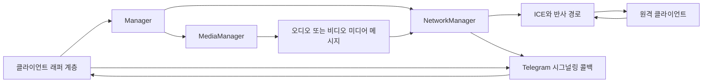
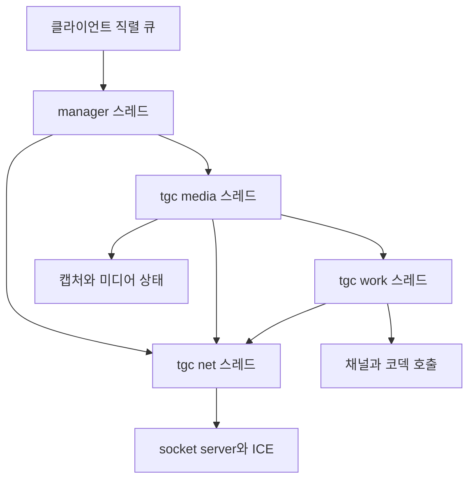
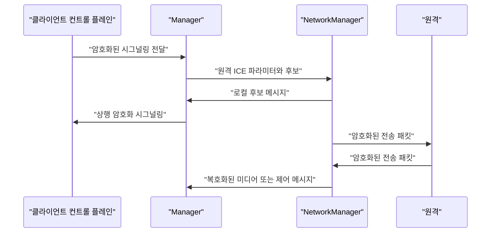
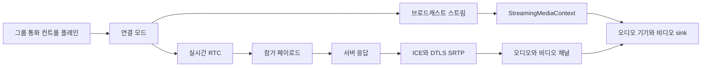

# tgcalls 통화 미디어 엔진

웹: /docs/system/17-tgcalls-media-engine/ · Markdown: /docs/system/17-tgcalls-media-engine.md

> Telegram iOS 및 macOS 클라이언트에서 tgcalls의 인스턴스, 스레드, 암호화 전송, 오디오·비디오, 그룹 통화 미디어 구현.

> 시스템 설계 · 통화 · 17장 · 도표 4 · 코드 발췌 10 · 인용 34 · 소스 기준선: [TelegramMessenger/Telegram-iOS@f1dd7a2d](https://github.com/TelegramMessenger/Telegram-iOS/tree/f1dd7a2dbd02cbbf513e75d5695d8d36d1cf5838), [overtake/TelegramSwift@579cebbf](https://github.com/overtake/TelegramSwift/tree/579cebbf0c01fd41b712eff3647fa7f69db9665d)
>
> 핵심 소스 파일: [TelegramMessenger/Telegram-iOS/submodules/TgVoipWebrtc/Sources/OngoingCallThreadLocalContext.mm](https://github.com/TelegramMessenger/Telegram-iOS/blob/f1dd7a2dbd02cbbf513e75d5695d8d36d1cf5838/submodules/TgVoipWebrtc/Sources/OngoingCallThreadLocalContext.mm), [TelegramMessenger/tgcalls/tgcalls/Instance.h](https://github.com/TelegramMessenger/tgcalls/blob/a024eaabf13c189d9577a14fb244bd242825ac96/tgcalls/Instance.h), [TelegramMessenger/tgcalls/tgcalls/InstanceImpl.cpp](https://github.com/TelegramMessenger/tgcalls/blob/a024eaabf13c189d9577a14fb244bd242825ac96/tgcalls/InstanceImpl.cpp), [TelegramMessenger/tgcalls/tgcalls/StaticThreads.cpp](https://github.com/TelegramMessenger/tgcalls/blob/a024eaabf13c189d9577a14fb244bd242825ac96/tgcalls/StaticThreads.cpp), [TelegramMessenger/tgcalls/tgcalls/Manager.cpp](https://github.com/TelegramMessenger/tgcalls/blob/a024eaabf13c189d9577a14fb244bd242825ac96/tgcalls/Manager.cpp), [TelegramMessenger/tgcalls/tgcalls/NetworkManager.cpp](https://github.com/TelegramMessenger/tgcalls/blob/a024eaabf13c189d9577a14fb244bd242825ac96/tgcalls/NetworkManager.cpp), [TelegramMessenger/tgcalls/tgcalls/EncryptedConnection.cpp](https://github.com/TelegramMessenger/tgcalls/blob/a024eaabf13c189d9577a14fb244bd242825ac96/tgcalls/EncryptedConnection.cpp), [TelegramMessenger/tgcalls/tgcalls/MediaManager.cpp](https://github.com/TelegramMessenger/tgcalls/blob/a024eaabf13c189d9577a14fb244bd242825ac96/tgcalls/MediaManager.cpp), [TelegramMessenger/tgcalls/tgcalls/VideoCaptureInterfaceImpl.cpp](https://github.com/TelegramMessenger/tgcalls/blob/a024eaabf13c189d9577a14fb244bd242825ac96/tgcalls/VideoCaptureInterfaceImpl.cpp), [TelegramMessenger/tgcalls/tgcalls/group/GroupInstanceImpl.h](https://github.com/TelegramMessenger/tgcalls/blob/a024eaabf13c189d9577a14fb244bd242825ac96/tgcalls/group/GroupInstanceImpl.h), [TelegramMessenger/tgcalls/tgcalls/group/GroupNetworkManager.cpp](https://github.com/TelegramMessenger/tgcalls/blob/a024eaabf13c189d9577a14fb244bd242825ac96/tgcalls/group/GroupNetworkManager.cpp), [TelegramMessenger/tgcalls/tgcalls/group/GroupInstanceCustomImpl.cpp](https://github.com/TelegramMessenger/tgcalls/blob/a024eaabf13c189d9577a14fb244bd242825ac96/tgcalls/group/GroupInstanceCustomImpl.cpp), [TelegramMessenger/tgcalls/tgcalls/group/GroupFrameTransformer.cpp](https://github.com/TelegramMessenger/tgcalls/blob/a024eaabf13c189d9577a14fb244bd242825ac96/tgcalls/group/GroupFrameTransformer.cpp), [TelegramMessenger/tgcalls/tgcalls/group/StreamingMediaContext.cpp](https://github.com/TelegramMessenger/tgcalls/blob/a024eaabf13c189d9577a14fb244bd242825ac96/tgcalls/group/StreamingMediaContext.cpp), [overtake/TelegramSwift/Telegram-Mac/OngoingCallContext.swift](https://github.com/overtake/TelegramSwift/blob/579cebbf0c01fd41b712eff3647fa7f69db9665d/Telegram-Mac/OngoingCallContext.swift), [overtake/Telegram-iOS/submodules/TgVoipWebrtc/Sources/OngoingCallThreadLocalContext.mm](https://github.com/overtake/Telegram-iOS/blob/a24bbe45f9861f736a79916a50898512f751e0dc/submodules/TgVoipWebrtc/Sources/OngoingCallThreadLocalContext.mm), [overtake/tgcalls/tgcalls/Instance.h](https://github.com/overtake/tgcalls/blob/5ddc3ccf2086127722a06e3d836698fcd717f11b/tgcalls/Instance.h)
>
> 미검증 사항:
> - 확인하지 못한 WebRTC 본체가 ICE 후보 쌍 선택, 네트워크 전환, 혼잡 제어를 어떻게 수행하는지.
> - InstanceV2PumpImpl에 내장된 WASM core와 네이티브 core가 연결 수립과 시그널링 처리에서 정확히 어떻게 다른지.
> - MtProtoDtlsTransport가 Telegram 서버와 상호작용하는 방식, 그리고 TURN 경로와의 관계.
> - macOS 릴리스 빌드가 독립 tgcalls와 fork 내장 서브모듈 중 어느 소스를 택하는지에 대한 전체 규칙.
> - 플랫폼 비디오 인코더 팩토리에서의 하드웨어 코덱 능력 선별과 최종 협상 결과.
> - 그룹 E2E 콜백의 키 교체, 인증 실패 처리, 서버에서 보이는 RTP 헤더 필드.

## 문제와 제약 [#문제와-제약]

`tgcalls`는 Telegram 클라이언트에서 실시간 미디어 엔진의 경계예요.

- 맡는 일: 클라이언트가 주는 호출 파라미터, 키, 후보 주소, 기기, 콜백을 받아서 오디오, 비디오, 데이터 패킷을 실제로 전송해요.
- 맡지 않는 일: MTProto 요청, 호출 상태 머신의 비즈니스 결정, 화면 표시.

13장 「통화 시스템」에서 컨트롤 플레인(MTProto 요청, 호출 상태 머신, 화면 표시를 맡는 쪽)은 이미 설명했어요. 이 장은 컨트롤 플레인 아래에 있는 미디어 엔진만 따라가요.

이 장이 점검한 소스는 아래와 같아요.

- iOS 메인 저장소의 `TgVoipWebrtc` 래퍼 계층과 그 `tgcalls` 서브모듈
- macOS 클라이언트 `TelegramSwift`, 그 `telegram-ios` fork, 독립된 `tgcalls` 서브모듈

이 문서의 "소스 확인"은 이 고정 체크아웃에만 해당해요. WebRTC 본체는 체크아웃하지 않았어요. 그래서 이 문서는 WebRTC 내부 동작에 대한 결론을, tgcalls가 부르는 공개 클래스와 파라미터까지만 한정해요. 하위 계층의 혼잡 제어, 코덱 구현, DTLS 상태 머신은 확인된 사실로 다루지 않아요.

엔진은 네 가지 제약에 부딪혀요.

1. 1:1 통화는 Telegram 커스텀 시그널링, 후보 교환, 미디어 RTP 패킷을 하나의 암호화된 네트워크 경로에 연결해야 해요.
2. 플랫폼 오디오 세션과 비디오 캡처에는 스레드 친화성이 있어요.
3. 그룹 통화는 실시간 RTC, 브로드캐스트 스트림, 그리고 둘 사이의 전환을 동시에 지원해야 해요.
4. 버전은 서버가 협상하기 때문에 클라이언트가 여러 `Instance` 구현을 동시에 가지고 있어야 해요.

`Instance`의 입력도 이런 제약을 분명히 보여줘요.

- `Config`: P2P, TCP, STUN 마킹, 데이터 절약, 프로토콜 버전, 비디오 선호를 담아요.
- `Descriptor`: 256바이트 키, RTC 서비스 목록, 시그널링 콜백, 기기 모듈 팩토리, 비디오 캡처 객체를 담아요.

공개 인터페이스에서 할 수 있는 조작은 아래뿐이에요.

- 네트워크 유형
- 음소거
- 입출력 기기
- 원격 비디오 sink(받은 영상 프레임을 넘겨받는 객체)
- 시그널링 입력
- 비디오 캡처 교체
- 정지 [\[1\]](https://github.com/TelegramMessenger/tgcalls/blob/a024eaabf13c189d9577a14fb244bd242825ac96/tgcalls/Instance.h#L60-L289)

## 모듈과 데이터 구조 [#모듈과-데이터-구조]

### 인스턴스 추상화와 버전 등록 [#인스턴스-추상화와-버전-등록]

`Instance`는 1:1 직접 통화의 추상화예요. 버전 테이블을 직접 갖고 있지 않아요. `Meta`가 문자열 버전을 각 구현의 팩토리에 연결하고, 구현이 알려주는 버전 목록에 따라 색인을 만들어요. 호출하는 쪽은 `Meta::Create`로 특정 구현을 얻어요. 소스는 문자열 `2.7.7`과 `5.0.0`에 대해서도 `ProtocolVersion`의 V0 또는 V1을 강제로 기록해요. 이걸 보면 버전 이름과 미디어 프로토콜 버전은 같은 개념이 아니고, 적어도 이 두 옛 버전에는 명시적인 호환 분기가 필요하다는 걸 알 수 있어요. [\[1\]](https://github.com/TelegramMessenger/tgcalls/blob/a024eaabf13c189d9577a14fb244bd242825ac96/tgcalls/Instance.h#L60-L289)[\[2\]](https://github.com/TelegramMessenger/Telegram-iOS/blob/f1dd7a2dbd02cbbf513e75d5695d8d36d1cf5838/submodules/TgVoipWebrtc/Sources/OngoingCallThreadLocalContext.mm#L1849-L1876)

iOS의 `OngoingCallThreadLocalContextWebrtc`는 일회성 등록으로 아래 구현을 로드해요.

- `InstanceImpl`
- `InstanceV2Impl`
- `InstanceV2ReferenceImpl`
- `InstanceV2CompatImpl`
- `InstanceV2PumpImpl`

이어서 `Meta::Versions`에서 쓸 수 있는 버전을 읽어요. 여기서 `includeReference` 파라미터는 그 메서드 안에서 목록을 필터링하지 않아요. 소스로 확인되는 건 이 계층이 구체적인 버전 선택을 외부 컨트롤 플레인과 `Meta` 테이블에 맡긴다는 점이에요. [\[2\]](https://github.com/TelegramMessenger/Telegram-iOS/blob/f1dd7a2dbd02cbbf513e75d5695d8d36d1cf5838/submodules/TgVoipWebrtc/Sources/OngoingCallThreadLocalContext.mm#L1849-L1876)

```objc
+ (void)ensureRegisteredImplementations {
    static dispatch_once_t onceToken;
    dispatch_once(&onceToken, ^{
        tgcalls::Register<tgcalls::InstanceImpl>();
        tgcalls::Register<tgcalls::InstanceV2Impl>();
        tgcalls::Register<tgcalls::InstanceV2ReferenceImpl>();
        tgcalls::Register<tgcalls::InstanceV2CompatImpl>();
        // 18.0.0 (native core) / 19.0.0 (embedded wasm core). Advertised
        // unconditionally: the server reconciles both endpoints' lists and
        // returns one version, so no client-side gating is needed.
        tgcalls::Register<tgcalls::InstanceV2PumpImpl>();
    });
}
```
[\[2\]](https://github.com/TelegramMessenger/Telegram-iOS/blob/f1dd7a2dbd02cbbf513e75d5695d8d36d1cf5838/submodules/TgVoipWebrtc/Sources/OngoingCallThreadLocalContext.mm#L1849-L1876)

버전 팩토리는 구현 클래스의 `GetVersions`, `GetConnectionMaxLayer`, 생성자를 `MetaImpl`로 캡슐화해요. 그래서 래퍼 계층은 구체적인 직접 통화 구현 타입에 기대지 않아요. 이렇게 계층을 나눈 덕분에 같은 Objective C 인터페이스가 옛 버전, V2, 참조 구현, 새 펌프(pump) 구현을 모두 받아들일 수 있어요. [\[1\]](https://github.com/TelegramMessenger/tgcalls/blob/a024eaabf13c189d9577a14fb244bd242825ac96/tgcalls/Instance.h#L60-L289)

macOS fork의 같은 이름의 래퍼 계층은 고정 커밋에서 `InstanceImpl`, `InstanceV2Impl`, `InstanceV2ReferenceImpl`만 등록해요. `2.7.7`을 V0으로, `5.0.0`을 V1으로 연결해요. macOS 쪽 `Telegram-Mac/OngoingCallContext.swift`는 래퍼 계층에서 버전 목록을 읽고, 필터링한 reflector 연결과 시그널링 클로저를 `OngoingCallThreadLocalContextWebrtc`에 넘겨요. [\[3\]](https://github.com/overtake/Telegram-iOS/blob/a24bbe45f9861f736a79916a50898512f751e0dc/submodules/TgVoipWebrtc/Sources/OngoingCallThreadLocalContext.mm#L1630-L1662)[\[4\]](https://github.com/overtake/TelegramSwift/blob/579cebbf0c01fd41b712eff3647fa7f69db9665d/Telegram-Mac/OngoingCallContext.swift#L417-L510)

등록된 구현 수의 이 차이는 커밋 시점이 달라서 생긴 직접적인 결과예요. macOS에 비디오나 그룹 통화가 없다는 뜻으로 이해하면 안 돼요. 양쪽의 공개 `Instance` 추상화는 같고, macOS 메인 프로그램은 실제로 `TgVoipWebrtc`를 임포트해요. 다만 iOS의 새 커밋에서 추가된 호환 구현, 펌프 구현, 내장 WASM core, 그룹 프레임 변환기는 macOS의 독립 `tgcalls` 고정 커밋에 대응하는 파일이 없어요. [\[4\]](https://github.com/overtake/TelegramSwift/blob/579cebbf0c01fd41b712eff3647fa7f69db9665d/Telegram-Mac/OngoingCallContext.swift#L417-L510)[\[5\]](https://github.com/overtake/tgcalls/blob/5ddc3ccf2086127722a06e3d836698fcd717f11b/tgcalls/Instance.h#L77-L285)

### 직접 통화의 객체 경계 [#직접-통화의-객체-경계]

직접 통화는 네 계층으로 나뉘어요.

- `OngoingCallThreadLocalContextWebrtc`는 Objective C++ 브리지예요. 키를 복사하고, STUN(공인 주소를 알려 주는 서버)과 TURN(트래픽을 대신 중계하는 서버) 설명을 파싱하고, 클라이언트 큐를 갖고 있고, 상행 암호문을 `sendSignalingData`에 넘겨요.
- `InstanceImpl`은 manager 스레드에서 `Manager`를 만들어요. `Manager`는 직접 통화의 오케스트레이터예요. 시그널링 암호화기 하나와, 네트워크 및 미디어 두 개의 스레드 로컬 객체를 소유해요.
- `NetworkManager`는 네트워크 스레드에서 ICE(두 단말 사이에 닿는 경로를 찾는 표준 절차), 포트 할당기, UDP 또는 TCP 반사(reflector) 경로를 만들고, 실제 전송 메시지를 암호화해요.
- `MediaManager`는 미디어 스레드에서 오디오와 비디오 채널을 만들어요. 자체 `NetworkInterfaceImpl`을 통해 WebRTC가 만든 RTP(실시간 오디오·비디오 패킷 형식) 또는 RTCP(RTP의 제어 패킷)를 `AudioDataMessage` 또는 `VideoDataMessage`로 감싸요.



`Manager`는 만들어질 때 `EncryptionKey`를 저장하고, 시그널링과 전송 각각의 송신 클로저를 만들어요. 클라이언트가 돌려준 시그널링 데이터를 받으면 먼저 시그널링 암호화기를 부른 뒤, 후보 메시지는 네트워크 객체에, 비디오 포맷 메시지는 미디어 객체에 넘겨요. 이렇게 나누면 후보 관리와 인코딩 협상이 같은 객체 락을 거치지 않아도 돼요. [\[6\]](https://github.com/TelegramMessenger/tgcalls/blob/a024eaabf13c189d9577a14fb244bd242825ac96/tgcalls/Manager.cpp#L79-L275)

```cpp
void Manager::receiveSignalingData(const std::vector<uint8_t> &data) {
	if (auto decrypted = _signaling.handleIncomingPacket((const char*)data.data(), data.size())) {
		receiveMessage(std::move(decrypted->main));
		for (auto &message : decrypted->additional) {
			receiveMessage(std::move(message));
		}
	}
}

void Manager::receiveMessage(DecryptedMessage &&message) {
	const auto data = &message.message.data;
	if (absl::get_if<CandidatesListMessage>(data)) {
		_networkManager->perform([message = std::move(message)](NetworkManager *networkManager) mutable {
			networkManager->receiveSignalingMessage(std::move(message));
		});
	} else if (absl::get_if<VideoFormatsMessage>(data)) {
		_mediaManager->perform([message = std::move(message)](MediaManager *mediaManager) mutable {
			mediaManager->receiveMessage(std::move(message));
		});
	}
}
```
[\[6\]](https://github.com/TelegramMessenger/tgcalls/blob/a024eaabf13c189d9577a14fb244bd242825ac96/tgcalls/Manager.cpp#L79-L275)

### 스레드 모델 [#스레드-모델]

`StaticThreads`는 오래 실행되는 `rtc::Thread` 세 개를 만들어요.

- `tgc-media`
- `tgc-work`
- socket server를 가진 `tgc-net`

스레드 사이의 동기 호출 방향은 이래요.

- 미디어 스레드는 작업 스레드와 네트워크 스레드를 동기 호출할 수 있어요.
- 작업 스레드는 네트워크 스레드를 동기 호출할 수 있어요.
- 반대 방향의 동기 호출은 켜지 않았어요.

이건 소스로 확인되는 호출 방향 제약이고, 미디어 스레드와 네트워크 스레드 사이에서 순환 대기가 생길 위험을 줄여줘요. [\[7\]](https://github.com/TelegramMessenger/tgcalls/blob/a024eaabf13c189d9577a14fb244bd242825ac96/tgcalls/StaticThreads.cpp#L58-L140)

```cpp
explicit ThreadsImpl(size_t i) {
  auto suffix = i == 0 ? "" : "#" + std::to_string(i);
  media_ = create("tgc-media" + suffix);
  worker_ = create("tgc-work" + suffix);
  network_ = create_network("tgc-net" + suffix);
    
  media_->AllowInvokesToThread(worker_.get());
  media_->AllowInvokesToThread(network_.get());
  worker_->AllowInvokesToThread(network_.get());
}

static Thread create_network(const std::string &name) {
  return init(std::unique_ptr<rtc::Thread>(rtc::Thread::CreateWithSocketServer()), name);
}
```
[\[7\]](https://github.com/TelegramMessenger/tgcalls/blob/a024eaabf13c189d9577a14fb244bd242825ac96/tgcalls/StaticThreads.cpp#L58-L140)

`ThreadLocalObject`는 한 걸음 더 나아가서, 생성, 소멸, 일반 `perform` 호출을 객체가 속한 스레드에서 실행하도록 스케줄해요. `Manager` 자체는 독립된 manager 스레드에 있어요. 이 스레드에서 `NetworkManager`와 `MediaManager`를 각각 만들고, `PostTask`로 상태를 되돌려 보내요. `MediaManager`는 WebRTC의 스레드를 이렇게 설정해요.

- signaling thread: 미디어 스레드
- worker thread: 작업 스레드
- network thread: 네트워크 스레드

이렇게 나눈 덕분에 애플리케이션 계층의 스케줄링이 미디어 라이브러리의 스레드 귀속과 일치해요. [\[6\]](https://github.com/TelegramMessenger/tgcalls/blob/a024eaabf13c189d9577a14fb244bd242825ac96/tgcalls/Manager.cpp#L79-L275)[\[8\]](https://github.com/TelegramMessenger/tgcalls/blob/a024eaabf13c189d9577a14fb244bd242825ac96/tgcalls/MediaManager.cpp#L241-L470)



스레드 모델에서 동기 호출을 완전히 비동기로 바꾼 건 아니에요. 미디어 계층은 미디어 엔진 생성, 오디오 기기 수정, 송신 스트림 추가, RTP 전달 등 여러 곳에서 `BlockingCall`을 써요. 추정: 이 선택은 모든 단계를 논블로킹으로 만드는 것보다 객체의 스레드 안전성과 설정 순서를 중요하게 본 거예요. 호출 그래프에 제한이 있어서, 허용된 상류 스레드에서 하류 스레드로만 동기 실행돼요. [\[7\]](https://github.com/TelegramMessenger/tgcalls/blob/a024eaabf13c189d9577a14fb244bd242825ac96/tgcalls/StaticThreads.cpp#L58-L140)[\[8\]](https://github.com/TelegramMessenger/tgcalls/blob/a024eaabf13c189d9577a14fb244bd242825ac96/tgcalls/MediaManager.cpp#L241-L470)

## 핵심 흐름 [#핵심-흐름]

### 직접 통화의 연결 수립, 후보, 네트워크 경로 [#직접-통화의-연결-수립-후보-네트워크-경로]

래퍼 계층은 서버 설명을 하나씩 `RtcServer`로 변환해요.

- STUN 마킹이 있는 항목은 non-TURN 서비스가 돼요.
- TURN 또는 TCP 마킹이 있는 항목은 reflector 식별자, 계정, 비밀번호, TCP 속성을 그대로 유지해요.

`Config`는 `allowP2P`, `allowTCP`, `enableStunMarking`을 함께 실어 보내요. 그래서 "직접 연결을 허용할지"는 네트워크 계층이 추측하는 게 아니라, 컨트롤 플레인이 전달하는 명시적 정책이에요. [\[9\]](https://github.com/TelegramMessenger/Telegram-iOS/blob/f1dd7a2dbd02cbbf513e75d5695d8d36d1cf5838/submodules/TgVoipWebrtc/Sources/OngoingCallThreadLocalContext.mm#L1968-L2025)

`NetworkManager::start`는 아래를 만들어요.

- `BasicPacketSocketFactory`
- `BasicNetworkManager`
- 커스텀 `ReflectorRelayPortFactory`
- `BasicPortAllocator`

포트 할당기는 이렇게 설정해요.

- IPv6와 WiFi에서의 IPv6는 항상 켜요.
- TCP를 비활성화하면 TCP 비활성화 플래그를 설정해요.
- P2P를 비활성화하면 UDP와 STUN을 끄고, 후보 필터에서 반사(reflexive) 후보를 제거해요.
- 서비스 목록의 UDP TURN과 STUN은 각각 다른 설정으로 구성해서 포트 할당기에 넘겨요. [\[10\]](https://github.com/TelegramMessenger/tgcalls/blob/a024eaabf13c189d9577a14fb244bd242825ac96/tgcalls/NetworkManager.cpp#L110-L176)

```cpp
if (!_enableTCP) {
    flags |= cricket::PORTALLOCATOR_DISABLE_TCP;
}
if (!_enableP2P) {
    flags |= cricket::PORTALLOCATOR_DISABLE_UDP;
    flags |= cricket::PORTALLOCATOR_DISABLE_STUN;
    uint32_t candidateFilter = _portAllocator->candidate_filter();
    candidateFilter &= ~(cricket::CF_REFLEXIVE);
    _portAllocator->SetCandidateFilter(candidateFilter);
}

_portAllocator->set_flags(flags);
_portAllocator->Initialize();
```
[\[10\]](https://github.com/TelegramMessenger/tgcalls/blob/a024eaabf13c189d9577a14fb244bd242825ac96/tgcalls/NetworkManager.cpp#L110-L176)

이어서 네트워크 객체는 이름이 `transport`인 `P2PTransportChannel`을 만들어요.

- 후보를 계속 수집하고, 가장 가능성 높은 후보 쌍을 우선하고, 실패한 네트워크는 다시 수집해요.
- 호출 방향에 따라 ICE controlling 또는 controlled 역할을 정해요.
- 로컬 후보가 수집되면 네트워크 스레드가 manager 스레드로 `CandidatesListMessage`를 보내고, manager는 시그널링 콜백으로 컨트롤 플레인에 넘겨요.
- 원격 후보를 받으면 원격 ICE 파라미터와 후보 집합을 기록해요. [\[11\]](https://github.com/TelegramMessenger/tgcalls/blob/a024eaabf13c189d9577a14fb244bd242825ac96/tgcalls/NetworkManager.cpp#L176-L355)

종단 간 네트워크 경로는 다음과 같이 요약할 수 있어요.

- P2P가 켜져 있으면 포트 할당기가 UDP, STUN, 쓸 수 있는 relay를 시도할 수 있어요.
- P2P가 꺼져 있으면 tgcalls 소스가 UDP와 STUN 후보를 명시적으로 끄기 때문에, 남는 경로는 relay 설정에 달려 있어요.
- TCP 허용은 `PORTALLOCATOR_DISABLE_TCP`를 적용하지 않는다는 의미일 뿐이에요. 어떤 후보가 최종 선택된다는 보장은 아니에요.

이 중 뒤 문장, 곧 최종 선택이 보장되지 않는다는 말은 추정이에요. 후보 쌍을 고르는 로직이, 확인하지 못한 WebRTC 본체에 있기 때문이에요.



### 시그널링, 전송, 암호화 경계 [#시그널링-전송-암호화-경계]

직접 통화는 `EncryptedConnection` 인스턴스를 두 개 써요. 하나는 `Signaling` 타입이고 다른 하나는 `Transport` 타입이에요.

- 둘 다 `EncryptionKey`와 방향 비트로 패킷마다 AES CTR 키와 IV를 유도해요.
- 송신 경로는 암호문 앞에 16바이트 `msgKey`를 둬요. `msgKey`는 키 조각과 평문의 SHA256 결과에서 나와요.
- 수신 경로는 먼저 복호화한 뒤 상수 시간 비교로 `msgKey`를 검증하고, 이어서 시퀀스 윈도우를 확인해요.

소스로 확인되는 건 이 계층이 시그널링과 미디어 외부 패킷을 함께 보호한다는 점이에요. [\[6\]](https://github.com/TelegramMessenger/tgcalls/blob/a024eaabf13c189d9577a14fb244bd242825ac96/tgcalls/Manager.cpp#L79-L275)[\[12\]](https://github.com/TelegramMessenger/tgcalls/blob/a024eaabf13c189d9577a14fb244bd242825ac96/tgcalls/EncryptedConnection.cpp#L101-L154)

```cpp
const auto msgKeyLarge = ConcatSHA256(
    MemorySpan{ key + 88 + x, 32 },
    MemorySpan{ decryptionBuffer.data(), decryptionBuffer.size() });
if (ConstTimeIsDifferent(msgKeyLarge.data() + 8, msgKey, 16)) {
    return absl::nullopt;
}

const auto incomingSeq = ReadSeq(decryptionBuffer.data());
const auto incomingCounter = CounterFromSeq(incomingSeq);
if (!registerIncomingCounter(incomingCounter)) {
    // We've received that packet already.
    return absl::nullopt;
}
```
[\[12\]](https://github.com/TelegramMessenger/tgcalls/blob/a024eaabf13c189d9577a14fb244bd242825ac96/tgcalls/EncryptedConnection.cpp#L101-L154)

패킷 시퀀스 번호에는 "단일 메시지 패킷"과 "확인 필요" 플래그도 인코딩돼요. 확인이 필요한 메시지는 미확인 큐에 저장되고, 서비스 패킷이 확인 응답과 재전송 대기 메시지를 실어 보내요.

- 시그널링: 최소 재전송 간격은 3초이고, 최대 재전송 및 확인 재전송 간격은 5초예요.
- 전송 메시지: 같은 두 값이 각각 300밀리초와 1초예요.
- 시그널링 페이로드 상한은 16 KiB예요.
- 소스의 수신 원시 패킷 상한은 128 KiB예요.

상한을 넘거나, 해시가 맞지 않거나, 카운터가 중복되거나 오래된 패킷은 모두 폐기돼요. [\[13\]](https://github.com/TelegramMessenger/tgcalls/blob/a024eaabf13c189d9577a14fb244bd242825ac96/tgcalls/EncryptedConnection.cpp#L208-L329)[\[14\]](https://github.com/TelegramMessenger/tgcalls/blob/a024eaabf13c189d9577a14fb244bd242825ac96/tgcalls/EncryptedConnection.cpp#L406-L523)

미디어 RTP는 `MediaManager`가 소켓에 직접 쓰지 않아요.

- 송신: `NetworkInterfaceImpl`이 오디오와 비디오 RTP 또는 RTCP 패킷을 서로 다른 `Message` 변형으로 감싸서 `NetworkManager`에 넘겨요. 네트워크 객체는 ICE transport에서 외부 암호화 결과를 전송해요.
- 수신: 먼저 외부 계층을 풀고, `MediaManager`가 RTCP인지 RTP인지 판단한 뒤 RTP 헤더를 파싱해서 해당 오디오 또는 비디오 수신기로 전달해요. 파싱에 실패하면 오류를 기록하고 그 패킷을 폐기해요. [\[6\]](https://github.com/TelegramMessenger/tgcalls/blob/a024eaabf13c189d9577a14fb244bd242825ac96/tgcalls/Manager.cpp#L79-L275)[\[15\]](https://github.com/TelegramMessenger/tgcalls/blob/a024eaabf13c189d9577a14fb244bd242825ac96/tgcalls/MediaManager.cpp#L984-L1035)

### 오디오 기기와 오디오 채널 [#오디오-기기와-오디오-채널]

`MediaManager`는 먼저 플랫폼 오디오를 구성한 뒤 `AudioDeviceModule`(오디오 입출력 장치를 다루는 WebRTC 모듈)을 만들어요. 모듈은 이 순서로 정해요.

1. 브리지 계층이 팩토리를 주면 tgcalls는 그 팩토리를 먼저 쓰고, `Init`이 0을 반환할 때만 그 모듈을 받아들여요.
2. 그렇지 않으면 iOS는 `AudioDeviceModuleIOS`를 쓰고, 다른 플랫폼은 WebRTC의 기본 플랫폼 기기를 요청해요.

이렇게 설계한 덕분에 iOS는 시스템 오디오 세션, 무음 감지, 다중 인스턴스 공유를 브리지 계층에 캡슐화할 수 있고, 데스크톱은 기기 열거 경로를 써요. [\[8\]](https://github.com/TelegramMessenger/tgcalls/blob/a024eaabf13c189d9577a14fb244bd242825ac96/tgcalls/MediaManager.cpp#L241-L470)

미디어 엔진은 Opus(오디오 코덱)를 명시적으로 구성해요.

- 샘플링 레이트는 48000
- 2채널
- payload type은 111
- 최소·초기·최대 비트레이트는 각각 6, 8, 32 Kbit/s
- 패킷 길이는 120밀리초
- 인밴드 FEC(손실된 패킷을 복구하려고 여분 데이터를 함께 보내는 방식)를 켜요.

오디오 송신과 수신 모두 transport sequence number 확장을 등록해요. 원격 볼륨을 상위 계층에 돌려보내려고 원시 오디오 sink도 만들어요. [\[8\]](https://github.com/TelegramMessenger/tgcalls/blob/a024eaabf13c189d9577a14fb244bd242825ac96/tgcalls/MediaManager.cpp#L241-L470)

iOS 래퍼 계층은 공유 오디오 모듈을 제공할 수 있어요. 그룹 통화 생성자는 `disableAudioInput`과 `enableSystemMute`도 전달하고, 공유 모듈이 없으면 `AudioDeviceModuleIOS`를 만들어요. 화면 공유의 외부 오디오에 대해서는, 지금 iOS 소스가 커스텀 그룹 구현에서 오디오 기기 팩토리 둘을 일부러 비워서 `FakeAudioDeviceModule`의 외부 샘플 경로를 타게 해요. 이 분기는 "녹음이 비활성화된 실제 모듈은 캡처 프레임을 만들지 않아서" 외부 샘플을 보낼 수 없게 되는 문제를 피해요. [\[16\]](https://github.com/TelegramMessenger/Telegram-iOS/blob/f1dd7a2dbd02cbbf513e75d5695d8d36d1cf5838/submodules/TgVoipWebrtc/Sources/OngoingCallThreadLocalContext.mm#L2590-L2944)

데스크톱에서 기기를 전환할 때 `AudioDeviceHelper`는 녹음 또는 재생을 일시 정지하고, GUID나 순번으로 기기를 찾아요. 실패하면 기본 통신 기기로 폴백하고, 초기화에 성공하면 녹음 또는 재생을 다시 시작해요. iOS의 `AudioDeviceModuleIOS`는 개별 `StopPlayout`, `StopRecording`, `Terminate`를 no-op으로 덮어쓰지만, `Stop`은 여전히 감싼 실제 모듈에 전달해요. macOS 래퍼 모듈은 `Stop`에서 명시적으로 재생 정지, 녹음 정지, 실제 모듈 종료를 차례로 해요. [\[17\]](https://github.com/TelegramMessenger/tgcalls/blob/a024eaabf13c189d9577a14fb244bd242825ac96/tgcalls/AudioDeviceHelper.cpp#L24-L138)[\[18\]](https://github.com/TelegramMessenger/tgcalls/blob/a024eaabf13c189d9577a14fb244bd242825ac96/tgcalls/platform/darwin/AudioDeviceModuleIOS.h#L1-L39)

### 비디오 캡처, 포맷 협상, 인코딩과 송신 [#비디오-캡처-포맷-협상-인코딩과-송신]

`VideoCaptureInterfaceImpl`은 실제 캡처 객체를 미디어 스레드에 고정해요. 만들어질 때 플랫폼 인터페이스에서 `VideoTrackSource`를 얻고, 기기 식별자나 화면 캡처 식별자에 따라 캡처러를 만들어요. 기기 교체, 일시 정지, 선호 가로세로비, 비디오 출력은 모두 `ThreadLocalObject`를 거쳐 미디어 스레드의 큐에 들어가요. 직접 통화와 그룹 통화 모두 `videoCaptureToGetVideoSource`로 같은 추상화의 track source를 얻을 수 있어요. [\[19\]](https://github.com/TelegramMessenger/tgcalls/blob/a024eaabf13c189d9577a14fb244bd242825ac96/tgcalls/VideoCaptureInterfaceImpl.cpp#L11-L65)

```cpp
VideoCaptureInterfaceImpl::VideoCaptureInterfaceImpl(std::string deviceId, bool isScreenCapture, std::shared_ptr<PlatformContext> platformContext, std::shared_ptr<Threads> threads) :
_impl(threads->getMediaThread(), [deviceId, isScreenCapture, platformContext, threads]() {
	return std::make_shared<VideoCaptureInterfaceObject>(deviceId, isScreenCapture, platformContext, *threads);
}) {
}

void VideoCaptureInterfaceImpl::switchToDevice(std::string deviceId, bool isScreenCapture) {
	_impl.perform([deviceId, isScreenCapture](VideoCaptureInterfaceObject *impl) {
		impl->switchToDevice(deviceId, isScreenCapture);
	});
}
```
[\[19\]](https://github.com/TelegramMessenger/tgcalls/blob/a024eaabf13c189d9577a14fb244bd242825ac96/tgcalls/VideoCaptureInterfaceImpl.cpp#L11-L65)

직접 통화의 미디어 초기화는 플랫폼 인코더와 디코더 팩토리에서 지원 포맷을 읽고 `ComposeSupportedFormats`를 불러서, 인코더 개수와 중복을 제거한 포맷 표를 상대에게 보내요.

- 먼저 scalability mode를 제거해요. 이 모드들은 커스텀 시그널링을 거치지 않기 때문이에요.
- 이어서 사용자 선호에 따라 인코더를 정렬해요.
- 일반 비디오 코덱에는 REMB, transport CC, FIR, NACK, PLI 같은 피드백 파라미터도 추가해요.

tgcalls 소스가 SDP offer나 answer 협상을 직접 하지는 않아요. [\[8\]](https://github.com/TelegramMessenger/tgcalls/blob/a024eaabf13c189d9577a14fb244bd242825ac96/tgcalls/MediaManager.cpp#L241-L470)[\[20\]](https://github.com/TelegramMessenger/tgcalls/blob/a024eaabf13c189d9577a14fb244bd242825ac96/tgcalls/CodecSelectHelper.cpp#L105-L171)

원격 포맷과 미디어 상태가 송신을 허용하면 `MediaManager`는 비디오 비트레이트를 최소 64, 초기 400, 최대 800 또는 2000 Kbit/s로 설정해요. 높은 비트레이트는 설정에 따라 정해져요.

- V1은 회전과 타임스탬프 오프셋 RTP 확장도 켜요.
- 비디오 송신 스트림에는 FlexFEC 짝 SSRC(RTP 스트림 식별자)가 들어갈 수 있어요.
- 캡처 소스는 비디오 송신 채널로 들어가고, 캡처 소스를 잃으면 명시적으로 비워요.
- V0는 원격 sink에 들어가기 전에 회전 정보를 다시 쓰고, V1은 다시 쓰지 않아요. [\[8\]](https://github.com/TelegramMessenger/tgcalls/blob/a024eaabf13c189d9577a14fb244bd242825ac96/tgcalls/MediaManager.cpp#L241-L470)[\[21\]](https://github.com/TelegramMessenger/tgcalls/blob/a024eaabf13c189d9577a14fb244bd242825ac96/tgcalls/MediaManager.cpp#L684-L858)

`setSendVideo`는 이렇게 움직여요.

1. 이전 캡처 객체에서 콜백을 제거한 뒤, 약한 guard를 써서 이전 객체가 이미 큐에 넣었지만 늦게 도착한 상태를 걸러 내요.
2. 이전 송신 스트림을 삭제하고 새 SSRC 스트림을 추가해요.
3. 작업 스레드에서 현재 track source를 송신기에 바인딩해요.

이 guard는 객체가 소멸되는 순서에만 기대지 않고 경쟁 상태를 명시적으로 처리하는 장치예요. [\[21\]](https://github.com/TelegramMessenger/tgcalls/blob/a024eaabf13c189d9577a14fb244bd242825ac96/tgcalls/MediaManager.cpp#L684-L858)

### 미디어 채널의 패킷화 경계와 품질 제어 [#미디어-채널의-패킷화-경계와-품질-제어]

직접 통화의 미디어 채널은 고정된 역할을 써요.

- 초기화할 때 오디오와 비디오 각각에 송신 채널 하나와 수신 채널 하나를 만들어요.
- 오디오와 비디오의 네트워크 인터페이스는 서로 다른 두 `NetworkInterfaceImpl` 인스턴스예요. 이 둘은 상위 전송 콜백을 공유하면서도 `_isVideo` 표식을 유지해요.

그래서 RTP와 RTCP가 나갈 때 tgcalls 내부에서 미디어 유형을 유지할 수 있고, 최종적으로 `AudioDataMessage` 또는 `VideoDataMessage`가 돼요. 인터페이스가 둘로 나뉘어 있다는 게 하위 계층에서 UDP 소켓 두 개를 쓴다는 뜻은 아니에요. 소스로 확인되는 건 이들이 결국 같은 `NetworkManager`의 ICE transport로 전송된다는 점이에요. [\[6\]](https://github.com/TelegramMessenger/tgcalls/blob/a024eaabf13c189d9577a14fb244bd242825ac96/tgcalls/Manager.cpp#L79-L275)[\[8\]](https://github.com/TelegramMessenger/tgcalls/blob/a024eaabf13c189d9577a14fb244bd242825ac96/tgcalls/MediaManager.cpp#L241-L470)

직접 통화는 전통적인 SSRC도 고정으로 할당해요.

- 오디오 수신과 송신: 1과 2
- 비디오 수신과 송신: 3과 4
- 오디오 FEC: 5와 6
- 비디오 FEC: 7과 8

어느 방향의 번호를 쓰는지는 로컬이 발신자인지에 따라 정해져요. 이렇게 번호를 정해 두면 양쪽이 각자 무작위로 할당한 뒤 기본 미디어 SSRC를 커스텀 시그널링으로 협상할 필요가 없어요. 이 판단은 이 직접 통화 `MediaManager`에만 적용되고, 그룹 통화로 확대할 수 없어요. 그룹 통화는 SSRC와 SSRC 그룹을 스스로 만들어요. [\[8\]](https://github.com/TelegramMessenger/tgcalls/blob/a024eaabf13c189d9577a14fb244bd242825ac96/tgcalls/MediaManager.cpp#L241-L470)[\[25\]](https://github.com/TelegramMessenger/tgcalls/blob/a024eaabf13c189d9577a14fb244bd242825ac96/tgcalls/group/GroupInstanceCustomImpl.cpp#L1324-L1807)

직접 통화는 RTP 확장 번호 두 개를 써요.

- 오디오 transport sequence number: 1
- 비디오 transport sequence number: 2
- 비디오 회전: 3
- 비디오 타임스탬프 오프셋: 4

V1만 비디오 송신 파라미터에 회전과 타임스탬프 오프셋 확장을 실어요. 수신할 때도 미디어 계층은 대응하는 확장 테이블로 RTP를 파싱해요. 이 버전 차이는 브리지 계층이 V0에 대해 프레임 회전을 다시 쓰는 로직과 맞물려서, 옛 프로토콜에서 방향 정보가 모호해지는 걸 줄여줘요. [\[8\]](https://github.com/TelegramMessenger/tgcalls/blob/a024eaabf13c189d9577a14fb244bd242825ac96/tgcalls/MediaManager.cpp#L241-L470)[\[21\]](https://github.com/TelegramMessenger/tgcalls/blob/a024eaabf13c189d9577a14fb244bd242825ac96/tgcalls/MediaManager.cpp#L684-L858)

송신 비트레이트는 인코더 기본값만으로 정해지지 않아요.

- `getMaxAudioBitrate`: 데이터 절약이 켜져 있으면 16000 bit/s를, 아니면 32000 bit/s를 돌려줘요.
- `getMaxVideoBitrate`: 고비트레이트 비디오이고 저비용 네트워크 상태이면 2000000을, 아니면 800000을 돌려줘요.

여기서 저비용이라는 이름은 소스 변수에서 온 거예요. 이게 WiFi나 이동통신사 요금제를 뜻하는지는 상위 네트워크 유형 매핑과, 확인하지 못한 하위 라우팅 로직이 함께 정해요. 뒤 문장, 곧 저비용의 의미에 대한 설명은 추정이에요. [\[8\]](https://github.com/TelegramMessenger/tgcalls/blob/a024eaabf13c189d9577a14fb244bd242825ac96/tgcalls/MediaManager.cpp#L241-L470)[\[21\]](https://github.com/TelegramMessenger/tgcalls/blob/a024eaabf13c189d9577a14fb244bd242825ac96/tgcalls/MediaManager.cpp#L684-L858)

미디어 계층은 연결 상태에 따라 이렇게 움직여요.

- 처음 연결되면: 바로 로컬 비디오 가로세로비 파라미터와 로컬 오디오·비디오 상태를 보내요.
- 연결이 끊기면: 오디오와 비디오 `Call` 채널을 network down으로 표시하고, 오디오 송신과 비디오 송신을 비활성화해요.
- 복구되면: network up으로 다시 표시하고 송신 준비 상태를 복원해요. 그리고 현재 음소거 상태에 따라 오디오 송신 채널에 실제로 프레임을 공급할지 정해요.

이 순서 덕분에 재연결한 뒤에도 음소거 상태가 잘못 리셋되지 않아요. [\[30\]](https://github.com/TelegramMessenger/tgcalls/blob/a024eaabf13c189d9577a14fb244bd242825ac96/tgcalls/MediaManager.cpp#L540-L610)

관측 가능성도 미디어 루프에 묶여 있어요.

- 네트워크 객체: WiFi와 셀룰러 네트워크의 송수신 바이트를 누적하고, 현재 엔드포인트 유형과 저비용 상태를 기록해요.
- 미디어 객체: 100밀리초 주기로 로컬과 원격 볼륨 중 큰 값을 취해서 상위 콜백을 불러요.
- 통계: 작업 스레드를 통해 `Call` 통계를 읽어서 수집해요.

소스로 확인되는 건 이 데이터가 엔진 안에서 집계된 뒤에 나간다는 점이에요. 그래서 컨트롤 플레인이 RTP를 파싱하지 않고도 신호 막대, 볼륨, 통화 통계를 보여줄 수 있어요. [\[11\]](https://github.com/TelegramMessenger/tgcalls/blob/a024eaabf13c189d9577a14fb244bd242825ac96/tgcalls/NetworkManager.cpp#L176-L355)[\[30\]](https://github.com/TelegramMessenger/tgcalls/blob/a024eaabf13c189d9577a14fb244bd242825ac96/tgcalls/MediaManager.cpp#L540-L610)

## 그룹 통화 미디어 구현 [#그룹-통화-미디어-구현]

### GroupInstance의 모드와 브리지 데이터 [#groupinstance의-모드와-브리지-데이터]

그룹 통화는 `Instance`를 대량으로 재사용하는 게 아니에요. 독립된 `GroupInstanceInterface`와 `GroupInstanceDescriptor`를 써요. 디스크립터에는 아래가 들어 있어요.

- 세 스레드 객체
- 네트워크 및 볼륨 콜백
- 기기 모듈 팩토리
- 외부 브로드캐스트 조각 리더
- 비디오 소스
- 알 수 없는 SSRC에 대한 채널 설명 요청
- 비디오 코덱 선호
- 선택적 `e2eEncryptDecrypt` 콜백

연결 모드는 `None`, `Rtc`, `Broadcast`를 명확히 구분해요. 비디오 채널은 오디오 SSRC, 사용자 식별자, endpoint 식별자, SSRC 그룹, 그리고 썸네일, 중간, 전체의 세 단계 품질로 나타내요. [\[22\]](https://github.com/TelegramMessenger/tgcalls/blob/a024eaabf13c189d9577a14fb244bd242825ac96/tgcalls/group/GroupInstanceImpl.h#L35-L215)

iOS의 `GroupCallThreadLocalContext`는 애플리케이션이 준 Objective C 블록을 `GroupInstanceDescriptor`로 변환해요. 브로드캐스트 조각 상태를 Success, NotReady, ResyncNeeded로 연결하고, 알 수 없는 SSRC의 미디어 채널 설명을 오디오 또는 비디오, 사용자 식별자, 오디오 SSRC, 비디오 정보로 변환해요. 기본으로 `GroupInstanceCustomImpl`을 만들어요. iOS의 새 코드는 `useReferenceImpl`이 참일 때만 `GroupInstanceReferenceImpl`을 만들어요. [\[16\]](https://github.com/TelegramMessenger/Telegram-iOS/blob/f1dd7a2dbd02cbbf513e75d5695d8d36d1cf5838/submodules/TgVoipWebrtc/Sources/OngoingCallThreadLocalContext.mm#L2590-L2944)



`Rtc` 모드에서 `GroupNetworkManager`는 네트워크 스레드에서 아래를 만들어요.

- ICE 사용자 이름, 비밀번호, ECDSA 인증서
- `BasicPortAllocator`, `P2PTransportChannel`, DTLS(UDP용 TLS) transport, `WrappedDtlsSrtpTransport`, SCTP data channel

설정은 이래요.

- 포트 할당기는 IPv6와 WiFi IPv6를 켜고 지속적 gather를 쓰고, 실패한 네트워크는 2초마다 다시 수집해요.
- DTLS 역할은 server로 설정해요.

소스로 확인되는 건 이 그룹 실시간 미디어 전송이 ICE, DTLS, SRTP(암호화된 RTP) 객체를 쓴다는 점이에요. 하지만 WebRTC 본체는 확인하지 못했기 때문에, 이 문서는 각 프로토콜의 내부 구현을 더 단정하지 않아요. [\[23\]](https://github.com/TelegramMessenger/tgcalls/blob/a024eaabf13c189d9577a14fb244bd242825ac96/tgcalls/group/GroupNetworkManager.cpp#L338-L571)

```cpp
auto transportChannel = cricket::P2PTransportChannel::Create("transport", 0, std::move(iceTransportInit));

cricket::IceConfig iceConfig;
iceConfig.continual_gathering_policy = cricket::GATHER_CONTINUALLY;
iceConfig.prioritize_most_likely_candidate_pairs = true;
iceConfig.regather_on_failed_networks_interval = 2000;
transportChannel->SetIceConfig(iceConfig);

cricket::IceParameters localIceParameters(
    _localIceParameters.ufrag,
    _localIceParameters.pwd,
    false
);

transportChannel->SetIceParameters(localIceParameters);
const bool isOutgoing = false;
transportChannel->SetIceRole(isOutgoing ? cricket::ICEROLE_CONTROLLING : cricket::ICEROLE_CONTROLLED);
transportChannel->SetRemoteIceMode(cricket::ICEMODE_FULL);
```
[\[23\]](https://github.com/TelegramMessenger/tgcalls/blob/a024eaabf13c189d9577a14fb244bd242825ac96/tgcalls/group/GroupNetworkManager.cpp#L338-L571)

`emitJoinPayload`는 `GroupNetworkManager`에서 로컬 ICE 자격 증명과 인증서 지문을 읽어 JSON 참가 페이로드에 쓰고, 로컬 오디오 SSRC와 있으면 비디오 SSRC 그룹도 함께 실어요. 컨트롤 플레인은 이 JSON을 서버로 보내요. 응답을 받으면 그룹 엔진이 아래 순서로 처리해요.

1. 원격 ICE 파라미터, 후보, 첫 번째 fingerprint를 파싱해서 `setRemoteParams`에 넘겨요.
2. 비디오를 구성해요.
3. 송신 비디오 채널을 만들어요.

잘못된 JSON이면 오류를 기록하고 일찍 반환해요. [\[24\]](https://github.com/TelegramMessenger/tgcalls/blob/a024eaabf13c189d9577a14fb244bd242825ac96/tgcalls/group/GroupInstanceCustomImpl.cpp#L3001-L3152)

```cpp
void emitJoinPayload(std::function<void(GroupJoinPayload const &)> completion) {
    _networkManager->perform([outgoingAudioSsrc = _outgoingAudioSsrc, /*videoPayloadTypes = _videoPayloadTypes, videoExtensionMap = _videoExtensionMap, */videoSourceGroups = _videoSourceGroups, videoContentType = _videoContentType, completion](GroupNetworkManager *networkManager) {
        GroupJoinInternalPayload payload;

        payload.audioSsrc = outgoingAudioSsrc;

        if (videoContentType != VideoContentType::None) {
            GroupParticipantVideoInformation videoInformation;
            videoInformation.ssrcGroups = videoSourceGroups;
            payload.videoInformation = std::move(videoInformation);
        }

        GroupJoinTransportDescription transportDescription;

        auto localIceParameters = networkManager->getLocalIceParameters();
        transportDescription.ufrag = localIceParameters.ufrag;
        transportDescription.pwd = localIceParameters.pwd;
```
[\[24\]](https://github.com/TelegramMessenger/tgcalls/blob/a024eaabf13c189d9577a14fb244bd242825ac96/tgcalls/group/GroupInstanceCustomImpl.cpp#L3001-L3152)

### 그룹 오디오·비디오 채널과 E2E 프레임 변환 [#그룹-오디오비디오-채널과-e2e-프레임-변환]

`GroupInstanceCustomImpl`은 스레드별로 이렇게 만들어요.

- 미디어 스레드: 객체를 만들어요.
- 작업 스레드: 미디어 엔진, 인코더, 디코더, `ChannelManager`, `Call`을 만들어요.
- 네트워크 스레드: RTP transport를 얻어 패킷 콜백을 구독해요.

Opus와 L16 오디오 팩토리를 지원하고, 비디오 코덱은 플랫폼 인터페이스 팩토리가 줘요. payload type 111은 Opus에 연결돼요. 비디오 포맷 중 VP8과 H264는 내부 프레임 변환 유형에 연결돼요. [\[25\]](https://github.com/TelegramMessenger/tgcalls/blob/a024eaabf13c189d9577a14fb244bd242825ac96/tgcalls/group/GroupInstanceCustomImpl.cpp#L1324-L1807)

실시간 그룹 비디오의 송신 스트림은 simulcast(한 영상을 여러 해상도 계층으로 동시에 보내는 방식) SSRC, 레이어별 FID SSRC, 그리고 있을 수 있는 SIM SSRC 그룹을 stream 파라미터와 참가 페이로드에 써요.

- 채널: 송신 전용 또는 수신 전용, RTCP mux, 축소된 RTCP 크기, 1300000 bit/s 대역폭으로 설정돼요.
- 화면 공유의 3계층 인코딩: 180, 360, 720의 제약에 따라 켜고 끄고, 서로 다른 해상도 스케일링과 비트레이트를 구성해요.
- 일반 카메라 비디오: 계층형 제약을 쓰지만 낮은 계층의 비트레이트가 달라요. [\[25\]](https://github.com/TelegramMessenger/tgcalls/blob/a024eaabf13c189d9577a14fb244bd242825ac96/tgcalls/group/GroupInstanceCustomImpl.cpp#L1324-L1807)[\[26\]](https://github.com/TelegramMessenger/tgcalls/blob/a024eaabf13c189d9577a14fb244bd242825ac96/tgcalls/group/GroupInstanceCustomImpl.cpp#L3274-L3383)

네트워크가 알 수 없는 SSRC를 받으면 그룹 엔진은 컨트롤 플레인에 미디어 채널 설명을 요청해요. 오디오 설명이 돌아오면 `IncomingAudioChannel`을 만들고, 그 채널에 사용자 식별자, 볼륨 콜백, 스레드, 선택적 프레임 암호화 함수, payload type 매핑을 전달해요.

- 활성 수신 오디오 채널은 최대 10개까지 유지해요.
- 넘으면 코드는 1초 동안 비활성이었던 비보존 채널을 먼저 제거해요.
- 그래도 자리를 만들 수 없으면 새 채널을 거부해요. [\[26\]](https://github.com/TelegramMessenger/tgcalls/blob/a024eaabf13c189d9577a14fb244bd242825ac96/tgcalls/group/GroupInstanceCustomImpl.cpp#L3274-L3383)

```cpp
if (_incomingAudioChannels.size() > 10) {
    auto timestamp = rtc::TimeMillis();

    int64_t minActivity = INT64_MAX;
    ChannelId minActivityChannelId(0, 0);

    for (const auto &it : _incomingAudioChannels) {
        if (it.first.networkSsrc == 1) {
            continue;
        }
        auto activity = it.second->getActivity();
        if (activity < minActivity && activity < timestamp - 1000) {
            minActivity = activity;
            minActivityChannelId = it.first;
        }
    }
```
[\[26\]](https://github.com/TelegramMessenger/tgcalls/blob/a024eaabf13c189d9577a14fb244bd242825ac96/tgcalls/group/GroupInstanceCustomImpl.cpp#L3274-L3383)

그룹 E2E(종단 간 암호화)의 `FrameTransformer`는 직접 통화의 `EncryptedConnection`이 아니에요. 애플리케이션이 제공하는, 사용자 식별자별로 동작하는 암복호화 콜백을 받아요.

- 오디오 변환: 평문 끝에 확장 플래그, 볼륨, 음성 비트를 덧붙인 뒤 암호화해요.
- 비디오 변환: H264와 VP8에 대해서만 평문으로 남겨야 하는 헤더 접두부를 계산해요.

암호문이 우연히 문제 있는 프레임으로 인식되는 걸 피하려고 최대 네 번 암호화를 시도해요. 콜백이 빈 바이트를 돌려주면 프레임은 더 이상 sink에 전달되지 않아요. 프레임을 폐기하는 것과 같아요. [\[27\]](https://github.com/TelegramMessenger/tgcalls/blob/a024eaabf13c189d9577a14fb244bd242825ac96/tgcalls/group/GroupFrameTransformer.cpp#L365-L565)

```cpp
for (int attempt = 0; attempt < 4; attempt++) {
    auto result = transform(frameData, userId, true, plaintextHeaderSize);
    if (result.empty()) {
        break;
    }
    if (ValidateEncryptedFrame(payloadType, result, plaintextHeaderSize)) {
        return result;
    }
}
return std::vector<uint8_t>();
```
[\[27\]](https://github.com/TelegramMessenger/tgcalls/blob/a024eaabf13c189d9577a14fb244bd242825ac96/tgcalls/group/GroupFrameTransformer.cpp#L365-L565)

이 설계는 키 관리를 애플리케이션과 컨트롤 플레인에 남기고, 프레임 단위의 위치와 인코딩 포맷에 대한 지식은 tgcalls에 둬요. 추정: H264나 VP8의 일부 헤더를 남기는 건, 중간 전송과 수신 측의 프레임 처리에 필요한 패킷화 경계를 여전히 식별할 수 있게 하려는 거예요. 소스 주석은 Jitsi Videobridge와 수신 측 복호화 전의 파싱 순서를 명시적으로 언급해요. 하지만 브리지 바깥의 서버 처리는 이번에 확인한 범위에 없어요.

### 브로드캐스트 스트림과 RTC의 전환 [#브로드캐스트-스트림과-rtc의-전환]

`setConnectionMode`의 전환 로직은 모든 걸 멈춘 뒤 모든 걸 다시 만드는 방식이 아니에요.

- RTC에서 나갈 때: 네트워크 매니저를 정지해요.
- Broadcast에서 나갈 때: 브로드캐스트 유지가 허용되면 전환 시간을 기록하고, 그렇지 않으면 `StreamingMediaContext`를 파기하고 오디오 기기 옵저버에 준 포인터를 지워요.
- RTC로 들어갈 때: 네트워크 매니저를 시작해요.
- Broadcast로 들어갈 때: `StreamingMediaContext`를 구성하고, 현재 시간, 오디오 조각, 비디오 조각, 표시 대기 중인 sink, 볼륨 설정, 비디오 품질 요청을 넘겨요. [\[28\]](https://github.com/TelegramMessenger/tgcalls/blob/a024eaabf13c189d9577a14fb244bd242825ac96/tgcalls/group/GroupInstanceCustomImpl.cpp#L2837-L2939)

`StreamingMediaContext`는 미디어 스레드에서 초당 약 120회의 스케줄로 `render`를 불러요.

- 먼저 충분한 버퍼가 쌓일 때까지 기다린 뒤 endpoint별로 비디오 sink에 프레임을 전달해요.
- 오디오 쪽에서는 매번 채널당 10밀리초 데이터를 가져와 48000 샘플링 레이트의 `AudioFrame`을 만들고, SSRC별로 볼륨을 조절하고, 오디오 프레임을 합쳐 링 버퍼에 써요.

이 분기는 실시간 ICE transport를 거치지 않아요. [\[29\]](https://github.com/TelegramMessenger/tgcalls/blob/a024eaabf13c189d9577a14fb244bd242825ac96/tgcalls/group/StreamingMediaContext.cpp#L241-L430)

RTC와 브로드캐스트를 오가는 연결 상태는 `GroupNetworkState`가 종합해요. 브로드캐스트에서 RTC로 전환하면서 브로드캐스트를 계속 유지하는 경우에는, RTC가 연결될 때까지 브로드캐스트 연결을 계속 유효한 것으로 볼 수 있어요. 덕분에 화면은 연속 재생과 RTC 연결 수립을 나눠서 처리할 수 있어요. [\[22\]](https://github.com/TelegramMessenger/tgcalls/blob/a024eaabf13c189d9577a14fb244bd242825ac96/tgcalls/group/GroupInstanceImpl.h#L35-L215)[\[28\]](https://github.com/TelegramMessenger/tgcalls/blob/a024eaabf13c189d9577a14fb244bd242825ac96/tgcalls/group/GroupInstanceCustomImpl.cpp#L2837-L2939)

### 수명 주기와 리소스 회수 [#수명-주기와-리소스-회수]

직접 통화의 수명 주기는 `InstanceImpl`에서 시작해요. 생성자는 이 순서로 움직여요.

1. 로그 sink를 만들어요.
2. manager 스레드에서 `Manager`를 만들어요.
3. `start`를 예약해요.
4. 마지막으로 초기 네트워크 유형을 manager에 전달해요.

인스턴스가 사라질 때는 로그 sink만 제거해요. 네트워크 객체와 미디어 객체는 각자의 `ThreadLocalObject`를 따라 소속 스레드로 돌아가서 실제로 해제돼요. 그래서 브리지 계층은 네트워크 소켓이나 미디어 채널의 해제 순서를 알 필요가 없어요. [\[31\]](https://github.com/TelegramMessenger/tgcalls/blob/a024eaabf13c189d9577a14fb244bd242825ac96/tgcalls/InstanceImpl.cpp#L20-L87)

미디어 객체가 사라질 때는 이 순서로 정리해요.

1. 작업 스레드에서 오디오와 비디오 채널에 network down을 알려요.
2. 오디오 송신을 멈추고, 오디오 송신 및 수신 스트림을 제거하고, 오디오 네트워크 인터페이스 둘을 비워요.
3. 비디오 쪽은 먼저 비디오 캡처를 비우고, 수신 스트림과 있을 수 있는 FlexFEC 스트림을 제거한 뒤 비디오 네트워크 인터페이스를 비워요.
4. 마지막으로 오디오 기기 모듈, `Call`, 미디어 엔진을 해제해요.

이 순서를 보면 tgcalls가 하위 미디어 객체를 파기하기 전에 채널의 네트워크 콜백부터 끊는다는 걸 알 수 있어요. [\[32\]](https://github.com/TelegramMessenger/tgcalls/blob/a024eaabf13c189d9577a14fb244bd242825ac96/tgcalls/MediaManager.cpp#L470-L540)

그룹 커스텀 구현은 소멸 순서가 달라요.

1. 수신 오디오와 비디오 채널을 비워요.
2. 송신 오디오와 비디오 채널을 파기해요.
3. 네트워크 스레드에서 RTP 송신 완료 패킷 구독을 취소해요.
4. 작업 스레드에서 오디오 기기 모듈을 정지하고 `Call`을 해제해요.

바깥쪽 `GroupInstanceCustomImpl`은 사라질 때 내부 객체를 리셋한 다음, 미디어 스레드가 빈 작업 하나를 실행하기를 동기적으로 기다려요. 이 마지막 단계는 소멸 배리어(앞선 작업이 끝났음을 확인하는 지점)예요. 내부 객체가 미디어 스레드에서 파기된 것을 확인한 뒤에야 바깥 객체의 해제를 이어 가요. [\[33\]](https://github.com/TelegramMessenger/tgcalls/blob/a024eaabf13c189d9577a14fb244bd242825ac96/tgcalls/group/GroupInstanceCustomImpl.cpp#L1388-L1410)

이런 순서를 보면, 리소스 회수는 일반적인 C++ 소멸의 부수 효과가 아니라 미디어 스레드 모델의 일부라는 걸 알 수 있어요. 추정: 애플리케이션이 잘못된 큐에서 플랫폼 기기나 비디오 sink를 직접 파기하면 tgcalls의 스레드 귀속을 어길 수 있어요. 그래서 래퍼 계층은 정지 조작을 `stop` 콜백과 큐 디스패치로 바꾸고, WebRTC 객체를 Swift나 Objective C 호출자에게 노출하지 않아요. [\[16\]](https://github.com/TelegramMessenger/Telegram-iOS/blob/f1dd7a2dbd02cbbf513e75d5695d8d36d1cf5838/submodules/TgVoipWebrtc/Sources/OngoingCallThreadLocalContext.mm#L2590-L2944)[\[31\]](https://github.com/TelegramMessenger/tgcalls/blob/a024eaabf13c189d9577a14fb244bd242825ac96/tgcalls/InstanceImpl.cpp#L20-L87)[\[33\]](https://github.com/TelegramMessenger/tgcalls/blob/a024eaabf13c189d9577a14fb244bd242825ac96/tgcalls/group/GroupInstanceCustomImpl.cpp#L1388-L1410)

## 경계 사례와 실패 처리 [#경계-사례와-실패-처리]

직접 통화의 실패 처리는 세 계층이에요.

- 네트워크 스레드: 매초 최근 활동 시간을 확인해요. 20초 동안 패킷을 받지 못하면 네트워크 상태를 실패로 설정해요. ICE 상태가 connected 또는 completed일 때만 송신할 수 있다고 봐요.
- `Manager`: 네트워크 상태를 `Established`, `Reconnecting`, `Failed`로 연결하고, 연결 변화를 미디어 계층에 알려서 오디오와 비디오 채널이 network up 또는 network down으로 들어가게 해요. [\[11\]](https://github.com/TelegramMessenger/tgcalls/blob/a024eaabf13c189d9577a14fb244bd242825ac96/tgcalls/NetworkManager.cpp#L176-L355)[\[30\]](https://github.com/TelegramMessenger/tgcalls/blob/a024eaabf13c189d9577a14fb244bd242825ac96/tgcalls/MediaManager.cpp#L540-L610)

암호화 계층은 아래 패킷을 폐기해요.

- 너무 작거나 너무 큰 패킷
- 메시지 해시 불일치
- 중복 카운터
- 너무 오래된 카운터

미확인 큐가 상한에 이르거나 송신 카운터가 상한에 이르면, 새 시퀀스 번호를 할당하지 않고 오류를 내요. 형식이 잘못된 수신 RTP도 WebRTC demux 전에 폐기해요. 이렇게 하면 신뢰할 수 없는 네트워크 데이터가 미디어 계층에서 계속 파싱되지 않아요. [\[13\]](https://github.com/TelegramMessenger/tgcalls/blob/a024eaabf13c189d9577a14fb244bd242825ac96/tgcalls/EncryptedConnection.cpp#L208-L329)[\[14\]](https://github.com/TelegramMessenger/tgcalls/blob/a024eaabf13c189d9577a14fb244bd242825ac96/tgcalls/EncryptedConnection.cpp#L406-L523)[\[15\]](https://github.com/TelegramMessenger/tgcalls/blob/a024eaabf13c189d9577a14fb244bd242825ac96/tgcalls/MediaManager.cpp#L984-L1035)

비디오 전환은 구체적인 비동기 경쟁 상태에 부딪혀요. 이전 캡처러의 콜백을 제거한 뒤에도 이전 상태 이벤트가 미디어 스레드 큐에 남아 있을 수 있어요. `MediaManager`는 캡처 객체마다 guard를 만들어서, guard가 아직 살아 있는 지연 이벤트만 받아들여요. 수신 비디오는 `_readyToReceiveVideo`가 된 뒤에야 수신 채널에 전달돼요. 그렇지 않은 경우 현재 코드에는 "버퍼링이 필요할 수 있다"는 주석만 남아 있고 큐는 구현돼 있지 않아요. 큐가 구현돼 있지 않다는 점은 확인된 기능 경계예요. [\[15\]](https://github.com/TelegramMessenger/tgcalls/blob/a024eaabf13c189d9577a14fb244bd242825ac96/tgcalls/MediaManager.cpp#L984-L1035)[\[21\]](https://github.com/TelegramMessenger/tgcalls/blob/a024eaabf13c189d9577a14fb244bd242825ac96/tgcalls/MediaManager.cpp#L684-L858)

그룹 통화의 방어는 리소스 상한 쪽에 더 치우쳐 있어요.

- 수신 오디오 채널은 상한이 10개예요.
- 그룹 네트워크 객체는 매초 활동을 확인하고, 20초 동안 활동이 없으면 실패를 보고해요.
- 데이터 채널 상태가 변하면 재시작이 트리거되고, 약한 참조 검사로 객체가 사라진 뒤의 콜백이 쓰이는 걸 막아요.
- 브로드캐스트 조각 상태가 재동기화나 준비 대기를 요구할 수 있어요. 브리지 계층이 이를 `BroadcastPart::Status`로 변환해요. [\[16\]](https://github.com/TelegramMessenger/Telegram-iOS/blob/f1dd7a2dbd02cbbf513e75d5695d8d36d1cf5838/submodules/TgVoipWebrtc/Sources/OngoingCallThreadLocalContext.mm#L2590-L2944)[\[23\]](https://github.com/TelegramMessenger/tgcalls/blob/a024eaabf13c189d9577a14fb244bd242825ac96/tgcalls/group/GroupNetworkManager.cpp#L338-L571)[\[26\]](https://github.com/TelegramMessenger/tgcalls/blob/a024eaabf13c189d9577a14fb244bd242825ac96/tgcalls/group/GroupInstanceCustomImpl.cpp#L3274-L3383)

## iOS와 macOS 비교 [#ios와-macos-비교]

| 주제 | iOS 고정 커밋 | macOS 고정 커밋 | 영향 |
| --- | --- | --- | --- |
| 외부 진입점 | `OngoingCallThreadLocalContextWebrtc` | 같은 이름의 ObjC++ 인터페이스, `Telegram-Mac`이 임포트 | 양쪽 모두 같은 종류의 브리지 API로 엔진에 들어가요. [\[3\]](https://github.com/overtake/Telegram-iOS/blob/a24bbe45f9861f736a79916a50898512f751e0dc/submodules/TgVoipWebrtc/Sources/OngoingCallThreadLocalContext.mm#L1630-L1662)[\[4\]](https://github.com/overtake/TelegramSwift/blob/579cebbf0c01fd41b712eff3647fa7f69db9665d/Telegram-Mac/OngoingCallContext.swift#L417-L510) |
| 직접 통화 등록 | 구현 5개, Compat와 Pump 포함 | 구현 3개, Compat와 Pump 없음 | 쓸 수 있는 버전 집합이 달라서 버전 협상으로 처리해야 해요. [\[2\]](https://github.com/TelegramMessenger/Telegram-iOS/blob/f1dd7a2dbd02cbbf513e75d5695d8d36d1cf5838/submodules/TgVoipWebrtc/Sources/OngoingCallThreadLocalContext.mm#L1849-L1876)[\[3\]](https://github.com/overtake/Telegram-iOS/blob/a24bbe45f9861f736a79916a50898512f751e0dc/submodules/TgVoipWebrtc/Sources/OngoingCallThreadLocalContext.mm#L1630-L1662) |
| 직접 통화 인터페이스 | `Instance`, `Descriptor`와 V0 V1 매핑 | 같은 공개 추상화와 매핑 | 상위 호출 면은 대체로 같아요. [\[1\]](https://github.com/TelegramMessenger/tgcalls/blob/a024eaabf13c189d9577a14fb244bd242825ac96/tgcalls/Instance.h#L60-L289)[\[5\]](https://github.com/overtake/tgcalls/blob/5ddc3ccf2086127722a06e3d836698fcd717f11b/tgcalls/Instance.h#L77-L285) |
| 오디오 모듈 | 기본으로 iOS 전용 ADM 사용, 공유 모듈 주입 가능 | 플랫폼 기본 ADM과 macOS 래퍼 모듈 사용 가능 | 기기 세션과 정지 의미가 달라요. [\[8\]](https://github.com/TelegramMessenger/tgcalls/blob/a024eaabf13c189d9577a14fb244bd242825ac96/tgcalls/MediaManager.cpp#L241-L470)[\[17\]](https://github.com/TelegramMessenger/tgcalls/blob/a024eaabf13c189d9577a14fb244bd242825ac96/tgcalls/AudioDeviceHelper.cpp#L24-L138)[\[18\]](https://github.com/TelegramMessenger/tgcalls/blob/a024eaabf13c189d9577a14fb244bd242825ac96/tgcalls/platform/darwin/AudioDeviceModuleIOS.h#L1-L39)[\[34\]](https://github.com/overtake/tgcalls/blob/5ddc3ccf2086127722a06e3d836698fcd717f11b/tgcalls/platform/darwin/AudioDeviceModuleMacos.h#L1-L31) |
| 비디오와 데스크톱 캡처 | iOS 래퍼 계층이 iOS 비디오 뷰 사용 | macOS 프로그램이 데스크톱 캡처와 TgVoipWebrtc를 임포트 | 양쪽 모두 비디오 기능이 있지만 플랫폼 캡처와 렌더링이 달라요. [\[4\]](https://github.com/overtake/TelegramSwift/blob/579cebbf0c01fd41b712eff3647fa7f69db9665d/Telegram-Mac/OngoingCallContext.swift#L417-L510)[\[19\]](https://github.com/TelegramMessenger/tgcalls/blob/a024eaabf13c189d9577a14fb244bd242825ac96/tgcalls/VideoCaptureInterfaceImpl.cpp#L11-L65) |
| 그룹 프레임 E2E | 독립된 `GroupFrameTransformer`와 테스트 있음 | 고정 커밋에 해당 파일 없음 | iOS가 로컬 프레임 단위 암호화 어댑터 계층을 새로 추가했어요. [\[5\]](https://github.com/overtake/tgcalls/blob/5ddc3ccf2086127722a06e3d836698fcd717f11b/tgcalls/Instance.h#L77-L285)[\[27\]](https://github.com/TelegramMessenger/tgcalls/blob/a024eaabf13c189d9577a14fb244bd242825ac96/tgcalls/group/GroupFrameTransformer.cpp#L365-L565) |
| 그룹 참조 구현 | `GroupInstanceReferenceImpl` 있음, 브리지에서 선택 가능 | 독립 tgcalls 고정 커밋에 해당 파일 없음 | macOS의 해당 커밋이 같은 참조 분기를 갖췄다는 걸 이 소스로는 증명할 수 없어요. [\[5\]](https://github.com/overtake/tgcalls/blob/5ddc3ccf2086127722a06e3d836698fcd717f11b/tgcalls/Instance.h#L77-L285)[\[16\]](https://github.com/TelegramMessenger/Telegram-iOS/blob/f1dd7a2dbd02cbbf513e75d5695d8d36d1cf5838/submodules/TgVoipWebrtc/Sources/OngoingCallThreadLocalContext.mm#L2590-L2944) |
| V2 전송 | 새 커밋에 WASM core, MTProto DTLS, 호환 파일 있음 | 고정 커밋에 KCP 관련 파일이 남아 있음 | 두 커밋의 V2 백엔드가 실질적으로 갈라졌어요. [\[5\]](https://github.com/overtake/tgcalls/blob/5ddc3ccf2086127722a06e3d836698fcd717f11b/tgcalls/Instance.h#L77-L285) |

macOS의 메인 클라이언트는 `OngoingCallContext`에서 `OngoingCallThreadLocalContextWebrtc`를 구성하고, 컨트롤 플레인 콜백을 바로 `callSessionManager.sendSignalingData`로 변환해요. P2P, TCP, STUN 마킹, 비디오 캡처 객체, 선호 비디오 코덱, 기기 식별자도 똑같이 전달해요. 그래서 macOS라는 이유만으로 그 미디어 경로를 옛 `libtgvoip`로 볼 수는 없어요. 소스로 확인되는 건 이게 `TgVoipWebrtc`를 쓴다는 점이에요. [\[4\]](https://github.com/overtake/TelegramSwift/blob/579cebbf0c01fd41b712eff3647fa7f69db9665d/Telegram-Mac/OngoingCallContext.swift#L417-L510)

다만 macOS의 브리지 코드는 `TelegramSwift/submodules/telegram-ios` fork에서 온 거예요. 그 내장 tgcalls 서브모듈이 기록한 커밋은 따로 체크아웃한 `overtake/tgcalls`와 달라요. 이 문서는 고정 디렉터리별로 소스를 각각 비교하고, 둘이 빌드 산출물에서 반드시 완전히 같다고 가정하지 않아요. 어느 디렉터리가 최종적으로 macOS의 특정 빌드 스크립트에서 컴파일되는지는 빌드 구성 문제이고, 지금 점검한 파일 범위 밖이에요.

## 설계 트레이드오프 [#설계-트레이드오프]

첫째, tgcalls는 비즈니스 시그널링과 미디어 데이터를 모두 같은 커스텀 암호화 패킷 프로토콜에 올리면서도, 후보, 포맷, 미디어 상태, RTP 비디오·오디오를 서로 다른 메시지 유형으로 유지해요. 덕분에 확인 응답, 재전송, 재생 공격 방어, 로그 경로를 재사용하면서, UI나 MTProto 계층이 RTP 파싱에 닿지 않게 할 수 있어요.

둘째, 세 스레드와 `ThreadLocalObject`의 조합은 강한 귀속 제약을 줘요. 대가는 스레드를 넘는 설정에 `PostTask`나 `BlockingCall`을 써야 한다는 거예요. 추정: 이 방식이 모든 상태를 하나의 큰 락 아래 두는 것보다 오디오·비디오 엔진에 더 알맞아요. 플랫폼 기기, socket server, 채널 객체 자체가 이미 스레드 친화성을 갖기 때문이에요.

셋째, 그룹 통화는 실시간 RTC와 브로드캐스트 스트림을 나란히 두고, 브로드캐스트를 저비트레이트 RTC로 위장하지 않아요. RTC 경로는 ICE, DTLS, SRTP, SCTP, 동적 채널이 중심이에요. 브로드캐스트 경로는 조각 획득, 버퍼링, 디코딩, 오디오 합성, endpoint 비디오 sink가 중심이에요. 브로드캐스트에서 RTC로 전환하는 상태를 유지하면, 청취자가 상행 발언을 하거나 네트워크가 복구되는 시점에 재생이 바로 끊기는 일을 피할 수 있어요.

넷째, 이 장에서 볼 수 있는 소스의 비디오 협상은 일반적인 SDP 협상을 따르지 않고, tgcalls가 지원 포맷과 우선순위를 직접 전달해요. 이 트레이드오프는 Telegram 커스텀 시그널링과 외부 암호화 전송의 경계에 맞아요. 대가는 포맷 표, 회전 처리, FEC, payload type의 호환 로직을 클라이언트 버전 사이에서 계속 유지보수해야 한다는 거예요.

## 열린 질문 [#열린-질문]

- 확인하지 못한 WebRTC 본체가 ICE 후보 쌍 사이에서 최종 우선순위, 네트워크 전환, 혼잡 제어를 어떻게 수행하는지.
- `InstanceV2PumpImpl`이 쓰는 내장 WASM core와 네이티브 core가 미디어 수립, 시그널링 프레임, 폴백 전략에서 정확히 어떻게 다른지.
- tgcalls의 `MtProtoDtlsTransport`가 Telegram 서버와 어떻게 상호작용하는지, 그리고 표준 TURN 경로를 대체하는지 보완하는지.
- macOS 실제 릴리스 빌드가 `TelegramSwift/submodules/tgcalls`와 fork 내장 서브모듈 중 어느 소스를 택하는지에 대한 전체 Bazel 또는 Xcode 규칙.
- 플랫폼 비디오 인코더 팩토리의 H264, H265, VP8, VP9 하드웨어 능력 선별과 실제 협상 결과.
- 그룹 E2E 콜백의 키 교체, 인증 실패 처리, 서버에서 보일 수 있는 RTP 헤더 필드.

## 참고 [#references]

- \[1\] [직접 통화 인스턴스 인터페이스와 디스크립터](https://github.com/TelegramMessenger/tgcalls/blob/a024eaabf13c189d9577a14fb244bd242825ac96/tgcalls/Instance.h#L60-L289)
- \[2\] [iOS 직접 통화 구현 등록](https://github.com/TelegramMessenger/Telegram-iOS/blob/f1dd7a2dbd02cbbf513e75d5695d8d36d1cf5838/submodules/TgVoipWebrtc/Sources/OngoingCallThreadLocalContext.mm#L1849-L1876)
- \[3\] [macOS fork의 직접 통화 구현 등록](https://github.com/overtake/Telegram-iOS/blob/a24bbe45f9861f736a79916a50898512f751e0dc/submodules/TgVoipWebrtc/Sources/OngoingCallThreadLocalContext.mm#L1630-L1662)
- \[4\] [macOS 직접 통화 래퍼 계층 생성](https://github.com/overtake/TelegramSwift/blob/579cebbf0c01fd41b712eff3647fa7f69db9665d/Telegram-Mac/OngoingCallContext.swift#L417-L510)
- \[5\] [macOS tgcalls 인스턴스 인터페이스](https://github.com/overtake/tgcalls/blob/5ddc3ccf2086127722a06e3d836698fcd717f11b/tgcalls/Instance.h#L77-L285)
- \[6\] [직접 통화 매니저 스케줄링](https://github.com/TelegramMessenger/tgcalls/blob/a024eaabf13c189d9577a14fb244bd242825ac96/tgcalls/Manager.cpp#L79-L275)
- \[7\] [정적 3스레드 풀](https://github.com/TelegramMessenger/tgcalls/blob/a024eaabf13c189d9577a14fb244bd242825ac96/tgcalls/StaticThreads.cpp#L58-L140)
- \[8\] [직접 통화 미디어 엔진 초기화](https://github.com/TelegramMessenger/tgcalls/blob/a024eaabf13c189d9577a14fb244bd242825ac96/tgcalls/MediaManager.cpp#L241-L470)
- \[9\] [iOS RTC 서비스와 설정 매핑](https://github.com/TelegramMessenger/Telegram-iOS/blob/f1dd7a2dbd02cbbf513e75d5695d8d36d1cf5838/submodules/TgVoipWebrtc/Sources/OngoingCallThreadLocalContext.mm#L1968-L2025)
- \[10\] [포트 할당기와 서비스 설정](https://github.com/TelegramMessenger/tgcalls/blob/a024eaabf13c189d9577a14fb244bd242825ac96/tgcalls/NetworkManager.cpp#L110-L176)
- \[11\] [ICE 연결 수립, 후보, 타임아웃](https://github.com/TelegramMessenger/tgcalls/blob/a024eaabf13c189d9577a14fb244bd242825ac96/tgcalls/NetworkManager.cpp#L176-L355)
- \[12\] [복호화 검증과 재생 검사](https://github.com/TelegramMessenger/tgcalls/blob/a024eaabf13c189d9577a14fb244bd242825ac96/tgcalls/EncryptedConnection.cpp#L101-L154)
- \[13\] [확인 응답 큐와 패킷 상한](https://github.com/TelegramMessenger/tgcalls/blob/a024eaabf13c189d9577a14fb244bd242825ac96/tgcalls/EncryptedConnection.cpp#L208-L329)
- \[14\] [암호화, 해시, 수신 거부](https://github.com/TelegramMessenger/tgcalls/blob/a024eaabf13c189d9577a14fb244bd242825ac96/tgcalls/EncryptedConnection.cpp#L406-L523)
- \[15\] [수신 RTP와 RTCP 전달](https://github.com/TelegramMessenger/tgcalls/blob/a024eaabf13c189d9577a14fb244bd242825ac96/tgcalls/MediaManager.cpp#L984-L1035)
- \[16\] [iOS 그룹 통화 디스크립터와 구현 선택](https://github.com/TelegramMessenger/Telegram-iOS/blob/f1dd7a2dbd02cbbf513e75d5695d8d36d1cf5838/submodules/TgVoipWebrtc/Sources/OngoingCallThreadLocalContext.mm#L2590-L2944)
- \[17\] [데스크톱 오디오 기기 전환](https://github.com/TelegramMessenger/tgcalls/blob/a024eaabf13c189d9577a14fb244bd242825ac96/tgcalls/AudioDeviceHelper.cpp#L24-L138)
- \[18\] [iOS 오디오 모듈 래핑](https://github.com/TelegramMessenger/tgcalls/blob/a024eaabf13c189d9577a14fb244bd242825ac96/tgcalls/platform/darwin/AudioDeviceModuleIOS.h#L1-L39)
- \[19\] [비디오 캡처 객체 생성](https://github.com/TelegramMessenger/tgcalls/blob/a024eaabf13c189d9577a14fb244bd242825ac96/tgcalls/VideoCaptureInterfaceImpl.cpp#L11-L65)
- \[20\] [비디오 포맷 중복 제거와 피드백 파라미터](https://github.com/TelegramMessenger/tgcalls/blob/a024eaabf13c189d9577a14fb244bd242825ac96/tgcalls/CodecSelectHelper.cpp#L105-L171)
- \[21\] [비디오 캡처, 비트레이트, 송신 바인딩](https://github.com/TelegramMessenger/tgcalls/blob/a024eaabf13c189d9577a14fb244bd242825ac96/tgcalls/MediaManager.cpp#L684-L858)
- \[22\] [그룹 통화 인터페이스와 미디어 설명](https://github.com/TelegramMessenger/tgcalls/blob/a024eaabf13c189d9577a14fb244bd242825ac96/tgcalls/group/GroupInstanceImpl.h#L35-L215)
- \[23\] [그룹 통화 ICE, DTLS, SRTP, 데이터 채널](https://github.com/TelegramMessenger/tgcalls/blob/a024eaabf13c189d9577a14fb244bd242825ac96/tgcalls/group/GroupNetworkManager.cpp#L338-L571)
- \[24\] [그룹 참가 페이로드와 원격 파라미터](https://github.com/TelegramMessenger/tgcalls/blob/a024eaabf13c189d9577a14fb244bd242825ac96/tgcalls/group/GroupInstanceCustomImpl.cpp#L3001-L3152)
- \[25\] [그룹 커스텀 구현의 미디어 엔진과 비디오 채널](https://github.com/TelegramMessenger/tgcalls/blob/a024eaabf13c189d9577a14fb244bd242825ac96/tgcalls/group/GroupInstanceCustomImpl.cpp#L1324-L1807)
- \[26\] [그룹 수신 오디오 채널 상한과 생성](https://github.com/TelegramMessenger/tgcalls/blob/a024eaabf13c189d9577a14fb244bd242825ac96/tgcalls/group/GroupInstanceCustomImpl.cpp#L3274-L3383)
- \[27\] [그룹 오디오·비디오 프레임 암복호화](https://github.com/TelegramMessenger/tgcalls/blob/a024eaabf13c189d9577a14fb244bd242825ac96/tgcalls/group/GroupFrameTransformer.cpp#L365-L565)
- \[28\] [그룹 RTC와 브로드캐스트 모드 전환](https://github.com/TelegramMessenger/tgcalls/blob/a024eaabf13c189d9577a14fb244bd242825ac96/tgcalls/group/GroupInstanceCustomImpl.cpp#L2837-L2939)
- \[29\] [브로드캐스트 스트림 렌더링과 오디오 합성](https://github.com/TelegramMessenger/tgcalls/blob/a024eaabf13c189d9577a14fb244bd242825ac96/tgcalls/group/StreamingMediaContext.cpp#L241-L430)
- \[30\] [미디어 네트워크 상태와 볼륨 타이머](https://github.com/TelegramMessenger/tgcalls/blob/a024eaabf13c189d9577a14fb244bd242825ac96/tgcalls/MediaManager.cpp#L540-L610)
- \[31\] [직접 통화 인스턴스 생성과 스레드 전달](https://github.com/TelegramMessenger/tgcalls/blob/a024eaabf13c189d9577a14fb244bd242825ac96/tgcalls/InstanceImpl.cpp#L20-L87)
- \[32\] [직접 통화 미디어 객체 소멸](https://github.com/TelegramMessenger/tgcalls/blob/a024eaabf13c189d9577a14fb244bd242825ac96/tgcalls/MediaManager.cpp#L470-L540)
- \[33\] [그룹 미디어 객체 소멸](https://github.com/TelegramMessenger/tgcalls/blob/a024eaabf13c189d9577a14fb244bd242825ac96/tgcalls/group/GroupInstanceCustomImpl.cpp#L1388-L1410)
- \[34\] [macOS 오디오 모듈 래핑](https://github.com/overtake/tgcalls/blob/5ddc3ccf2086127722a06e3d836698fcd717f11b/tgcalls/platform/darwin/AudioDeviceModuleMacos.h#L1-L31)
