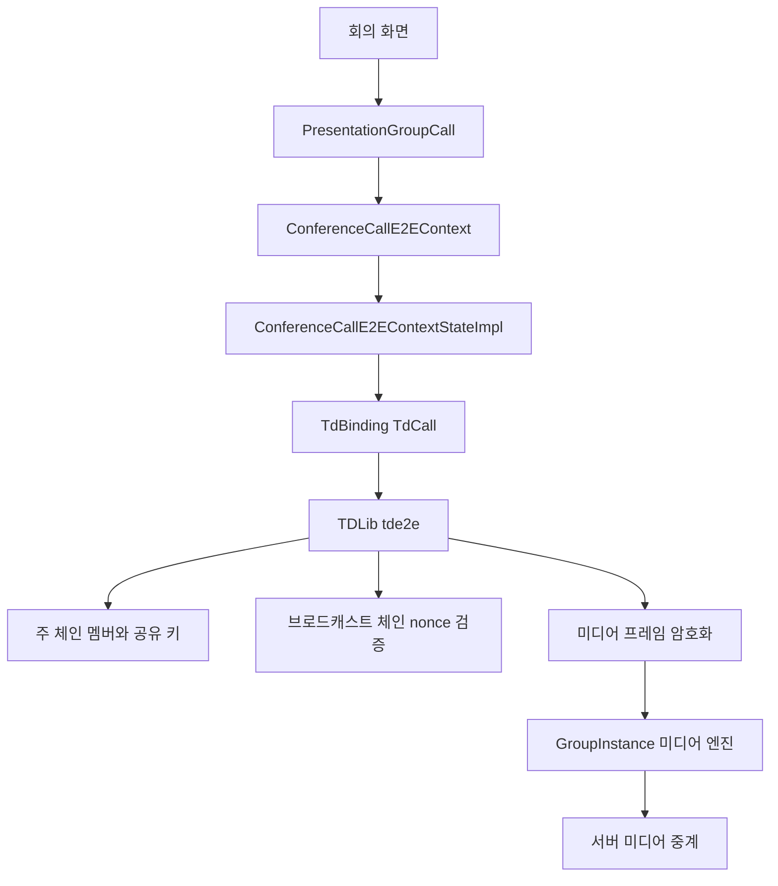
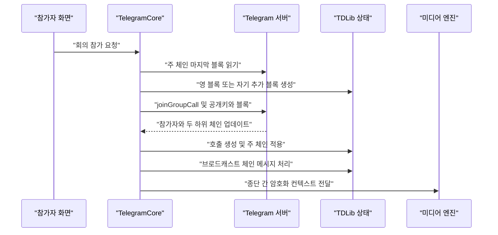
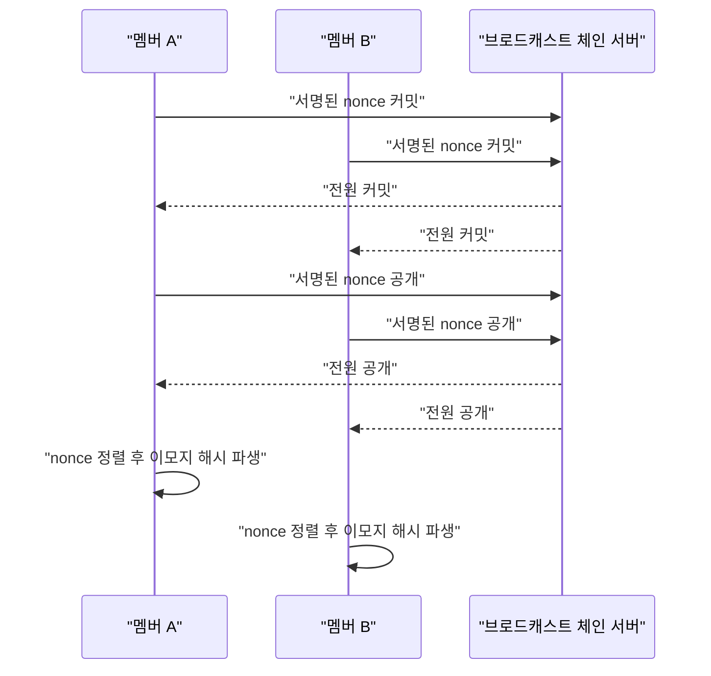
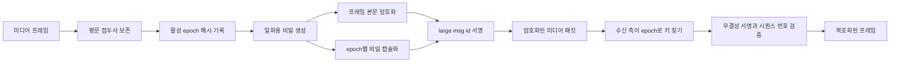

# 컨퍼런스 통화의 종단 간 암호화

웹: /docs/system/18-conference-e2e/ · Markdown: /docs/system/18-conference-e2e.md

> Telegram 컨퍼런스 통화의 멤버 상태 체인, 키 교체, 이모지 검증, 미디어 프레임 암호화를 설명해요.

> 시스템 설계 · 통화 · 18장 · 도표 4 · 코드 발췌 10 · 인용 36 · 소스 기준선: [TelegramMessenger/Telegram-iOS@f1dd7a2d](https://github.com/TelegramMessenger/Telegram-iOS/tree/f1dd7a2dbd02cbbf513e75d5695d8d36d1cf5838), [overtake/TelegramSwift@579cebbf](https://github.com/overtake/TelegramSwift/tree/579cebbf0c01fd41b712eff3647fa7f69db9665d)
>
> 핵심 소스 파일: [TelegramMessenger/Telegram-iOS/submodules/TelegramCore/Sources/State/ConferenceCallE2EContext.swift](https://github.com/TelegramMessenger/Telegram-iOS/blob/f1dd7a2dbd02cbbf513e75d5695d8d36d1cf5838/submodules/TelegramCore/Sources/State/ConferenceCallE2EContext.swift), [TelegramMessenger/Telegram-iOS/submodules/TelegramCore/Sources/TelegramEngine/Calls/GroupCalls.swift](https://github.com/TelegramMessenger/Telegram-iOS/blob/f1dd7a2dbd02cbbf513e75d5695d8d36d1cf5838/submodules/TelegramCore/Sources/TelegramEngine/Calls/GroupCalls.swift), [TelegramMessenger/Telegram-iOS/submodules/TelegramCallsUI/Sources/PresentationGroupCall.swift](https://github.com/TelegramMessenger/Telegram-iOS/blob/f1dd7a2dbd02cbbf513e75d5695d8d36d1cf5838/submodules/TelegramCallsUI/Sources/PresentationGroupCall.swift), [TelegramMessenger/Telegram-iOS/submodules/TelegramCallsUI/Sources/VideoChatScreen.swift](https://github.com/TelegramMessenger/Telegram-iOS/blob/f1dd7a2dbd02cbbf513e75d5695d8d36d1cf5838/submodules/TelegramCallsUI/Sources/VideoChatScreen.swift), [TelegramMessenger/Telegram-iOS/submodules/TelegramVoip/Sources/GroupCallContext.swift](https://github.com/TelegramMessenger/Telegram-iOS/blob/f1dd7a2dbd02cbbf513e75d5695d8d36d1cf5838/submodules/TelegramVoip/Sources/GroupCallContext.swift), [TelegramMessenger/Telegram-iOS/third-party/td/TdBinding/Sources/TdBinding.mm](https://github.com/TelegramMessenger/Telegram-iOS/blob/f1dd7a2dbd02cbbf513e75d5695d8d36d1cf5838/third-party/td/TdBinding/Sources/TdBinding.mm), [tdlib/td/tde2e/td/e2e/Call.cpp](https://github.com/tdlib/td/blob/e894536b2f46caad93f997448d2daff9431b19dd/tde2e/td/e2e/Call.cpp), [tdlib/td/tde2e/td/e2e/Call.h](https://github.com/tdlib/td/blob/e894536b2f46caad93f997448d2daff9431b19dd/tde2e/td/e2e/Call.h), [tdlib/td/tde2e/td/e2e/Blockchain.cpp](https://github.com/tdlib/td/blob/e894536b2f46caad93f997448d2daff9431b19dd/tde2e/td/e2e/Blockchain.cpp), [tdlib/td/tde2e/td/e2e/Blockchain.h](https://github.com/tdlib/td/blob/e894536b2f46caad93f997448d2daff9431b19dd/tde2e/td/e2e/Blockchain.h), [tdlib/td/tde2e/td/e2e/Keys.cpp](https://github.com/tdlib/td/blob/e894536b2f46caad93f997448d2daff9431b19dd/tde2e/td/e2e/Keys.cpp), [tdlib/td/tde2e/td/e2e/MessageEncryption.cpp](https://github.com/tdlib/td/blob/e894536b2f46caad93f997448d2daff9431b19dd/tde2e/td/e2e/MessageEncryption.cpp), [overtake/TelegramSwift/Telegram-Mac/GroupCallController.swift](https://github.com/overtake/TelegramSwift/blob/579cebbf0c01fd41b712eff3647fa7f69db9665d/Telegram-Mac/GroupCallController.swift), [overtake/Telegram-iOS/submodules/TelegramCallsUI/Sources/PresentationGroupCall.swift](https://github.com/overtake/Telegram-iOS/blob/a24bbe45f9861f736a79916a50898512f751e0dc/submodules/TelegramCallsUI/Sources/PresentationGroupCall.swift)
>
> 미검증 사항:
> - 서버가 두 getGroupCallChainBlocks 하위 체인 각각에 얼마나 많은 이력 블록을 보관하는지, 그리고 오래된 클라이언트가 어떻게 초기화되는지는 클라이언트 소스 코드로 검증하지 못했어요.
> - CallsEmoji 모듈 안에서 32바이트 해시로부터 이모지 네 개를 고르는 구체적인 인덱스 알고리즘은 이번 소스 범위에서 검증하지 않았어요.
> - 서버가 모든 블록, 브로드캐스트, 미디어 패킷에 같은 권한 의미론을 검증하는지는 클라이언트 소스 코드로 증명하지 못했어요.
> - macOS 독립 tgcalls 서브모듈이 encryptDecrypt 콜백을 C++에서 호출하는 지점과 ABI는 이번 범위에서 검증하지 않았어요.

## 문제와 제약 [#문제와-제약]

이 장은 컨퍼런스 통화의 종단 간 암호화(통신 양 끝의 단말만 내용을 푸는 암호화)만 다뤄요. 여기서 컨퍼런스 통화는 `isConference`가 참인 그룹 통화예요. 일반 그룹 통화와는 이렇게 달라요.

- 일반 그룹 통화: 서버가 미디어를 중계할 수 있어요.
- 컨퍼런스 통화: 현재 멤버 모두가 같은 상태와 공유 미디어 키를 가져야 해요.

서버는 여전히 제어 업데이트와 미디어 패킷을 중계해요. 하지만 클라이언트는 전송 전에 미디어 내용을 암호화하고, 수신 후에 검증하고 복호화해요.

기존 《통화 시스템》은 전화 제어 평면, 그룹 미디어 엔진, 업그레이드 진입점을 설명했어요. 이 장은 그중 검증되지 않았던 회의 상태 체인, 교체, 패킷 형식을 보완해요. 결론은 iOS 고정 커밋과 TDLib(Telegram의 클라이언트 라이브러리) 고정 커밋에서 나왔어요. 본문 중의 추론은 명시적으로 표시해요.

이 설계는 동시에 다섯 가지 제약을 마주해요.

- 멤버 집합은 변해요. 관리자는 멤버를 초대하거나, 내보내거나, 이탈자를 정리할 수 있어요.
- 네트워크 업데이트는 순서가 뒤바뀌거나 빠져요.
- 실시간 미디어는 긴 상태 복구를 기다릴 수 없어요.
- 사용자는 회의의 모든 엔드포인트가 같은 상태를 보고 있는지도 확인해야 해요.

`ConferenceCallE2EContext`는 암호학을 직접 구현하지 않아요. 상태 어댑터 프로토콜을 정의하고, 구체적인 작업은 `TelegramCallsUI`의 `ConferenceCallE2EContextStateImpl`에 맡겨요. `ConferenceCallE2EContextStateImpl`이 `TdCall`을 갖고 있어요. `TdCall`은 다시 `tde2e_api`를 호출해요. 이런 계층 구조 덕분에 Swift의 통화 수명 주기가 TDLib의 키, 서명, 패킷 형식과 분리돼요. [\[1\]](https://github.com/TelegramMessenger/Telegram-iOS/blob/f1dd7a2dbd02cbbf513e75d5695d8d36d1cf5838/submodules/TelegramCore/Sources/State/ConferenceCallE2EContext.swift#L4-L28) [\[2\]](https://github.com/TelegramMessenger/Telegram-iOS/blob/f1dd7a2dbd02cbbf513e75d5695d8d36d1cf5838/submodules/TelegramCallsUI/Sources/PresentationGroupCall.swift#L332-L402)

```swift
public protocol ConferenceCallE2EContextState: AnyObject {
    func getEmojiState() -> Data?
    func getParticipantIds() -> [Int64]
    func getParticipants() -> [ConferenceCallE2EContext.BlockchainParticipant]
    func getParticipantLatencies() -> [Int64: Double]

    func applyBlock(block: Data) -> Bool
    func applyBroadcastBlock(block: Data)
    
    func generateRemoveParticipantsBlock(participantIds: [Int64]) -> Data?

    func takeOutgoingBroadcastBlocks() -> [Data]

    func encrypt(message: Data, channelId: Int32, plaintextPrefixLength: Int) -> Data?
    func decrypt(message: Data, userId: Int64) -> Data?
}
```
[\[1\]](https://github.com/TelegramMessenger/Telegram-iOS/blob/f1dd7a2dbd02cbbf513e75d5695d8d36d1cf5838/submodules/TelegramCore/Sources/State/ConferenceCallE2EContext.swift#L4-L28)

`TdBinding`의 키 객체는 TDLib 개인키 핸들과 공개 바이트만 Objective C에 노출해요. `TdKeyPair.generate`는 먼저 개인키 핸들을 요청한 다음 공개키를 가져와요. 개인키 바이트는 Swift로 반환되지 않아요. `TdCall`이 소멸할 때 `call_destroy`를 호출해서, TDLib가 해당 회의 상태를 들고 있던 것을 해제해요. [\[3\]](https://github.com/TelegramMessenger/Telegram-iOS/blob/f1dd7a2dbd02cbbf513e75d5695d8d36d1cf5838/third-party/td/TdBinding/Sources/TdBinding.mm#L41-L55) [\[36\]](https://github.com/TelegramMessenger/Telegram-iOS/blob/f1dd7a2dbd02cbbf513e75d5695d8d36d1cf5838/third-party/td/TdBinding/Sources/TdBinding.mm#L79-L128)

TDLib 공개 API는 멤버 상태, 블록 생성, 미디어 암복호화, 검증 상태를 독립된 작업으로 선언해요. `CallState`는 멤버 배열을 포함해요. 각 멤버는 Telegram 숫자 사용자 ID, 공개키 핸들, 권한 정수로 구성돼요. API의 `CallVerificationState`는 체인 높이와 선택적 이모지 해시를 함께 포함해요. 따라서 이모지는 독립된 채팅 설정이 아니에요. 현재 체인 상태에서 파생된 출력이에요. [\[4\]](https://github.com/tdlib/td/blob/e894536b2f46caad93f997448d2daff9431b19dd/tde2e/td/e2e/e2e_api.h#L288-L340)

## 모듈과 데이터 구조 [#모듈과-데이터-구조]

### 신원, 권한, 공유 키 [#신원-권한-공유-키]

각 멤버는 서로 다른 두 신원을 가져요.

- `user_id`: Telegram 사용자의 정수 신원이에요.
- `public_key`: 해당 회의 상태에서의 공개키예요.

둘은 `GroupParticipant`에 함께 나타나요. 같은 사용자가 다시 참가하면 클라이언트는 기존 상태에서 같은 사용자 ID를 삭제한 뒤 새 멤버 항목을 추가해요. 따라서 이 사용자의 이전 항목을 새 키로 바꾸는 걸 지원해요. 같은 사용자를 두 번 유지하지 않아요. [\[5\]](https://github.com/tdlib/td/blob/e894536b2f46caad93f997448d2daff9431b19dd/tde2e/td/e2e/Blockchain.h#L34-L113) [\[6\]](https://github.com/tdlib/td/blob/e894536b2f46caad93f997448d2daff9431b19dd/tde2e/td/e2e/Call.cpp#L595-L623)

키 구현은 Ed25519 개인키와 공개키를 써요. 공개키는 서명 검증에 쓰여요. `compute_shared_secret`은 Ed25519 키 쌍에서 X25519 공유 비밀을 계산한 다음, 태그 `tde2e_shared_secret`을 쓴 HMAC SHA512의 앞 32바이트를 가져와요. 이 키 쌍에는 서명 신원도 있고, 수신자별 키 캡슐화 재료도 있어요. [\[7\]](https://github.com/tdlib/td/blob/e894536b2f46caad93f997448d2daff9431b19dd/tde2e/td/e2e/Keys.cpp#L118-L147)

권한은 UI의 관리자 목록이 아니에요. 권한 정수의 비트는 이렇게 쓰여요.

- 상태 체인의 하위 3비트: 각각 멤버 추가, 멤버 제거, 키-값 설정을 허용해요.
- `IsParticipant`: 상위 비트예요.

여전히 멤버이면서 멤버를 추가하거나 제거할 수 있는 공개키만 공유 키를 수정할 수 있어요. 멤버 상태는 중복 사용자 ID, 중복 공개키, 범위를 벗어난 권한 비트도 금지해요. [\[5\]](https://github.com/tdlib/td/blob/e894536b2f46caad93f997448d2daff9431b19dd/tde2e/td/e2e/Blockchain.h#L34-L113) [\[8\]](https://github.com/tdlib/td/blob/e894536b2f46caad93f997448d2daff9431b19dd/tde2e/td/e2e/Blockchain.cpp#L334-L447)

```cpp
struct GroupParticipant {
  td::int64 user_id{0};
  td::int32 flags{0};
  PublicKey public_key{};
  td::int32 version{1};
  bool add_users() const {
    return (flags & GroupParticipantFlags::AddUsers) != 0;
  }
  bool remove_users() const {
    return (flags & GroupParticipantFlags::RemoveUsers) != 0;
  }
// ...
};

struct Permissions {
  td::int32 flags{0};
  bool may_add_users() const {
    return (flags & GroupParticipantFlags::AddUsers) != 0;
  }
  bool may_remove_users() const {
    return (flags & GroupParticipantFlags::RemoveUsers) != 0;
  }
  bool may_set_value() const {
    return (flags & GroupParticipantFlags::SetValue) != 0;
  }
  bool is_participant() const {
    return (flags & GroupParticipantFlags::IsParticipant) != 0;
  }
  bool may_change_shared_key() const {
    return is_participant() && (may_remove_users() || may_add_users());
  }
};
```
[\[5\]](https://github.com/tdlib/td/blob/e894536b2f46caad93f997448d2daff9431b19dd/tde2e/td/e2e/Blockchain.h#L34-L113)

`GroupSharedKey`는 평문 그룹 키를 직접 저장하지 않아요. 대신 이런 값을 포함해요.

- 임시 공개키 `ek`
- 암호화된 32바이트 그룹 키
- 수신자별 사용자 ID
- 같은 개수의 암호화 헤더

TDLib는 이런 점을 검증해요.

- 수신자 배열의 길이가 같은지
- 개수가 현재 멤버 수와 같은지
- 중복 사용자가 없는지
- 모든 사용자가 멤버 상태에 있는지

그래서 공유 키 객체 하나는 현재 멤버 집합 전체를 반드시 포함해야 해요. [\[9\]](https://github.com/tdlib/td/blob/e894536b2f46caad93f997448d2daff9431b19dd/tde2e/td/e2e/Blockchain.h#L118-L140)

### 주 체인, 브로드캐스트 하위 체인, 로컬 상태 [#주-체인-브로드캐스트-하위-체인-로컬-상태]

회의에는 클라이언트가 폴링하는 하위 체인이 두 개 있어요. 이 글에서는 하위 체인 0을 주 체인, 하위 체인 1을 브로드캐스트 체인이라고 불러요. 이건 `subChainId`가 하는 처리 역할을 근거로 한 추론이에요.

- 주 체인: 블록이 `applyBlock`을 거쳐 멤버와 공유 키를 바꿔요.
- 브로드캐스트 체인: 메시지가 `applyBroadcastBlock`을 거쳐 nonce(한 번만 쓰는 무작위 값) 커밋과 공개(reveal)를 구동해요.

참가 결과의 `E2EState`는 두 하위 체인의 오프셋과 블록 배열을 각각 담고 있어요. [\[10\]](https://github.com/TelegramMessenger/Telegram-iOS/blob/f1dd7a2dbd02cbbf513e75d5695d8d36d1cf5838/submodules/TelegramCore/Sources/TelegramEngine/Calls/GroupCalls.swift#L622-L653) [\[11\]](https://github.com/TelegramMessenger/Telegram-iOS/blob/f1dd7a2dbd02cbbf513e75d5695d8d36d1cf5838/submodules/TelegramCore/Sources/TelegramEngine/Calls/GroupCalls.swift#L655-L703)

주 체인 블록은 이런 필드를 가져요.

- 높이
- 이전 블록 해시
- 변경 배열
- 상태 증명
- 선택적 서명 공개키
- 서명

변경은 키-값을 쓰거나, 그룹 멤버 상태를 교체하거나, 공유 키를 설정하거나, 동작 없는 난수만 추가할 수 있어요.

클라이언트는 블록을 만들 때 이렇게 해요.

1. 높이를 이전 높이 + 1로 설정해요.
2. 이전 블록 해시를 채워요.
3. 상태 증명을 만들어요.
4. 시작한 사람의 개인키로 서명해요.

블록을 적용할 때는 높이가 이어지는지, 이전 해시가 맞는지 검사한 다음, 서명과 상태를 검사해요. [\[12\]](https://github.com/tdlib/td/blob/e894536b2f46caad93f997448d2daff9431b19dd/tde2e/td/e2e/Blockchain.h#L255-L308) [\[13\]](https://github.com/tdlib/td/blob/e894536b2f46caad93f997448d2daff9431b19dd/tde2e/td/e2e/Blockchain.cpp#L607-L685)

```cpp
struct Block {
  Signature signature_;
  td::UInt256 prev_block_hash_{};
  std::vector<Change> changes_;
  td::int32 height_{-1};

  StateProof state_proof_;
  td::optional<PublicKey> o_signature_public_key_;

  td::Status sign_inplace(const PrivateKey &private_key) {
    TRY_RESULT_ASSIGN(signature_, ::tde2e_core::sign(private_key, *to_tl()));
    return td::Status::OK();
  }
  td::Status verify_signature(const PublicKey &public_key) const {
    return ::tde2e_core::verify_signature(public_key, *to_tl());
  }
  td::UInt256 calc_hash() const;
// ...
};
```
[\[12\]](https://github.com/tdlib/td/blob/e894536b2f46caad93f997448d2daff9431b19dd/tde2e/td/e2e/Blockchain.h#L255-L308)

`ContextStateHolder`는 null이 될 수 있는 TD 상태와 아직 처리할 수 없는 브로드캐스트 메시지를 하나의 원자적 객체 안에 둬요. 브로드캐스트 체인이 주 체인보다 먼저 도착하면 `pendingIncomingBroadcastBlocks`에 먼저 쌓아요. 첫 주 체인 블록을 받고 `TdCall`을 성공적으로 만들면, 코드는 곧바로 이 브로드캐스트들을 하나씩 재생해요. 이렇게 하면 멤버 공개키를 아직 모르는 시점에 브로드캐스트 프로토콜이 잘못 실패하는 일을 막아요. [\[1\]](https://github.com/TelegramMessenger/Telegram-iOS/blob/f1dd7a2dbd02cbbf513e75d5695d8d36d1cf5838/submodules/TelegramCore/Sources/State/ConferenceCallE2EContext.swift#L4-L28) [\[14\]](https://github.com/TelegramMessenger/Telegram-iOS/blob/f1dd7a2dbd02cbbf513e75d5695d8d36d1cf5838/submodules/TelegramCore/Sources/State/ConferenceCallE2EContext.swift#L167-L220)

주 체인 블록을 처리할 때마다 Swift 상위 계층은 관찰할 수 있는 결과 세 가지를 발행해요.

- 이모지 해시
- 체인 상태에서 꺼낸 참가자
- 실패 비트

주 체인 적용이 실패하면 `isFailed`를 참으로 설정해요. 코드는 이 오류를 암호화되지 않은 미디어 모드로 이어 가지 않아요. [\[14\]](https://github.com/TelegramMessenger/Telegram-iOS/blob/f1dd7a2dbd02cbbf513e75d5695d8d36d1cf5838/submodules/TelegramCore/Sources/State/ConferenceCallE2EContext.swift#L167-L220)



## 참가와 상태 수렴 [#참가와-상태-수렴]

### 참가자가 신원을 제출하는 방법 [#참가자가-신원을-제출하는-방법]

회의 참가는 일반 미디어를 먼저 세우고 나중에 종단 간 상태를 보충하는 방식이 아니에요. `PresentationGroupCall`은 join payload를 쓸 수 있게 될 때마다 `generateE2EData` 클로저를 준비해요. 클로저의 동작은 이래요.

- 서버가 최근 주 체인 블록을 돌려주면 `tdGenerateSelfAddBlock`을 호출해요.
- 블록이 없으면 `tdGenerateZeroBlock`을 호출해요.
- 이어서 공개키와 만든 블록을 미디어 join payload와 함께 `engine.calls.joinGroupCall`에 전달해요.

[\[15\]](https://github.com/TelegramMessenger/Telegram-iOS/blob/f1dd7a2dbd02cbbf513e75d5695d8d36d1cf5838/submodules/TelegramCallsUI/Sources/PresentationGroupCall.swift#L2034-L2089)

`_internal_joinGroupCall`은 실제로 RPC를 보내기 전에 `offset`을 -1, `limit`을 1로 해서 최근 주 체인 블록을 가져와요. 이 결과가 클로저의 입력 인자를 결정해요. 종단 간 데이터가 있으면 함수는 flags의 3번 비트를 설정하고 공개키와 블록을 `phone.joinGroupCall`에 넣어요. 이렇게 미디어 참가와 신원 상태 제출이 하나의 API 요청으로 묶여요. [\[11\]](https://github.com/TelegramMessenger/Telegram-iOS/blob/f1dd7a2dbd02cbbf513e75d5695d8d36d1cf5838/submodules/TelegramCore/Sources/TelegramEngine/Calls/GroupCalls.swift#L655-L703)

```swift
var e2eData: Signal<JoinGroupCallE2E?, NoError> = .single(nil)
if let generateE2E {
    e2eData = _internal_pollConferenceCallBlockchain(network: account.network, reference: reference, subChainId: 0, offset: -1, limit: 1)
    |> map { result -> JoinGroupCallE2E? in
        guard let result else {
            return nil
        }
        guard let block = result.blocks.last else {
            return generateE2E(nil)
        }
        return generateE2E(block)
    }
}
// ...
if e2eData != nil {
    flags |= (1 << 3)
}
let joinRequest = account.network.request(Api.functions.phone.joinGroupCall(flags: flags, call: reference.apiInputGroupCall, joinAs: inputJoinAs, inviteHash: inviteHash, publicKey: e2eData?.publicKey.value, block: (e2eData?.block).flatMap({ Buffer.init(data: $0) }), params: .dataJSON(.init(data: joinPayload))))
```
[\[11\]](https://github.com/TelegramMessenger/Telegram-iOS/blob/f1dd7a2dbd02cbbf513e75d5695d8d36d1cf5838/submodules/TelegramCore/Sources/TelegramEngine/Calls/GroupCalls.swift#L655-L703)

첫 번째 멤버의 영(zero) 블록은 자기 자신을 포함해요. 이후 멤버의 자기 추가 블록은 이렇게 만들어요.

1. 서버 형식을 로컬 형식으로 되돌려요.
2. 이전 멤버 상태를 읽어요.
3. 같은 사용자 ID의 이전 기록을 삭제해요.
4. 현재 사용자 ID, 공개키, 권한을 추가해요.

그러니 중복 참가는 단순히 두 번째 신원을 덧붙이는 게 아니에요. 호출을 만들 때 TDLib는 같은 공개키로 `Call` 인스턴스를 여러 개 만드는 것도 금지해요. [\[6\]](https://github.com/tdlib/td/blob/e894536b2f46caad93f997448d2daff9431b19dd/tde2e/td/e2e/Call.cpp#L595-L623) [\[16\]](https://github.com/tdlib/td/blob/e894536b2f46caad93f997448d2daff9431b19dd/tde2e/td/e2e/Call.cpp#L631-L656)

`joinGroupCall`이 성공하면 업데이트가 두 하위 체인의 상태를 동시에 제공해야 해요. Core는 `updateGroupCallChainBlocks`에서 그 오프셋과 블록을 뽑아요. 호출자가 종단 간 데이터를 요청했는데 결과에 어느 한 하위 체인의 상태라도 없으면 함수는 일반 참가 실패를 반환해요. 이 가드 덕분에 이후의 `ConferenceCallE2EContext.begin`은 완전한 시작점을 갖게 돼요. [\[17\]](https://github.com/TelegramMessenger/Telegram-iOS/blob/f1dd7a2dbd02cbbf513e75d5695d8d36d1cf5838/submodules/TelegramCore/Sources/TelegramEngine/Calls/GroupCalls.swift#L869-L954)

참가에 성공하면 `ConferenceCallE2EContext.begin`은 이렇게 시작해요.

- 초기 offset 두 개를 저장해요.
- 반환된 블록 집합 두 개를 먼저 적용해요.
- 폴링 두 개를 시작해요.
- 10초마다 멤버 정리 동기화도 실행해요.

오프셋은 연속된 블록이 도착할 때만 앞으로 나아가요. 업데이트가 공백을 암시하면 코드는 공백을 넘은 블록을 TDLib에 넘기지 않고, 곧바로 해당 하위 체인을 다시 폴링해요. [\[18\]](https://github.com/TelegramMessenger/Telegram-iOS/blob/f1dd7a2dbd02cbbf513e75d5695d8d36d1cf5838/submodules/TelegramCore/Sources/State/ConferenceCallE2EContext.swift#L96-L165) [\[19\]](https://github.com/TelegramMessenger/Telegram-iOS/blob/f1dd7a2dbd02cbbf513e75d5695d8d36d1cf5838/submodules/TelegramCore/Sources/State/ConferenceCallE2EContext.swift#L222-L293)



### 멤버 이탈, 내보내기, 재폴링 [#멤버-이탈-내보내기-재폴링]

멤버 이탈에는 트리거 경로가 두 가지 있어요.

- 제품 계층이 사용자를 `pendingKickPeers`에 넣을 수 있어요. 이때 컨텍스트는 여전히 블록체인 멤버 집합에 있는 ID만 남기고, 그들에 대한 제거 블록을 만들고, `kick` 모드로 삭제 RPC를 호출해요.
- 주기적 정리예요. 클라이언트가 현재 서버 참가자를 최대 100명 요청해서, 서버 목록과 블록체인 멤버 집합의 차집합을 구해요. 그리고 본 계정을 뺀 뒤 `cleanup` 모드로 제거 블록을 제출해요.

[\[20\]](https://github.com/TelegramMessenger/Telegram-iOS/blob/f1dd7a2dbd02cbbf513e75d5695d8d36d1cf5838/submodules/TelegramCore/Sources/State/ConferenceCallE2EContext.swift#L295-L449)

삭제 RPC가 성공하면 Core는 서버 업데이트를 `stateManager`에 넘겨요. 어떤 RPC 오류든 `pollBlocksAndRetry`로 매핑돼요. 컨텍스트는 오래된 로컬 상태로 같은 블록을 반복해서 만들지 않아요. 대신 이렇게 해요.

- 원래 제거 대기 중이던 ID를 처리 대기 큐에 되돌려 놓아요.
- 주 체인을 먼저 폴링하도록 표시해요.
- 다시 시도해요.

이 순서는 소스 코드로 확인된 동시성 수렴 전략이에요.

TDLib는 멤버 상태가 바뀔 때 새 공유 키도 함께 만들어요.

1. 32바이트 그룹 키 하나와 32바이트 일회용 비밀 하나를 무작위로 만들어요.
2. 일회용 비밀로 그룹 키를 암호화해요.
3. 새 상태의 모든 멤버에 대해 공유 비밀을 계산하고, 그 멤버 전용의 암호화 헤더를 만들어요.

블록 하나가 `ChangeSetGroupState`와 `ChangeSetSharedKey`를 함께 담아요. 따라서 참가, 제거, 권한 상태 변경은 멤버 배열만 고치는 게 아니에요. 키 교체와 함께 묶여요. [\[16\]](https://github.com/tdlib/td/blob/e894536b2f46caad93f997448d2daff9431b19dd/tde2e/td/e2e/Call.cpp#L631-L656)

```cpp
td::Result<std::vector<Change>> Call::make_changes_for_new_state(GroupStateRef group_state) {
  TRY_RESULT(e_private_key, PrivateKey::generate());
  td::SecureString group_shared_key(32);
  td::Random::secure_bytes(group_shared_key.as_mutable_slice());

  td::SecureString one_time_secret(32);
  td::Random::secure_bytes(one_time_secret.as_mutable_slice());

  auto encrypted_group_shared_key = MessageEncryption::encrypt_data(group_shared_key, one_time_secret);

  std::vector<td::int64> dst_user_id;
  std::vector<std::string> dst_header;
  for (auto &participant : group_state->participants) {
    auto public_key = participant.public_key;
    TRY_RESULT(shared_key, e_private_key.compute_shared_secret(public_key));
    dst_user_id.push_back(participant.user_id);
    TRY_RESULT(header, MessageEncryption::encrypt_header(one_time_secret, encrypted_group_shared_key, shared_key));
    dst_header.push_back(header.as_slice().str());
  }
  auto change_set_shared_key = Change{ChangeSetSharedKey{std::make_shared<GroupSharedKey>(
      GroupSharedKey{e_private_key.to_public_key(), encrypted_group_shared_key.as_slice().str(), std::move(dst_user_id),
                     std::move(dst_header)})}};
  auto change_set_group_state = Change{ChangeSetGroupState{std::move(group_state)}};

  return std::vector<Change>{std::move(change_set_group_state), std::move(change_set_shared_key)};
}
```
[\[16\]](https://github.com/tdlib/td/blob/e894536b2f46caad93f997448d2daff9431b19dd/tde2e/td/e2e/Call.cpp#L631-L656)

## Epoch, 폴링, 이모지 검증 [#epoch-폴링-이모지-검증]

### 주 체인 높이로 나누는 epoch [#주-체인-높이로-나누는-epoch]

성공적으로 적용된 주 체인 블록은 각각 새 epoch(그 높이의 키와 멤버 상태를 묶은 단위)예요. TDLib는 이 순서로 처리해요.

1. 이전 높이와 그 이전 해시에 해당하는 키를 잊도록 예약해요.
2. 현재 `GroupSharedKey`에서 본 사용자의 암호화 헤더를 찾아 공유 비밀을 계산하고, 일회용 비밀을 풀고, 그룹 키를 풀어요.
3. 그룹 상태 버전이 1 이상이면 최신 블록 해시를 메시지로 해서 HMAC SHA512를 수행하고, 앞 32바이트를 실제 epoch 키로 삼아요.
4. 현재 체인 높이와 최신 블록 해시로 키와 해당 멤버 상태를 설치해요.

[\[21\]](https://github.com/tdlib/td/blob/e894536b2f46caad93f997448d2daff9431b19dd/tde2e/td/e2e/Call.cpp#L688-L734)

```cpp
td::Status Call::update_group_shared_key() {
  // NB: we drop key immediately, we don't want old key to be active due to some errors later
  group_shared_key_ = {};
  call_encryption_.forget_shared_key(td::narrow_cast<td::int32>(blockchain_.get_height() - 1),
                                     blockchain_.get_previous_block_hash());

  auto group_state = blockchain_.get_group_state();

  auto r_participant = group_state->get_participant(private_key_.to_public_key());
  if (r_participant.is_error()) {
    return Error(E::InvalidCallGroupState_NotParticipant);
  }
  auto participant = r_participant.move_as_ok();
  if (participant.user_id != user_id_) {
    return Error(E::InvalidCallGroupState_WrongUserId);
  }

  TRY_RESULT_ASSIGN(group_shared_key_, decrypt_shared_key());
  if (group_state->version() >= 1) {
    group_shared_key_ = td::SecureString(
        MessageEncryption::hmac_sha512(group_shared_key_, blockchain_.get_last_block_hash().as_slice())
            .as_slice()
            .substr(0, 32));
  }

  return call_encryption_.add_shared_key(td::narrow_cast<td::int32>(blockchain_.get_height()),
                                         blockchain_.get_last_block_hash(), group_shared_key_.copy(), group_state);
}
```
[\[21\]](https://github.com/tdlib/td/blob/e894536b2f46caad93f997448d2daff9431b19dd/tde2e/td/e2e/Call.cpp#L688-L734)

보존 정책에는 명시적인 수치 세 개가 있어요.

- 오래된 epoch: 최대 10초 지연된 뒤 잊혀요.
- 활성 epoch: 최대 15개예요.
- 재전송 방지 검사: 발신 공개키와 채널별로 시퀀스 번호 집합을 저장해요. 집합이 1024개를 넘거나 가장 이른 시퀀스 번호가 새 번호보다 1024 이상 앞서면 가장 이른 항목을 삭제해요.

[\[22\]](https://github.com/tdlib/td/blob/e894536b2f46caad93f997448d2daff9431b19dd/tde2e/td/e2e/Call.h#L88-L137) [\[23\]](https://github.com/tdlib/td/blob/e894536b2f46caad93f997448d2daff9431b19dd/tde2e/td/e2e/Call.cpp#L475-L519)

여기서 10초는 서버가 주 체인 블록을 보관하는 시간이 아니에요. 여기서 15도 회의 인원 상한이 아니에요. 이 값들은 로컬 미디어 복호화가 들고 있는 오래된 epoch만 제한해요. 소스 코드는 서버가 `getGroupCallChainBlocks` 이력을 저장하는 기한도, 영속화된 주 체인 블록 수의 상한도 제시하지 않아요. 따라서 서버의 블록 보존 정책은 미검증이에요.

### 체크포인트, 체인 형식, 상태의 출처 [#체크포인트-체인-형식-상태의-출처]

클라이언트는 각 하위 체인의 다음 offset을 네트워크 체크포인트로 다뤄요. 최초 참가 응답은 각각의 offset과 이미 얻은 블록을 먼저 줘요. 이후의 실시간 업데이트는 `nextOffset`에서 블록 수를 빼서 각 블록의 위치를 거꾸로 구해요. 블록 위치를 로컬 offset과 비교한 결과에 따라 이렇게 처리해요.

- 정확히 같을 때만: offset을 앞으로 옮기고 그 블록을 적용해요.
- 더 클 때: 공백을 건너뛰지 않고 폴링을 예약해요.
- 더 작을 때: 더 이상 적용하지 않아요.

이 규칙은 중복 업데이트와 순서가 뒤바뀐 업데이트에 대한 멱등 경계를 제공해요. [\[18\]](https://github.com/TelegramMessenger/Telegram-iOS/blob/f1dd7a2dbd02cbbf513e75d5695d8d36d1cf5838/submodules/TelegramCore/Sources/State/ConferenceCallE2EContext.swift#L96-L165)

주 체인의 암호학적 체크포인트는 마지막으로 수락한 블록의 높이와 해시예요. `Blockchain::try_apply_block`이 요구하는 조건은 이래요.

- 새 높이가 현재 높이 + 1과 엄격히 같아야 해요.
- `prev_block_hash_`가 로컬의 마지막 해시와 같아야 해요.
- 상태, 서명, 권한 검사가 모두 성공해야 해요.

이 조건을 모두 통과한 뒤에야 코드는 상태를 교체하고 마지막 해시를 갱신해요. 따라서 서버에서 온 블록의 순서는 신뢰의 근거가 아니에요. 연속성과 서명이 클라이언트가 수락하는 근거예요. [\[8\]](https://github.com/tdlib/td/blob/e894536b2f46caad93f997448d2daff9431b19dd/tde2e/td/e2e/Blockchain.cpp#L334-L447) [\[13\]](https://github.com/tdlib/td/blob/e894536b2f46caad93f997448d2daff9431b19dd/tde2e/td/e2e/Blockchain.cpp#L607-L685)

서버 형식과 로컬 형식 사이에는 명확하고 좁은 변환이 하나 더 있어요. TDLib는 첫 번째 4바이트 매직 넘버를 검사해요.

- 서버 블록을 읽을 때: 1을 빼요.
- 로컬 블록을 서버에 제출할 때: 1을 더해요.

이 변환은 주 체인 블록과 두 종류의 브로드캐스트 메시지 모두에 적용돼요. 암호화 단계가 아니고, 블록 안의 서명 데이터 이외의 필드를 바꾸지도 않아요. 코드는 이 매직 넘버 오프셋이 서버 프로토콜상 왜 필요한지 설명하지 않아요. 그래서 그 이유는 미검증이에요. [\[13\]](https://github.com/tdlib/td/blob/e894536b2f46caad93f997448d2daff9431b19dd/tde2e/td/e2e/Blockchain.cpp#L607-L685)

회의 실행 중에는 멤버 뷰가 두 벌 있어요.

- 주 체인의 `GroupState`: 키 수신자와 서명 검증자의 권위 있는 입력이에요.
- 일반 그룹 통화 참가자 목록: SSRC(미디어 스트림 식별자), 미디어 표시, 이탈 이벤트를 제공해요.

클라이언트는 참가자 목록으로 `GroupState`를 직접 대체하지 않아요. 둘을 주기적으로 비교해서, 체인에 남아 있는 사용자를 새 제거 블록으로 바꿔요. 추론하자면 이렇게 뷰를 둘로 나눈 건 미디어 가시성과 암호화 권한을 분리한 결과예요. [\[17\]](https://github.com/TelegramMessenger/Telegram-iOS/blob/f1dd7a2dbd02cbbf513e75d5695d8d36d1cf5838/submodules/TelegramCore/Sources/TelegramEngine/Calls/GroupCalls.swift#L869-L954) [\[20\]](https://github.com/TelegramMessenger/Telegram-iOS/blob/f1dd7a2dbd02cbbf513e75d5695d8d36d1cf5838/submodules/TelegramCore/Sources/State/ConferenceCallE2EContext.swift#L295-L449)

이 구조는 이탈 후의 시간 경계도 설명해 줘요. 삭제 RPC가 성공을 반환했다고 해서 이전 미디어 패킷을 바로 복호화할 수 없게 되는 건 아니에요. 이미 설치된 이전 epoch는 최대 10초 동안, 또는 활성 epoch 상한 때문에 강제로 밀려날 때까지 유지될 수 있어요. 새 멤버 상태 블록이 성공적으로 적용되는 즉시, 현재의 전송은 새 epoch로 향해야 해요. 소스 코드는 이 겹치는 구간을 확인해 줘요. 하지만 미디어 엔진이 프레임 수준에서 언제 이전 epoch로의 전송을 멈출지는 설명하지 않아요. 그래서 그 전환 시점은 미검증이에요. [\[21\]](https://github.com/tdlib/td/blob/e894536b2f46caad93f997448d2daff9431b19dd/tde2e/td/e2e/Call.cpp#L688-L734) [\[22\]](https://github.com/tdlib/td/blob/e894536b2f46caad93f997448d2daff9431b19dd/tde2e/td/e2e/Call.h#L88-L137) [\[31\]](https://github.com/tdlib/td/blob/e894536b2f46caad93f997448d2daff9431b19dd/tde2e/td/e2e/Call.cpp#L352-L432)

### 교체에 따른 패킷 크기와 실시간성의 대가 [#교체에-따른-패킷-크기와-실시간성의-대가]

주 체인의 멤버 변경은 모두 새 epoch를 만들어요. 송신 측은 미디어 패킷 하나에 모든 활성 epoch 해시를 나열하고, epoch마다 32바이트 암호화 헤더를 하나씩 추가해요. 활성 epoch가 많을수록 패킷 헤더가 커져요. 이 증가는 소스 코드의 루프에서 나온 것이고, 측정으로 얻은 실제 대역폭 값이 아니에요. 활성 epoch의 최대치가 15이므로, 패킷 하나에 최대 15개의 hash와 15개의 암호화 헤더가 쓰여요. 여기에 고정 헤더, 서명, 암호문 본문이 더해져요. [\[22\]](https://github.com/tdlib/td/blob/e894536b2f46caad93f997448d2daff9431b19dd/tde2e/td/e2e/Call.h#L88-L137) [\[31\]](https://github.com/tdlib/td/blob/e894536b2f46caad93f997448d2daff9431b19dd/tde2e/td/e2e/Call.cpp#L352-L432)

이렇게 하면 동기화가 맞지 않는 멤버에게 짧은 복구 여지를 줄 수 있어요. 수신자는 패킷 헤더의 epoch 해시를 훑어보고, 그중 하나라도 로컬에 있으면 해당 일회용 비밀을 풀고 서명과 시퀀스 번호 검증을 이어 갈 수 있어요. 대가는 클라이언트가 활성 epoch마다 멤버 상태를 저장해야 한다는 점이에요. 서명 검증은 그 epoch의 멤버 공개키를 써야 해요. 최신 멤버 표에만 기댈 수 없어요. [\[21\]](https://github.com/tdlib/td/blob/e894536b2f46caad93f997448d2daff9431b19dd/tde2e/td/e2e/Call.cpp#L688-L734) [\[31\]](https://github.com/tdlib/td/blob/e894536b2f46caad93f997448d2daff9431b19dd/tde2e/td/e2e/Call.cpp#L352-L432) [\[33\]](https://github.com/tdlib/td/blob/e894536b2f46caad93f997448d2daff9431b19dd/tde2e/td/e2e/Call.cpp#L434-L473)

일회용 비밀은 미디어 패킷 하나의 본문만 보호해요. 송신 측은 패킷마다 이를 무작위로 만들고, epoch 키마다 따로 캡슐화해요. 멤버 키는 AES CBC의 입력으로 직접 쓰이지 않아요. 이렇게 하면 전환 단계의 여러 epoch가 같은 프레임 본문 암호문을 공유하면서도, 각자 풀 수 있는 헤더를 하나씩 받아요. 추론하자면 이건 같은 프레임에 대해 본문 암호화를 여러 번 수행하는 비용을 줄인 거예요. 추가 헤더를 대가로 치르고 교체 호환성을 얻었어요. [\[31\]](https://github.com/tdlib/td/blob/e894536b2f46caad93f997448d2daff9431b19dd/tde2e/td/e2e/Call.cpp#L352-L432) [\[32\]](https://github.com/tdlib/td/blob/e894536b2f46caad93f997448d2daff9431b19dd/tde2e/td/e2e/MessageEncryption.cpp#L55-L144)

실시간성은 이모지 검증에도 영향을 줘요. 주 체인 적용은 미디어 epoch를 바로 설치하고 본 사용자의 nonce 커밋을 내보내요. 하지만 이모지는 현재 멤버 전원이 커밋과 공개를 마친 뒤에야 나타나요. 그래서 미디어는 먼저 종단 간 암호화를 시작할 수 있고, 시각적 검증은 조금 뒤에야 쓸 수 있게 될 수 있어요. 이 순서는 `Call::do_apply_block`의 키 갱신과 검증 초기화, 그리고 `emoji_hash`가 전원 공개 후에야 대입된다는 점이 함께 결정해요. [\[21\]](https://github.com/tdlib/td/blob/e894536b2f46caad93f997448d2daff9431b19dd/tde2e/td/e2e/Call.cpp#L688-L734) [\[25\]](https://github.com/tdlib/td/blob/e894536b2f46caad93f997448d2daff9431b19dd/tde2e/td/e2e/Call.cpp#L65-L100) [\[26\]](https://github.com/tdlib/td/blob/e894536b2f46caad93f997448d2daff9431b19dd/tde2e/td/e2e/Call.cpp#L181-L256)

폴링과 재시도 수치는 이래요.

- 읽기 배치: 블록 10개예요.
- 재폴링: 응답이 offset을 앞으로 옮기면 다음 폴링은 지연 없이 진행돼요. 새 offset이 없거나, 실패하거나, 결과가 비었을 때 클라이언트는 1초 뒤에 재시도해요.
- 타이머: 두 하위 체인에는 각각 타이머와 `Disposable`이 있어요.
- 브로드캐스트 RPC 전송: 최대 5번 재시도하고, 지연은 0.1초에서 시작해 최대 1초까지 늘어나요.
- 멤버 정리 타이머: 10초에 한 번이에요.

[\[18\]](https://github.com/TelegramMessenger/Telegram-iOS/blob/f1dd7a2dbd02cbbf513e75d5695d8d36d1cf5838/submodules/TelegramCore/Sources/State/ConferenceCallE2EContext.swift#L96-L165) [\[19\]](https://github.com/TelegramMessenger/Telegram-iOS/blob/f1dd7a2dbd02cbbf513e75d5695d8d36d1cf5838/submodules/TelegramCore/Sources/State/ConferenceCallE2EContext.swift#L222-L293) [\[24\]](https://github.com/TelegramMessenger/Telegram-iOS/blob/f1dd7a2dbd02cbbf513e75d5695d8d36d1cf5838/submodules/TelegramCore/Sources/TelegramEngine/Calls/GroupCalls.swift#L3418-L3466)

```swift
let disposable = (self.engine.calls.pollConferenceCallBlockchain(reference: self.reference, subChainId: subChainId, offset: offset ?? 0, limit: 10)
|> deliverOnMainQueue).startStrict(next: { [weak self] result in
    guard let self else {
        return
    }
// ...
    if subChainId == 0 {
        self.e2ePoll0Timer?.invalidate()
        self.e2ePoll0Timer = Foundation.Timer.scheduledTimer(withTimeInterval: delayPoll ? 1.0 : 0.0, repeats: false, block: { [weak self] _ in
            guard let self else {
                return
            }
            self.e2ePoll(subChainId: 0)
        })
// ...
    } else if subChainId == 1 {
        self.e2ePoll1Timer?.invalidate()
        self.e2ePoll1Timer = Foundation.Timer.scheduledTimer(withTimeInterval: delayPoll ? 1.0 : 0.0, repeats: false, block: { [weak self] _ in
            guard let self else {
                return
            }
            self.e2ePoll(subChainId: 1)
        })
    }
})
```
[\[19\]](https://github.com/TelegramMessenger/Telegram-iOS/blob/f1dd7a2dbd02cbbf513e75d5695d8d36d1cf5838/submodules/TelegramCore/Sources/State/ConferenceCallE2EContext.swift#L222-L293)

### 상태 노출과 복구 경계 [#상태-노출과-복구-경계]

`ConferenceCallE2EContext`는 UI에 독립된 신호 세 개를 공개해요.

- `e2eEncryptionKeyHash`: 비어 있지 않은 이모지 해시만 발행해요.
- `blockchainParticipants`: 주 체인의 사용자 ID와 공개키 핸들 문자열을 발행해요.
- `isFailed`: 거짓에서 참으로만 바뀌고 중복 값은 무시해요.

이들은 각각 검증이 완료되었는지, 키 멤버가 누구인지, 상태 머신에 주 체인 오류가 생겼는지에 답해요. 공유 키, 일회용 비밀, 암호화된 미디어 패킷은 포함하지 않아요. [\[1\]](https://github.com/TelegramMessenger/Telegram-iOS/blob/f1dd7a2dbd02cbbf513e75d5695d8d36d1cf5838/submodules/TelegramCore/Sources/State/ConferenceCallE2EContext.swift#L4-L28) [\[14\]](https://github.com/TelegramMessenger/Telegram-iOS/blob/f1dd7a2dbd02cbbf513e75d5695d8d36d1cf5838/submodules/TelegramCore/Sources/State/ConferenceCallE2EContext.swift#L167-L220)

이 공개 면은 원본 블록을 화면에 넘기지 않도록 일부러 설계되었어요. 원본 블록은 먼저 TDLib가 검증하고, 그 뒤 Swift는 파생 상태만 발행해요. 추론하자면 이렇게 하면 UI 코드가 검증되지 않은 바이트를 멤버 사실로 잘못 받아들일 위험이 줄어요. 이모지 창이 nonce 브로드캐스트 형식을 이해할 필요도 없어져요.

화면에 표시되는 해시가 비어 있을 때, 이를 근거로 다음을 구분할 수 없어요.

- 커밋과 공개가 아직 끝나지 않은 것인지
- 주 체인을 아직 얻지 못한 것인지
- TDLib 초기화가 실패한 것인지
- 회의가 종단 간 모드가 아닌 것인지

따라서 빈 해시는 보안 성공 상태가 아니에요. [\[14\]](https://github.com/TelegramMessenger/Telegram-iOS/blob/f1dd7a2dbd02cbbf513e75d5695d8d36d1cf5838/submodules/TelegramCore/Sources/State/ConferenceCallE2EContext.swift#L167-L220) [\[27\]](https://github.com/TelegramMessenger/Telegram-iOS/blob/f1dd7a2dbd02cbbf513e75d5695d8d36d1cf5838/submodules/TelegramCallsUI/Sources/VideoChatScreen.swift#L1752-L1772)

연결 복구도 UI 캐시로 키를 다시 만들지 않아요. 컨텍스트는 하위 체인 offset 두 개를 저장하고 Core에 계속 블록을 요청해요. 연속된 블록을 받은 뒤에야 TDLib 상태를 재구성하거나 앞으로 나아가게 해요. 서버 참가자 목록은 정리용 차집합에만 쓰여요. 이것만으로는 `TdCall`을 만들 수 없어요. 그래서 미디어 계층의 재참가와 종단 간 체인 복구는 같은 API가 반환한 초기 상태를 공유해요. 추론하자면 이렇게 해서 오래된 멤버 목록 위에서 새 미디어를 계속 전송하는 일을 피해요. [\[17\]](https://github.com/TelegramMessenger/Telegram-iOS/blob/f1dd7a2dbd02cbbf513e75d5695d8d36d1cf5838/submodules/TelegramCore/Sources/TelegramEngine/Calls/GroupCalls.swift#L869-L954) [\[18\]](https://github.com/TelegramMessenger/Telegram-iOS/blob/f1dd7a2dbd02cbbf513e75d5695d8d36d1cf5838/submodules/TelegramCore/Sources/State/ConferenceCallE2EContext.swift#L96-L165)

### 상태에서 이모지까지 [#상태에서-이모지까지]

새 주 체인 블록을 받을 때마다 `CallVerificationChain`은 커밋 단계로 초기화돼요. 순서는 이래요.

1. 새 높이와 마지막 블록 해시를 저장해요.
2. 현재 멤버 공개키를 읽어요.
3. 본 사용자의 무작위 nonce에 대한 SHA256 커밋(nonce는 숨기고 해시만 먼저 내는 값)을 바로 만들어요. 이 커밋에는 체인 높이, 체인 해시, 발신자 서명이 붙어요.
4. 모든 멤버의 유효한 커밋을 받으면 상태가 공개 단계로 전환돼요.
5. 본 사용자가 원본 nonce가 담긴 서명 메시지를 보내요.

[\[25\]](https://github.com/tdlib/td/blob/e894536b2f46caad93f997448d2daff9431b19dd/tde2e/td/e2e/Call.cpp#L65-L100) [\[26\]](https://github.com/tdlib/td/blob/e894536b2f46caad93f997448d2daff9431b19dd/tde2e/td/e2e/Call.cpp#L181-L256)

각 단계에서 TDLib는 이렇게 검사하고 계산해요.

- 커밋을 받을 때: 체인 높이, 단계, 사용자가 현재 멤버 상태에 있는지, 서명, 중복 여부를 검사해요.
- 공개를 받을 때: 서명과 중복을 다시 검사한 다음, nonce의 SHA256이 앞서 받은 커밋과 같은지 비교해요.
- 모든 멤버가 공개를 마치면: nonce를 사전식으로 정렬하고 이어 붙인 뒤 마지막 주 체인 블록 해시를 키로 해서 HMAC SHA512를 수행해요. 출력이 곧 `emoji_hash`예요.

식으로 쓰면 `emoji_hash = HMAC_SHA512(key = 마지막 주 체인 블록 해시, msg = 정렬해 이어 붙인 nonce)`예요. 따라서 이모지는 현재 멤버 상태의 마지막 해시에 묶여 있어요. 그리고 현재 멤버 모두가 2단계 증명을 마쳐야 해요. [\[26\]](https://github.com/tdlib/td/blob/e894536b2f46caad93f997448d2daff9431b19dd/tde2e/td/e2e/Call.cpp#L181-L256)

```cpp
if (revealed_.size() == participant_keys_.size()) {
  auto nonces = td::transform(revealed_, [](auto &p) { return p.second; });
  std::sort(nonces.begin(), nonces.end());

  std::string full_nonce;
  for (auto &nonce : nonces) {
    full_nonce += nonce;
  }

  verification_state_.emoji_hash =
      MessageEncryption::hmac_sha512(full_nonce, last_block_hash_.as_slice()).as_slice().str();
  state_ = End;
  done_at_ = td::Timestamp::now();
}
return td::Status::OK();
```
[\[26\]](https://github.com/tdlib/td/blob/e894536b2f46caad93f997448d2daff9431b19dd/tde2e/td/e2e/Call.cpp#L181-L256)

Swift는 `TdCall.emojiState`를 `e2eEncryptionKeyHash`로 발행해요. 화면은 해시가 32바이트 이상일 때만 앞 32바이트를 가져와서 `stringForEmojiHashOfData`를 호출하고 이모지 4개를 얻어요. 소스 코드가 확인해 주는 건 입력 길이와 개수예요. 이모지 사전의 구체적인 인덱스 알고리즘은 임포트된 모듈 `CallsEmoji`에 있는데, 이번에는 그 구현을 읽지 않았어요. 따라서 이모지 사전의 비트 수준 매핑은 미검증이에요. [\[27\]](https://github.com/TelegramMessenger/Telegram-iOS/blob/f1dd7a2dbd02cbbf513e75d5695d8d36d1cf5838/submodules/TelegramCallsUI/Sources/VideoChatScreen.swift#L1752-L1772)

TDLib 테스트는 같은 멤버 상태가 커밋과 공개를 마치면 양단이 같은 `emoji_hash`를 얻는다는 것을 검증해요. 이 테스트는 같은 패킷을 두 번째로 복호화하면 실패한다는 것도 검증해요. 테스트는 구현이 기대한 동작을 증명할 뿐이에요. 프로덕션 서버 동작을 독립적으로 감사했다는 뜻은 아니에요. [\[28\]](https://github.com/tdlib/td/blob/e894536b2f46caad93f997448d2daff9431b19dd/tde2e/test/e2e.cpp#L780-L814)



## 미디어 프레임의 암호화와 복호화 [#미디어-프레임의-암호화와-복호화]

### Swift에서 미디어 엔진으로의 호출 경계 [#swift에서-미디어-엔진으로의-호출-경계]

`OngoingGroupCallEncryptionContextImpl`은 원자적 상태에서 현재 `TdCall`을 가져와요. 음성과 일반 비디오는 채널 0을 써요. 화면 공유는 채널 1을 써요. 미디어 엔진이 제공한 평문 접두사 길이를 그대로 TDLib에 넘겨요. 복호화 호출은 미디어 엔진이 알아낸 발신자 사용자 ID도 함께 전달해요. 채널은 Telegram 사용자 ID가 아니에요. 같은 사용자의 미디어 논리 채널일 뿐이에요. [\[2\]](https://github.com/TelegramMessenger/Telegram-iOS/blob/f1dd7a2dbd02cbbf513e75d5695d8d36d1cf5838/submodules/TelegramCallsUI/Sources/PresentationGroupCall.swift#L332-L402) [\[29\]](https://github.com/TelegramMessenger/Telegram-iOS/blob/f1dd7a2dbd02cbbf513e75d5695d8d36d1cf5838/submodules/TelegramVoip/Sources/GroupCallContext.swift#L656-L668)

`OngoingGroupCallContext`는 네이티브 미디어 컨텍스트를 만들 때 클로저 하나를 `encryptDecrypt`로 전달해요. 클로저의 `isEncrypt`가 참이면 암호화하고, 아니면 `userId`에 따라 복호화해요. 회의인데 `e2eContext`가 없으면, 표현 계층은 상태가 없는 암호화 컨텍스트를 미디어 엔진에 넘겨요. 이 객체의 암복호화는 빈 값을 반환해요. 소스 코드의 주석은 그 목적을 명시해요. 암호화 없는 회의를 막기 위한 것이고, 일반 그룹 통화로 강등하기 위한 것이 아니에요. [\[29\]](https://github.com/TelegramMessenger/Telegram-iOS/blob/f1dd7a2dbd02cbbf513e75d5695d8d36d1cf5838/submodules/TelegramVoip/Sources/GroupCallContext.swift#L656-L668) [\[30\]](https://github.com/TelegramMessenger/Telegram-iOS/blob/f1dd7a2dbd02cbbf513e75d5695d8d36d1cf5838/submodules/TelegramCallsUI/Sources/PresentationGroupCall.swift#L1851-L1909)

### 패킷 헤더, 키 캡슐화, 인증 [#패킷-헤더-키-캡슐화-인증]

송신 측은 이렇게 패킷을 만들어요.

1. 호출자가 지정한 평문 접두사를 보존해요.
2. 최신 epoch만이 아니라 현재의 모든 활성 epoch를 써요. 패킷 헤더에는 epoch 개수와 각 epoch 해시가 들어가요. epoch마다 32바이트 암호화 헤더가 하나 있어요.
3. 미디어 패킷 하나마다 32바이트 일회용 비밀을 무작위로 만들어요.
4. 각 epoch 비밀로 같은 일회용 비밀을 암호화한 다음, 그 일회용 비밀로 패킷 본문을 암호화해요.
5. 꼬리에는 4바이트 평문 접두사 길이를 넣어요.

[\[31\]](https://github.com/tdlib/td/blob/e894536b2f46caad93f997448d2daff9431b19dd/tde2e/td/e2e/Call.cpp#L352-L432)

```cpp
// use all active epochs
if (epochs_.empty()) {
  return Error(E::Encrypt_UnknownEpoch);
}
auto epochs_n = td::narrow_cast<td::int32>(epochs_.size());

using td::store;
std::string header_a = lambda_serialize([&](auto &storer) {
  store(epochs_n, storer);
  for (auto &[epoch_i, epoch] : epochs_) {
    store(epoch.epoch_hash_, storer);
  }
});

td::SecureString one_time_secret(32, 0);
td::Random::secure_bytes(one_time_secret.as_mutable_slice());
TRY_RESULT(encrypted_packet, encrypt_packet_with_secret(channel_id, header_a + unencrypted_prefix.str(),
                                                        decrypted_data, one_time_secret));

std::vector<td::SecureString> encrypted_headers;
for (auto &[epoch_i, epoch] : epochs_) {
  TRY_RESULT(encrypted_header, MessageEncryption::encrypt_header(one_time_secret, encrypted_packet, epoch.secret_));
  encrypted_headers.emplace_back(std::move(encrypted_header));
}
```
[\[31\]](https://github.com/tdlib/td/blob/e894536b2f46caad93f997448d2daff9431b19dd/tde2e/td/e2e/Call.cpp#L352-L432)

본문 암호화는 최소 16바이트의 무작위 패딩을 추가해요. 파생 함수는 `tde2e_encrypt_data` 태그로 비밀을 확장해요. 파생하는 값은 이래요.

- 16바이트 `msg_id`: HMAC SHA256에서 도출해요.
- 32바이트 AES CBC 키와 16바이트 IV: HMAC SHA512에서 도출해요.

복호화할 때는 `msg_id`를 다시 계산하고, 바이트별로 누적 비교하고, 무작위 패딩 길이를 검증해요. 이 `msg_id`는 무결성 검사의 일부예요. [\[32\]](https://github.com/tdlib/td/blob/e894536b2f46caad93f997448d2daff9431b19dd/tde2e/td/e2e/MessageEncryption.cpp#L55-L144)

TDLib는 채널 ID, 증가하는 패킷 시퀀스 번호, 미디어 본문을 직렬화해요. 일회용 비밀로 그 페이로드를 암호화해요. 연관 데이터에는 패킷 유형 식별자, 암호화되지 않은 헤더, 암호화되지 않은 접두사가 포함돼요. 그 뒤 발신자는 자신의 개인키로 `large_msg_id`에 서명해요.

수신자는 이렇게 처리해요.

1. 해당 epoch 해시로 로컬 epoch를 찾고, 일회용 비밀을 풀어요.
2. AEAD(암호화와 무결성 검증을 함께 하는 방식)의 외부 무결성에 해당하는 해시 검사와 발신자 서명을 검증해요.
3. 채널과 시퀀스 번호를 파싱해요.
4. 재전송 방지 검사를 수행해요.

[\[31\]](https://github.com/tdlib/td/blob/e894536b2f46caad93f997448d2daff9431b19dd/tde2e/td/e2e/Call.cpp#L352-L432) [\[33\]](https://github.com/tdlib/td/blob/e894536b2f46caad93f997448d2daff9431b19dd/tde2e/td/e2e/Call.cpp#L434-L473)

여기서 `MessageEncryption`을 표준 AEAD라고 불러서는 안 돼요. 소스 코드는 AES CBC, HMAC, 서명의 조합을 써요. 보안 속성은 구체적인 구현과 프로토콜 버전에 따라 감사해야 해요. 이 글은 소스 코드의 호출 순서만 설명해요.

수신 측은 다음 경우에 패킷을 거부해요.

- 패킷 길이가 4바이트 미만인 경우
- 유효하지 않은 평문 접두사 길이
- 지원하지 않는 버전
- 0이 아닌 예약 비트
- 15개를 넘는 epoch
- 알 수 없는 epoch
- 64바이트 미만의 서명
- 서명 실패
- 중복 시퀀스 번호

채널 ID는 0에서 1023으로 제한돼요. 코드는 지금 파싱한 채널이 기대한 채널과 같지 않을 때 주석만 남기고 오류를 반환하지 않아요. 따라서 수신 경로가 호출자의 기대 채널에 맞지 않는 모든 패킷을 엄격히 거부한다고 주장할 수는 없어요. [\[23\]](https://github.com/tdlib/td/blob/e894536b2f46caad93f997448d2daff9431b19dd/tde2e/td/e2e/Call.cpp#L475-L519) [\[33\]](https://github.com/tdlib/td/blob/e894536b2f46caad93f997448d2daff9431b19dd/tde2e/td/e2e/Call.cpp#L434-L473)

```cpp
td::Status CallEncryption::check_not_seen(const PublicKey &public_key, td::int32 channel_id, td::uint32 seqno) {
  auto &s = seen_[std::make_pair(public_key, channel_id)];
  if (s.empty()) {
    return td::Status::OK();
  }
  auto value = seqno;
  if (value < *s.begin()) {
    return td::Status::Error("Message is too old");
  }
  if (s.count(value) != 0) {
    return td::Status::Error("Message is already processed");
  }
  return td::Status::OK();
}

void CallEncryption::mark_as_seen(const PublicKey &public_key, td::int32 channel_id, td::uint32 seqno) {
  auto value = seqno;
  auto &s = seen_[std::make_pair(public_key, channel_id)];
  CHECK(s.insert(value).second);
  while (s.size() > 1024 || (!s.empty() && *s.begin() + 1024 < seqno)) {
    s.erase(s.begin());
  }
}
```
[\[23\]](https://github.com/tdlib/td/blob/e894536b2f46caad93f997448d2daff9431b19dd/tde2e/td/e2e/Call.cpp#L475-L519)



## 경계 사례와 실패 처리 [#경계-사례와-실패-처리]

주 체인과 브로드캐스트 체인이 순서 없이 도착할 때는 명확한 규칙이 있어요.

- 주 체인 상태를 모르는 동안: 브로드캐스트 메시지는 캐시만 해요. 주 체인이 적용된 뒤에야 재생해요.
- 오래된 높이의 브로드캐스트: 무시해요.
- 미래 높이의 브로드캐스트: `allow_delay` 모드에서 캐시되고 주 체인이 따라잡기를 기다려요.
- 오류가 발생하는 경우: 브로드캐스트 체인 해시가 현재 주 체인의 마지막 해시와 맞지 않거나, 커밋한 사람을 알 수 없거나, 서명이 무효이거나, 커밋이 중복되거나, 공개가 약속과 맞지 않을 때예요.

[\[14\]](https://github.com/TelegramMessenger/Telegram-iOS/blob/f1dd7a2dbd02cbbf513e75d5695d8d36d1cf5838/submodules/TelegramCore/Sources/State/ConferenceCallE2EContext.swift#L167-L220) [\[25\]](https://github.com/tdlib/td/blob/e894536b2f46caad93f997448d2daff9431b19dd/tde2e/td/e2e/Call.cpp#L65-L100) [\[26\]](https://github.com/tdlib/td/blob/e894536b2f46caad93f997448d2daff9431b19dd/tde2e/td/e2e/Call.cpp#L181-L256)

주 체인 적용 오류는 더 엄격해요. 클라이언트는 연속된 높이, 이전 해시, 서명, 멤버 고유성, 권한, 공유 키 수신자의 완전성을 검사해요. `Call.apply_block`은 오류를 영구적인 `status_`로 저장해요. 그 뒤 `get_status`를 호출하면 `CallFailed`를 반환해요. Swift 어댑터 계층은 `applyBlock`의 실패를 컨텍스트에 되돌려 주고, 컨텍스트는 `isFailed`를 설정해요. 이로써 상태 체인 검증 실패가 새 키를 조용히 수락하지 않는다는 걸 확인할 수 있어요. [\[8\]](https://github.com/tdlib/td/blob/e894536b2f46caad93f997448d2daff9431b19dd/tde2e/td/e2e/Blockchain.cpp#L334-L447) [\[13\]](https://github.com/tdlib/td/blob/e894536b2f46caad93f997448d2daff9431b19dd/tde2e/td/e2e/Blockchain.cpp#L607-L685) [\[14\]](https://github.com/TelegramMessenger/Telegram-iOS/blob/f1dd7a2dbd02cbbf513e75d5695d8d36d1cf5838/submodules/TelegramCore/Sources/State/ConferenceCallE2EContext.swift#L167-L220)

참가 실패에도 명확한 수렴 방식이 있어요.

- 종단 간 참가: 서버 응답이 하위 체인 두 개의 상태를 제공해야 해요. 없으면 실패해요.
- 멤버 삭제 실패: 로컬 성공을 직접 꾸며 내지 않고, 폴링을 요청한 뒤 재시도해요.
- 브로드캐스트 전송 실패: 최대 5번 시도하고, 넘으면 네트워크 오류를 삼켜요.

추론하자면 이 절충은 주 체인 복구를 막지 않는 것을 우선해요. 하지만 상위 계층에 표시할 독립적인 브로드캐스트 전송 실패 상태가 없다는 뜻이기도 해요. [\[17\]](https://github.com/TelegramMessenger/Telegram-iOS/blob/f1dd7a2dbd02cbbf513e75d5695d8d36d1cf5838/submodules/TelegramCore/Sources/TelegramEngine/Calls/GroupCalls.swift#L869-L954) [\[20\]](https://github.com/TelegramMessenger/Telegram-iOS/blob/f1dd7a2dbd02cbbf513e75d5695d8d36d1cf5838/submodules/TelegramCore/Sources/State/ConferenceCallE2EContext.swift#L295-L449) [\[24\]](https://github.com/TelegramMessenger/Telegram-iOS/blob/f1dd7a2dbd02cbbf513e75d5695d8d36d1cf5838/submodules/TelegramCore/Sources/TelegramEngine/Calls/GroupCalls.swift#L3418-L3466)

미디어 실패는 실시간 경로 안에 머물러요. 활성 epoch가 없으면 암호화는 알 수 없는 epoch를 반환해요. 알 수 없는 이전 epoch, 과다한 epoch, 패킷 시퀀스 번호 오버플로, 재전송, 서명 실패, 패딩 오류는 모두 패킷을 거부하게 만들어요. 멤버 변화로 뒤처진 수신자도 최대 15개의 활성 epoch를 이용해서 짧은 전환 기간의 트래픽을 복호화할 수 있어요. 10초를 넘기거나 개수 상한에 도달하면 이전 epoch는 제거돼요. [\[22\]](https://github.com/tdlib/td/blob/e894536b2f46caad93f997448d2daff9431b19dd/tde2e/td/e2e/Call.h#L88-L137) [\[23\]](https://github.com/tdlib/td/blob/e894536b2f46caad93f997448d2daff9431b19dd/tde2e/td/e2e/Call.cpp#L475-L519) [\[31\]](https://github.com/tdlib/td/blob/e894536b2f46caad93f997448d2daff9431b19dd/tde2e/td/e2e/Call.cpp#L352-L432)

클라이언트 객체가 소멸하면 폴링 두 개의 timer와 disposable이 취소되고, 멤버 정리 요청과 timer도 취소돼요. 따라서 회의를 나간 뒤에는 이미 끝난 회의를 계속 폴링하거나 제거 블록을 제출하지 않아요. TDLib의 `TdCall`이 소멸할 때도 하위 호출 객체를 파괴해요. [\[3\]](https://github.com/TelegramMessenger/Telegram-iOS/blob/f1dd7a2dbd02cbbf513e75d5695d8d36d1cf5838/third-party/td/TdBinding/Sources/TdBinding.mm#L41-L55) [\[18\]](https://github.com/TelegramMessenger/Telegram-iOS/blob/f1dd7a2dbd02cbbf513e75d5695d8d36d1cf5838/submodules/TelegramCore/Sources/State/ConferenceCallE2EContext.swift#L96-L165)

## iOS와 macOS 비교 [#ios와-macos-비교]

iOS는 TelegramMessenger 고정 커밋을 써요. 그 `PresentationGroupCall`은 `TdCall`을 `ConferenceCallE2EContextState`로 적응시키고, 음성 채널에는 0을, 화면 공유에는 1을 설정한 뒤 클로저를 `OngoingGroupCallContext`에 넘겨요. iOS 화면은 `e2eEncryptionKeyHash`의 앞 32바이트로 이모지 4개를 표시해요. [\[2\]](https://github.com/TelegramMessenger/Telegram-iOS/blob/f1dd7a2dbd02cbbf513e75d5695d8d36d1cf5838/submodules/TelegramCallsUI/Sources/PresentationGroupCall.swift#L332-L402) [\[27\]](https://github.com/TelegramMessenger/Telegram-iOS/blob/f1dd7a2dbd02cbbf513e75d5695d8d36d1cf5838/submodules/TelegramCallsUI/Sources/VideoChatScreen.swift#L1752-L1772) [\[29\]](https://github.com/TelegramMessenger/Telegram-iOS/blob/f1dd7a2dbd02cbbf513e75d5695d8d36d1cf5838/submodules/TelegramVoip/Sources/GroupCallContext.swift#L656-L668)

macOS 루트 저장소는 `579cebbf0c01fd41b712eff3647fa7f69db9665d`로 고정되어 있어요. 그 공유 코어는 `overtake/Telegram-iOS` fork에서 오고, `a24bbe45f9861f736a79916a50898512f751e0dc`로 고정되어 있어요. 이 회의 관련 파일 두 개는 iOS 메인 저장소의 현재 파일과 바이트 단위로 같지 않아요. 그래서 iOS 고정 행 번호를 macOS의 행 수준 증거로 삼을 수 없어요.

그래도 macOS fork 안에는 같은 이름의 `ConferenceCallE2EContext`와 똑같은 TD 어댑터가 있어요. fork의 `OngoingGroupCallEncryptionContextImpl`도 마찬가지로 원자적 상태에서 `encrypt`와 `decrypt`를 호출해요. macOS 루트 저장소의 `GroupCallController`는 `e2eEncryptionKeyHash`를 `combineLatest`에 넣고 UI 상태로 보내요. 데스크톱은 회의 인원 제한도 앱 구성 `conference_call_size_limit`으로 읽고, 기본값은 10이에요. 마지막 항목은 데스크톱 UI의 제한이에요. TDLib의 키나 블록 상한이 아니에요. [\[34\]](https://github.com/overtake/Telegram-iOS/blob/a24bbe45f9861f736a79916a50898512f751e0dc/submodules/TelegramCallsUI/Sources/PresentationGroupCall.swift#L324-L394) [\[35\]](https://github.com/overtake/TelegramSwift/blob/579cebbf0c01fd41b712eff3647fa7f69db9665d/Telegram-Mac/GroupCallController.swift#L1267-L1271)

이번에는 macOS의 `tgcalls` 서브모듈이 `encryptDecrypt` 콜백을 어떻게 소비하는지 검증하지 않았어요. 루트 저장소에 독립된 `submodules/tgcalls` 고정 커밋이 있지만, 그 빌드 산출물과 브리지 구현은 이번 범위에서 한 줄씩 읽지 않았어요. 따라서 macOS의 공유 Swift와 TD 상태 계층은 확인했어요. 실제 C++ 미디어 호출 ABI는 미검증이에요.

## 설계 트레이드오프 [#설계-트레이드오프]

이 설계는 서명된 상태 체인 하나로 멤버십과 키를 표현해요. 서버가 어떤 멤버를 신뢰할 수 있다고 주장하는 데 기대지 않아요. 장점은 모든 엔드포인트가 높이, 이전 해시, 권한, 서명을 독립적으로 검증할 수 있다는 거예요. 대가는 멤버 변경마다 블록을 제출해야 하고, 전원에 대한 키 캡슐화와 이모지 검증이 일어난다는 거예요.

새 epoch와 이전 epoch가 겹치는 건 실시간성과 멤버 제거의 즉시성 사이의 절충이에요. 전송 패킷이 모든 활성 epoch의 해시와 키 캡슐화를 담고 있어서, 네트워크가 잠시 뒤처진 합법적 멤버도 여전히 복호화할 수 있어요. 이전 키는 최대 10초 늦게까지 보존되고 15개 epoch 상한의 제약을 받아요. 추론하자면 멤버가 극도로 자주 바뀌면 미디어 패킷마다 헤더와 암호화 헤더의 개수가 늘어나요.

이모지 검증은 주 체인 해시만 보여 주는 대신, 멤버별 nonce의 커밋과 공개를 골랐어요. 이렇게 하면 멤버는 다른 사람의 nonce를 본 뒤에 자기 nonce를 고를 수 없어요. 또 현재 멤버 모두가 2단계 브로드캐스트를 마치기를 기다려요. 이득은 공통의 이모지가 주 체인과 온라인 검증 참여자를 모두 아우른다는 거예요. 대가는 브로드캐스트가 늦어지는 멤버가 있으면 이모지를 바로 쓸 수 없다는 거예요.

서버 목록과 상태 체인 목록이 함께 있어요. 서버 목록은 미디어 참가자와 UI를 구동해요. 상태 체인 목록은 키 멤버를 구동해요. 클라이언트는 10초마다 차집합으로 정리하고, 삭제가 충돌한 뒤에는 먼저 폴링해요. 이렇게 하면 이탈한 사람이 암호화 상태에 오래 남는 것을 막을 수 있어요. 대신 추가 RPC와 짧은 불일치 구간이 생겨요.

## 열린 문제 [#열린-문제]

- 서버가 두 `getGroupCallChainBlocks` 하위 체인 각각에 얼마나 많은 이력 블록을 보관하는지, 그리고 오래된 클라이언트가 어떻게 초기화되는지는 클라이언트 소스 코드로 검증하지 못했어요.
- `CallsEmoji` 모듈 안에서 32바이트 해시로부터 이모지 네 개를 고르는 구체적인 인덱스 알고리즘은 이번 소스 범위에서 검증하지 않았어요.
- 서버가 모든 블록, 브로드캐스트, 미디어 패킷에 같은 권한 의미론을 검증하는지는 클라이언트 소스 코드로 증명하지 못했어요.
- macOS 독립 `tgcalls` 서브모듈이 `encryptDecrypt` 콜백을 C++에서 호출하는 지점과 ABI는 이번 범위에서 검증하지 않았어요.

## 참고 [#references]

- \[1\] [회의 암호화 상태 어댑터 프로토콜](https://github.com/TelegramMessenger/Telegram-iOS/blob/f1dd7a2dbd02cbbf513e75d5695d8d36d1cf5838/submodules/TelegramCore/Sources/State/ConferenceCallE2EContext.swift#L4-L28)
- \[2\] [TdCall 상태와 미디어 어댑터](https://github.com/TelegramMessenger/Telegram-iOS/blob/f1dd7a2dbd02cbbf513e75d5695d8d36d1cf5838/submodules/TelegramCallsUI/Sources/PresentationGroupCall.swift#L332-L402)
- \[3\] [TD 키 쌍 생성](https://github.com/TelegramMessenger/Telegram-iOS/blob/f1dd7a2dbd02cbbf513e75d5695d8d36d1cf5838/third-party/td/TdBinding/Sources/TdBinding.mm#L41-L55)
- \[4\] [TDLib 회의 암호화 인터페이스](https://github.com/tdlib/td/blob/e894536b2f46caad93f997448d2daff9431b19dd/tde2e/td/e2e/e2e_api.h#L288-L340)
- \[5\] [멤버 신원과 권한](https://github.com/tdlib/td/blob/e894536b2f46caad93f997448d2daff9431b19dd/tde2e/td/e2e/Blockchain.h#L34-L113)
- \[6\] [자기 추가 블록과 호출 생성](https://github.com/tdlib/td/blob/e894536b2f46caad93f997448d2daff9431b19dd/tde2e/td/e2e/Call.cpp#L595-L623)
- \[7\] [서명 키와 공유 비밀](https://github.com/tdlib/td/blob/e894536b2f46caad93f997448d2daff9431b19dd/tde2e/td/e2e/Keys.cpp#L118-L147)
- \[8\] [멤버 상태와 공유 키 검증](https://github.com/tdlib/td/blob/e894536b2f46caad93f997448d2daff9431b19dd/tde2e/td/e2e/Blockchain.cpp#L334-L447)
- \[9\] [공유 키 캡슐화 구조](https://github.com/tdlib/td/blob/e894536b2f46caad93f997448d2daff9431b19dd/tde2e/td/e2e/Blockchain.h#L118-L140)
- \[10\] [회의 참가 종단 간 상태](https://github.com/TelegramMessenger/Telegram-iOS/blob/f1dd7a2dbd02cbbf513e75d5695d8d36d1cf5838/submodules/TelegramCore/Sources/TelegramEngine/Calls/GroupCalls.swift#L622-L653)
- \[11\] [회의 참가 요청의 종단 간 데이터](https://github.com/TelegramMessenger/Telegram-iOS/blob/f1dd7a2dbd02cbbf513e75d5695d8d36d1cf5838/submodules/TelegramCore/Sources/TelegramEngine/Calls/GroupCalls.swift#L655-L703)
- \[12\] [블록과 상태 체인 구조](https://github.com/tdlib/td/blob/e894536b2f46caad93f997448d2daff9431b19dd/tde2e/td/e2e/Blockchain.h#L255-L308)
- \[13\] [연속 블록 생성과 적용](https://github.com/tdlib/td/blob/e894536b2f46caad93f997448d2daff9431b19dd/tde2e/td/e2e/Blockchain.cpp#L607-L685)
- \[14\] [블록 적용과 브로드캐스트 버퍼링](https://github.com/TelegramMessenger/Telegram-iOS/blob/f1dd7a2dbd02cbbf513e75d5695d8d36d1cf5838/submodules/TelegramCore/Sources/State/ConferenceCallE2EContext.swift#L167-L220)
- \[15\] [회의 참가 블록 생성](https://github.com/TelegramMessenger/Telegram-iOS/blob/f1dd7a2dbd02cbbf513e75d5695d8d36d1cf5838/submodules/TelegramCallsUI/Sources/PresentationGroupCall.swift#L2034-L2089)
- \[16\] [멤버 변경에 따른 공유 키 생성](https://github.com/tdlib/td/blob/e894536b2f46caad93f997448d2daff9431b19dd/tde2e/td/e2e/Call.cpp#L631-L656)
- \[17\] [참가 결과의 두 하위 체인](https://github.com/TelegramMessenger/Telegram-iOS/blob/f1dd7a2dbd02cbbf513e75d5695d8d36d1cf5838/submodules/TelegramCore/Sources/TelegramEngine/Calls/GroupCalls.swift#L869-L954)
- \[18\] [초기화와 연속 오프셋 처리](https://github.com/TelegramMessenger/Telegram-iOS/blob/f1dd7a2dbd02cbbf513e75d5695d8d36d1cf5838/submodules/TelegramCore/Sources/State/ConferenceCallE2EContext.swift#L96-L165)
- \[19\] [이중 하위 체인 폴링 타이밍](https://github.com/TelegramMessenger/Telegram-iOS/blob/f1dd7a2dbd02cbbf513e75d5695d8d36d1cf5838/submodules/TelegramCore/Sources/State/ConferenceCallE2EContext.swift#L222-L293)
- \[20\] [멤버 내보내기와 정리 재시도](https://github.com/TelegramMessenger/Telegram-iOS/blob/f1dd7a2dbd02cbbf513e75d5695d8d36d1cf5838/submodules/TelegramCore/Sources/State/ConferenceCallE2EContext.swift#L295-L449)
- \[21\] [공유 키 개봉과 epoch 설치](https://github.com/tdlib/td/blob/e894536b2f46caad93f997448d2daff9431b19dd/tde2e/td/e2e/Call.cpp#L688-L734)
- \[22\] [epoch와 재전송 캐시 상수](https://github.com/tdlib/td/blob/e894536b2f46caad93f997448d2daff9431b19dd/tde2e/td/e2e/Call.h#L88-L137)
- \[23\] [시퀀스 번호 재전송 방지와 채널 범위](https://github.com/tdlib/td/blob/e894536b2f46caad93f997448d2daff9431b19dd/tde2e/td/e2e/Call.cpp#L475-L519)
- \[24\] [체인 폴링과 브로드캐스트 재시도](https://github.com/TelegramMessenger/Telegram-iOS/blob/f1dd7a2dbd02cbbf513e75d5695d8d36d1cf5838/submodules/TelegramCore/Sources/TelegramEngine/Calls/GroupCalls.swift#L3418-L3466)
- \[25\] [새 주 체인 블록의 검증 초기화](https://github.com/tdlib/td/blob/e894536b2f46caad93f997448d2daff9431b19dd/tde2e/td/e2e/Call.cpp#L65-L100)
- \[26\] [nonce 커밋, 공개, 이모지 해시](https://github.com/tdlib/td/blob/e894536b2f46caad93f997448d2daff9431b19dd/tde2e/td/e2e/Call.cpp#L181-L256)
- \[27\] [회의 이모지 해시의 화면 소비](https://github.com/TelegramMessenger/Telegram-iOS/blob/f1dd7a2dbd02cbbf513e75d5695d8d36d1cf5838/submodules/TelegramCallsUI/Sources/VideoChatScreen.swift#L1752-L1772)
- \[28\] [검증 해시와 미디어 재전송 테스트](https://github.com/tdlib/td/blob/e894536b2f46caad93f997448d2daff9431b19dd/tde2e/test/e2e.cpp#L780-L814)
- \[29\] [미디어 엔진 암복호화 콜백](https://github.com/TelegramMessenger/Telegram-iOS/blob/f1dd7a2dbd02cbbf513e75d5695d8d36d1cf5838/submodules/TelegramVoip/Sources/GroupCallContext.swift#L656-L668)
- \[30\] [초기화되지 않은 상태가 회의 미디어를 차단](https://github.com/TelegramMessenger/Telegram-iOS/blob/f1dd7a2dbd02cbbf513e75d5695d8d36d1cf5838/submodules/TelegramCallsUI/Sources/PresentationGroupCall.swift#L1851-L1909)
- \[31\] [미디어 패킷 다중 epoch 암호화](https://github.com/tdlib/td/blob/e894536b2f46caad93f997448d2daff9431b19dd/tde2e/td/e2e/Call.cpp#L352-L432)
- \[32\] [미디어 본문 암호화와 무결성 검사](https://github.com/tdlib/td/blob/e894536b2f46caad93f997448d2daff9431b19dd/tde2e/td/e2e/MessageEncryption.cpp#L55-L144)
- \[33\] [미디어 복호화 서명 검증](https://github.com/tdlib/td/blob/e894536b2f46caad93f997448d2daff9431b19dd/tde2e/td/e2e/Call.cpp#L434-L473)
- \[34\] [macOS fork의 회의 미디어 어댑터](https://github.com/overtake/Telegram-iOS/blob/a24bbe45f9861f736a79916a50898512f751e0dc/submodules/TelegramCallsUI/Sources/PresentationGroupCall.swift#L324-L394)
- \[35\] [macOS 회의 인원 구성](https://github.com/overtake/TelegramSwift/blob/579cebbf0c01fd41b712eff3647fa7f69db9665d/Telegram-Mac/GroupCallController.swift#L1267-L1271)
- \[36\] [TD 호출 객체 수명 주기](https://github.com/TelegramMessenger/Telegram-iOS/blob/f1dd7a2dbd02cbbf513e75d5695d8d36d1cf5838/third-party/td/TdBinding/Sources/TdBinding.mm#L79-L128)
