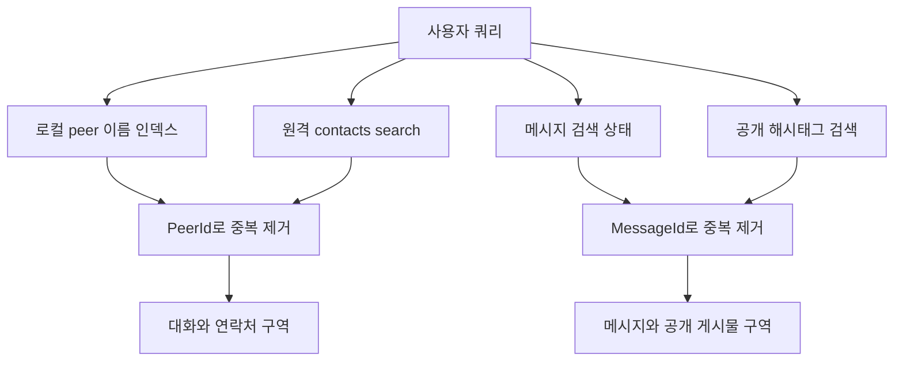
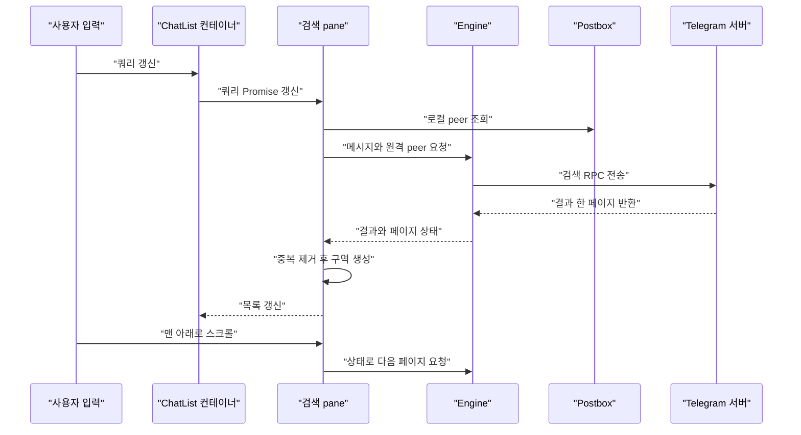

# 검색과 로컬 인덱스

웹: /docs/system/19-search-index/ · Markdown: /docs/system/19-search-index.md

> Postbox 전문 인덱스, 메시지 및 peer 검색 API, 그리고 iOS와 macOS의 검색 결과 병합, 페이지 나누기, 취소 메커니즘을 설명해요.

> 시스템 설계 · 저장과 검색 · 19장 · 도표 3 · 코드 발췌 10 · 인용 33 · 소스 기준선: [TelegramMessenger/Telegram-iOS@f1dd7a2d](https://github.com/TelegramMessenger/Telegram-iOS/tree/f1dd7a2dbd02cbbf513e75d5695d8d36d1cf5838), [overtake/TelegramSwift@579cebbf](https://github.com/overtake/TelegramSwift/tree/579cebbf0c01fd41b712eff3647fa7f69db9665d)
>
> 핵심 소스 파일: [TelegramMessenger/Telegram-iOS/submodules/Postbox/Sources/SqliteValueBox.swift](https://github.com/TelegramMessenger/Telegram-iOS/blob/f1dd7a2dbd02cbbf513e75d5695d8d36d1cf5838/submodules/Postbox/Sources/SqliteValueBox.swift), [TelegramMessenger/Telegram-iOS/submodules/Postbox/Sources/MessageHistoryTextIndexTable.swift](https://github.com/TelegramMessenger/Telegram-iOS/blob/f1dd7a2dbd02cbbf513e75d5695d8d36d1cf5838/submodules/Postbox/Sources/MessageHistoryTextIndexTable.swift), [TelegramMessenger/Telegram-iOS/submodules/Postbox/Sources/MessageHistoryTable.swift](https://github.com/TelegramMessenger/Telegram-iOS/blob/f1dd7a2dbd02cbbf513e75d5695d8d36d1cf5838/submodules/Postbox/Sources/MessageHistoryTable.swift), [TelegramMessenger/Telegram-iOS/submodules/Postbox/Sources/Postbox.swift](https://github.com/TelegramMessenger/Telegram-iOS/blob/f1dd7a2dbd02cbbf513e75d5695d8d36d1cf5838/submodules/Postbox/Sources/Postbox.swift), [TelegramMessenger/Telegram-iOS/submodules/Postbox/Sources/PeerNameIndexTable.swift](https://github.com/TelegramMessenger/Telegram-iOS/blob/f1dd7a2dbd02cbbf513e75d5695d8d36d1cf5838/submodules/Postbox/Sources/PeerNameIndexTable.swift), [TelegramMessenger/Telegram-iOS/submodules/TelegramCore/Sources/TelegramEngine/Messages/SearchMessages.swift](https://github.com/TelegramMessenger/Telegram-iOS/blob/f1dd7a2dbd02cbbf513e75d5695d8d36d1cf5838/submodules/TelegramCore/Sources/TelegramEngine/Messages/SearchMessages.swift), [TelegramMessenger/Telegram-iOS/submodules/TelegramCore/Sources/TelegramEngine/Peers/SearchPeers.swift](https://github.com/TelegramMessenger/Telegram-iOS/blob/f1dd7a2dbd02cbbf513e75d5695d8d36d1cf5838/submodules/TelegramCore/Sources/TelegramEngine/Peers/SearchPeers.swift), [TelegramMessenger/Telegram-iOS/submodules/ChatListUI/Sources/ChatListSearchListPaneNode.swift](https://github.com/TelegramMessenger/Telegram-iOS/blob/f1dd7a2dbd02cbbf513e75d5695d8d36d1cf5838/submodules/ChatListUI/Sources/ChatListSearchListPaneNode.swift), [overtake/TelegramSwift/Telegram-Mac/SearchController.swift](https://github.com/overtake/TelegramSwift/blob/579cebbf0c01fd41b712eff3647fa7f69db9665d/Telegram-Mac/SearchController.swift), [overtake/Telegram-iOS/submodules/Postbox/Sources/MessageHistoryTextIndexTable.swift](https://github.com/overtake/Telegram-iOS/blob/a24bbe45f9861f736a79916a50898512f751e0dc/submodules/Postbox/Sources/MessageHistoryTextIndexTable.swift)
>
> 미검증 사항:
> - SQLite FTS5가 대상 시스템에서 보이는 tokenizer, 대소문자 폴딩, CJK 분절 동작은 런타임 검증이 필요해요.
> - peerNamespacesRequiringMessageTextIndex의 전체 구성 출처와 각 namespace 값은 항목별로 추적하지 않았어요.
> - FTS5의 반환 순서가 안정적인지, 그리고 비밀 채팅의 로컬 적중이 UI 이전에 별도로 정렬되는지는 런타임 검증이 필요해요.
> - 쿼리를 바꾼 뒤 하위 네트워크 계층이 이미 시작된 RPC를 어느 단위로 취소하는지는 확인하지 못했어요.

## 문제와 제약 [#문제와-제약]

Telegram의 검색은 데이터베이스 쿼리 하나가 아니에요. 사용자가 단어를 한 번 입력하면 클라이언트는 다음 결과를 동시에 필요로 할 수 있어요.

- 로컬 대화
- 최근 검색
- 원격 연락처
- 원격 메시지
- 비밀 채팅 메시지
- 포럼 토픽
- 공개 토픽 해시태그 결과

결과 종류마다 보이는 범위, 정렬 기준, 네트워크 권한이 달라요. 그래서 검색 계층은 “이미 있는 데이터를 낮은 지연으로 먼저 보여 주는 일”과 “서버가 검색할 수 있는 데이터를 마지막에 보충하는 일”을 나눠서 처리해야 해요.

08장 《Postbox 저장 엔진》과 09장 《Postbox 뷰와 메시지 이력 모델》에서 트랜잭션, 뷰, 메시지 인덱스의 일반 모델을 이미 설명했어요. 이 장은 텍스트, 이름, 토픽 해시태그가 검색 경로에 어떻게 들어가는지만 다뤄요.

이 글은 iOS 고정 커밋을 중심으로 하고, TelegramSwift와 그것이 고정한 overtake fork로 macOS의 대응 구현을 설명해요. 모든 “로컬”은 현재 계정의 Postbox를 가리켜요. 모든 기기의 완전한 이력을 가리키지 않아요.

검색의 첫 번째 제약은 캐시가 불완전하다는 점이에요. 일반 클라우드 메시지 검색은 RPC(서버에 보내는 원격 호출)가 필요하고, 페이지 나누기 상태는 서버가 돌려주는 오프셋 정보에 기대요. 비밀 채팅에는 이런 서버 검색 경로가 없어요.

그래서 코어는 대신 로컬 텍스트 인덱스에서 읽어요. 전역 쿼리는 로컬에서 얻은 비밀 채팅 적중도 추가 결과로 병합해요. 이 구조를 보면 전문 인덱스(본문을 단어로 찾을 수 있게 만든 색인)는 일반 클라우드 메시지의 권위 있는 검색 사본이 아니에요. 비밀 채팅과 현재 캐시를 위한 오프라인 기능이에요. [\[16\]](https://github.com/TelegramMessenger/Telegram-iOS/blob/f1dd7a2dbd02cbbf513e75d5695d8d36d1cf5838/submodules/TelegramCore/Sources/TelegramEngine/Messages/SearchMessages.swift#L308-L363) [\[18\]](https://github.com/TelegramMessenger/Telegram-iOS/blob/f1dd7a2dbd02cbbf513e75d5695d8d36d1cf5838/submodules/TelegramCore/Sources/TelegramEngine/Messages/SearchMessages.swift#L571-L647)

두 번째 제약은 신원을 메시지 번호만으로 정할 수 없다는 점이에요. 전문 인덱스가 반환하는 것은 되돌릴 수 있는 완전한 `MessageId`이고, 여기에는 peer(대화 상대), namespace, 메시지 번호가 들어 있어요. 컨트롤러가 데이터를 병합할 때는 `PeerId` 또는 `MessageId`로 중복을 제거해요. 표시 이름, 날짜, 결과 위치로 중복 여부를 판단하면 안 돼요. 이렇게 하면 연락처가 로컬에도 있고 원격에서도 반환되는 경우, 그리고 포럼 쿼리와 전역 쿼리가 같은 메시지에 적중하는 경우를 처리할 수 있어요. [\[6\]](https://github.com/TelegramMessenger/Telegram-iOS/blob/f1dd7a2dbd02cbbf513e75d5695d8d36d1cf5838/submodules/Postbox/Sources/MessageHistoryTextIndexTable.swift#L3-L98) [\[24\]](https://github.com/TelegramMessenger/Telegram-iOS/blob/f1dd7a2dbd02cbbf513e75d5695d8d36d1cf5838/submodules/ChatListUI/Sources/ChatListSearchListPaneNode.swift#L3395-L3468)

세 번째 제약은 검색을 취소할 수 있어야 한다는 점이에요. 입력, 필터, 날짜, 대상 대화가 모두 쿼리 범위를 바꿔요. 오래된 요청이 뒤늦게 도착하더라도 새 쿼리의 화면을 오래된 결과로 되돌려 쓰면 안 돼요. 두 플랫폼은 이렇게 풀어요.

- iOS: 쿼리를 `Promise`에 넣고, pane(검색 결과를 보여 주는 화면 영역) 안의 신호 체인이 결과를 재구성해요.
- macOS: `ValuePromise`와 `MetaDisposable`로 현재 구독을 보관해요.

두 플랫폼 모두 페이지 나누기 상태를 전역 싱글턴 상태가 아니라 쿼리 세션의 상태로 둬요. [\[20\]](https://github.com/TelegramMessenger/Telegram-iOS/blob/f1dd7a2dbd02cbbf513e75d5695d8d36d1cf5838/submodules/ChatListUI/Sources/ChatListSearchContainerNode.swift#L713-L724) [\[25\]](https://github.com/TelegramMessenger/Telegram-iOS/blob/f1dd7a2dbd02cbbf513e75d5695d8d36d1cf5838/submodules/ChatListUI/Sources/ChatListSearchListPaneNode.swift#L4839-L4863)

## 로컬 텍스트 인덱스의 구조 [#로컬-텍스트-인덱스의-구조]

### 테이블 번호, 가상 테이블, 컬럼의 역할 [#테이블-번호-가상-테이블-컬럼의-역할]

`PostboxImpl`은 생성할 때 테이블 번호 `41`로 `MessageHistoryTextIndexTable`을 만들고, 같은 객체를 `MessageHistoryTable`에 넘겨요. 그러니까 이 인덱스는 특정 UI 컨트롤러의 임시 캐시가 아니에요. 계정 데이터베이스 안의 파생 인덱스예요. [\[1\]](https://github.com/TelegramMessenger/Telegram-iOS/blob/f1dd7a2dbd02cbbf513e75d5695d8d36d1cf5838/submodules/Postbox/Sources/Postbox.swift#L1937-L1948)

`SqliteValueBox`는 이 전문 테이블에 처음 쓸 때만 SQLite의 전문 검색 확장인 FTS5의 가상 테이블을 만들어요. 물리 이름은 `ft`에 테이블 번호를 붙인 것이고, 테이블 정의에는 `collectionId`, `itemId`, `contents`, `tags` 네 컬럼이 있어요.

또 테이블 번호를 `__meta_fulltext_tables`에 기록해요. 그래서 다음에 데이터베이스를 열 때 이미 있는 전문 테이블 집합을 복원할 수 있어요. [\[2\]](https://github.com/TelegramMessenger/Telegram-iOS/blob/f1dd7a2dbd02cbbf513e75d5695d8d36d1cf5838/submodules/Postbox/Sources/SqliteValueBox.swift#L914-L924)

```swift
private func checkFullTextTable(_ table: ValueBoxFullTextTable) {
    precondition(self.queue.isCurrent())
    if let _ = self.fullTextTables[table.id] {
    } else {
        var resultCode = self.database.execute("CREATE VIRTUAL TABLE IF NOT EXISTS ft\(table.id) USING fts5(collectionId, itemId, contents, tags)")
        precondition(resultCode)
        self.fullTextTables[table.id] = table
        resultCode = self.database.execute("INSERT OR IGNORE INTO __meta_fulltext_tables(name) VALUES (\(table.id))")
        precondition(resultCode)
    }
}
```
[\[2\]](https://github.com/TelegramMessenger/Telegram-iOS/blob/f1dd7a2dbd02cbbf513e75d5695d8d36d1cf5838/submodules/Postbox/Sources/SqliteValueBox.swift#L914-L924)

여기에는 `tokenize` 인자가 없어요. 그래서 소스 코드는 FTS5를 쓴다는 것만 증명할 뿐, 명시적으로 구성한 언어 토크나이저가 있다는 것은 증명하지 않아요.

앱 쪽의 정제 코드는 `CharacterSet.alphanumerics`에 속한 문자만 남기고 나머지 문자는 공백으로 바꿔요. 중국어, 태국어, 혼합 문자 체계의 최종 분절 효과는 FTS5 런타임 구성에 달려 있어요. 이 글은 이 클라이언트 소스 코드만으로는 확인할 수 없으니 확인 대기 문제로 올려요.

컬럼마다 역할이 달라요.

- `collectionId`: peer 수준의 범위 키예요.
- `itemId`: 완전한 메시지 신원을 인코딩해요.
- `contents`: 검색할 텍스트를 저장해요.
- `tags`: `MessageTags`의 원시 값 각각을 공백으로 구분된 단어로 인코딩해요.

이 설계 덕분에 FTS5 테이블 하나가 전역 로컬 스캔, 단일 대화 스캔, 메시지 태그 제약을 함께 지원하고, peer마다 가상 테이블을 따로 만들 필요가 없어요. [\[6\]](https://github.com/TelegramMessenger/Telegram-iOS/blob/f1dd7a2dbd02cbbf513e75d5695d8d36d1cf5838/submodules/Postbox/Sources/MessageHistoryTextIndexTable.swift#L3-L98)

```swift
func add(messageId: MessageId, text: String, tags: MessageTags) {
    self.valueBox.fullTextSet(self.table, collectionId: collectionId(messageId.peerId), itemId: itemId(messageId), contents: text, tags: messageTags(tags))
}

func remove(messageId: MessageId) {
    self.valueBox.fullTextRemove(self.table, itemId: itemId(messageId), secure: true)
}

func search(peerId: PeerId?, text: String, tags: MessageTags?) -> [MessageId] {
    var escapedText = String(text.map({ c in
        var codeUnits: [UnicodeScalar] = []
        for codeUnit in String(c).unicodeScalars {
            codeUnits.append(codeUnit)
        }
        for codeUnit in codeUnits {
            if !alphanumerics.contains(codeUnit) {
                return " "
            }
        }
        return c
    }))
    if !escapedText.isEmpty {
        escapedText += "*"
    }
    var result: [MessageId] = []
    self.valueBox.fullTextMatch(self.table, collectionId: peerId.flatMap { collectionId($0) }, query: escapedText, tags: tags.flatMap(messageTags), values: { _, itemId in
        if let messageId = parseMessageId(itemId) {
            result.append(messageId)
        } else {
            assertionFailure()
        }
        return true
    })
    return result
}
```
[\[6\]](https://github.com/TelegramMessenger/Telegram-iOS/blob/f1dd7a2dbd02cbbf513e75d5695d8d36d1cf5838/submodules/Postbox/Sources/MessageHistoryTextIndexTable.swift#L3-L98)

이 정제에는 직접적인 결과가 두 가지 있어요.

1. 쿼리 문자열의 구두점은 FTS5 연산자로 해석되지 않아요.
2. 영숫자가 아닌 모든 문자는 구분자가 돼요.

코드는 비어 있지 않은 쿼리에 `*`를 덧붙여요. 그래서 이 계층은 접두사 일치를 요청해요. 여기서 lower-case는 하지 않고, 여러 공백을 다시 압축하지도 않아요. 쿼리 의미론이 대소문자를 무시하는지, Unicode 정규화를 어떻게 처리하는지는 이 Swift 코드만으로는 확인할 수 없어요.

### 쓰기 시점과 삭제 제약 [#쓰기-시점과-삭제-제약]

텍스트 인덱스는 동기화 컨트롤러나 화면이 직접 유지하는 게 아니라 메시지 이력 테이블이 유지해요. 메시지를 삽입할 때 `MessageHistoryTable`은 먼저 본문을 가져온 다음 각 미디어 객체의 `indexableText`를 덧붙여요. peer namespace가 `seedConfiguration.peerNamespacesRequiringMessageTextIndex`에 있을 때만 인덱스에 써요. 그래서 이 구성 집합이 “어떤 메시지 공간을 인덱싱할 수 있는가”에 대한 유일한 관문이에요. [\[7\]](https://github.com/TelegramMessenger/Telegram-iOS/blob/f1dd7a2dbd02cbbf513e75d5695d8d36d1cf5838/submodules/Postbox/Sources/MessageHistoryTable.swift#L1136-L1145)

```swift
if self.seedConfiguration.peerNamespacesRequiringMessageTextIndex.contains(message.id.peerId.namespace) {
    var indexableText = message.text
    for media in message.media {
        if let mediaText = media.indexableText {
            indexableText.append(" ")
            indexableText.append(mediaText)
        }
    }
    self.textIndexTable.add(messageId: message.id, text: indexableText, tags: message.tags)
}
```
[\[7\]](https://github.com/TelegramMessenger/Telegram-iOS/blob/f1dd7a2dbd02cbbf513e75d5695d8d36d1cf5838/submodules/Postbox/Sources/MessageHistoryTable.swift#L1136-L1145)

미디어에 딸린 인덱싱 가능 텍스트는 본문과 같은 `contents` 컬럼에 들어가요. 그래서 적중이 메시지 말풍선에 보이는 본문에서만 나오는 건 아니에요. 어떤 미디어 유형이 `indexableText`를 제공하는지는 각 미디어 모델에 달려 있어요. 이 글은 “모든 파일 이름, 설명, 전사 텍스트가 인덱싱된다”를 사실로 쓰지 않아요.

메시지를 삭제하거나 갱신할 때는 이렇게 처리해요.

- 삭제: 이력 테이블은 먼저 전문 항목을 지우고, 그다음 정규 메시지 레코드를 지워요.
- 갱신: 메시지 신원, 본문, `MessageTags`가 바뀌면 이력 테이블은 먼저 이전 신원의 항목을 제거하고, 새 본문, 미디어 텍스트, 태그로 항목을 다시 만들어요. [\[8\]](https://github.com/TelegramMessenger/Telegram-iOS/blob/f1dd7a2dbd02cbbf513e75d5695d8d36d1cf5838/submodules/Postbox/Sources/MessageHistoryTable.swift#L1817-L1830)

이 작업은 Postbox 트랜잭션 안에 있어서, 메시지, 주 인덱스, 태그 인덱스, 전문 인덱스가 같은 커밋 경계 안에서 갱신될 수 있어요. 추론: 이렇게 하면 삭제된 메시지가 여전히 텍스트 검색에서 반환되는 흔한 일시적 불일치를 피해요.

`fullTextRemove`를 호출할 때는 `secure: true`를 전달해요. `SqliteValueBox`는 현재 값이 내부 상태와 다르면 SQLite의 `secure_delete` pragma(삭제한 내용을 덮어쓰게 하는 설정)를 설정한 다음 `itemId` 기준의 삭제를 실행해요. [\[5\]](https://github.com/TelegramMessenger/Telegram-iOS/blob/f1dd7a2dbd02cbbf513e75d5695d8d36d1cf5838/submodules/Postbox/Sources/SqliteValueBox.swift#L2179-L2249) 이 사실은 이 삭제 경로가 보안 삭제 모드를 요청한다는 것만 보여 줘요. FTS5 섀도 테이블, WAL 파일, 데이터베이스의 빈 페이지가 어떤 기기 상태에서든 바로 복구할 수 없게 된다는 것을 증명하지는 않아요.

### 쿼리, 테이블 되돌아가기, 정렬 경계 [#쿼리-테이블-되돌아가기-정렬-경계]

쓰기와 읽기는 이렇게 동작해요.

- 쓰기: 캐시된 사전 컴파일 구문을 써서 네 컬럼에 UTF-8 데이터를 삽입해요.
- 읽기: 캐시된 FTS5 `MATCH` 구문을 써요.

읽을 때 백엔드는 조건에 따라 다르게 움직여요.

- peer가 있으면: `collectionId`를 `MATCH` 표현식에 제한으로 넣어요.
- 태그가 있으면: `tags` 조건을 추가해요.
- peer가 없으면: 전역 쿼리를 실행해요. [\[3\]](https://github.com/TelegramMessenger/Telegram-iOS/blob/f1dd7a2dbd02cbbf513e75d5695d8d36d1cf5838/submodules/Postbox/Sources/SqliteValueBox.swift#L1552-L1590) [\[4\]](https://github.com/TelegramMessenger/Telegram-iOS/blob/f1dd7a2dbd02cbbf513e75d5695d8d36d1cf5838/submodules/Postbox/Sources/SqliteValueBox.swift#L1619-L1682)

```swift
public func fullTextMatch(_ table: ValueBoxFullTextTable, collectionId: String?, query: String, tags: String?, values: (String, String) -> Bool) {
    if let _ = self.fullTextTables[table.id] {
        guard let queryData = query.data(using: .utf8) else {
            return
        }
        
        var statement: SqlitePreparedStatement?
        if let collectionId = collectionId {
            if let collectionIdData = collectionId.data(using: .utf8) {
                if let tags = tags {
                    if let tagsData = tags.data(using: .utf8) {
                        statement = self.fullTextMatchCollectionTagsStatement(table, collectionId: collectionIdData, contents: queryData, tags: tagsData)
                    }
                } else {
                    statement = self.fullTextMatchCollectionStatement(table, collectionId: collectionIdData, contents: queryData)
                }
            }
        } else {
            statement = self.fullTextMatchGlobalStatement(table, contents: queryData)
        }
        
        if let statement = statement {
            while statement.step(handle: self.database.handle, pathToRemoveOnError: self.pathToRemoveOnError) {
                let resultCollectionId = statement.stringAt(0)
                let resultItemId = statement.stringAt(1)
```
[\[5\]](https://github.com/TelegramMessenger/Telegram-iOS/blob/f1dd7a2dbd02cbbf513e75d5695d8d36d1cf5838/submodules/Postbox/Sources/SqliteValueBox.swift#L2179-L2249)

이 계층은 `Message`를 반환하지 않고, SQL에서 날짜 순서나 관련도 순서를 요구하지도 않아요. 해석할 수 있는 `MessageId`만 반환해요. 그 뒤 Postbox가 메시지 신원으로 `MessageHistoryIndexTable`과 `MessageHistoryTable`을 조회하고 메시지 객체를 렌더링해요.

FTS가 적중했는데 주 인덱스나 주 레코드가 없으면, 소스 코드는 반쪽짜리 결과를 조용히 남기지 않고 assertion을 발생시켜요. [\[9\]](https://github.com/TelegramMessenger/Telegram-iOS/blob/f1dd7a2dbd02cbbf513e75d5695d8d36d1cf5838/submodules/Postbox/Sources/Postbox.swift#L3257-L3267)
```swift
fileprivate func searchMessages(peerId: PeerId?, query: String, tags: MessageTags?) -> [Message] {
    var result: [Message] = []
    for messageId in self.textIndexTable.search(peerId: peerId, text: query, tags: tags) {
        if let index = self.messageHistoryIndexTable.getIndex(messageId), let message = self.messageHistoryTable.getMessage(index) {
            result.append(self.messageHistoryTable.renderMessage(message, peerTable: self.peerTable, threadIndexTable: self.messageHistoryThreadIndexTable, storyTable: self.storyTable))
        } else {
            assertionFailure()
        }
    }
    return result
}
```
[\[9\]](https://github.com/TelegramMessenger/Telegram-iOS/blob/f1dd7a2dbd02cbbf513e75d5695d8d36d1cf5838/submodules/Postbox/Sources/Postbox.swift#L3257-L3267)

그래서 `MessageHistoryTextIndexTable`은 정렬 인덱스가 아니에요. 호출자가 얻는 부분 적중의 순서를 시간, 관련도, UI의 최종 정렬로 해석하면 안 돼요.

- 일반 클라우드 검색: 최종 순서는 코어의 `SearchMessagesState`에서 `MessageIndex` 내림차순으로 다시 정렬돼요.
- 비밀 채팅의 로컬 결과: 이 테이블 되돌아가기 경로에서 곧바로 나와요.

그래서 비밀 채팅 경로의 반환 순서가 명시적으로 정렬되는지는 나중에 인덱스 구현이 바뀔 때 다시 대조해야 해요.


## 메시지, 태그, peer의 API [#메시지-태그-peer의-api]

### 메시지 검색의 통합 인터페이스 [#메시지-검색의-통합-인터페이스]

`TelegramEngine.Messages`는 화면에 관련 인터페이스 세 개를 공개해요.

- `searchMessages`: `SearchMessagesLocation`, 쿼리 단어, 이전 페이지 상태, 선택적 중심 메시지, 페이지 크기를 받아요.
- `getSearchMessageCount`: 개수를 구하는 데 쓰여요.
- `searchHashtagPosts`: 공개 토픽 해시태그 게시물 검색에 쓰여요. [\[14\]](https://github.com/TelegramMessenger/Telegram-iOS/blob/f1dd7a2dbd02cbbf513e75d5695d8d36d1cf5838/submodules/TelegramCore/Sources/TelegramEngine/Messages/TelegramEngineMessages.swift#L147-L157)

`SearchMessagesLocation`은 세 가지 범위를 구분해요.

- `general`: peer 유형 범위, 채팅 그룹, 태그, 날짜, 폴더, 커뮤니티 조건을 담을 수 있어요.
- `peer`: 지정한 대화, 발신자, 태그, 리액션, 토픽, 날짜를 담을 수 있어요.
- `sentMedia`: 전송한 미디어 전용 RPC를 타요.

`SearchMessagesResult`는 메시지, 읽음 상태, 토픽 데이터, 총수, 완료 플래그를 반환해요. `SearchMessagesState`는 주 대화 페이지와 마이그레이션된 이전 대화 등 추가 페이지를 비공개로 저장해요. [\[15\]](https://github.com/TelegramMessenger/Telegram-iOS/blob/f1dd7a2dbd02cbbf513e75d5695d8d36d1cf5838/submodules/TelegramCore/Sources/TelegramEngine/Messages/SearchMessages.swift#L178-L239)

코어는 페이지를 병합할 때 먼저 `Set<MessageId>`로 이미 있는 메시지를 제거하고, `MessageIndex` 역순으로 정렬해요. 추가 상태가 있으면 `mergedResult`는 주 상태가 완료됐는지에 따라 추가 결과가 보이는 범위도 정해요. 이 병합 방식은 채널 마이그레이션(일반 그룹이 채널형 그룹으로 바뀌는 일) 전후의 두 구간 이력을 처리하고, 같은 메시지가 이후 페이지에서 중복으로 나오지 않게 해요. [\[15\]](https://github.com/TelegramMessenger/Telegram-iOS/blob/f1dd7a2dbd02cbbf513e75d5695d8d36d1cf5838/submodules/TelegramCore/Sources/TelegramEngine/Messages/SearchMessages.swift#L178-L239)

```swift
if let previous = state {
    var currentIds = Set<MessageId>()
    var mergedMessages: [Message] = []
    for message in previous.messages {
        if currentIds.contains(message.id) {
            continue
        }
        currentIds.insert(message.id)
        mergedMessages.append(message)
    }
    for message in renderedMessages {
        if currentIds.contains(message.id) {
            continue
        }
        currentIds.insert(message.id)
        mergedMessages.append(message)
    }
    mergedMessages.sort(by: { lhs, rhs in
        return lhs.index > rhs.index
    })
    return SearchMessagesPeerState(messages: mergedMessages, readStates: readStates, threadInfo: threadInfo, totalCount: completed ? Int32(mergedMessages.count) : totalCount, completed: completed, nextRate: nextRate)
}
```
[\[15\]](https://github.com/TelegramMessenger/Telegram-iOS/blob/f1dd7a2dbd02cbbf513e75d5695d8d36d1cf5838/submodules/TelegramCore/Sources/TelegramEngine/Messages/SearchMessages.swift#L178-L239)

비밀 채팅은 분명한 로컬 분기예요. 대상 peer의 namespace가 `SecretChat`이면 코어는 Postbox 트랜잭션 안에서 `transaction.searchMessages`를 호출해서 전문 인덱스를 읽고 테이블로 되돌아가요. 그 peer의 읽음 상태와 답장 스레드 데이터도 채워요. 이 분기는 `completed: true`를 반환해요. 현재 로컬 인덱스를 스캔하는 것만 약속하고 서버에 더 많은 비밀 채팅 이력을 요청하지 않기 때문이에요. [\[16\]](https://github.com/TelegramMessenger/Telegram-iOS/blob/f1dd7a2dbd02cbbf513e75d5695d8d36d1cf5838/submodules/TelegramCore/Sources/TelegramEngine/Messages/SearchMessages.swift#L308-L363)

일반 peer 검색은 이 순서로 진행해요.

1. 대상 peer, 마이그레이션 이전의 peer일 가능성, 발신자와 토픽 subpeer를 읽어요.
2. 이전 페이지의 마지막 메시지의 `MessageIndex`에서 `offsetId`를 얻어요.
3. 필터 없는 채널의 빈 쿼리이면 `messages.getHistory`를 대신 써요. 그 밖의 경우에는 `messages.search`를 쓰고, 발신자, 토픽, 태그, 리액션, 날짜를 RPC 인자로 접어 넣어요. [\[17\]](https://github.com/TelegramMessenger/Telegram-iOS/blob/f1dd7a2dbd02cbbf513e75d5695d8d36d1cf5838/submodules/TelegramCore/Sources/TelegramEngine/Messages/SearchMessages.swift#L412-L438)

```swift
let peerMessages: Signal<Api.messages.Messages?, NoError>
if let completed = state?.main.completed, completed {
    peerMessages = .single(nil)
} else {
    let lowerBound = state?.main.messages.last.flatMap({ $0.index })
    let signal: Signal<Api.messages.Messages, MTRpcError>
    if peer.id.namespace == Namespaces.Peer.CloudChannel && query.isEmpty && fromId == nil && tags == nil && minDate == nil && maxDate == nil && threadId == nil {
        signal = account.network.request(Api.functions.messages.getHistory(peer: inputPeer, offsetId: lowerBound?.id.id ?? 0, offsetDate: 0, addOffset: 0, limit: limit, maxId: Int32.max - 1, minId: 0, hash: 0))
    } else {
        var savedReactions: [Api.Reaction]?
        if let reactions = reactions {
            savedReactions = reactions.map {
                $0.apiReaction
            }
        }
        
        if savedReactions != nil {
            flags |= 1 << 3
        }
        
        signal = account.network.request(Api.functions.messages.search(flags: flags, peer: inputPeer, q: query, fromId: fromInputPeer, savedPeerId: inputSavedPeer, savedReaction: savedReactions, topMsgId: topMsgId, filter: filter, minDate: minDate ?? 0, maxDate: maxDate ?? (Int32.max - 1), offsetId: lowerBound?.id.id ?? 0, addOffset: 0, limit: limit, maxId: Int32.max - 1, minId: 0, hash: 0))
    }
```
[\[17\]](https://github.com/TelegramMessenger/Telegram-iOS/blob/f1dd7a2dbd02cbbf513e75d5695d8d36d1cf5838/submodules/TelegramCore/Sources/TelegramEngine/Messages/SearchMessages.swift#L412-L438)

네트워크 요청에 오류가 나면 코드는 그 페이지를 `nil`로 매핑해요. 이어지는 트랜잭션은 새 원격 결과가 없는 상태를 병합해서 내보내요. [\[17\]](https://github.com/TelegramMessenger/Telegram-iOS/blob/f1dd7a2dbd02cbbf513e75d5695d8d36d1cf5838/submodules/TelegramCore/Sources/TelegramEngine/Messages/SearchMessages.swift#L412-L438)

이 매핑은 API의 오류 타입이 `NoError`라는 뜻이에요. 화면이 네트워크 실패와 마지막 페이지 도달을 반드시 구분할 수 있다는 뜻은 아니에요. 호출자는 `completed`, 이미 있는 결과, 자신의 로딩 상태를 결합해서 대체 표시를 마련할 수밖에 없어요.

### 해시태그와 포럼 토픽 [#해시태그와-포럼-토픽]

`searchHashtagPosts`는 별도의 공개 게시물 경로예요. 지난 결과의 마지막 메시지에서 `nextRate`, peer, 메시지 번호를 가져와 `channels.searchPosts`를 호출해요. 첫 페이지와 이후 페이지 모두 같은 `SearchMessagesState`로 병합되고, 페이지 크기는 호출하는 쪽이 지정해요. [\[19\]](https://github.com/TelegramMessenger/Telegram-iOS/blob/f1dd7a2dbd02cbbf513e75d5695d8d36d1cf5838/submodules/TelegramCore/Sources/TelegramEngine/Messages/SearchMessages.swift#L652-L681)

해시태그 쿼리는 로컬 전문 인덱스의 별칭이 아니에요. FTS 테이블의 `tags`는 `MessageTags` 비트마스크이고, 예를 들면 미디어 필터 의미론이에요. 공개 해시태그는 문자열이고 `searchHashtagPosts`를 거쳐 원격으로 보내져요.

iOS 채팅 목록 검색은 입력이 해시태그로 시작할 때 공개 게시물 검색과 일반 메시지 검색 결과를 병렬로 만들 수 있고, 스토리 검색 결과를 동시에 보여 줄 수도 있어요. 두 결과는 표시 계층에서 섹션으로 나뉘어요. 출처 없는 하나의 목록으로 섞지 않아요. [\[19\]](https://github.com/TelegramMessenger/Telegram-iOS/blob/f1dd7a2dbd02cbbf513e75d5695d8d36d1cf5838/submodules/TelegramCore/Sources/TelegramEngine/Messages/SearchMessages.swift#L652-L681) [\[22\]](https://github.com/TelegramMessenger/Telegram-iOS/blob/f1dd7a2dbd02cbbf513e75d5695d8d36d1cf5838/submodules/ChatListUI/Sources/ChatListSearchListPaneNode.swift#L2732-L2938)

포럼 토픽은 세 번째 경로를 써요. `ChatListSearchListPaneNode`는 먼저 로컬 토픽 데이터에서 token으로 찾은 다음 `searchForumTopics`를 호출해요. 원격 토픽을 하나씩 검사해서 같은 `.forum(threadId)`가 이미 있는지 확인하고, 나타나지 않은 토픽만 보충해 넣어요. 그래서 토픽 목록은 메시지 검색과 진입점을 공유하면서도, 토픽을 가짜 메시지로 취급해 페이지를 나누지는 않아요. [\[22\]](https://github.com/TelegramMessenger/Telegram-iOS/blob/f1dd7a2dbd02cbbf513e75d5695d8d36d1cf5838/submodules/ChatListUI/Sources/ChatListSearchListPaneNode.swift#L2732-L2938)

### peer와 연락처 검색 [#peer와-연락처-검색]

로컬 peer 검색은 `PeerNameIndexTable`에 기대고 FTS5에는 기대지 않아요. 이 테이블은 규칙 인덱스 token과 전사 token을 유지해요. 쿼리할 때 두 종류의 token 적중을 합집합으로 만들고, 채팅 목록에 있는 peer를 `ChatListIndex` 내림차순으로 내보내요. 채팅 목록에는 없지만 연락처 테이블에 있는 peer는 연락처 결과로 들어가요. [\[10\]](https://github.com/TelegramMessenger/Telegram-iOS/blob/f1dd7a2dbd02cbbf513e75d5695d8d36d1cf5838/submodules/Postbox/Sources/PeerNameIndexTable.swift#L260-L293)

`Postbox.searchPeers`는 채팅 peer에 연관 peer를 추가해요. 예를 들면 비밀 채팅에 연결된 일반 사용자예요. 그다음 대화 결과를 앞에 두고, 연락처 전용 결과를 `lastNameFirst` 이름 순서로 정렬해요. 선택적인 `ChatListFilterPredicate`는 결과가 만들어지기 전에 대화 소속, 읽지 않음, 연락처, 알림, 태그 요약도 검사해요. [\[11\]](https://github.com/TelegramMessenger/Telegram-iOS/blob/f1dd7a2dbd02cbbf513e75d5695d8d36d1cf5838/submodules/Postbox/Sources/Postbox.swift#L3853-L3948)

연락처 엔진의 검색 함수는 이렇게 나뉘어요.

- `TelegramEngine.Contacts.searchLocalPeers`: 이 Postbox 쿼리에 채널, 그룹, 개인 채팅, 봇의 영역 필터를 얹은 것에 불과해요.
- `searchContacts`: 로컬 연락처와 presence를 반환해요.
- `searchRemotePeers`: `contacts.search`를 호출하고 원격 결과를 `20`개로 제한한 다음, 서버의 사용자와 그룹을 Postbox에 되써 넣어요. `myResults`와 일반 `results`의 두 배열을 따로 보존해서, UI가 “로컬 관련”과 “전역” 두 구역을 보여 줄 수 있게 해요. [\[12\]](https://github.com/TelegramMessenger/Telegram-iOS/blob/f1dd7a2dbd02cbbf513e75d5695d8d36d1cf5838/submodules/TelegramCore/Sources/TelegramEngine/Contacts/TelegramEngineContacts.swift#L59-L114) [\[13\]](https://github.com/TelegramMessenger/Telegram-iOS/blob/f1dd7a2dbd02cbbf513e75d5695d8d36d1cf5838/submodules/TelegramCore/Sources/TelegramEngine/Peers/SearchPeers.swift#L30-L45)

최근 검색은 이름 인덱스의 부산물이 아니에요. 순서가 있는 항목 목록이고, 새로 추가하면 맨 앞으로 옮기고 끝에서 `20`개를 넘으면 지워요.

읽는 쪽은 peer, 읽지 않은 수, presence, 알림 설정 뷰를 조합해요. 마이그레이션된 이전 그룹은 새 peer ID로 교체돼요. 그래서 최근 목록이 마이그레이션 이전의 대화를 오래도록 가리키지 않아요. [\[26\]](https://github.com/TelegramMessenger/Telegram-iOS/blob/f1dd7a2dbd02cbbf513e75d5695d8d36d1cf5838/submodules/TelegramCore/Sources/TelegramEngine/Peers/RecentlySearchedPeerIds.swift#L6-L23)



## iOS ChatListUI의 검색 세션 [#ios-chatlistui의-검색-세션]

### 입력이 바뀔 때 쿼리를 다시 만드는 방식 [#입력이-바뀔-때-쿼리를-다시-만드는-방식]

`ChatListSearchContainerNode.searchTextUpdated`는 빈 텍스트를 `nil`로 바꾸고, 비어 있지 않은 텍스트는 쿼리로 유지해서 `Promise<String?>`에 써요. 현재 공개 게시물 pane에 있는데 새 텍스트가 해시태그로 시작하지 않으면, 컨테이너는 먼저 일반 채팅 pane으로 되돌려요. 날짜 제안도 같은 진입점에서 갱신돼요. [\[20\]](https://github.com/TelegramMessenger/Telegram-iOS/blob/f1dd7a2dbd02cbbf513e75d5695d8d36d1cf5838/submodules/ChatListUI/Sources/ChatListSearchContainerNode.swift#L713-L724)

각 pane은 이 쿼리 신호를 구독하고, `mapToSignal` 안에서 다음 신호를 구성해요.

- 로컬 peer
- 원격 peer
- 원격 메시지
- 공개 게시물
- 토픽
- URL 해석 적중 등

바깥쪽 `searchDisposable`이 최종 구독을 보유해요. 쿼리가 바뀌면 새 내부 신호가 만들어지고, 컨트롤러가 소멸할 때 검색, 입력, 옵션 및 그 밖의 장기 구독을 dispose해요.

소스 코드는 리소스 소유권을 분명하게 보여 줘요. 추론: SwiftSignalKit의 전환 조합은 이전 쿼리가 더 이상 현재 화면을 움직이지 않음을 보장해요. 이건 쓰인 연산의 disposable이 네트워크 요청까지 올바르게 전파된다는 전제에서 성립해요. [\[25\]](https://github.com/TelegramMessenger/Telegram-iOS/blob/f1dd7a2dbd02cbbf513e75d5695d8d36d1cf5838/submodules/ChatListUI/Sources/ChatListSearchListPaneNode.swift#L4839-L4863)

원격 peer 분기는 일부러 이 순서로 움직여요.

1. 이전 라운드의 캐시를 먼저 내보내고 로딩 플래그를 참으로 설정해요.
2. `globalPeerSearchContext.searchRemotePeers`를 호출해요.
3. 완료 후 광고 peer도 함께 얻어요.

해시태그와 지정 폴더에 대한 쿼리는 이 원격 연락처 경로를 시작하지 않아요. [\[21\]](https://github.com/TelegramMessenger/Telegram-iOS/blob/f1dd7a2dbd02cbbf513e75d5695d8d36d1cf5838/submodules/ChatListUI/Sources/ChatListSearchListPaneNode.swift#L2695-L2725)

이렇게 하면 화면 내용이 끊기지 않고 이어져요. 대신 짧은 시간 동안 이전 쿼리에 속한 peer가 보일 수 있어요. 표시 계층은 로딩 상태를 현재 쿼리와 함께 처리해야 해요.

### 다중 영역 메시지 검색과 페이지 나누기 [#다중-영역-메시지-검색과-페이지-나누기]

메시지 pane은 먼저 필터를 하나 또는 두 개의 `SearchMessagesLocation`으로 분류해요. 포럼 아래의 일반 검색은 “현재 포럼 peer”와 “전역”의 두 location을 만들어요. 지정 peer, 날짜, 폴더, 미디어 태그, 전역 게시물은 location의 배열 내용을 바꿔요.

첫 일반 메시지 페이지는 명시적으로 `limit: 50`을 쓰고, location마다의 결과가 독립된 `ChatListSearchMessagesContext`로 매핑돼요. [\[22\]](https://github.com/TelegramMessenger/Telegram-iOS/blob/f1dd7a2dbd02cbbf513e75d5695d8d36d1cf5838/submodules/ChatListUI/Sources/ChatListSearchListPaneNode.swift#L2732-L2938)

사용자가 더 많은 메시지가 필요한 위치까지 스크롤하면, 클로저가 최대 두 개의 context를 순회해요.

- 현재 context에 `loadMoreIndex`가 없을 때만 마지막 메시지의 `MessageIndex`를 in-flight 표식으로 기록해요.
- 그 context에 아직 더 많은 페이지가 있으면 루프가 멈추고 그 context를 먼저 로드해요.

이렇게 하면 같은 스크롤 이벤트가 context 하나에 페이지 요청 두 개를 동시에 보내지 않아요. [\[22\]](https://github.com/TelegramMessenger/Telegram-iOS/blob/f1dd7a2dbd02cbbf513e75d5695d8d36d1cf5838/submodules/ChatListUI/Sources/ChatListSearchListPaneNode.swift#L2732-L2938)

```swift
let loadMore = {
    updateSearchContexts { previousMap in
        var updatedMap = previousMap
        var isSearching = false
        for i in 0 ..< 2 {
            if let previous = updatedMap[i] {
                if previous.loadMoreIndex != nil {
                    continue
                }
                guard let last = previous.result.messages.last else {
                    continue
                }
                updatedMap[i] = ChatListSearchMessagesContext(result: previous.result, loadMoreIndex: last.index)
                isSearching = true

                if previous.result.hasMore {
                    break
                }
            }
        }
        return (updatedMap, isSearching)
    }
}
```
[\[22\]](https://github.com/TelegramMessenger/Telegram-iOS/blob/f1dd7a2dbd02cbbf513e75d5695d8d36d1cf5838/submodules/ChatListUI/Sources/ChatListSearchListPaneNode.swift#L2732-L2938)

이 in-flight 표식을 감지하면 페이지 요청은 `limit: 80`을 쓰고, 이전 페이지의 `SearchMessagesState`를 코어에 전달해요. 요청이 끝나면 컨트롤러는 새 결과로 그 context를 교체하고 `loadMoreIndex`를 `nil`로 되돌려요. 페이지에 더 이상 남은 것이 없으면 컨트롤러는 기존 context로 표시 배열만 재구성하고 요청을 더 보내지 않아요.

공개 게시물 pane은 같은 발상을 쓰는데, 첫 해시태그 게시물 배치는 `10`개, 이후는 `80`개예요. [\[22\]](https://github.com/TelegramMessenger/Telegram-iOS/blob/f1dd7a2dbd02cbbf513e75d5695d8d36d1cf5838/submodules/ChatListUI/Sources/ChatListSearchListPaneNode.swift#L2732-L2938)

이 상태 머신의 종료 조건은 `hasMore`이고, 그 출처는 코어 결과의 `completed`를 뒤집은 값이에요. 네트워크 오류는 코어에서 새 API 결과가 없는 것으로 변환되기 때문에, 한 번의 이상이 UI에 독립된 실패 상태를 주지 않을 수도 있어요.

추론: 오류 페이지가 `hasMore`를 유지하면 사용자의 다음 스크롤에서 다시 시도될 수 있어요. 최종 재시도 스로틀링은 이 파일에서는 보이지 않아요.

### 중복 제거, 표시 순서, 부분 정렬 [#중복-제거-표시-순서-부분-정렬]

peer 병합은 먼저 `existingPeerIds`로 로컬 결과와 원격 자체 결과의 수를 계산해요. 그다음 이 집합을 비우고, 고정된 순서로 다음을 추가해요.

1. 자신의 Saved Messages
2. 이미 검색한 적 있는 peer
3. 이름에 적중한 로컬 peer
4. 원격 `myResults`
5. 광고 peer
6. 전역 peer

추가할 때마다 먼저 peer ID를 검사해요. 그래서 같은 객체가 로컬 인덱스, 최근 항목, 원격 결과에서 올 수 있지만 최대 한 번만 표시돼요. [\[23\]](https://github.com/TelegramMessenger/Telegram-iOS/blob/f1dd7a2dbd02cbbf513e75d5695d8d36d1cf5838/submodules/ChatListUI/Sources/ChatListSearchListPaneNode.swift#L3208-L3380)

메시지 병합도 별도로 `existingMessageIds`를 만들어요.

- 공개 게시물과 일반 원격 메시지는 각각 `MessageId`로 중복을 제거해요.
- 삭제 집합에 있는 메시지는 걸러져요.
- 마이그레이션된 이전 그룹에서 적중한 것은 마이그레이션 후의 채널 peer를 표시용 peer로 써요.
- 메시지 entry는 결과 배열 순서를 따라 추가되고, 날짜 헤더는 메시지 타임스탬프로 계산돼요.

코어가 이미 각 검색 상태를 `MessageIndex` 역순으로 정렬해 두었기 때문에, 컨트롤러는 context를 가로지르는 메시지에 대해 새로운 전역 병합 정렬을 하지 않아요. [\[15\]](https://github.com/TelegramMessenger/Telegram-iOS/blob/f1dd7a2dbd02cbbf513e75d5695d8d36d1cf5838/submodules/TelegramCore/Sources/TelegramEngine/Messages/SearchMessages.swift#L178-L239) [\[24\]](https://github.com/TelegramMessenger/Telegram-iOS/blob/f1dd7a2dbd02cbbf513e75d5695d8d36d1cf5838/submodules/ChatListUI/Sources/ChatListSearchListPaneNode.swift#L3395-L3468)

```swift
var existingMessageIds = Set<MessageId>()
if foundRemoteMessages.1 && (searchScope != .everywhere || hadAnySearchMessagesBefore) {
    for i in 0 ..< 6 {
        entries.append(.messagePlaceholder(Int32(i), presentationData, searchScope))
        index += 1
    }
} else {
    var hasAnyMessages = false
    for foundRemoteMessageSet in foundRemoteMessages.0 {
        for message in foundRemoteMessageSet.messages {
            if existingMessageIds.contains(message.id) {
                continue
            }
            existingMessageIds.insert(message.id)

            if searchState.deletedMessageIds.contains(message.id) {
                continue
            } else if message.id.namespace == Namespaces.Message.Cloud && searchState.deletedGlobalMessageIds.contains(message.id.id) {
                continue
            }
            let headerId = listMessageDateHeaderId(timestamp: message.timestamp)
            if firstHeaderId == nil {
                firstHeaderId = headerId
            }
```
[\[24\]](https://github.com/TelegramMessenger/Telegram-iOS/blob/f1dd7a2dbd02cbbf513e75d5695d8d36d1cf5838/submodules/ChatListUI/Sources/ChatListSearchListPaneNode.swift#L3395-L3468)

정렬에는 중요한 경계가 하나 있어요. 구역마다 정렬의 출처가 달라요.

- 로컬 peer: `PeerNameIndexTable`의 채팅 목록 순서와 연락처 성 기준 정렬에서 와요.
- 원격 peer: 서버의 분류와 순서를 유지해요.
- 메시지 구역: 구성된 순서대로 이어 붙여요.

그래서 검색 페이지 전체는 하나의 “관련도 정렬” 알고리즘이 아니라, 출처 우선순위를 가진 구역의 모음이에요. 제품에 통합 관련도 점수를 도입하려면 출처 간 재정렬, 안정적인 ID, 페이지 앵커 의미론을 함께 정의해야 해요.



## 경계 사례와 실패 처리 [#경계-사례와-실패-처리]

### 인덱스와 메시지 주 테이블의 불일치 [#인덱스와-메시지-주-테이블의-불일치]

`Postbox.searchMessages`는 FTS 적중마다 메시지 이력 인덱스와 주 레코드를 찾을 수 있어야 해요. 어느 하나라도 없으면 `assertionFailure`가 발생해요. 이건 사용자를 위한 복구 정책이 아니라 개발 중의 불변식이에요. 유지보수 코드는 같은 트랜잭션에서 인덱스와 주 테이블을 함께 유지해야 해요. [\[9\]](https://github.com/TelegramMessenger/Telegram-iOS/blob/f1dd7a2dbd02cbbf513e75d5695d8d36d1cf5838/submodules/Postbox/Sources/Postbox.swift#L3257-L3267) 삭제와 갱신 경로는 이미 인덱스 제거 후 재구성을 다루지만, 메시지 공간이 인덱스에 들어갈지는 여전히 seed configuration이 정해요. [\[7\]](https://github.com/TelegramMessenger/Telegram-iOS/blob/f1dd7a2dbd02cbbf513e75d5695d8d36d1cf5838/submodules/Postbox/Sources/MessageHistoryTable.swift#L1136-L1145) [\[8\]](https://github.com/TelegramMessenger/Telegram-iOS/blob/f1dd7a2dbd02cbbf513e75d5695d8d36d1cf5838/submodules/Postbox/Sources/MessageHistoryTable.swift#L1817-L1830)

SQLite 쪽의 삭제는 `itemId` 기준이고 `collectionId` 기준이 아니에요. `itemId` 자체가 이미 peer, namespace, 메시지 번호를 포함하기 때문에, 이것이 안전의 전제예요. 나중에 item ID 인코딩을 바꾸거나 메시지 번호만 쓰게 되면 삭제가 대화를 넘나들며 잘못 지워질 수 있어요. 이 위험은 현재의 키 설계에서 나온 것이고 추론이에요.

### 캐시, 서버, 비밀 채팅의 가시성 [#캐시-서버-비밀-채팅의-가시성]

일반 클라우드 검색의 RPC 반환값은 코어에서 `Message`로 변환되고 기존 상태와 중복이 제거돼요. 검색 결과가 있다고 해서 로컬에 인접한 이력 전체가 내려받아져 있다는 뜻은 아니에요. 사용자가 적중한 메시지를 열면 이력 뷰는 여전히 공백(hole) 모델로 주변 내용을 채울 수 있어요.

비밀 채팅은 일반 클라우드 검색 RPC를 보내지 않고 로컬 `transaction.searchMessages`에만 기대요. 그래서 두 대화에 같은 단어를 입력했을 때 결과의 완전성은 비교할 수 없어요. [\[16\]](https://github.com/TelegramMessenger/Telegram-iOS/blob/f1dd7a2dbd02cbbf513e75d5695d8d36d1cf5838/submodules/TelegramCore/Sources/TelegramEngine/Messages/SearchMessages.swift#L308-L363) [\[17\]](https://github.com/TelegramMessenger/Telegram-iOS/blob/f1dd7a2dbd02cbbf513e75d5695d8d36d1cf5838/submodules/TelegramCore/Sources/TelegramEngine/Messages/SearchMessages.swift#L412-L438)

전역 클라우드 검색은 첫 상태 병합 때 로컬 비밀 메시지도 추가해요. 다만 쿼리가 채널이나 커뮤니티로 한정된 경우는 예외예요. 최소·최대 날짜에 맞지 않는 비밀 메시지를 걸러 내고, 해당하는 읽음 상태와 스레드 데이터를 덧붙여요. [\[18\]](https://github.com/TelegramMessenger/Telegram-iOS/blob/f1dd7a2dbd02cbbf513e75d5695d8d36d1cf5838/submodules/TelegramCore/Sources/TelegramEngine/Messages/SearchMessages.swift#L571-L647) 이걸 보면 UI 의미론에서 “전역”이 로컬 비밀 채팅을 포함할 수 있어요. 하지만 서버는 그것들을 보지 못해요.

### 빈 쿼리, 태그, 결과 제한 [#빈-쿼리-태그-결과-제한]

빈 쿼리가 항상 의미 없는 것은 아니에요. 채널 peer이고 태그, 날짜, 토픽 조건이 없으면 코어는 이를 `messages.search`가 아니라 `messages.getHistory`로 바꿔요. [\[17\]](https://github.com/TelegramMessenger/Telegram-iOS/blob/f1dd7a2dbd02cbbf513e75d5695d8d36d1cf5838/submodules/TelegramCore/Sources/TelegramEngine/Messages/SearchMessages.swift#L412-L438) 덕분에 같은 API가 검색 필터를 비운 뒤의 메시지 탐색도 맡을 수 있어요. 다만 호출자는 빈 쿼리를 글자 적중으로 잘못 표시하지 않도록 주의해야 해요.

macOS 컨트롤러는 먼저 정규식으로 입력의 해시태그 시작 문자를 제거한 다음 `searchHashtagPosts`에 넘겨요. iOS의 채팅 pane은 `finalQuery`를 같은 Engine API에 그대로 전달해요. 이 차이를 보면 태그 문자열을 마지막에 어떻게 정리하는지는 Engine 함수 시그니처만으로 추론할 수 없어요. 호출 지점도 프로토콜 적응 계층에 속해요. [\[19\]](https://github.com/TelegramMessenger/Telegram-iOS/blob/f1dd7a2dbd02cbbf513e75d5695d8d36d1cf5838/submodules/TelegramCore/Sources/TelegramEngine/Messages/SearchMessages.swift#L652-L681) [\[22\]](https://github.com/TelegramMessenger/Telegram-iOS/blob/f1dd7a2dbd02cbbf513e75d5695d8d36d1cf5838/submodules/ChatListUI/Sources/ChatListSearchListPaneNode.swift#L2732-L2938) [\[27\]](https://github.com/overtake/TelegramSwift/blob/579cebbf0c01fd41b712eff3647fa7f69db9665d/Telegram-Mac/SearchController.swift#L1208-L1253)

원격 peer 검색의 하드 요청 상한은 `20`이에요. 이것은 검색 페이지 전체의 총수가 아니에요. 컨트롤러는 로컬 peer, 최근 peer, 광고 peer, 여러 메시지 위치의 결과도 표시할 수 있어요. 그래서 테스트에서 UI 행 수가 `contacts.search`의 limit과 같다고 볼 수 없어요. [\[13\]](https://github.com/TelegramMessenger/Telegram-iOS/blob/f1dd7a2dbd02cbbf513e75d5695d8d36d1cf5838/submodules/TelegramCore/Sources/TelegramEngine/Peers/SearchPeers.swift#L30-L45)

### 취소, 오래된 결과, UI 플레이스홀더 [#취소-오래된-결과-ui-플레이스홀더]

iOS는 원격 메시지가 아직 검색 중일 때 메시지 플레이스홀더 entry를 `6`개 삽입해요. 이전에 이미 메시지가 있었고 범위가 적절할 때만 그렇게 해요. 목표는 목록의 기하를 안정적으로 유지하는 거예요. 오래된 결과를 새 적중이라고 부르려는 게 아니에요. [\[24\]](https://github.com/TelegramMessenger/Telegram-iOS/blob/f1dd7a2dbd02cbbf513e75d5695d8d36d1cf5838/submodules/ChatListUI/Sources/ChatListSearchListPaneNode.swift#L3395-L3468)

요청 상태는 행 객체가 아니라 `searchContexts`에 둬요. 새 쿼리는 빈 map으로 이 상태를 재구성하기 때문에, 오래된 페이지 앵커는 새 쿼리에 쓰이면 안 돼요. [\[22\]](https://github.com/TelegramMessenger/Telegram-iOS/blob/f1dd7a2dbd02cbbf513e75d5695d8d36d1cf5838/submodules/ChatListUI/Sources/ChatListSearchListPaneNode.swift#L2732-L2938)

pane이 소멸할 때 `searchQueryDisposable`, 검색 옵션 구독, 전역 게시물 새로 고침 구독, 그 밖의 disposable이 해제돼요. macOS의 `SearchController`도 소멸할 때 `MetaDisposable` 세 개를 해제해요. 소스 코드를 보면 수명 주기가 끝날 때 구독이 취소된다는 것을 확인할 수 있어요. 개별 RPC가 하위 네트워크 계층에서 곧바로 종료되는지는 이 글에서 검증하지 않았어요. [\[25\]](https://github.com/TelegramMessenger/Telegram-iOS/blob/f1dd7a2dbd02cbbf513e75d5695d8d36d1cf5838/submodules/ChatListUI/Sources/ChatListSearchListPaneNode.swift#L4839-L4863) [\[29\]](https://github.com/overtake/TelegramSwift/blob/579cebbf0c01fd41b712eff3647fa7f69db9665d/Telegram-Mac/SearchController.swift#L1900-L2038)

## macOS와 iOS의 대응 구현 [#macos와-ios의-대응-구현]

### 공유 fork 안의 인덱스와 코어 [#공유-fork-안의-인덱스와-코어]

TelegramSwift가 고정한 `submodules/telegram-ios`는 실제로 `a24bbe45f9861f736a79916a50898512f751e0dc`에서 체크아웃되어 있어요. 이 fork의 `MessageHistoryTextIndexTable.swift`는 이번 iOS 커밋의 같은 파일과 같아요. 동일한 peer collection, 완전한 메시지 item ID, 영숫자 정제, 접두사 쿼리를 쓰기 때문에, macOS의 Postbox 전문 인덱스 구조가 동일하다는 것을 바로 확인할 수 있어요. [\[28\]](https://github.com/overtake/Telegram-iOS/blob/a24bbe45f9861f736a79916a50898512f751e0dc/submodules/Postbox/Sources/MessageHistoryTextIndexTable.swift#L3-L98)

fork의 `SearchMessages.swift`와 peer 검색 코드는 iOS 고정 커밋과 완전히 같지 않아요. fork의 `SearchMessagesLocation`에는 여전히 별도의 `group` case가 있고, 그 `TelegramSearchPeersScope` 집합은 더 작아요. macOS에 iOS의 현재 인터페이스 이름대로 모든 전역 게시물이나 커뮤니티 인자가 있다고 단순히 가정하면 안 돼요. 구현 수준의 수정은 fork 코드와 데스크톱 빌드 산출물을 기준으로 해야 해요. [\[30\]](https://github.com/overtake/Telegram-iOS/blob/a24bbe45f9861f736a79916a50898512f751e0dc/submodules/TelegramCore/Sources/TelegramEngine/Messages/SearchMessages.swift#L8-L13) [\[31\]](https://github.com/overtake/Telegram-iOS/blob/a24bbe45f9861f736a79916a50898512f751e0dc/submodules/TelegramCore/Sources/TelegramEngine/Peers/SearchPeers.swift#L21-L29)

### TelegramSwift의 데스크톱 검색 컨트롤러 [#telegramswift의-데스크톱-검색-컨트롤러]

데스크톱 앱의 `Telegram-Mac/SearchController.swift`는 로컬 peer, 원격 peer, 원격 메시지, 공개 토픽 해시태그, 스토리 결과를 직접 조합해요. `searchQuery`, 메시지 source 필터, `CachedSearchMessages`, 캐시 데이터, `MetaDisposable`을 가지고 있어요. 로컬 peer 쿼리는 `context.account.postbox.searchPeers`를 호출하고, 원격 peer 쿼리는 `context.engine.contacts.searchRemotePeers`를 호출해요. 그래서 데스크톱 계층은 텍스트 데이터베이스나 연락처 프로토콜을 새로 구현하지 않았어요. [\[27\]](https://github.com/overtake/TelegramSwift/blob/579cebbf0c01fd41b712eff3647fa7f69db9665d/Telegram-Mac/SearchController.swift#L1208-L1253) [\[32\]](https://github.com/overtake/TelegramSwift/blob/579cebbf0c01fd41b712eff3647fa7f69db9665d/Telegram-Mac/SearchController.swift#L940-L1105)

원격 메시지 검색은 이미 캐시된 `SearchMessagesResult`를 먼저 UI에 보내고, 그다음 새 `searchMessages` 또는 `searchHashtagPosts`를 요청해요. 컨트롤러는 `SearchMessagesState`를 결과와 함께 저장해서 이후에 계속 호출할 수 있게 해요. 일반 메시지와 해시태그 모두 `0.2`초 지연한 뒤 준비 큐에 넘겨서, 입력 중 테이블이 자주 갱신되는 부담을 줄여요. [\[27\]](https://github.com/overtake/TelegramSwift/blob/579cebbf0c01fd41b712eff3647fa7f69db9665d/Telegram-Mac/SearchController.swift#L1208-L1253)

```swift
let remoteSearch = combineLatest(searchMessagesState.get(), messagesSourceValue) |> mapToSignal { state, messagesSourceValue -> Signal<([ChatListSearchEntry], Bool, SearchMessagesState?, SearchMessagesResult?), NoError> in
    
    var signal: Signal<(SearchMessagesResult, SearchMessagesState), NoError>
    
    if globalTags.publicPosts {
        let text = (globalTags.text ?? query)
        signal = context.engine.messages.searchHashtagPosts(hashtag: text.replacingOccurrences(of: "[#$]", with: "", options: .regularExpression), state: state?.state, limit: 100)
        |> delay(0.2, queue: prepareQueue)
    } else {
        signal = context.engine.messages.searchMessages(location: location.withUpdatedSouce(messagesSourceValue), query: globalTags.text ?? query, state: state?.state)
        |> delay(0.2, queue: prepareQueue)
    }
    
    if let state {
        signal = .single((state.result, state.state)) |> then(signal)
    }
    
    return signal
```
[\[27\]](https://github.com/overtake/TelegramSwift/blob/579cebbf0c01fd41b712eff3647fa7f69db9665d/Telegram-Mac/SearchController.swift#L1208-L1253)

데스크톱의 페이지 나누기는 iOS처럼 location map 두 개를 유지하지 않아요. `SearchController`는 스크롤 방향이 맨 아래에 도달하면 원자적으로 캐시된 메시지 상태를 `searchMessagesState`에 다시 써요. 상위의 `remoteSearch`가 그 state를 읽어 다시 Engine을 호출해요. 이 패턴은 Engine의 페이지 앵커와 중복 제거 규칙을 재사용해요. 대신 “언제 더 불러올 것인가”의 판정은 `TableView` 스크롤 콜백에 맡겨요. [\[33\]](https://github.com/overtake/TelegramSwift/blob/579cebbf0c01fd41b712eff3647fa7f69db9665d/Telegram-Mac/SearchController.swift#L1728-L1787)

데스크톱의 병합은 구역과 안정적인 ID로 구현해요. 코드는 구역을 이 순서로 놓아요.

1. 로컬 peer와 원격 자체 결과
2. 전역 peer
3. 최대 세 개의 공개 해시태그 게시물
4. 메시지 구역

이 컨트롤러는 peer ID 딕셔너리로 로컬 연락처와 원격 연락처 사이의 중복을 제거해요. 펼치지 않은 전역 peer는 `5`개로 제한해요. 이 임계값은 현재 macOS UI에만 속해요. Engine이나 프로토콜의 제한이 아니에요. [\[32\]](https://github.com/overtake/TelegramSwift/blob/579cebbf0c01fd41b712eff3647fa7f69db9665d/Telegram-Mac/SearchController.swift#L940-L1105)

`request(with:)`는 쿼리가 실제로 바뀌었을 때 메시지 페이지 상태를 `nil`로 설정하고, 필요에 따라 해시태그 스토리 검색 컨텍스트를 만들거나 지워요. 소멸할 때 열린 peer, 전역, 주 검색 disposable을 해제해요. 그래서 데스크톱 구현은 이전 쿼리의 `SearchMessagesState`를 새 키워드의 page token으로 쓰는 일을 분명하게 피해요. [\[29\]](https://github.com/overtake/TelegramSwift/blob/579cebbf0c01fd41b712eff3647fa7f69db9665d/Telegram-Mac/SearchController.swift#L1900-L2038)

### 비교 결론 [#비교-결론]

두 플랫폼이 함께 지키는 안정적인 경계는 컨트롤러의 모양이 아니라 Postbox, Engine, `SearchMessagesState`예요. iOS의 pane은 최대 두 개의 메시지 location을 병렬로 관리하고, 로딩 표식을 명시적으로 보유하며, 로딩 중인 메시지를 위한 플레이스홀더를 만들어요. macOS의 현재 컨트롤러는 단일 캐시 상태, 테이블 하단 이벤트, 데스크톱의 구역 표시에 더 기대요. 둘은 결과 신원, 메시지 페이지 나누기, 원격 RPC를 공유 코어에 남겨 둔다는 점이 같아요.

fork의 전문 인덱스 파일은 iOS 업스트림과 같다는 것을 한 줄씩 확인할 수 있지만, 코어 API에는 이미 버전 차이가 있어요. 유지보수자가 iOS의 ChatListUI 동작을 TelegramSwift로 옮기려면, 먼저 fork의 `SearchMessagesLocation`과 scope 타입을 고른 다음 UI 상태 머신을 재구성해야 해요. iOS의 커뮤니티, 전역 게시물, 광고 분기를 그대로 복사하면 컴파일 시점이나 동작상의 차이가 생겨요. 뒤의 문장은 관찰한 타입 차이를 바탕으로 한 추론이에요.

## 설계 트레이드오프 [#설계-트레이드오프]

전문 인덱스는 “신원 인덱스와 본문 인덱스의 분리”를 택했어요. 덕분에 FTS 테이블이 작고 peer별로 제한할 수 있지만, 적중마다 테이블로 되돌아가야 해요. 이 대가로 통일된 메시지 렌더링과 신원 검증을 얻고, 완전한 메시지 blob을 FTS 섀도 테이블에 복사하는 것도 피해요. 적중이 많은 쿼리에서는 테이블로 되돌아가는 횟수가 비용이 될 수 있어요. 현재 코드는 이 경로에 limit이나 ranking 인자를 드러내지 않아요.

메시지 검색은 “서버 주도, 비밀 채팅은 로컬 보충”을 택했어요. 이렇게 하면 클라우드 대화는 서버 이력을 검색할 수 있고, 비밀 채팅은 여전히 텍스트를 일반 검색 RPC에 보내지 않아요. 대가는 peer 유형마다 결과의 완전성과 지연이 다르다는 점이에요. UI는 비어 있는 로컬 비밀 채팅 결과를 “이력에 그 단어가 나온 적이 없다”로 해석하면 안 돼요.

peer 검색은 전문 인덱스가 아닌 이름 token 인덱스를 택했어요. 규칙 token과 전사 token을 지원하고, 채팅 목록의 활동도를 우선해서 대화를 정렬해요. 대가는 이름 관련도가 텍스트 관련도와 같지 않다는 점이에요. 연락처 구역은 또 성 기준 정렬을 쓰기 때문에, 같은 페이지에 대화와 연락처를 가로지르는 통일된 순위 함수는 없어요.

ChatListUI는 하나의 백엔드 API가 표시 배열을 반환하게 하는 대신 명시적 병합을 택했어요. 이렇게 하면 네트워크가 반환되기 전에 로컬 결과를 먼저 보여 줄 수 있고, 채널, 포럼, 공개 게시물, 광고, 스토리에 개별 규칙을 설정할 수 있어요. 대가는 중복 제거, 페이지 상태, 로딩 플레이스홀더, 필터가 UI 조합 계층에서 반복해서 나타난다는 점이에요. 새로 추가하는 출처는 모두 신원 키, 정렬, 페이지 앵커, 취소 소유권을 분명히 적어야 해요.

이 설계는 일관성도 세 계층으로 나눠요.

- Postbox 트랜잭션: 메시지 레코드와 인덱스 갱신이 함께 커밋됨을 보장해요.
- Engine 상태: 같은 원격 페이지 흐름이 이미 본 메시지를 다시 추가하지 않음을 보장해요.
- 컨트롤러의 집합: 서로 다른 흐름에서 온 peer와 메시지가 한 번만 표시됨을 보장해요.

이 세 계층은 해결하는 문제가 달라요. UI에서 표시 텍스트로만 중복을 제거하면, 데이터베이스의 오래된 적중과 이후 페이지의 중복이 위험으로 남아요. [\[8\]](https://github.com/TelegramMessenger/Telegram-iOS/blob/f1dd7a2dbd02cbbf513e75d5695d8d36d1cf5838/submodules/Postbox/Sources/MessageHistoryTable.swift#L1817-L1830) [\[15\]](https://github.com/TelegramMessenger/Telegram-iOS/blob/f1dd7a2dbd02cbbf513e75d5695d8d36d1cf5838/submodules/TelegramCore/Sources/TelegramEngine/Messages/SearchMessages.swift#L178-L239) [\[24\]](https://github.com/TelegramMessenger/Telegram-iOS/blob/f1dd7a2dbd02cbbf513e75d5695d8d36d1cf5838/submodules/ChatListUI/Sources/ChatListSearchListPaneNode.swift#L3395-L3468)

필터도 순수한 UI 조건으로 보면 안 돼요. 날짜, peer, 폴더, 미디어 태그, 토픽은 `SearchMessagesLocation`으로 변환되어 RPC나 로컬 비밀 채팅 필터링에 들어가요. peer 유형 범위는 로컬 `searchLocalPeers`와 원격 `contacts.search`의 결과에 동시에 영향을 줘요. 이렇게 하면 UI로 돌아오는 무효한 결과를 줄일 수 있어요. 대신 새로운 필터 차원을 추가할 때마다 Postbox, Engine, 모든 검색 pane에서 그 적용 여부를 명시적으로 정해야 해요. [\[12\]](https://github.com/TelegramMessenger/Telegram-iOS/blob/f1dd7a2dbd02cbbf513e75d5695d8d36d1cf5838/submodules/TelegramCore/Sources/TelegramEngine/Contacts/TelegramEngineContacts.swift#L59-L114) [\[17\]](https://github.com/TelegramMessenger/Telegram-iOS/blob/f1dd7a2dbd02cbbf513e75d5695d8d36d1cf5838/submodules/TelegramCore/Sources/TelegramEngine/Messages/SearchMessages.swift#L412-L438) [\[22\]](https://github.com/TelegramMessenger/Telegram-iOS/blob/f1dd7a2dbd02cbbf513e75d5695d8d36d1cf5838/submodules/ChatListUI/Sources/ChatListSearchListPaneNode.swift#L2732-L2938)

마지막으로, 검색 결과 구역에는 안정성의 가치가 있어요. 사용자가 스크롤하거나 메시지를 선택하는 중에 원격 결과가 도착했다고 전체 내용을 관련도로 다시 정렬하면, 선택된 행과 페이지 앵커가 모두 튈 수 있어요. 현재 구현은 출처 순서를 고정하고, 로딩 중에는 플레이스홀더와 캐시된 결과를 쓰는 쪽을 택했어요. 추론: 이건 전역 관련도 최적보다 상호작용 안정성을 우선하는 설계예요. 그 대가는 사용자가 목록 위치를 통일된 관련도 점수로 해석할 수 없다는 점이에요. [\[21\]](https://github.com/TelegramMessenger/Telegram-iOS/blob/f1dd7a2dbd02cbbf513e75d5695d8d36d1cf5838/submodules/ChatListUI/Sources/ChatListSearchListPaneNode.swift#L2695-L2725) [\[24\]](https://github.com/TelegramMessenger/Telegram-iOS/blob/f1dd7a2dbd02cbbf513e75d5695d8d36d1cf5838/submodules/ChatListUI/Sources/ChatListSearchListPaneNode.swift#L3395-L3468)

## 확인 대기 문제 [#확인-대기-문제]

- SQLite FTS5가 현재 대상 시스템에서 실제로 보이는 tokenizer, 대소문자 폴딩, CJK 분절 동작은 런타임 빌드와 쿼리 사례로 검증해야 해요.
- `peerNamespacesRequiringMessageTextIndex`의 전체 구성 출처와 각 namespace의 값은 이 장에서 항목별로 추적하지 않았어요.
- FTS5의 반환 순서가 현재 빌드에서 안정적인지, 그리고 비밀 채팅의 로컬 적중이 UI 이전에 별도로 정렬되는지는 런타임 결과로 검증해야 해요.
- 쿼리를 바꾼 뒤 네트워크 계층이 이미 시작된 RPC를 즉시 취소하는 단위, 그리고 서버가 이전 요청을 계속 실행하는지는 이 장의 소스 범위에서 확인하지 못했어요.
- TelegramSwift의 현재 릴리스 빌드가 실제로 링크하는 fork 산출물과 조건부 컴파일 옵션은 대상 macOS 빌드 구성에서 검증해야 해요.

## 참고 [#references]

- \[1\] [Postbox 텍스트 인덱스 테이블 초기화](https://github.com/TelegramMessenger/Telegram-iOS/blob/f1dd7a2dbd02cbbf513e75d5695d8d36d1cf5838/submodules/Postbox/Sources/Postbox.swift#L1937-L1948)
- \[2\] [FTS5 가상 테이블 생성](https://github.com/TelegramMessenger/Telegram-iOS/blob/f1dd7a2dbd02cbbf513e75d5695d8d36d1cf5838/submodules/Postbox/Sources/SqliteValueBox.swift#L914-L924)
- \[3\] [전문 인덱스 삽입 구문](https://github.com/TelegramMessenger/Telegram-iOS/blob/f1dd7a2dbd02cbbf513e75d5695d8d36d1cf5838/submodules/Postbox/Sources/SqliteValueBox.swift#L1552-L1590)
- \[4\] [전문 매치 쿼리 구문](https://github.com/TelegramMessenger/Telegram-iOS/blob/f1dd7a2dbd02cbbf513e75d5695d8d36d1cf5838/submodules/Postbox/Sources/SqliteValueBox.swift#L1619-L1682)
- \[5\] [전문 쿼리 쓰기와 삭제](https://github.com/TelegramMessenger/Telegram-iOS/blob/f1dd7a2dbd02cbbf513e75d5695d8d36d1cf5838/submodules/Postbox/Sources/SqliteValueBox.swift#L2179-L2249)
- \[6\] [메시지 텍스트 인덱스 키와 쿼리 정제](https://github.com/TelegramMessenger/Telegram-iOS/blob/f1dd7a2dbd02cbbf513e75d5695d8d36d1cf5838/submodules/Postbox/Sources/MessageHistoryTextIndexTable.swift#L3-L98)
- \[7\] [메시지 삽입 시 텍스트 인덱스 쓰기](https://github.com/TelegramMessenger/Telegram-iOS/blob/f1dd7a2dbd02cbbf513e75d5695d8d36d1cf5838/submodules/Postbox/Sources/MessageHistoryTable.swift#L1136-L1145)
- \[8\] [메시지 갱신 시 텍스트 인덱스 재구성](https://github.com/TelegramMessenger/Telegram-iOS/blob/f1dd7a2dbd02cbbf513e75d5695d8d36d1cf5838/submodules/Postbox/Sources/MessageHistoryTable.swift#L1817-L1830)
- \[9\] [전문 적중을 테이블로 되돌려 메시지로 만들기](https://github.com/TelegramMessenger/Telegram-iOS/blob/f1dd7a2dbd02cbbf513e75d5695d8d36d1cf5838/submodules/Postbox/Sources/Postbox.swift#L3257-L3267)
- \[10\] [Peer 이름 인덱스 매칭과 정렬](https://github.com/TelegramMessenger/Telegram-iOS/blob/f1dd7a2dbd02cbbf513e75d5695d8d36d1cf5838/submodules/Postbox/Sources/PeerNameIndexTable.swift#L260-L293)
- \[11\] [로컬 연락처와 대화 검색](https://github.com/TelegramMessenger/Telegram-iOS/blob/f1dd7a2dbd02cbbf513e75d5695d8d36d1cf5838/submodules/Postbox/Sources/Postbox.swift#L3853-L3948)
- \[12\] [Engine 연락처 검색 API](https://github.com/TelegramMessenger/Telegram-iOS/blob/f1dd7a2dbd02cbbf513e75d5695d8d36d1cf5838/submodules/TelegramCore/Sources/TelegramEngine/Contacts/TelegramEngineContacts.swift#L59-L114)
- \[13\] [원격 peer 검색 요청](https://github.com/TelegramMessenger/Telegram-iOS/blob/f1dd7a2dbd02cbbf513e75d5695d8d36d1cf5838/submodules/TelegramCore/Sources/TelegramEngine/Peers/SearchPeers.swift#L30-L45)
- \[14\] [Engine 메시지와 태그 검색 API](https://github.com/TelegramMessenger/Telegram-iOS/blob/f1dd7a2dbd02cbbf513e75d5695d8d36d1cf5838/submodules/TelegramCore/Sources/TelegramEngine/Messages/TelegramEngineMessages.swift#L147-L157)
- \[15\] [검색 페이지 상태 병합과 메시지 중복 제거](https://github.com/TelegramMessenger/Telegram-iOS/blob/f1dd7a2dbd02cbbf513e75d5695d8d36d1cf5838/submodules/TelegramCore/Sources/TelegramEngine/Messages/SearchMessages.swift#L178-L239)
- \[16\] [비밀 채팅 로컬 메시지 검색](https://github.com/TelegramMessenger/Telegram-iOS/blob/f1dd7a2dbd02cbbf513e75d5695d8d36d1cf5838/submodules/TelegramCore/Sources/TelegramEngine/Messages/SearchMessages.swift#L308-L363)
- \[17\] [일반 대화 원격 검색 페이지 나누기](https://github.com/TelegramMessenger/Telegram-iOS/blob/f1dd7a2dbd02cbbf513e75d5695d8d36d1cf5838/submodules/TelegramCore/Sources/TelegramEngine/Messages/SearchMessages.swift#L412-L438)
- \[18\] [전역 검색의 비밀 채팅 결과 병합](https://github.com/TelegramMessenger/Telegram-iOS/blob/f1dd7a2dbd02cbbf513e75d5695d8d36d1cf5838/submodules/TelegramCore/Sources/TelegramEngine/Messages/SearchMessages.swift#L571-L647)
- \[19\] [공개 토픽 해시태그 게시물 검색](https://github.com/TelegramMessenger/Telegram-iOS/blob/f1dd7a2dbd02cbbf513e75d5695d8d36d1cf5838/submodules/TelegramCore/Sources/TelegramEngine/Messages/SearchMessages.swift#L652-L681)
- \[20\] [채팅 목록 검색 입력 갱신](https://github.com/TelegramMessenger/Telegram-iOS/blob/f1dd7a2dbd02cbbf513e75d5695d8d36d1cf5838/submodules/ChatListUI/Sources/ChatListSearchContainerNode.swift#L713-L724)
- \[21\] [iOS 원격 peer 검색 병합](https://github.com/TelegramMessenger/Telegram-iOS/blob/f1dd7a2dbd02cbbf513e75d5695d8d36d1cf5838/submodules/ChatListUI/Sources/ChatListSearchListPaneNode.swift#L2695-L2725)
- \[22\] [iOS 메시지와 해시태그 페이지 나누기](https://github.com/TelegramMessenger/Telegram-iOS/blob/f1dd7a2dbd02cbbf513e75d5695d8d36d1cf5838/submodules/ChatListUI/Sources/ChatListSearchListPaneNode.swift#L2732-L2938)
- \[23\] [iOS peer 결과 중복 제거와 섹션 나누기](https://github.com/TelegramMessenger/Telegram-iOS/blob/f1dd7a2dbd02cbbf513e75d5695d8d36d1cf5838/submodules/ChatListUI/Sources/ChatListSearchListPaneNode.swift#L3208-L3380)
- \[24\] [iOS 메시지 결과 중복 제거와 플레이스홀더](https://github.com/TelegramMessenger/Telegram-iOS/blob/f1dd7a2dbd02cbbf513e75d5695d8d36d1cf5838/submodules/ChatListUI/Sources/ChatListSearchListPaneNode.swift#L3395-L3468)
- \[25\] [iOS 검색 구독 해제](https://github.com/TelegramMessenger/Telegram-iOS/blob/f1dd7a2dbd02cbbf513e75d5695d8d36d1cf5838/submodules/ChatListUI/Sources/ChatListSearchListPaneNode.swift#L4839-L4863)
- \[26\] [최근 검색 쓰기와 삭제](https://github.com/TelegramMessenger/Telegram-iOS/blob/f1dd7a2dbd02cbbf513e75d5695d8d36d1cf5838/submodules/TelegramCore/Sources/TelegramEngine/Peers/RecentlySearchedPeerIds.swift#L6-L23)
- \[27\] [macOS 메시지와 태그 검색](https://github.com/overtake/TelegramSwift/blob/579cebbf0c01fd41b712eff3647fa7f69db9665d/Telegram-Mac/SearchController.swift#L1208-L1253)
- \[28\] [macOS fork 텍스트 인덱스](https://github.com/overtake/Telegram-iOS/blob/a24bbe45f9861f736a79916a50898512f751e0dc/submodules/Postbox/Sources/MessageHistoryTextIndexTable.swift#L3-L98)
- \[29\] [macOS 쿼리 상태와 해제](https://github.com/overtake/TelegramSwift/blob/579cebbf0c01fd41b712eff3647fa7f69db9665d/Telegram-Mac/SearchController.swift#L1900-L2038)
- \[30\] [macOS fork 검색 위치 타입](https://github.com/overtake/Telegram-iOS/blob/a24bbe45f9861f736a79916a50898512f751e0dc/submodules/TelegramCore/Sources/TelegramEngine/Messages/SearchMessages.swift#L8-L13)
- \[31\] [macOS fork peer 검색 범위](https://github.com/overtake/Telegram-iOS/blob/a24bbe45f9861f736a79916a50898512f751e0dc/submodules/TelegramCore/Sources/TelegramEngine/Peers/SearchPeers.swift#L21-L29)
- \[32\] [macOS 로컬 및 원격 peer 검색](https://github.com/overtake/TelegramSwift/blob/579cebbf0c01fd41b712eff3647fa7f69db9665d/Telegram-Mac/SearchController.swift#L940-L1105)
- \[33\] [macOS 테이블 갱신과 하단 페이지 나누기](https://github.com/overtake/TelegramSwift/blob/579cebbf0c01fd41b712eff3647fa7f69db9665d/Telegram-Mac/SearchController.swift#L1728-L1787)
