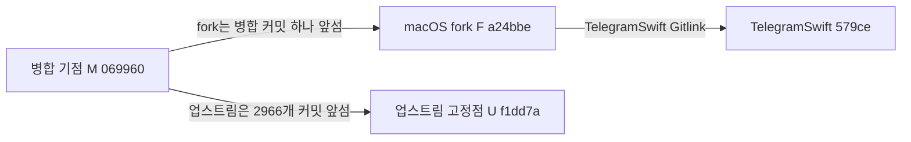
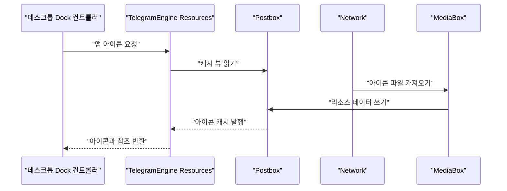
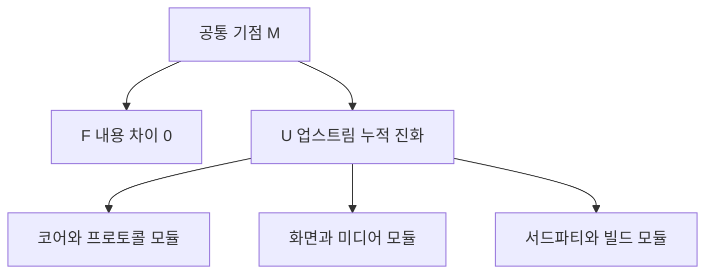
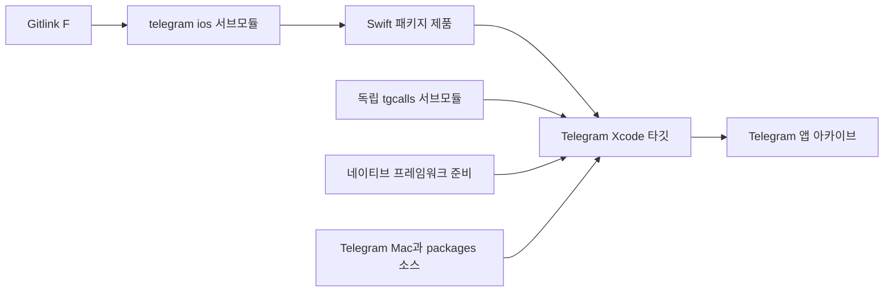

# macOS fork의 출처와 차이

웹: /docs/system/20-macos-fork/ · Markdown: /docs/system/20-macos-fork.md

> TelegramSwift가 쓰는 Telegram-iOS fork의 병합 기점, 트리 차이, 업스트림 진화 규모, 로컬 빌드가 fork를 소비하는 관계를 검증해요.

> 시스템 설계 · 계정과 플랫폼 · 20장 · 도표 4 · 코드 발췌 10 · 인용 25 · 소스 기준선: [TelegramMessenger/Telegram-iOS@f1dd7a2d](https://github.com/TelegramMessenger/Telegram-iOS/tree/f1dd7a2dbd02cbbf513e75d5695d8d36d1cf5838), [overtake/TelegramSwift@579cebbf](https://github.com/overtake/TelegramSwift/tree/579cebbf0c01fd41b712eff3647fa7f69db9665d)
>
> 핵심 소스 파일: [overtake/TelegramSwift/.gitmodules](https://github.com/overtake/TelegramSwift/blob/579cebbf0c01fd41b712eff3647fa7f69db9665d/.gitmodules), [overtake/TelegramSwift/Telegram.xcodeproj/project.pbxproj](https://github.com/overtake/TelegramSwift/blob/579cebbf0c01fd41b712eff3647fa7f69db9665d/Telegram.xcodeproj/project.pbxproj), [overtake/TelegramSwift/buildbox/build-mac.sh](https://github.com/overtake/TelegramSwift/blob/579cebbf0c01fd41b712eff3647fa7f69db9665d/buildbox/build-mac.sh), [overtake/TelegramSwift/scripts/configure_frameworks.sh](https://github.com/overtake/TelegramSwift/blob/579cebbf0c01fd41b712eff3647fa7f69db9665d/scripts/configure_frameworks.sh), [overtake/TelegramSwift/packages/FetchManager/Package.swift](https://github.com/overtake/TelegramSwift/blob/579cebbf0c01fd41b712eff3647fa7f69db9665d/packages/FetchManager/Package.swift), [overtake/TelegramSwift/packages/TelegramMedia/Package.swift](https://github.com/overtake/TelegramSwift/blob/579cebbf0c01fd41b712eff3647fa7f69db9665d/packages/TelegramMedia/Package.swift), [overtake/TelegramSwift/Telegram-Mac/PCallSession.swift](https://github.com/overtake/TelegramSwift/blob/579cebbf0c01fd41b712eff3647fa7f69db9665d/Telegram-Mac/PCallSession.swift), [overtake/Telegram-iOS/submodules/TelegramCore/Package.swift](https://github.com/overtake/Telegram-iOS/blob/a24bbe45f9861f736a79916a50898512f751e0dc/submodules/TelegramCore/Package.swift), [overtake/Telegram-iOS/submodules/TelegramCore/Sources/MacOS/MacInternal.swift](https://github.com/overtake/Telegram-iOS/blob/a24bbe45f9861f736a79916a50898512f751e0dc/submodules/TelegramCore/Sources/MacOS/MacInternal.swift), [overtake/Telegram-iOS/submodules/TelegramCore/Sources/MacOS/TelegramApplicationIcons.swift](https://github.com/overtake/Telegram-iOS/blob/a24bbe45f9861f736a79916a50898512f751e0dc/submodules/TelegramCore/Sources/MacOS/TelegramApplicationIcons.swift), [overtake/Telegram-iOS/submodules/TelegramCore/Sources/MacOS/NotificationAutolockReportManager.swift](https://github.com/overtake/Telegram-iOS/blob/a24bbe45f9861f736a79916a50898512f751e0dc/submodules/TelegramCore/Sources/MacOS/NotificationAutolockReportManager.swift), [overtake/Telegram-iOS/submodules/TelegramCore/Sources/Account/Account.swift](https://github.com/overtake/Telegram-iOS/blob/a24bbe45f9861f736a79916a50898512f751e0dc/submodules/TelegramCore/Sources/Account/Account.swift), [overtake/Telegram-iOS/submodules/TelegramCore/Sources/TelegramEngine/Resources/TelegramEngineResources.swift](https://github.com/overtake/Telegram-iOS/blob/a24bbe45f9861f736a79916a50898512f751e0dc/submodules/TelegramCore/Sources/TelegramEngine/Resources/TelegramEngineResources.swift)
>
> 미검증 사항:
> - 업데이트 채널의 XML, 설치 패키지 미디어, 실패 UI가 xmlLoad와 archiveLoad를 올바르게 구분하는지는 네트워크 환경에서 아직 검증하지 않았어요.
> - tgcalls, Sparkle, rlottie 등 독립 서브모듈이 iOS의 같은 이름 의존성과 소스 수준에서 어떻게 다른지는 별도 검증이 남아 있어요.

## 문제와 판정 기준 [#문제와-판정-기준]

이 장은 저장소 이름에 쉽게 속는 문제 하나에 답해요. TelegramSwift는 `submodules/telegram-ios`를 `overtake/Telegram-iOS.git`으로 설정하니까, 실제로 fork 하나를 소비해요. 하지만 fork의 원격 이름, 브랜치 이름, 병합 커밋만으로는 고정된 그 버전에 고유한 소스가 들어 있다는 걸 증명할 수 없어요.

그래서 이 장은 Git 커밋 그래프, 파일 트리, 빌드 그래프를 나누어 검증해요. 앞선 “macOS 클라이언트의 시스템 계층”은 데스크톱 호스트가 공유 코어에 어떻게 연결되는지를 설명해요. 이 장은 그 공유 코어의 출처와 버전 차이만 설명해요. [\[1\]](https://github.com/overtake/TelegramSwift/blob/579cebbf0c01fd41b712eff3647fa7f69db9665d/.gitmodules#L7-L15)

이 장은 커밋 세 개를 기준으로 비교해요.

- M: 공통 병합 기점이에요. 값은 `0699602bbc2756d1feaeb67df485e376dce44ad2`예요.
- F: macOS fork의 고정점이에요. 값은 `a24bbe45f9861f736a79916a50898512f751e0dc`예요.
- U: 이 사이트의 iOS 업스트림 고정점이에요. 값은 `f1dd7a2dbd02cbbf513e75d5695d8d36d1cf5838`이에요.

여기서 두 용어를 파일 트리 차이로 엄밀하게 정의해요.

- macOS 전용 패치: M에서 F까지의 파일 트리 차이예요.
- 업스트림 진화: M에서 U까지의 파일 트리 차이예요.

이렇게 정의하면 데스크톱 저장소 자체의 AppKit 코드나, 업스트림이 나중에 추가한 iOS 코드를 fork의 몫으로 잘못 돌리는 일이 없어요.

GitHub compare API로 `U...overtake:F`를 비교했어요. 응답은 이래요.

- 상태는 `diverged`예요(F와 U가 서로 갈라졌다는 뜻이에요).
- F가 M보다 커밋 1개 앞서 있어요.
- U가 M보다 커밋 2,966개 앞서 있어요.

F는 기준 날짜 2025-07-29의 병합 커밋이고, 제목은 `Merge branch 'beta' into macos-11.14-release`예요. 두 번째 부모 커밋이 바로 M이에요. 이어서 scratch 저장소에서 M, F, U를 얕게 가져와 두 쌍의 트리에 `git diff --numstat`(파일별 추가·삭제 행 수를 보여 주는 명령)을 실행했어요.



이 도표의 두 화살표는 서로 바꿔 해석하면 안 돼요.

- M에서 F: 이 장에서 다루는 fork 전용 패치 구간이에요.
- M에서 U: macOS 고정 버전 이후 iOS 업스트림이 진화한 구간이에요.
- F에서 U: 경로가 하나가 아니에요. 둘이 이미 갈라졌기 때문이에요.

그래서 U를 F와 직접 텍스트 diff하면 업스트림 커밋 2,966개의 누적 변화를 macOS 수정으로 착각하게 돼요.

Git 토폴로지(커밋의 연결 관계)와 트리 내용도 구분해야 해요. F에는 부모 커밋이 둘 있어요.

- 첫 번째 부모 커밋과 비교하면 파일 17개를 바꾸고 231행을 추가하고 163행을 삭제했어요. 이건 병합 커밋이 첫 번째 부모에 대해 낸 병합 결과예요. M에서 F까지의 차이가 아니에요.
- M과 F의 tree ID(Git이 파일 트리 내용으로 계산하는 식별자)는 모두 `0beebf847c66e5d1bcfe3e2d7f28054ca7b8fbe0`으로 같아요.
- M에서 F까지의 전체 `--numstat` 출력은 0행이에요.
- 샘플링한 파일 네 개의 blob ID(파일 내용 식별자)도 같아요. `TelegramCore/Package.swift`, `MacInternal.swift`, `TelegramApplicationIcons.swift`, `Account.swift`가 여기에 들어가요.

### 검증 결과 [#검증-결과]

| 비교 흐름 | 커밋 관계 | 변경 파일 | 추가 행 | 삭제 행 | 바이너리 파일 |
| --- | --- | ---: | ---: | ---: | ---: |
| M에서 F | F가 병합 커밋 1개 앞섬 | 0 | 0 | 0 | 0 |
| M에서 U | U가 커밋 2,966개 앞섬 | 20,679 | 2,697,589 | 762,822 | 579 |

결론은 분명해요. 이 macOS fork 고정점은 커밋 그래프상으로는 업스트림 참조가 아니에요. 그런데 M에서 F까지의 내용을 기준으로 보면 macOS 전용 패치가 전혀 없어요. 그래서 이렇게 해석하면 안 돼요.

- F의 브랜치 이름 `macos-11.14-release`를 패치 집합의 이름으로 취급하면 안 돼요.
- F가 M보다 병합 노드가 하나 많다는 사실만으로 `TelegramCore`, `Postbox` 또는 다른 어떤 파일을 수정했다고 추론해서도 안 돼요.

소스 트리에 macOS 기능이 없다는 뜻은 아니에요. F의 `TelegramCore` 패키지는 macOS 10.13 플랫폼을 명시적으로 선언하고, `Postbox`(로컬 저장 계층), `SwiftSignalKit`, `MtProtoKit`, `TelegramApi`를 로컬 패키지 의존성으로 둬요. 이 기능들은 F에 있지만 이미 M에도 있어요. 그래서 이번 fork만의 차이가 아니라 공유 기준선에 속해요. [\[2\]](https://github.com/overtake/Telegram-iOS/blob/a24bbe45f9861f736a79916a50898512f751e0dc/submodules/TelegramCore/Package.swift#L6-L49)

```swift
let package = Package(
    name: "TelegramCore",
    platforms: [.macOS(.v10_13)],
    products: [
        // Products define the executables and libraries a package produces, and make them visible to other packages.
        .library(
            name: "TelegramCore",
            targets: ["TelegramCore"]),
    ],
    dependencies: [
        // Dependencies declare other packages that this package depends on.
        // .package(url: /* package url */, from: "1.0.0"),
        .package(name: "FlatBuffers", path: "./FlatBuffers"),
        .package(name: "FlatSerialization", path: "./FlatSerialization"),
        .package(name: "Postbox", path: "../Postbox"),
        .package(name: "SSignalKit", path: "../SSignalKit"),
        .package(name: "MtProtoKit", path: "../MtProtoKit"),
        .package(name: "TelegramApi", path: "../TelegramApi"),
```
[\[2\]](https://github.com/overtake/Telegram-iOS/blob/a24bbe45f9861f736a79916a50898512f751e0dc/submodules/TelegramCore/Package.swift#L6-L49)

## fork 전용 패치가 0일 때 트리의 macOS 코드를 이해하는 방법 [#fork-전용-패치가-0일-때-트리의-macos-코드를-이해하는-방법]

M에서 F까지는 집계할 수 있는 내용 변경이 없어요. 그래서 모듈별 fork 전용 패치를 집계해 봐도, 0이 아닌 결론 하나를 빼면 모든 모듈이 0이라는 결과뿐이에요. 이 결과는 지우면 안 돼요. 이 장에서 출처에 관해 가장 중요한 판정이기 때문이에요.

| M에서 F까지의 모듈 범위 | 변경 파일 | 추가 행 | 삭제 행 | 해석 |
| --- | ---: | ---: | ---: | --- |
| `submodules/TelegramCore` | 0 | 0 | 0 | fork 전용 변경 없음 |
| `submodules/Postbox` | 0 | 0 | 0 | fork 전용 변경 없음 |
| `submodules/SSignalKit` | 0 | 0 | 0 | fork 전용 변경 없음 |
| `submodules/MtProtoKit` | 0 | 0 | 0 | fork 전용 변경 없음 |
| 나머지 소스, 빌드, 서브모듈 Gitlink(서브모듈의 고정 커밋을 가리키는 항목) | 0 | 0 | 0 | 파일 트리가 M과 같음 |

이 결론은 유지보수에도 의미가 있어요. F의 공유 코어 문제를 고칠 때 유지보수자는 비공개 macOS 패치를 병합해야 한다고 먼저 가정하면 안 돼요. 문제를 찾는 순서는 이래요.

1. M에 해당하는 업스트림 코드와 U 이후의 진화 속에서 문제를 찾아요.
2. 그다음 TelegramSwift 자체 코드, 다른 서브모듈, 또는 실제 빌드 산출물에서 차이가 나타나야만 독립적인 데스크톱 수정 영역이 생겨요.

### 병합 노드와 내용 노드는 별개 [#병합-노드와-내용-노드는-별개]

Git 커밋은 작성자, 시간, 부모, tree ID를 저장해요. 병합 커밋은 부모가 최소 둘이라서 “두 이력이 연결되었다”는 걸 표현할 수 있지만, 새 파일 트리를 들여올 필요는 없어요. F가 바로 이런 경우예요. `macos-11.14-release`의 첫 번째 부모와 beta의 두 번째 부모를 한 커밋에 기록했지만, 최종 tree는 두 번째 부모 M과 완전히 같아요.

그래서 compare API는 앞선 커밋 하나를 올바르게 보고해요. `git diff`도 내용 변화 0개를 올바르게 보고해요. 두 결과는 충돌하지 않아요.

첫 번째 부모와 비교한 파일 17개의 변화는 M에서 F까지의 차이 표를 대신할 수 없어요. 그 변화는 merge가 두 번째 부모의 일부 내용을 선택했다는 걸 나타내요. 여기에는 Stars, 선물, 연령 확인, 업데이트 화면과 관련된 업스트림 파일이 들어 있어요. 이 변화들은 F가 M에 대해 추가한 집합에 들어가지 않아요.

유지보수자가 이 17개 파일을 macOS 패치로 나열하면, 병합을 해결한 결과와 최종 기준선에서 벗어난 부분이 뒤섞여요.

이 판정은 Gitlink에도 적용돼요. Gitlink는 tree 항목이라서 tree ID 계산에 참여해요. F와 M의 전체 tree ID가 같으니 둘의 일반 파일, 실행 비트, 심볼릭 링크, 서브모듈 고정점이 모두 같아요.

여기서의 결론은 부모 저장소의 tree에 대한 거예요. 다음 두 가지를 주장하는 건 아니에요.

- 서브모듈 원격이 이후 움직이지 않았다.
- 다른 네트워크 프로토콜로 서브모듈을 다시 초기화해도 같은 브랜치 헤드가 나온다.

따라서 F가 특별한 점은 릴리스 선택과 저장소 귀속에 있어요. M에서 F까지의 소스 증분에는 없어요. TelegramSwift는 자체 원격과 고정 Gitlink로 재현할 수 있는 입력을 보장해요. 이런 구성에도 여전히 가치가 있어요.

- 데스크톱 저장소가 공유 트리를 언제 갱신할지 독립적으로 정할 수 있어요.
- 빌드 스크립트가 고정된 입력 하나를 기준으로 headers와 생성 소스를 준비할 수 있어요.

다만 이 제어 지점만으로 그 입력에 비공개 패치가 있다고 추론할 수는 없어요.

### 공유 기준선에 이미 있는 데스크톱 업데이트 다운로드 [#공유-기준선에-이미-있는-데스크톱-업데이트-다운로드]

`submodules/TelegramCore/Sources/MacOS/MacInternal.swift`에는 데스크톱을 위한 업데이트 도우미 함수가 있어요. `requestUpdatesXml`은 이렇게 동작해요.

1. 주어진 소스 이름을 먼저 해석해요.
2. 그 peer의 최신 히스토리 메시지를 요청해요.
3. `TelegramMediaFile`로 변환할 수 있는 첫 번째 메시지만 받아들여요.
4. `MediaBox`(미디어 리소스를 가져오고 캐시하는 객체)가 그 리소스를 가져와 전부 읽게 해요.

이 흐름은 macOS 자체 업데이트를 위한 것으로 보여요. 하지만 blob이 M과 F에서 이미 같으니 F의 신규 패치로 나열할 수 없어요. [\[6\]](https://github.com/overtake/Telegram-iOS/blob/a24bbe45f9861f736a79916a50898512f751e0dc/submodules/TelegramCore/Sources/MacOS/MacInternal.swift#L13-L75)

```swift
public func requestUpdatesXml(account: Account, source: String) -> Signal<Data, InternalUpdaterError> {
    return TelegramEngine(account: account).peers.resolvePeerByName(name: source, referrer: nil)
        |> castError(InternalUpdaterError.self)
        |> mapToSignal { result -> Signal<Peer?, InternalUpdaterError> in
            switch result {
            case .progress:
                return .never()
            case let .result(peer):
                return .single(peer?._asPeer())
            }
        }
        |> mapToSignal { peer -> Signal<Data, InternalUpdaterError> in
            if let peer = peer, let inputPeer = apiInputPeer(peer) {
                return account.network.request(Api.functions.messages.getHistory(peer: inputPeer, offsetId: 0, offsetDate: 0, addOffset: 0, limit: 1, maxId: Int32.max, minId: 0, hash: 0))
                    |> retryRequest
                    |> castError(InternalUpdaterError.self)
```
[\[6\]](https://github.com/overtake/Telegram-iOS/blob/a24bbe45f9861f736a79916a50898512f751e0dc/submodules/TelegramCore/Sources/MacOS/MacInternal.swift#L13-L75)

실패하는 경계도 구체적이에요.

- 이름을 해석하는 중에는 값을 영영 내보내지 않는 Signal(SwiftSignalKit의 비동기 스트림)을 반환해요.
- peer를 찾지 못하거나, 미디어를 얻지 못하거나, 리소스 경로에서 데이터를 읽지 못하면 함수는 `xmlLoad`를 반환해요.
- `ActionDisposable`은 다운로드와 데이터 구독을 함께 dispose(구독 해제)해요.

그래서 호출하는 쪽은 빈 XML이나 끝나지 않은 다운로드를 유효한 업데이트 정보로 보면 안 돼요. 네트워크 요청은 `retryRequest`로 재시도하기도 해요. 재시도 횟수와 백오프 전략은 공유 네트워크 계층에 있고, 이 장에서는 다루지 않아요.

실제 설치 패키지를 내려받는 경로는 별도의 명시적 결과 타입을 써요. 다운로드 시작, 진행률, 완료 경로를 나누어 상위 계층에 넘겨요. 이 인터페이스 자체에는 Sparkle이나 AppKit API가 없어요. Telegram 미디어 캐시에서 얻은 로컬 경로만 내놓아요. [\[7\]](https://github.com/overtake/Telegram-iOS/blob/a24bbe45f9861f736a79916a50898512f751e0dc/submodules/TelegramCore/Sources/MacOS/MacInternal.swift#L77-L83)

```swift
public enum AppUpdateDownloadResult {
    case started(Int)
    case progress(Int, Int)
    case finished(String)
}

public func downloadAppUpdate(account: Account, source: String, messageId: Int32) -> Signal<AppUpdateDownloadResult, InternalUpdaterError> {
```
[\[7\]](https://github.com/overtake/Telegram-iOS/blob/a24bbe45f9861f736a79916a50898512f751e0dc/submodules/TelegramCore/Sources/MacOS/MacInternal.swift#L77-L83)

다운로드 함수의 흐름은 이래요.

1. 반환된 메시지를 로컬 `Message`로 바꿔요.
2. 가장 최신이면서 첫 번째 미디어가 파일인 메시지를 골라요.
3. 같은 리소스의 캐시를 먼저 지워요.
4. 가져오기를 시작하고, 리소스 상태를 구독해요.
5. 전체 데이터가 나타나면 파일 경로를 보내요.

조건에 맞는 미디어가 없으면 `archiveLoad`를 반환해요. 구독이 취소되면 가져오기, 상태, 데이터, 삭제의 disposable 네 종류를 해제해요. 덕분에 업데이트 UI가 오래된 다운로드를 멈출 수 있고, 계속 관찰 중인 진행률 스트림이 남지 않아요. [\[8\]](https://github.com/overtake/Telegram-iOS/blob/a24bbe45f9861f736a79916a50898512f751e0dc/submodules/TelegramCore/Sources/MacOS/MacInternal.swift#L83-L176)

```swift
if let (message, media) = messageAndFile {
    return Signal { subscriber in
        var dataDisposable: Disposable?
        var fetchDisposable: Disposable?
        var statusDisposable: Disposable?
        let removeDisposable = account.postbox.mediaBox.removeCachedResources([media.resource.id]).start(completed: {
            let reference = MediaResourceReference.media(media: .message(message: MessageReference(message), media: media), resource: media.resource)
            
            fetchDisposable = fetchedMediaResource(mediaBox: account.postbox.mediaBox, userLocation: .other, userContentType: .other, reference: reference).start()
            statusDisposable = account.postbox.mediaBox.resourceStatus(media.resource).start(next: { status in
                switch status {
                case let .Fetching(_, progress):
                    if let size = media.size {
                        if progress == 0 {
                            subscriber.putNext(.started(Int(size)))
                        } else {
                            subscriber.putNext(.progress(Int(progress * Float(size)), Int(size)))
                        }
                    }
                default:
                    break
                }
            })
            
            dataDisposable = account.postbox.mediaBox.resourceData(media.resource, option: .complete(waitUntilFetchStatus: true)).start(next: { data in
                if data.complete {
                    subscriber.putNext(.finished(data.path))
                    subscriber.putCompletion()
                }
            })
        })
        
        
        
        return ActionDisposable {
            fetchDisposable?.dispose()
            dataDisposable?.dispose()
            statusDisposable?.dispose()
            removeDisposable.dispose()
        }
    }
}
```
[\[8\]](https://github.com/overtake/Telegram-iOS/blob/a24bbe45f9861f736a79916a50898512f751e0dc/submodules/TelegramCore/Sources/MacOS/MacInternal.swift#L83-L176)

### 앱 아이콘의 공유 저장 모델 [#앱-아이콘의-공유-저장-모델]

`TelegramApplicationIcons`는 아이콘 파일과 그 `MessageReference`를 Postbox 인코딩 객체로 저장해요. 캐시 항목에는 고정 collection ID와 1바이트 key를 써요. 읽는 쪽은 `combinedView`로 캐시 항목을 얻고, 쓰는 쪽은 Postbox transaction을 써요.

그래서 Dock 아이콘 선택은 AppKit 메모리에만 있는 설정 값이 아니에요. 계정 코어와 데스크톱 셸이 함께 관찰할 수 있는 영속 데이터예요. [\[9\]](https://github.com/overtake/Telegram-iOS/blob/a24bbe45f9861f736a79916a50898512f751e0dc/submodules/TelegramCore/Sources/MacOS/TelegramApplicationIcons.swift#L12-L68)

```swift
func _internal_applicationIcons(account: Account) -> Signal<TelegramApplicationIcons, NoError> {
    let key = PostboxViewKey.cachedItem(TelegramApplicationIcons.entryId)
    return account.postbox.combinedView(keys: [key])
    |> mapToSignal { views -> Signal<TelegramApplicationIcons, NoError> in
        guard let icons = (views.views[key] as? CachedItemView)?.value?.getLegacy(TelegramApplicationIcons.self) as? TelegramApplicationIcons else {
            return .single(.init(icons: []))
        }
        return .single(icons)
    }
}

func _internal_updateApplicationIcons(postbox: Postbox, icons: TelegramApplicationIcons) -> Signal<Void, NoError> {
    return postbox.transaction { transaction -> Void in
        let entry = CodableEntry(legacyValue: icons)
        transaction.putItemCacheEntry(id: TelegramApplicationIcons.entryId, entry: entry)
    }
}
```
[\[9\]](https://github.com/overtake/Telegram-iOS/blob/a24bbe45f9861f736a79916a50898512f751e0dc/submodules/TelegramCore/Sources/MacOS/TelegramApplicationIcons.swift#L12-L68)

`requestApplicationIcons`는 `macos_app_icons`라는 이름의 peer 히스토리를 읽고, 파싱할 수 있는 파일을 이 캐시에 넣어요. `TelegramEngine.Resources.applicationIcons`는 읽기 진입점을 Engine API로 드러내요. TelegramSwift의 `DockControl`은 `TelegramApplicationIcons.Icon`을 확장하고, 같은 계정의 `MediaBox`에서 리소스 경로를 구해요.

이 연결 고리는 두 가지를 증명해요. 하나는 데스크톱 셸이 코어 타입을 실제로 소비한다는 거예요. 다른 하나는 이 기능의 핵심 저장 계층이 TelegramSwift 디렉터리 안에 있지 않다는 거예요. [\[10\]](https://github.com/overtake/Telegram-iOS/blob/a24bbe45f9861f736a79916a50898512f751e0dc/submodules/TelegramCore/Sources/MacOS/MacInternal.swift#L179-L226) [\[11\]](https://github.com/overtake/Telegram-iOS/blob/a24bbe45f9861f736a79916a50898512f751e0dc/submodules/TelegramCore/Sources/TelegramEngine/Resources/TelegramEngineResources.swift#L412-L419) [\[12\]](https://github.com/overtake/TelegramSwift/blob/579cebbf0c01fd41b712eff3647fa7f69db9665d/Telegram-Mac/DockControl.swift#L18-L28)



소스 코드는 자동 잠금 상태를 보고하는 관리자도 정의해요. 동작은 이래요.

- 전용 `Queue`에서 deadline 스트림을 받아 남은 초를 `account.updateDeviceLocked`에 넘겨요. deadline이 없으면 -1을 써요.
- 네트워크 오류는 `boolFalse`로 바뀌어요.
- 이어서 완료 콜백이 `isPerformingUpdate`를 다시 초기화해요.

이걸 보면 UI는 보고가 진행 중인지는 관찰할 수 있어요. 하지만 이 불리언만으로는 서버가 보고를 받아들였는지 확인할 수 없어요. [\[13\]](https://github.com/overtake/Telegram-iOS/blob/a24bbe45f9861f736a79916a50898512f751e0dc/submodules/TelegramCore/Sources/MacOS/NotificationAutolockReportManager.swift#L19-L55)

```swift
private func updateDeadline(_ deadline: Int32?) {
    self.isPerformingUpdate.set(true)
    let value: Int32
    if let deadline = deadline {
        value = max(0, deadline - Int32(CFAbsoluteTimeGetCurrent()))
    } else {
        value = -1
    }
    self.currentRequestDisposable.set((self.network.request(Api.functions.account.updateDeviceLocked(period: value))
    |> `catch` { _ -> Signal<Api.Bool, NoError> in
        return .single(.boolFalse)
    }
    |> deliverOn(self.queue)).start(completed: { [weak self] in
        guard let strongSelf = self else {
            return
        }
        strongSelf.isPerformingUpdate.set(false)
    }))
}
```
[\[13\]](https://github.com/overtake/Telegram-iOS/blob/a24bbe45f9861f736a79916a50898512f751e0dc/submodules/TelegramCore/Sources/MacOS/NotificationAutolockReportManager.swift#L19-L55)

`Account`는 이 관리자, deadline Promise, 네트워크 파라미터의 구독을 갖고 있어요. 생성 단계에서는 일반 계정 관리자를 초기화한 뒤 이 관리자를 만들고, `networkArguments.autolockDeadine`을 중복 제거해 Promise로 보내요. 여기의 철자 `autolockDeadine`은 소스 필드 이름이에요.

이 연결은 공유 `Account`에서 일어나고 macOS 윈도우 컨트롤러에서 일어나지 않아요. 그래서 이것도 공유 기준선에 있는 계정 동작이에요. [\[14\]](https://github.com/overtake/Telegram-iOS/blob/a24bbe45f9861f736a79916a50898512f751e0dc/submodules/TelegramCore/Sources/Account/Account.swift#L1003-L1025) [\[15\]](https://github.com/overtake/Telegram-iOS/blob/a24bbe45f9861f736a79916a50898512f751e0dc/submodules/TelegramCore/Sources/Account/Account.swift#L1115-L1126)

### macOS와 iOS의 기능표가 아님 [#macos와-ios의-기능표가-아님]

위의 세 가지 예(업데이트 다운로드, 앱 아이콘, 자동 잠금 보고)가 iOS도 반드시 같은 Dock 아이콘을 표시하거나 같은 업데이트 UI를 실행한다는 뜻은 아니에요. M과 F 모두 이 Core 소스 파일과 계정 조립 지점을 갖고 있다는 것만 증명해요. 실제 제품 동작은 어느 호스트가 API를 호출하는지에도 달려 있어요.

이 경계는 앞선 “전체 아키텍처와 모듈 계층화”의 결론과 맞아요. 코어 패키지는 계정, 저장, 네트워크, 도메인 API를 제공하고, 플랫폼 프로젝트가 언제 호출할지 정해요.

그래서 이 장은 `Sources/MacOS` 디렉터리를 “fork diff”와 같다고 보지 않아요. 더 정확한 용어는 “공유 기준선 안의 macOS 지향 소스”예요. 어떤 API가 iOS 산출물의 최종 바이너리에 들어가는지 판단하려면 iOS의 Bazel target과 호출 위치를 하나씩 확인해야 해요. 이건 버전 출처에 따라 분류하는 이 장의 과제를 넘어서요.

## M 이후 업스트림의 진화 규모 [#m-이후-업스트림의-진화-규모]

U는 F의 직접 후속이 아니에요. 아래 표는 M에서 U까지의 원본 `git diff --numstat`을 엄밀하게 집계한 거예요. 이 표가 답하는 건 macOS 고정 버전에 업스트림 진화가 얼마나 들어 있지 않은가예요. 어떤 기능을 “되돌려 가져와야 하는가”는 답하지 않아요.

표의 숫자는 이렇게 읽어요.

- 파일 수: 텍스트 또는 바이너리 변화가 한 곳이라도 있는 경로의 수예요.
- 추가와 삭제 행: Git 텍스트 통계에서 나와요.
- 바이너리 수: 행 수가 들어 있지 않아요.

| M에서 U까지의 모듈 | 파일 | 추가 행 | 삭제 행 | 바이너리 |
| --- | ---: | ---: | ---: | ---: |
| `submodules/TelegramUI` | 3,420 | 504,881 | 105,266 | 501 |
| `submodules/TelegramCore` | 461 | 47,527 | 8,676 | 0 |
| `submodules/TelegramApi` | 57 | 103,017 | 58,270 | 0 |
| `submodules/Postbox` | 82 | 7,707 | 991 | 0 |
| `submodules/SSignalKit` | 72 | 14,821 | 15 | 0 |
| `submodules/MtProtoKit` | 59 | 5,867 | 1,653 | 0 |
| `submodules/TgVoipWebrtc` | 6 | 1,248 | 22 | 0 |
| `submodules/MediaPlayer` | 16 | 843 | 109 | 0 |
| `submodules/Display` | 67 | 3,708 | 3,340 | 0 |
| `submodules/TelegramCallsUI` | 64 | 5,200 | 2,793 | 0 |
| `Telegram/Telegram-iOS` | 29 | 2,525 | 63 | 23 |
| `Telegram/NotificationService` | 4 | 1,249 | 92 | 0 |
| `Telegram/WatchApp` | 954 | 223,340 | 0 | 8 |
| `build-system` | 113 | 16,991 | 1,133 | 10 |
| `third-party` | 1,927 | 999,319 | 1,920 | 23 |

표에 나열하지 않은 모듈의 합계도 앞의 총계에는 그대로 들어 있어요. 예를 들면 이래요.

- `submodules/ffmpeg`는 혼자서 변경 파일이 11,059개이고 448,892행이 추가되고 315,764행이 삭제되었어요.
- `third-party/yasm`은 변경 파일이 1,428개이고 834,092행이 추가되었어요.

이 숫자는 총 코드량이 주로 서드파티 임포트, 생성물, 대규모 동기화의 영향을 받는다는 걸 보여 줘요. 그러니 총 코드 행 수로 제품 로직의 위험이나 가치를 추론하면 안 돼요.

TelegramSwift가 가장 직접 소비하는 공유 코어는 M에서 U까지 규모가 작지 않아요.

- `TelegramApi`: 추가 103,017행과 삭제 58,270행은 TL 생성 코드가 크게 진화했다는 뜻이에요.
- `TelegramCore`: 파일 변화 461개는 계정, 도메인 API, 동기화 동작에 영향을 줘요.
- `Postbox`, `SSignalKit`, `MtProtoKit`: 각자 독립적인 변화가 있어요.

그래서 TelegramSwift를 F에서 U로 올리는 건 네트워크 모듈 하나만 바꾸는 작업이 아니에요.

### 이 규모 표를 읽는 방법 [#이-규모-표를-읽는-방법]

이 표는 rename(파일 이름 변경)을 같은 파일로 합치지 않아요. generated source(생성된 소스)에 대해 의미 단위로 중복을 제거하지도 않아요. 원본 numstat을 고른 이유는 이 장의 목표가 사람이 작성한 코드량을 추정하는 게 아니라, 다시 실행할 수 있는 버전 간 규모를 보여 주는 거라서예요.

이 방식에는 두 가지 한계가 있어요.

- 파일 이름이 바뀐 뒤 삭제와 추가로 취급되면 일부 디렉터리의 행 수가 부풀려져요.
- schema를 다시 생성한 뒤 나온 대량의 `TelegramApi` 행도 같은 수의 독립적인 프로토콜 설계 결정을 뜻하지는 않아요.

바이너리 파일은 추가 행이나 삭제 행에 기여하지 않아요. `TelegramUI`의 바이너리 변경 501개와 `Telegram/WatchApp`의 바이너리 변경 8개를 보면, 리소스, 프로젝트 자산, 사전 빌드된 입력도 업스트림과 함께 진화했다는 걸 알 수 있어요. 이들은 최종 패키지 크기, 빌드 캐시, 릴리스 검증에 모두 영향을 줘요.

하지만 이 장은 이를 사용자에게 보이는 기능으로 해석하지 않아요. 어떤 asset이 macOS 산출물에 들어가는지 판단하려면 TelegramSwift의 Xcode target과 리소스 copy phase에서 계속 추적해야 해요.

서드파티 디렉터리의 통계는 따로 봐야 해요. `third-party`의 추가 999,319행은 공유 코어 모듈 어느 하나보다 커요. 그중 `yasm`의 추가 834,092행이 큰 비중을 차지해요. `submodules/ffmpeg`도 수십만 행이 변했어요.

이들 디렉터리가 바뀌는 건 업스트림 미러링, 버전 동기화, 컴파일 지원 때문인 경우가 많아요. 업그레이드 테스트 범위는 넓어지지만, 행 수만으로 Telegram 메시지, 저장, 인증 의미가 그만큼 바뀌었다고 추론할 수는 없어요.

반대로 파일 수가 적은 모듈도 호환성의 핵심 지점일 수 있어요.

- `MtProtoKit`은 변경 파일이 59개뿐이지만 연결, 세션, 요청 전송의 경계에 있어요.
- `Postbox`의 파일 82개는 로컬 영속성에 영향을 줘요.
- `TelegramApi`는 대부분 생성 타입이더라도 이름, 생성자, layer가 바뀌면 데스크톱 호출이 컴파일되지 않을 수 있어요.

규모 표는 검토 순서를 안내할 뿐이에요. 모듈별 API diff, 마이그레이션 테스트, 네트워크 상호운용 테스트를 대신하면 안 돼요.

버전을 혼동하지 않으려면 M에서 U까지의 결과로 F를 거꾸로 해석하면 안 돼요. F는 2025-07-29에 고정되어 있고, U는 기준으로 삼은 2026-10-07의 업스트림 지점이에요. 표에는 약 14개월 분량의 업스트림 커밋이 누적되어 있어요. merge request 하나의 변경 요약이 아니에요.

되돌려 가져오는 결정은 모두 중간 업스트림 커밋을 따로 골라서, 그 커밋이 TelegramSwift에서 컴파일되는지 확인해야 해요. U를 유일한 후보로 삼으면 안 돼요.



표의 `TelegramUI` 규모도 TelegramSwift가 iOS 화면 전체를 컴파일한다는 뜻은 아니에요. TelegramSwift의 주 제품은 자체 `Telegram-Mac`과 `packages` 소스를 써요. 이 표의 역할은 업그레이드를 위한 차이 지도를 주는 거예요. 순서는 이래요.

1. 먼저 업스트림의 어느 영역이 바뀌었는지 찾아요.
2. 그다음 TelegramSwift의 로컬 API 사용 지점, Swift 컴파일 오류, 런타임 동작을 확인해요.

이 표는 기능 호환성 목록도 아니고 보안 감사 결과도 아니에요.

## TelegramSwift가 fork를 소비하는 방식 [#telegramswift가-fork를-소비하는-방식]

### 서브모듈 위치와 패키지 경계 [#서브모듈-위치와-패키지-경계]

TelegramSwift는 먼저 Git 서브모듈로 fork를 가져와요. `.gitmodules`는 경로 `submodules/telegram-ios`를 `overtake/Telegram-iOS.git`으로 지정해요. 부모 저장소의 고정 커밋 `579cebbf0c01fd41b712eff3647fa7f69db9665d`에 있는 Gitlink가 F를 고정해요.

다시 말해 원격에서 가져오는 일과 실제 소스 버전은 서로 다른 두 겹의 정보예요.

- 원격은 서브모듈의 출처를 정해요.
- Gitlink는 그 작업 트리가 어느 커밋을 읽을지 정해요. [\[1\]](https://github.com/overtake/TelegramSwift/blob/579cebbf0c01fd41b712eff3647fa7f69db9665d/.gitmodules#L7-L15)

```ini
[submodule "submodules/telegram-ios"]
	path = submodules/telegram-ios
url=git@github.com:overtake/Telegram-iOS.git
[submodule "submodules/rlottie"]
	path = submodules/rlottie
url=git@github.com:overtake/rlottie.git
[submodule "submodules/tgcalls"]
	path = submodules/tgcalls
url=git@github.com:overtake/tgcalls.git
```
[\[1\]](https://github.com/overtake/TelegramSwift/blob/579cebbf0c01fd41b712eff3647fa7f69db9665d/.gitmodules#L7-L15)

fork 안의 SwiftPM 매니페스트(Swift 패키지 정의 파일)는 `TelegramCore`, `Postbox`, `SwiftSignalKit`, `MtProtoKit`, `TelegramApi` 등의 제품을 정의해요. 세부 사항은 이래요.

- `Postbox`는 SQLCipher, 파일 관리, 범위 집합, 시그널 라이브러리, 암호화 도구에 스스로 의존해요.
- `SwiftSignalKit`의 제품 이름은 `SwiftSignalKit`이지만 패키지 이름은 `SSignalKit`이에요.
- `MtProtoKit`은 C 또는 Objective-C 스타일의 target으로 컴파일되고 공개 헤더 디렉터리는 `PublicHeaders`예요.

이 이름들을 보면 macOS 소스의 import 이름과 프로젝트의 제품 이름이 항상 같지는 않은 이유를 알 수 있어요. [\[3\]](https://github.com/overtake/Telegram-iOS/blob/a24bbe45f9861f736a79916a50898512f751e0dc/submodules/SSignalKit/Package.swift#L6-L26) [\[4\]](https://github.com/overtake/Telegram-iOS/blob/a24bbe45f9861f736a79916a50898512f751e0dc/submodules/Postbox/Package.swift#L6-L43) [\[5\]](https://github.com/overtake/Telegram-iOS/blob/a24bbe45f9861f736a79916a50898512f751e0dc/submodules/MtProtoKit/Package.swift#L6-L31)

TelegramSwift의 데스크톱 비공개 패키지는 상대 경로로 이 제품들을 참조해요. `FetchManager`는 `Postbox`, `SSignalKit`, `TelegramCore`의 fork 경로를 함께 선언하고, `Postbox`, `SwiftSignalKit`, `TelegramCore`를 target 의존성으로 써요. 다운로드 저장소나 Signal 구현을 복사해 두는 게 아니에요. 데스크톱 패키지 안에서 fork의 제품을 조합해요. [\[16\]](https://github.com/overtake/TelegramSwift/blob/579cebbf0c01fd41b712eff3647fa7f69db9665d/packages/FetchManager/Package.swift#L15-L33)

`TelegramMedia`는 모듈 간 조합을 더 잘 보여 줘요. 의존성에는 fork의 `TelegramCore`, `Postbox`, `TelegramVoip`, `MediaPlayer`, `OpusBinding`도 있고, TelegramSwift 자체의 `TgVoipWebrtc`, `TGUIKit`, 자격 증명과 UI 패키지도 있어요. 그래서 미디어와 통화 경로를 “telegram-ios fork만 썼다”고 설명할 수 없어요. fork 코어, 데스크톱 패키지, 독립 tgcalls 서브모듈을 조합한 거예요. [\[17\]](https://github.com/overtake/TelegramSwift/blob/579cebbf0c01fd41b712eff3647fa7f69db9665d/packages/TelegramMedia/Package.swift#L15-L55)

```swift
.package(name: "SSignalKit", path: "../../submodules/telegram-ios/submodules/SSignalKit"),
.package(name: "TelegramCore", path: "../../submodules/telegram-ios/submodules/TelegramCore"),
.package(name: "Postbox", path: "../../submodules/telegram-ios/submodules/Postbox"),
.package(name: "OpusBinding", path: "../../submodules/telegram-ios/submodules/OpusBinding"),
.package(name: "TelegramVoip", path: "../../submodules/telegram-ios/submodules/TelegramVoip"),
.package(name: "TgVoipWebrtc", path: "../tgcalls"),
```
[\[17\]](https://github.com/overtake/TelegramSwift/blob/579cebbf0c01fd41b712eff3647fa7f69db9665d/packages/TelegramMedia/Package.swift#L15-L55)

`Telegram-Mac`과 `packages` 아래 Swift 파일의 import 행을 집계하면, 각 모듈이 나오는 파일 수는 이래요.

- `SwiftSignalKit`: 808개 파일
- `TelegramCore`: 763개 파일
- `Postbox`: 664개 파일
- `TgVoipWebrtc`: 16개 파일
- `TelegramVoip`: 10개 파일
- `MtProtoKit`: 5개 파일

이 숫자는 소스 import의 파일 수예요. 링크 횟수가 아니고, 모든 경로가 한 번의 실행에서 수행된다는 뜻도 아니에요. 앞의 세 공유 제품은 데스크톱 앱의 상용 기반이고, 전송, VoIP, WebRTC는 특정 기능 영역에 더 집중되어 있다는 점을 설명하기에는 충분해요.

`SharedAccountContext.swift`, `AppDelegate.swift`, `CoreExtension.swift`는 모두 `TelegramCore`, `Postbox`, `SwiftSignalKit`을 직접 import해요. 통화 세션은 `TelegramVoip`과 `TgVoipWebrtc`도 import해요. 그래서 데스크톱 계층은 래퍼 하나만 거쳐 코어에 간접 접근하지 않아요. 데스크톱 계층의 계정 컨텍스트도 쓰고, 기능 모듈에서는 공유 도메인과 저장 타입을 직접 써요. [\[18\]](https://github.com/overtake/TelegramSwift/blob/579cebbf0c01fd41b712eff3647fa7f69db9665d/Telegram-Mac/SharedAccountContext.swift#L9-L20) [\[19\]](https://github.com/overtake/TelegramSwift/blob/579cebbf0c01fd41b712eff3647fa7f69db9665d/Telegram-Mac/PCallSession.swift#L9-L18)

### 상대 경로에서 최종 제품까지 [#상대-경로에서-최종-제품까지]

SwiftPM 매니페스트가 답하는 건 패키지가 의존성을 어디서 찾는지, target이 어떤 제품을 선언하는지예요. 애플리케이션 프로세스에 어떤 제품이 들어가는지는 직접 정하지 않아요. `FetchManager`를 예로 들면, 매니페스트는 fork 경로 세 개를 로컬 `.package`로 쓰고, 이어서 target이 같은 이름의 제품 세 개를 골라요.

이런 방식은 버전 선택을 부모 저장소의 Gitlink에 맡겨요. 데스크톱 패키지마다 원격 버전을 따로 해석하게 하지 않아요. 같은 프로세스에 `TelegramCore` 사본이 두 개 섞여 들어갈 위험이 줄어요. [\[16\]](https://github.com/overtake/TelegramSwift/blob/579cebbf0c01fd41b712eff3647fa7f69db9665d/packages/FetchManager/Package.swift#L15-L33)

`TelegramMedia`는 두 번째 층위의 선택을 보여 줘요. fork의 저장, 도메인, 오디오, 미디어 패키지와 TelegramSwift의 표시, 자격 증명, WebP, tgcalls 패키지를 한데 모아요. 그래서 `TelegramMedia`는 조합 패키지이고 fork와 같은 말이 아니에요.

- 이점: 데스크톱이 표시와 비디오 계층을 바꿔 끼울 수 있어요.
- 대가: 공개 타입의 변화가 여러 로컬 package를 따라 전파돼요. 코어 제품 하나를 업그레이드한 뒤 컴파일 오류가 `Telegram-Mac` 주 target이 아니라 미디어 패키지에서 먼저 나타날 수 있어요.

Xcode target은 세 번째 층위의 선택이에요. `packageProductDependencies`가 제품을 `Telegram` 타깃에 추가해요. 타깃에는 코어, 프로토콜, 저장, 시그널, 미디어, 로컬 UI 패키지가 함께 나열돼요. 의존성 클로저와 target 제품 집합에 동시에 나타나는 코드만 최종 앱의 링크에 참여해요.

- 디렉터리에 `Package.swift`가 있다고 자동으로 `Telegram.app`에 들어간다는 증거가 되지는 않아요.
- 파일이 어떤 모듈을 import한다고 그 모듈의 모든 API가 호출된다는 증거가 되지도 않아요.

이 층위로 흔한 오판 세 가지를 설명할 수 있어요.

1. `.gitmodules`에 fork가 있다고 모든 하위 디렉터리가 컴파일되는 건 아니에요.
2. Swift 패키지가 fork에 의존한다고 주 target이 반드시 그 패키지를 링크하는 건 아니에요.
3. 주 target이 `TgVoipWebrtc`를 링크한다고 그게 `overtake/Telegram-iOS`에서 왔다는 뜻은 아니에요. 여기의 경로는 TelegramSwift 자체의 `submodules/tgcalls`이기 때문이에요.

버전 출처를 검토할 때는 Gitlink를 먼저 확정하고, 그다음 패키지 경로를, 마지막으로 타깃 제품 의존성을 확인해야 해요.

관찰할 수 있는 경계가 하나 더 있어요. 확장 target이에요.

- `FocusIntents`는 `SwiftSignalKit`, `TelegramCore`, `Postbox`, `ApiCredentials`, `InAppSettings` 등 더 좁은 제품만 나열해요.
- `TelegramShare`는 코어, API, 저장, 데스크톱 UI 보조 패키지를 나열해요.

이들은 주 `Telegram` target과 같은 의존성 집합을 공유하지 않아요. 추정하자면 이렇게 줄인 건 extension의 코드 크기와 쓸 수 있는 능력을 통제하려는 거예요. extension마다 런타임 진입점과 생명주기가 구체적으로 어떤지는 각자의 target 소스에서 계속 검증해야 해요. [\[23\]](https://github.com/overtake/TelegramSwift/blob/579cebbf0c01fd41b712eff3647fa7f69db9665d/Telegram.xcodeproj/project.pbxproj#L6906-L6929) [\[24\]](https://github.com/overtake/TelegramSwift/blob/579cebbf0c01fd41b712eff3647fa7f69db9665d/Telegram.xcodeproj/project.pbxproj#L6931-L6981)

생성 소스는 네 번째 버전 경계예요. 아카이브 전에 도는 프레임워크 스크립트는 fork의 `TelegramCore/FlatSerialization/Sources` 디렉터리에 macOS 직렬화 소스를 생성해요. 이 디렉터리의 내용은 Gitlink만으로 정해지지 않아요. Models 입력, `flatc` 실행 파일, 스크립트 인자에도 달려 있어요.

스크립트가 입력과 출력 경로를 고정하긴 하지만, 이 장은 생성 전후의 디렉터리를 해시로 비교하지 않았어요. 그래서 M과 F의 Git tree가 같다고 해서, 새로 아카이브하며 생성한 Swift 파일이 과거 산출물과 글자 하나까지 같다는 게 자동으로 증명되지는 않아요. [\[22\]](https://github.com/overtake/TelegramSwift/blob/579cebbf0c01fd41b712eff3647fa7f69db9665d/scripts/configure_frameworks.sh#L13-L15)

네이티브 framework에도 같은 두 겹의 성질이 있어요. 스크립트는 두 가지를 해요.

1. macOS destination에서 OpenH264, OpenSSL, libopus, libvpx, mozjpeg, libwebp, dav1d, FFmpeg, WebRTC, tde2e를 빌드해요.
2. 필요한 헤더 파일을 fork의 binding 디렉터리와 TelegramSwift의 tgcalls 공유 헤더 디렉터리로 복사해요.

이 과정은 Swift product의 출처와 그 product가 보는 C header의 출처가 다를 수 있다는 걸 보여 줘요. fork 안의 `EncryptionProvider`나 `TelegramVoip`을 업그레이드할 때는 package manifest, module map, header 복사 경로, 최종 linker 입력을 함께 확인해야 해요. [\[22\]](https://github.com/overtake/TelegramSwift/blob/579cebbf0c01fd41b712eff3647fa7f69db9665d/scripts/configure_frameworks.sh#L13-L15)

버전 검증은 소유자 기준으로 층을 나눠야 해요.

1. Git 층: 서브모듈 Gitlink가 실제로 checkout한 F와 일치하는지 검증해요.
2. 패키지 층: `Package.swift`의 제품 이름과 상대 경로가 여전히 해석되는지 검증해요.
3. Xcode 층: 주 target과 extension target의 제품 클로저를 검증해요.
4. 런타임 층: 계정 열기, Postbox schema, 네트워크 연결성, 미디어 가져오기, 통화 기기, 업데이트 다운로드를 검증해요.

이 층 구분은 소스에 보이는 의존 관계를 근거로 한 엔지니어링 추론이에요. 가치는 “서브모듈이 잘못된 버전을 가리킨다”와 “런타임 API 동작이 호환되지 않는다”를 서로 다른 점검 진입점으로 나눈다는 데 있어요.

업그레이드가 실패할 때는 오류 위치도 진단 정보를 줘요.

- 모듈을 찾을 수 없다면 보통 Gitlink, 상대 경로, package product 이름을 가리켜요.
- C 또는 Objective-C header가 없다면 보통 `configure_frameworks.sh`의 framework 출력이나 복사 과정을 가리켜요.
- Swift 타입이 맞지 않는다면 보통 M에서 U까지의 공개 API 진화를 가리켜요.
- 앱을 시작한 뒤에 생기는 계정이나 캐시 문제는 `TelegramCore`, `Postbox`, 데이터 마이그레이션을 점검해야 해요.

이 분류가 로그와 테스트를 대신할 수는 없어요. 하지만 유지보수자가 모든 실패를 fork 이름 탓으로 돌리는 일은 피할 수 있어요.

### Xcode 타깃과 아카이브 체인 [#xcode-타깃과-아카이브-체인]

주 Xcode target의 이름은 `Telegram`이에요. 이 target의 `packageProductDependencies`에는 `TelegramApi`, `TelegramCore`, `Postbox`, `SwiftSignalKit`, `MtProtoKit`, `TgVoipWebrtc`가 명시적으로 나열되어 있어요. 단순히 import를 검색하는 것보다 강력한 근거예요. 이 제품들이 주 애플리케이션 타깃의 빌드 의존성 집합에 들어간다는 걸 보여 주기 때문이에요.

`TelegramShare`와 `FocusIntents`도 더 좁은 제품 집합을 갖지만, 이 장의 초점은 주 애플리케이션이에요. [\[20\]](https://github.com/overtake/TelegramSwift/blob/579cebbf0c01fd41b712eff3647fa7f69db9665d/Telegram.xcodeproj/project.pbxproj#L7001-L7024)

```text
name = Telegram;
packageProductDependencies = (
    27F3B75327391E6B00B81F10 /* TelegramIconsTheme */,
    27B6D04E27393A2A00C785C7 /* TelegramApi */,
    27B6D05027393A3200C785C7 /* TelegramCore */,
    27B6D05227393A3600C785C7 /* Postbox */,
    27B6D05427393A3D00C785C7 /* GraphCore */,
    27B6D05627393A3D00C785C7 /* GraphUI */,
    27B6D05827393A4200C785C7 /* SwiftSignalKit */,
    27B6D05A27393A4700C785C7 /* TGUIKit */,
    27B6D05C27393A5500C785C7 /* MergeLists */,
    27E5C3BC2739761300C52BA0 /* MurMurHash32 */,
    277E829C273A8E890037118C /* MtProtoKit */,
    2700B221273ADC94003E4018 /* HotKey */,
    279FD29F273C1234004F08A1 /* BuildConfig */,
    279FD2A6273C1251004F08A1 /* Zip */,
    279FD2AC273C1291004F08A1 /* TgVoipWebrtc */,
```
[\[20\]](https://github.com/overtake/TelegramSwift/blob/579cebbf0c01fd41b712eff3647fa7f69db9665d/Telegram.xcodeproj/project.pbxproj#L7001-L7024)

아카이브 스크립트는 세 단계로 실행해요.

1. 먼저 `scripts/configure_frameworks.sh`를 실행해요.
2. 선택한 설정을 `Telegram-Mac/Release.xcconfig`로 복사해요.
3. workspace, `Release` scheme, `Release` configuration으로 `xcodebuild archive`를 실행해요.

설정 스크립트는 그 전에 세 가지를 해요.

- fork 안의 `TelegramCore/FlatSerialization`에 macOS 코드를 생성해요.
- OpenSSL, FFmpeg, WebRTC 등 네이티브 프레임워크를 빌드해요.
- 헤더 파일을 fork 또는 tgcalls의 공유 헤더 디렉터리로 복사해요.

이를 통해 최종 macOS 아카이브가 Swift 패키지 제품, fork 안의 생성 단계, 독립 네이티브 프레임워크 준비 단계에 동시에 의존한다는 걸 확인할 수 있어요. [\[21\]](https://github.com/overtake/TelegramSwift/blob/579cebbf0c01fd41b712eff3647fa7f69db9665d/buildbox/build-mac.sh#L25-L45) [\[22\]](https://github.com/overtake/TelegramSwift/blob/579cebbf0c01fd41b712eff3647fa7f69db9665d/scripts/configure_frameworks.sh#L13-L15)

```bash
sh "scripts/configure_frameworks.sh"
cp "configurations/${BUILD_CONFIGURATION}.xcconfig" "Telegram-Mac/Release.xcconfig"

xcodebuild archive -workspace "Telegram-Mac.xcworkspace" \
-scheme Release \
-configuration Release \
-archivePath ./


cd ..

archive="./telegrammacos.xcarchive"
appname="Telegram.app"

cp -R "${archive}/Products/Applications/Telegram.app" ${appname}
cp -R "${archive}/dSYMs/Telegram.app.dSYM" ${appname}.dSYM
```
[\[21\]](https://github.com/overtake/TelegramSwift/blob/579cebbf0c01fd41b712eff3647fa7f69db9665d/buildbox/build-mac.sh#L25-L45)



이 빌드 그래프에는 트레이드오프가 둘 있어요.

- 첫째, 코어 모듈을 데스크톱과 iOS가 재사용할 수 있어요.
- 둘째, F를 업그레이드할 때는 Swift API, 생성된 FlatSerialization 소스, 네이티브 프레임워크 헤더 파일, tgcalls ABI를 함께 확인해야 해요.

Gitlink만 바꾸고 설정 스크립트를 실행하지 않으면 최종 앱이 링크된다는 걸 증명할 수 없어요. 반대로 TelegramSwift의 AppKit 소스만 봐서는 그 소스가 U의 업스트림 수정을 하나라도 쓴다는 것도 증명할 수 없어요.

## iOS와 macOS의 비교와 설계 트레이드오프 [#ios와-macos의-비교와-설계-트레이드오프]

F의 내용 트리가 M과 같으니, 코어 버전을 비교하면 macOS와 기점 업스트림 사이에는 분기가 없어요. 차이는 TelegramSwift가 소비하는 계층에 있어요. iOS 업스트림 주 산출물은 Bazel 타깃으로 `TelegramUI`와 확장을 구성해요. macOS 주 산출물은 Xcode workspace 안에서 `Telegram-Mac`, 데스크톱 Swift 패키지, 네이티브 framework를 구성해요. 둘 다 `TelegramCore`, `Postbox`, `SwiftSignalKit`, `MtProtoKit`, `TelegramApi`를 쓸 수 있지만, 서로 다른 플랫폼 셸과 미디어 의존성 조합을 골라요. [\[2\]](https://github.com/overtake/Telegram-iOS/blob/a24bbe45f9861f736a79916a50898512f751e0dc/submodules/TelegramCore/Package.swift#L6-L49) [\[20\]](https://github.com/overtake/TelegramSwift/blob/579cebbf0c01fd41b712eff3647fa7f69db9665d/Telegram.xcodeproj/project.pbxproj#L7001-L7024) [\[21\]](https://github.com/overtake/TelegramSwift/blob/579cebbf0c01fd41b712eff3647fa7f69db9665d/buildbox/build-mac.sh#L25-L45)

이 비교는 세 층위로 나눌 수 있어요.

1. 내용 기준선: M에서 F까지가 0이라는 건 F가 공통 기점 위에서 코어 파일을 하나도 바꾸지 않았다는 뜻이에요.
2. 컴파일 선택: fork의 `TelegramCore` 매니페스트는 macOS를 대상으로 하고, TelegramSwift의 패키지도 macOS 플랫폼으로 제품을 선언해요. 업스트림 iOS 프로젝트는 다른 빌드 타깃으로 제품을 골라요.
3. 호스트 동작: TelegramSwift의 AppKit, Dock, 윈도우, 시스템 알림, 데스크톱 기기 코드가 어떤 공유 API를 호출할지 정해요.

세 층 모두 “macOS 차이”라고 부르지만, 이 장이 정의한 fork 전용 patch에 속하는 건 첫째 층뿐이에요. [\[2\]](https://github.com/overtake/Telegram-iOS/blob/a24bbe45f9861f736a79916a50898512f751e0dc/submodules/TelegramCore/Package.swift#L6-L49) [\[17\]](https://github.com/overtake/TelegramSwift/blob/579cebbf0c01fd41b712eff3647fa7f69db9665d/packages/TelegramMedia/Package.swift#L15-L55) [\[20\]](https://github.com/overtake/TelegramSwift/blob/579cebbf0c01fd41b712eff3647fa7f69db9665d/Telegram.xcodeproj/project.pbxproj#L7001-L7024)

이렇게 구분하면 조건부 컴파일을 분기로 오해하는 일도 막을 수 있어요. 공유 `Network.swift`는 `os(iOS)` 조건에서만 `CloudData`를 import해요. 같은 소스 파일이 플랫폼마다 다르게 보이는 코드를 컴파일해 낼 수 있고, Git tree에는 여전히 분기가 없어요. 조건부 컴파일은 트리 하나에서 여러 산출물을 만드는 설계예요. fork patch가 되려면 버전 트리에 내용 변화가 있어야 해요.

추정하자면, 유지보수자가 플랫폼 버그를 검토할 때는 문제가 어디서 왔는지 먼저 판단한 뒤 그에 맞는 diff 범위를 골라야 해요. 후보는 세 가지예요. 같은 트리의 조건 분기, 데스크톱 호출자, 벗어난 버전 트리예요. [\[25\]](https://github.com/overtake/Telegram-iOS/blob/a24bbe45f9861f736a79916a50898512f751e0dc/submodules/TelegramCore/Sources/Network/Network.swift#L1-L12)

macOS 최소 시스템 버전도 패키지마다 일치하지 않아요. `TelegramCore`, `Postbox`, `SSignalKit`, `MtProtoKit`의 패키지 매니페스트는 모두 macOS 10.13을 선언하는 반면 `Spotlight`는 macOS 10.11을 선언할 수 있어요. 실제 주 target의 배포 버전과 런타임 가용성은 여전히 Xcode build setting이 정해요. 패키지 플랫폼 선언은 패키지를 해석할 수 있는 최저 플랫폼을 제한할 뿐이에요. 완전한 제품 지원 약속이 아니에요. 지나친 결론을 피하려고 이 장은 어떤 단일 package의 버전 번호도 Telegram.app의 최종 최소 시스템 버전으로 적지 않았어요. [\[2\]](https://github.com/overtake/Telegram-iOS/blob/a24bbe45f9861f736a79916a50898512f751e0dc/submodules/TelegramCore/Package.swift#L6-L49) [\[3\]](https://github.com/overtake/Telegram-iOS/blob/a24bbe45f9861f736a79916a50898512f751e0dc/submodules/SSignalKit/Package.swift#L6-L26) [\[4\]](https://github.com/overtake/Telegram-iOS/blob/a24bbe45f9861f736a79916a50898512f751e0dc/submodules/Postbox/Package.swift#L6-L43) [\[5\]](https://github.com/overtake/Telegram-iOS/blob/a24bbe45f9861f736a79916a50898512f751e0dc/submodules/MtProtoKit/Package.swift#L6-L31)

데스크톱과 iOS 사이에는 시스템 서비스라는 경계도 있어요. 공유 코어는 `Account`, `Network`, `Postbox`, Signal로 계정, 영속성, 비동기 작업을 표현할 수 있어요. macOS의 윈도우, Dock, `NSApplication`은 알 필요가 없어요. TelegramSwift는 `SharedAccountContext`와 다른 Cocoa 소스로 이 서비스들을 구성해요. 이렇게 분리하면 계정 객체 하나를 서로 다른 플랫폼 셸이 조립할 수 있어요. 데스크톱 고유의 윈도우 생명주기가 메시지 동기화 코드에 직접 들어오지도 않아요. 디커플링의 이점에 관한 뒷부분 문장은 import와 제품 경계에서 얻은 추정이에요. [\[18\]](https://github.com/overtake/TelegramSwift/blob/579cebbf0c01fd41b712eff3647fa7f69db9665d/Telegram-Mac/SharedAccountContext.swift#L9-L20) [\[19\]](https://github.com/overtake/TelegramSwift/blob/579cebbf0c01fd41b712eff3647fa7f69db9665d/Telegram-Mac/PCallSession.swift#L9-L18)

데스크톱 통화는 이런 조합을 잘 보여 주는 예예요. `PCallSession.swift`는 Cocoa, 공유 코어, 저장, SignalKit, `TelegramVoip`, 독립 `TgVoipWebrtc`를 함께 import해요. 그래서 프로토콜 세션과 계정 상태는 fork 제품에서 오고, 기기와 호출 표시는 macOS 계층이 관리해요. 미디어 구현은 또 다른 고정 서브모듈에도 의존해요. 통화 동작의 차이를 `overtake/Telegram-iOS`의 차이 탓으로 돌릴 수는 없어요. [\[19\]](https://github.com/overtake/TelegramSwift/blob/579cebbf0c01fd41b712eff3647fa7f69db9665d/Telegram-Mac/PCallSession.swift#L9-L18)

Dock 아이콘도 마찬가지예요. 타입은 공유 코어에서 오지만, 그 파일 리소스를 데스크톱 경로로 바꾸는 건 `DockControl`이에요. 이렇게 나누면 코어는 동기화할 수 있는 파일 참조와 캐시 트랜잭션을 맡고, 호스트는 Dock 아이콘을 어떻게 표시할지 정해요. 이 설계는 Cocoa API가 계정 모델에 들어오는 걸 막아요. 또 API의 직렬화 타입이 오랫동안 읽을 수 있는 상태로 남아야 한다는 요구도 생겨요. 그러지 않으면 이미 Postbox에 쓰인 캐시를 투명하게 복원할 수 없기 때문이에요. [\[9\]](https://github.com/overtake/Telegram-iOS/blob/a24bbe45f9861f736a79916a50898512f751e0dc/submodules/TelegramCore/Sources/MacOS/TelegramApplicationIcons.swift#L12-L68) [\[12\]](https://github.com/overtake/TelegramSwift/blob/579cebbf0c01fd41b712eff3647fa7f69db9665d/Telegram-Mac/DockControl.swift#L18-L28)

F의 내용 차이가 0이라고 업그레이드 위험이 줄어드는 건 아니에요. 오히려 반대예요. M에서 U까지의 표를 보면 코어, 프로토콜, 시그널, 저장이 모두 앞으로 나아갔어요. TelegramSwift에서는 파일 763개가 `TelegramCore`를 import해요. 업그레이드하는 사람은 M에서 U까지를 모든 변화를 곧바로 받아들일 대상이 아니라 후보 변경 풀로 봐야 해요.

적절한 순서는 이래요.

1. 공개 제품 API를 먼저 비교해요.
2. 주 타깃과 확장을 컴파일해요.
3. 계정 복원, 미디어, 통화, 업데이트 다운로드처럼 경계를 넘는 경로를 검증해요.

이 순서는 의존 관계를 근거로 한 엔지니어링 추론이에요. 소스가 강제하는 업그레이드 스크립트가 아니에요.

반대 방향의 오판도 피해야 해요. F에는 M 대비 고유한 텍스트 변경이 없어요. 그렇다고 TelegramSwift 제품 전체가 iOS 클라이언트를 수정 없이 컴파일한 건 결코 아니에요. 독립적인 AppKit 소스, 데스크톱 패키지, Xcode 설정, 네이티브 프레임워크 빌드, 다른 서브모듈이 있어요. 여기서 “차이 0”은 `overtake/Telegram-iOS`가 M에서 F까지라는 정확한 버전 구간에서만 가지는 제약이에요. TelegramSwift 저장소 전체로 넓혀 해석하면 안 돼요.

## 경계 사례와 열린 문제 [#경계-사례와-열린-문제]

`requestUpdatesXml`과 `downloadAppUpdate`는 취소할 수 있고 실패할 수 있는 미디어 경로를 보여 줘요. 하지만 이 장은 네트워크 요청을 실행하거나 업데이트를 설치하지 않았어요. 그래서 특정 릴리스 채널이 있는지, XML이 Sparkle 형식을 충족하는지, 실패 UI가 `xmlLoad`와 `archiveLoad`를 구분해 보여 주는지는 여전히 미검증이에요.

아카이브 스크립트와 프레임워크 설정 스크립트는 빌드 의도를 증명해요. 하지만 이 장은 macOS와 Xcode 환경에서 `xcodebuild archive`를 실제로 실행하지 않았어요. 그래서 F와 TelegramSwift 고정점의 현재 컴파일, 링크, 서명, 생성물 ABI 호환성은 여전히 미검증이에요.

`tgcalls`, Sparkle, rlottie 등 서브모듈은 데스크톱 미디어와 업데이트에 결정적인 역할을 할 수 있어요. 이 장은 그것들이 TelegramSwift의 모듈 그래프에서 fork와 나란히 나타난다는 것만 확인했어요. 각자 iOS의 같은 이름 의존성과 소스 수준에서 어떻게 다른지는 M에서 F까지의 fork 차이에 속하지 않아요. 별도 검증이 남아 있어요.

## 참고 [#references]

- \[1\] [TelegramSwift 서브모듈 출처](https://github.com/overtake/TelegramSwift/blob/579cebbf0c01fd41b712eff3647fa7f69db9665d/.gitmodules#L7-L15)
- \[2\] [TelegramCore macOS 패키지 정의](https://github.com/overtake/Telegram-iOS/blob/a24bbe45f9861f736a79916a50898512f751e0dc/submodules/TelegramCore/Package.swift#L6-L49)
- \[3\] [SwiftSignalKit 패키지 정의](https://github.com/overtake/Telegram-iOS/blob/a24bbe45f9861f736a79916a50898512f751e0dc/submodules/SSignalKit/Package.swift#L6-L26)
- \[4\] [Postbox 패키지 의존성](https://github.com/overtake/Telegram-iOS/blob/a24bbe45f9861f736a79916a50898512f751e0dc/submodules/Postbox/Package.swift#L6-L43)
- \[5\] [MtProtoKit 패키지 정의](https://github.com/overtake/Telegram-iOS/blob/a24bbe45f9861f736a79916a50898512f751e0dc/submodules/MtProtoKit/Package.swift#L6-L31)
- \[6\] [데스크톱 업데이트 XML 가져오기](https://github.com/overtake/Telegram-iOS/blob/a24bbe45f9861f736a79916a50898512f751e0dc/submodules/TelegramCore/Sources/MacOS/MacInternal.swift#L13-L75)
- \[7\] [앱 업데이트 다운로드 결과](https://github.com/overtake/Telegram-iOS/blob/a24bbe45f9861f736a79916a50898512f751e0dc/submodules/TelegramCore/Sources/MacOS/MacInternal.swift#L77-L83)
- \[8\] [앱 업데이트 미디어 다운로드](https://github.com/overtake/Telegram-iOS/blob/a24bbe45f9861f736a79916a50898512f751e0dc/submodules/TelegramCore/Sources/MacOS/MacInternal.swift#L83-L176)
- \[9\] [앱 아이콘 캐시 모델](https://github.com/overtake/Telegram-iOS/blob/a24bbe45f9861f736a79916a50898512f751e0dc/submodules/TelegramCore/Sources/MacOS/TelegramApplicationIcons.swift#L12-L68)
- \[10\] [앱 아이콘 가져오기](https://github.com/overtake/Telegram-iOS/blob/a24bbe45f9861f736a79916a50898512f751e0dc/submodules/TelegramCore/Sources/MacOS/MacInternal.swift#L179-L226)
- \[11\] [Engine 아이콘 진입점](https://github.com/overtake/Telegram-iOS/blob/a24bbe45f9861f736a79916a50898512f751e0dc/submodules/TelegramCore/Sources/TelegramEngine/Resources/TelegramEngineResources.swift#L412-L419)
- \[12\] [Dock 아이콘 리소스 경로](https://github.com/overtake/TelegramSwift/blob/579cebbf0c01fd41b712eff3647fa7f69db9665d/Telegram-Mac/DockControl.swift#L18-L28)
- \[13\] [자동 잠금 상태 보고](https://github.com/overtake/Telegram-iOS/blob/a24bbe45f9861f736a79916a50898512f751e0dc/submodules/TelegramCore/Sources/MacOS/NotificationAutolockReportManager.swift#L19-L55)
- \[14\] [계정 자동 잠금 필드](https://github.com/overtake/Telegram-iOS/blob/a24bbe45f9861f736a79916a50898512f751e0dc/submodules/TelegramCore/Sources/Account/Account.swift#L1003-L1025)
- \[15\] [계정 자동 잠금 조립](https://github.com/overtake/Telegram-iOS/blob/a24bbe45f9861f736a79916a50898512f751e0dc/submodules/TelegramCore/Sources/Account/Account.swift#L1115-L1126)
- \[16\] [FetchManager 로컬 코어 의존성](https://github.com/overtake/TelegramSwift/blob/579cebbf0c01fd41b712eff3647fa7f69db9665d/packages/FetchManager/Package.swift#L15-L33)
- \[17\] [TelegramMedia 조합 의존성](https://github.com/overtake/TelegramSwift/blob/579cebbf0c01fd41b712eff3647fa7f69db9665d/packages/TelegramMedia/Package.swift#L15-L55)
- \[18\] [데스크톱 공유 계정 import](https://github.com/overtake/TelegramSwift/blob/579cebbf0c01fd41b712eff3647fa7f69db9665d/Telegram-Mac/SharedAccountContext.swift#L9-L20)
- \[19\] [데스크톱 통화 의존성](https://github.com/overtake/TelegramSwift/blob/579cebbf0c01fd41b712eff3647fa7f69db9665d/Telegram-Mac/PCallSession.swift#L9-L18)
- \[20\] [주 앱 제품 의존성](https://github.com/overtake/TelegramSwift/blob/579cebbf0c01fd41b712eff3647fa7f69db9665d/Telegram.xcodeproj/project.pbxproj#L7001-L7024)
- \[21\] [macOS 아카이브 스크립트](https://github.com/overtake/TelegramSwift/blob/579cebbf0c01fd41b712eff3647fa7f69db9665d/buildbox/build-mac.sh#L25-L45)
- \[22\] [FlatSerialization 생성 단계](https://github.com/overtake/TelegramSwift/blob/579cebbf0c01fd41b712eff3647fa7f69db9665d/scripts/configure_frameworks.sh#L13-L15)
- \[23\] [FocusIntents 제품 의존성](https://github.com/overtake/TelegramSwift/blob/579cebbf0c01fd41b712eff3647fa7f69db9665d/Telegram.xcodeproj/project.pbxproj#L6906-L6929)
- \[24\] [TelegramShare 제품 의존성](https://github.com/overtake/TelegramSwift/blob/579cebbf0c01fd41b712eff3647fa7f69db9665d/Telegram.xcodeproj/project.pbxproj#L6931-L6981)
- \[25\] [공유 네트워크 조건부 컴파일](https://github.com/overtake/Telegram-iOS/blob/a24bbe45f9861f736a79916a50898512f751e0dc/submodules/TelegramCore/Sources/Network/Network.swift#L1-L12)
