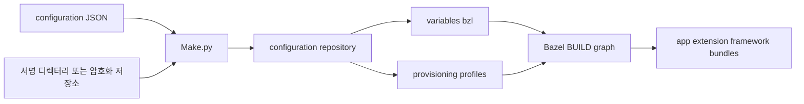
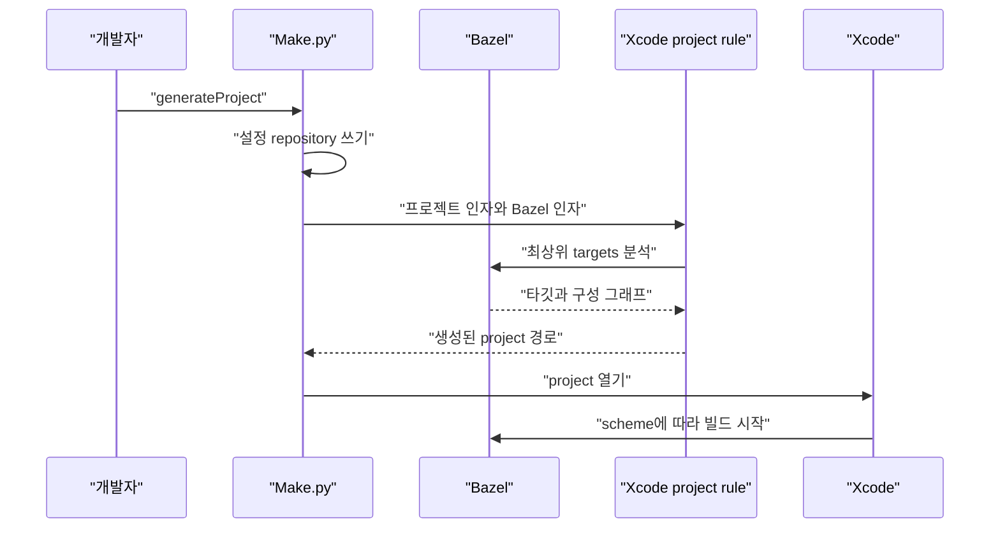

# iOS 빌드 시스템: Bazel과 Make.py

웹: /docs/system/21-ios-bazel-build/ · Markdown: /docs/system/21-ios-bazel-build.md

> Telegram-iOS가 제품 설정, 서명 자료, Bazel 그래프, Xcode 프로젝트를 어떻게 디버깅과 릴리스가 가능한 iOS 빌드 흐름으로 연결하는지 살펴봐요.

> 시스템 설계 · 엔지니어링 · 21장 · 도표 2 · 코드 발췌 8 · 인용 40 · 소스 기준선: [TelegramMessenger/Telegram-iOS@f1dd7a2d](https://github.com/TelegramMessenger/Telegram-iOS/tree/f1dd7a2dbd02cbbf513e75d5695d8d36d1cf5838), [overtake/TelegramSwift@579cebbf](https://github.com/overtake/TelegramSwift/tree/579cebbf0c01fd41b712eff3647fa7f69db9665d)
>
> 핵심 소스 파일: [TelegramMessenger/Telegram-iOS/build-system/Make/Make.py](https://github.com/TelegramMessenger/Telegram-iOS/blob/f1dd7a2dbd02cbbf513e75d5695d8d36d1cf5838/build-system/Make/Make.py), [TelegramMessenger/Telegram-iOS/build-system/Make/BuildConfiguration.py](https://github.com/TelegramMessenger/Telegram-iOS/blob/f1dd7a2dbd02cbbf513e75d5695d8d36d1cf5838/build-system/Make/BuildConfiguration.py), [TelegramMessenger/Telegram-iOS/Telegram/BUILD](https://github.com/TelegramMessenger/Telegram-iOS/blob/f1dd7a2dbd02cbbf513e75d5695d8d36d1cf5838/Telegram/BUILD), [TelegramMessenger/Telegram-iOS/build-system/bazel-utils/plist_fragment.bzl](https://github.com/TelegramMessenger/Telegram-iOS/blob/f1dd7a2dbd02cbbf513e75d5695d8d36d1cf5838/build-system/bazel-utils/plist_fragment.bzl), [TelegramMessenger/Telegram-iOS/MODULE.bazel](https://github.com/TelegramMessenger/Telegram-iOS/blob/f1dd7a2dbd02cbbf513e75d5695d8d36d1cf5838/MODULE.bazel), [TelegramMessenger/Telegram-iOS/build-system/appstore-configuration.json](https://github.com/TelegramMessenger/Telegram-iOS/blob/f1dd7a2dbd02cbbf513e75d5695d8d36d1cf5838/build-system/appstore-configuration.json), [ali-fareed/rules_apple/apple/internal/ios_rules.bzl](https://github.com/ali-fareed/rules_apple/blob/485016eb5b0948cc17307064e7977a6d68e94046/apple/internal/ios_rules.bzl), [ali-fareed/rules_apple/apple/internal/codesigning_support.bzl](https://github.com/ali-fareed/rules_apple/blob/485016eb5b0948cc17307064e7977a6d68e94046/apple/internal/codesigning_support.bzl), [ali-fareed/rules_apple/apple/internal/entitlements_support.bzl](https://github.com/ali-fareed/rules_apple/blob/485016eb5b0948cc17307064e7977a6d68e94046/apple/internal/entitlements_support.bzl), [ali-fareed/rules_apple/tools/codesigningtool/codesigningtool.py](https://github.com/ali-fareed/rules_apple/blob/485016eb5b0948cc17307064e7977a6d68e94046/tools/codesigningtool/codesigningtool.py), [overtake/TelegramSwift/Telegram.xcodeproj/project.pbxproj](https://github.com/overtake/TelegramSwift/blob/579cebbf0c01fd41b712eff3647fa7f69db9665d/Telegram.xcodeproj/project.pbxproj), [overtake/TelegramSwift/Telegram-Mac/Release.xcconfig](https://github.com/overtake/TelegramSwift/blob/579cebbf0c01fd41b712eff3647fa7f69db9665d/Telegram-Mac/Release.xcconfig)
>
> 미검증 사항:
> - 고정된 로컬 체크아웃에 rules_xcodeproj 소스가 없어서, 그 pbxproj 생성과 외부 생성 repository의 내부 메커니즘을 확인할 수 없어요.
> - rules_swift와 apple_support를 체크아웃하지 못해서, Swift module cache, WMO, Apple toolchain 구현의 세부 사항을 더 검증할 수 없어요.
> - iOS 시뮬레이터, 실기기, macOS에서의 종단 간 빌드를 실행하지 않았으므로, 고정된 도구 버전이 실제 머신에서 호환되는지 확인할 수 없어요.
> - 서명 자료를 읽지 않았으므로, fake-codesigning의 인증서 체인, profile 이름 규칙, 실제 entitlement가 App Store 업로드 요건을 충족하는지 확인할 수 없어요.

## 문제와 제약 [#문제와-제약]

Telegram-iOS의 빌드 시스템이 푸는 문제는 단순한 컴파일이 아니에요. 같은 소스 그래프로 다음을 모두 지원해야 해요.

- 개발자 자체 빌드 클라이언트
- 시뮬레이터 디버깅
- 실기기 설치
- 확장이 포함된 App Store 패키지
- 추적할 수 있는 dSYM(디버그 심볼 파일)

API 자격 증명, bundle id, 팀 서명, 푸시 환경도 소스 밖으로 빼내야 해요. 루트 README는 개발자가 먼저 자신의 `api_id`를 받고, 최소 설정 JSON을 채운 뒤, `Make.py generateProject`로 프로젝트를 생성하라고 요구해요. [\[1\]](https://github.com/TelegramMessenger/Telegram-iOS/blob/f1dd7a2dbd02cbbf513e75d5695d8d36d1cf5838/README.md#L14-L44)

시스템은 책임을 세 계층으로 나눠요.

- `Make.py`: 운영자를 향한 오케스트레이션 계층이에요.
- Bazel(선언한 의존성 그래프대로 빌드하는 빌드 도구)의 `BUILD` 파일: 의존성, 리소스, 서명 입력, 산출물 경계를 선언하는 계층이에요.
- `rules_apple`과 `rules_swift`: 이 선언들을 컴파일, 링크, bundle, 서명, Xcode 도구 동작으로 번역해요.

이미 있는 「전체 아키텍처와 모듈 계층」이 비즈니스 모듈 의존성을 설명하므로, 이 장은 그 모듈들이 어떻게 설치할 수 있는 산출물이 되는지만 설명해요.

이 설계는 네 가지 제약을 마주해요.

1. iOS 실기기와 App Store는 profile(앱·기기·인증서를 묶는 Apple의 서명 허가 파일), entitlement(앱이 쓰는 권한 선언), 인증서, bundle id가 일치해야 해요.
2. 시뮬레이터는 profile 없이 빠르게 빌드할 수 있어야 해요.
3. Xcode는 여전히 디버깅, 브레이크포인트, 기기 관리의 인터페이스이지만, 의존성 해석의 두 번째 진실이 되어서는 안 돼요.
4. 큰 Swift 그래프의 증분 컴파일은 캐시할 수 있어야 하지만, 서명과 로컬 키체인 접근을 잘못 원격화해서는 안 돼요.

고정 커밋의 `versions.json`은 이 버전을 요구해요.

- Xcode 26.6
- 배포용 Xcode 26.2
- Bazel 9.2.0
- macOS 26 [\[2\]](https://github.com/TelegramMessenger/Telegram-iOS/blob/f1dd7a2dbd02cbbf513e75d5695d8d36d1cf5838/versions.json#L1-L7)

`BuildEnvironment`는 운영자가 `--overrideXcodeVersion` 또는 `--overrideBazelVersion`을 넘기지 않는 한 실제 도구 버전을 비교해요. README도 이 스위치들을 기본 경로가 아니라 버전 검사를 우회하는 수단이라고 분명히 적어 두었어요. [\[3\]](https://github.com/TelegramMessenger/Telegram-iOS/blob/f1dd7a2dbd02cbbf513e75d5695d8d36d1cf5838/README.md#L61-L115)

### 진입 명령과 산출물 [#진입-명령과-산출물]

`Make.py`는 `generateProject`, `build`, `test`, `query`, `clean`, `spm` 등의 하위 명령을 정의해요. 이들은 설정 파싱과 캐시 옵션을 공유하지만 출력은 달라요.

- `generateProject`: Xcode 프로젝트를 생성해요.
- `build`: 기본으로 `Telegram/Telegram`을 빌드하고 IPA(iOS 설치 파일)와 dSYM을 복사할 수 있어요.
- `test`: arm64 시뮬레이터 디버그 구성을 고정으로 써요.
- `query`: Bazel의 action query를 불러요.
- `spm`: 전용 루트 target을 먼저 빌드한 뒤 SPM(Swift Package Manager)에 필요한 의존성 정보를 내보내요. [\[4\]](https://github.com/TelegramMessenger/Telegram-iOS/blob/f1dd7a2dbd02cbbf513e75d5695d8d36d1cf5838/build-system/Make/Make.py#L279-L442)

| 하위 명령 | 직접 동작 | 고정 동작 | 주요 산출물 |
| --- | --- | --- | --- |
| `generateProject` | 설정을 파싱하고 프로젝트 생성기를 호출 | 기본적으로 Release 프로젝트 구성을 포함하지 않음 | `Telegram.xcodeproj` |
| `build` | `bazel build` 호출 | 기본 target은 `Telegram/Telegram` | app bundle, IPA, 선택적 dSYM |
| `test` | `bazel test` 호출 | `debug_sim_arm64`, build number는 10000 | 테스트 결과와 로그 |
| `query` | `bazel aquery` 호출 | 쿼리 구성은 디버그 arm64 시뮬레이터 | action 그래프 |
| `spm` | `//Telegram:spm_build_root` 빌드 | sandbox와 Swift 모듈 분할 금지 | 모듈 의존성 JSON |
| `clean` | `bazel clean --expunge` 호출 | Bazel 로컬 상태 삭제 | 없음 |

아래의 구성 선택 코드는 디버그와 릴리스의 차이가 처음으로 합류하는 지점이에요. 네 개의 구성 값이 Bazel 컴파일 모드, iOS CPU, Watch CPU를 동시에 골라요.

릴리스 실기기 빌드는 추가로 dSYM을 요청하고 다음을 켜요.

- Rust LTO(링크 시점 최적화)
- Swift WMO(모듈 전체를 한 번에 컴파일하는 최적화)
- 크기 최적화
- dead strip(쓰지 않는 코드 제거) [\[5\]](https://github.com/TelegramMessenger/Telegram-iOS/blob/f1dd7a2dbd02cbbf513e75d5695d8d36d1cf5838/build-system/Make/Make.py#L82-L197)

```python
def set_configuration(self, configuration):
        if configuration == 'debug_arm64':
            self.configuration_args = [
                # bazel debug build configuration
                '-c', 'dbg',

                # Build single-architecture binaries. It is almost 2 times faster is 32-bit support is not required.
                '--ios_multi_cpus=arm64',

                # Always build universal Watch binaries.
                '--watchos_cpus=arm64_32'
            ] + self.common_debug_args
        elif configuration == 'debug_sim_arm64':
            self.configuration_args = [
                # bazel debug build configuration
                '-c', 'dbg',

                # Build single-architecture binaries. It is almost 2 times faster is 32-bit support is not required.
                '--ios_multi_cpus=sim_arm64',

                # Always build universal Watch binaries.
                '--watchos_cpus=arm64_32'
            ] + self.common_debug_args
        elif configuration == 'release_sim_arm64':
            self.configuration_args = [
                # bazel optimized build configuration
                '-c', 'opt',

                # Build single-architecture binaries. It is almost 2 times faster is 32-bit support is not required.
                '--ios_multi_cpus=sim_arm64',

                # Always build universal Watch binaries.
                '--watchos_cpus=arm64_32'
            ] + self.common_debug_args
        elif configuration == 'release_arm64':
            self.configuration_args = [
                # bazel optimized build configuration
                '-c', 'opt',

                # Build single-architecture binaries. It is almost 2 times faster is 32-bit support is not required.
                '--ios_multi_cpus=arm64',

                # Always build universal Watch binaries.
                '--watchos_cpus=arm64_32',

                # Generate DSYM files when building.
                '--apple_generate_dsym',

                # Require DSYM files as build output.
                '--output_groups=+dsyms',
            ] + self.common_release_args
        else:
            raise Exception('Unknown configuration {}'.format(configuration))
```
[\[5\]](https://github.com/TelegramMessenger/Telegram-iOS/blob/f1dd7a2dbd02cbbf513e75d5695d8d36d1cf5838/build-system/Make/Make.py#L82-L197)

## 모듈과 데이터 구조 [#모듈과-데이터-구조]

### Bazel 인자 목록과 다른 설정 JSON [#bazel-인자-목록과-다른-설정-json]

`appstore-configuration.json`은 제품 정체성 입력의 예시예요. 이런 값이 들어 있어요.

- `bundle_id`, `api_id`, `api_hash`
- 팀 ID
- App Store 플래그와 App Store 숫자 ID
- URL scheme
- 구독 상품 ID
- Siri와 iCloud 스위치 [\[6\]](https://github.com/TelegramMessenger/Telegram-iOS/blob/f1dd7a2dbd02cbbf513e75d5695d8d36d1cf5838/build-system/appstore-configuration.json#L1-L14)

최소 개발 템플릿은 내부 빌드를 참으로, App Store 빌드를 거짓으로 두고 Siri와 iCloud를 꺼요. [\[7\]](https://github.com/TelegramMessenger/Telegram-iOS/blob/f1dd7a2dbd02cbbf513e75d5695d8d36d1cf5838/build-system/template_minimal_development_configuration.json#L1-L14) 이 사실은 설정이 서명 전용 파일이 아니라는 뜻이에요. 애플리케이션의 런타임 제품 기능도 함께 바꿔요.

`BuildConfiguration`은 JSON을 읽은 뒤 필수 키 12개를 확인해요. 이어서 임시 외부 Bazel module `build-input/configuration-repository`에 `variables.bzl`을 써요. 이 파일에는 다음이 기록돼요.

- `telegram_bundle_id`
- API 자격 증명
- 팀 ID
- APS 환경(푸시 알림 환경)
- 기능 불리언

루트 `MODULE.bazel`은 `local_path_override`로 `build_configuration` module을 이 디렉터리로 지정해요. 그래서 매 빌드가 방금 생성된 값을 읽고, 버전 관리되는 BUILD 파일은 수정하지 않아요. [\[8\]](https://github.com/TelegramMessenger/Telegram-iOS/blob/f1dd7a2dbd02cbbf513e75d5695d8d36d1cf5838/build-system/Make/BuildConfiguration.py#L39-L100) [\[9\]](https://github.com/TelegramMessenger/Telegram-iOS/blob/f1dd7a2dbd02cbbf513e75d5695d8d36d1cf5838/MODULE.bazel#L175-L237)

```python
def write_to_variables_file(self, bazel_path, use_xcode_managed_codesigning, aps_environment, path):
        string = ''
        string += 'telegram_bazel_path = "{}"\n'.format(bazel_path)
        string += 'telegram_use_xcode_managed_codesigning = {}\n'.format('True' if use_xcode_managed_codesigning else 'False')
        string += 'telegram_bundle_id = "{}"\n'.format(self.bundle_id)
        string += 'telegram_api_id = "{}"\n'.format(self.api_id)
        string += 'telegram_api_hash = "{}"\n'.format(self.api_hash)
        string += 'telegram_team_id = "{}"\n'.format(self.team_id)
        string += 'telegram_app_center_id = "{}"\n'.format(self.app_center_id)
        string += 'telegram_is_internal_build = "{}"\n'.format(self.is_internal_build)
        string += 'telegram_is_appstore_build = "{}"\n'.format(self.is_appstore_build)
        string += 'telegram_appstore_id = "{}"\n'.format(self.appstore_id)
        string += 'telegram_app_specific_url_scheme = "{}"\n'.format(self.app_specific_url_scheme)
        string += 'telegram_premium_iap_product_id = "{}"\n'.format(self.premium_iap_product_id)
        string += 'telegram_aps_environment = "{}"\n'.format(aps_environment)
        string += 'telegram_enable_siri = {}\n'.format(self.enable_siri)
        string += 'telegram_enable_icloud = {}\n'.format(self.enable_icloud)
        string += 'telegram_enable_watch = True\n'
```
[\[8\]](https://github.com/TelegramMessenger/Telegram-iOS/blob/f1dd7a2dbd02cbbf513e75d5695d8d36d1cf5838/build-system/Make/BuildConfiguration.py#L39-L100)

메인 BUILD는 `@build_configuration//:variables.bzl`에서 이 값들을 임포트해요.

- Bazel 경로
- 서명 모드
- bundle id
- APS 환경
- 팀 ID
- 두 개의 기능 스위치 [\[10\]](https://github.com/TelegramMessenger/Telegram-iOS/blob/f1dd7a2dbd02cbbf513e75d5695d8d36d1cf5838/Telegram/BUILD#L1-L68)

`submodules/BuildConfig/BUILD`는 다시 API ID, hash, App Center ID, 내부 및 App Store 플래그를 Objective-C 컴파일 매크로로 바꿔요. 따라서 이 값들은 Info.plist뿐 아니라 최종적으로 `BuildConfig` 런타임 모듈에도 들어가요. [\[11\]](https://github.com/TelegramMessenger/Telegram-iOS/blob/f1dd7a2dbd02cbbf513e75d5695d8d36d1cf5838/submodules/BuildConfig/BUILD#L1-L43)

설정이 주입되는 도착점은 세 곳이에요.

1. `ios_application.bundle_id` 같은 규칙 속성
2. `plist_fragment`가 템플릿의 변수를 치환하는 것
3. C 또는 Objective-C 전처리기 정의

이 세 메커니즘을 구분하는 것이 중요해요.

- bundle과 entitlement: 패키징 경계에 속해요.
- Info.plist: 시스템 메타데이터에 속해요.
- API와 제품 플래그: 프로세스 안의 코드가 읽는 상수에 속해요.

`plist_fragment`는 템플릿에서 짝을 이루는 플레이스홀더를 스캔해요. 각 값은 이 순서로 찾아요.

1. Bazel `ctx.var`
2. 규칙 기본값

두 곳 모두 값이 없으면 불완전한 plist를 만들지 않고 분석 단계에서 곧바로 실패해요. [\[12\]](https://github.com/TelegramMessenger/Telegram-iOS/blob/f1dd7a2dbd02cbbf513e75d5695d8d36d1cf5838/build-system/bazel-utils/plist_fragment.bzl#L2-L47)

```python
def _plist_fragment(ctx):
    output = ctx.outputs.out

    found_keys = list()
    template = ctx.attr.template
    current_start = 0
    for i in range(len(template)):
        start_index = template.find("{", current_start)
        if start_index == -1:
            break
        end_index = template.find("}", start_index + 1)
        if end_index == -1:
            fail("Could not find the matching '}' for the '{' at {}".format(start_index))
        found_keys.append(template[start_index + 1:end_index])
        current_start = end_index + 1

    resolved_values = dict()
    for key in found_keys:
        value = ctx.var.get(key, None)
        if value == None:
            value = ctx.attr.defaults.get(key, None)
        if value == None:
            fail("Expected value for --define={} was not found".format(key))
        resolved_values[key] = value
```
[\[12\]](https://github.com/TelegramMessenger/Telegram-iOS/blob/f1dd7a2dbd02cbbf513e75d5695d8d36d1cf5838/build-system/bazel-utils/plist_fragment.bzl#L2-L47)

### BUILD 규약과 자주 쓰는 매크로 [#build-규약과-자주-쓰는-매크로]

`Telegram/BUILD`는 제품 그래프가 모이는 지점이에요. 이 파일은 이런 것들을 로드해요.

- `ios_application`, `ios_extension`, `ios_framework`
- Swift library
- 리소스 규칙
- `xcodeproj`
- 로컬 profile 매크로 [\[10\]](https://github.com/TelegramMessenger/Telegram-iOS/blob/f1dd7a2dbd02cbbf513e75d5695d8d36d1cf5838/Telegram/BUILD#L1-L68)

이 BUILD는 Xcode project file에서 거꾸로 생성된 것이 아니에요. 반대로 BUILD가 애플리케이션, 프레임워크, 확장, 테스트 루트 노드를 명시적으로 제시하고, Xcode 프로젝트는 그 투영(BUILD 그래프를 Xcode 형태로 옮긴 결과물)이에요.

다음 규약이 이 그래프에서 반복해서 나타나요.

- `swift_library`와 `objc_library`는 재사용할 수 있는 컴파일 단위를 나타내요. 각 target은 `srcs`, 모듈 이름, SDK framework, `deps`를 명시적으로 줘요.
- `filegroup`은 리소스나 소스 파일 집합을 모으고 컴파일 단계를 도입하지 않아요. 아이콘, 문자열, LaunchScreen, 테스트 소스는 모두 먼저 filegroup이 돼요.
- `plist_fragment`는 설정할 수 있는 plist 조각을 이름이 있는 입력으로 생성해요. 메인 app은 스크립트에서 plist를 제자리 수정하는 대신 여러 조각을 병합해요.
- `ios_framework`는 app에 임베드될 동적 프레임워크를 만들어요. 메인 애플리케이션은 `MtProtoKitFramework`, `SwiftSignalKitFramework`, `PostboxFramework`, `TelegramCoreFramework`, `TelegramUIFramework` 등 다섯 개의 프레임워크를 나열해요.
- `ios_extension`은 Share, 알림 콘텐츠, 알림 서비스, Intents, Widget, 화면 브로드캐스트 각각의 bundle을 정의해요. 임베드할지 여부는 `disableExtensions` build setting으로 골라요.
- `ios_application`은 bundle의 루트예요. 메인 바이너리 의존성, 리소스, 프레임워크, 확장, Info.plist, entitlement, profile을 연결해요.

BUILD는 먼저 다섯 불리언 build setting을 선언해요.

- `disableExtensions`
- `disableProvisioningProfiles`
- `projectIncludeRelease`
- `embedWatchApp`
- `disableStripping`

각각의 `config_setting`은 명령줄 값을 `select`에서 쓸 수 있는 조건으로 바꾸는 일만 해요. [\[13\]](https://github.com/TelegramMessenger/Telegram-iOS/blob/f1dd7a2dbd02cbbf513e75d5695d8d36d1cf5838/Telegram/BUILD#L70-L140) 그래서 `Make.py`는 BUILD를 수정하지 않고도 Xcode 관리 서명, profile 없는 시뮬레이터, 간소화된 프로젝트, Watch 임베딩을 Bazel 구성으로 표현할 수 있어요.

## 핵심 흐름 [#핵심-흐름]

### 설정과 서명 자료에서 외부 module로 [#설정과-서명-자료에서-외부-module로]

`resolve_configuration`은 `build-input/configuration-repository`를 만들고 빈 `WORKSPACE`, `MODULE.bazel`, `BUILD`를 생성해요. 이어서 이 순서로 진행해요.

1. JSON을 읽어요.
2. profile을 복사해요.
3. 메인 profile에 `aps-environment`가 있는지 확인해요.
4. `variables.bzl`을 생성해요.
5. 마지막으로 모든 `.mobileprovision` 파일에 대해 `exports_files`를 써요. [\[14\]](https://github.com/TelegramMessenger/Telegram-iOS/blob/f1dd7a2dbd02cbbf513e75d5695d8d36d1cf5838/build-system/Make/Make.py#L496-L539)

덕분에 profile은 안정적인 Bazel label을 가지면서도 애플리케이션 소스 그래프에 커밋되지 않아요.

서명 출처는 세 가지이며 서로 배타적이에요.

- `DirectoryCodesigningSource`: 로컬 디렉터리에서 `profiles`와 `certs`를 읽어요.
- `GitCodesigningSource`: 암호화된 저장소를 얕게 클론하거나 업데이트한 뒤 `.mobileprovision`, `.cer`, `.p12`를 복호화해요.
- `XcodeManagedCodesigningSource`: 자료를 복사하지 않고 Xcode 관리 서명을 쓴다는 플래그만 변수 파일에 써요. [\[15\]](https://github.com/TelegramMessenger/Telegram-iOS/blob/f1dd7a2dbd02cbbf513e75d5695d8d36d1cf5838/build-system/Make/BuildConfiguration.py#L232-L340)

Git 모드는 `TELEGRAM_CODESIGNING_GIT_PASSWORD`가 필요해요. 이 환경 변수가 없으면 코드는 상태 1로 종료해요. [\[16\]](https://github.com/TelegramMessenger/Telegram-iOS/blob/f1dd7a2dbd02cbbf513e75d5695d8d36d1cf5838/build-system/Make/Make.py#L445-L493)

profile은 원래 파일 이름 그대로 복사하지 않아요. 도구는 `application-identifier` entitlement로 bundle 대비 접미사를 계산한 뒤, 다음 profile을 고정된 이름으로 바꿔요.

- 메인 app
- Siri
- 알림 서비스
- Share
- Widget
- 브로드캐스트 업로드
- Watch

알 수 없는 접미사는 warning을 내고 건너뛰어요. [\[17\]](https://github.com/TelegramMessenger/Telegram-iOS/blob/f1dd7a2dbd02cbbf513e75d5695d8d36d1cf5838/build-system/Make/BuildConfiguration.py#L154-L221) 덕분에 BUILD는 `@build_configuration//provisioning:Telegram.mobileprovision` 같은 label을 고정으로 쓸 수 있지만, 입력 profile의 entitlement가 설정의 팀 및 bundle id와 일치해야 해요.



설정을 파싱할 때 이런 경우에는 바로 종료해요.

- APS entitlement를 찾지 못하면 명시적으로 오류를 내고 종료해요.
- 설정 경로가 없어도 즉시 종료해요.

주목할 점은 필수 키 검사가 빠진 키를 출력만 하고 이후에도 딕셔너리를 인덱스로 읽는다는 거예요. 그래서 키가 빠지면 이어지는 키 접근에서 예외가 발생해요. 이 실패 순서는 소스에서 나온 것이고, 오류 메시지가 완전히 일관된 사용자 경험은 아니라는 점을 보여 줘요. [\[8\]](https://github.com/TelegramMessenger/Telegram-iOS/blob/f1dd7a2dbd02cbbf513e75d5695d8d36d1cf5838/build-system/Make/BuildConfiguration.py#L39-L100)

### 기기, 시뮬레이터, 서명 경계 [#기기-시뮬레이터-서명-경계]

메인 target은 `ios_application(name = "Telegram")`이에요. 주입된 bundle id를 쓰고, iPhone과 iPad family를 선언하고, 최소 시스템은 iOS 15예요.

profile은 `select` 하나로 정해져요.

- profile을 비활성화하면: `None`이에요.
- 그렇지 않고 Xcode 관리 모드이면: `Telegram_xcode_profile`을 골라요.
- 그렇지 않고 비관리 모드이면: 생성된 module의 `Telegram.mobileprovision`을 골라요. [\[18\]](https://github.com/TelegramMessenger/Telegram-iOS/blob/f1dd7a2dbd02cbbf513e75d5695d8d36d1cf5838/Telegram/BUILD#L1806-L1891)

메인 target은 Info.plist 조각 다섯 개를 병합하고, 다음을 덧붙여요.

- 앱 아이콘
- 대체 아이콘
- 시작 리소스
- 현지화 문자열
- 동적 프레임워크 다섯 개
- iOS 확장 여섯 종류

여기서 `extensions`와 `frameworks`는 주석 성격의 목록이 아니에요. `rules_apple`의 애플리케이션 구현은 frameworks, extensions, app clips, 일반 의존성을 `embeddable_targets`로 조합해 codesigning dossier partial에 전달해요. [\[19\]](https://github.com/ali-fareed/rules_apple/blob/485016eb5b0948cc17307064e7977a6d68e94046/apple/internal/ios_rules.bzl#L169-L267) 따라서 임베딩 순서, 서명 재귀, bundle 일관성은 Apple 규칙 계층이 한꺼번에 처리해요.

```python
ios_application(
    name = "Telegram",
    bundle_id = "{telegram_bundle_id}".format(
        telegram_bundle_id = telegram_bundle_id,
    ),
    families = ["iphone", "ipad"],
    minimum_os_version = minimum_os_version,
    provisioning_profile = select({
        ":disableProvisioningProfilesSetting": None,
        "//conditions:default": ":Telegram_xcode_profile" if telegram_use_xcode_managed_codesigning else "@build_configuration//provisioning:Telegram.mobileprovision",
    }),
    entitlements = ":TelegramEntitlements.entitlements",
    infoplists = [
        ":TelegramInfoPlist",
        ":BuildNumberInfoPlist",
        ":VersionInfoPlist",
        ":RequiredDeviceCapabilitiesPlist",
        ":UrlTypesInfoPlist",
    ],
```
[\[18\]](https://github.com/TelegramMessenger/Telegram-iOS/blob/f1dd7a2dbd02cbbf513e75d5695d8d36d1cf5838/Telegram/BUILD#L1806-L1891)

`rules_apple`은 애플리케이션을 이 순서로 처리해요.

1. 전체 bundle 이름과 bundle id를 계산해요.
2. 최상위 Info.plist와 리소스를 수집해요.
3. entitlement를 처리해요.
4. 바이너리 링크 동작을 등록해요.

링크할 때 framework target은 `avoid_deps`에 들어가요. 그래서 임베드되어야 할 framework가 메인 executable에 정적으로 중복 링크되는 것을 막아요. [\[19\]](https://github.com/ali-fareed/rules_apple/blob/485016eb5b0948cc17307064e7977a6d68e94046/apple/internal/ios_rules.bzl#L169-L267)

Watch app의 경우 규칙은 Watch target을 임베드할 수 있는 target에 추가하고, 그 `WKCompanionAppBundleIdentifier`가 메인 bundle id를 가리키도록 요구해요. [\[20\]](https://github.com/ali-fareed/rules_apple/blob/485016eb5b0948cc17307064e7977a6d68e94046/apple/internal/ios_rules.bzl#L271-L332)

entitlement는 플랫폼마다 처리 방식이 달라요.

- device build: 처리된 entitlement를 codesign에 넘겨요.
- simulator build: entitlement를 Mach O의 `__TEXT,__entitlements` section에 써요. [\[21\]](https://github.com/ali-fareed/rules_apple/blob/485016eb5b0948cc17307064e7977a6d68e94046/apple/internal/entitlements_support.bzl#L204-L230)

호출하는 쪽이 entitlement 파일을 주지 않으면 규칙은 profile에서 기본 entitlement를 추출할 수 있어요. 이 추출 action은 `openssl`이나 `security`를 부르기 때문에 `no-sandbox`를 명시적으로 표시해요. [\[22\]](https://github.com/ali-fareed/rules_apple/blob/485016eb5b0948cc17307064e7977a6d68e94046/apple/internal/entitlements_support.bzl#L127-L197)

서명 wrapper도 플랫폼별로 identity를 구분해요.

- 비기기 target: ad hoc pseudo identity를 반환해요.
- 기기 target: build setting에서 인증서 이름을 우선 가져오고, 없으면 profile이 있을 때 도구가 profile에서 사용할 수 있는 identity를 찾게 해요.

플래그도 달라요. 기기 서명에는 `--force`가 있고, 시뮬레이터에는 추가로 `--disable_timestamp`가 있어요. [\[23\]](https://github.com/ali-fareed/rules_apple/blob/485016eb5b0948cc17307064e7977a6d68e94046/apple/internal/codesigning_support.bzl#L78-L171)

그래서 README는 `--disableProvisioningProfiles`로 시뮬레이터 프로젝트를 생성하는 경로를 제시해요. 이 경로는 릴리스 빌드에 대한 보안 우회가 아니에요. [\[3\]](https://github.com/TelegramMessenger/Telegram-iOS/blob/f1dd7a2dbd02cbbf513e75d5695d8d36d1cf5838/README.md#L61-L115)

### fork의 최소 패치 [#fork의-최소-패치]

Telegram이 고정한 `ali-fareed/rules_apple` 커밋은 `485016eb5b0948cc17307064e7977a6d68e94046`이에요. `bazelbuild/rules_apple`에 대한 GitHub compare와 고정 커밋의 부모 관계를 보면, 이 fork는 업스트림 `d26c342c48a7d7fc97e9dc7cde1a89fe5e09cc6e` 이후 `Accept any certificate`라는 제목의 패치 하나만 포함해요. 이 결론은 GitHub의 커밋 메타데이터에서 나온 것이고, 아래에서는 이 패치가 고정 소스에서 어떤 효과를 내는지 설명해요.

패치는 `security find-identity` 호출에서 `-v`를 제거했어요. 그래도 호출은 이렇게 한정돼요.

- `-p codesigning`으로 한정돼요.
- 이후 40자리 대문자 16진수 지문만 매칭해요.
- identity가 지정된 경우 이름도 매칭해요.

소스는 `CSSMERR_TP_CERT_REVOKED`로 표시된 행도 건너뛰고 smart card identity를 보충해요. [\[24\]](https://github.com/ali-fareed/rules_apple/blob/485016eb5b0948cc17307064e7977a6d68e94046/tools/codesigningtool/codesigningtool.py#L259-L285)

따라서 "아무 인증서나 받아들인다"는 말이 profile이나 bundle entitlement 검사를 건너뛴다는 뜻은 아니에요. 줄어드는 것은 macOS `security` 도구가 identity를 나열할 때의 유효성 필터예요.

추정: 이 덕분에 비표준이거나 만료 상태인 로컬 인증서도 이후의 profile 매칭에 들어갈 수 있어서 재현 가능한 환경이나 엔터프라이즈 환경에 알맞아요. 다만 최종 유효성 위험은 codesign과 설치 검증에 남아요.

```python
def _find_codesign_identities(identity=None):
  """Finds code signing identities on the current system."""
  ids = []
  _, output, _ = execute.execute_and_filter_output([
      "security",
      "find-identity",
      "-p",
      "codesigning",
  ], raise_on_failure=True)
  output = output.strip()
  pattern = "(?P<hash>[A-F0-9]{40})"
  if identity:
    name_requirement = re.escape(identity)
    pattern += r'\s+".*?{}.*?"'.format(name_requirement)
  regex = re.compile(pattern)
```
[\[24\]](https://github.com/ali-fareed/rules_apple/blob/485016eb5b0948cc17307064e7977a6d68e94046/tools/codesigningtool/codesigningtool.py#L259-L285)

이 fork는 루트 `MODULE.bazel`의 `local_path_override`로 적용돼요. 루트 module은 이렇게 구성돼요.

- `rules_xcodeproj`, `rules_swift`, `apple_support`도 로컬 오버라이드로 연결해요.
- Apple C C++ toolchain을 루트 module에 등록해서 범용 로컬 toolchain과 Swift target triple 사이의 불일치를 피해요. [\[9\]](https://github.com/TelegramMessenger/Telegram-iOS/blob/f1dd7a2dbd02cbbf513e75d5695d8d36d1cf5838/MODULE.bazel#L175-L237)

덕분에 빌드는 개발자 머신의 Bazel registry 해석 결과에 의존하지 않고, 서로 호환되는 규칙 소스 한 벌에 고정될 수 있어요.

### BUILD에서 Xcode로 [#build에서-xcode로]

Xcode 프로젝트 규칙은 같은 `Telegram/BUILD`에 선언되어 있어요. 프로젝트 이름은 `Telegram`이고, 주입된 Bazel 경로를 쓰고, `Telegram` app의 device 및 simulator 환경과 UI test suite를 최상위 target으로 삼아요.

Xcode 구성은 Bazel 컴파일 모드에 이렇게 매핑돼요.

- Xcode `Debug` → Bazel `dbg`
- Xcode `Release` → Bazel `opt`
- 기본값은 Debug예요. [\[25\]](https://github.com/TelegramMessenger/Telegram-iOS/blob/f1dd7a2dbd02cbbf513e75d5695d8d36d1cf5838/Telegram/BUILD#L1893-L1943)

```python
xcodeproj(
    name = "Telegram_xcodeproj",
    bazel_path = telegram_bazel_path,
    project_name = "Telegram",
    tags = ["manual"],
    top_level_targets = [
        top_level_target(":Telegram", target_environments = ["device", "simulator"]),
        ":iOSAppUITestSuite",
    ],
    xcode_configurations = {
        "Debug": {
            "//command_line_option:compilation_mode": "dbg",
        },
        "Release": {
            "//command_line_option:compilation_mode": "opt",
        },
    },
    default_xcode_configuration = "Debug"
)
```
[\[25\]](https://github.com/TelegramMessenger/Telegram-iOS/blob/f1dd7a2dbd02cbbf513e75d5695d8d36d1cf5838/Telegram/BUILD#L1893-L1943)

`Make.py generateProject`는 이 순서로 진행해요.

1. 설정과 서명을 파싱해요.
2. 옵션에 따라 extensions, profile, Release, dSYM을 비활성화할지 정해요. Xcode 관리 서명일 때는 extensions를 강제로 비활성화해요.
3. 실행 중인 Xcode를 종료해요.
4. `ProjectGeneration.generate`를 불러요.
5. 생성된 project를 열어요. [\[26\]](https://github.com/TelegramMessenger/Telegram-iOS/blob/f1dd7a2dbd02cbbf513e75d5695d8d36d1cf5838/build-system/Make/Make.py#L542-L597)

추정: extension을 강제로 끄는 것은 Xcode 자동 서명 모드에서 여러 extension bundle의 profile이 갖춰지지 않았을 때 불안정한 프로젝트 상태가 생기는 것을 피하려는 거예요. 소스는 더 구체적인 이유를 주지 않아요.

이번 고정 체크아웃에는 `rules_xcodeproj`의 실제 서브모듈 파일이 없어요. 따라서 이 장이 확인할 수 있는 것과 없는 것이 나뉘어요.

- 확인할 수 있는 것: 규칙 호출의 입력 파라미터, 생성되는 target, 사용자에게 보이는 장애
- 확인할 수 없는 것: 이 규칙이 내부적으로 `pbxproj`(Xcode 프로젝트 파일)를 어떻게 쓰는지

README에는 재부팅 후 발생하는 한 종류의 장애가 기록되어 있어요. 외부 repository `@rules_xcodeproj_generated`가 없으면 프로젝트 생성을 다시 실행해야 해요. [\[27\]](https://github.com/TelegramMessenger/Telegram-iOS/blob/f1dd7a2dbd02cbbf513e75d5695d8d36d1cf5838/README.md#L75-L93)



UI 테스트와 명령줄 `test`가 검증하는 범위는 달라요.

- 프로젝트 그래프의 UI 테스트: 수동 target이에요. iPhone 17과 시스템 26.2의 runner를 지정하고 호스트를 `//Telegram`으로 설정해요.
- 명령줄 `test`의 기본 `Tests/AllTests`: 현재 `//submodules/TgVoipWebrtc:TgCallsTests`만 포함해요. [\[25\]](https://github.com/TelegramMessenger/Telegram-iOS/blob/f1dd7a2dbd02cbbf513e75d5695d8d36d1cf5838/Telegram/BUILD#L1893-L1943) [\[28\]](https://github.com/TelegramMessenger/Telegram-iOS/blob/f1dd7a2dbd02cbbf513e75d5695d8d36d1cf5838/Tests/AllTests/BUILD#L2-L10)

기본 테스트 명령이 통과했다고 해서 모든 UI 테스트가 실행된 것으로 오해해서는 안 돼요.

## 디버그, 릴리스, 캐시, 원격 실행 [#디버그-릴리스-캐시-원격-실행]

### 디버그와 릴리스의 차이 [#디버그와-릴리스의-차이]

디버그 build와 릴리스 device build는 이렇게 달라요.

- 디버그 build: `-c dbg`를 쓰고 단일 arm64 device 또는 sim arm64를 지정해요. rules_swift에 스레드 수를 전달하는데, 값은 CPU 코어 수에서 2를 뺀 값이고 2보다 작지 않아요(`max(코어 수 - 2, 2)`).
- 릴리스 device build: `-c opt`를 쓰고 dSYM을 요구하며, 다음을 켜요.
  - fat LTO
  - Swift whole module optimization
  - Swift size optimization
  - dead strip
  - Objective-C 바이너리 스트리핑 [\[5\]](https://github.com/TelegramMessenger/Telegram-iOS/blob/f1dd7a2dbd02cbbf513e75d5695d8d36d1cf5838/build-system/Make/Make.py#L82-L197)

두 경로는 애플리케이션 그래프와 설정 module을 공유해요. 그래서 다음이 Debug나 Release에 따라 자동으로 바뀌지 않아요.

- bundle id
- API hash
- profile 선택
- Info.plist 템플릿

이 값들은 선택한 JSON과 서명 출처가 정해요. `projectIncludeRelease`는 생성되는 프로젝트에 Release 구성이 포함되는지만 좌우해요. `build --configuration=release_arm64`의 실제 릴리스 파라미터를 대체하지는 않아요. [\[13\]](https://github.com/TelegramMessenger/Telegram-iOS/blob/f1dd7a2dbd02cbbf513e75d5695d8d36d1cf5838/Telegram/BUILD#L70-L140) [\[26\]](https://github.com/TelegramMessenger/Telegram-iOS/blob/f1dd7a2dbd02cbbf513e75d5695d8d36d1cf5838/build-system/Make/Make.py#L542-L597)

릴리스 산출물을 내보내는 일도 `Make.py`가 해요. `--outputBuildArtifactsPath`가 전달되면 스크립트는 이렇게 진행해요.

1. `bazel-bin/Telegram/Telegram.ipa`를 찾아요. 찾지 못하거나 IPA가 여러 개 발견되면 종료해요.
2. 모든 `.dSYM`을 복사해 `Telegram.DSYMs.zip`으로 압축해요.
3. 임시 디렉터리를 삭제해요. [\[29\]](https://github.com/TelegramMessenger/Telegram-iOS/blob/f1dd7a2dbd02cbbf513e75d5695d8d36d1cf5838/build-system/Make/Make.py#L647-L727)

따라서 dSYM은 릴리스 구성의 명시적 출력 그룹이고, Xcode가 자동으로 추론하는 부산물이 아니에요.

Watch는 추가 경계예요.

- `--embedWatchApp`은 기기 구성에서만 유효하고 Watch API ID와 hash를 요구해요.
- 릴리스 서명 유형에 Watch profile이 없으면 함수는 서명 없이 진행하는 것을 허용하지 않고 예외를 던져요. 이렇게 해서 서명되지 않은 Watch payload가 든 IPA가 설치 단계에 가서야 거부되는 일을 막아요. [\[30\]](https://github.com/TelegramMessenger/Telegram-iOS/blob/f1dd7a2dbd02cbbf513e75d5695d8d36d1cf5838/build-system/Make/Make.py#L600-L693)
- 시뮬레이터 구성에서는 warning을 출력하고 Watch 임베딩을 무시해요.

### 캐시 계층 [#캐시-계층]

`BazelCommandLine`은 자주 쓰는 모든 명령에 `--remote_cache_async`를 붙여요. 호출하는 쪽은 `--cacheHost`와 `--cacheDir` 중 하나만 고를 수 있어요. 옵션별 동작은 이래요.

- `--cacheHost`: `--remote_cache`와 `--experimental_remote_downloader`를 함께 설정해요.
- `--cacheDir`: Bazel `--disk_cache`를 설정해요.
- `--bazelUserRoot`: Bazel startup option `--output_user_root`로 전달되어 로컬 Bazel 작업 영역을 격리하거나 재현하는 데 쓰여요. [\[31\]](https://github.com/TelegramMessenger/Telegram-iOS/blob/f1dd7a2dbd02cbbf513e75d5695d8d36d1cf5838/build-system/Make/Make.py#L208-L264)

```python
def get_project_generation_arguments(self):
        combined_arguments = []
        combined_arguments += self.common_args
        combined_arguments += self.common_debug_args
        combined_arguments += self.get_define_arguments()

        if self.remote_cache is not None:
            combined_arguments += [
                '--remote_cache={}'.format(self.remote_cache),
                '--experimental_remote_downloader={}'.format(self.remote_cache)
            ]
        elif self.cache_dir is not None:
            combined_arguments += [
                '--disk_cache={path}'.format(path=self.cache_dir)
            ]
```
[\[31\]](https://github.com/TelegramMessenger/Telegram-iOS/blob/f1dd7a2dbd02cbbf513e75d5695d8d36d1cf5838/build-system/Make/Make.py#L208-L264)

이 캐시 설정은 범용 원격 실행 설정이 아니에요. 소스로 확인되는 것은 원격 캐시와 원격 downloader이고, 이 명령줄 부분에서는 remote executor를 설정하지 않아요. 로컬에 묶이는 동작도 있어요.

- profile entitlement 추출은 `no-sandbox`를 명시적으로 요구해요.
- 로컬 profile 조회 규칙은 `no-remote-exec`도 지정해요.

따라서 추정: 순수 컴파일과 리소스 동작은 캐시의 혜택을 볼 수 있지만, 서명 자료 탐색, 키체인, profile 추출은 여전히 macOS 로컬 환경에 묶여 있어요. [\[22\]](https://github.com/ali-fareed/rules_apple/blob/485016eb5b0948cc17307064e7977a6d68e94046/apple/internal/entitlements_support.bzl#L127-L197) [\[32\]](https://github.com/ali-fareed/rules_apple/blob/485016eb5b0948cc17307064e7977a6d68e94046/apple/internal/local_provisioning_profiles.bzl#L140-L208)

`clean`은 `bazel clean --expunge`를 실행해요. 도움말 텍스트는 이 명령이 원격 cache에도, 외부 `--cacheDir`의 cache에도 영향을 주지 않는다고 설명해요. [\[4\]](https://github.com/TelegramMessenger/Telegram-iOS/blob/f1dd7a2dbd02cbbf513e75d5695d8d36d1cf5838/build-system/Make/Make.py#L279-L442) 따라서 규칙이나 설정에 이상이 있는지 조사할 때 output base를 정리하는 것과 공유 disk cache를 정리하는 것은 서로 다른 두 작업이에요.

cache key를 바꾸는 주요 입력은 이래요.

- 설정으로 생성된 `variables.bzl`
- profile 파일
- 컴파일 모드
- CPU
- Swift feature
- build number
- target

추정: 비밀 값이 든 JSON이나 profile을 공유 cache 경로에 저장하기 전에 실제 action 입력과 서버의 접근 제어를 먼저 확인해야 해요.

### 원격 macOS VM 경로 [#원격-macos-vm-경로]

`Make.py`에는 `remote-build`와 `tart-build` 분기도 있어요. `tart-build`는 이렇게 해요.

- 설정 JSON을 원격 입력 디렉터리에 복사해요.
- 게스트에 cache host, 서명 입력, 버전 오버라이드 옵션을 전달해요.

지정한 VM을 재사용하는 경우 도움말 텍스트는 그 VM의 guest Bazel cache와 소스 트리가 빌드 사이에 유지된다고 설명해요. [\[4\]](https://github.com/TelegramMessenger/Telegram-iOS/blob/f1dd7a2dbd02cbbf513e75d5695d8d36d1cf5838/build-system/Make/Make.py#L279-L442) 이 분기는 원격 macOS 개발 머신의 오케스트레이션이고 Bazel remote execution과는 달라요.

cache host에 따라 Tart 경로가 달라져요.

- `file://` cache host: 로컬 cache 디렉터리를 게스트에 마운트해요.
- 다른 cache host: 게스트 환경 변수를 쓰고 게스트 내부의 `Make.py`가 remote cache를 설정하게 해요.

이렇게 계층을 나누면 호스트의 절대 cache 경로를 그 경로를 모르는 게스트에 그대로 전달하는 일을 피해요.

추정: 재사용할 수 있는 VM은 도구 다운로드와 분석 시간을 줄일 수 있지만, 오래된 소스, 오래된 profile, Xcode 상태를 조사해야 하는 범위도 넓혀요.

## 경계 사례와 실패 처리 [#경계-사례와-실패-처리]

### 서명 실패의 여러 종류 [#서명-실패의-여러-종류]

| 조건 | 시스템 동작 | 의미 |
| --- | --- | --- |
| 세 가지 서명 출처 중 어느 것도 지정하지 않음 | 예외 발생 | 설정 파싱이 계속되지 않음 |
| Git 서명 모드에서 비밀번호 환경 변수가 없음 | 오류를 출력하고 종료 | 익명으로 자료를 읽으려 시도하지 않음 |
| 메인 profile에 APS entitlement가 없음 | 오류를 출력하고 종료 | 푸시 환경을 주입할 수 없음 |
| simulator이고 profile 비활성화 | profile 속성이 `None` | profile 없는 프로젝트를 생성할 수 있음 |
| device profile이 인증서와 맞지 않음 | codesigning wrapper가 identity를 찾지 못하고 오류를 반환 | 서명을 계속할 수 없음 |
| distribution Watch에 profile 없음 | 예외 발생 | 서명되지 않은 Watch payload 방지 |
| `rules_xcodeproj_generated` 없음 | README가 프로젝트 재생성을 요구 | 외부 생성 repository가 무효화됨 |

이 분기들은 하나의 트레이드오프를 보여 줘요.

- 정적 입력으로 판단할 수 있는 곳(예: APS entitlement 누락, Watch distribution profile 누락): 시스템이 일찍 실패해요.
- 로컬 머신 상태에 의존하는 곳(예: `security find-identity`와 `codesign`): 하위 도구가 오류를 내도록 둬요.

추정: 일찍 실패하는 방식은 더 명확한 제품 오류를 제공하고, 하위 도구에 맡기는 방식은 인증서와 키체인에 대한 Apple 도구의 권위 있는 판단을 보존해요.

`codesigningtool`은 identity를 찾지 못했을 때 두 가지 오류를 구분해요. 반환 코드는 이래요.

- identity를 명시적으로 지정했는데 일치하는 것이 없으면: -1을 반환해요.
- mobileprovision에서 identity를 자동으로 찾는 데 실패하면: 1을 반환해요.
- 대상 경로가 없으면: 1을 반환해요.
- 서명할 경로가 비어 있으면: 일단 0을 반환해요.

소스 주석은 이 마지막 0 반환을 개선 대상으로 명시해요. [\[33\]](https://github.com/ali-fareed/rules_apple/blob/485016eb5b0948cc17307064e7977a6d68e94046/tools/codesigningtool/codesigningtool.py#L412-L455) 따라서 빌드 로그에 서명 action이 없다고 해서 반드시 서명이 성공했다는 뜻은 아니에요. 현재 bundle에 서명할 경로가 없다는 뜻일 수도 있어요.

프로젝트 생성에도 상태 위험이 있어요. 먼저 `killall Xcode`를 실행해요. README는 두 경우를 기록해요.

- Xcode가 build request 업데이트에서 멈출 수 있어요. 이때는 취소하고 다시 빌드하라고 권해요.
- 시스템을 재부팅한 뒤 생성된 repository가 사라질 수 있어요. 이때는 프로젝트를 다시 생성하라고 권해요. [\[26\]](https://github.com/TelegramMessenger/Telegram-iOS/blob/f1dd7a2dbd02cbbf513e75d5695d8d36d1cf5838/build-system/Make/Make.py#L542-L597) [\[27\]](https://github.com/TelegramMessenger/Telegram-iOS/blob/f1dd7a2dbd02cbbf513e75d5695d8d36d1cf5838/README.md#L75-L93)

이런 방식은 파생된 프로젝트 상태를 다시 만드는 대가로 결정성을 얻고, 제품 소스 파일은 건드리지 않아요.

## iOS와 macOS 비교 [#ios와-macos-비교]

macOS 클라이언트는 `overtake/TelegramSwift`의 커밋된 `.xcodeproj`와 `.xcconfig`를 써요. 고정 체크아웃에는 `build-system/Make/Make.py`, 루트 `MODULE.bazel`, iOS의 `xcodeproj` 규칙 호출이 없어요. 따라서 macOS 클라이언트가 이 장의 iOS Make.py에서 Bazel, 생성된 Xcode 프로젝트로 이어지는 경로를 쓰지 않는다는 것이 소스로 확인돼요.

macOS의 Debug, Beta, Release 구성은 `common.xcconfig`를 직접 include해요. 이 구성들은 DSA PEM, 업데이트 feed, `SOURCE`, `OTHER_SWIFT_FLAGS`를 설정해요.

- Debug와 Beta: 모두 `-D'BETA'`를 써요.
- Release: `-D'STABLE'`을 써요. [\[34\]](https://github.com/overtake/TelegramSwift/blob/579cebbf0c01fd41b712eff3647fa7f69db9665d/Telegram-Mac/Release.xcconfig#L8-L14)
- App Store 구성: `SOURCE = APP_STORE`와 `-D'APP_STORE'`를 설정해요. [\[35\]](https://github.com/overtake/TelegramSwift/blob/579cebbf0c01fd41b712eff3647fa7f69db9665d/configurations/AppStore.xcconfig#L12-L15)

여기서 배포 정체성은 외부 Bazel configuration module을 생성하는 대신 Xcode 구성 변수와 Swift flags로 주입돼요.

```ini
#include "common.xcconfig"
DSA_PEM_FILE = dsa_pub_prod.pem
SFEED_URL = https:$(SIMPLE_SLASH)/mac-updates.telegram.org/updates/versions.xml
SOURCE = STABLE

TYPE = -D'STABLE'
OTHER_SWIFT_FLAGS = $(TYPE)
```
[\[34\]](https://github.com/overtake/TelegramSwift/blob/579cebbf0c01fd41b712eff3647fa7f69db9665d/Telegram-Mac/Release.xcconfig#L8-L14)

macOS project의 메인 target은 구성에 따라 이렇게 설정해요.

- Debug: `CODE_SIGN_IDENTITY = "Apple Development"`, `SWIFT_ACTIVE_COMPILATION_CONDITIONS = DEBUG`, `SWIFT_COMPILATION_MODE = singlefile`, `-Onone`을 설정해요.
- Release: `dwarf-with-dsym`, `wholemodule`, `-O`, `PRODUCTION` 조건을 써요. [\[36\]](https://github.com/overtake/TelegramSwift/blob/579cebbf0c01fd41b712eff3647fa7f69db9665d/Telegram.xcodeproj/project.pbxproj#L8946-L9025)

이 구분은 iOS의 dbg와 opt 구분과 목적은 같지만 표현하는 주체가 달라요. macOS는 파라미터를 커밋된 pbxproj와 xcconfig에 저장해요. iOS는 빌드 선택을 `Make.py`와 Bazel flags에 저장해요.

양쪽 모두 확장, 서명, dSYM을 처리해요. 차이는 유일한 진실(설정의 기준이 되는 단 하나의 원본)이 놓인 위치예요.

- iOS: 메인 app, 확장, framework 관계는 BUILD의 `ios_application` 속성 안에 선언돼요.
- macOS: framework search path, library search path, entitlement와 profile 관련 설정은 Xcode target build settings 안에 선언돼요. [\[18\]](https://github.com/TelegramMessenger/Telegram-iOS/blob/f1dd7a2dbd02cbbf513e75d5695d8d36d1cf5838/Telegram/BUILD#L1806-L1891) [\[36\]](https://github.com/overtake/TelegramSwift/blob/579cebbf0c01fd41b712eff3647fa7f69db9665d/Telegram.xcodeproj/project.pbxproj#L8946-L9025)

추정: iOS 방식은 명령줄 캐시를 통일하고 IDE 프로젝트를 생성할 수 있는 데 더 알맞고, macOS 방식은 오랫동안 유지보수하는 네이티브 Xcode 프로젝트에 더 직접적으로 도움이 돼요.

macOS 저장소의 `submodules/telegram-ios`는 독립적으로 고정된 커밋의 fork예요. 또 다른 iOS 빌드 파일 세트를 포함할 수 있지만, 이 연구 범위에서는 그 누락된 서브모듈 의존성을 체크아웃하지 못했어요. 따라서 macOS 저장소에서 그것이 이 장의 `Make.py`나 `rules_apple` 버전을 온전히 재사용할 수 있는지는 도출할 수 없어요.

## 설계 트레이드오프 [#설계-트레이드오프]

### 단일 빌드 그래프, 이중 조작 인터페이스 [#단일-빌드-그래프-이중-조작-인터페이스]

시스템은 BUILD를 컴파일할 수 있는 그래프로, Xcode를 투영이자 상호작용 인터페이스로 삼아요. 덕분에 `.pbxproj`와 스크립트에서 framework, extension, 리소스 의존성을 따로 유지할 필요가 없어요.

대가는 개발자가 먼저 생성기를 실행해야 하고, Bazel configuration과 Xcode scheme이 완전히 같지 않다는 것을 이해해야 한다는 거예요. README의 프로젝트 생성 복구 절차가 이 대가의 직접적인 증거예요. [\[25\]](https://github.com/TelegramMessenger/Telegram-iOS/blob/f1dd7a2dbd02cbbf513e75d5695d8d36d1cf5838/Telegram/BUILD#L1893-L1943) [\[27\]](https://github.com/TelegramMessenger/Telegram-iOS/blob/f1dd7a2dbd02cbbf513e75d5695d8d36d1cf5838/README.md#L75-L93)

### 설정 파일은 외부에 두고, 생성된 module로 주입 [#설정-파일은-외부에-두고-생성된-module로-주입]

JSON 입력과 임시 `variables.bzl` 덕분에 공개 소스에는 fork의 API 자격 증명, 팀 ID, distribution 플래그가 들어 있지 않아요. profile도 생성된 repository로 복사돼요.

대가는 빌드가 더는 Git commit만으로 결정되지 않는다는 거예요. 완전히 재현하려면 다음이 모두 필요해요.

- 같은 설정 JSON
- 같은 서명 자료
- 같은 도구 버전
- 있을 수 있는 외부 cache 상태

`--lockfile_mode=error`는 `--lock`을 쓸 때만 Bazel module lock을 보호할 뿐, 이런 외부 입력은 잠그지 못해요. [\[4\]](https://github.com/TelegramMessenger/Telegram-iOS/blob/f1dd7a2dbd02cbbf513e75d5695d8d36d1cf5838/build-system/Make/Make.py#L279-L442) [\[14\]](https://github.com/TelegramMessenger/Telegram-iOS/blob/f1dd7a2dbd02cbbf513e75d5695d8d36d1cf5838/build-system/Make/Make.py#L496-L539)

### 빠른 경로와 안전한 경로의 분리 [#빠른-경로와-안전한-경로의-분리]

빠른 경로와 안전한 경로는 이렇게 나뉘어요.

- 로컬 디버깅에 도움이 되는 것: profile 없는 시뮬레이터, extensions 끄기, 단일 CPU, disk cache
- 릴리스에 도움이 되는 것: 배포 profile, 인증서 디렉터리, device target, dSYM, Watch profile

이렇게 나누면 개발자의 진입 장벽이 낮아지고 릴리스 실패도 더 일찍 드러나요. 대가는 스위치 조합이 많다는 거예요. 특히 `release_sim_arm64`를 릴리스할 수 있는 IPA의 검증 대용으로 여겨서는 안 돼요.

### 규칙 분기보다 작은 fork 패치 [#규칙-분기보다-작은-fork-패치]

`rules_apple` fork가 업스트림 기준선에 대해 가진 로컬 변경은 동작상 한 줄뿐인데, `security find-identity`에 `-v`를 더 이상 넘기지 않는 거예요. 나머지 규칙 버전은 여전히 고정된 commit이 관리해요. 이 방식은 대규모 비공개 규칙 분기를 유지하는 것보다 동기화하기 쉬워요.

대가는 이 인증서 정책 변경이 Telegram 자체 명령줄에 명시적으로 드러나지 않는다는 거예요. 유지보수하는 사람은 이 변경이 vendored 규칙 안에 있다는 점을 기억해야 하고, 업스트림을 올릴 때 서명 의미를 다시 검증해야 해요. [\[24\]](https://github.com/ali-fareed/rules_apple/blob/485016eb5b0948cc17307064e7977a6d68e94046/tools/codesigningtool/codesigningtool.py#L259-L285)

### 디렉터리 복사와 다른 Bundle 조립 [#디렉터리-복사와-다른-bundle-조립]

메인 애플리케이션은 BUILD에 framework, extension, 리소스, plist를 나열해요. Apple 규칙은 이 목록을 app 디렉터리에 단순 복사하지 않아요. `ios_application`은 partial(bundle을 단계별로 조립하는 부분 처리 단위)을 이 순서로 만들어요.

- 먼저 만드는 것: bundle 정보, 메인 바이너리, codesigning dossier partial
- 이어서 각각 추가하는 것: debug symbols, 임베드 bundle, framework import, resources, Swift runtime dylib, 심볼 파일 partial [\[37\]](https://github.com/ali-fareed/rules_apple/blob/485016eb5b0948cc17307064e7977a6d68e94046/apple/internal/ios_rules.bzl#L283-L427)

이 partial들은 같은 bundle id, 플랫폼 전제, 임베드할 수 있는 target 집합을 공유해요.

이렇게 나누면 여러 리소스의 서로 다른 수명 주기를 해결할 수 있어요.

- 최상위 Info.plist와 app icon: 집계와 검증이 필요해요.
- 동적 framework: 대상 플랫폼에 맞게 슬라이스를 추출해 임베드해야 해요.
- Swift runtime dylib: 의존성 그래프가 필요로 할 때만 패키징돼요.
- dSYM: 아키텍처별 링크 출력에서 수집돼요.
- extension과 Watch app: 임베드할 수 있는 bundle이면서 메인 app bundle id 검증의 입력이기도 해요. [\[19\]](https://github.com/ali-fareed/rules_apple/blob/485016eb5b0948cc17307064e7977a6d68e94046/apple/internal/ios_rules.bzl#L169-L267) [\[20\]](https://github.com/ali-fareed/rules_apple/blob/485016eb5b0948cc17307064e7977a6d68e94046/apple/internal/ios_rules.bzl#L271-L332) [\[37\]](https://github.com/ali-fareed/rules_apple/blob/485016eb5b0948cc17307064e7977a6d68e94046/apple/internal/ios_rules.bzl#L283-L427)

partial마다 받는 target 목록이 달라요.

- `framework_import_partial`의 target 목록: 일반 의존성, extension, framework가 포함돼요.
- `resources_partial`: 위 목록에 더해 최상위 plist, 최상위 리소스, bundle 검증 target, 복사를 피해야 할 framework를 받아요.

이렇게 나누면 framework 리소스가 메인 app의 최상위 리소스로 취급되어 중복 처리되는 것을 막아요. 추정: 이는 framework, 확장, 메인 bundle이 각자의 서명과 리소스 경계를 유지할 수 있게도 해 줘요. [\[37\]](https://github.com/ali-fareed/rules_apple/blob/485016eb5b0948cc17307064e7977a6d68e94046/apple/internal/ios_rules.bzl#L283-L427)

Swift runtime 처리도 Telegram BUILD의 수동 copy phase가 아니라 bundle 규칙에 있어요.

- `swift_dylibs_partial`: 모든 임베드할 수 있는 target을 의존성 집합으로 삼고 패키징할 수 있는 Swift support를 선언해요.
- `apple_symbols_file_partial`: 임베드할 수 있는 target과 일반 의존성을 함께 관찰한 뒤 bundle에 심볼 파일을 포함할지 정해요. [\[37\]](https://github.com/ali-fareed/rules_apple/blob/485016eb5b0948cc17307064e7977a6d68e94046/apple/internal/ios_rules.bzl#L283-L427)

이 구조에서는 app target이 관계만 선언해요. 시스템이 필요로 하는 런타임 지원과 디버깅 부속물에 대해 구체적인 파일 선택은 Apple rule과 toolchain이 정해요.

서명 순서는 이렇게 처리돼요.

- 규칙이 이미 서명된 framework를 예외 경로로 wrapper에 넘겨요.
- wrapper는 서명할 경로마다 독립적인 codesign 명령을 생성해요.

소스 주석은 framework에 app entitlement를 쓰는 것을 권하지 않는다고 설명하므로, framework와 다른 경로의 서명 호출을 구분해야 해요. [\[38\]](https://github.com/ali-fareed/rules_apple/blob/485016eb5b0948cc17307064e7977a6d68e94046/apple/internal/codesigning_support.bzl#L182-L274) 이 구분은 메인 애플리케이션 entitlement가 임베드된 framework에 잘못 붙는 것을 막아 줘요.

### 로컬 profile 탐색과 빌드 입력의 안정성 [#로컬-profile-탐색과-빌드-입력의-안정성]

Telegram이 생성한 profile repository 외에도 `rules_apple`은 `local_provisioning_profile`을 제공해요. 이 repository는 로컬 머신의 디렉터리 두 곳을 함께 링크해요.

- 전통적인 MobileDevice 디렉터리
- Xcode 16 이후의 UserData 디렉터리

iOS의 `.mobileprovision`과 macOS의 `.provisionprofile`을 모두 공개 filegroup에 수집해요. [\[39\]](https://github.com/ali-fareed/rules_apple/blob/485016eb5b0948cc17307064e7977a6d68e94046/apple/internal/local_provisioning_profiles.bzl#L8-L69)

`local_provisioning_profile`은 profile 이름과 선택적 team ID로 finder를 불러요.

- 로컬과 fallback 모두 일치하는 것이 없으면 분석이 실패해요.
- 일치하는 것이 여럿이면 규칙은 가장 최신 profile을 고른다고 설명해요.
- finder action에는 `no-sandbox`와 `no-remote-exec`가 표시되어 있어요. [\[32\]](https://github.com/ali-fareed/rules_apple/blob/485016eb5b0948cc17307064e7977a6d68e94046/apple/internal/local_provisioning_profiles.bzl#L140-L208) [\[39\]](https://github.com/ali-fareed/rules_apple/blob/485016eb5b0948cc17307064e7977a6d68e94046/apple/internal/local_provisioning_profiles.bzl#L8-L69)

따라서 profile 탐색은 로컬 머신 상태에 의존해요. 컴파일 action이 remote cache에 적중하더라도, 서명 입력이 모든 실행기에서 같다고 가정할 수는 없어요.

Telegram의 `Telegram_local_profile`이 바로 `local_provisioning_profile` 매크로의 인스턴스예요. Xcode 관리 서명을 `xcode_provisioning_profile`로 감싸면서, configuration repository가 제공하는 결정적인 profile label도 유지해요. 이 두 경로(Xcode 관리 서명과 configuration repository의 profile label)는 메인 target의 `select` 하나에서 합류해요. [\[18\]](https://github.com/TelegramMessenger/Telegram-iOS/blob/f1dd7a2dbd02cbbf513e75d5695d8d36d1cf5838/Telegram/BUILD#L1806-L1891) 이렇게 경로를 둘로 나눈 덕분에 로컬 개발은 Xcode의 계정 관리를 활용하고, CI나 배포 빌드는 명시적인 profile 파일을 쓸 수 있어요.

### 재현성의 경계 [#재현성의-경계]

이 시스템은 일부 입력을 버전 저장소에 고정해요.

- `versions.json`: Bazel과 Xcode 버전을 고정해요.
- `MODULE.bazel.lock`: Bazel module 해석을 고정해요.
- vendored 규칙: local override로 작업 트리 안의 고정된 소스에 고정돼요.
- `--lock`일 때 `build`는 `--lockfile_mode=error`도 추가해요. [\[2\]](https://github.com/TelegramMessenger/Telegram-iOS/blob/f1dd7a2dbd02cbbf513e75d5695d8d36d1cf5838/versions.json#L1-L7) [\[4\]](https://github.com/TelegramMessenger/Telegram-iOS/blob/f1dd7a2dbd02cbbf513e75d5695d8d36d1cf5838/build-system/Make/Make.py#L279-L442) [\[9\]](https://github.com/TelegramMessenger/Telegram-iOS/blob/f1dd7a2dbd02cbbf513e75d5695d8d36d1cf5838/MODULE.bazel#L175-L237)

그러나 모든 입력을 Git에 고정하지는 않았어요. 다음은 모두 버전 저장소 밖에 있어요.

- JSON 제품 설정
- profile
- 인증서
- 키체인 identity
- Xcode 설치 위치
- 원격 cache 내용
- 재사용 VM 상태

빌드 시스템은 초기 검증으로 불확실성을 낮추지만 없앨 수는 없어요. 추정: 릴리스 빌드 기록은 다음을 함께 저장해야 해요.

- 소스 커밋
- 설정 파일 다이제스트
- 서명 자료 버전
- Bazel과 Xcode 버전
- 실제 Bazel 명령줄

build number도 외부 빌드 입력에 속해요. `Make.py`는 build number를 일괄적으로 `--define=buildNumber`로 바꿔요. `Telegram/BUILD`의 BuildNumber plist 조각은 이 define을 읽고 기본값으로 1을 제공해요. [\[4\]](https://github.com/TelegramMessenger/Telegram-iOS/blob/f1dd7a2dbd02cbbf513e75d5695d8d36d1cf5838/build-system/Make/Make.py#L279-L442) [\[40\]](https://github.com/TelegramMessenger/Telegram-iOS/blob/f1dd7a2dbd02cbbf513e75d5695d8d36d1cf5838/Telegram/BUILD#L403-L421) 덕분에 같은 소스로 버전 번호가 다른 설치 패키지를 만들 수 있어요. 이는 버전 번호가 바뀌면 관련 plist action과 상위 bundle action이 cache 적중을 잃는다는 뜻이기도 해요.

테스트 결과는 의도적으로 캐시에서 제외돼요. `invoke_test`는 `--cache_test_results=no`를 추가하고 오류만 출력해요. [\[4\]](https://github.com/TelegramMessenger/Telegram-iOS/blob/f1dd7a2dbd02cbbf513e75d5695d8d36d1cf5838/build-system/Make/Make.py#L279-L442) 이렇게 하면 기본 테스트를 반복 실행할 때 성공 기록만 재사용하지 않고 실제로 실행돼요. 대가는 테스트 명령이 일반 build보다 결과 캐시의 혜택을 덜 받는다는 거예요. 컴파일과 중간 action은 여전히 disk 또는 remote cache에서 재사용될 수 있어요.

### 운영자 모델과 구성 전환 비용 [#운영자-모델과-구성-전환-비용]

`generateProject`와 `build`의 책임은 의도적으로 비대칭이에요.

- `generateProject`: 항상 범용 디버그 파라미터를 프로젝트 생성 호출에 넣고, 생성된 프로젝트의 Debug와 Release scheme이 최종 컴파일 모드를 정하게 해요.
- `build`: 명령줄에서 네 가지 명시적 configuration 중 하나를 즉시 골라요. [\[5\]](https://github.com/TelegramMessenger/Telegram-iOS/blob/f1dd7a2dbd02cbbf513e75d5695d8d36d1cf5838/build-system/Make/Make.py#L82-L197) [\[26\]](https://github.com/TelegramMessenger/Telegram-iOS/blob/f1dd7a2dbd02cbbf513e75d5695d8d36d1cf5838/build-system/Make/Make.py#L542-L597)

따라서 개발자가 Xcode에서 scheme을 전환할 때 `Make.py build`를 다시 실행하는 것이 아니에요. Xcode는 생성 규칙으로 같은 BUILD 그래프를 얻고, 대응하는 Bazel 설정으로 빌드를 시작해요.

이 비대칭은 프로젝트 파일 안의 머신 특정 상태를 줄여 줘요. `xcodeproj`는 Xcode configuration 두 벌만 선언해요. 명령줄의 각 cache 디렉터리, 각 서명 저장소, 각 build number를 프로젝트에 쓰지 않아요. Bazel 경로와 제품 변수는 방금 생성된 configuration repository에서 와요. [\[8\]](https://github.com/TelegramMessenger/Telegram-iOS/blob/f1dd7a2dbd02cbbf513e75d5695d8d36d1cf5838/build-system/Make/BuildConfiguration.py#L39-L100) [\[25\]](https://github.com/TelegramMessenger/Telegram-iOS/blob/f1dd7a2dbd02cbbf513e75d5695d8d36d1cf5838/Telegram/BUILD#L1893-L1943) 추정: 프로젝트를 다시 생성하는 것이 pbxproj를 편집하는 것보다 믿을 만해요. 전자는 외부 repository, Bazel 경로, profile label을 갱신하기 때문이에요.

명령줄 build의 기본 target은 `Telegram/Telegram`이지만 `--target`으로 바꿀 수 있어요. 이 기능은 `webrtc_build_test`, `libvpx_build_test`, `spm_build_app` 같은 진단 target을 빌드하게 해 줘요. 이 진단 target들은 여전히 메인 app의 bundle id, Info.plist, entitlement 구조를 쓰고 일반 의존성 집합만 줄여요. [\[4\]](https://github.com/TelegramMessenger/Telegram-iOS/blob/f1dd7a2dbd02cbbf513e75d5695d8d36d1cf5838/build-system/Make/Make.py#L279-L442) [\[25\]](https://github.com/TelegramMessenger/Telegram-iOS/blob/f1dd7a2dbd02cbbf513e75d5695d8d36d1cf5838/Telegram/BUILD#L1893-L1943) 덕분에 큰 서드파티 라이브러리를 전체 TelegramUI 그래프를 링크하지 않고도 완전한 Apple bundle 맥락에서 독립적으로 검증할 수 있어요.

`spm_build_root`는 또 다른 종류의 진단 진입점이에요. `spm_build_app`을 의존성으로 삼고 Swift package 정보를 Bazel 산출물로 내보내요. Make.py는 이 경로에서 이것들을 비활성화해요.

- sandbox
- Swift module 분할
- 계속 실행
- action 표시 [\[4\]](https://github.com/TelegramMessenger/Telegram-iOS/blob/f1dd7a2dbd02cbbf513e75d5695d8d36d1cf5838/build-system/Make/Make.py#L279-L442) [\[25\]](https://github.com/TelegramMessenger/Telegram-iOS/blob/f1dd7a2dbd02cbbf513e75d5695d8d36d1cf5838/Telegram/BUILD#L1893-L1943)

추정: 이 경로는 병렬 개발 시의 최대 처리량이 아니라 안정적인 의존성 기술을 추구해요. 릴리스 IPA의 대용으로 보아서는 안 돼요.

구성을 전환하면 Swift 컴파일 전략에도 영향이 있어요.

- 디버그 구성: CPU 코어 수를 기준으로 Swift 컴파일 스레드를 설정해요.
- 릴리스 구성: WMO와 size optimization을 켜요.
- 추가 `--enableParallelSwiftmoduleGeneration`이 있어야 `swift.split_derived_files_generation` feature가 켜져요. [\[4\]](https://github.com/TelegramMessenger/Telegram-iOS/blob/f1dd7a2dbd02cbbf513e75d5695d8d36d1cf5838/build-system/Make/Make.py#L279-L442) [\[5\]](https://github.com/TelegramMessenger/Telegram-iOS/blob/f1dd7a2dbd02cbbf513e75d5695d8d36d1cf5838/build-system/Make/Make.py#L82-L197)

이는 시스템이 링크 산출물 크기, 편집 후 응답 시간, 파생 module 파일의 병렬도를 독립된 차원으로 본다는 것을 보여 줘요. 운영자는 성능 문제를 기록할 때 Debug나 Release라는 이름만이 아니라 실제 feature 조합을 기록해야 해요.

빌드 파라미터에는 명확한 오버라이드 계층이 있어요.

- `--cacheDir`이 `--cacheHost`보다 우선해요. 코드가 `--cacheDir`의 조건 분기를 쓰기 때문이에요.
- `--target`은 기본 app target을 덮어써요.
- `--disableProvisioningProfiles`는 메인 target의 profile 선택을 덮어써요.
- `--embedWatchApp`은 기기 구성에서 Watch 자격 증명과 함께일 때만 유효해요. [\[4\]](https://github.com/TelegramMessenger/Telegram-iOS/blob/f1dd7a2dbd02cbbf513e75d5695d8d36d1cf5838/build-system/Make/Make.py#L279-L442) [\[18\]](https://github.com/TelegramMessenger/Telegram-iOS/blob/f1dd7a2dbd02cbbf513e75d5695d8d36d1cf5838/Telegram/BUILD#L1806-L1891) [\[30\]](https://github.com/TelegramMessenger/Telegram-iOS/blob/f1dd7a2dbd02cbbf513e75d5695d8d36d1cf5838/build-system/Make/Make.py#L600-L693)

이 순서는 암묵적인 환경 변수의 수를 줄이지만, 자동화 스크립트가 서로 배타적인 캐시 또는 서명 옵션을 동시에 넘기지 않도록 요구하기도 해요.

서명 JSON의 `api_hash`, team ID, 제품 플래그는 생성된 Starlark 파일에 기록돼요. Git 서명 경로는 인증서와 profile을 작업 디렉터리로 복호화하기도 해요. [\[8\]](https://github.com/TelegramMessenger/Telegram-iOS/blob/f1dd7a2dbd02cbbf513e75d5695d8d36d1cf5838/build-system/Make/BuildConfiguration.py#L39-L100) [\[15\]](https://github.com/TelegramMessenger/Telegram-iOS/blob/f1dd7a2dbd02cbbf513e75d5695d8d36d1cf5838/build-system/Make/BuildConfiguration.py#L232-L340) 따라서 `build-input`은 민감한 파생 디렉터리로 취급해야 해요. 소스로 확인되는 것은 이것이 메모리 객체가 아니라 현재 작업 디렉터리 아래의 일반 파일 시스템 경로라는 점이에요.

추정: CI는 `build-input`을 아카이브, 로그 업로드, 암호화되지 않은 공유 디스크에서 제외하고, 작업이 끝난 뒤 내부 키 관리 규칙에 따라 삭제해야 해요.

원격 cache와 서명 자료도 구분해야 해요. 원격 cache 파라미터는 모든 Bazel build 또는 test 호출에 전달돼요. 코드는 JSON이나 profile을 cache URL 파라미터로 직접 보내지 않아요. [\[31\]](https://github.com/TelegramMessenger/Telegram-iOS/blob/f1dd7a2dbd02cbbf513e75d5695d8d36d1cf5838/build-system/Make/Make.py#L208-L264) 하지만 JSON과 profile은 action의 입력이 돼요.

추정: remote cache에서 민감한 입력을 거꾸로 추론할 수 있는지는 cache 서비스의 프로토콜, 접근 제어, action cache 구현에 달려 있어요. 이 소스만으로는 그 서버의 보안성을 증명할 수 없어요.

## 열린 질문 [#open_questions]

- `rules_xcodeproj`는 고정된 로컬 체크아웃에 소스가 없어요. 이 장은 그것이 pbxproj를 어떻게 생성하는지, 외부 생성 repository를 어떻게 관리하는지, `xcode_configurations`를 scheme으로 어떻게 바꾸는지 확인할 수 없어요.
- 확인하지 못한 `rules_swift`와 `apple_support` 소스 때문에 Swift module cache, WMO, Apple toolchain 세부 사항을 더 깊이 검증하지 못했어요.
- macOS, iOS 시뮬레이터, 실기기 build는 실행하지 않았어요. 이 장은 Xcode 26.6과 고정된 Bazel 9.2.0이 실제 머신에서 종단 간 호환되는지 확인할 수 없어요.
- 서명 자료를 읽지 않았어요. `fake-codesigning`의 profile 이름 규칙, 인증서 체인, 실제 entitlement가 App Store 업로드 요건을 충족하는지 확인할 수 없어요.

## 참고 [#references]

- \[1\] [iOS 컴파일과 프로젝트 생성 설명](https://github.com/TelegramMessenger/Telegram-iOS/blob/f1dd7a2dbd02cbbf513e75d5695d8d36d1cf5838/README.md#L14-L44)
- \[2\] [고정된 도구 버전](https://github.com/TelegramMessenger/Telegram-iOS/blob/f1dd7a2dbd02cbbf513e75d5695d8d36d1cf5838/versions.json#L1-L7)
- \[3\] [IPA, 시뮬레이터 서명, 버전 검사 설명](https://github.com/TelegramMessenger/Telegram-iOS/blob/f1dd7a2dbd02cbbf513e75d5695d8d36d1cf5838/README.md#L61-L115)
- \[4\] [Bazel 빌드, 테스트, 쿼리, 정리 명령](https://github.com/TelegramMessenger/Telegram-iOS/blob/f1dd7a2dbd02cbbf513e75d5695d8d36d1cf5838/build-system/Make/Make.py#L279-L442)
- \[5\] [디버그와 릴리스 구성 파라미터](https://github.com/TelegramMessenger/Telegram-iOS/blob/f1dd7a2dbd02cbbf513e75d5695d8d36d1cf5838/build-system/Make/Make.py#L82-L197)
- \[6\] [App Store 빌드 설정 예시](https://github.com/TelegramMessenger/Telegram-iOS/blob/f1dd7a2dbd02cbbf513e75d5695d8d36d1cf5838/build-system/appstore-configuration.json#L1-L14)
- \[7\] [최소 개발 빌드 설정 템플릿](https://github.com/TelegramMessenger/Telegram-iOS/blob/f1dd7a2dbd02cbbf513e75d5695d8d36d1cf5838/build-system/template_minimal_development_configuration.json#L1-L14)
- \[8\] [JSON 파싱과 variables 파일 생성](https://github.com/TelegramMessenger/Telegram-iOS/blob/f1dd7a2dbd02cbbf513e75d5695d8d36d1cf5838/build-system/Make/BuildConfiguration.py#L39-L100)
- \[9\] [로컬 Bazel module 오버라이드와 Apple toolchain](https://github.com/TelegramMessenger/Telegram-iOS/blob/f1dd7a2dbd02cbbf513e75d5695d8d36d1cf5838/MODULE.bazel#L175-L237)
- \[10\] [메인 BUILD의 규칙과 설정 변수 로드](https://github.com/TelegramMessenger/Telegram-iOS/blob/f1dd7a2dbd02cbbf513e75d5695d8d36d1cf5838/Telegram/BUILD#L1-L68)
- \[11\] [런타임 BuildConfig 컴파일 매크로](https://github.com/TelegramMessenger/Telegram-iOS/blob/f1dd7a2dbd02cbbf513e75d5695d8d36d1cf5838/submodules/BuildConfig/BUILD#L1-L43)
- \[12\] [설정 가능한 plist 조각 규칙](https://github.com/TelegramMessenger/Telegram-iOS/blob/f1dd7a2dbd02cbbf513e75d5695d8d36d1cf5838/build-system/bazel-utils/plist_fragment.bzl#L2-L47)
- \[13\] [애플리케이션 빌드 불리언 설정과 구성 조건](https://github.com/TelegramMessenger/Telegram-iOS/blob/f1dd7a2dbd02cbbf513e75d5695d8d36d1cf5838/Telegram/BUILD#L70-L140)
- \[14\] [configuration repository와 profile exports 생성](https://github.com/TelegramMessenger/Telegram-iOS/blob/f1dd7a2dbd02cbbf513e75d5695d8d36d1cf5838/build-system/Make/Make.py#L496-L539)
- \[15\] [세 종류의 서명 자료 출처](https://github.com/TelegramMessenger/Telegram-iOS/blob/f1dd7a2dbd02cbbf513e75d5695d8d36d1cf5838/build-system/Make/BuildConfiguration.py#L232-L340)
- \[16\] [서명 출처 선택과 환경 변수 검사](https://github.com/TelegramMessenger/Telegram-iOS/blob/f1dd7a2dbd02cbbf513e75d5695d8d36d1cf5838/build-system/Make/Make.py#L445-L493)
- \[17\] [Profile 접미사 매핑과 APS 환경 파싱](https://github.com/TelegramMessenger/Telegram-iOS/blob/f1dd7a2dbd02cbbf513e75d5695d8d36d1cf5838/build-system/Make/BuildConfiguration.py#L154-L221)
- \[18\] [메인 iOS application, 프레임워크, 확장, 서명 입력](https://github.com/TelegramMessenger/Telegram-iOS/blob/f1dd7a2dbd02cbbf513e75d5695d8d36d1cf5838/Telegram/BUILD#L1806-L1891)
- \[19\] [ios application의 분석, 리소스, 링크 동작](https://github.com/ali-fareed/rules_apple/blob/485016eb5b0948cc17307064e7977a6d68e94046/apple/internal/ios_rules.bzl#L169-L267)
- \[20\] [Watch 임베딩과 서명 dossier partial](https://github.com/ali-fareed/rules_apple/blob/485016eb5b0948cc17307064e7977a6d68e94046/apple/internal/ios_rules.bzl#L271-L332)
- \[21\] [Device와 simulator의 entitlement 처리 차이](https://github.com/ali-fareed/rules_apple/blob/485016eb5b0948cc17307064e7977a6d68e94046/apple/internal/entitlements_support.bzl#L204-L230)
- \[22\] [Profile entitlement 추출 action](https://github.com/ali-fareed/rules_apple/blob/485016eb5b0948cc17307064e7977a6d68e94046/apple/internal/entitlements_support.bzl#L127-L197)
- \[23\] [서명 identity와 platform 파라미터](https://github.com/ali-fareed/rules_apple/blob/485016eb5b0948cc17307064e7977a6d68e94046/apple/internal/codesigning_support.bzl#L78-L171)
- \[24\] [인증서 identity 조회 구현](https://github.com/ali-fareed/rules_apple/blob/485016eb5b0948cc17307064e7977a6d68e94046/tools/codesigningtool/codesigningtool.py#L259-L285)
- \[25\] [Xcode 프로젝트 규칙과 UI 테스트 선언](https://github.com/TelegramMessenger/Telegram-iOS/blob/f1dd7a2dbd02cbbf513e75d5695d8d36d1cf5838/Telegram/BUILD#L1893-L1943)
- \[26\] [프로젝트 생성 오케스트레이션과 Xcode 열기](https://github.com/TelegramMessenger/Telegram-iOS/blob/f1dd7a2dbd02cbbf513e75d5695d8d36d1cf5838/build-system/Make/Make.py#L542-L597)
- \[27\] [Xcode 파생 프로젝트 장애 복구](https://github.com/TelegramMessenger/Telegram-iOS/blob/f1dd7a2dbd02cbbf513e75d5695d8d36d1cf5838/README.md#L75-L93)
- \[28\] [기본 명령줄 테스트 스위트](https://github.com/TelegramMessenger/Telegram-iOS/blob/f1dd7a2dbd02cbbf513e75d5695d8d36d1cf5838/Tests/AllTests/BUILD#L2-L10)
- \[29\] [릴리스 빌드와 IPA dSYM 내보내기](https://github.com/TelegramMessenger/Telegram-iOS/blob/f1dd7a2dbd02cbbf513e75d5695d8d36d1cf5838/build-system/Make/Make.py#L647-L727)
- \[30\] [Watch profile 파싱과 기기 빌드 제약](https://github.com/TelegramMessenger/Telegram-iOS/blob/f1dd7a2dbd02cbbf513e75d5695d8d36d1cf5838/build-system/Make/Make.py#L600-L693)
- \[31\] [Bazel startup, remote cache, disk cache 파라미터](https://github.com/TelegramMessenger/Telegram-iOS/blob/f1dd7a2dbd02cbbf513e75d5695d8d36d1cf5838/build-system/Make/Make.py#L208-L264)
- \[32\] [로컬 profile 조회의 원격 실행 금지](https://github.com/ali-fareed/rules_apple/blob/485016eb5b0948cc17307064e7977a6d68e94046/apple/internal/local_provisioning_profiles.bzl#L140-L208)
- \[33\] [서명 identity와 경로 실패 처리](https://github.com/ali-fareed/rules_apple/blob/485016eb5b0948cc17307064e7977a6d68e94046/tools/codesigningtool/codesigningtool.py#L412-L455)
- \[34\] [macOS 안정 버전 xcconfig](https://github.com/overtake/TelegramSwift/blob/579cebbf0c01fd41b712eff3647fa7f69db9665d/Telegram-Mac/Release.xcconfig#L8-L14)
- \[35\] [macOS App Store xcconfig](https://github.com/overtake/TelegramSwift/blob/579cebbf0c01fd41b712eff3647fa7f69db9665d/configurations/AppStore.xcconfig#L12-L15)
- \[36\] [macOS Release target build settings](https://github.com/overtake/TelegramSwift/blob/579cebbf0c01fd41b712eff3647fa7f69db9665d/Telegram.xcodeproj/project.pbxproj#L8946-L9025)
- \[37\] [iOS bundle partial의 조립 순서](https://github.com/ali-fareed/rules_apple/blob/485016eb5b0948cc17307064e7977a6d68e94046/apple/internal/ios_rules.bzl#L283-L427)
- \[38\] [Framework와 bundle의 서명 명령 분리](https://github.com/ali-fareed/rules_apple/blob/485016eb5b0948cc17307064e7977a6d68e94046/apple/internal/codesigning_support.bzl#L182-L274)
- \[39\] [로컬 머신 profile 디렉터리와 fallback repository](https://github.com/ali-fareed/rules_apple/blob/485016eb5b0948cc17307064e7977a6d68e94046/apple/internal/local_provisioning_profiles.bzl#L8-L69)
- \[40\] [Build number plist 조각](https://github.com/TelegramMessenger/Telegram-iOS/blob/f1dd7a2dbd02cbbf513e75d5695d8d36d1cf5838/Telegram/BUILD#L403-L421)
