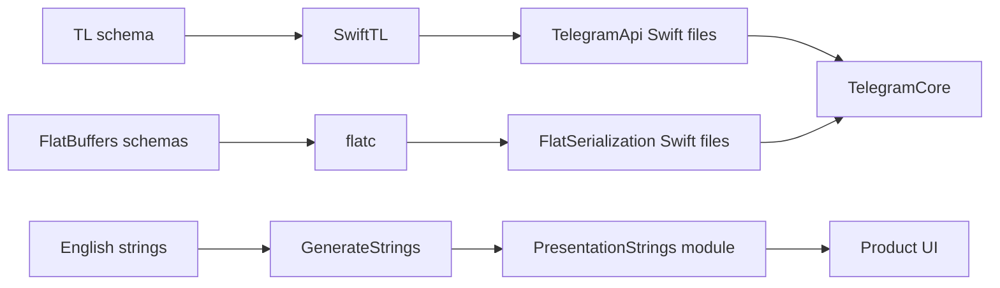
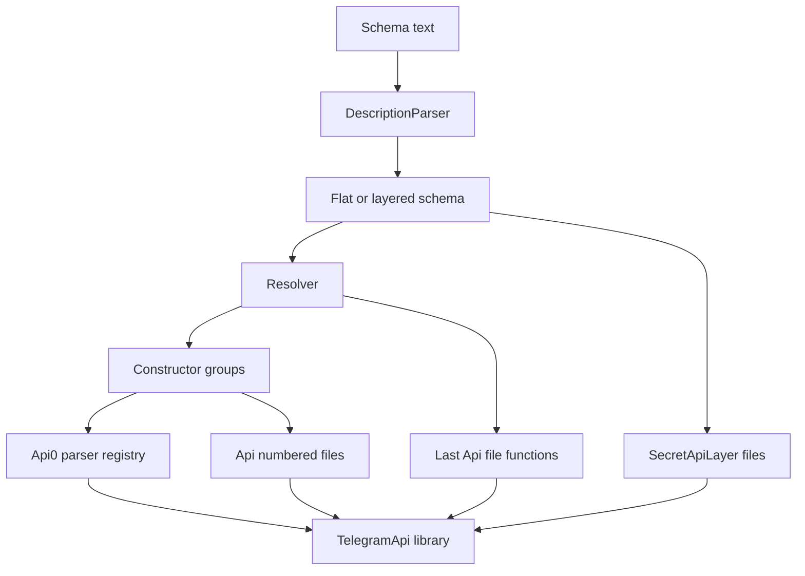
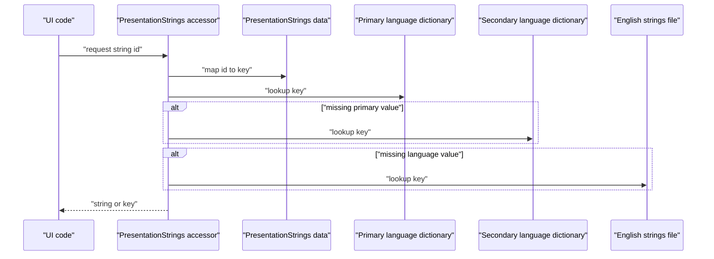
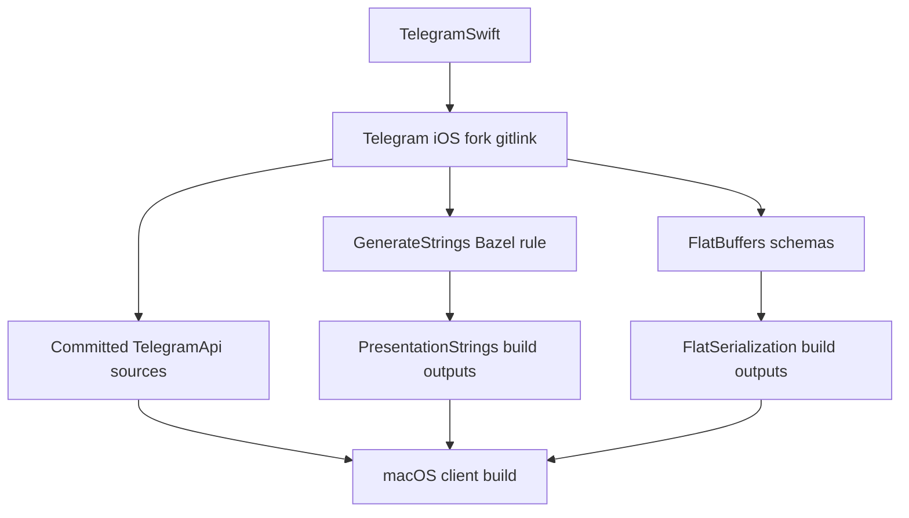

# 코드 생성: TL, 문자열, 직렬화

웹: /docs/system/22-codegen/ · Markdown: /docs/system/22-codegen.md

> Telegram iOS와 macOS 클라이언트가 프로토콜 타입, 현지화 인터페이스, FlatBuffers 직렬화 코드를 어떻게 생성하는지 추적해요.

> 시스템 설계 · 엔지니어링 · 22장 · 도표 4 · 코드 발췌 10 · 인용 28 · 소스 기준선: [TelegramMessenger/Telegram-iOS@f1dd7a2d](https://github.com/TelegramMessenger/Telegram-iOS/tree/f1dd7a2dbd02cbbf513e75d5695d8d36d1cf5838), [overtake/TelegramSwift@579cebbf](https://github.com/overtake/TelegramSwift/tree/579cebbf0c01fd41b712eff3647fa7f69db9665d)
>
> 핵심 소스 파일: [TelegramMessenger/Telegram-iOS/build-system/SwiftTL/Sources/SwiftTL/main.swift](https://github.com/TelegramMessenger/Telegram-iOS/blob/f1dd7a2dbd02cbbf513e75d5695d8d36d1cf5838/build-system/SwiftTL/Sources/SwiftTL/main.swift), [TelegramMessenger/Telegram-iOS/build-system/SwiftTL/Sources/SwiftTL/DescriptionParsing.swift](https://github.com/TelegramMessenger/Telegram-iOS/blob/f1dd7a2dbd02cbbf513e75d5695d8d36d1cf5838/build-system/SwiftTL/Sources/SwiftTL/DescriptionParsing.swift), [TelegramMessenger/Telegram-iOS/build-system/SwiftTL/Sources/SwiftTL/CodeGeneration.swift](https://github.com/TelegramMessenger/Telegram-iOS/blob/f1dd7a2dbd02cbbf513e75d5695d8d36d1cf5838/build-system/SwiftTL/Sources/SwiftTL/CodeGeneration.swift), [TelegramMessenger/Telegram-iOS/submodules/TelegramApi/BUILD](https://github.com/TelegramMessenger/Telegram-iOS/blob/f1dd7a2dbd02cbbf513e75d5695d8d36d1cf5838/submodules/TelegramApi/BUILD), [TelegramMessenger/Telegram-iOS/submodules/TelegramApi/Sources/Api0.swift](https://github.com/TelegramMessenger/Telegram-iOS/blob/f1dd7a2dbd02cbbf513e75d5695d8d36d1cf5838/submodules/TelegramApi/Sources/Api0.swift), [TelegramMessenger/Telegram-iOS/Telegram/BUILD](https://github.com/TelegramMessenger/Telegram-iOS/blob/f1dd7a2dbd02cbbf513e75d5695d8d36d1cf5838/Telegram/BUILD), [TelegramMessenger/Telegram-iOS/build-system/GenerateStrings/GenerateStrings.py](https://github.com/TelegramMessenger/Telegram-iOS/blob/f1dd7a2dbd02cbbf513e75d5695d8d36d1cf5838/build-system/GenerateStrings/GenerateStrings.py), [TelegramMessenger/Telegram-iOS/submodules/TelegramCore/FlatSerialization/BUILD](https://github.com/TelegramMessenger/Telegram-iOS/blob/f1dd7a2dbd02cbbf513e75d5695d8d36d1cf5838/submodules/TelegramCore/FlatSerialization/BUILD), [TelegramMessenger/Telegram-iOS/submodules/TelegramCore/FlatSerialization/Models/RichText.fbs](https://github.com/TelegramMessenger/Telegram-iOS/blob/f1dd7a2dbd02cbbf513e75d5695d8d36d1cf5838/submodules/TelegramCore/FlatSerialization/Models/RichText.fbs), [TelegramMessenger/Telegram-iOS/submodules/TelegramCore/FlatSerialization/macOS/generate.sh](https://github.com/TelegramMessenger/Telegram-iOS/blob/f1dd7a2dbd02cbbf513e75d5695d8d36d1cf5838/submodules/TelegramCore/FlatSerialization/macOS/generate.sh), [TelegramMessenger/Telegram-iOS/third-party/flatc/BUILD](https://github.com/TelegramMessenger/Telegram-iOS/blob/f1dd7a2dbd02cbbf513e75d5695d8d36d1cf5838/third-party/flatc/BUILD), [overtake/TelegramSwift/.gitmodules](https://github.com/overtake/TelegramSwift/blob/579cebbf0c01fd41b712eff3647fa7f69db9665d/.gitmodules), [overtake/Telegram-iOS/submodules/TelegramApi/BUILD](https://github.com/overtake/Telegram-iOS/blob/a24bbe45f9861f736a79916a50898512f751e0dc/submodules/TelegramApi/BUILD), [overtake/Telegram-iOS/Telegram/BUILD](https://github.com/overtake/Telegram-iOS/blob/a24bbe45f9861f736a79916a50898512f751e0dc/Telegram/BUILD)
>
> 미검증 사항:
> - 고정 iOS 커밋 바깥의 클라우드 TL schema 출처, 버전 식별자, 입수 방법은 무엇인가요?
> - TDLib의 telegram_api.tl은 이 iOS TelegramApi와 어떤 지정 layer에서든 같은 출처이고 호환되나요?
> - 클라우드 schema가 갱신될 때, 프로젝트 외부 절차는 TelegramApi 출력과 네트워크 초기화가 선언하는 layer를 어떻게 함께 갱신하나요?
> - TelegramSwift의 실제 macOS 빌드 진입점은 FlatSerialization/macOS/generate.sh를 자동으로 호출하나요, 아니면 Bazel GenerateModels에만 의존하나요?

## 문제와 제약 [#문제와-제약]

Telegram의 코드 생성은 단일 도구가 아니에요. 최소한 세 개의 독립된 경로가 있어요.

- `SwiftTL`: 클라우드 TL(Telegram의 타입 기술 언어) 기술(description)을 이미 커밋된 `TelegramApi` Swift 소스로 바꿔요.
- `GenerateStrings.py`: 영어 키 집합을 빌드 시점의 Objective C 인터페이스와 키 인덱스로 바꿔요.
- `flatc`(FlatBuffers 컴파일러): 로컬 영속화 모델의 FlatBuffers schema를 빌드 디렉터리의 Swift 타입으로 바꿔요.

세 경로는 입력, 커밋 정책, 실패 경계, macOS에서 다시 쓰는 방식이 모두 달라요. [\[1\]](https://github.com/TelegramMessenger/Telegram-iOS/blob/f1dd7a2dbd02cbbf513e75d5695d8d36d1cf5838/build-system/SwiftTL/Package.swift#L1-L15) [\[7\]](https://github.com/TelegramMessenger/Telegram-iOS/blob/f1dd7a2dbd02cbbf513e75d5695d8d36d1cf5838/submodules/TelegramApi/Sources/Api30.swift#L798-L835) [\[11\]](https://github.com/TelegramMessenger/Telegram-iOS/blob/f1dd7a2dbd02cbbf513e75d5695d8d36d1cf5838/build-system/GenerateStrings/GenerateStrings.py#L219-L250)

이 글의 증거는 다음 커밋에 고정되어 있어요.

- iOS: `TelegramMessenger/Telegram-iOS`의 `f1dd7a2dbd02cbbf513e75d5695d8d36d1cf5838`
- macOS: `overtake/TelegramSwift`의 `579cebbf0c01fd41b712eff3647fa7f69db9665d`와, 그 `overtake/Telegram-iOS` 서브모듈의 `a24bbe45f9861f736a79916a50898512f751e0dc`

이 글은 생성 경계만 설명해요. 나머지 주제는 다른 장을 참고하세요.

- TL 요청이 `Network`로 들어가는 과정: “TL 직렬화와 API 호출 레이어”
- 플랫폼이 공유 코어를 조립하는 방식: “macOS 클라이언트의 시스템 레이어”

세 생성기는 서로 다른 반복을 해결해요. 입력마다 관리하는 대상이 달라요.

- TL 입력: 원격 메서드 번호, flags, 생성자
- 문자열 입력: 안정적인 제품 키와 포맷 매개변수
- FlatBuffers 입력: 로컬 캐시 모델의 필드 번호와 union

세 입력을 하나의 “schema”로 뭉뚱그리면, 파일 하나만 고치면 모든 클라이언트 인터페이스가 갱신되리라고 잘못 기대하게 돼요.



이 장은 01장과 05장의 미검증 항목 하나도 바로잡아요. 고정 iOS 트리에는 `SwiftTL`이 소비할 클라우드 API `.tl` 파일이 없어요. 재귀 Git 트리에는 다음 파일만 있어요.

- `FlatSerialization/Models`의 `.fbs` 34개
- TDLib(Telegram 공식 클라이언트 라이브러리) 서브모듈 자체의 `.tl` 파일

TDLib의 Bazel target은 TDLib 소스 트리 전체를 CMake 빌드에 넘기고 `SwiftTL`을 호출하지 않아요. 그래서 파일 이름이 같다는 이유만으로 그 `telegram_api.tl`을 iOS `TelegramApi`의 재생성 입력으로 단정할 수 없어요. [\[26\]](https://github.com/TelegramMessenger/Telegram-iOS/blob/f1dd7a2dbd02cbbf513e75d5695d8d36d1cf5838/third-party/td/BUILD#L19-L103)

그러므로 이 트리에서 확인할 수 있는 것은 “완전한 TL 재생성 레시피”가 아니라 생성기의 정확한 인터페이스와 이미 커밋된 출력이에요. 업스트림 클라우드 schema의 출처 주소, 입수 버전, 그리고 `Serialization.currentLayer`와의 대응 관계는 이 체크아웃에 없어요. 이 결론은 고정 Git 트리에서 없다는 것을 확인한 거예요. TDLib schema를 입력이라고 짐작한 것이 아니에요. 유지 보수하는 사람이 클라우드 layer를 올리려면 먼저 목표 서버 layer에 맞는 원본 schema를 입수하고, 이후 출력 차이를 검토해야 해요.

## TL: 기술 파일에서 커밋된 TelegramApi까지 [#tl-기술-파일에서-커밋된-telegramapi까지]

### SwiftTL의 입력 계약 [#swifttl의-입력-계약]

`SwiftTL`은 SwiftPM(Swift 패키지 매니저) executable target이에요. 위치 인자 두 개를 요구해요.

- 첫 번째: schema 파일
- 두 번째: 출력 디렉터리

실제 인자 파싱은 `--api-prefix`만 받아요. 사용법 텍스트에는 `--stub-functions`와 `--print-constructors`도 나열되어 있지만, 현재 인자 루프는 이 두 옵션을 알 수 없는 인자로 판정해요. 소스에서 보이는 인터페이스와 도움말 텍스트가 맞지 않는 거예요. 그래서 자동화 스크립트는 도움말 텍스트를 구현된 인자 계약으로 취급하면 안 돼요. [\[1\]](https://github.com/TelegramMessenger/Telegram-iOS/blob/f1dd7a2dbd02cbbf513e75d5695d8d36d1cf5838/build-system/SwiftTL/Package.swift#L1-L15) [\[2\]](https://github.com/TelegramMessenger/Telegram-iOS/blob/f1dd7a2dbd02cbbf513e75d5695d8d36d1cf5838/build-system/SwiftTL/Sources/SwiftTL/main.swift#L23-L107)

```swift
guard let data = try? String(contentsOfFile: schemeFilePath) else {
    print("Could not open scheme file \(schemeFilePath)")
    exit(1)
}

do {
    let parsedSchema = try DescriptionParser.parse(data: data)

    try FileManager.default.createDirectory(at: URL(fileURLWithPath: outputDirectoryPath), withIntermediateDirectories: true, attributes: nil)

    switch parsedSchema {
    case let .flat(constructors, functions):
        let resolvedTypes = try Resolver.resolveTypes(constructors: constructors)
        var resolvedFunctions = try Resolver.resolveFunctions(types: resolvedTypes, functionDescriptions: functions)

        resolvedFunctions.append(Resolver.Function(name: QualifiedName(namespace: "help", value: "test"), id: 0xc0e202f7, arguments: [], result: .boxedType(QualifiedName(namespace: nil, value: "Bool"))))
```
[\[2\]](https://github.com/TelegramMessenger/Telegram-iOS/blob/f1dd7a2dbd02cbbf513e75d5695d8d36d1cf5838/build-system/SwiftTL/Sources/SwiftTL/main.swift#L23-L107)

파서는 `---functions---`로 일반 constructor와 RPC function을 나눠요. `===숫자===`로 표시된 layered schema(layer 번호별로 나뉜 schema)도 식별해요. layered schema는 타입만 포함할 수 있고 함수는 포함할 수 없어서 `SecretApiLayer` 스냅샷을 생성하기에 알맞아요. 파서는 TL 기본 정의의 `true`, `vector`, `error`, `null`을 건너뛰어요. 이 도구가 범용 TL 컴파일러가 아니라는 뜻이에요. 현재 Telegram schema의 부분 집합을 대상으로 하는 코드 생성기예요. [\[3\]](https://github.com/TelegramMessenger/Telegram-iOS/blob/f1dd7a2dbd02cbbf513e75d5695d8d36d1cf5838/build-system/SwiftTL/Sources/SwiftTL/DescriptionParsing.swift#L3-L174)

TL의 평면 출력은 생성자 개수로 분할돼요.

- 생성기는 constructor가 최소 32개 쌓일 때마다 새 분할을 열어요.
- 모든 함수는 마지막 분할에 덧붙여요.
- 기록한 파일을 하나씩 지정 디렉터리에 교체해 넣어요.

그래서 `Api` 파일 번호는 생성 시점의 정렬과 그룹화를 나타낼 뿐, 프로토콜 layer 번호가 아니에요. [\[2\]](https://github.com/TelegramMessenger/Telegram-iOS/blob/f1dd7a2dbd02cbbf513e75d5695d8d36d1cf5838/build-system/SwiftTL/Sources/SwiftTL/main.swift#L23-L107) [\[4\]](https://github.com/TelegramMessenger/Telegram-iOS/blob/f1dd7a2dbd02cbbf513e75d5695d8d36d1cf5838/build-system/SwiftTL/Sources/SwiftTL/CodeGeneration.swift#L90-L116)

```swift
var totalConstructorCount = 0
var currentConstructorCount = 0
for type in sortedTypes {
    if typeOrder.isEmpty || currentConstructorCount >= 32 {
        typeOrder.append(([], []))
        currentConstructorCount = 0
    }
    typeOrder[typeOrder.count - 1].types.append((type.name, type.constructors.values.sorted(by: { $0.name < $1.name }).map(\.name.value)))
    currentConstructorCount += type.constructors.count
    totalConstructorCount += type.constructors.count
    if totalConstructorCount > 40 { }
}

// ...

for (name, fileData) in generatedFiles {
    let filePath = URL(fileURLWithPath: outputDirectoryPath).appendingPathComponent(name).path
    let _ = try? FileManager.default.removeItem(atPath: filePath)
    try fileData.write(toFile: filePath, atomically: true, encoding: .utf8)
}
```
[\[2\]](https://github.com/TelegramMessenger/Telegram-iOS/blob/f1dd7a2dbd02cbbf513e75d5695d8d36d1cf5838/build-system/SwiftTL/Sources/SwiftTL/main.swift#L23-L107)

생성기는 기본 스칼라를 `Int32`, `Int64`, `Int256`, `Double`, `Buffer`, `String`, `Bool`로 매핑해요. 그 밖의 규칙은 이래요.

- 박스형(constructor id를 앞에 쓰는 형태)과 비박스형 vector는 모두 Swift 배열이 돼요.
- 박스형 타입과 비박스형 constructor는 모두 설정 가능한 API 접두사를 써요.
- `protocol`과 `private`에 대해서는 Swift 키워드 이스케이프도 해서, schema 이름이 그대로 컴파일할 수 없는 선언이 되는 일을 막아요. [\[4\]](https://github.com/TelegramMessenger/Telegram-iOS/blob/f1dd7a2dbd02cbbf513e75d5695d8d36d1cf5838/build-system/SwiftTL/Sources/SwiftTL/CodeGeneration.swift#L90-L116)

### 생성물 구조, 크기, 커밋 정책 [#생성물-구조-크기-커밋-정책]

iOS의 `TelegramApi` Bazel library에는 생성 rule이 없어요. 이미 있는 `Sources` 아래의 Swift 파일을 `glob`(패턴에 맞는 파일을 모으는 기능)으로 컴파일할 뿐이에요. 그래서 일상적인 Bazel 빌드는 schema를 가져오지 않고 `SwiftTL`도 다시 실행하지 않아요. 생성된 TL 소스는 Bazel 중간 산출물이 아니라 버전 관리되는 입력이에요. [\[5\]](https://github.com/TelegramMessenger/Telegram-iOS/blob/f1dd7a2dbd02cbbf513e75d5695d8d36d1cf5838/submodules/TelegramApi/BUILD#L1-L15)

고정 iOS 커밋에서 `Sources`에는 Swift 파일이 58개 있고 합계 118,613행, 5,941,847바이트예요. 여기에는 다음이 포함돼요.

- `Api0.swift`부터 `Api43.swift`까지의 클라우드 분할 44개
- `SecretApiLayer` 스냅샷 11개
- `Buffer`, 응답 클로저, 로그 지원 파일

`git ls-files`는 이 소스 파일이 모두 추적됨을 보여 줘요. 디렉터리 전체는 약 5.9 MiB예요. 이런 커밋 정책 덕분에 schema가 없는 일반 빌드도 안정적인 프로토콜 ABI(바이너리 수준의 호환 규약)를 얻어요.

`Api0.swift`는 먼저 모든 네임스페이스를 선언한 뒤, 파일 수준 parser 딕셔너리에 constructor 번호를 등록해요. 이어지는 `ApiN.swift`에는 추상 TL 타입, 연관된 `Cons_` 클래스, 직렬화 함수, 파싱 함수가 들어 있어요. RPC는 `Api.functions` 네임스페이스의 extension에 있어요. 파일 분할은 컴파일 규모와 검토 가독성에만 기여하고, 호출 측의 `Api` 네임스페이스는 바꾸지 않아요. [\[6\]](https://github.com/TelegramMessenger/Telegram-iOS/blob/f1dd7a2dbd02cbbf513e75d5695d8d36d1cf5838/submodules/TelegramApi/Sources/Api0.swift#L2-L67)

```swift
public enum Api {
    public enum account {}
    public enum aicompose {}
    public enum auth {}
    public enum bots {}
    public enum channels {}
    public enum chatlists {}
    public enum communities {}
    public enum contacts {}
    public enum ephemeral {}
    public enum fragment {}
    public enum help {}
    public enum messages {}
    public enum payments {}
    public enum phone {}
    public enum photos {}
    public enum premium {}
    public enum smsjobs {}
    public enum stats {}
    public enum stickers {}
    public enum storage {}
    public enum stories {}
    public enum toncenter {}
    public enum updates {}
    public enum upload {}
    public enum users {}
    public enum wallet {}
    public enum functions {
```
[\[6\]](https://github.com/TelegramMessenger/Telegram-iOS/blob/f1dd7a2dbd02cbbf513e75d5695d8d36d1cf5838/submodules/TelegramApi/Sources/Api0.swift#L2-L67)

enum case 하나는 schema constructor 하나에 대응해요. `Api.User`의 `.user` case는 `Cons_user`를 감싸요. `serialize`는 박스형 모드에서 먼저 constructor id를 쓴 다음, schema 순서대로 flags, 스칼라, flags가 제어하는 선택 필드를 써요. flags가 설정되었는데 `nil` 값이 제공되면 강제 언래핑이 실패해요. 그래서 비즈니스 계층이 flags와 optional 매개변수를 일치시켜야 해요. 생성기는 호출자의 비즈니스 객체를 대신 고쳐 주지 않아요. [\[7\]](https://github.com/TelegramMessenger/Telegram-iOS/blob/f1dd7a2dbd02cbbf513e75d5695d8d36d1cf5838/submodules/TelegramApi/Sources/Api30.swift#L798-L835)

```swift
case user(Cons_user)
case userEmpty(Cons_userEmpty)

public func serialize(_ buffer: Buffer, _ boxed: Swift.Bool) {
    switch self {
    case .user(let _data):
        if boxed {
            buffer.appendInt32(-1313289085)
        }
        serializeInt32(_data.flags, buffer: buffer, boxed: false)
        serializeInt32(_data.flags2, buffer: buffer, boxed: false)
        serializeInt64(_data.id, buffer: buffer, boxed: false)
        if Int(_data.flags) & Int(1 << 0) != 0 {
            serializeInt64(_data.accessHash!, buffer: buffer, boxed: false)
        }
        if Int(_data.flags) & Int(1 << 1) != 0 {
            serializeString(_data.firstName!, buffer: buffer, boxed: false)
        }
```
[\[7\]](https://github.com/TelegramMessenger/Telegram-iOS/blob/f1dd7a2dbd02cbbf513e75d5695d8d36d1cf5838/submodules/TelegramApi/Sources/Api30.swift#L798-L835)

함수 생성물은 다음을 트리플(세 쌍의 묶음)로 묶어요.

- 요청 기술
- 요청 바이트
- 강타입 응답 파싱 클로저

아래의 `users.getUsers` 예시는 함수 id, vector id, 길이, 각 입력 객체를 써요. 응답 파서는 vector 표식을 읽은 뒤 각 요소가 `Api.User`이기를 요구해요. 도메인 계층이 `Buffer`를 손으로 쓸 필요가 없는 이유가 바로 이거예요. [\[8\]](https://github.com/TelegramMessenger/Telegram-iOS/blob/f1dd7a2dbd02cbbf513e75d5695d8d36d1cf5838/submodules/TelegramApi/Sources/Api43.swift#L14777-L14795)

```swift
static func getUsers(id: [Api.InputUser]) -> (FunctionDescription, Buffer, DeserializeFunctionResponse<[Api.User]>) {
    let buffer = Buffer()
    buffer.appendInt32(227648840)
    buffer.appendInt32(481674261)
    buffer.appendInt32(Int32(id.count))
    for item in id {
        item.serialize(buffer, true)
    }
    return (FunctionDescription(name: "users.getUsers", parameters: [("id", ConstructorParameterDescription(id))]), buffer, DeserializeFunctionResponse { (buffer: Buffer) -> [Api.User]? in
        let reader = BufferReader(buffer)
        var result: [Api.User]?
        if let _ = reader.readInt32() {
            result = Api.parseVector(reader, elementSignature: 0, elementType: Api.User.self)
        }
        return result
    })
}
```
[\[8\]](https://github.com/TelegramMessenger/Telegram-iOS/blob/f1dd7a2dbd02cbbf513e75d5695d8d36d1cf5838/submodules/TelegramApi/Sources/Api43.swift#L14777-L14795)



### 실행 가능한 명령과 재현할 수 없는 부분 [#실행-가능한-명령과-재현할-수-없는-부분]

일치하는 원본 schema를 이미 확보했다면, SwiftPM이 설치된 macOS 환경에서 도구 인터페이스는 아래 명령을 지원해요. 이 명령은 executable의 인자 처리에서 곧바로 추론한 거예요. 입력 파일이 고정 트리에 없으므로 이 저장소가 제공하는 완전한 재생성 명령은 아니에요.

```bash
cd build-system/SwiftTL
swift run SwiftTL /absolute/path/to/schema.tl /absolute/path/to/output
```

쓰기 전에 옛 디렉터리를 삭제하거나 격리하고, `Sources` 트리 전체를 비교해야 해요. 도구의 동작이 이래요.

- 현재 도구는 이번 실행에서 쓸 파일만 삭제해요. 새 schema에서 분할이나 layer가 줄어들면 옛 파일이 디렉터리에 남아 `glob`으로 계속 컴파일될 수 있어요.
- 도구는 최외곽 `catch`에서 예외를 출력할 뿐 실패 종료를 명시적으로 호출하지 않아요. 그래서 자동화는 종료 상태 외에도 출력 차이와 컴파일 결과를 확인해야 해요.

옛 파일이 남는 문제와 실패 종료가 없는 문제, 이 두 가지는 쓰기 루프, Bazel `glob`, 예외 분기에서 얻은 추론이에요. [\[2\]](https://github.com/TelegramMessenger/Telegram-iOS/blob/f1dd7a2dbd02cbbf513e75d5695d8d36d1cf5838/build-system/SwiftTL/Sources/SwiftTL/main.swift#L23-L107) [\[5\]](https://github.com/TelegramMessenger/Telegram-iOS/blob/f1dd7a2dbd02cbbf513e75d5695d8d36d1cf5838/submodules/TelegramApi/BUILD#L1-L15)

재생성 후에는 최소한 네 종류의 변화를 검토해야 해요.

- constructor id, 매개변수 순서, flags
- parser registry와 `Api.functions`의 반환 타입
- `TelegramCore`의 enum `switch`와 wire model 변환기
- 네트워크 초기화 계층이 선언하는 프로토콜 layer

목록의 앞 두 항목은 생성물에 직접적인 증거가 있어요. 뒤 두 항목은 강타입 생성 경계에서 도출한 업그레이드 점검 항목이에요.

### TL 출력의 안정성과 업그레이드 감사 [#tl-출력의-안정성과-업그레이드-감사]

생성기는 먼저 타입 이름으로, 이어 constructor 이름으로 정렬해요. 그래서 같은 입력 텍스트에서 무관한 행의 원래 배치는 같은 파싱 타입 안의 출력 순서를 바꾸지 않아야 해요. 반대로 이름 정렬이 앞서는 타입을 하나 추가하면 이후 여러 `ApiN.swift`의 분할 경계가 통째로 움직일 수 있어요. 검토할 때 파일 번호의 변화를 해당 프로토콜 객체가 모두 바뀐 것으로 해석하면 안 돼요. constructor id, 선언 구조, 함수 트리플을 비교해야 해요. 이 결론은 정렬과 그룹당 constructor 32개라는 구현에서 나와요. [\[2\]](https://github.com/TelegramMessenger/Telegram-iOS/blob/f1dd7a2dbd02cbbf513e75d5695d8d36d1cf5838/build-system/SwiftTL/Sources/SwiftTL/main.swift#L23-L107) [\[4\]](https://github.com/TelegramMessenger/Telegram-iOS/blob/f1dd7a2dbd02cbbf513e75d5695d8d36d1cf5838/build-system/SwiftTL/Sources/SwiftTL/CodeGeneration.swift#L90-L116)

`Api0.swift`의 전역 parser registry는 또 하나의 업그레이드 점검 지점이에요. 생성기는 constructor id마다 클로저를 채우고, `Api.parse`가 입력 서명에 따라 분배해요. 새 constructor에 등록 항목이 없으면, 응답 bytes의 구조가 온전해도 Swift 값으로 복원할 수 없어요. 반대로 아직 도달할 수 있는 옛 constructor를 registry에서 지우면 호환성 실패가 런타임으로 미뤄져요. 그래서 schema diff는 요청을 보내는 함수 시그니처뿐 아니라, 아무 박스형 객체나 받을 때의 분배 전체 집합에도 영향을 줘요. [\[4\]](https://github.com/TelegramMessenger/Telegram-iOS/blob/f1dd7a2dbd02cbbf513e75d5695d8d36d1cf5838/build-system/SwiftTL/Sources/SwiftTL/CodeGeneration.swift#L90-L116) [\[6\]](https://github.com/TelegramMessenger/Telegram-iOS/blob/f1dd7a2dbd02cbbf513e75d5695d8d36d1cf5838/submodules/TelegramApi/Sources/Api0.swift#L2-L67)

layered schema와 일반 클라우드 schema의 출력도 섞어 쓸 수 없어요. 모드마다 동작이 달라요.

- 일반 모드: constructor와 function 두 단락이 있고 호출할 수 있는 RPC를 만들어요.
- layered 모드: 연속해서 증가하는 layer section만 파싱하고 `ApiLayer` 형태의 타입 스냅샷을 생성해요.

`---functions---`가 들어 있는 파일을 layered 모드에 넘기면 파서가 오류를 던져요. layer 표식이 거꾸로 가도 파서는 입력을 거부해요. 이 제한은 비밀 채팅 스냅샷이 실수로 클라우드 RPC 표면을 생성하는 일을 막아요. [\[3\]](https://github.com/TelegramMessenger/Telegram-iOS/blob/f1dd7a2dbd02cbbf513e75d5695d8d36d1cf5838/build-system/SwiftTL/Sources/SwiftTL/DescriptionParsing.swift#L3-L174)

도구의 `help.test` 주입은 두 번 있어요.

- main 함수가 파싱 이후 `help.test` 함수를 resolved functions에 추가해요.
- `CodeGenerator.generate` 내부에서 같은 이름의 함수를 다시 추가해요.

출력의 중복 제거나 덮어쓰기 동작은 여기서 명시적으로 검사하지 않아요. 이 세부 사항을 보면 재생성 후 반드시 컴파일하고, 생성된 functions 분할에서 중복 선언을 검사해야 한다는 걸 알 수 있어요. 재생성 후 컴파일과 중복 선언 검사가 필요하다는 이 결론은 두 추가 지점에서 도출한 추론이에요. [\[2\]](https://github.com/TelegramMessenger/Telegram-iOS/blob/f1dd7a2dbd02cbbf513e75d5695d8d36d1cf5838/build-system/SwiftTL/Sources/SwiftTL/main.swift#L23-L107) [\[4\]](https://github.com/TelegramMessenger/Telegram-iOS/blob/f1dd7a2dbd02cbbf513e75d5695d8d36d1cf5838/build-system/SwiftTL/Sources/SwiftTL/CodeGeneration.swift#L90-L116)

커밋된 출력은 검토 방식에도 영향을 줘요. 일반 TL 변경 하나가 정렬과 그룹화로 생기는 수많은 행을 동시에 바꿀 수 있어요. 가장 작고 믿을 만한 검토 단위는 “어떤 `Api17.swift` 파일”이 아니에요. 다음을 한 단위로 봐야 해요.

- schema 행
- 그에 대응하는 `Cons_` 구조
- 그 `serialize`와 `parse` 분기
- 관련 `Api.functions` 메서드
- Core의 모델 변환

이 항목들을 업그레이드 체크리스트 하나로 묶어야 기계적 재배열과 실제 wire ABI 변경을 구분할 수 있어요.

## 문자열: 영어 키 표에서 PresentationStrings까지 [#문자열-영어-키-표에서-presentationstrings까지]

### 영어 파일 하나, 산출물 세 가지 [#영어-파일-하나-산출물-세-가지]

`Telegram/Telegram-iOS/en.lproj/Localizable.strings`는 `GeneratedPresentationStrings`의 유일한 비즈니스 입력이에요. 이 파일은 17,098행, 879,833바이트예요. Bazel rule은 Python 스크립트와 이 입력을 함께 의존성으로 선언한 뒤 다음을 만들어요.

- `PresentationStrings.m`
- 공개 헤더 파일
- `PresentationStrings.data`

`PresentationStrings` Objective C library는 생성된 구현을 컴파일하고 pluralization과 app bundle 지원을 링크해요. [\[9\]](https://github.com/TelegramMessenger/Telegram-iOS/blob/f1dd7a2dbd02cbbf513e75d5695d8d36d1cf5838/Telegram/BUILD#L148-L224)

문자열 파싱은 이렇게 진행돼요.

- `parse_strings`는 UTF 8 파일을 읽어 BOM을 제거하고 주석과 키·값을 식별해요.
- 이어서 `parse_entries`가 `_0`, `_1`, `_2`, `_3_10`, `_many`, `_any` 접미사로 복수형 키를 병합해요. 복수형 stem(복수형 변형을 묶는 기본 키) 하나를 남기고, 매개변수 수가 더 많은 변형이 그 stem의 인터페이스 매개변수 수를 결정해요.
- 일반 중복 키는 처음 나온 항목만 남겨요.
- 마지막으로 키 이름순으로 정렬해서 키 id 할당이 안정적이도록 해요. [\[10\]](https://github.com/TelegramMessenger/Telegram-iOS/blob/f1dd7a2dbd02cbbf513e75d5695d8d36d1cf5838/build-system/GenerateStrings/GenerateStrings.py#L110-L158)

```python
def parse_entries(strings: [dict]) -> [Entry]:
    entries: List[Entry] = []
    pluralized = re.compile(r'^(.*?)_(0|1|2|3_10|many|any)$', re.U)
    processed_entries = set()
    for string in strings:
        key = string['key']
        m = pluralized.match(key)
        if m is not None:
            raw_key = m.group(1)

            positional_arguments = parse_positional_arguments(string['value'])

            if raw_key in processed_entries:
                for i in range(0, len(entries)):
                    if entries[i].name == raw_key:
                        if len(entries[i].positional_arguments) < len(positional_arguments):
                            entries[i].positional_arguments = positional_arguments
                continue
            processed_entries.add(raw_key)

            entries.append(Entry(
                name=raw_key,
                is_pluralized=True,
                positional_arguments=positional_arguments
            ))
```
[\[10\]](https://github.com/TelegramMessenger/Telegram-iOS/blob/f1dd7a2dbd02cbbf513e75d5695d8d36d1cf5838/build-system/GenerateStrings/GenerateStrings.py#L110-L158)

고정 입력으로 임시 디렉터리에서 이 Python 프로그램을 실행해 봤어요. 결과는 이래요.

- 원시 키·값 13,386개를 읽어 접근 항목 11,959개를 생성했어요.
- 이 중 688개가 복수형 stem이고, 2,630개 항목이 포맷 매개변수를 가지며, 최대 매개변수 수는 8이에요.
- 생성된 헤더 파일은 2,068,021바이트, 구현은 1,853,706바이트, 키 인덱스 데이터는 360,395바이트예요.

여기의 숫자는 이 고정 파일과 고정 스크립트의 실측값이에요. 런타임에 내려받는 언어 팩의 규모가 아니에요.

각 접근자의 Swift 임포트 이름은 C 또는 Objective C 인터페이스에서 와요. 스크립트는 점을 밑줄로 바꾸고, 접근자를 이렇게 생성해요.

- 포맷 매개변수가 없는 단일 값 접근자
- 매개변수가 있는 `_FormattedString` 접근자
- 카운트 매개변수가 있는 복수형 접근자

또 각 키를 정렬된 정수 id로 데이터 파일에 기록해요. data 파일에 저장되는 것은 id에서 key로의 인덱스예요. 영어 번역 텍스트 자체가 아니에요. [\[11\]](https://github.com/TelegramMessenger/Telegram-iOS/blob/f1dd7a2dbd02cbbf513e75d5695d8d36d1cf5838/build-system/GenerateStrings/GenerateStrings.py#L219-L250)

### 런타임 조회, 포맷, 폴백 [#런타임-조회-포맷-폴백]

생성된 `_PresentationStrings`는 주 언어 컴포넌트, 선택적 보조 언어 컴포넌트, 그룹 구분자를 받아요. 컴포넌트는 언어 코드, 선택적 복수 규칙 코드, 키에서 번역문으로의 딕셔너리를 가져요. 접근자는 이 순서로 조회해요.

- 정수 id로 data에서 key를 복원해요.
- 주 컴포넌트를 조회해요.
- 보조 컴포넌트를 조회해요.
- app bundle의 영어 `Localizable.strings`를 조회해요.

주 컴포넌트, 보조 컴포넌트, 영어 파일 세 곳 모두에 없을 때에야 key 자체를 반환해요. [\[12\]](https://github.com/TelegramMessenger/Telegram-iOS/blob/f1dd7a2dbd02cbbf513e75d5695d8d36d1cf5838/build-system/GenerateStrings/GenerateStrings.py#L424-L555)



포맷은 시스템의 완전한 포매터를 직접 호출하지 않아요. 생성 템플릿은 이렇게 처리해요.

- 정규식으로 `%` 매개변수 자리 표시자 범위를 찾아요.
- 하나씩 문자열 인자로 치환하며, 출력 범위를 함께 보존해요.

덕분에 상위 계층은 치환된 텍스트와 각 인자가 표시 텍스트에서 차지하는 위치를 얻을 수 있어요. 복수형 선택은 `numberPluralizationForm`이 반환하는 범주가 정하고, 생성기는 해당 접미사를 이어 붙여요. 현지화된 복수형 키를 찾지 못하면 템플릿은 영어 규칙과 영어 리소스로 폴백해요. [\[12\]](https://github.com/TelegramMessenger/Telegram-iOS/blob/f1dd7a2dbd02cbbf513e75d5695d8d36d1cf5838/build-system/GenerateStrings/GenerateStrings.py#L424-L555)

Bazel은 언어 코드 18개에 대해 빈 `Localizable.strings` 파일도 생성해요. 이 빈 파일은 이 생성기의 번역 출력이 아니에요. 이 rule은 패키징에 필요한 빈 리소스 자리만 만들어요. 실제 주 컴포넌트와 보조 컴포넌트 딕셔너리의 조립은 현지화 설정과 언어 팩 절차에 속해요. 그래서 이 rule만 보고 “모든 번역이 앱에 컴파일되어 들어간다”고 추론하면 안 돼요. [\[9\]](https://github.com/TelegramMessenger/Telegram-iOS/blob/f1dd7a2dbd02cbbf513e75d5695d8d36d1cf5838/Telegram/BUILD#L148-L224)

이 생성 경로는 TL과 반대예요. `PresentationStrings`의 세 출력은 Git 소스 트리에 커밋되지 않고 Bazel action이 실행될 때마다 만들어져요. `PresentationStrings.data`는 다시 메인 App과 미리 보기 테스트 target에 명시적으로 리소스 입력으로 들어가요. 그래서 영어 키 표가 바뀌면 인터페이스, 이진 키 표, bundle 리소스가 반드시 같은 action에서 함께 갱신돼요. [\[9\]](https://github.com/TelegramMessenger/Telegram-iOS/blob/f1dd7a2dbd02cbbf513e75d5695d8d36d1cf5838/Telegram/BUILD#L148-L224)

### 문자열 생성의 실패 경계 [#문자열-생성의-실패-경계]

생성기의 검사는 이래요.

- 복수형 키에 위치 매개변수를 최대 하나만 허용해요. 더 많은 매개변수가 발견되면 오류를 설정하고 종료 코드 1로 종료해요.
- 일반 포맷 문자열의 매개변수 타입은 정규식이 `@`와 `d`만 식별해요.
- 생성기는 여기서 각 언어 딕셔너리의 키 집합이나 포맷 매개변수가 완전히 일치하는지 비교하지 않아요.

마지막 항목(언어 딕셔너리를 비교하지 않는 점)은 입력 모델과 확인된 검증 조건에서 얻은 추론이고, 언어 팩 검증 절차가 맡아야 해요. [\[10\]](https://github.com/TelegramMessenger/Telegram-iOS/blob/f1dd7a2dbd02cbbf513e75d5695d8d36d1cf5838/build-system/GenerateStrings/GenerateStrings.py#L110-L158) [\[11\]](https://github.com/TelegramMessenger/Telegram-iOS/blob/f1dd7a2dbd02cbbf513e75d5695d8d36d1cf5838/build-system/GenerateStrings/GenerateStrings.py#L219-L250)

런타임에는 서로 다른 두 가지 오류가 있어요.

- `PresentationStrings.data`가 없거나, 읽을 수 없거나, 데이터가 4바이트보다 짧으면 생성 코드가 assertion을 일으켜요. 이 경우는 리소스 패키징 오류를 프로그래머의 오류로 봐요.
- 키가 없는 것은 assertion이 아니라 계층별 폴백이고, 결국 key가 표시돼요. 이 경우는 부분적인 번역 공백을 눈에 보이지만 복구할 수 있는 콘텐츠 오류로 다뤄요. [\[12\]](https://github.com/TelegramMessenger/Telegram-iOS/blob/f1dd7a2dbd02cbbf513e75d5695d8d36d1cf5838/build-system/GenerateStrings/GenerateStrings.py#L424-L555)

### 키 id, 포맷 범위, 리소스 일관성 [#키-id-포맷-범위-리소스-일관성]

`PresentationStrings.data`의 레이아웃은 작지만 핵심적이에요.

- 파일은 먼저 `UInt32` 항목 수를 써요.
- 이후 항목마다 `UInt8` 길이와 UTF 8 key를 써요.

초기화할 때 생성 구현은 bundle에서 데이터 전체를 읽어 같은 순서로 `NSNumber`에서 `NSString`으로의 딕셔너리를 재구성해요. 접근자 안의 상수 id는 그래서 `parse_entries`의 정렬 결과에 의존해요. 다음 경우에 이후 id가 달라질 수 있어요.

- 키 이름을 바꿀 때
- 정렬이 앞서는 키를 추가할 때
- 복수형 stem을 바꿀 때

옛 data 파일과 새 헤더 파일을 섞어 배포하면 안 돼요. [\[11\]](https://github.com/TelegramMessenger/Telegram-iOS/blob/f1dd7a2dbd02cbbf513e75d5695d8d36d1cf5838/build-system/GenerateStrings/GenerateStrings.py#L219-L250) [\[12\]](https://github.com/TelegramMessenger/Telegram-iOS/blob/f1dd7a2dbd02cbbf513e75d5695d8d36d1cf5838/build-system/GenerateStrings/GenerateStrings.py#L424-L555)

이 설계는 번역 본문을 생성 data에 복사하지 않아요. 주 컴포넌트와 보조 컴포넌트는 딕셔너리 형태로 주입되고, 영어 bundle이 최종 딕셔너리 출처예요. 정적 인덱스 리소스의 크기를 줄이고, 런타임 언어 팩이 같은 컴파일 시점 접근자 집합을 재사용하게 해 줘요. 대가는 “인터페이스가 있다”는 사실이 어떤 언어에 번역문이 반드시 있다는 증거가 되지 못한다는 점이에요. 호출자는 폴백 계약에만 의존할 수 있어요. 어떤 key의 현지화 완전성을 타입 시스템의 보장으로 여길 수는 없어요. [\[12\]](https://github.com/TelegramMessenger/Telegram-iOS/blob/f1dd7a2dbd02cbbf513e75d5695d8d36d1cf5838/build-system/GenerateStrings/GenerateStrings.py#L424-L555)

포맷 접근자는 문자열만 반환하지 않고 매개변수 범위도 보존해요. 템플릿은 자리 표시자를 스캔할 때 명시적 순번을 지원하고, 각 인자가 치환된 뒤의 구간을 출력해요. 리치 텍스트 호출 지점은 이를 바탕으로 사용자 이름, 숫자, 링크 인자에 속성을 붙일 수 있고, 이미 포맷된 문장에서 부분 문자열을 다시 검색할 필요가 없어요. 이 이점은 생성 템플릿의 `_FormattedStringRange`, 자리 표시자 정규식, 치환 루프에서 나와요. 소스에서 관찰할 수 있는 능력이고, 모든 UI가 이 범위를 쓴다는 뜻은 아니에요. [\[12\]](https://github.com/TelegramMessenger/Telegram-iOS/blob/f1dd7a2dbd02cbbf513e75d5695d8d36d1cf5838/build-system/GenerateStrings/GenerateStrings.py#L424-L555)

안정적인 정렬은 마이그레이션 위험도 함께 가져와요. key는 바꾸지 않고 영어 번역 값만 바꾸면 항목 순서와 id는 유지될 수 있어요. 새 키가 사전순으로 앞쪽에 끼어들면 이후 id가 이동해요. 그래서 data를 배포 리소스로 쓸 때는 반드시 같은 빌드 action이 구현, 헤더 파일, data를 함께 산출해야 해요. Bazel rule이 이 셋을 같은 `outs` 집합에 나열한 것이 바로 빌드 그래프에서 이 분리할 수 없는 관계를 표현한 거예요. [\[9\]](https://github.com/TelegramMessenger/Telegram-iOS/blob/f1dd7a2dbd02cbbf513e75d5695d8d36d1cf5838/Telegram/BUILD#L148-L224)

## FlatBuffers: 로컬 모델의 빌드 시점 직렬화 코드 [#flatbuffers-로컬-모델의-빌드-시점-직렬화-코드]

### 원본 모델과 생성 규칙 [#원본-모델과-생성-규칙]

FlatBuffers는 Telegram 클라우드 TL 요청을 담지 않아요. `TelegramCore`의 로컬 모델에 간결한 이진 구조를 제공해요. 고정 iOS 트리에는 `.fbs` 모델(FlatBuffers schema 파일)이 34개 있고 합계 1,340행, 32,267바이트예요. `RichText.fbs`의 namespace는 `TelegramCore`예요. `RichText_Value` union(여러 타입 중 하나를 담는 타입)으로 구체적인 리치 텍스트 변형을 나타내고, `RichText` table의 `value` 필드에 tag와 객체를 저장해요. [\[13\]](https://github.com/TelegramMessenger/Telegram-iOS/blob/f1dd7a2dbd02cbbf513e75d5695d8d36d1cf5838/submodules/TelegramCore/FlatSerialization/Models/RichText.fbs#L4-L48)

```text
namespace TelegramCore;

union RichText_Value {
    RichText_Empty,
    RichText_Plain,
    RichText_Bold,
    RichText_Italic,
    RichText_Underline,
    RichText_Strikethrough,
    RichText_Fixed,
    RichText_Url,
    RichText_Email,
    RichText_Concat,
    RichText_Subscript,
    RichText_Superscript,
    RichText_Marked,
    RichText_Phone,
    RichText_Image,
    RichText_Anchor,
    RichText_Formula,
    RichText_CustomEmoji,
    RichText_AutoEmail,
    RichText_AutoPhone,
    RichText_AutoUrl,
    RichText_BankCard,
    RichText_BotCommand,
    RichText_Cashtag,
    RichText_Hashtag,
    RichText_Mention,
    RichText_MentionName,
    RichText_Spoiler,
    RichText_Date,
    RichText_TextButton,
    RichText_TonAddress
}

table RichText {
    value:RichText_Value (id: 1, required);
}
```
[\[13\]](https://github.com/TelegramMessenger/Telegram-iOS/blob/f1dd7a2dbd02cbbf513e75d5695d8d36d1cf5838/submodules/TelegramCore/FlatSerialization/Models/RichText.fbs#L4-L48)

생성 과정은 이래요.

- Bazel은 모든 `Models/*.fbs`에서 파일 이름을 계산하고 `GenerateModels`가 `flatc`를 호출하게 해요. 명령은 `--require-explicit-ids --swift`를 고정으로 써요.
- 생성물은 먼저 rule 전용 `build` 디렉터리에 떨어지고, 이어서 하나씩 target output으로 복사돼요.
- 이후 `FlatSerialization` library는 이 output을 Swift 소스로 삼고 FlatBuffers runtime에 의존해요.

명시적 id를 요구하므로 필드 id는 `flatc`가 파일 배열에 따라 자동으로 추론하는 세부 사항이 아니라 schema 계약의 일부예요. [\[14\]](https://github.com/TelegramMessenger/Telegram-iOS/blob/f1dd7a2dbd02cbbf513e75d5695d8d36d1cf5838/submodules/TelegramCore/FlatSerialization/BUILD#L3-L55)

```python
models = glob([
    "Models/*.fbs",
])

model_names = [
    f[7:-4] for f in models
]

generated_models = [ "{}_generated.swift".format(name) for name in model_names ]
flatc_input = " ".join([ "$(location Models/{}.fbs)".format(name) for name in model_names ])

genrule(
    name = "GenerateModels",
    srcs = models,
    tools = [
        "//third-party/flatc:flatc_bin"
    ],
    cmd_bash = 
    """
    set -ex
    FLATC="$$(pwd)/$(location //third-party/flatc:flatc_bin)"

    BUILD_DIR="$(RULEDIR)/build"
    rm -rf "$$BUILD_DIR"
    mkdir -p "$$BUILD_DIR"

    "$$FLATC" --require-explicit-ids --swift -o "$$BUILD_DIR" {flatc_input}
    """.format(
        flatc_input=flatc_input
    ) + "\n" + "\n".join([
    """
    cp "$$BUILD_DIR/{name}_generated.swift" "$(location {name}_generated.swift)"
    """.format(name=name) for name in model_names
    ]),
    outs = generated_models,
```
[\[11\]](https://github.com/TelegramMessenger/Telegram-iOS/blob/f1dd7a2dbd02cbbf513e75d5695d8d36d1cf5838/build-system/GenerateStrings/GenerateStrings.py#L219-L250)

`flatc` 자체도 시스템에 미리 설치되어 있다고 가정하지 않아요. `third-party/flatc/BUILD`는 이렇게 해요.

- 고정된 FlatBuffers 24.12.23 archive에서 소스를 풀어요.
- CMake로 실행 파일을 빌드해요.
- `flatc_bin`을 복사해요.

그래서 iOS Bazel 그래프는 schema와 생성기 구현 버전을 함께 고정해요. [\[14\]](https://github.com/TelegramMessenger/Telegram-iOS/blob/f1dd7a2dbd02cbbf513e75d5695d8d36d1cf5838/submodules/TelegramCore/FlatSerialization/BUILD#L3-L55) [\[27\]](https://github.com/TelegramMessenger/Telegram-iOS/blob/f1dd7a2dbd02cbbf513e75d5695d8d36d1cf5838/third-party/flatc/BUILD#L2-L36)

생성된 모델 클래스는 FlatBuffers table, vector, union의 이진 레이아웃만 처리해요. 도메인 enum에서 이 클래스들로의 매핑은 여전히 손으로 쓴 `TelegramCore` 코드가 맡아요. 예를 들어 `SyncCore_RichText.swift`는 `FlatBuffers`와 `FlatSerialization`을 함께 import한 뒤, 각 `RichText` case마다 `TelegramCore_RichText_*`의 `start`, `add`, `end` 메서드를 호출해요. 그래서 schema 변경은 먼저 생성 클래스의 타입 변화로 나타나고, 이어서 도메인 변환기를 갱신하도록 강제해요. [\[15\]](https://github.com/TelegramMessenger/Telegram-iOS/blob/f1dd7a2dbd02cbbf513e75d5695d8d36d1cf5838/submodules/TelegramCore/Sources/SyncCore/SyncCore_RichText.swift#L760-L855)

고정 iOS checkout은 `FlatSerialization/Sources` 아래의 생성 Swift 파일을 전혀 커밋하지 않아요. 이 디렉터리는 `.gitignore`에서 무시돼요. 이는 TL의 정책과 반대예요. FlatBuffers 출력은 Bazel이 현재 34개 schema로 즉석에서 생성하고, `TelegramApi` 출력은 커밋돼요. 추론하자면, FlatBuffers 쪽은 입력과 생성기 버전이 모두 빌드 그래프 안에 있고, `TelegramApi` 쪽은 클라우드 schema 입력이 없으므로 같은 비커밋 정책을 쓸 수 없어요. [\[5\]](https://github.com/TelegramMessenger/Telegram-iOS/blob/f1dd7a2dbd02cbbf513e75d5695d8d36d1cf5838/submodules/TelegramApi/BUILD#L1-L15) [\[14\]](https://github.com/TelegramMessenger/Telegram-iOS/blob/f1dd7a2dbd02cbbf513e75d5695d8d36d1cf5838/submodules/TelegramCore/FlatSerialization/BUILD#L3-L55) [\[16\]](https://github.com/TelegramMessenger/Telegram-iOS/blob/f1dd7a2dbd02cbbf513e75d5695d8d36d1cf5838/submodules/TelegramCore/FlatSerialization/.gitignore#L1-L1)

### macOS 스크립트와 안전한 재생성 방식 [#macos-스크립트와-안전한-재생성-방식]

공유 코어는 macOS용 `FlatSerialization/macOS/generate.sh`도 제공해요. 스크립트는 `--binary`, `--input`과 이미 있는 `--output` 디렉터리를 요구해요. 실행하면 순서대로 이렇게 해요.

- 출력 디렉터리의 기존 Swift 파일을 삭제해요.
- 입력 디렉터리의 `.fbs`를 열거해요.
- 같은 `flatc` 인자 쌍으로 실행해요.

이 스크립트가 macOS에서 FlatBuffers 생성 코드를 얻는 직접적인 진입점이에요. [\[17\]](https://github.com/TelegramMessenger/Telegram-iOS/blob/f1dd7a2dbd02cbbf513e75d5695d8d36d1cf5838/submodules/TelegramCore/FlatSerialization/macOS/generate.sh#L1-L72)

```bash
# Remove existing Swift files from output directory
rm -f "$OUTPUT_DIR"/*.swift

# Get all .fbs files in Models directory
models=$(ls "$INPUT_DIR"/*.fbs)

# Initialize empty flatc_input
flatc_input=""

# Build space-separated list of model paths
for model in $models; do
    flatc_input="$flatc_input $model"
done

$BINARY_PATH --require-explicit-ids --swift -o "$OUTPUT_DIR" ${flatc_input}
```
[\[17\]](https://github.com/TelegramMessenger/Telegram-iOS/blob/f1dd7a2dbd02cbbf513e75d5695d8d36d1cf5838/submodules/TelegramCore/FlatSerialization/macOS/generate.sh#L1-L72)

이 스크립트의 실패 순서는 주목할 만해요. `flatc`를 호출하기 전에 대상 Swift 파일부터 삭제해요. 그래서 다음 경우에 출력 디렉터리가 이미 비어 있을 수 있어요.

- binary 경로가 틀렸을 때
- 도구가 실패했을 때
- 입력 glob이 예상과 다를 때

권고는 이래요.

- 프로덕션 빌드: Bazel의 rule output이 임시 디렉터리를 격리하게 하는 쪽을 우선해야 해요.
- 스크립트를 수동으로 호출할 때: 먼저 새 디렉터리에 생성하고, 성공한 뒤에 원자적으로 교체해야 해요.

이는 삭제 순서와 Bazel의 임시 디렉터리 방식에서 얻은 추론이에요. [\[14\]](https://github.com/TelegramMessenger/Telegram-iOS/blob/f1dd7a2dbd02cbbf513e75d5695d8d36d1cf5838/submodules/TelegramCore/FlatSerialization/BUILD#L3-L55) [\[17\]](https://github.com/TelegramMessenger/Telegram-iOS/blob/f1dd7a2dbd02cbbf513e75d5695d8d36d1cf5838/submodules/TelegramCore/FlatSerialization/macOS/generate.sh#L1-L72)

### schema 변경에 양방향 검토가 필요한 이유 [#schema-변경에-양방향-검토가-필요한-이유]

FlatBuffers schema와 TL schema는 진화 위험이 달라요.

- TL의 flags: 어떤 필드가 네트워크 바이트 스트림에 나타나는지를 가리켜요.
- FlatBuffers의 `id`: table slot(table 안의 필드 자리)을 정의해요.

Bazel이 명시적 id를 강제하기 때문에, 필드를 추가할 때 유지 보수하는 사람은 선언 위치에 의존하지 않고 안정적인 slot을 정해야 해요. `required`도 `.fbs`에 쓰여요. 이는 생성 API가 누락된 객체를 검증하는 의미론에 영향을 줘요. [\[13\]](https://github.com/TelegramMessenger/Telegram-iOS/blob/f1dd7a2dbd02cbbf513e75d5695d8d36d1cf5838/submodules/TelegramCore/FlatSerialization/Models/RichText.fbs#L4-L48) [\[14\]](https://github.com/TelegramMessenger/Telegram-iOS/blob/f1dd7a2dbd02cbbf513e75d5695d8d36d1cf5838/submodules/TelegramCore/FlatSerialization/BUILD#L3-L55)

`RichText`를 예로 들면, schema union에 멤버를 추가하면 생성기가 새 `TelegramCore_RichText_*` 클래스와 union tag를 만들어요. 손으로 쓴 `RichTextTypes`와 `encodeToFlatBuffers`도 도메인 case에서 schema union으로의 매핑을 함께 추가해야 해요. `.fbs`만 고치면 손으로 쓴 switch가 새 비즈니스 case를 표현할 수 없어요. Swift 도메인 enum만 고치면 쓸 수 있는 FlatBuffers tag가 없어요. 둘은 같은 변경에서 함께 검토해야 해요. [\[13\]](https://github.com/TelegramMessenger/Telegram-iOS/blob/f1dd7a2dbd02cbbf513e75d5695d8d36d1cf5838/submodules/TelegramCore/FlatSerialization/Models/RichText.fbs#L4-L48) [\[15\]](https://github.com/TelegramMessenger/Telegram-iOS/blob/f1dd7a2dbd02cbbf513e75d5695d8d36d1cf5838/submodules/TelegramCore/Sources/SyncCore/SyncCore_RichText.swift#L760-L855)

읽기 방향도 같은 검토를 받아야 해요. 쓰기 경로는 로컬 테스트로 덮을 수 있지만, 과거 캐시에는 옛 schema 인코딩이 들어 있을 수 있어요. optional slot을 새로 추가하면 보통 옛 데이터의 가독성이 유지돼요. 하지만 다음 변경은 캐시 디코딩이 실패할 수 있어요.

- 번호를 바꾸는 것
- 여전히 읽히는 union 변형을 삭제하는 것
- 값이 없을 수 있던 것을 required로 바꾸는 것

구체적인 마이그레이션 정책은 모델마다 확인해야 해요. 위의 호환성 판단은 명시적 id, union, required 선언에서 도출한 엔지니어링 추론이고, 저장소 안의 통일된 마이그레이션 프레임워크가 아니에요. [\[13\]](https://github.com/TelegramMessenger/Telegram-iOS/blob/f1dd7a2dbd02cbbf513e75d5695d8d36d1cf5838/submodules/TelegramCore/FlatSerialization/Models/RichText.fbs#L4-L48) [\[14\]](https://github.com/TelegramMessenger/Telegram-iOS/blob/f1dd7a2dbd02cbbf513e75d5695d8d36d1cf5838/submodules/TelegramCore/FlatSerialization/BUILD#L3-L55)

`FlatSerialization`의 SwiftPM package도 target path를 `Sources`로 선언해요. 그러나 고정 checkout은 이 디렉터리의 생성물을 무시해요. 이는 깨끗한 트리에서 SwiftPM을 곧바로 실행하기 전에 반드시 생성 단계를 먼저 실행하거나 Bazel이 제공하는 sources를 써야 한다는 뜻이에요. Mac 스크립트가 있는 이유가 이 간극이에요. TelegramSwift 개발 스크립트가 이 단계를 어떻게 배치하는지는 아직 확인이 필요한 문제예요. [\[16\]](https://github.com/TelegramMessenger/Telegram-iOS/blob/f1dd7a2dbd02cbbf513e75d5695d8d36d1cf5838/submodules/TelegramCore/FlatSerialization/.gitignore#L1-L1) [\[17\]](https://github.com/TelegramMessenger/Telegram-iOS/blob/f1dd7a2dbd02cbbf513e75d5695d8d36d1cf5838/submodules/TelegramCore/FlatSerialization/macOS/generate.sh#L1-L72) [\[28\]](https://github.com/TelegramMessenger/Telegram-iOS/blob/f1dd7a2dbd02cbbf513e75d5695d8d36d1cf5838/submodules/TelegramCore/FlatSerialization/Package.swift#L6-L29)

## 기타 생성 단계와 그 경계 [#기타-생성-단계와-그-경계]

코드 생성은 제품 통합에서도 나타나지만, 이들은 TL이나 영속화 모델을 바꾸지 않아요.

| 단계 | 입력 | 출력 | 적용 범위 |
| --- | --- | --- | --- |
| Siri Intents | `Intents.intentdefinition` | `GeneratedSources` Swift library | Widget과 Intents extension |
| 버전 plist | `versions.json` | `VersionInfoPlist.plist` | App bundle 메타데이터 |
| SwiftPM 섀도 트리 | Bazel 모듈 목록과 sources | 상대 심볼릭 링크 트리 | Xcode와 SwiftPM 인덱스 |
| FlatBuffers compiler | 압축 아카이브와 CMake | `flatc_bin` | FlatBuffers code generation |

`swift_intent_library`는 `.intentdefinition` 파일 하나를 Apple의 Intent 생성기에 넘기고, 결과를 Swift library로 감싸요. Telegram의 `GeneratedSources`는 Widget extension이 직접 의존해요. 이는 Apple 시스템 기술에서 타입 인터페이스를 생성하는 거예요. Telegram API schema의 일부가 아니에요. [\[18\]](https://github.com/TelegramMessenger/Telegram-iOS/blob/f1dd7a2dbd02cbbf513e75d5695d8d36d1cf5838/Telegram/BUILD#L1329-L1360) [\[19\]](https://github.com/ali-fareed/rules_apple/blob/485016eb5b0948cc17307064e7977a6d68e94046/apple/resources.bzl#L201-L242)

`VersionInfoPlist` rule은 `versions.json`에서 app 버전을 읽어 XML plist를 써요. 빌드 메타데이터 템플릿 전개일 뿐 비즈니스 모델을 만들지 않아요. 이것을 `PresentationStrings`와 같은 `Telegram/BUILD` 파일에 두었다고 해서 둘이 입력이나 버전 정책을 공유한다는 뜻은 아니에요. [\[20\]](https://github.com/TelegramMessenger/Telegram-iOS/blob/f1dd7a2dbd02cbbf513e75d5695d8d36d1cf5838/Telegram/BUILD#L602-L619)

루트 target의 `generate_spm`은 SwiftPM 지원 트리를 생성해요. Python 스크립트는 일반 source와 `bazel-out` 생성 source 모두에 대해 상대 심볼릭 링크만 만들고, 모듈 경로 밖에 있는 입력은 거부해요. TL, 문자열, FlatBuffers를 다시 생성하지 않아요. Bazel이 이미 정한 입력 집합을 SwiftPM이 볼 수 있게 할 뿐이에요. [\[21\]](https://github.com/TelegramMessenger/Telegram-iOS/blob/f1dd7a2dbd02cbbf513e75d5695d8d36d1cf5838/Telegram/BUILD#L1984-L1989) [\[22\]](https://github.com/TelegramMessenger/Telegram-iOS/blob/f1dd7a2dbd02cbbf513e75d5695d8d36d1cf5838/build-system/generate_spm.py#L333-L378)

## iOS와 macOS 비교 [#ios와-macos-비교]

TelegramSwift는 iOS 코어 디렉터리를 복사하지 않고 `submodules/telegram-ios`를 통해 `overtake/Telegram-iOS.git`을 참조해요. 고정 Gitlink는 `a24bbe45f9861f736a79916a50898512f751e0dc`예요. 그래서 macOS가 생성 코드를 얻는 우선적인 방법은 이 서브모듈의 고정 커밋을 체크아웃하는 거예요. 새 iOS checkout의 `TelegramApi` 파일을 macOS fork에 그대로 덮어쓰면 안 돼요. 두 커밋의 schema 출력이 뚜렷이 다르기 때문이에요. [\[23\]](https://github.com/overtake/TelegramSwift/blob/579cebbf0c01fd41b712eff3647fa7f69db9665d/.gitmodules#L7-L9)

| 항목 | iOS 고정 커밋 | macOS fork 고정 커밋 | 결론 |
| --- | --- | --- | --- |
| `TelegramApi` 출력 | `Api` 분할 44개, secret 스냅샷 11개, 118,613행 | `Api` 분할 40개, secret 스냅샷 5개, 73,866행 | 양쪽 모두 출력을 커밋하지만 버전이 다름 |
| TL 입력과 SwiftTL | `SwiftTL` 있음, 클라우드 입력 `.tl` 없음 | `SwiftTL` 없음, 클라우드 입력 `.tl` 없음 | 양쪽 모두 각자의 트리만으로는 클라우드 API를 완전히 재생성할 수 없음 |
| `GenerateStrings` | Bazel rule이 영어 입력에서 파일 세 개를 생성 | 같은 Python 스크립트와 같은 형태의 rule | fork 빌드로 이 버전의 산출물을 얻을 수 있음 |
| FlatBuffers | Bazel `GenerateModels` | 같은 형태의 rule과 macOS shell 스크립트 | schema와 생성기 인자를 fork 안에서 다시 실행할 수 있음 |

macOS fork의 `TelegramApi` BUILD 파일도 iOS와 마찬가지로 커밋된 `Sources`만 glob해요. 생성기를 호출하지 않아요. fork의 `Telegram/BUILD`도 `GeneratedPresentationStrings` rule을 유지하며, 입력은 여전히 영어 `Localizable.strings`이고 최소 시스템 버전만 달라요. 개발자가 macOS 클라이언트를 빌드할 때는 fork의 Bazel 그래프가 문자열과 FlatBuffers 출력을 생성하는 동시에, fork가 이미 커밋한 API 소스를 곧바로 컴파일해요. [\[24\]](https://github.com/overtake/Telegram-iOS/blob/a24bbe45f9861f736a79916a50898512f751e0dc/submodules/TelegramApi/BUILD#L1-L15) [\[25\]](https://github.com/overtake/Telegram-iOS/blob/a24bbe45f9861f736a79916a50898512f751e0dc/Telegram/BUILD#L121-L190)

macOS가 “같은 생성 코드”를 얻는 것이 목표라면, 먼저 같다는 것이 무슨 뜻인지 구분해야 해요.

- macOS 릴리스 소스와 같다는 뜻이면, TelegramSwift 서브모듈을 초기화하고 그 `a24bbe` 출력을 유지해야 해요.
- 현재 iOS `f1dd`와 같다는 뜻이면 iOS 트리의 `TelegramApi`를 빌드해야 해요. 하지만 이는 macOS가 의존하는 API ABI를 바꾸기 때문에 macOS fork의 재현할 수 있는 빌드라고 부를 수 없어요.
- FlatBuffers만 재생성하는 것이라면 macOS shell 스크립트가 이미 인터페이스를 제공해요. 다만 fork와 같은 커밋의 `.fbs`와 일치하는 `flatc` binary를 써야 해요. [\[17\]](https://github.com/TelegramMessenger/Telegram-iOS/blob/f1dd7a2dbd02cbbf513e75d5695d8d36d1cf5838/submodules/TelegramCore/FlatSerialization/macOS/generate.sh#L1-L72) [\[23\]](https://github.com/overtake/TelegramSwift/blob/579cebbf0c01fd41b712eff3647fa7f69db9665d/.gitmodules#L7-L9) [\[24\]](https://github.com/overtake/Telegram-iOS/blob/a24bbe45f9861f736a79916a50898512f751e0dc/submodules/TelegramApi/BUILD#L1-L15)



### macOS의 입수와 재빌드 작업 경계 [#macos의-입수와-재빌드-작업-경계]

macOS 개발자는 먼저 TelegramSwift의 서브모듈을 생성물의 버전 경계로 봐야 해요. 순서는 이래요.

- 상위 저장소를 체크아웃한 뒤 `submodules/telegram-ios`를 Gitlink가 지정한 커밋으로 초기화해요.
- 그런 다음 iOS 메인 저장소에서 `TelegramApi/Sources`를 복사하지 말고 이 fork를 빌드해요.

이것이 macOS의 현재 Core, ApiUtils, 제품 코드와 맞는 API 선언을 얻는 유일하게 검증된 경로예요. 서브모듈 URL, fork의 커밋된 Sources glob, strings rule에는 모두 소스 증거가 있어요. [\[23\]](https://github.com/overtake/TelegramSwift/blob/579cebbf0c01fd41b712eff3647fa7f69db9665d/.gitmodules#L7-L9) [\[24\]](https://github.com/overtake/Telegram-iOS/blob/a24bbe45f9861f736a79916a50898512f751e0dc/submodules/TelegramApi/BUILD#L1-L15) [\[25\]](https://github.com/overtake/Telegram-iOS/blob/a24bbe45f9861f736a79916a50898512f751e0dc/Telegram/BUILD#L121-L190)

제품 빌드 산출물이 없는 것뿐이라면 `SwiftTL`을 실행할 필요가 없어요. fork의 `TelegramApi`에는 이미 클라우드 분할 40개와 secret layer 스냅샷 5개가 있어요. Bazel은 추적되는 이 Swift 파일들을 그대로 모듈에 컴파일해 넣어요. 문자열은 fork의 `GeneratedPresentationStrings` action이 빌드 디렉터리에 만들어요. `TelegramApi` 소스와 문자열은 복구 절차가 달라요.

- `TelegramApi` 소스: Git 파일을 복구해요.
- 문자열: Bazel output을 복구해요.

둘 다 “삭제한 뒤 다시 생성하는” 디렉터리로 취급하면 불필요한 프로토콜 버전 드리프트가 생겨요. [\[24\]](https://github.com/overtake/Telegram-iOS/blob/a24bbe45f9861f736a79916a50898512f751e0dc/submodules/TelegramApi/BUILD#L1-L15) [\[25\]](https://github.com/overtake/Telegram-iOS/blob/a24bbe45f9861f736a79916a50898512f751e0dc/Telegram/BUILD#L121-L190)

FlatBuffers schema를 수정한다면 macOS는 같은 커밋의 schema와 `flatc` binary로 스크립트를 실행할 수 있어요. 다만 출력은 먼저 새 빈 디렉터리에 쓰고, 이에 의존하는 모듈을 컴파일한 뒤 대상 디렉터리를 교체해야 해요. 이렇게 하면 스크립트가 먼저 옛 파일을 비우는 위험을 피할 수 있고, 차이에서 `*_generated.swift`의 이름, union tag, 필드 접근자도 점검할 수 있어요. 이 절차는 스크립트의 삭제 순서와 Bazel의 격리된 출력 디렉터리에서 도출한 권고예요. [\[14\]](https://github.com/TelegramMessenger/Telegram-iOS/blob/f1dd7a2dbd02cbbf513e75d5695d8d36d1cf5838/submodules/TelegramCore/FlatSerialization/BUILD#L3-L55) [\[17\]](https://github.com/TelegramMessenger/Telegram-iOS/blob/f1dd7a2dbd02cbbf513e75d5695d8d36d1cf5838/submodules/TelegramCore/FlatSerialization/macOS/generate.sh#L1-L72)

클라우드 TL schema를 올리는 것이 목표라면, 현재 macOS fork에는 `SwiftTL` 소스도 클라우드 입력 `.tl`도 없어요. 그래서 FlatBuffers 스크립트를 TL 업그레이드 도구로 오해하면 안 돼요. 먼저 버전 관리되는 schema 출처와 생성기를 갖춘 다음 독립된 worktree에서 생성하고 컴파일해야 해요. fork의 Core 변환기와 네트워크 layer를 함께 검토한 뒤에야 커밋된 `TelegramApi` 소스를 갱신해야 해요. 마지막 두 문장은 fork의 커밋된 입력과 없는 도구에서 얻은 엔지니어링 권고예요. [\[23\]](https://github.com/overtake/TelegramSwift/blob/579cebbf0c01fd41b712eff3647fa7f69db9665d/.gitmodules#L7-L9) [\[24\]](https://github.com/overtake/Telegram-iOS/blob/a24bbe45f9861f736a79916a50898512f751e0dc/submodules/TelegramApi/BUILD#L1-L15)

## 설계 절충 [#설계-절충]

첫 번째 절충은 대규모 TL 출력을 커밋하는 거예요. 약 5.9 MiB의 iOS API Swift 소스는 검토량과 저장소 크기를 늘리지만, 일반 개발자가 비공개이거나 외부에 있는 schema를 얻지 않고도 같은 API를 컴파일할 수 있게 해요. 단점은 schema와 출력이 빌드 그래프에서 기계적 결합을 잃는다는 점이에요. 업그레이드하는 사람은 코드 리뷰나 독립 스크립트로 커밋 누락, 옛 분할의 잔존, layer 불일치를 막아야 해요.

두 번째 절충은 현지화 API를 정적 접근자로 컴파일하고, 화면 곳곳에 문자열 키를 흩어 놓지 않는 거예요. 호출 지점에 안정적인 이름, 매개변수 범위, 복수형 진입점을 주고, 입력 키를 정렬한 뒤 안정적인 정수 id를 할당할 수 있게 해요. 대가는 인터페이스의 크기가 입력 키 표보다 크고, 키가 없으면 런타임에 원시 key로 폴백될 수 있다는 점이에요. 생성기의 리소스 assertion과 조회 폴백이 함께 “빌드는 반드시 완전해야 한다”와 “번역은 부분적으로 없을 수 있다”의 경계를 그어요.

세 번째 절충은 FlatBuffers 출력을 커밋하지 않는 거예요. Bazel은 `flatc` 버전, schema glob, 엄격한 필드 id, 생성 source를 같은 action에 넣어서, 모델 수정이 컴파일 입력을 자동으로 갱신하게 해요. 대가는 Bazel을 벗어나거나 macOS에서 수동 생성할 때 도구 버전과 출력 디렉터리 관리가 호출자의 책임이 된다는 점이에요. macOS 스크립트는 이 책임을 드러내지만, 먼저 삭제하고 나중에 생성하는 순서 때문에 추가적인 원자적 디렉터리 정책이 필요해요.

마지막으로, 세 경로 모두 위험이 큰 바이트 레이아웃을 아주 작은 경계에 모아 둬요.

- TL 생성기: 원격 wire ABI를 맡아요.
- FlatBuffers 생성기: 로컬 이진 table ABI를 맡아요.
- 문자열 생성기: 키에서 접근자와 리소스 인덱스로의 ABI를 맡아요.

상위 UI와 Engine은 이 인터페이스들을 호출해야 해요. constructor id, FlatBuffers 필드 id, 타입 없는 현지화 키를 다시 쓰면 안 돼요.

생성 계층은 검증 가능성의 모양도 결정해요. 출력마다 알맞은 검증이 달라요.

- TL 출력: Git diff, Swift 컴파일, 알려진 요청 바이트의 스냅샷 테스트에 알맞아요.
- 문자열 출력: 영어 키에서 접근자로의 커버리지, 복수형 매개변수 제한, data 리소스가 bundle과 함께 나타나는지를 검증하기에 알맞아요.
- FlatBuffers 출력: 도메인 모델마다 인코딩 후 디코딩하는 round trip을 하고, 과거 이진 샘플로 호환성을 점검하기에 알맞아요.

세 테스트 모두 생성기를 실행한 뒤 파일이 있는지만 확인하는 데 그치지 말고, 생성물과 소비자의 이음매를 덮어야 해요.

롤백 정책도 커밋 정책과 일치해야 해요.

- TL 업그레이드: 한 묶음의 schema에 대응하는 커밋된 Swift 파일과 네트워크 layer 검토를 되돌릴 수 있어요.
- 문자열 변경: 영어 키, 인터페이스, data 리소스를 함께 되돌려야 해요.
- FlatBuffers 변경: schema와 같은 `flatc` 버전이 만든 출력을 함께 되돌려야 해요.

한쪽 면만 되돌리면, 컴파일 오류가 불일치를 제때 드러내기도 하지만, 캐시 호환성이나 런타임 key 매핑 오류는 사용자 경로에서야 나타날 수 있어요. 앞의 롤백 원칙은 세 빌드 의존 경로에서 도출한 엔지니어링 권고예요. [\[5\]](https://github.com/TelegramMessenger/Telegram-iOS/blob/f1dd7a2dbd02cbbf513e75d5695d8d36d1cf5838/submodules/TelegramApi/BUILD#L1-L15) [\[9\]](https://github.com/TelegramMessenger/Telegram-iOS/blob/f1dd7a2dbd02cbbf513e75d5695d8d36d1cf5838/Telegram/BUILD#L148-L224) [\[14\]](https://github.com/TelegramMessenger/Telegram-iOS/blob/f1dd7a2dbd02cbbf513e75d5695d8d36d1cf5838/submodules/TelegramCore/FlatSerialization/BUILD#L3-L55)

## 확인이 필요한 기술 문제 [#확인이-필요한-기술-문제]

- 고정 iOS 커밋 바깥의 클라우드 TL schema 출처, 버전 식별자, 입수 방법은 무엇인가요?
- TDLib의 `telegram_api.tl`은 이 iOS `TelegramApi`와 어떤 지정 layer에서든 같은 출처이고 호환되나요?
- 클라우드 schema가 갱신될 때, 프로젝트 외부 절차는 `TelegramApi` 출력과 네트워크 초기화가 선언하는 layer를 어떻게 함께 갱신하나요?
- TelegramSwift의 실제 macOS 빌드 진입점은 `FlatSerialization/macOS/generate.sh`를 자동으로 호출하나요, 아니면 Bazel `GenerateModels`에만 의존하나요?

## 참고 자료 [#references]

- \[1\] [SwiftTL SwiftPM executable](https://github.com/TelegramMessenger/Telegram-iOS/blob/f1dd7a2dbd02cbbf513e75d5695d8d36d1cf5838/build-system/SwiftTL/Package.swift#L1-L15)
- \[2\] [SwiftTL command and file emission](https://github.com/TelegramMessenger/Telegram-iOS/blob/f1dd7a2dbd02cbbf513e75d5695d8d36d1cf5838/build-system/SwiftTL/Sources/SwiftTL/main.swift#L23-L107)
- \[3\] [TL flat and layered parser](https://github.com/TelegramMessenger/Telegram-iOS/blob/f1dd7a2dbd02cbbf513e75d5695d8d36d1cf5838/build-system/SwiftTL/Sources/SwiftTL/DescriptionParsing.swift#L3-L174)
- \[4\] [Swift type representation](https://github.com/TelegramMessenger/Telegram-iOS/blob/f1dd7a2dbd02cbbf513e75d5695d8d36d1cf5838/build-system/SwiftTL/Sources/SwiftTL/CodeGeneration.swift#L90-L116)
- \[5\] [TelegramApi consumes committed sources](https://github.com/TelegramMessenger/Telegram-iOS/blob/f1dd7a2dbd02cbbf513e75d5695d8d36d1cf5838/submodules/TelegramApi/BUILD#L1-L15)
- \[6\] [Api namespaces and parser registry](https://github.com/TelegramMessenger/Telegram-iOS/blob/f1dd7a2dbd02cbbf513e75d5695d8d36d1cf5838/submodules/TelegramApi/Sources/Api0.swift#L2-L67)
- \[7\] [Generated Api User serialization](https://github.com/TelegramMessenger/Telegram-iOS/blob/f1dd7a2dbd02cbbf513e75d5695d8d36d1cf5838/submodules/TelegramApi/Sources/Api30.swift#L798-L835)
- \[8\] [Generated users getUsers RPC](https://github.com/TelegramMessenger/Telegram-iOS/blob/f1dd7a2dbd02cbbf513e75d5695d8d36d1cf5838/submodules/TelegramApi/Sources/Api43.swift#L14777-L14795)
- \[9\] [PresentationStrings generation and library](https://github.com/TelegramMessenger/Telegram-iOS/blob/f1dd7a2dbd02cbbf513e75d5695d8d36d1cf5838/Telegram/BUILD#L148-L224)
- \[10\] [Pluralized string entry parsing](https://github.com/TelegramMessenger/Telegram-iOS/blob/f1dd7a2dbd02cbbf513e75d5695d8d36d1cf5838/build-system/GenerateStrings/GenerateStrings.py#L110-L158)
- \[11\] [String accessor generation template](https://github.com/TelegramMessenger/Telegram-iOS/blob/f1dd7a2dbd02cbbf513e75d5695d8d36d1cf5838/build-system/GenerateStrings/GenerateStrings.py#L219-L250)
- \[12\] [String fallback and id map runtime](https://github.com/TelegramMessenger/Telegram-iOS/blob/f1dd7a2dbd02cbbf513e75d5695d8d36d1cf5838/build-system/GenerateStrings/GenerateStrings.py#L424-L555)
- \[13\] [RichText FlatBuffers schema](https://github.com/TelegramMessenger/Telegram-iOS/blob/f1dd7a2dbd02cbbf513e75d5695d8d36d1cf5838/submodules/TelegramCore/FlatSerialization/Models/RichText.fbs#L4-L48)
- \[14\] [FlatBuffers Bazel code generation](https://github.com/TelegramMessenger/Telegram-iOS/blob/f1dd7a2dbd02cbbf513e75d5695d8d36d1cf5838/submodules/TelegramCore/FlatSerialization/BUILD#L3-L55)
- \[15\] [Handwritten RichText FlatBuffers encoding](https://github.com/TelegramMessenger/Telegram-iOS/blob/f1dd7a2dbd02cbbf513e75d5695d8d36d1cf5838/submodules/TelegramCore/Sources/SyncCore/SyncCore_RichText.swift#L760-L855)
- \[16\] [Ignore generated FlatSerialization sources](https://github.com/TelegramMessenger/Telegram-iOS/blob/f1dd7a2dbd02cbbf513e75d5695d8d36d1cf5838/submodules/TelegramCore/FlatSerialization/.gitignore#L1-L1)
- \[17\] [macOS FlatBuffers generation script](https://github.com/TelegramMessenger/Telegram-iOS/blob/f1dd7a2dbd02cbbf513e75d5695d8d36d1cf5838/submodules/TelegramCore/FlatSerialization/macOS/generate.sh#L1-L72)
- \[18\] [Siri intent generated sources](https://github.com/TelegramMessenger/Telegram-iOS/blob/f1dd7a2dbd02cbbf513e75d5695d8d36d1cf5838/Telegram/BUILD#L1329-L1360)
- \[19\] [swift intent library macro](https://github.com/ali-fareed/rules_apple/blob/485016eb5b0948cc17307064e7977a6d68e94046/apple/resources.bzl#L201-L242)
- \[20\] [Version plist generation](https://github.com/TelegramMessenger/Telegram-iOS/blob/f1dd7a2dbd02cbbf513e75d5695d8d36d1cf5838/Telegram/BUILD#L602-L619)
- \[21\] [SwiftPM generation root](https://github.com/TelegramMessenger/Telegram-iOS/blob/f1dd7a2dbd02cbbf513e75d5695d8d36d1cf5838/Telegram/BUILD#L1984-L1989)
- \[22\] [SwiftPM source symlink generation](https://github.com/TelegramMessenger/Telegram-iOS/blob/f1dd7a2dbd02cbbf513e75d5695d8d36d1cf5838/build-system/generate_spm.py#L333-L378)
- \[23\] [Telegram iOS fork submodule](https://github.com/overtake/TelegramSwift/blob/579cebbf0c01fd41b712eff3647fa7f69db9665d/.gitmodules#L7-L9)
- \[24\] [macOS fork TelegramApi sources](https://github.com/overtake/Telegram-iOS/blob/a24bbe45f9861f736a79916a50898512f751e0dc/submodules/TelegramApi/BUILD#L1-L15)
- \[25\] [macOS fork PresentationStrings rule](https://github.com/overtake/Telegram-iOS/blob/a24bbe45f9861f736a79916a50898512f751e0dc/Telegram/BUILD#L121-L190)
- \[26\] [TDLib Bazel wrapper](https://github.com/TelegramMessenger/Telegram-iOS/blob/f1dd7a2dbd02cbbf513e75d5695d8d36d1cf5838/third-party/td/BUILD#L19-L103)
- \[27\] [Build pinned flatc binary](https://github.com/TelegramMessenger/Telegram-iOS/blob/f1dd7a2dbd02cbbf513e75d5695d8d36d1cf5838/third-party/flatc/BUILD#L2-L36)
- \[28\] [FlatSerialization SwiftPM target](https://github.com/TelegramMessenger/Telegram-iOS/blob/f1dd7a2dbd02cbbf513e75d5695d8d36d1cf5838/submodules/TelegramCore/FlatSerialization/Package.swift#L6-L29)
