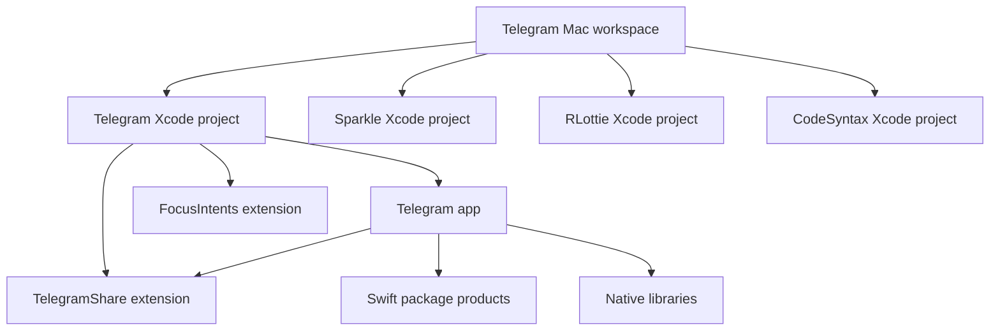
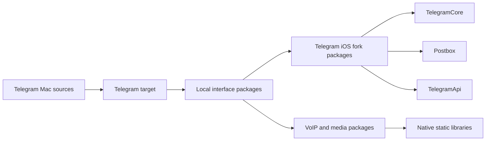
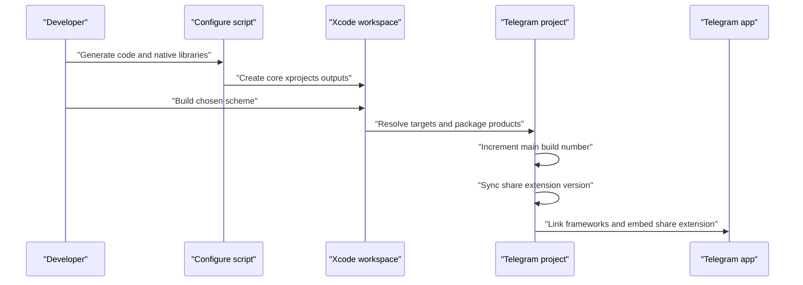
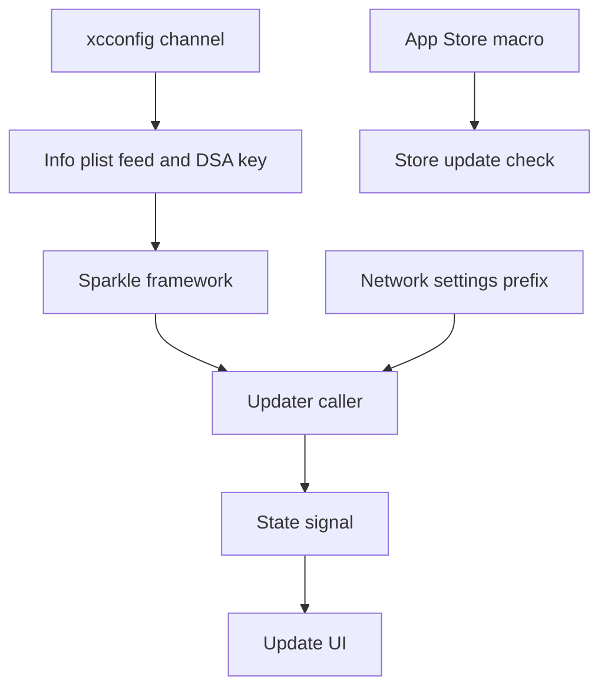

# macOS 빌드, 패키징, 배포

웹: /docs/system/23-macos-build-distribution/ · Markdown: /docs/system/23-macos-build-distribution.md

> TelegramSwift의 Xcode 프로젝트, Swift Package, 네이티브 라이브러리, 서명, 업데이트, 채널 배포 설계.

> 시스템 설계 · 엔지니어링 · 23장 · 도표 4 · 코드 발췌 8 · 인용 46 · 소스 기준선: [TelegramMessenger/Telegram-iOS@f1dd7a2d](https://github.com/TelegramMessenger/Telegram-iOS/tree/f1dd7a2dbd02cbbf513e75d5695d8d36d1cf5838), [overtake/TelegramSwift@579cebbf](https://github.com/overtake/TelegramSwift/tree/579cebbf0c01fd41b712eff3647fa7f69db9665d)
>
> 핵심 소스 파일: [overtake/TelegramSwift/Telegram.xcodeproj/project.pbxproj](https://github.com/overtake/TelegramSwift/blob/579cebbf0c01fd41b712eff3647fa7f69db9665d/Telegram.xcodeproj/project.pbxproj), [overtake/TelegramSwift/Telegram-Mac.xcworkspace/contents.xcworkspacedata](https://github.com/overtake/TelegramSwift/blob/579cebbf0c01fd41b712eff3647fa7f69db9665d/Telegram-Mac.xcworkspace/contents.xcworkspacedata), [overtake/TelegramSwift/scripts/configure_frameworks.sh](https://github.com/overtake/TelegramSwift/blob/579cebbf0c01fd41b712eff3647fa7f69db9665d/scripts/configure_frameworks.sh), [overtake/TelegramSwift/Telegram-Mac/Debug.xcconfig](https://github.com/overtake/TelegramSwift/blob/579cebbf0c01fd41b712eff3647fa7f69db9665d/Telegram-Mac/Debug.xcconfig), [overtake/TelegramSwift/Telegram-Mac/Release.xcconfig](https://github.com/overtake/TelegramSwift/blob/579cebbf0c01fd41b712eff3647fa7f69db9665d/Telegram-Mac/Release.xcconfig), [overtake/TelegramSwift/Telegram-Mac/AppDelegate.swift](https://github.com/overtake/TelegramSwift/blob/579cebbf0c01fd41b712eff3647fa7f69db9665d/Telegram-Mac/AppDelegate.swift), [overtake/TelegramSwift/Telegram-Mac/AppUpdateViewController.swift](https://github.com/overtake/TelegramSwift/blob/579cebbf0c01fd41b712eff3647fa7f69db9665d/Telegram-Mac/AppUpdateViewController.swift), [overtake/TelegramSwift/packages/ApiCredentials/Sources/ApiCredentials/Config.swift](https://github.com/overtake/TelegramSwift/blob/579cebbf0c01fd41b712eff3647fa7f69db9665d/packages/ApiCredentials/Sources/ApiCredentials/Config.swift), [overtake/TelegramSwift/TelegramShare/ShareViewController.swift](https://github.com/overtake/TelegramSwift/blob/579cebbf0c01fd41b712eff3647fa7f69db9665d/TelegramShare/ShareViewController.swift), [overtake/TelegramSwift/TelegramShare/SESelectController.swift](https://github.com/overtake/TelegramSwift/blob/579cebbf0c01fd41b712eff3647fa7f69db9665d/TelegramShare/SESelectController.swift), [overtake/TelegramSwift/FocusIntents/FocusIntents.swift](https://github.com/overtake/TelegramSwift/blob/579cebbf0c01fd41b712eff3647fa7f69db9665d/FocusIntents/FocusIntents.swift), [overtake/Telegram-iOS/submodules/TelegramCore/Package.swift](https://github.com/overtake/Telegram-iOS/blob/a24bbe45f9861f736a79916a50898512f751e0dc/submodules/TelegramCore/Package.swift)
>
> 미검증 사항:
> - 현재 커밋에서 Xcode가 눈에 보이는 package 포인터가 없는 로컬 SwiftPM 제품을 어떻게 등록하는지.
> - AppStore, Alpha, Beta, Stable xcconfig가 실제 릴리스 그래프의 어디에 연결되는지.
> - FocusIntents.appex가 커밋되지 않은 후처리나 별도의 릴리스 방안으로 Telegram.app에 임베드되는지.
> - 체크아웃되지 않은 Sparkle 서브모듈의 서명 검증, 차분 업데이트, 설치, 롤백, 오류 처리의 세부.
> - 공식 웹사이트 직접 배포용 Developer ID 서명, 공증, staple, DMG 또는 PKG 패키징 명령.
> - 실제 App Store archive가 AppStore xcconfig에 바인딩되지 않은 서명 설정을 쓰는지.
> - 깨끗한 macOS 빌드 머신에서 네이티브 서브모듈의 전체 빌드 순서와 출력 경로.
> - configure_frameworks.sh의 Bash 배열 문법이 대상 macOS의 sh 호출 방식에서 호환되는지.

## 문제와 제약 [#문제와-제약]

TelegramSwift는 고정 커밋 `579cebbf0c01fd41b712eff3647fa7f69db9665d`에서 Xcode 워크스페이스(여러 프로젝트를 묶는 Xcode 단위)를 macOS 앱의 조립 지점으로 써요. `Telegram-iOS`를 그대로 iOS 앱으로 컴파일하는 게 아니에요.

overtake의 `telegram-ios` fork를 서브모듈로 고정하고, 로컬 패키지, Xcode 타깃, 네이티브 라이브러리 프로젝트를 이어 붙여서 `Telegram.app`을 만들어요. 서브모듈 기록에는 아래가 명시적으로 들어 있어요. [\[1\]](https://github.com/overtake/TelegramSwift/blob/579cebbf0c01fd41b712eff3647fa7f69db9665d/.gitmodules#L1-L24)

- `telegram-ios`
- `tgcalls`
- Sparkle(macOS 앱의 자동 업데이트 프레임워크)
- `libtgvoip`
- `rlottie`
- `tg_owt`
- `libprisma`
- `regex`

이 장은 macOS 클라이언트의 빌드와 배포 경계만 다뤄요. 15장 「macOS 시스템 계층」에서 이미 설명한 내용이 있어요.

- 공유 코어
- 시스템 업데이트의 런타임 계층 구분
- 데스크톱 호스트의 책임

이 장은 필요한 곳에서만 15장을 가리키고, 런타임 비즈니스 설계는 반복하지 않아요.

이 저장소를 재현할 수 있는 범위는 분명해요. `INSTALL.md`는 이 순서를 안내해요. [\[2\]](https://github.com/overtake/TelegramSwift/blob/579cebbf0c01fd41b712eff3647fa7f69db9665d/INSTALL.md#L1-L36)

1. 서브모듈을 재귀적으로 클론해요.
2. Homebrew 의존성을 설치해요.
3. `scripts/rebuild`를 `no`에서 `yes`로 바꿔요.
4. `configure_frameworks.sh`를 실행해요.
5. 최신 Xcode로 워크스페이스를 열어 서명을 설정해요.

따라서 최상위 Git 트리만 내려받아서는 빌드할 수 없어요.

워크스페이스 `Telegram-Mac.xcworkspace`는 이 프로젝트들을 함께 참조해요. [\[3\]](https://github.com/overtake/TelegramSwift/blob/579cebbf0c01fd41b712eff3647fa7f69db9665d/Telegram-Mac.xcworkspace/contents.xcworkspacedata#L1-L16)

- `CodeSyntax.xcodeproj`
- `RLottie_Xcode.xcodeproj`
- `Sparkle.xcodeproj`
- 주 프로젝트 `Telegram.xcodeproj`

현재 연구용 체크아웃에는 Sparkle 서브모듈이 없어요. 그래서 이후에는 TelegramSwift 쪽의 Sparkle 링크와 호출자만 분석해요. Sparkle 내부 검증 로직을 소스로 확인한 것처럼 말하지 않아요.

빌드는 세 가지 외부 조건의 제약도 받아요.

- 반드시 macOS에서 Xcode와 `xcrun xcodebuild`를 써야 해요. 이번 연구 환경은 macOS가 아니어서 실제 아카이브는 한 번도 실행하지 않았어요.
- Bundle ID에 대응하는 팀, 인증서, App Group, 확장 서명 자료가 있어야 해요. 프로젝트는 자동 서명을 쓰지만, 서드파티 fork가 배포할 수 있는 산출물을 바로 서명해 낼 수 있다는 보장은 아니에요.
- 모든 서브모듈을 체크아웃해야 해요. 특히 Sparkle, `libtgvoip`, `tg_owt`, `rlottie`, `regex`는 체크아웃되지 않았어요. 이 때문에 일부 워크스페이스 참조나 네이티브 링크가 막혀요.

아래의 “소스 확인”은 모두 고정 커밋의 파일에서 나온 거예요. “추론”은 여러 소스 사실에서 얻은 엔지니어링상의 함의일 뿐이에요. 소스로 검증할 수 없는 문제는 글 끝의 “열린 문제”에 뒀어요.

## 조립 모델: 워크스페이스, 타깃, 패키지 [#조립-모델-워크스페이스-타깃-패키지]

### 최상위 타깃과 임베드 관계 [#최상위-타깃과-임베드-관계]

주 프로젝트에는 네이티브 타깃이 세 개 있어요.

| 타깃 | 산출물 | 소스로 확인한 책임 | 주 앱에 임베드되는지 |
| --- | --- | --- | --- |
| `Telegram` | `Telegram.app` | AppKit 주 앱 | 주 타깃 |
| `TelegramShare` | `TelegramShare.appex` | macOS 공유 서비스 확장 | 주 타깃이 의존하고 임베드함 |
| `FocusIntents` | `FocusIntents.appex` | macOS 13 이상의 Focus 필터 | 이번 프로젝트 파일은 주 앱에 임베드하지 않음 |

`Telegram`은 `com.apple.product-type.application`이에요. 패키지 제품 의존 목록에는 `TelegramApi`, `TelegramCore`, `Postbox`, `SwiftSignalKit`, `TGUIKit`, 미디어, 음성, OCR, 결제, Firebase와 많은 유틸리티 패키지가 들어 있어요. [\[4\]](https://github.com/overtake/TelegramSwift/blob/579cebbf0c01fd41b712eff3647fa7f69db9665d/Telegram.xcodeproj/project.pbxproj#L7000-L7085) 이 목록은 “주 앱이 거대한 코어 모듈 하나를 직접 컴파일한다”는 뜻이 아니에요. Xcode가 먼저 패키지 경계에서 제품을 컴파일한 뒤, 그 제품을 주 타깃에 링크해요.

`TelegramShare`는 `com.apple.product-type.app-extension`이에요. 자체 소스, 프레임워크, 리소스, 복사 단계를 갖고 있어요. 주 타깃은 `PBXTargetDependency` 하나만 선언하고, 그 대상이 바로 `TelegramShare`예요. 주 타깃의 `Embed App Extensions` 단계에도 `TelegramShare.appex`만 나열되어 있어요. [\[5\]](https://github.com/overtake/TelegramSwift/blob/579cebbf0c01fd41b712eff3647fa7f69db9665d/Telegram.xcodeproj/project.pbxproj#L1683-L1705)

같은 주 타깃에는 Sparkle의 Copy Files 단계도 있어요. 다시 말해 릴리스 패키지의 객체 관계는 두 가지로 나뉘어요.

- `TelegramShare.appex`: 확장 디렉터리로 들어가요.
- `Sparkle.framework`: Frameworks 디렉터리로 들어가요.

둘 다 호스트 번들의 서명 범위 안에서 처리되어야 해요. [\[5\]](https://github.com/overtake/TelegramSwift/blob/579cebbf0c01fd41b712eff3647fa7f69db9665d/Telegram.xcodeproj/project.pbxproj#L1683-L1705)[\[26\]](https://github.com/overtake/TelegramSwift/blob/579cebbf0c01fd41b712eff3647fa7f69db9665d/Telegram.xcodeproj/project.pbxproj#L1166-L1175)

`FocusIntents`는 `com.apple.product-type.extensionkit-extension` 타깃이고 `ApiCredentials`, `SwiftSignalKit`, `TelegramCore`, `Postbox`, `InAppSettings`도 링크하지만 타깃 의존성은 없어요. [\[6\]](https://github.com/overtake/TelegramSwift/blob/579cebbf0c01fd41b712eff3647fa7f69db9665d/Telegram.xcodeproj/project.pbxproj#L6906-L6930) 주 타깃의 임베드 확장 목록에도 `FocusIntents.appex`는 없어요. [\[5\]](https://github.com/overtake/TelegramSwift/blob/579cebbf0c01fd41b712eff3647fa7f69db9665d/Telegram.xcodeproj/project.pbxproj#L1683-L1705)

여기서 소스 확인과 추론을 나눠 볼 수 있어요.

- 소스로 확인되는 것: 이 확장을 Xcode 타깃으로 따로 빌드할 수 있어요.
- 추론: 현재 `Telegram` 스킴의 아카이브가 이 확장을 반드시 담지는 않아요.

다른 릴리스 스킴, 후처리 단계, Xcode의 암묵적 동작으로 설치되는지는 현재 트리에 증거가 없어요.



워크스페이스는 이 프로젝트들을 같은 Xcode 빌드 그래프에 놓아요. [\[3\]](https://github.com/overtake/TelegramSwift/blob/579cebbf0c01fd41b712eff3647fa7f69db9665d/Telegram-Mac.xcworkspace/contents.xcworkspacedata#L1-L16) 하지만 디렉터리 구조보다 프로젝트의 명시적인 관계를 먼저 보고 판단해야 해요. 예를 들어 Sparkle이 워크스페이스에 나온다고 해서 모든 채널이 Sparkle을 쓰는 건 아니에요.

### `packages` 디렉터리의 두 종류 내용 [#packages-디렉터리의-두-종류-내용]

`packages`는 단일 SwiftPM(Swift Package Manager) 루트 패키지가 아니에요. 인접한 `Package.swift`가 여러 개 있어요. 예로 `TGUIKit`, `GraphUI`, `TelegramMedia`, `InAppSettings`, `ApiCredentials`, `TelegramSystem`, `Dock`, `FetchManager`와 많은 소형 유틸리티 패키지가 있어요. 각 매니페스트는 라이브러리 제품 하나를 선언하고, 플랫폼 하한은 보통 macOS 10.13이에요.

첫 번째 종류는 로컬 인터페이스 패키지예요. fork의 서브모듈 패키지에 직접 의존해요. 예를 들면 이래요.

- `TGUIKit`: 매니페스트가 상대 경로로 `SSignalKit`에 의존하고, 로컬 `ColorPalette`, `KeyboardKey`, `ObjcUtils`, `MergeLists`에도 의존해요. [\[7\]](https://github.com/overtake/TelegramSwift/blob/579cebbf0c01fd41b712eff3647fa7f69db9665d/packages/TGUIKit/Package.swift#L1-L38)
- `TelegramMedia`(미디어 패키지): `TelegramCore`, `Postbox`, `TelegramVoip`, `TgVoipWebrtc`, `FFMpegBinding`, `libwebp`, `TGUIKit`, `ApiCredentials`에 동시에 의존해요. [\[8\]](https://github.com/overtake/TelegramSwift/blob/579cebbf0c01fd41b712eff3647fa7f69db9665d/packages/TelegramMedia/Package.swift#L1-L57)

이 의존 관계는 macOS 셸의 미디어와 인터페이스 계층이 fork의 수동적 사본이 아니라는 뜻이에요. macOS 전용 패키지로 fork의 코어 산출물을 능동적으로 조율해요.

두 번째 종류는 fork 안의 자체 Swift 패키지예요. `submodules/telegram-ios/submodules/TelegramCore/Package.swift`는 `TelegramCore` 라이브러리를 내보내요. 그리고 상대 경로로 아래 패키지를 조합해요.

- `FlatBuffers`
- `FlatSerialization`
- `Postbox`
- `SSignalKit`
- `MtProtoKit`
- `TelegramApi`
- 암호화
- 네트워크 로그
- 도달 가능성(네트워크 연결 상태 감지) 패키지 [\[9\]](https://github.com/overtake/Telegram-iOS/blob/a24bbe45f9861f736a79916a50898512f751e0dc/submodules/TelegramCore/Package.swift#L1-L50)

`Postbox`와 `TelegramApi`도 각자 macOS 10.13의 SwiftPM 제품 선언을 갖고 있어요. [\[10\]](https://github.com/overtake/Telegram-iOS/blob/a24bbe45f9861f736a79916a50898512f751e0dc/submodules/Postbox/Package.swift#L1-L44)[\[11\]](https://github.com/overtake/Telegram-iOS/blob/a24bbe45f9861f736a79916a50898512f751e0dc/submodules/TelegramApi/Package.swift#L1-L27)



주 타깃의 `packageProductDependencies`는 이 체인의 제품 이름을 나열해요. `TelegramCore`, `Postbox`, `TelegramApi`, `TgVoipWebrtc`, `FFMpegBinding`, `TelegramMediaPlayer`, `TelegramSystem`이 포함돼요. [\[4\]](https://github.com/overtake/TelegramSwift/blob/579cebbf0c01fd41b712eff3647fa7f69db9665d/Telegram.xcodeproj/project.pbxproj#L7000-L7085) 이 목록은 fork의 코어 모듈이 macOS 주 앱의 링크 입력이라는 걸 보여 줘요.

그러나 `project.pbxproj`에는 Firebase의 원격 패키지 기록만 있어요. 다른 제품 객체에는 눈에 보이는 `package` 포인터도, 눈에 보이는 `XCLocalSwiftPackageReference`도 없어요. 따라서 이 장은 “현재 커밋에서 Xcode가 로컬 매니페스트를 하나하나 어떻게 등록하는지”를 확인된 결론으로 쓰지 않아요. 확인할 수 있는 건 매니페스트, 경로, 타깃 제품 이름이 모두 트리 안에 있다는 점이에요. 정확한 패키지 해석 메타데이터는 macOS Xcode로 워크스페이스를 한 번 열어 확인해야 해요.

### fork가 macOS 산출물에 들어가는 방식 [#fork가-macos-산출물에-들어가는-방식]

fork의 역할은 적어도 네 층이에요.

1. `TelegramCore`, `Postbox`, `TelegramApi`, `SSignalKit`, `MtProtoKit`, 미디어 바인딩의 소스와 패키지 매니페스트를 제공해요. [\[9\]](https://github.com/overtake/Telegram-iOS/blob/a24bbe45f9861f736a79916a50898512f751e0dc/submodules/TelegramCore/Package.swift#L1-L50)[\[10\]](https://github.com/overtake/Telegram-iOS/blob/a24bbe45f9861f736a79916a50898512f751e0dc/submodules/Postbox/Package.swift#L1-L44)[\[11\]](https://github.com/overtake/Telegram-iOS/blob/a24bbe45f9861f736a79916a50898512f751e0dc/submodules/TelegramApi/Package.swift#L1-L27)
2. 주 Xcode 타깃이 이 제품들을 패키지 의존성으로 링크 그래프에 올려요. [\[4\]](https://github.com/overtake/TelegramSwift/blob/579cebbf0c01fd41b712eff3647fa7f69db9665d/Telegram.xcodeproj/project.pbxproj#L7000-L7085)
3. `configure_frameworks.sh`는 fork의 `TelegramCore/FlatSerialization/Sources`에 코드를 생성해요. 그리고 OpenSSL, FFmpeg, Opus 같은 네이티브 라이브러리의 헤더 파일을 fork나 관련 서브모듈의 `SharedHeaders` 경로로 복사해요. [\[12\]](https://github.com/overtake/TelegramSwift/blob/579cebbf0c01fd41b712eff3647fa7f69db9665d/scripts/configure_frameworks.sh#L1-L106)
4. 주 타깃의 `LIBRARY_SEARCH_PATHS`는 `core-xprojects` 아래의 FFmpeg, Opus, libvpx, libwebp, Mozjpeg, OpenSSL, WebRTC, OpenH264, dav1d, tde2e 빌드 출력을 가리켜요. [\[13\]](https://github.com/overtake/TelegramSwift/blob/579cebbf0c01fd41b712eff3647fa7f69db9665d/Telegram.xcodeproj/project.pbxproj#L8946-L9024)

따라서 추론하자면 “Swift 패키지가 Swift와 래퍼 계층을 컴파일하고, Xcode가 사전 빌드된 네이티브 라이브러리를 링크하는” 혼합 방식이에요.

이 방식의 장점은 SwiftPM으로 수많은 모듈 관계를 표현하면서도 C, C++, 미디어, WebRTC 라이브러리에 대한 Xcode 빌드 통제권을 유지한다는 거예요. 대가는 패키지 의존성, 서브모듈, `core-xprojects` 출력이 서로 맞게 동기화되어 있어야 한다는 거예요. 그렇지 않으면 컴파일, 헤더 파일 탐색, 링크 단계에서 실패해요.

## 핵심 흐름: 소스에서 서명 가능한 앱까지 [#핵심-흐름-소스에서-서명-가능한-앱까지]

### 의존성 준비와 네이티브 라이브러리 빌드 [#의존성-준비와-네이티브-라이브러리-빌드]

설치 안내는 네이티브 의존성 준비를 워크스페이스를 열기 전에 두어요. 스크립트는 열 개 항목의 라이브러리 목록을 고정해 둬요.

- OpenH264
- OpenSSL
- libopus
- libvpx
- mozjpeg
- libwebp
- dav1d
- ffmpeg
- webrtc
- tde2e

각 항목에 `xcrun xcodebuild build`를 호출하고, 구성은 `Release`이고 `BUILD_LIBRARY_FOR_DISTRIBUTION=YES`와 범용 macOS 대상 환경을 지정해요. [\[12\]](https://github.com/overtake/TelegramSwift/blob/579cebbf0c01fd41b712eff3647fa7f69db9665d/scripts/configure_frameworks.sh#L1-L106)

```bash
COMMON_SETUP=" -project ${SCRIPT_DIR}/../core-xprojects/${LIB}/${FWNAME}.xcodeproj -configuration Release BUILD_LIBRARY_FOR_DISTRIBUTION=YES "

DERIVED_DATA_PATH=$( mktemp -d )
xcrun xcodebuild build \
    $COMMON_SETUP \
    -scheme "${FWNAME}" \
    -derivedDataPath "${DERIVED_DATA_PATH}" \
    -destination 'generic/platform=macOS'
```

[\[12\]](https://github.com/overtake/TelegramSwift/blob/579cebbf0c01fd41b712eff3647fa7f69db9665d/scripts/configure_frameworks.sh#L1-L106)

이 스크립트는 이어서 경로 쌍에 따라 `.h` 헤더 파일을 복사해요. 예를 들면 이래요.

- FFmpeg 헤더 파일: fork의 `FFMpegBinding/SharedHeaders`로 들어가요.
- WebRTC, OpenSSL, Opus의 헤더 파일: `tgcalls/SharedHeaders`로 들어가요. [\[12\]](https://github.com/overtake/TelegramSwift/blob/579cebbf0c01fd41b712eff3647fa7f69db9665d/scripts/configure_frameworks.sh#L1-L106)

마지막으로 fork의 `third-party/td/macos-cleanup.sh`를 호출해요. 따라서 네이티브 라이브러리는 주 프로젝트의 링크 입력이면서, Swift나 Objective-C 패키지가 모듈 맵과 컴파일 브리지를 만드는 데 필요한 헤더 파일 입력이기도 해요.

`rebuild`의 기본 내용은 `no`예요.

- `yes`로 바꾸면: 스크립트는 각 `core-xprojects`의 기존 build 디렉터리를 삭제해요. 이 분기의 루프는 삭제한 뒤 라이브러리 컴파일 명령을 명시적으로 실행하지 않아요.
- 값과 상관없이: 스크립트를 실행할 때마다 뒤쪽의 `xcodebuild` 루프가 실행돼요. [\[12\]](https://github.com/overtake/TelegramSwift/blob/579cebbf0c01fd41b712eff3647fa7f69db9665d/scripts/configure_frameworks.sh#L1-L106)

추론하자면 이 스위치는 유일한 빌드 경로를 켜는 것이라기보다 오래된 출력을 정리하는 쪽에 가까워요.

실패 처리는 비대칭적이에요.

- `xcodebuild`와 생성기가 실패하면: 스크립트가 `set -e`를 쓰므로 스크립트 전체가 중단돼요.
- 헤더 파일 복사 단계는 소스 디렉터리가 없으면: 건너뛴다는 안내만 출력하고 계속 진행해요. [\[12\]](https://github.com/overtake/TelegramSwift/blob/579cebbf0c01fd41b712eff3647fa7f69db9665d/scripts/configure_frameworks.sh#L1-L106)

건너뛴 복사는 오류를 바로 드러내지 않아요. 하지만 다음 단계인 패키지 컴파일이나 링크가 헤더 파일 누락으로 실패할 수 있어요. 유지 보수하는 사람은 “건너뜀”을 성공 결과가 아니라 빌드 위험으로 봐야 해요.

### Xcode 컴파일, 리소스, 버전 동기화 [#xcode-컴파일-리소스-버전-동기화]

주 타깃의 Debug와 Release는 모두 `Telegram-Mac/Info.plist`를 쓰고 표준 아키텍처를 지원해요. 최소 배포 타깃은 둘 다 macOS 10.13이에요. [\[13\]](https://github.com/overtake/TelegramSwift/blob/579cebbf0c01fd41b712eff3647fa7f69db9665d/Telegram.xcodeproj/project.pbxproj#L8946-L9024)[\[14\]](https://github.com/overtake/TelegramSwift/blob/579cebbf0c01fd41b712eff3647fa7f69db9665d/Telegram.xcodeproj/project.pbxproj#L9176-L9255)

둘이 다른 점은 이래요. entitlement는 앱이 쓸 수 있는 시스템 권한을 선언한 파일이고, hardened runtime은 서명된 앱에 적용하는 런타임 보안 강화 모드예요.

- Debug: `-Onone`, `singlefile` 컴파일 모드, `ONLY_ACTIVE_ARCH=YES`를 쓰고 `Telegram-Mac.entitlements`와 `Apple Development` 신원을 써요. [\[14\]](https://github.com/overtake/TelegramSwift/blob/579cebbf0c01fd41b712eff3647fa7f69db9665d/Telegram.xcodeproj/project.pbxproj#L9176-L9255)
- Release: `-O`, `wholemodule`, `ONLY_ACTIVE_ARCH=NO`, 데드 코드 제거, hardened runtime을 쓰고 `Telegram-Sandbox.entitlements`를 써요. [\[13\]](https://github.com/overtake/TelegramSwift/blob/579cebbf0c01fd41b712eff3647fa7f69db9665d/Telegram.xcodeproj/project.pbxproj#L8946-L9024)

따라서 Debug와 Release는 적어도 네 가지를 동시에 바꿔요.

- Swift 조건
- 최적화
- 유효 아키텍처 범위
- entitlement 파일 [\[13\]](https://github.com/overtake/TelegramSwift/blob/579cebbf0c01fd41b712eff3647fa7f69db9665d/Telegram.xcodeproj/project.pbxproj#L8946-L9024)[\[14\]](https://github.com/overtake/TelegramSwift/blob/579cebbf0c01fd41b712eff3647fa7f69db9665d/Telegram.xcodeproj/project.pbxproj#L9176-L9255)

이 중 `ONLY_ACTIVE_ARCH`의 차이는 Debug가 현재 개발 머신의 아키텍처를 향하고 Release는 표준 아키텍처 집합을 요구한다는 뜻이에요. 아카이브마다 실제로 Intel과 Apple Silicon 슬라이스가 모두 들어 있는지는 archive 안의 Mach-O 파일을 검사해야 알 수 있어요. 이 설정만으로 단정할 수 없어요.

이 두 Xcode 구성이 채널 구성의 전부는 아니에요.

- `Debug.xcconfig`: `-DBETA`를 주입하고 `SOURCE=DEBUG`를 설정하며, beta appcast(Sparkle이 읽는 업데이트 목록 피드)와 프로덕션이 아닌 DSA 공개 키(업데이트 서명 검증용)를 써요.
- `Release.xcconfig`: `-DSTABLE`을 주입하고 `SOURCE=STABLE`을 설정하며, 안정판 appcast와 프로덕션 DSA 공개 키로 바꿔요. [\[15\]](https://github.com/overtake/TelegramSwift/blob/579cebbf0c01fd41b712eff3647fa7f69db9665d/Telegram-Mac/Debug.xcconfig#L1-L20)[\[16\]](https://github.com/overtake/TelegramSwift/blob/579cebbf0c01fd41b712eff3647fa7f69db9665d/Telegram-Mac/Release.xcconfig#L1-L14)

다시 말해 Debug는 최적화와 서명에서는 개발 빌드지만, 업데이트 성향에서는 beta로 동작해요. 구성 이름을 릴리스 채널 이름과 같다고 볼 수 없어요.

프로젝트에는 `configurations/AppStore.xcconfig`, `Alpha.xcconfig`, `Beta.xcconfig`, `Stable.xcconfig`도 있어요. 이 중 App Store 구성은 `-DAPP_STORE`를 주입해요. 하지만 현재 `project.pbxproj`에서 보이는 구성 목록은 `Telegram-Mac/Debug.xcconfig`와 `Telegram-Mac/Release.xcconfig`만 참조해요. [\[15\]](https://github.com/overtake/TelegramSwift/blob/579cebbf0c01fd41b712eff3647fa7f69db9665d/Telegram-Mac/Debug.xcconfig#L1-L20)[\[16\]](https://github.com/overtake/TelegramSwift/blob/579cebbf0c01fd41b712eff3647fa7f69db9665d/Telegram-Mac/Release.xcconfig#L1-L14)[\[17\]](https://github.com/overtake/TelegramSwift/blob/579cebbf0c01fd41b712eff3647fa7f69db9665d/configurations/AppStore.xcconfig#L1-L15)

그러므로 App Store 파일이 있다는 것만으로는 이 고정된 프로젝트 그래프에서 어떤 타깃이 이를 골랐다는 걸 증명할 수 없어요. 배포하는 사람이 App Store 산출물이 필요하다면 이 파일이 어떻게 연결되는지를 Xcode나 트리에 포함되지 않은 생성 단계에서 확인해야 해요.

주 타깃에는 shell build phase도 두 개 있어요. 하나는 비어 있어요. 다른 하나는 빌드할 때마다 이렇게 해요. [\[18\]](https://github.com/overtake/TelegramSwift/blob/579cebbf0c01fd41b712eff3647fa7f69db9665d/Telegram.xcodeproj/project.pbxproj#L7683-L7711)

- 주 앱 `Info.plist`의 `CFBundleVersion`을 올려요.
- 주 앱의 마케팅 버전과 빌드 번호를 `TelegramShare/Info.plist`에 써요.

위험하지만 분명한 설계예요. 일반 build가 읽기 전용 작업이 아니라 작업 트리를 수정해요. 로컬에서 빌드를 반복하면 버전 번호가 달라질 수 있어요. 빌드 전에 작업 트리 상태와 커밋 산출물을 릴리스 체크리스트에 기록해 두어야 해요.

```bash
sh ${PROJECT_DIR}/tools/bump_build_number.sh "${PROJECT_DIR}/${INFOPLIST_FILE}"
sh ${PROJECT_DIR}/tools/sync_share_version.sh "${PROJECT_DIR}/${INFOPLIST_FILE}" "${PROJECT_DIR}/TelegramShare/Info.plist"
```

[\[18\]](https://github.com/overtake/TelegramSwift/blob/579cebbf0c01fd41b712eff3647fa7f69db9665d/Telegram.xcodeproj/project.pbxproj#L7683-L7711)

- `bump_build_number.sh`: `CFBundleVersion`을 읽어 1을 더해요.
- `sync_share_version.sh`: 주 앱의 `CFBundleShortVersionString`과 `CFBundleVersion`을 읽어 공유 확장에 써 줘요. [\[19\]](https://github.com/overtake/TelegramSwift/blob/579cebbf0c01fd41b712eff3647fa7f69db9665d/tools/sync_share_version.sh#L1-L27)

덕분에 `TelegramShare.appex`와 호스트의 버전 표시가 동기화돼요. 이는 병렬 빌드, 커밋되지 않은 plist 변경, 서로 다른 브랜치에서의 아카이브가 예기치 않은 빌드 번호를 만들 수 있다는 뜻이기도 해요.



### 패키징, 서명, 자동화의 증거 경계 [#패키징-서명-자동화의-증거-경계]

- 프로젝트의 Release 설정: `CODE_SIGN_STYLE=Automatic`, `ENABLE_HARDENED_RUNTIME=YES`를 지정하고 샌드박스 entitlement를 참조해요. [\[13\]](https://github.com/overtake/TelegramSwift/blob/579cebbf0c01fd41b712eff3647fa7f69db9665d/Telegram.xcodeproj/project.pbxproj#L8946-L9024)
- `TelegramShare`의 Release 구성: hardened runtime을 켜고 자체 entitlement를 쓰며, `SKIP_INSTALL=NO`와 `VALID_ARCHS`를 `arm64 x86_64`로 설정해요. [\[20\]](https://github.com/overtake/TelegramSwift/blob/579cebbf0c01fd41b712eff3647fa7f69db9665d/Telegram.xcodeproj/project.pbxproj#L9080-L9127)

이 설정은 프로젝트가 호스트와 공유 확장에 각각 서명하고, 공유 확장을 호스트 번들에 설치할 수 있게 한다는 증거예요.

저장소에서 보이는 Fastlane(앱 빌드와 배포 자동화 도구) `Release` lane은 `output`만 비운 뒤 scheme `Release`로 `gym`을 호출해요. [\[21\]](https://github.com/overtake/TelegramSwift/blob/579cebbf0c01fd41b712eff3647fa7f69db9665d/fastlane/Fastfile#L1-L30) 주 프로젝트에도 `Release`라는 이름의 공유 scheme이 있고 아카이브 동작은 Release 구성이에요. [\[22\]](https://github.com/overtake/TelegramSwift/blob/579cebbf0c01fd41b712eff3647fa7f69db9665d/Telegram.xcodeproj/xcshareddata/xcschemes/Release.xcscheme#L1-L87) 따라서 Xcode archive를 만들 수 있다는 건 소스로 확인돼요.

저장소에서 인용할 만한 아래 스크립트는 보이지 않아요.

- `codesign` 명령
- notarization(Apple의 공증 절차)
- stapler
- DMG
- PKG
- App Store Connect 업로드
- `xcodebuild -exportArchive`

따라서 현재 공개 트리를 완전한 macOS 직접 배포 파이프라인이라고 부를 수 없어요. 추론하자면 아카이브는 Xcode와 Fastlane에 맡기고, 인증서 선택은 자동 서명에 맡겨요. 하지만 내보내기, Developer ID 서명, 공증, 마운트 이미지, 업로드는 사람의 절차나 비공개 자동화에 맡겨요. 이 공백은 릴리스를 재현할 때의 위험일 뿐 소스 오류의 증거는 아니에요.

## 채널 설계: Debug, 공식 사이트 직접 배포, App Store [#채널-설계-debug-공식-사이트-직접-배포-app-store]

### 세 가지 업데이트와 설치 의미 [#세-가지-업데이트와-설치-의미]

채널 차이는 조건부 컴파일과 업데이트 UI에서 가장 분명하게 나타나요.

| 차원 | Debug 또는 Beta | 안정판 직접 배포 | App Store |
| --- | --- | --- | --- |
| 보이는 매크로 | `DEBUG`와 `BETA` | `PRODUCTION`과 `STABLE` | `APP_STORE` |
| appcast 공개 키 | `dsa_pub.pem` | `dsa_pub_prod.pem` | 현재 프로젝트 연결은 미검증 |
| appcast URL | beta `versions.xml` | 안정판 `versions.xml` | Sparkle UI를 쓰지 않음 |
| 앱 내 업데이트 | Sparkle 호출자를 컴파일할 수 있음 | Sparkle 호출자를 컴파일할 수 있음 | 24시간마다 스토어를 확인하고 스토어 링크를 엶 |
| 서명 구성 | 개발 entitlement | 샌드박스 entitlement | App Store xcconfig는 있으나 타깃 바인딩은 미검증 |

Debug, Beta, Stable의 업데이트 URL과 매크로는 `.xcconfig` 파일에서 와요. [\[15\]](https://github.com/overtake/TelegramSwift/blob/579cebbf0c01fd41b712eff3647fa7f69db9665d/Telegram-Mac/Debug.xcconfig#L1-L20)[\[16\]](https://github.com/overtake/TelegramSwift/blob/579cebbf0c01fd41b712eff3647fa7f69db9665d/Telegram-Mac/Release.xcconfig#L1-L14)

App Store의 런타임 UI는 Sparkle 상태를 구독하지 않아요. 대신 이렇게 해요. [\[23\]](https://github.com/overtake/TelegramSwift/blob/579cebbf0c01fd41b712eff3647fa7f69db9665d/Telegram-Mac/MainViewController.swift#L150-L240)

1. 먼저 즉시 한 번 확인해요.
2. 그 뒤 24시간 주기로 `checkForAppstoreUpdate`를 호출해요.
3. 업데이트가 발견되면 클릭했을 때 `itunesAppLink`를 열어요.

```swift
#if APP_STORE

let signal = Signal<Void, NoError>.single(Void()) |> then(.single(Void()) |> delay(24 * 60 * 60, queue: .mainQueue()) |> restart)

disposable.set(signal.start(next: { [weak self] in
    checkForAppstoreUpdate(completion: { needToUpdate in
        self?.genericView.isHidden = !needToUpdate
        self?.state = .common
    })
}))
genericView.set(handler: { control in
    execute(inapp: inAppLink.external(link: itunesAppLink, false))
    control.isHidden = true
}, for: .Click)
```

[\[23\]](https://github.com/overtake/TelegramSwift/blob/579cebbf0c01fd41b712eff3647fa7f69db9665d/Telegram-Mac/MainViewController.swift#L150-L240)

반대로 App Store가 아닌 분기는 `appUpdateStateSignal`을 관찰해요. [\[23\]](https://github.com/overtake/TelegramSwift/blob/579cebbf0c01fd41b712eff3647fa7f69db9665d/Telegram-Mac/MainViewController.swift#L150-L240)

- `readyToInstall`: appcast 항목을 표시해요.
- `installing`: 설치 중 상태를 표시해요.
- 클릭하면 `updateApplication`을 호출해요.

스토어 버전과 직접 배포 버전은 feed URL만 다른 게 아니에요. 설치 책임을 서로 다른 배포 주체에게 나눠요.

`AppDelegate`에서 `APP_STORE` 빌드는 Sparkle 호출 진입점을 이렇게 막아요. [\[24\]](https://github.com/overtake/TelegramSwift/blob/579cebbf0c01fd41b712eff3647fa7f69db9665d/Telegram-Mac/AppDelegate.swift#L1288-L1319)

- 메뉴에서 tag가 1000인 Sparkle 항목을 삭제해요.
- 수동 업데이트 확인 메서드도 `!APP_STORE`로 감싸져 있어요.
- 앱이 종료될 때는 App Store가 아닌 분기만 `updateAppIfNeeded()`를 호출해요.

그러므로 스토어 버전이 현재의 Sparkle 호출 진입점을 일부러 거치지 않는다는 게 소스로 확인돼요.

### Sparkle의 호출 경로와 내부 업데이트 소스 [#sparkle의-호출-경로와-내부-업데이트-소스]

직접 배포 빌드의 Sparkle 구성은 세 가지 사실로 확인돼요.

- `Info.plist`는 `SUFeedURL`과 `SUPublicDSAKeyFile`을 `SFEED_URL`과 `DSA_PEM_FILE` 빌드 변수에 연결해요. [\[25\]](https://github.com/overtake/TelegramSwift/blob/579cebbf0c01fd41b712eff3647fa7f69db9665d/Telegram-Mac/Info.plist#L60-L76)
- 주 프로젝트는 `Sparkle.framework`를 링크하고, Copy Files 단계에서 CodeSignOnCopy 방식으로 복사해요. [\[26\]](https://github.com/overtake/TelegramSwift/blob/579cebbf0c01fd41b712eff3647fa7f69db9665d/Telegram.xcodeproj/project.pbxproj#L1166-L1175)
- 워크스페이스도 `submodules/Sparkle/Sparkle.xcodeproj`를 선언해요. [\[3\]](https://github.com/overtake/TelegramSwift/blob/579cebbf0c01fd41b712eff3647fa7f69db9665d/Telegram-Mac.xcworkspace/contents.xcworkspacedata#L1-L16)

이 사실들을 함께 보면, 직접 배포 빌드는 Sparkle framework를 앱 번들에 넣고 서명할 것을 기대한다는 걸 알 수 있어요.



호출자에는 소스 전환기도 있어요. 사용자가 로그인하거나 인증을 마치면 스토어가 아닌 분기는 이 순서로 움직여요.

1. `NetworkSettings.applicationUpdateUrlPrefix`에서 선택적 도메인을 읽어요. 값에 URL scheme이 없으면 코드가 `https://`를 붙여요.
2. `setAppUpdaterBaseDomain`을 호출해요.
3. 매크로가 `STABLE`, `BETA`, `DEBUG`이면 `.internal` 업데이트 소스를, 그렇지 않으면 `.external` 업데이트 소스를 골라요. [\[27\]](https://github.com/overtake/TelegramSwift/blob/579cebbf0c01fd41b712eff3647fa7f69db9665d/Telegram-Mac/AppDelegate.swift#L1088-L1120)

```swift
setAppUpdaterBaseDomain(applicationUpdateUrlPrefix)
#if STABLE || BETA || DEBUG
updater_resetWithUpdaterSource(.internal(context: context.context))
#else
updater_resetWithUpdaterSource(.external(context: context.context))
#endif
```

[\[27\]](https://github.com/overtake/TelegramSwift/blob/579cebbf0c01fd41b712eff3647fa7f69db9665d/Telegram-Mac/AppDelegate.swift#L1088-L1120)

이로써 직접 배포 채널의 appcast URL을 계정 네트워크 설정이 제공하는 도메인으로 덮어쓸 수 있다는 게 확인돼요. 추론하자면 Telegram 서버가 구동하는 내부 다운로드에 전환 지점을 주고, 특정 업데이트 소스에 장애가 생겼을 때 폴백도 허용해요.

아래 항목의 구체적인 내용은 모두 체크아웃되지 않은 Sparkle 서브모듈이나 검토하지 않은 다른 코드 안에 있어요. 그래서 이로부터 추론할 수 없어요.

- Sparkle feed 해석
- 서명 검증
- 다운로드 후 재시작
- 설치 교체
- 롤백 정책

`AppUpdateViewController.swift`의 호출자에서는 실패 보호 두 가지가 확인돼요. [\[28\]](https://github.com/overtake/TelegramSwift/blob/579cebbf0c01fd41b712eff3647fa7f69db9665d/Telegram-Mac/AppUpdateViewController.swift#L514-L637)

- `updateAppIfNeeded`는 상태가 `readyToInstall`일 때만 driver에 설치를 요구해요.
- `updater_resetWithUpdaterSource`도 이미 준비된 상태에서는 곧바로 반환해서, 이미 내려받은 업데이트에서 소스를 리셋하는 일을 피해요.

이 파일은 소스 전환이 외부에서 내부로 되돌아가거나 내부에서 외부로 폴백할 수 있다는 것도 보여 줘요. [\[28\]](https://github.com/overtake/TelegramSwift/blob/579cebbf0c01fd41b712eff3647fa7f69db9665d/Telegram-Mac/AppUpdateViewController.swift#L514-L637) 이는 UI 상태가 단순한 “새 버전 있음” 불리언이 아니라는 뜻이에요. 다운로드와 설치 흐름의 상호 배타적 래치(한 번 걸리면 유지되는 잠금 상태)예요.

Sparkle 서브모듈이 체크아웃되지 않았어요. 그래서 이 장은 `SUUpdater` 초기화 인자, TLS 제한, DSA 키 형식, 차분 업데이트, downgrade 규칙, 공증 검사, 설치 실패 후의 재시도를 검증하지 않아요. 이들은 모두 열린 문제에 올려요.

## App Group, 샌드박스, 부속 타깃 [#app-group-샌드박스-부속-타깃]

### 주 앱의 entitlement 두 벌 [#주-앱의-entitlement-두-벌]

주 앱의 entitlement는 빌드 구성마다 달라요. 앱 그룹은 같은 팀의 앱과 확장이 파일을 공유하는 영역이고, 샌드박스는 앱이 접근할 수 있는 자원을 제한하는 보안 격리예요.

- Debug 주 앱: `Telegram-Mac.entitlements`를 써요. `com.apple.security.app-sandbox`를 명시적으로 false로 두고, 앱 그룹 두 개를 나열하고, 마이크, 카메라, 위치를 허용해요. [\[29\]](https://github.com/overtake/TelegramSwift/blob/579cebbf0c01fd41b712eff3647fa7f69db9665d/Telegram-Mac/Telegram-Mac.entitlements#L1-L19)
- Release 주 앱: `Telegram-Sandbox.entitlements`를 써요. 샌드박스를 true로 두고, 같은 앱 그룹 두 개를 유지하고, 아래 권한을 더해요.
  - 다운로드 디렉터리와 사용자 선택 파일 읽기/쓰기
  - 네트워크 클라이언트와 서버
  - Keychain
  - 지도
  - 마이크, 카메라, 위치 [\[30\]](https://github.com/overtake/TelegramSwift/blob/579cebbf0c01fd41b712eff3647fa7f69db9665d/Telegram-Mac/Telegram-Sandbox.entitlements#L1-L34)

단순히 “Release가 더 엄격하다”는 이야기가 아니에요. Release는 오히려 더 많은 명시적 샌드박스 허가를 선언해서 네트워크, 파일, Keychain 기능을 유지해요. Debug의 비샌드박스 구성은 로컬 디버깅에 더 알맞아요. 추론하자면 이 전환은 개발과 배포의 서로 다른 제약에 맞출 수 있어요. 하지만 파일 이름만으로 Release가 반드시 App Store 패키지라고 단정할 수는 없어요.

`ApiEnvironment`는 App Group을 이렇게 정의해요: 팀 ID + Bundle ID. 그다음 이 순서로 움직여요.

1. 시스템에 그 그룹 컨테이너를 질의해요.
2. 버전 접두사를 붙여요.
3. 필요하면 디렉터리를 만들어요.

이 클래스는 옛 컨테이너의 내용을 새 디렉터리로 옮기기도 해요. 하지만 새 디렉터리에 이미 내용이 있으면 일찍 반환해요. [\[31\]](https://github.com/overtake/TelegramSwift/blob/579cebbf0c01fd41b712eff3647fa7f69db9665d/packages/ApiCredentials/Sources/ApiCredentials/Config.swift#L3-L70)

따라서 `containerURL`이 nil을 반환하는 건 예상할 수 있는 실패 결과예요. 주 앱은 시작할 때 guard로 이 값을 처리하고, 실패하면 공유 임시 디렉터리와 계정 경로 초기화를 이어 가지 않아요. [\[32\]](https://github.com/overtake/TelegramSwift/blob/579cebbf0c01fd41b712eff3647fa7f69db9665d/Telegram-Mac/AppDelegate.swift#L367-L385)

```swift
public static var containerURL: URL? {
    let appGroupName = ApiEnvironment.group
    let containerUrl = FileManager.default.containerURL(forSecurityApplicationGroupIdentifier: appGroupName)?.appendingPathComponent(prefix)
    if let containerUrl = containerUrl {
        try? FileManager.default.createDirectory(at: containerUrl, withIntermediateDirectories: true, attributes: nil)
        return containerUrl
    }
    return nil
}
```

[\[31\]](https://github.com/overtake/TelegramSwift/blob/579cebbf0c01fd41b712eff3647fa7f69db9665d/packages/ApiCredentials/Sources/ApiCredentials/Config.swift#L3-L70)

배포하는 사람이 특히 확인해야 할 세부 사항이 하나 있어요. entitlement 안의 그룹 문자열은 `6N38VWS5BX.ru.keepcoder.Telegram`이에요. `ApiEnvironment.group`도 팀 ID와 같은 Bundle ID로 구성해요. [\[29\]](https://github.com/overtake/TelegramSwift/blob/579cebbf0c01fd41b712eff3647fa7f69db9665d/Telegram-Mac/Telegram-Mac.entitlements#L1-L19)[\[31\]](https://github.com/overtake/TelegramSwift/blob/579cebbf0c01fd41b712eff3647fa7f69db9665d/packages/ApiCredentials/Sources/ApiCredentials/Config.swift#L3-L70)

fork가 Bundle ID나 팀 ID를 바꿀 때는 아래를 함께 고쳐야 해요.

- 설정 상수
- 세 타깃의 bundle identifier
- 모든 entitlement
- 실제 provisioning profile

`INSTALL.md`도 fork를 만드는 사람이 `ru.keepcoder.Telegram`과 팀 ID를 바꾸라고 해요. [\[2\]](https://github.com/overtake/TelegramSwift/blob/579cebbf0c01fd41b712eff3647fa7f69db9665d/INSTALL.md#L1-L36)

### 공유 확장의 데이터, 실패, 패키징 [#공유-확장의-데이터-실패-패키징]

`TelegramShare`의 entitlement는 아래를 켜요.

- 샌드박스
- 앱 그룹 두 개
- 사용자 선택 파일 읽기 전용 권한
- 네트워크 클라이언트 권한 [\[33\]](https://github.com/overtake/TelegramSwift/blob/579cebbf0c01fd41b712eff3647fa7f69db9665d/TelegramShare/TelegramShare.entitlements#L1-L17)

그 `Info.plist`는 `com.apple.share-services` 확장 지점을 선언해요.

- 첨부, 파일, 이미지의 최대 개수: 모두 10
- 웹 페이지와 URL의 최대 개수: 1
- 텍스트도 지원해요. [\[34\]](https://github.com/overtake/TelegramSwift/blob/579cebbf0c01fd41b712eff3647fa7f69db9665d/TelegramShare/Info.plist#L29-L55)

이런 시스템 선언이 공유 시트에서 확장이 선택되는지를 정해요. 앱 안의 UI로는 우회할 수 없어요.

공유 확장은 시작할 때 이렇게 해요.

1. 같은 `ApiEnvironment.containerURL`에서 root path를 얻어요.
2. `isReadOnly: true`로 `AccountManager`를 만들어요.
3. 테마와 현지화를 읽어요.
4. 앱 수준 암호화 파라미터를 복호화해요. 쓸 수 있는 파라미터가 없으면 passlock 컨트롤러를 보여 줘요.

취소 콜백은 `NSExtensionContext`에 `NSUserCancelledError`를 내요. [\[35\]](https://github.com/overtake/TelegramSwift/blob/579cebbf0c01fd41b712eff3647fa7f69db9665d/TelegramShare/ShareViewController.swift#L22-L143)

```swift
let rootPath = containerUrl.path
let accountManager = AccountManager<TelegramAccountManagerTypes>(basePath: containerUrl.path + "/accounts-metadata", isTemporary: false, isReadOnly: true, useCaches: true, removeDatabaseOnError: true)

let appEncryption = AppEncryptionParameters(path: rootPath)

if let deviceSpecificEncryptionParameters = appEncryption.decrypt() {
    let parameters = ValueBoxEncryptionParameters(forceEncryptionIfNoSet: true, key: ValueBoxEncryptionParameters.Key(data: deviceSpecificEncryptionParameters.key)!, salt: ValueBoxEncryptionParameters.Salt(data: deviceSpecificEncryptionParameters.salt)!)
    launchExtension(accountManager: accountManager, encryptionParameters: parameters, appEncryption: appEncryption)
}
```

[\[35\]](https://github.com/overtake/TelegramSwift/blob/579cebbf0c01fd41b712eff3647fa7f69db9665d/TelegramShare/ShareViewController.swift#L22-L143)

확장은 첨부를 이미 실행 중인 주 앱에 넘기기만 하는 게 아니에요. 스스로 `SharedAccountContext`를 만들고, 계정과 프록시 정보를 `StoredAccountInfos`로 인코딩해서 루트 디렉터리 아래 `accounts-shared-data`에 써요. [\[35\]](https://github.com/overtake/TelegramSwift/blob/579cebbf0c01fd41b712eff3647fa7f69db9665d/TelegramShare/ShareViewController.swift#L22-L143)[\[36\]](https://github.com/overtake/TelegramSwift/blob/579cebbf0c01fd41b712eff3647fa7f69db9665d/Telegram-Mac/ManageSharedAccountInfo.swift#L15-L86)

읽는 쪽은 파일이 없거나 JSON 디코딩에 실패하면 오류를 던지지 않고 빈 계정과 프록시 없음을 반환해요. [\[37\]](https://github.com/overtake/TelegramSwift/blob/579cebbf0c01fd41b712eff3647fa7f69db9665d/Telegram-Mac/SharedAccountInfo.swift#L12-L64) 공유 파일이 잠시 없다고 해서 확장이 시작할 때 크래시하는 것을 막는 강등 전략이에요.

하지만 이는 아래 정보를 App Group 파일에 인코딩해 넣는다는 뜻이기도 해요. [\[36\]](https://github.com/overtake/TelegramSwift/blob/579cebbf0c01fd41b712eff3647fa7f69db9665d/Telegram-Mac/ManageSharedAccountInfo.swift#L15-L86)

- 인증 키
- 데이터 센터 주소
- 알림 키
- 프록시 인증 데이터

따라서 App Group의 접근 제어가 이 설계의 보안 경계예요.

전송 로직은 이렇게 움직여요.

1. 먼저 `inputItems` 안의 텍스트나 첨부의 수를 세어요.
2. 텍스트, 파일이 아닌 URL, 파일 URL, 이미지마다 전송 신호를 따로 만들어요. 이미지는 최대 1280픽셀로 줄이고 JPEG 품질 0.83으로 다시 인코딩해요.
3. 모든 신호가 완료되면 확장은 2초를 기다려 `completeRequest`를 호출해요.

사용자가 취소를 누르면 요청을 취소하고 구독을 해제해요. [\[38\]](https://github.com/overtake/TelegramSwift/blob/579cebbf0c01fd41b712eff3647fa7f69db9665d/TelegramShare/SESelectController.swift#L539-L727)

```swift
let signal = combineLatest(signals) |> deliverOnMainQueue

let disposable = signal.start(next: { states in
    let progress = states.reduce(0, { (current, value) -> Float in
        return current + value
    })
    self.progressView.set(progress: CGFloat(min(progress / Float(total), 1)))
}, completed: {
    self.progressView.markComplete()
    delay(2.0, closure: {
        self.shareContext.completeRequest(returningItems: nil, completionHandler: nil)
    })
})
```

[\[38\]](https://github.com/overtake/TelegramSwift/blob/579cebbf0c01fd41b712eff3647fa7f69db9665d/TelegramShare/SESelectController.swift#L539-L727)

이 흐름의 경계 사례도 소스에서 나와요.

- 시스템 선언은 첨부를 최대 10개까지 받지만, 전송 루프는 `inputItems`의 실제 내용에 따라 총개수를 계산해요. [\[34\]](https://github.com/overtake/TelegramSwift/blob/579cebbf0c01fd41b712eff3647fa7f69db9665d/TelegramShare/Info.plist#L29-L55)[\[38\]](https://github.com/overtake/TelegramSwift/blob/579cebbf0c01fd41b712eff3647fa7f69db9665d/TelegramShare/SESelectController.swift#L539-L727)
- `loadItem`의 URL 디코딩이 실패하면 콜백은 신호를 추가하지 않지만 카운트 흐름은 여전히 이어질 수 있어요. 이 분기에는 명시적인 오류 UI가 없어요. [\[38\]](https://github.com/overtake/TelegramSwift/blob/579cebbf0c01fd41b712eff3647fa7f69db9665d/TelegramShare/SESelectController.swift#L539-L727)
- `sendMedia`와 `sendText`는 전송 오류를 완료 신호로 변환해요. 사용자는 진행이 끝난 것만 볼 수 있고, 소스는 여기서 개별 전송 실패를 사용자에게 보여 주지 않아요. [\[38\]](https://github.com/overtake/TelegramSwift/blob/579cebbf0c01fd41b712eff3647fa7f69db9665d/TelegramShare/SESelectController.swift#L539-L727)
- 공유 계정 파일이 없거나 손상되면 읽는 쪽은 안전하게 빈 객체를 반환해요. 주 계정 데이터베이스를 읽기 전용으로 열 수 없을 때, 현재 확장 호출자에는 눈에 보이는 독립적인 복구 흐름이 없어요. [\[35\]](https://github.com/overtake/TelegramSwift/blob/579cebbf0c01fd41b712eff3647fa7f69db9665d/TelegramShare/ShareViewController.swift#L22-L143)[\[37\]](https://github.com/overtake/TelegramSwift/blob/579cebbf0c01fd41b712eff3647fa7f69db9665d/Telegram-Mac/SharedAccountInfo.swift#L12-L64)

### FocusIntents의 고립된 경계 [#focusintents의-고립된-경계]

`FocusIntents`는 macOS 13을 요구하고 Focus filter 하나를 제공해요. 다크 모드와 “Unable” 상태를 인코딩해서 `UserDefaults`에 쓰는데, suite 이름은 `ApiEnvironment.intentsBundleId`에서 와요. [\[39\]](https://github.com/overtake/TelegramSwift/blob/579cebbf0c01fd41b712eff3647fa7f69db9665d/FocusIntents/FocusIntents.swift#L18-L68) entitlement는 샌드박스이고 주 앱 그룹과 독립된 FocusIntents 그룹을 나열해요. [\[40\]](https://github.com/overtake/TelegramSwift/blob/579cebbf0c01fd41b712eff3647fa7f69db9665d/FocusIntents/FocusIntents.entitlements#L1-L13)

```swift
func perform() async throws -> some IntentResult {
    let model = AppIntentDataModel(alwaysUseDarkMode: self.alwaysUseDarkMode, useUnableStatus: self.unableStatus)
    if let model = model.encoded() {
        UserDefaults(suiteName: ApiEnvironment.intentsBundleId)?.set(model, forKey: AppIntentDataModel.key)
    }
    return .result()
}
```

[\[39\]](https://github.com/overtake/TelegramSwift/blob/579cebbf0c01fd41b712eff3647fa7f69db9665d/FocusIntents/FocusIntents.swift#L18-L68)

`FocusIntents` 확장의 데이터 공유 모델은 공유 확장의 `accounts-shared-data` 파일과 달라요. bundle과 관련된 UserDefaults suite에 써요. 더 중요한 점은 프로젝트가 이를 주 앱의 임베드 확장 단계에 올리지 않았다는 거예요. 추론하자면 개발하는 사람이 `Telegram` target만 빌드하고 Focus 기능이 최종 앱에 들어간다고 가정해서는 안 돼요. 릴리스 전에 archive 안의 확장 디렉터리와 설치 후의 시스템 등록 상태를 확인해야 해요.

## iOS 업스트림과의 대조 [#ios-업스트림과의-대조]

여기서 iOS 대조는 고정 커밋 `f1dd7a2dbd02cbbf513e75d5695d8d36d1cf5838`의 TelegramMessenger/Telegram-iOS만 가리켜요. macOS가 쓰는 overtake fork가 아니에요.

| 측면 | macOS TelegramSwift | iOS 업스트림 Telegram-iOS |
| --- | --- | --- |
| 주 빌드 진입점 | 손으로 작성한 Xcode 워크스페이스와 프로젝트 | `Make.py`가 Bazel(Google의 빌드 도구)을 구동 |
| Xcode 프로젝트의 출처 | 커밋된 `Telegram.xcodeproj` | Bazel이 Xcode 프로젝트를 생성 |
| 릴리스 산출물 | `Telegram.app`과 `.appex`, 내보내기 방식은 공개되지 않음 | 스크립트가 `Telegram.ipa`를 찾고 dSYM을 수집 |
| 서명 선택 | Xcode 자동 서명 설정 | JSON 구성에 Git, 디렉터리, Xcode 관리 서명 |
| 패키지 재사용 | 손으로 작성한 로컬 SwiftPM 매니페스트가 fork를 직접 가리킴 | Bazel이 `spm_build_root`로 생성한 패키지 구조도 빌드할 수 있음 |

iOS의 `ProjectGeneration.py`는 `bazel run`으로 타깃의 `_xcodeproj` 생성기를 실행한 뒤 Bazel 인자 파일을 써요. [\[41\]](https://github.com/TelegramMessenger/Telegram-iOS/blob/f1dd7a2dbd02cbbf513e75d5695d8d36d1cf5838/build-system/Make/ProjectGeneration.py#L12-L53) iOS의 `Make.py`는 `debug_arm64`를 Bazel `dbg`로, `release_arm64`를 `opt`로 매핑하고, release에는 dSYM(디버그 심벌 파일) 출력을 요구해요. [\[42\]](https://github.com/TelegramMessenger/Telegram-iOS/blob/f1dd7a2dbd02cbbf513e75d5695d8d36d1cf5838/build-system/Make/Make.py#L147-L199)

macOS 프로젝트는 Xcode 프로젝트를 직접 커밋하고 `GCC_OPTIMIZATION_LEVEL`, Swift 최적화, 아키텍처 설정, `.xcconfig`로 Debug, Release, 채널 매크로를 표현해요. [\[13\]](https://github.com/overtake/TelegramSwift/blob/579cebbf0c01fd41b712eff3647fa7f69db9665d/Telegram.xcodeproj/project.pbxproj#L8946-L9024)[\[14\]](https://github.com/overtake/TelegramSwift/blob/579cebbf0c01fd41b712eff3647fa7f69db9665d/Telegram.xcodeproj/project.pbxproj#L9176-L9255)[\[15\]](https://github.com/overtake/TelegramSwift/blob/579cebbf0c01fd41b712eff3647fa7f69db9665d/Telegram-Mac/Debug.xcconfig#L1-L20)[\[16\]](https://github.com/overtake/TelegramSwift/blob/579cebbf0c01fd41b712eff3647fa7f69db9665d/Telegram-Mac/Release.xcconfig#L1-L14)

iOS 빌드는 구성과 서명을 명시적으로 파라미터화해요. `configurationPath`를 요구하고, 인증서와 provisioning profile을 세 가지 방식으로 불러올 수 있어요.

- Git
- 디렉터리
- Xcode 관리

Git 방식은 development, adhoc, appstore, enterprise도 구분해요. [\[43\]](https://github.com/TelegramMessenger/Telegram-iOS/blob/f1dd7a2dbd02cbbf513e75d5695d8d36d1cf5838/build-system/Make/Make.py#L814-L860)

iOS의 `build` 명령은 성공 후 `bazel-bin/Telegram/Telegram.ipa`를 찾아 IPA와 dSYM을 복사하고 dSYM을 압축해요. [\[44\]](https://github.com/TelegramMessenger/Telegram-iOS/blob/f1dd7a2dbd02cbbf513e75d5695d8d36d1cf5838/build-system/Make/Make.py#L647-L726) 이에 비해 TelegramSwift 공개 트리에는 이와 같은 macOS 패키징 스크립트가 없어요.

iOS CI는 TestFlight 흐름에서도 `appstore` 유형 서명을 쓰고, 원격 빌드와 배포를 실행하고, 재빌드와 IPA diff 검증을 한 번 포함해요. [\[45\]](https://github.com/TelegramMessenger/Telegram-iOS/blob/f1dd7a2dbd02cbbf513e75d5695d8d36d1cf5838/.gitlab-ci.yml#L13-L46) macOS 저장소의 Fastlane에서는 `gym` 아카이브 호출만 보여요. [\[21\]](https://github.com/overtake/TelegramSwift/blob/579cebbf0c01fd41b712eff3647fa7f69db9665d/fastlane/Fastfile#L1-L30) 그러므로 iOS CI의 완전함을 macOS에서 구현된 능력으로 옮겨 놓을 수는 없어요.

iOS와 macOS가 수렴하는 지점도 있어요. iOS 업스트림의 SwiftPM 빌드도 먼저 Bazel이 `//Telegram:spm_build_root`를 빌드하게 해서 의존 트리 JSON을 얻어요. [\[46\]](https://github.com/TelegramMessenger/Telegram-iOS/blob/f1dd7a2dbd02cbbf513e75d5695d8d36d1cf5838/build-system/Make/Make.py#L392-L431) macOS fork는 `Package.swift`를 다수 그대로 두고 UI 패키지가 상대 경로로 fork 패키지를 재사용하게 해요. [\[7\]](https://github.com/overtake/TelegramSwift/blob/579cebbf0c01fd41b712eff3647fa7f69db9665d/packages/TGUIKit/Package.swift#L1-L38)[\[8\]](https://github.com/overtake/TelegramSwift/blob/579cebbf0c01fd41b712eff3647fa7f69db9665d/packages/TelegramMedia/Package.swift#L1-L57)[\[9\]](https://github.com/overtake/Telegram-iOS/blob/a24bbe45f9861f736a79916a50898512f751e0dc/submodules/TelegramCore/Package.swift#L1-L50) 추론하자면 둘 다 같은 문제를 풀고 있어요. 오래된 Telegram 코어를 IDE에서 쓸 수 있는 모듈 그래프로 쪼개는 거예요. 차이는 iOS는 Bazel을 권위 있는 그래프로 삼고, macOS는 커밋된 Xcode 프로젝트와 흩어진 SwiftPM 매니페스트를 권위 있는 그래프로 삼는다는 점이에요.

## 설계 선택과 릴리스 권고 [#설계-선택과-릴리스-권고]

### 확인된 선택 [#확인된-선택]

첫째, 프로젝트는 Xcode 워크스페이스로 Sparkle, RLottie, CodeSyntax를 담고, SwiftPM으로 대부분의 Swift 모듈을 쪼개요. [\[3\]](https://github.com/overtake/TelegramSwift/blob/579cebbf0c01fd41b712eff3647fa7f69db9665d/Telegram-Mac.xcworkspace/contents.xcworkspacedata#L1-L16)[\[4\]](https://github.com/overtake/TelegramSwift/blob/579cebbf0c01fd41b712eff3647fa7f69db9665d/Telegram.xcodeproj/project.pbxproj#L7000-L7085) 이 방식은 타깃 하나의 컴파일과 IDE 부담을 줄여요. macOS 전용 인터페이스 패키지가 fork의 데이터 계층을 재사용하게 해 주기도 해요. 대가는 의존성 등록 정보가 workspace, PBX, 여러 `Package.swift`, 서브모듈, 로컬 산출물 디렉터리에 흩어진다는 거예요.

둘째, 네이티브 미디어 라이브러리는 주 타깃이 그때그때 컴파일하지 않아요. 준비 스크립트가 정적 라이브러리를 미리 빌드하고, 고정된 검색 경로로 링크해요. [\[12\]](https://github.com/overtake/TelegramSwift/blob/579cebbf0c01fd41b712eff3647fa7f69db9665d/scripts/configure_frameworks.sh#L1-L106)[\[13\]](https://github.com/overtake/TelegramSwift/blob/579cebbf0c01fd41b712eff3647fa7f69db9665d/Telegram.xcodeproj/project.pbxproj#L8946-L9024) 이렇게 하면 라이브러리 빌드를 더 잘 통제할 수 있고, 주 프로젝트가 증분 컴파일을 더 빨리 할 수 있어요. 대가는 스크립트의 조용한 건너뜀, 캐시 디렉터리, 맞지 않는 헤더 파일이 오류를 이후 단계로 미룬다는 거예요.

셋째, 채널은 Xcode의 Debug나 Release 이름만으로 정해지지 않아요. `SOURCE`, Swift 매크로, feed, 공개 키, entitlement, 런타임 `APP_STORE` 분기가 함께 업데이트 책임과 권한 경계를 정해요. [\[13\]](https://github.com/overtake/TelegramSwift/blob/579cebbf0c01fd41b712eff3647fa7f69db9665d/Telegram.xcodeproj/project.pbxproj#L8946-L9024)[\[14\]](https://github.com/overtake/TelegramSwift/blob/579cebbf0c01fd41b712eff3647fa7f69db9665d/Telegram.xcodeproj/project.pbxproj#L9176-L9255)[\[15\]](https://github.com/overtake/TelegramSwift/blob/579cebbf0c01fd41b712eff3647fa7f69db9665d/Telegram-Mac/Debug.xcconfig#L1-L20)[\[16\]](https://github.com/overtake/TelegramSwift/blob/579cebbf0c01fd41b712eff3647fa7f69db9665d/Telegram-Mac/Release.xcconfig#L1-L14)[\[23\]](https://github.com/overtake/TelegramSwift/blob/579cebbf0c01fd41b712eff3647fa7f69db9665d/Telegram-Mac/MainViewController.swift#L150-L240)[\[24\]](https://github.com/overtake/TelegramSwift/blob/579cebbf0c01fd41b712eff3647fa7f69db9665d/Telegram-Mac/AppDelegate.swift#L1288-L1319) 릴리스 시스템은 scheme만 바꾸지 말고 채널 매트릭스 한 장으로 이 변수들을 관리해야 해요.

넷째, 공유 확장은 일회성 IPC 프록시가 아니라 완전한 공유 계정 조립 능력을 얻어요. App Group, 읽기 전용 계정 데이터베이스, 암호화 파라미터, 네트워크 접근, 독립된 리소스 처리가 필요해요. [\[33\]](https://github.com/overtake/TelegramSwift/blob/579cebbf0c01fd41b712eff3647fa7f69db9665d/TelegramShare/TelegramShare.entitlements#L1-L17)[\[35\]](https://github.com/overtake/TelegramSwift/blob/579cebbf0c01fd41b712eff3647fa7f69db9665d/TelegramShare/ShareViewController.swift#L22-L143)[\[36\]](https://github.com/overtake/TelegramSwift/blob/579cebbf0c01fd41b712eff3647fa7f69db9665d/Telegram-Mac/ManageSharedAccountInfo.swift#L15-L86) 이렇게 하면 공유 흐름의 독립성은 높아져요. 하지만 확장의 콜드 스타트, 서명, 민감한 공유 데이터의 위험도 커져요.

다섯째, Sparkle은 App Store가 아닌 조건부 컴파일 분기에 격리되어 있고, App Store 업데이트는 스토어 확인과 딥링크로 바뀌어요. [\[23\]](https://github.com/overtake/TelegramSwift/blob/579cebbf0c01fd41b712eff3647fa7f69db9665d/Telegram-Mac/MainViewController.swift#L150-L240)[\[24\]](https://github.com/overtake/TelegramSwift/blob/579cebbf0c01fd41b712eff3647fa7f69db9665d/Telegram-Mac/AppDelegate.swift#L1288-L1319) 두 배포 주체가 서로 다른 설치 권한을 갖는다는 점에 맞는 구조적 선택이에요. 호출자는 한 걸음 더 나아가 서버 설정이 내부와 외부 업데이트 소스를 정하게 해요. [\[27\]](https://github.com/overtake/TelegramSwift/blob/579cebbf0c01fd41b712eff3647fa7f69db9665d/Telegram-Mac/AppDelegate.swift#L1088-L1120)[\[28\]](https://github.com/overtake/TelegramSwift/blob/579cebbf0c01fd41b712eff3647fa7f69db9665d/Telegram-Mac/AppUpdateViewController.swift#L514-L637)

### 실패 경계와 아카이브 판단 [#실패-경계와-아카이브-판단]

빌드 실패는 최종 링크 오류부터 추측하지 말고 의존성 계층별로 위치를 찾아야 해요. 첫 번째 계층은 Git 서브모듈이에요. 워크스페이스는 Sparkle, RLottie, CodeSyntax 프로젝트를 직접 참조하고, 패키지 매니페스트는 상대 경로로 fork, `tgcalls`, 로컬 라이브러리를 참조해요. 그래서 서브모듈이 체크아웃되지 않았을 때는 보통 먼저 워크스페이스 파일이 없다거나 SwiftPM 해석 경로가 없다는 형태로 나타나요. [\[1\]](https://github.com/overtake/TelegramSwift/blob/579cebbf0c01fd41b712eff3647fa7f69db9665d/.gitmodules#L1-L24)[\[3\]](https://github.com/overtake/TelegramSwift/blob/579cebbf0c01fd41b712eff3647fa7f69db9665d/Telegram-Mac.xcworkspace/contents.xcworkspacedata#L1-L16)[\[7\]](https://github.com/overtake/TelegramSwift/blob/579cebbf0c01fd41b712eff3647fa7f69db9665d/packages/TGUIKit/Package.swift#L1-L38)[\[8\]](https://github.com/overtake/TelegramSwift/blob/579cebbf0c01fd41b712eff3647fa7f69db9665d/packages/TelegramMedia/Package.swift#L1-L57)

두 번째 계층은 네이티브 라이브러리 준비예요. `configure_frameworks.sh`는 FlatSerialization 소스 파일을 생성한 뒤 `core-xprojects` 열 개를 차례로 빌드해요. 주 앱과 공유 확장은 모두 FFmpeg, Mozjpeg, OpenSSL, Opus, libvpx, libwebp, dav1d의 고정 build 하위 디렉터리를 라이브러리 검색 경로에 넣어요. [\[12\]](https://github.com/overtake/TelegramSwift/blob/579cebbf0c01fd41b712eff3647fa7f69db9665d/scripts/configure_frameworks.sh#L1-L106)[\[13\]](https://github.com/overtake/TelegramSwift/blob/579cebbf0c01fd41b712eff3647fa7f69db9665d/Telegram.xcodeproj/project.pbxproj#L8946-L9024)[\[20\]](https://github.com/overtake/TelegramSwift/blob/579cebbf0c01fd41b712eff3647fa7f69db9665d/Telegram.xcodeproj/project.pbxproj#L9080-L9127) 그러므로 “package resolve 성공”만으로는 앱이 링크될 수 있다는 걸 증명하기에 부족해요. 배포하는 사람은 각 타깃의 정적 라이브러리와 헤더 파일이 같은 준비 실행에서 나온 것인지도 확인해야 해요.

세 번째 계층은 Xcode target 그래프예요. `TelegramShare`에는 명시적인 target dependency와 임베드 단계가 있어요. 그래서 빠졌을 때 target 의존성이나 Copy Files 단계에서 점검할 수 있어요. `FocusIntents`에는 같은 주 타깃 관계가 없어요. 기능이 로컬 Xcode 실행에서만 동작하고 아카이브 패키지에서는 사라진다면, AppIntents API의 오류를 먼저 가정하기보다 archive에 들어갔는지부터 확인해야 해요. [\[5\]](https://github.com/overtake/TelegramSwift/blob/579cebbf0c01fd41b712eff3647fa7f69db9665d/Telegram.xcodeproj/project.pbxproj#L1683-L1705)[\[6\]](https://github.com/overtake/TelegramSwift/blob/579cebbf0c01fd41b712eff3647fa7f69db9665d/Telegram.xcodeproj/project.pbxproj#L6906-L6930)

네 번째 계층은 서명과 컨테이너예요. `ApiEnvironment.containerURL`은 시스템이 App Group 컨테이너를 주지 않으면 nil을 반환해요. 주 앱과 공유 확장은 모두 이 경로를 계정 데이터의 루트로 써요. [\[31\]](https://github.com/overtake/TelegramSwift/blob/579cebbf0c01fd41b712eff3647fa7f69db9665d/packages/ApiCredentials/Sources/ApiCredentials/Config.swift#L3-L70)[\[32\]](https://github.com/overtake/TelegramSwift/blob/579cebbf0c01fd41b712eff3647fa7f69db9665d/Telegram-Mac/AppDelegate.swift#L367-L385)[\[35\]](https://github.com/overtake/TelegramSwift/blob/579cebbf0c01fd41b712eff3647fa7f69db9665d/TelegramShare/ShareViewController.swift#L22-L143)

`containerURL`이 nil이 되는 같은 문제가 겉으로는 이렇게 나타날 수 있어요.

- 시작 시 조기 반환
- 확장이 계정을 열지 못함
- 빈 계정 데이터를 읽음

소스의 빈 데이터 폴백은 크래시를 피하게 해 주지만 서명이나 entitlement 설정 오류를 가려요. [\[37\]](https://github.com/overtake/TelegramSwift/blob/579cebbf0c01fd41b712eff3647fa7f69db9665d/Telegram-Mac/SharedAccountInfo.swift#L12-L64) 그래서 아카이브 검증에서는 호스트와 공유 확장을 실제로 실행하고 그룹 컨테이너를 읽고 쓸 수 있는지 확인해야 해요.

다섯 번째 계층은 업데이트 채널이에요. 직접 배포 버전에 Sparkle framework, appcast 변수, 공개 키 리소스가 없으면 업데이트 경로를 호출할 때 실패해요. App Store 분기는 이 경로를 타지 않고 스토어 확인 함수를 호출해요. [\[23\]](https://github.com/overtake/TelegramSwift/blob/579cebbf0c01fd41b712eff3647fa7f69db9665d/Telegram-Mac/MainViewController.swift#L150-L240)[\[25\]](https://github.com/overtake/TelegramSwift/blob/579cebbf0c01fd41b712eff3647fa7f69db9665d/Telegram-Mac/Info.plist#L60-L76)[\[26\]](https://github.com/overtake/TelegramSwift/blob/579cebbf0c01fd41b712eff3647fa7f69db9665d/Telegram.xcodeproj/project.pbxproj#L1166-L1175)

그래서 “업데이트 확인”은 채널의 좋은 스모크 테스트(핵심 동작만 빠르게 확인하는 점검)가 돼요.

- 직접 배포 패키지는 다운로드와 설치 상태를 보여 줘야 해요.
- 스토어 패키지는 Sparkle 메뉴를 숨기고 사용자를 스토어 링크로 안내해야 해요. [\[23\]](https://github.com/overtake/TelegramSwift/blob/579cebbf0c01fd41b712eff3647fa7f69db9665d/Telegram-Mac/MainViewController.swift#L150-L240)[\[24\]](https://github.com/overtake/TelegramSwift/blob/579cebbf0c01fd41b712eff3647fa7f69db9665d/Telegram-Mac/AppDelegate.swift#L1288-L1319)

빌드 번호 스크립트 때문에 재현 가능한 빌드는 상태 오염 문제도 안고 있어요. 두 스크립트는 임시 plist를 쓰지 않아요. 프로젝트 안의 주 앱과 공유 확장 plist를 직접 고쳐요. [\[18\]](https://github.com/overtake/TelegramSwift/blob/579cebbf0c01fd41b712eff3647fa7f69db9665d/Telegram.xcodeproj/project.pbxproj#L7683-L7711)[\[19\]](https://github.com/overtake/TelegramSwift/blob/579cebbf0c01fd41b712eff3647fa7f69db9665d/tools/sync_share_version.sh#L1-L27) 추론하자면 파이프라인이 같은 작업 디렉터리에서 재시도하면 같은 소스 커밋에서도 서로 다른 `CFBundleVersion`이 나올 수 있어요. 안정적인 릴리스 공정은 먼저 깨끗한 작업 트리를 복사하고, 그다음 아카이브하고, 마지막으로 아카이브의 버전을 소스 커밋과 함께 기록해야 해요.

Xcode의 성공과 배포할 수 있는 성공도 구분해야 해요. Xcode의 성공은 해석된 타깃을 컴파일하고 링크할 수 있다는 것만 증명해요. 아래는 자동으로 증명하지 못해요.

- 모든 확장이 임베드되었는지
- 임베드된 모든 코드가 기대한 신원으로 서명되었는지
- App Store가 아닌 패키지가 공증되었는지
- appcast로 끝에서 끝까지 설치를 마칠 수 있는지

공개 저장소에는 이런 사후 검사 스크립트가 없어요. 따라서 서명 체크리스트, archive 내용 검사, 설치 검증이 빌드 로그의 부속 정보가 아니라 릴리스 게이트가 되어야 해요.

### 권장 릴리스 게이트 [#권장-릴리스-게이트]

아래는 소스의 위험에 근거한 권고예요. 저장소에 이미 구현된 파이프라인이 아니에요.

1. 최상위 커밋과 각 서브모듈의 Gitlink를 고정해요. 아카이브 전에 `git submodule status`가 릴리스 체크리스트와 일치하는지 검증해요.
2. 깨끗한 macOS worker에서 `configure_frameworks.sh`를 실행해요. “Source directory does not exist. Skipping.”이 나오면 모두 릴리스를 실패시켜야 해요.
3. 아카이브 전에 주 앱과 확장의 `CFBundleShortVersionString`, `CFBundleVersion`을 기록해요. build phase가 plist를 수정하므로 빌드 후에 작업 트리를 다시 확인해요.
4. archive를 풀어 `TelegramShare.appex`가 앱 확장 디렉터리에 있는지 확인해요. Focus 기능이 필요하다면 프로젝트가 명시적으로 임베드하지 않으므로 `FocusIntents.appex`가 있는지도 따로 검증해요.
5. 채널마다 실제 서명 entitlement를 확인해요. 소스의 plist만 보지 말고 샌드박스, App Group, Keychain, 네트워크, 파일 권한을 검증해야 해요.
6. 직접 배포 패키지는 Sparkle framework, feed URL, 공개 키, 다운로드 후 설치를 검증해요. App Store 패키지는 Sparkle 메뉴가 없고 업데이트 버튼이 스토어를 여는지 검증해요.
7. 공식 사이트 직접 배포를 택한다면 Developer ID 서명, 공증, staple, DMG 또는 PKG 생성과 서명 검증 기록을 보충해요. 현재 공개 트리에는 이런 명령이 없어요.

## 열린 문제 [#열린-문제]

- 현재 커밋에서 Xcode가 `package` 포인터가 없는 로컬 SwiftPM 제품을 하나하나 어떻게 등록하는지. macOS Xcode로 워크스페이스를 열어 패키지 해석 로그를 내보내 검증해야 해요.
- `configurations/AppStore.xcconfig`, `Alpha.xcconfig`, `Beta.xcconfig`, `Stable.xcconfig`가 현재 Xcode 프로젝트나 비공개 릴리스 스크립트에서 실제로 연결되는 지점.
- `FocusIntents.appex`가 커밋되지 않은 아카이브 후처리나 별도의 릴리스 방안으로 `Telegram.app`에 임베드되는지.
- 체크아웃되지 않은 Sparkle 서브모듈의 appcast 서명 검증, 차분 업데이트, 다운로드, 설치, 롤백, 오류 표시의 세부.
- 직접 배포 버전의 Developer ID 서명, 공증, staple, DMG 또는 PKG 패키징 명령과 산출물 업로드 위치.
- 실제 App Store archive가 Release의 샌드박스 entitlement를 쓰는지, 아니면 바인딩되지 않은 `AppStore.xcconfig`와 또 다른 서명 설정을 쓰는지.
- 체크아웃되지 않은 `libtgvoip`, `tg_owt`, `rlottie`, `regex`가 깨끗한 머신에서 갖는 정확한 빌드 순서와 출력 경로.
- `configure_frameworks.sh`가 `/bin/sh`로 호출되는데 Bash 배열 문법을 써요. 대상 macOS shell에서 항상 호환되는지는 실제 실행으로 검증해야 해요.

## 참고 자료 [#references]

- \[1\] [TelegramSwift submodule declarations](https://github.com/overtake/TelegramSwift/blob/579cebbf0c01fd41b712eff3647fa7f69db9665d/.gitmodules#L1-L24)
- \[2\] [macOS build instructions](https://github.com/overtake/TelegramSwift/blob/579cebbf0c01fd41b712eff3647fa7f69db9665d/INSTALL.md#L1-L36)
- \[3\] [Telegram macOS workspace](https://github.com/overtake/TelegramSwift/blob/579cebbf0c01fd41b712eff3647fa7f69db9665d/Telegram-Mac.xcworkspace/contents.xcworkspacedata#L1-L16)
- \[4\] [Telegram target package products](https://github.com/overtake/TelegramSwift/blob/579cebbf0c01fd41b712eff3647fa7f69db9665d/Telegram.xcodeproj/project.pbxproj#L7000-L7085)
- \[5\] [extension embedding phase](https://github.com/overtake/TelegramSwift/blob/579cebbf0c01fd41b712eff3647fa7f69db9665d/Telegram.xcodeproj/project.pbxproj#L1683-L1705)
- \[6\] [FocusIntents target](https://github.com/overtake/TelegramSwift/blob/579cebbf0c01fd41b712eff3647fa7f69db9665d/Telegram.xcodeproj/project.pbxproj#L6906-L6930)
- \[7\] [TGUIKit package manifest](https://github.com/overtake/TelegramSwift/blob/579cebbf0c01fd41b712eff3647fa7f69db9665d/packages/TGUIKit/Package.swift#L1-L38)
- \[8\] [TelegramMedia package manifest](https://github.com/overtake/TelegramSwift/blob/579cebbf0c01fd41b712eff3647fa7f69db9665d/packages/TelegramMedia/Package.swift#L1-L57)
- \[9\] [fork TelegramCore package manifest](https://github.com/overtake/Telegram-iOS/blob/a24bbe45f9861f736a79916a50898512f751e0dc/submodules/TelegramCore/Package.swift#L1-L50)
- \[10\] [fork Postbox package manifest](https://github.com/overtake/Telegram-iOS/blob/a24bbe45f9861f736a79916a50898512f751e0dc/submodules/Postbox/Package.swift#L1-L44)
- \[11\] [fork TelegramApi package manifest](https://github.com/overtake/Telegram-iOS/blob/a24bbe45f9861f736a79916a50898512f751e0dc/submodules/TelegramApi/Package.swift#L1-L27)
- \[12\] [native framework configuration script](https://github.com/overtake/TelegramSwift/blob/579cebbf0c01fd41b712eff3647fa7f69db9665d/scripts/configure_frameworks.sh#L1-L106)
- \[13\] [Release target settings](https://github.com/overtake/TelegramSwift/blob/579cebbf0c01fd41b712eff3647fa7f69db9665d/Telegram.xcodeproj/project.pbxproj#L8946-L9024)
- \[14\] [Debug target settings](https://github.com/overtake/TelegramSwift/blob/579cebbf0c01fd41b712eff3647fa7f69db9665d/Telegram.xcodeproj/project.pbxproj#L9176-L9255)
- \[15\] [Debug update channel](https://github.com/overtake/TelegramSwift/blob/579cebbf0c01fd41b712eff3647fa7f69db9665d/Telegram-Mac/Debug.xcconfig#L1-L20)
- \[16\] [Stable update channel](https://github.com/overtake/TelegramSwift/blob/579cebbf0c01fd41b712eff3647fa7f69db9665d/Telegram-Mac/Release.xcconfig#L1-L14)
- \[17\] [App Store channel configuration](https://github.com/overtake/TelegramSwift/blob/579cebbf0c01fd41b712eff3647fa7f69db9665d/configurations/AppStore.xcconfig#L1-L15)
- \[18\] [version synchronization build phase](https://github.com/overtake/TelegramSwift/blob/579cebbf0c01fd41b712eff3647fa7f69db9665d/Telegram.xcodeproj/project.pbxproj#L7683-L7711)
- \[19\] [share version synchronization script](https://github.com/overtake/TelegramSwift/blob/579cebbf0c01fd41b712eff3647fa7f69db9665d/tools/sync_share_version.sh#L1-L27)
- \[20\] [TelegramShare Release settings](https://github.com/overtake/TelegramSwift/blob/579cebbf0c01fd41b712eff3647fa7f69db9665d/Telegram.xcodeproj/project.pbxproj#L9080-L9127)
- \[21\] [Fastlane release lane](https://github.com/overtake/TelegramSwift/blob/579cebbf0c01fd41b712eff3647fa7f69db9665d/fastlane/Fastfile#L1-L30)
- \[22\] [Release scheme](https://github.com/overtake/TelegramSwift/blob/579cebbf0c01fd41b712eff3647fa7f69db9665d/Telegram.xcodeproj/xcshareddata/xcschemes/Release.xcscheme#L1-L87)
- \[23\] [channel-specific update UI](https://github.com/overtake/TelegramSwift/blob/579cebbf0c01fd41b712eff3647fa7f69db9665d/Telegram-Mac/MainViewController.swift#L150-L240)
- \[24\] [manual updater entry and App Store menu removal](https://github.com/overtake/TelegramSwift/blob/579cebbf0c01fd41b712eff3647fa7f69db9665d/Telegram-Mac/AppDelegate.swift#L1288-L1319)
- \[25\] [Sparkle feed and key variables](https://github.com/overtake/TelegramSwift/blob/579cebbf0c01fd41b712eff3647fa7f69db9665d/Telegram-Mac/Info.plist#L60-L76)
- \[26\] [Sparkle framework build files](https://github.com/overtake/TelegramSwift/blob/579cebbf0c01fd41b712eff3647fa7f69db9665d/Telegram.xcodeproj/project.pbxproj#L1166-L1175)
- \[27\] [updater source selection after login](https://github.com/overtake/TelegramSwift/blob/579cebbf0c01fd41b712eff3647fa7f69db9665d/Telegram-Mac/AppDelegate.swift#L1088-L1120)
- \[28\] [updater state and source reset](https://github.com/overtake/TelegramSwift/blob/579cebbf0c01fd41b712eff3647fa7f69db9665d/Telegram-Mac/AppUpdateViewController.swift#L514-L637)
- \[29\] [development app entitlements](https://github.com/overtake/TelegramSwift/blob/579cebbf0c01fd41b712eff3647fa7f69db9665d/Telegram-Mac/Telegram-Mac.entitlements#L1-L19)
- \[30\] [sandbox app entitlements](https://github.com/overtake/TelegramSwift/blob/579cebbf0c01fd41b712eff3647fa7f69db9665d/Telegram-Mac/Telegram-Sandbox.entitlements#L1-L34)
- \[31\] [application identity and group container](https://github.com/overtake/TelegramSwift/blob/579cebbf0c01fd41b712eff3647fa7f69db9665d/packages/ApiCredentials/Sources/ApiCredentials/Config.swift#L3-L70)
- \[32\] [container startup guard](https://github.com/overtake/TelegramSwift/blob/579cebbf0c01fd41b712eff3647fa7f69db9665d/Telegram-Mac/AppDelegate.swift#L367-L385)
- \[33\] [share extension entitlements](https://github.com/overtake/TelegramSwift/blob/579cebbf0c01fd41b712eff3647fa7f69db9665d/TelegramShare/TelegramShare.entitlements#L1-L17)
- \[34\] [share extension activation rules](https://github.com/overtake/TelegramSwift/blob/579cebbf0c01fd41b712eff3647fa7f69db9665d/TelegramShare/Info.plist#L29-L55)
- \[35\] [share extension startup](https://github.com/overtake/TelegramSwift/blob/579cebbf0c01fd41b712eff3647fa7f69db9665d/TelegramShare/ShareViewController.swift#L22-L143)
- \[36\] [shared account serialization](https://github.com/overtake/TelegramSwift/blob/579cebbf0c01fd41b712eff3647fa7f69db9665d/Telegram-Mac/ManageSharedAccountInfo.swift#L15-L86)
- \[37\] [shared account fallback reader](https://github.com/overtake/TelegramSwift/blob/579cebbf0c01fd41b712eff3647fa7f69db9665d/Telegram-Mac/SharedAccountInfo.swift#L12-L64)
- \[38\] [share send flow](https://github.com/overtake/TelegramSwift/blob/579cebbf0c01fd41b712eff3647fa7f69db9665d/TelegramShare/SESelectController.swift#L539-L727)
- \[39\] [Focus intent data write](https://github.com/overtake/TelegramSwift/blob/579cebbf0c01fd41b712eff3647fa7f69db9665d/FocusIntents/FocusIntents.swift#L18-L68)
- \[40\] [FocusIntents entitlements](https://github.com/overtake/TelegramSwift/blob/579cebbf0c01fd41b712eff3647fa7f69db9665d/FocusIntents/FocusIntents.entitlements#L1-L13)
- \[41\] [iOS Bazel Xcode project generation](https://github.com/TelegramMessenger/Telegram-iOS/blob/f1dd7a2dbd02cbbf513e75d5695d8d36d1cf5838/build-system/Make/ProjectGeneration.py#L12-L53)
- \[42\] [iOS build configuration mapping](https://github.com/TelegramMessenger/Telegram-iOS/blob/f1dd7a2dbd02cbbf513e75d5695d8d36d1cf5838/build-system/Make/Make.py#L147-L199)
- \[43\] [iOS codesigning options](https://github.com/TelegramMessenger/Telegram-iOS/blob/f1dd7a2dbd02cbbf513e75d5695d8d36d1cf5838/build-system/Make/Make.py#L814-L860)
- \[44\] [iOS IPA and dSYM export](https://github.com/TelegramMessenger/Telegram-iOS/blob/f1dd7a2dbd02cbbf513e75d5695d8d36d1cf5838/build-system/Make/Make.py#L647-L726)
- \[45\] [iOS internal and TestFlight jobs](https://github.com/TelegramMessenger/Telegram-iOS/blob/f1dd7a2dbd02cbbf513e75d5695d8d36d1cf5838/.gitlab-ci.yml#L13-L46)
- \[46\] [iOS SwiftPM build root](https://github.com/TelegramMessenger/Telegram-iOS/blob/f1dd7a2dbd02cbbf513e75d5695d8d36d1cf5838/build-system/Make/Make.py#L392-L431)
