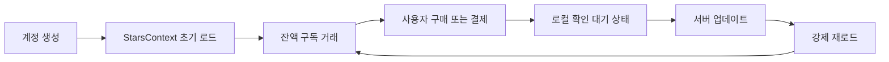
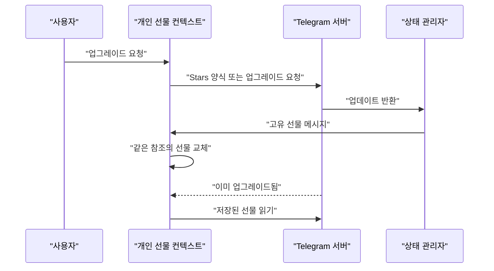
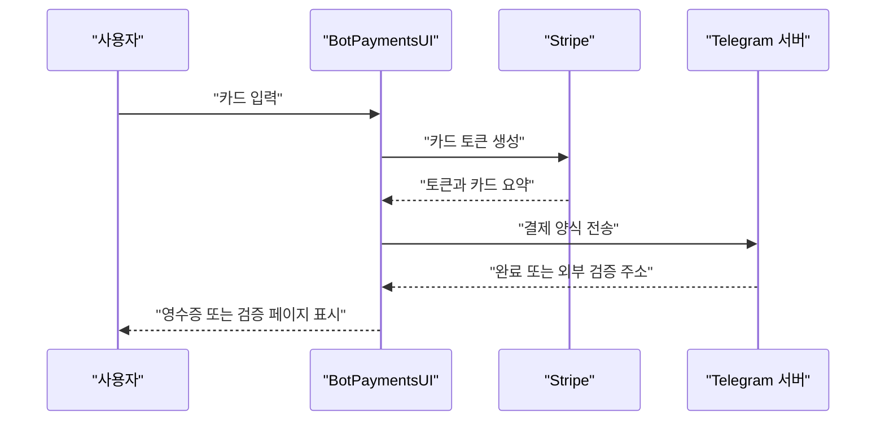

# Stars, 선물, 결제

웹: /docs/system/24-stars-payments/ · Markdown: /docs/system/24-stars-payments.md

> Telegram iOS와 macOS의 Stars 상태, 선물 모델, 봇 결제, StoreKit 영수증 귀속, 캐시 갱신 설계.

> 시스템 설계 · 비즈니스 시스템 · 24장 · 도표 4 · 코드 발췌 8 · 인용 31 · 소스 기준선: [TelegramMessenger/Telegram-iOS@f1dd7a2d](https://github.com/TelegramMessenger/Telegram-iOS/tree/f1dd7a2dbd02cbbf513e75d5695d8d36d1cf5838), [overtake/TelegramSwift@579cebbf](https://github.com/overtake/TelegramSwift/tree/579cebbf0c01fd41b712eff3647fa7f69db9665d)
>
> 핵심 소스 파일: [TelegramMessenger/Telegram-iOS/submodules/TelegramCore/Sources/TelegramEngine/Payments/Stars.swift](https://github.com/TelegramMessenger/Telegram-iOS/blob/f1dd7a2dbd02cbbf513e75d5695d8d36d1cf5838/submodules/TelegramCore/Sources/TelegramEngine/Payments/Stars.swift), [TelegramMessenger/Telegram-iOS/submodules/TelegramCore/Sources/TelegramEngine/Payments/StarGifts.swift](https://github.com/TelegramMessenger/Telegram-iOS/blob/f1dd7a2dbd02cbbf513e75d5695d8d36d1cf5838/submodules/TelegramCore/Sources/TelegramEngine/Payments/StarGifts.swift), [TelegramMessenger/Telegram-iOS/submodules/TelegramCore/Sources/TelegramEngine/Payments/AppStore.swift](https://github.com/TelegramMessenger/Telegram-iOS/blob/f1dd7a2dbd02cbbf513e75d5695d8d36d1cf5838/submodules/TelegramCore/Sources/TelegramEngine/Payments/AppStore.swift), [TelegramMessenger/Telegram-iOS/submodules/TelegramCore/Sources/TelegramEngine/Payments/TelegramEnginePayments.swift](https://github.com/TelegramMessenger/Telegram-iOS/blob/f1dd7a2dbd02cbbf513e75d5695d8d36d1cf5838/submodules/TelegramCore/Sources/TelegramEngine/Payments/TelegramEnginePayments.swift), [TelegramMessenger/Telegram-iOS/submodules/InAppPurchaseManager/Sources/InAppPurchaseManager.swift](https://github.com/TelegramMessenger/Telegram-iOS/blob/f1dd7a2dbd02cbbf513e75d5695d8d36d1cf5838/submodules/InAppPurchaseManager/Sources/InAppPurchaseManager.swift), [TelegramMessenger/Telegram-iOS/submodules/InAppPurchaseManager/Sources/Receipt.swift](https://github.com/TelegramMessenger/Telegram-iOS/blob/f1dd7a2dbd02cbbf513e75d5695d8d36d1cf5838/submodules/InAppPurchaseManager/Sources/Receipt.swift), [TelegramMessenger/Telegram-iOS/submodules/BotPaymentsUI/Sources/BotCheckoutNativeCardEntryControllerNode.swift](https://github.com/TelegramMessenger/Telegram-iOS/blob/f1dd7a2dbd02cbbf513e75d5695d8d36d1cf5838/submodules/BotPaymentsUI/Sources/BotCheckoutNativeCardEntryControllerNode.swift), [TelegramMessenger/Telegram-iOS/submodules/BotPaymentsUI/Sources/BotCheckoutControllerNode.swift](https://github.com/TelegramMessenger/Telegram-iOS/blob/f1dd7a2dbd02cbbf513e75d5695d8d36d1cf5838/submodules/BotPaymentsUI/Sources/BotCheckoutControllerNode.swift), [TelegramMessenger/Telegram-iOS/submodules/TelegramUI/Components/Stars/StarsPurchaseScreen/Sources/StarsPurchaseScreen.swift](https://github.com/TelegramMessenger/Telegram-iOS/blob/f1dd7a2dbd02cbbf513e75d5695d8d36d1cf5838/submodules/TelegramUI/Components/Stars/StarsPurchaseScreen/Sources/StarsPurchaseScreen.swift), [overtake/TelegramSwift/Telegram-Mac/AccountContext.swift](https://github.com/overtake/TelegramSwift/blob/579cebbf0c01fd41b712eff3647fa7f69db9665d/Telegram-Mac/AccountContext.swift), [overtake/TelegramSwift/Telegram-Mac/Star_ListScreen.swift](https://github.com/overtake/TelegramSwift/blob/579cebbf0c01fd41b712eff3647fa7f69db9665d/Telegram-Mac/Star_ListScreen.swift), [overtake/TelegramSwift/Telegram-Mac/PaymentsCheckoutController.swift](https://github.com/overtake/TelegramSwift/blob/579cebbf0c01fd41b712eff3647fa7f69db9665d/Telegram-Mac/PaymentsCheckoutController.swift), [overtake/TelegramSwift/Telegram-Mac/PaymentsPaymentMethodController.swift](https://github.com/overtake/TelegramSwift/blob/579cebbf0c01fd41b712eff3647fa7f69db9665d/Telegram-Mac/PaymentsPaymentMethodController.swift)
>
> 미검증 사항:
> - Telegram 서버가 Apple 영수증 서명을 어떻게 검증하고, 거래 식별자를 어떻게 중복 제거하며, 환불을 어떻게 처리하는지는 클라이언트 소스에 보이지 않아요.
> - assignAppStoreTransaction 귀속에 실패한 뒤 클라이언트가 StoreKit 거래를 완료하는 데 대한 서버 측 보상 정책은 클라이언트 소스에 보이지 않아요.
> - _internal_convertStarGift 실패 후 개인 선물 목록이 최종적으로 갱신되는 시점은, 현재 호출 지점이 즉시 갱신을 보장하지 않아요.
> - StarsContext의 2.5초 고정 재시도가 약한 네트워크에서 네트워크 계층의 통합 백오프 제어를 받는지는 더 낮은 계층의 네트워크 구현을 확인해야 해요.
> - macOS 릴리스 구성이 항상 APP_STORE를 정의하는지, 그리고 App Store 밖 배포에서 모든 Stars 상품을 쓸 수 있는지는 현재 소스로는 조건부 컴파일 분기만 확인할 수 있어요.

## 문제와 제약 [#문제와-제약]

Telegram은 자금과 관련된 동작 세 가지를 결제 도메인 하나에 둬요.

1. 법정 통화로 Premium이나 Stars를 구매해요.
2. Stars로 봇 청구서, 유료 미디어, 구독, 선물을 결제해요.
3. 이미 받은 선물을 관리해요. 표시, 전환, 재선물, 업그레이드, 재판매가 여기에 들어가요.

이 세 가지가 공통으로 겪는 난제는 비동기 확인이에요. App Store, 서드파티 결제 제공자, Telegram 서버가 확인하는 순서는 모두 다를 수 있어요.

이 장에서는 상태를 세 가지로 나눠 불러요.

- 권위 있는 상태: Telegram 서버가 돌려주는 잔액, 거래, 업데이트예요.
- 낙관적 상태: 클라이언트가 바로 렌더링하는 잔액, 임시 거래, 선물 목록 수정이에요.
- 디바이스 캐시: Postbox(앱의 로컬 저장소)나 ItemCache에 저장된 카탈로그와 개인 선물이에요.

셋은 서로 대신할 수 없어요. 클라이언트는 응답 속도를 높이려고 낙관적 상태를 쓸 뿐이고, 이후에는 반드시 권위 있는 상태로 수렴(최종적으로 일치)해야 해요.

소스 확인: `TelegramEngine.Payments`는 Stars 충전 옵션, 결제 양식, Stars 결제, App Store 영수증 귀속 등의 인터페이스를 제공해요. 이 인터페이스가 UI와 `TelegramCore`의 경계예요. [\[23\]](https://github.com/TelegramMessenger/Telegram-iOS/blob/f1dd7a2dbd02cbbf513e75d5695d8d36d1cf5838/submodules/TelegramCore/Sources/TelegramEngine/Payments/TelegramEnginePayments.swift#L68-L97)

이 장이 반복하지 않는 내용은 이래요.

- Postbox 트랜잭션과 인코딩의 일반 메커니즘: 앞선 장 「Postbox 스토리지」를 참고하세요.
- macOS 프로세스와 윈도우 계층: 「macOS 시스템 계층」을 참고하세요.

연구 기준선은 두 가지예요.

- Telegram iOS의 고정 커밋 `f1dd7a2dbd02cbbf513e75d5695d8d36d1cf5838`
- TelegramSwift의 고정 커밋 `579cebbf0c01fd41b712eff3647fa7f69db9665d`

본문에서 쓰는 두 표현의 뜻은 이래요.

- “소스 확인”: 이 체크아웃들에서의 동작만 설명해요.
- “추론”: 호출 관계에서 얻은 결론만 뜻해요.

## 모듈과 데이터 구조 [#모듈과-데이터-구조]

### Stars 금액, 옵션과 상태 컨텍스트 [#stars-금액-옵션과-상태-컨텍스트]

`StarsTopUpOption`은 다음을 함께 저장해요.

- Stars 수량
- 선택적 StoreKit 제품 식별자
- 법정 통화 코드
- 법정 통화 금액
- 확장 티어 표시

옵션 자체는 `payments.getStarsTopupOptions`에서 오니까 UI가 상품 티어를 클라이언트에 하드코딩하면 안 돼요. [\[1\]](https://github.com/TelegramMessenger/Telegram-iOS/blob/f1dd7a2dbd02cbbf513e75d5695d8d36d1cf5838/submodules/TelegramCore/Sources/TelegramEngine/Payments/Stars.swift#L9-L74)

금액은 두 타입으로 나타내요. `StarsAmount`는 정수 `value`와 나노 단위 `nanos`로 금액을 나타내요. `CurrencyAmount`는 다시 Stars와 TON을 구분해요. 이렇게 계층을 나눈 덕분에 같은 거래 목록에 두 가지 자산을 표시할 수 있어요. 다만 Stars 구매 화면은 그중 한 가지 자산만 골라요. [\[2\]](https://github.com/TelegramMessenger/Telegram-iOS/blob/f1dd7a2dbd02cbbf513e75d5695d8d36d1cf5838/submodules/TelegramCore/Sources/TelegramEngine/Payments/Stars.swift#L350-L553)

`StarsContext.State`는 계정 Stars 첫 화면의 메모리 스냅샷이에요. 잔액, 구독 배열, 거래 배열, 페이지 표시 두 개, 로딩 표시, `isPendingBalance`를 가져요. 거래와 구독에는 상태를 나타내는 플래그가 있어요.

- 거래: 환불, 임시, 로컬 확인 대기, 실패, 선물, 리액션, 업그레이드, 재판매, 경매, 유료 메시지 등
- 구독: 취소, 결제 보충 가능, 잔액 부족, 봇이 취소함 등 [\[3\]](https://github.com/TelegramMessenger/Telegram-iOS/blob/f1dd7a2dbd02cbbf513e75d5695d8d36d1cf5838/submodules/TelegramCore/Sources/TelegramEngine/Payments/Stars.swift#L787-L1078)

상태의 경계는 이래요. `StarsContext`는 현재 계정 또는 현재 TON 자산만 대상으로 하고, `QueueLocalObject`가 메인 큐에서 실행되도록 고정해요. 이 컨텍스트는 같은 `Promise`를 여러 화면에 발행해요. 그래서 거래 화면, 충전 화면, 채팅 안의 Stars 버튼이 각자 잔액을 요청하고 각자 사본을 유지하면 안 돼요.

따로 만든 컨텍스트는 역할이 제한돼요.

- 별도의 거래 컨텍스트: 페이지를 나눌 수 있지만 첫 페이지에서 공유 잔액을 덮어써요.
- 별도의 구독 컨텍스트: 잔액 부족으로 필터링할 수 있지만 공유 잔액을 대신하면 안 돼요.

이런 구성이면 화면이 필요한 만큼 더 많은 데이터를 불러오면서도, 모든 화면이 계정 원장에 쓰는 또 다른 주체가 되는 일은 막을 수 있어요. [\[3\]](https://github.com/TelegramMessenger/Telegram-iOS/blob/f1dd7a2dbd02cbbf513e75d5695d8d36d1cf5838/submodules/TelegramCore/Sources/TelegramEngine/Payments/Stars.swift#L787-L1078)[\[5\]](https://github.com/TelegramMessenger/Telegram-iOS/blob/f1dd7a2dbd02cbbf513e75d5695d8d36d1cf5838/submodules/TelegramCore/Sources/TelegramEngine/Payments/Stars.swift#L1298-L1331)[\[6\]](https://github.com/TelegramMessenger/Telegram-iOS/blob/f1dd7a2dbd02cbbf513e75d5695d8d36d1cf5838/submodules/TelegramCore/Sources/TelegramEngine/Payments/Stars.swift#L1459-L1536)

잔액 업데이트가 오는 곳은 결제 화면만이 아니에요. 상태 관리자는 Stars와 TON 잔액의 업데이트를 발행해요. `StarsContextImpl`은 이 업데이트를 받으면 이렇게 처리해요.

1. 기존 거래와 구독 배열은 유지하고 잔액만 바꿔요.
2. 바로 전체 상태를 가져와요.

추론: 메시지 업데이트, 선물 전환, 다른 디바이스에서의 소비 모두 이 경로를 따라 현재 화면을 수렴시킬 수 있어요. 이 설계는 잔액 갱신을 특정 UI의 수명 주기에 묶지 않아요. [\[4\]](https://github.com/TelegramMessenger/Telegram-iOS/blob/f1dd7a2dbd02cbbf513e75d5695d8d36d1cf5838/submodules/TelegramCore/Sources/TelegramEngine/Payments/Stars.swift#L557-L662)

```swift
private var previousLoadTimestamp: Double?
func load(force: Bool) {
    assert(Queue.mainQueue().isCurrent())
    
    let currentTimestamp = CFAbsoluteTimeGetCurrent()
    if let previousLoadTimestamp = self.previousLoadTimestamp, currentTimestamp - previousLoadTimestamp < 60 && !force {
        return
    }
    self.previousLoadTimestamp = currentTimestamp
    
    self.disposable.set((_internal_requestStarsState(account: self.account, peerId: self.peerId, ton: self.ton, mode: .all, subscriptionId: nil, offset: nil, limit: 5)
    |> deliverOnMainQueue).start(next: { [weak self] status in
        guard let self else {
            return
        }
        self.updateState(StarsContext.State(flags: [], balance: status.balance, subscriptions: status.subscriptions, canLoadMoreSubscriptions: status.nextSubscriptionsOffset != nil, transactions: status.transactions, canLoadMoreTransactions: status.nextTransactionsOffset != nil, isLoading: false))
    }, error: { [weak self] _ in
        guard let self else {
            return
        }
        Queue.mainQueue().after(2.5, {
            self.load(force: true)
        })
    }))
}
```
[\[4\]](https://github.com/TelegramMessenger/Telegram-iOS/blob/f1dd7a2dbd02cbbf513e75d5695d8d36d1cf5838/submodules/TelegramCore/Sources/TelegramEngine/Payments/Stars.swift#L557-L662)

`StarsContextImpl`은 메인 큐에서 만들어지자마자 강제로 로드해요. 동시에 계정 상태 관리자가 발행하는 Stars 또는 TON 잔액 업데이트를 구독해요. 업데이트를 받으면 새 잔액을 먼저 쓰고, 이어서 전체 상태를 강제로 요청해요. 로드 규칙은 이래요.

- 일반 `load`: 마지막으로 로드한 뒤 60초 이내의 요청을 중복 제거해요.
- 실패하면: 2.5초 뒤에 강제로 재시도해요.
- 첫 화면: 거래를 5건만 요청해서 잔액 화면의 초기 네트워크 비용을 통제해요. [\[4\]](https://github.com/TelegramMessenger/Telegram-iOS/blob/f1dd7a2dbd02cbbf513e75d5695d8d36d1cf5838/submodules/TelegramCore/Sources/TelegramEngine/Payments/Stars.swift#L557-L662)

```swift
func add(balance: StarsAmount, addTransaction: Bool) {
    guard let state = self._state else {
        return
    }
    var transactions = state.transactions
    if addTransaction {
        let count =  CurrencyAmount(amount: balance, currency: self.ton ? .ton : .stars)
        transactions.insert(.init(flags: [.isLocal], id: "\(arc4random())", count: count, date: Int32(Date().timeIntervalSince1970), peer: .appStore, title: nil, description: nil, photo: nil, transactionDate: nil, transactionUrl: nil, paidMessageId: nil, giveawayMessageId: nil, media: [], subscriptionPeriod: nil, starGift: nil, floodskipNumber: nil, starrefCommissionPermille: nil, starrefPeerId: nil, starrefAmount: nil, paidMessageCount: nil, premiumGiftMonths: nil, adsProceedsFromDate: nil, adsProceedsToDate: nil), at: 0)
    }
    self.updateState(StarsContext.State(flags: [.isPendingBalance], balance: max(StarsAmount(value: 0, nanos: 0), state.balance + balance), subscriptions: state.subscriptions, canLoadMoreSubscriptions: state.canLoadMoreSubscriptions, transactions: transactions, canLoadMoreTransactions: state.canLoadMoreTransactions, isLoading: state.isLoading))
}
```
[\[4\]](https://github.com/TelegramMessenger/Telegram-iOS/blob/f1dd7a2dbd02cbbf513e75d5695d8d36d1cf5838/submodules/TelegramCore/Sources/TelegramEngine/Payments/Stars.swift#L557-L662)

위 코드는 낙관적 업데이트의 정확한 경계를 보여 줘요.

- `add`: 이미 있는 상태에서만 동작해요. `.isLocal`이 붙은 무작위 식별자의 거래를 삽입하고, 잔액이 음수가 되지 않게 제한해요.
- `onUpdate`: `isPendingBalance`가 사라질 때까지 기다려요.

그래서 호출하는 쪽은 로컬 가산을 정산 성공으로 보는 대신, 네트워크 갱신 이후에 안정된 상태를 기다릴 수 있어요. [\[4\]](https://github.com/TelegramMessenger/Telegram-iOS/blob/f1dd7a2dbd02cbbf513e75d5695d8d36d1cf5838/submodules/TelegramCore/Sources/TelegramEngine/Payments/Stars.swift#L557-L662)

거래 상세 화면은 별도로 `StarsTransactionsContext`를 만들어요. 페이지 크기는 첫 페이지 요청이 25건, 이후 요청이 50건이에요. `isLoading`이 거짓이고 서버가 여전히 `nextOffset`을 줄 때만 다음 페이지를 계속 불러와요. 전체 모드의 첫 페이지는 공유 `StarsContext`의 잔액과 거래도 덮어써요. 덕분에 상세 화면과 잔액 화면이 다시 일치해요. [\[5\]](https://github.com/TelegramMessenger/Telegram-iOS/blob/f1dd7a2dbd02cbbf513e75d5695d8d36d1cf5838/submodules/TelegramCore/Sources/TelegramEngine/Payments/Stars.swift#L1298-L1331)

구독 목록은 독립된 `StarsSubscriptionsContext`를 써요.

- `nextSubscriptionsOffset`에 따라 페이지를 추가해요.
- 취소 표시를 로컬에서 먼저 바꾼 뒤 `changeStarsSubscription`을 호출하는 것도 지원해요. 이 동작에는 롤백 분기가 없어요. 추론: 이후의 강제 갱신이 네트워크 실패나 서버 거부를 바로잡는 메커니즘이에요.
- 구독의 일반 갱신도 60초 억제를 쓰지만 호출하는 쪽이 이를 우회할 수 있어요. [\[6\]](https://github.com/TelegramMessenger/Telegram-iOS/blob/f1dd7a2dbd02cbbf513e75d5695d8d36d1cf5838/submodules/TelegramCore/Sources/TelegramEngine/Payments/Stars.swift#L1459-L1536)

페이지를 나눌 때 재진입(로드 중에 또 로드가 시작되는 일)을 제어하는 데에도 비즈니스상의 의미가 있어요.

- 거래와 구독 컨텍스트는 모두 먼저 `isLoading`을 설정하고 서버 응답이 온 뒤에야 해제해요.
- 스크롤 뷰가 연달아 로드를 일으켜도 `MetaDisposable`은 현재 요청만 유지해요.
- 응답에 쓸 수 있는 오프셋이 없으면 `canLoadMore`가 거짓이 돼요.
- 네트워크 오류 경로는 대부분 빈 값이나 범용 실패로 매핑되고, 기존 페이지를 비우지는 않아요.

그래서 UI는 빈 결과를 “당분간 신뢰할 만한 새 페이지가 없다”로 해석해야 해요. 이를 근거로 사용자에게 거래나 구독이 없다고 결론 내리면 안 돼요. [\[5\]](https://github.com/TelegramMessenger/Telegram-iOS/blob/f1dd7a2dbd02cbbf513e75d5695d8d36d1cf5838/submodules/TelegramCore/Sources/TelegramEngine/Payments/Stars.swift#L1298-L1331)[\[6\]](https://github.com/TelegramMessenger/Telegram-iOS/blob/f1dd7a2dbd02cbbf513e75d5695d8d36d1cf5838/submodules/TelegramCore/Sources/TelegramEngine/Payments/Stars.swift#L1459-L1536)



위 도표는 로컬 잔액을 정산 증빙으로 취급하지 않아요. UI 쪽에서 로컬 잔액은 짧은 과도기예요. 비즈니스 쪽에서는 `payments.getStarsStatus`의 결과와 업데이트가 최종 원장 뷰예요. [\[2\]](https://github.com/TelegramMessenger/Telegram-iOS/blob/f1dd7a2dbd02cbbf513e75d5695d8d36d1cf5838/submodules/TelegramCore/Sources/TelegramEngine/Payments/Stars.swift#L350-L553)[\[4\]](https://github.com/TelegramMessenger/Telegram-iOS/blob/f1dd7a2dbd02cbbf513e75d5695d8d36d1cf5838/submodules/TelegramCore/Sources/TelegramEngine/Payments/Stars.swift#L557-L662)

### 일반 선물, 업그레이드 가능 선물, 저장된 선물 [#일반-선물-업그레이드-가능-선물-저장된-선물]

`StarGift`는 이원 유니온(두 형태 중 하나)이에요.

- `generic`: 카탈로그에서 선물 식별자별로 판매되는 일반 선물이에요.
- `unique`: 인스턴스 식별자와 소유자를 가진 고유 선물이에요.

일반 선물은 다음을 기록해요.

- 애니메이션 파일
- 가격
- 전환 가능한 Stars
- 남은 수량
- 품절 시각
- 업그레이드 가격
- 사용자별 한도
- 잠금 시간
- 경매 매개변수
- 배경색

플래그는 생일 선물, Premium 제한, 사용자 이름 색상으로 쓸 수 있는지 여부, 경매도 나타내요. [\[8\]](https://github.com/TelegramMessenger/Telegram-iOS/blob/f1dd7a2dbd02cbbf513e75d5695d8d36d1cf5838/submodules/TelegramCore/Sources/TelegramEngine/Payments/StarGifts.swift#L7-L260)

```swift
public enum StarGift: Equatable, Codable, PostboxCoding {
    enum CodingKeys: String, CodingKey {
        case type
        case value
    }
    
    public struct Gift: Equatable, Codable, PostboxCoding {
        public struct Flags: OptionSet {
            public var rawValue: Int32
            
            public init(rawValue: Int32) {
                self.rawValue = rawValue
            }
            
            public static let isBirthdayGift = Flags(rawValue: 1 << 0)
            public static let requiresPremium = Flags(rawValue: 1 << 1)
            public static let peerColorAvailable = Flags(rawValue: 1 << 2)
            public static let isAuction = Flags(rawValue: 1 << 3)
        }
```
[\[8\]](https://github.com/TelegramMessenger/Telegram-iOS/blob/f1dd7a2dbd02cbbf513e75d5695d8d36d1cf5838/submodules/TelegramCore/Sources/TelegramEngine/Payments/StarGifts.swift#L7-L260)

고유 선물의 신원은 일반 선물 식별자가 아니에요. 고유 선물은 다음을 가져요.

- 인스턴스 `id`
- 모체 `giftId`(바탕이 된 일반 선물의 식별자)
- 일련번호
- `slug`
- 소유자
- 모델과 패턴 등의 속성
- 발행량
- 선물 주소
- 재판매 가격
- TON 전용 판매 표시
- 테마와 아바타 색상
- 최저 제안가
- 합성 기회

일반 선물을 전환하거나 업그레이드하면 이런 인스턴스가 생길 수 있어요. 자산 속성이 들어 있어서 일반 `giftId`만으로는 소유권을 나타낼 수 없어요. [\[9\]](https://github.com/TelegramMessenger/Telegram-iOS/blob/f1dd7a2dbd02cbbf513e75d5695d8d36d1cf5838/submodules/TelegramCore/Sources/TelegramEngine/Payments/StarGifts.swift#L755-L833)

프로필에 표시되는 `ProfileGiftsContext.State.StarGift`는 자산 객체 외에 다음을 더해요.

- 메시지 또는 저장 식별자
- 선물한 사람
- 텍스트
- 익명 표시
- 표시 여부
- 고정 상태
- 전환 가능 금액
- 업그레이드 가능성
- 양도와 재판매 시각
- 컬렉션
- 환불
- 합성 가능 시각

`StarGiftReference`는 작업 대상의 안정적인 주소예요. 메시지 식별자, 대화 안의 저장 식별자, 또는 `slug`가 될 수 있어요. 참조는 API 입력으로 변환할 때 Postbox를 다시 조회해 `InputPeer`를 얻어요. 그래서 영속 객체 안에는 액세스 해시를 저장하지 않아요. [\[14\]](https://github.com/TelegramMessenger/Telegram-iOS/blob/f1dd7a2dbd02cbbf513e75d5695d8d36d1cf5838/submodules/TelegramCore/Sources/TelegramEngine/Payments/StarGifts.swift#L2351-L2589)[\[15\]](https://github.com/TelegramMessenger/Telegram-iOS/blob/f1dd7a2dbd02cbbf513e75d5695d8d36d1cf5838/submodules/TelegramCore/Sources/TelegramEngine/Payments/StarGifts.swift#L3727-L3903)

### 3계층 선물 캐시 [#3계층-선물-캐시]

선물 캐시는 세 계층이에요. 첫 번째는 전역 선물 카탈로그, 두 번째는 개인 선물, 세 번째는 업그레이드 미리보기 속성이에요.

선물 카탈로그의 캐시 키는 `PreferencesKeys.starGifts`예요. 캐시 객체 `StarGiftsList`는 선물 배열과 서버 해시를 저장해요. 갱신 흐름은 이래요.

1. 백그라운드 폴링이 현재 해시를 `payments.getStarGifts`에 전달해요.
2. 서버가 변경 없음을 돌려주면 데이터베이스에 쓰지 않아요.
3. 새 카탈로그가 돌아오면 클라이언트는 같은 Postbox 트랜잭션 안에서 사용자와 그룹 엔티티를 갱신하고 환경설정 항목을 교체해요.

폴링은 한 시간마다 실행되고, 일시 중단을 인지하는 지연을 써요. [\[11\]](https://github.com/TelegramMessenger/Telegram-iOS/blob/f1dd7a2dbd02cbbf513e75d5695d8d36d1cf5838/submodules/TelegramCore/Sources/TelegramEngine/Payments/StarGifts.swift#L1345-L1396)

```swift
func managedStarGiftsUpdates(postbox: Postbox, network: Network, accountPeerId: EnginePeer.Id) -> Signal<Never, NoError> {
    let poll = _internal_keepCachedStarGiftsUpdated(postbox: postbox, network: network, accountPeerId: accountPeerId)
    return (poll |> then(.complete() |> suspendAwareDelay(1.0 * 60.0 * 60.0, queue: Queue.concurrentDefaultQueue()))) |> restart
}
```
[\[11\]](https://github.com/TelegramMessenger/Telegram-iOS/blob/f1dd7a2dbd02cbbf513e75d5695d8d36d1cf5838/submodules/TelegramCore/Sources/TelegramEngine/Payments/StarGifts.swift#L1345-L1396)

개인 선물은 두 번째 계층의 영속 캐시예요. 캐시 키는 `peerId`에 선택적 컬렉션 식별자를 더해 구성하고, 값에는 선물 배열, 총 개수, 알림 스위치가 들어 있어요. 처음 기본 필터로 로드할 때는 이렇게 해요.

1. 먼저 캐시를 읽고, 그 안에 있는 선물한 사람의 엔티티 참조를 보완한 뒤 바로 UI에 발행해요.
2. 동시에 `payments.getSavedStarGifts` 요청도 시작해요.
3. 네트워크 첫 페이지가 돌아오면 메모리 배열을 교체하고 캐시를 덮어써요.

이후 페이지는 메모리 데이터에만 추가해요. [\[13\]](https://github.com/TelegramMessenger/Telegram-iOS/blob/f1dd7a2dbd02cbbf513e75d5695d8d36d1cf5838/submodules/TelegramCore/Sources/TelegramEngine/Payments/StarGifts.swift#L1866-L2161)

캐시를 먼저 보여 주고 네트워크로 교체하는 이 전략에는 효과가 두 가지 있어요.

- 오프라인이거나 느린 네트워크에서도 사용자가 지난번의 선물을 볼 수 있어요.
- 카탈로그에서 재판매, 숨김, 양도가 일어난 뒤에도 캐시가 오랫동안 권위 있는 상태 행세를 하지 않아요.

필터링이나 가치순 정렬은 별도의 배열과 페이지 분할 상태를 쓰니까, 기본이 아닌 정렬이 기본 캐시에 되써지지 않아요. [\[13\]](https://github.com/TelegramMessenger/Telegram-iOS/blob/f1dd7a2dbd02cbbf513e75d5695d8d36d1cf5838/submodules/TelegramCore/Sources/TelegramEngine/Payments/StarGifts.swift#L1866-L2161)

업그레이드 미리보기 속성은 세 번째 전략을 써요. ItemCache에 이미 속성이 있으면 함수는 먼저 캐시 값을 내보낸 뒤 원격을 요청하고 새 값을 되써요. 이 패턴은 시각적 미리보기에 알맞아요. 잠깐 오래된 속성을 보여 줘도 결제 대상이 바뀌지 않기 때문이에요. 잔액이나 결제 결과에는 알맞지 않아요. [\[13\]](https://github.com/TelegramMessenger/Telegram-iOS/blob/f1dd7a2dbd02cbbf513e75d5695d8d36d1cf5838/submodules/TelegramCore/Sources/TelegramEngine/Payments/StarGifts.swift#L1866-L2161)

## 핵심 흐름 [#핵심-흐름]

### Stars 결제와 구독 [#stars-결제와-구독]

Stars 결제는 이 순서로 해요.

1. `BotPaymentInvoiceSource`에서 `InputInvoice`를 해석해요.
2. `payments.sendStarsForm`을 호출해요.
3. 성공 응답의 업데이트를 바로 `stateManager`에 투입해요.
4. 코드는 업데이트 메시지에서 영수증 메시지를 찾아내거나 고유 선물이 담긴 액션을 찾아내서 `uniqueStarGift`를 상위로 돌려줘요.

서버가 외부 검증을 요구하면 함수는 검증 URL을 반환하고, 로컬 성공을 위조하지 않아요. [\[7\]](https://github.com/TelegramMessenger/Telegram-iOS/blob/f1dd7a2dbd02cbbf513e75d5695d8d36d1cf5838/submodules/TelegramCore/Sources/TelegramEngine/Payments/Stars.swift#L1595-L1722)

```swift
func _internal_sendStarsPaymentForm(account: Account, formId: Int64, source: BotPaymentInvoiceSource) -> Signal<SendBotPaymentResult, SendBotPaymentFormError> {
    return account.postbox.transaction { transaction -> Api.InputInvoice? in
        return _internal_parseInputInvoice(transaction: transaction, source: source)
    }
    |> castError(SendBotPaymentFormError.self)
    |> mapToSignal { invoice -> Signal<SendBotPaymentResult, SendBotPaymentFormError> in
        guard let invoice = invoice else {
            return .fail(.generic)
        }
        return account.network.request(Api.functions.payments.sendStarsForm(formId: formId, invoice: invoice))
        |> map { result -> SendBotPaymentResult in
            switch result {
                case let .paymentResult(paymentResultData):
                    let updates = paymentResultData.updates
                    account.stateManager.addUpdates(updates)
```
[\[7\]](https://github.com/TelegramMessenger/Telegram-iOS/blob/f1dd7a2dbd02cbbf513e75d5695d8d36d1cf5838/submodules/TelegramCore/Sources/TelegramEngine/Payments/Stars.swift#L1595-L1722)

결제한 뒤에는 앞서 설명한 낙관적 거래에 기대지 말고 잔액과 구독을 강제로 로드해야 해요. macOS의 Stars 결제 윈도우가 바로 이렇게 호출해요.

- 잔액이 부족하면 충전 화면을 열어요.
- 잔액이 충분하면 Stars 양식을 보내요.
- 성공하면 `starsContext.load(force: true)`와 `starsSubscriptionsContext.load(force: true)`를 호출해요. [\[27\]](https://github.com/overtake/TelegramSwift/blob/579cebbf0c01fd41b712eff3647fa7f69db9665d/Telegram-Mac/AccountContext.swift#L693-L724)

오류를 매핑하는 것도 비즈니스 의미의 일부예요. Stars 양식은 다음 경우를 각각 매핑해요.

- 사전 점검 실패
- 결제 실패
- 이미 결제됨
- 미디어 이미 결제됨
- 재고 부족
- 사용자 구매 상한
- 이미 업그레이드됨

덕분에 UI는 사용자에게 재시도, 중복 결제 중단, 다른 선물 선택을 안내할 수 있어요. 일반 네트워크 오류는 범용 오류로만 매핑돼요. [\[7\]](https://github.com/TelegramMessenger/Telegram-iOS/blob/f1dd7a2dbd02cbbf513e75d5695d8d36d1cf5838/submodules/TelegramCore/Sources/TelegramEngine/Payments/Stars.swift#L1595-L1722)

### 일반 선물에서 고유 선물로 [#일반-선물에서-고유-선물로]

업그레이드에는 입력 경로가 두 가지 있어요.

- 상위 계층이 이미 결제 양식 식별자를 얻었다면: `_internal_upgradeStarGift`가 `.starGiftUpgrade` 청구서 소스를 만들어 Stars 결제를 거쳐요.
- 양식 식별자가 없으면: `payments.upgradeStarGift`를 직접 호출해요.

두 경로 모두 업데이트에서 새 고유 선물을 뽑아내야 해요. [\[12\]](https://github.com/TelegramMessenger/Telegram-iOS/blob/f1dd7a2dbd02cbbf513e75d5695d8d36d1cf5838/submodules/TelegramCore/Sources/TelegramEngine/Payments/StarGifts.swift#L1647-L1779)

서버가 `STARGIFT_ALREADY_UPGRADED`로 답하면 함수는 곧바로 실패를 보고하지 않아요. 원래 참조로 `getSavedStarGift`를 호출하고, 반환된 저장 선물에서 고유 인스턴스를 찾아요. 이렇게 보충해서 읽으면 다음 경합 상태를 처리할 수 있어요.

- 중복 클릭
- 타임아웃 뒤 재시도
- 다른 디바이스에서 이미 업그레이드를 마친 경우 [\[12\]](https://github.com/TelegramMessenger/Telegram-iOS/blob/f1dd7a2dbd02cbbf513e75d5695d8d36d1cf5838/submodules/TelegramCore/Sources/TelegramEngine/Payments/StarGifts.swift#L1647-L1779)



일반 선물을 Stars로 전환하는 경로는 비교적 단순해요. 컨텍스트가 먼저 `convertStarGift`를 요청한 뒤 메모리 목록에서 선물을 삭제하고 개수를 줄여요. 여기서는 낙관적으로 삭제해요. 네트워크 함수는 결과를 완료 또는 빈 완료로 매핑하고, 호출하는 쪽에 오류를 구분해 보고하지 않아요. 추론: 화면은 반환 시점이나 다음 로드 시점에 계정 잔액과 개인 선물 갱신에 기대어 최종 보정을 해야 해요. [\[14\]](https://github.com/TelegramMessenger/Telegram-iOS/blob/f1dd7a2dbd02cbbf513e75d5695d8d36d1cf5838/submodules/TelegramCore/Sources/TelegramEngine/Payments/StarGifts.swift#L2351-L2589)

재판매 선물을 구매할 때 컨텍스트는 먼저 주 배열과 필터 배열에서 같은 `slug`의 현재 Stars 호가(판매 희망 가격)를 찾아요. 호출이 끝나면 그 항목을 삭제하고 개수를 줄여요. 이렇게 국소적으로 처리하면 사용자가 현재 윈도우에서 같은 인스턴스를 다시 구매하는 걸 막을 수 있어요. 그래도 호가가 바뀌지 않았다는 보장은 못 해요. 그래서 서버의 구매 결과가 유일한 승인 지점이에요. [\[14\]](https://github.com/TelegramMessenger/Telegram-iOS/blob/f1dd7a2dbd02cbbf513e75d5695d8d36d1cf5838/submodules/TelegramCore/Sources/TelegramEngine/Payments/StarGifts.swift#L2351-L2589)

### 봇 결제, BotPaymentsUI와 Stripe [#봇-결제-botpaymentsui와-stripe]

전통적인 봇 청구서는 Stars 잔액으로 정산하지 않아요. iOS의 `BotCheckoutController`는 이 순서로 처리해요.

1. 먼저 `BotPaymentForm`을 가져와서 연락처, 배송, 저장된 자격 증명, 결제 수단을 보여 줘요.
2. 결제할 때는 양식 식별자, 검증된 정보 식별자, 배송 옵션, 팁, `BotPaymentCredentials`를 전달해요.
3. 성공 분기는 영수증을 처리해요. 외부 검증 분기는 검증 페이지를 열고 콜백을 기다려요. [\[25\]](https://github.com/TelegramMessenger/Telegram-iOS/blob/f1dd7a2dbd02cbbf513e75d5695d8d36d1cf5838/submodules/BotPaymentsUI/Sources/BotCheckoutControllerNode.swift#L1514-L1540)

Stripe가 하는 일은 카드 번호 정보를 단기 토큰으로 바꾸는 거예요. BotPaymentsUI는 이 순서로 일해요.

1. 서버 양식 속 공개 가능 키(publishable key)로 `STPAPIClient`를 만들어요.
2. 카드 번호, CVC, 유효 기간, 카드 소유자, 국가, 우편번호를 `STPCardParams`에 넣고 `createToken`을 호출해요.
3. 반환되면 브랜드, 끝 네 자리, 토큰 식별자만 `BotCheckoutPaymentWebToken`으로 감싸요.

카드 번호는 Telegram의 결제 자격 증명 문자열에 들어가지 않아요. [\[24\]](https://github.com/TelegramMessenger/Telegram-iOS/blob/f1dd7a2dbd02cbbf513e75d5695d8d36d1cf5838/submodules/BotPaymentsUI/Sources/BotCheckoutNativeCardEntryControllerNode.swift#L260-L322)

양식의 다른 필드도 로컬에서 추측하지 않아요.

- 결제 엔진은 먼저 청구서의 저장된 요청 정보를 읽어요.
- 청구서가 이름, 전화번호, 이메일, 배송지를 요구하면 UI는 사용자 입력을 `validateBotPaymentForm`에 넘겨요.
- 서버가 반환한 검증 식별자와 배송 옵션은 최종 제출할 때까지 유지돼요.

결제 버튼은 다음 중 하나라도 해당하면 바로 결제하지 않아요.

- 배송 방식을 고르지 않았어요.
- 결제 수단을 고르지 않았어요.
- 정기 결제 약관에 동의하지 않았어요.

그래서 카드 토큰화가 성공했다고 청구서가 정산 조건을 갖춘 건 아니에요. [\[23\]](https://github.com/TelegramMessenger/Telegram-iOS/blob/f1dd7a2dbd02cbbf513e75d5695d8d36d1cf5838/submodules/TelegramCore/Sources/TelegramEngine/Payments/TelegramEnginePayments.swift#L68-L97)[\[25\]](https://github.com/TelegramMessenger/Telegram-iOS/blob/f1dd7a2dbd02cbbf513e75d5695d8d36d1cf5838/submodules/BotPaymentsUI/Sources/BotCheckoutControllerNode.swift#L1514-L1540)

자격 증명을 저장할 때 클라이언트는 대상을 두 가지로 구분해요.

- 저장된 카드: 서버에 저장된 자격 증명 식별자만 담고, 결제할 때는 단기 2단계 비밀번호 토큰도 필요해요.
- 새 카드나 웹 토큰: `saveOnServer`를 붙일 수 있어요. 하지만 저장을 허용할지는 결제 양식의 `canSaveCredentials`와 비밀번호 상태에 따라 달라요.

결제하기 전에는 봇과 결제 제공자의 책임 고지도 표시하고, 사용자의 확인을 앱 전용 알림에 기록해요. 이 기록은 사용자가 위험 고지를 봤다는 것만 의미해요. 결제 승인이나 카드 유효성을 대신하지 않아요. [\[25\]](https://github.com/TelegramMessenger/Telegram-iOS/blob/f1dd7a2dbd02cbbf513e75d5695d8d36d1cf5838/submodules/BotPaymentsUI/Sources/BotCheckoutControllerNode.swift#L1514-L1540)[\[31\]](https://github.com/overtake/TelegramSwift/blob/579cebbf0c01fd41b712eff3647fa7f69db9665d/Telegram-Mac/PaymentsCheckoutController.swift#L540-L657)

```swift
let createToken: Signal<STPToken, Error> = Signal { subscriber in
    apiClient.createToken(withCard: card, completion: { token, error in
        if let error = error {
            subscriber.putError(error)
        } else if let token = token {
            subscriber.putNext(token)
            subscriber.putCompletion()
        }
    })

    return ActionDisposable {
        let _ = apiClient.publishableKey
    }
}

self.isVerifying = true
self.verifyDisposable.set((createToken |> deliverOnMainQueue).start(next: { [weak self] token in
    if let strongSelf = self, let card = token.card {
        let last4 = card.last4()
        let brand = STPAPIClient.string(with: card.brand)
        strongSelf.completion(.webToken(BotCheckoutPaymentWebToken(title: "\(brand)*\(last4)", data: "{\"type\": \"card\", \"id\": \"\(token.tokenId)\"}", saveOnServer: strongSelf.saveInfoItem.isOn)))
    }
```
[\[24\]](https://github.com/TelegramMessenger/Telegram-iOS/blob/f1dd7a2dbd02cbbf513e75d5695d8d36d1cf5838/submodules/BotPaymentsUI/Sources/BotCheckoutNativeCardEntryControllerNode.swift#L260-L322)

Apple Pay도 같은 컨트롤러에서 Stripe 토큰화를 거친 뒤 같은 범용 자격 증명으로 감쌀 수 있어요. 서드파티 웹 방식은 결제 화면에 `webToken`을 돌려줘요. 그래서 TelegramCore는 특정 카드 SDK의 객체 타입에 의존하지 않아요. 이미 토큰화된 `BotPaymentCredentials`만 받아요. [\[24\]](https://github.com/TelegramMessenger/Telegram-iOS/blob/f1dd7a2dbd02cbbf513e75d5695d8d36d1cf5838/submodules/BotPaymentsUI/Sources/BotCheckoutNativeCardEntryControllerNode.swift#L260-L322)[\[25\]](https://github.com/TelegramMessenger/Telegram-iOS/blob/f1dd7a2dbd02cbbf513e75d5695d8d36d1cf5838/submodules/BotPaymentsUI/Sources/BotCheckoutControllerNode.swift#L1514-L1540)



토큰화와 결제 코어를 나눈 이런 추상화를 보면 Stars 결제와 전통적인 카드 결제를 합치면 안 되는 이유도 알 수 있어요.

- Stars 흐름: `sendStarsForm`을 직접 보내고 Stars 원장 업데이트로 수렴해요.
- 전통적인 청구서 흐름: 주소, 배송, 안내 약관, 카드 저장, 2단계 비밀번호, 외부 검증이 있을 수 있어요.

두 흐름은 청구서 소스를 공유하지만 최종 자격 증명은 공유할 수 없어요. [\[7\]](https://github.com/TelegramMessenger/Telegram-iOS/blob/f1dd7a2dbd02cbbf513e75d5695d8d36d1cf5838/submodules/TelegramCore/Sources/TelegramEngine/Payments/Stars.swift#L1595-L1722)[\[23\]](https://github.com/TelegramMessenger/Telegram-iOS/blob/f1dd7a2dbd02cbbf513e75d5695d8d36d1cf5838/submodules/TelegramCore/Sources/TelegramEngine/Payments/TelegramEnginePayments.swift#L68-L97)[\[25\]](https://github.com/TelegramMessenger/Telegram-iOS/blob/f1dd7a2dbd02cbbf513e75d5695d8d36d1cf5838/submodules/BotPaymentsUI/Sources/BotCheckoutControllerNode.swift#L1514-L1540)

### StoreKit의 Premium과 Stars 경로 [#storekit의-premium과-stars-경로]

`InAppPurchaseManager`의 제품 화이트리스트(허용 상품 목록)에는 Premium 구독, Premium 기프트 코드, 여러 Stars 충전 티어가 함께 들어 있어요. 제품 요청은 이렇게 동작해요.

- 30초 타임아웃이 있어요.
- 타임아웃이나 실패 뒤 10초 후에 재시도해요.

쓸 수 있는 상품 목록은 로컬 StoreKit 상품 카탈로그로만 쓰여요. Stars의 가격과 수량은 여전히 Telegram이 반환한 충전 옵션과 짝지어야 해요. [\[16\]](https://github.com/TelegramMessenger/Telegram-iOS/blob/f1dd7a2dbd02cbbf513e75d5695d8d36d1cf5838/submodules/InAppPurchaseManager/Sources/InAppPurchaseManager.swift#L1-L53)[\[1\]](https://github.com/TelegramMessenger/Telegram-iOS/blob/f1dd7a2dbd02cbbf513e75d5695d8d36d1cf5838/submodules/TelegramCore/Sources/TelegramEngine/Payments/Stars.swift#L9-L74)

구매를 시작하기 전에 관리자는 용도(이 구매가 Telegram에서 무엇을 위한 것인지)를 대기 중 구매 캐시에 기록해요. 용도에는 다음 같은 비즈니스 정보가 유지돼요.

- Premium 구독
- 업그레이드
- 기프트
- 추첨
- Stars
- Stars 선물
- Stars 추첨

안정적으로 해시한 제품 식별자를 ItemCache 키로 써요. 그래서 앱을 다시 시작하거나, 인증 상태가 바뀌거나, StoreKit 콜백이 늦게 와도 클라이언트는 거래를 올바른 Telegram 목적에 귀속시킬 수 있어요. [\[17\]](https://github.com/TelegramMessenger/Telegram-iOS/blob/f1dd7a2dbd02cbbf513e75d5695d8d36d1cf5838/submodules/InAppPurchaseManager/Sources/InAppPurchaseManager.swift#L350-L568)[\[19\]](https://github.com/TelegramMessenger/Telegram-iOS/blob/f1dd7a2dbd02cbbf513e75d5695d8d36d1cf5838/submodules/InAppPurchaseManager/Sources/InAppPurchaseManager.swift#L895-L1200)

`SKPaymentTransactionObserver`가 구매 완료된 거래를 받으면 관리자는 이 순서로 처리해요.

1. App Store 영수증 바이트를 읽어요.
2. 먼저 메모리의 결제 컨텍스트에서 용도를 복원해요. 메모리에 없으면 대기 중 캐시에서 용도를 복원해요.
3. `sendAppStoreReceipt`를 호출해요.

결과에 따라 이렇게 마무리해요.

- 성공했을 때만: StoreKit 거래를 완료하고, 대기 중 상태를 지우고, 결제 컨텍스트를 제거해요.
- 귀속에 실패하면: `assignFailed`를 보고하고, 캐시를 지우고, StoreKit 거래를 완료해요. [\[18\]](https://github.com/TelegramMessenger/Telegram-iOS/blob/f1dd7a2dbd02cbbf513e75d5695d8d36d1cf5838/submodules/InAppPurchaseManager/Sources/InAppPurchaseManager.swift#L623-L827)[\[19\]](https://github.com/TelegramMessenger/Telegram-iOS/blob/f1dd7a2dbd02cbbf513e75d5695d8d36d1cf5838/submodules/InAppPurchaseManager/Sources/InAppPurchaseManager.swift#L895-L1200)

복원 경로는 새 구매와 달라요. `restoreCompletedTransactions`가 끝나면 관리자는 현재 앱 영수증을 다시 읽어 `.restore` 용도로 Telegram에 보내요. 복원된 거래 하나하나에서 개별적으로 Stars 용도를 구성하지는 않아요.

Stars는 소모형 상품(쓰면 없어지는 상품)이에요. 그래서 추론하면 복원 경로는 주로 Premium 구독이나 복원할 수 있는 권익을 위한 거예요. 이미 소모된 Stars를 다시 부여하기 위한 게 아니에요. 이 판단은 클라이언트가 복원 영수증에 `.restore`를 일괄 쓰는 코드에서 나온 거예요. 서버 규칙을 대신할 수 없어요. [\[18\]](https://github.com/TelegramMessenger/Telegram-iOS/blob/f1dd7a2dbd02cbbf513e75d5695d8d36d1cf5838/submodules/InAppPurchaseManager/Sources/InAppPurchaseManager.swift#L623-L827)[\[21\]](https://github.com/TelegramMessenger/Telegram-iOS/blob/f1dd7a2dbd02cbbf513e75d5695d8d36d1cf5838/submodules/TelegramCore/Sources/TelegramEngine/Payments/AppStore.swift#L13-L165)

대기 중 용도는 일부러 법정 통화 금액을 저장하지 않아요. Stars 수량, 수신자, 추첨 매개변수, 텍스트와 엔티티 같은 안정적인 비즈니스 데이터를 저장해요. 복원할 때 `appStorePurpose`가 현재 `SKProduct`에서 통화와 금액을 보충해요.

이렇게 하면 특정 시점의 표시 가격을 장기적인 사실로 취급하는 일을 피하면서, 거래 귀속에 필요한 사용자 의미는 유지해요.

위험은 제품 카탈로그를 아직 가져오지 못했을 때 빈 통화와 0 금액만 얻을 수 있다는 점이에요. 소스는 쓸 수 있는 상품 스트림이 비어 있지 않을 때까지 기다린 뒤 용도를 구성해서 이 위험을 낮춰요. [\[18\]](https://github.com/TelegramMessenger/Telegram-iOS/blob/f1dd7a2dbd02cbbf513e75d5695d8d36d1cf5838/submodules/InAppPurchaseManager/Sources/InAppPurchaseManager.swift#L623-L827)[\[19\]](https://github.com/TelegramMessenger/Telegram-iOS/blob/f1dd7a2dbd02cbbf513e75d5695d8d36d1cf5838/submodules/InAppPurchaseManager/Sources/InAppPurchaseManager.swift#L895-L1200)

영수증 귀속 응답의 업데이트는 `stateManager`로 들어가요. 결제 화면이 Premium이나 잔액을 직접 합성하지 않아요.

화면이 직접 합성하지 않는 이 원칙은 미인증 계정에도 적용돼요. 인증된 경우와 미인증 경우의 `sendAppStoreReceipt`는 같은 MTProto 메서드를 호출하고, 업데이트를 서로 다른 상태 관리자에 넘길 뿐이에요. 그래서 로그인 전에 구매하든 로그인 후에 구매하든 같은 서버 귀속 프로토콜을 따라요. UI가 또 다른 임시 권익을 저장할 필요가 없어요. [\[22\]](https://github.com/TelegramMessenger/Telegram-iOS/blob/f1dd7a2dbd02cbbf513e75d5695d8d36d1cf5838/submodules/TelegramCore/Sources/TelegramEngine/Payments/AppStore.swift#L167-L215)

```swift
return network.request(Api.functions.payments.assignAppStoreTransaction(receipt: Buffer(data: receipt), purpose: purpose))
|> mapError { error -> AssignAppStoreTransactionError in
    if error.errorCode == 406 {
        return .serverProvided
    } else {
        return .generic
    }
}
|> mapToSignal { updates -> Signal<Never, AssignAppStoreTransactionError> in
    stateManager.addUpdates(updates)
    return .complete()
}
```
[\[22\]](https://github.com/TelegramMessenger/Telegram-iOS/blob/f1dd7a2dbd02cbbf513e75d5695d8d36d1cf5838/submodules/TelegramCore/Sources/TelegramEngine/Payments/AppStore.swift#L167-L215)

소스 확인:

- 클라이언트는 원본 영수증과 구조화된 용도를 함께 `payments.assignAppStoreTransaction`으로 보내요.
- 클라이언트는 이 귀속 경로에서 Apple의 영수증 서명을 검증하지 않아요.
- `Receipt.swift`는 ASN.1 안의 상품 식별자, 거래 식별자, 만료 시간만 파싱하고, `getReceiptPurchases`가 이를 읽어요.

추론: 영수증이 진짜인지 검증하고 상품을 부여할지 판단하는 일은 Telegram 서버와 Apple의 서버 측 메커니즘이 해요. 하지만 이번 체크아웃으로는 서버 구현을 검증할 수 없어요. [\[18\]](https://github.com/TelegramMessenger/Telegram-iOS/blob/f1dd7a2dbd02cbbf513e75d5695d8d36d1cf5838/submodules/InAppPurchaseManager/Sources/InAppPurchaseManager.swift#L623-L827)[\[20\]](https://github.com/TelegramMessenger/Telegram-iOS/blob/f1dd7a2dbd02cbbf513e75d5695d8d36d1cf5838/submodules/InAppPurchaseManager/Sources/Receipt.swift#L179-L275)[\[22\]](https://github.com/TelegramMessenger/Telegram-iOS/blob/f1dd7a2dbd02cbbf513e75d5695d8d36d1cf5838/submodules/TelegramCore/Sources/TelegramEngine/Payments/AppStore.swift#L167-L215)

`AppStoreTransactionPurpose`는 Premium과 Stars를 서로 다른 MTProto 입력 목적으로 분리해요.

- Premium 구독은 `inputStorePaymentPremiumSubscription`을 써요.
- Stars 충전은 `inputStorePaymentStarsTopup`을 쓰고, 소비 목적 대화를 하나 붙일 수 있어요.
- Stars 선물은 `inputStorePaymentStarsGift`를 써요.

그래서 같은 Apple 영수증이라도 제품 식별자만으로는 귀속되지 않아요. 클라이언트가 보존한 용도 매개변수가 필요해요. [\[21\]](https://github.com/TelegramMessenger/Telegram-iOS/blob/f1dd7a2dbd02cbbf513e75d5695d8d36d1cf5838/submodules/TelegramCore/Sources/TelegramEngine/Payments/AppStore.swift#L13-L165)


iOS Stars 구매 화면은 이 순서로 구매를 시작해요.

1. Telegram의 `StarsTopUpOption` 또는 `StarsGiftOption`을 StoreKit 상품 식별자와 매칭해요.
2. 사용자가 상품을 선택하면 `.stars` 또는 `.starsGift` 용도를 구성해요.
3. 먼저 `canPurchasePremium`을 호출한 뒤 `buyProduct`를 호출해요.

이름은 여전히 `canPurchasePremium`이지만, 소스를 확인해 보면 이 함수는 Stars 용도를 받아서 최종적으로 `payments.canPurchaseStore`를 호출해요. [\[26\]](https://github.com/TelegramMessenger/Telegram-iOS/blob/f1dd7a2dbd02cbbf513e75d5695d8d36d1cf5838/submodules/TelegramUI/Components/Stars/StarsPurchaseScreen/Sources/StarsPurchaseScreen.swift#L606-L735)[\[21\]](https://github.com/TelegramMessenger/Telegram-iOS/blob/f1dd7a2dbd02cbbf513e75d5695d8d36d1cf5838/submodules/TelegramCore/Sources/TelegramEngine/Payments/AppStore.swift#L13-L165)[\[22\]](https://github.com/TelegramMessenger/Telegram-iOS/blob/f1dd7a2dbd02cbbf513e75d5695d8d36d1cf5838/submodules/TelegramCore/Sources/TelegramEngine/Payments/AppStore.swift#L167-L215)

## 경계 사례와 실패 처리 [#경계-사례와-실패-처리]

### 중복, 지연, 오프라인 [#중복-지연-오프라인]

StoreKit의 구매 상태는 구매 중, 지연, 실패, 구매 완료, 복원일 수 있어요. 관리자는 중복과 지연에 이렇게 대응해요.

- 30초를 기다린 뒤 대기 상태를 내보낼 수 있고, 지연 상태도 보고해요.
- 같은 구독에 대해 여러 컨텍스트가 병렬로 만들어지는 걸 막아요.
- 결제 큐에 이미 있는 거래도 확인해요.

이 설계는 중복 구독의 여지를 줄여요. 다만 Stars 1회성 충전은 여전히 거래 식별자 집합에 의존해서, 같은 topup 성공이 두 번 보고되는 일을 피해요. [\[17\]](https://github.com/TelegramMessenger/Telegram-iOS/blob/f1dd7a2dbd02cbbf513e75d5695d8d36d1cf5838/submodules/InAppPurchaseManager/Sources/InAppPurchaseManager.swift#L350-L568)[\[18\]](https://github.com/TelegramMessenger/Telegram-iOS/blob/f1dd7a2dbd02cbbf513e75d5695d8d36d1cf5838/submodules/InAppPurchaseManager/Sources/InAppPurchaseManager.swift#L623-L827)

제품 카탈로그가 비어 있어도 관리자는 빈 배열을 영구 실패로 보지 않아요. 10초 뒤의 재시도를 예약해요. 결제할 수 없을 때 구매는 `cantMakePayments`를 반환해요. Apple의 거부, 네트워크 실패, 사용자 취소, Telegram 귀속 실패도 서로 다른 오류로 나뉘어요. UI는 성공 애니메이션 하나로 귀속 실패를 덮지 말고 오류에 따라 복구해야 해요. [\[17\]](https://github.com/TelegramMessenger/Telegram-iOS/blob/f1dd7a2dbd02cbbf513e75d5695d8d36d1cf5838/submodules/InAppPurchaseManager/Sources/InAppPurchaseManager.swift#L350-L568)[\[18\]](https://github.com/TelegramMessenger/Telegram-iOS/blob/f1dd7a2dbd02cbbf513e75d5695d8d36d1cf5838/submodules/InAppPurchaseManager/Sources/InAppPurchaseManager.swift#L623-L827)

Stars 컨텍스트 로드가 실패하면 2.5초 뒤에 반복해서 재시도해요. 지수 백오프는 없어요. 추론: 계속 오프라인이면 이 전략 때문에 일정한 빈도로 실패 요청이 생겨요. 그래서 상위 네트워크 계층의 연결 관리와 작업 취소가 여전히 중요해요. [\[4\]](https://github.com/TelegramMessenger/Telegram-iOS/blob/f1dd7a2dbd02cbbf513e75d5695d8d36d1cf5838/submodules/TelegramCore/Sources/TelegramEngine/Payments/Stars.swift#L557-L662)

### 선물 경합과 권한 [#선물-경합과-권한]

업그레이드의 “이미 업그레이드된 뒤 읽기”가 가장 분명한 멱등(여러 번 해도 결과가 같은) 복구 경로예요. 선물 전송, 구매, 업그레이드의 오류 중 다음은 각각 따로 매핑돼요.

- 재고 소진
- 사용자 한도
- 수신자의 선물 금지
- 이미 결제됨

일반 선물과 고유 선물의 가용 수량은 표시용 힌트로만 쓸 수 있어요. 최종 차감과 소유권 이전은 여전히 서버가 정해요. [\[7\]](https://github.com/TelegramMessenger/Telegram-iOS/blob/f1dd7a2dbd02cbbf513e75d5695d8d36d1cf5838/submodules/TelegramCore/Sources/TelegramEngine/Payments/Stars.swift#L1595-L1722)[\[12\]](https://github.com/TelegramMessenger/Telegram-iOS/blob/f1dd7a2dbd02cbbf513e75d5695d8d36d1cf5838/submodules/TelegramCore/Sources/TelegramEngine/Payments/StarGifts.swift#L1647-L1779)

고유 선물을 외부 주소로 내보낼 때는 2단계 인증이 관여해요. 소스는 이 순서로 처리해요.

1. 비밀번호가 비어 있는지 검사해요.
2. SRP 비밀번호 증명(비밀번호 자체를 보내지 않는 증명 방식)을 계산해요.
3. 출금 주소를 요청해요.

또 다음 오류를 매핑해요.

- 비밀번호 미설정
- 비밀번호 또는 세션이 너무 새로움
- 비밀번호 오류
- 속도 제한

클라이언트는 출금 주소를 로컬 선물 상태만으로 만들 수 있는 값으로 취급하지 않아요. [\[15\]](https://github.com/TelegramMessenger/Telegram-iOS/blob/f1dd7a2dbd02cbbf513e75d5695d8d36d1cf5838/submodules/TelegramCore/Sources/TelegramEngine/Payments/StarGifts.swift#L3727-L3903)

### 캐시 무효화의 설계 경계 [#캐시-무효화의-설계-경계]

데이터 종류마다 캐시와 갱신 방식이 달라요.

- 잔액, 거래, 구독: 이 장에서 확인한 영속 Stars 스냅샷에 들어가지 않아요. 메모리 `Promise`에 강제 재로드를 더해서 써요.
- 전역 선물 카탈로그: 환경설정 항목에 들어가고, 해시와 매시간 폴링으로 갱신해요.
- 개인 선물: ItemCache에 들어가고, 캐시 우선 표시와 네트워크 교체로 갱신해요.
- 업그레이드 속성: 캐시를 먼저 내보내고 원격으로 갱신하는 연속 스트림을 써요. [\[4\]](https://github.com/TelegramMessenger/Telegram-iOS/blob/f1dd7a2dbd02cbbf513e75d5695d8d36d1cf5838/submodules/TelegramCore/Sources/TelegramEngine/Payments/Stars.swift#L557-L662)[\[11\]](https://github.com/TelegramMessenger/Telegram-iOS/blob/f1dd7a2dbd02cbbf513e75d5695d8d36d1cf5838/submodules/TelegramCore/Sources/TelegramEngine/Payments/StarGifts.swift#L1345-L1396)[\[13\]](https://github.com/TelegramMessenger/Telegram-iOS/blob/f1dd7a2dbd02cbbf513e75d5695d8d36d1cf5838/submodules/TelegramCore/Sources/TelegramEngine/Payments/StarGifts.swift#L1866-L2161)

갱신 책임은 동작의 소유자가 져요.

- Stars 결제에 성공한 화면은 잔액과 구독을 강제로 갱신해요.
- 개인 선물 동작은 새 객체를 확정할 수 있으면 현재 항목을 바로 교체해요.
- 카탈로그 관리자는 화면과 독립적으로 매시간 폴링해요.

덕분에 보이는 화면이 백그라운드 작업을 오래 붙들고 있을 필요가 없어요. modal 하나를 닫았다고 계정 수준의 카탈로그 갱신이 멈추는 일도 피해요.

반대로 UI는 캐시에서 읽은 개수를 결제 허용 여부에 쓰면 안 돼요. 결제 버튼은 현재 StarsContext 잔액과 서버 양식을 써야 해요. 개인 선물 캐시는 목록 표시와 내비게이션에만 알맞아요. [\[4\]](https://github.com/TelegramMessenger/Telegram-iOS/blob/f1dd7a2dbd02cbbf513e75d5695d8d36d1cf5838/submodules/TelegramCore/Sources/TelegramEngine/Payments/Stars.swift#L557-L662)[\[11\]](https://github.com/TelegramMessenger/Telegram-iOS/blob/f1dd7a2dbd02cbbf513e75d5695d8d36d1cf5838/submodules/TelegramCore/Sources/TelegramEngine/Payments/StarGifts.swift#L1345-L1396)[\[13\]](https://github.com/TelegramMessenger/Telegram-iOS/blob/f1dd7a2dbd02cbbf513e75d5695d8d36d1cf5838/submodules/TelegramCore/Sources/TelegramEngine/Payments/StarGifts.swift#L1866-L2161)

이렇게 계층을 나눈 건 데이터의 가치와 맞아요.

- 잔액: 민감도가 높고 자주 변하는 상태예요.
- 선물 카탈로그: 변경이 드문 공유 설정이에요.
- 개인 선물: 오프라인에서 열람할 수 있지만 소유권이 바뀔 수 있는 데이터예요.
- 업그레이드 속성: 주로 미리보기용이라서 순간적으로 낡아도 괜찮아요.

추론: 클라이언트가 모든 선물 동작마다 완전한 롤백 로그를 구현하지 않은 이유도 바로 이 차이 때문이에요.

## iOS와 macOS 비교 [#ios와-macos-비교]

### 공용 코어와 계정 조립 [#공용-코어와-계정-조립]

TelegramSwift의 macOS `AccountContext`는 `TelegramEngine`을 만든 뒤 `starsContext`, `tonContext`, `starsSubscriptionsContext`를 함께 가져요. `keepStarGiftsUpdated`도 시작해요. 그래서 macOS는 정적인 선물만 보여 주는 게 아니라, fork 안의 TelegramCore 상태와 카탈로그 갱신 기능을 재사용해요. [\[27\]](https://github.com/overtake/TelegramSwift/blob/579cebbf0c01fd41b712eff3647fa7f69db9665d/Telegram-Mac/AccountContext.swift#L693-L724)

macOS의 Stars 목록도 거래 컨텍스트를 만들고, 잔액과 구독을 강제로 로드하고, Telegram의 Stars 옵션을 App Store 상품과 매칭해요. 구매 경로는 빌드에 따라 달라요.

- App Store 밖에서 배포한 빌드: 상품 배열이 비어 있고 Telegram 청구서 결제를 폴백으로 써요.
- `APP_STORE`를 켠 빌드: StoreKit 구매를 우선해요. [\[27\]](https://github.com/overtake/TelegramSwift/blob/579cebbf0c01fd41b712eff3647fa7f69db9665d/Telegram-Mac/AccountContext.swift#L693-L724)[\[28\]](https://github.com/overtake/TelegramSwift/blob/579cebbf0c01fd41b712eff3647fa7f69db9665d/Telegram-Mac/Star_ListScreen.swift#L1331-L1430)

### macOS의 전통적인 카드 결제 [#macos의-전통적인-카드-결제]

macOS에는 iOS의 `BotPaymentsUI` 컨트롤러 트리가 없어요. `PaymentsCheckoutController`, `PaymentsPaymentMethodController`, 웹 상호작용 컨트롤러로 같은 기능을 다시 구성해요. 네이티브 결제 제공자 매개변수에서 Stripe 공개 가능 키와, 이름, 국가, 우편번호 등의 필드가 필요한지 여부를 읽어요. SmartGlocal도 지원해요. 제공자 매개변수 파싱에 실패하면 네이티브 카드 양식을 제공하지 않고 웹 방식으로 돌아가요. [\[29\]](https://github.com/overtake/TelegramSwift/blob/579cebbf0c01fd41b712eff3647fa7f69db9665d/Telegram-Mac/PaymentsCheckoutController.swift#L17-L114)

macOS는 카드 번호, 날짜, CVC를 먼저 Stripe 검증기로 확인해요. 확인할 때 `STPCardParams`와 `STPAPIClient`를 만들고, 토큰을 생성한 뒤, 토큰 식별자를 담은 `BotCheckoutPaymentWebToken`을 구성해요. 이 점은 iOS와 같아요. [\[30\]](https://github.com/overtake/TelegramSwift/blob/579cebbf0c01fd41b712eff3647fa7f69db9665d/Telegram-Mac/PaymentsPaymentMethodController.swift#L450-L505)

```swift
let apiClient = STPAPIClient(configuration: configuration)
let card = stateValue.with { $0.stripe }
let saveOnServer = stateValue.with { $0.saveInfo }
let createToken: Signal<STPToken, Error> = Signal { subscriber in
    apiClient.createToken(withCard: card, completion: { token, error in
        if let error = error {
            subscriber.putError(error)
        } else if let token = token {
            subscriber.putNext(token)
            subscriber.putCompletion()
        }
    })
    return ActionDisposable {
        let _ = apiClient.publishableKey
    }
}
tokenSignal = createToken |> map { token in
    if let card = token.card {
        let last4 = card.last4()
        let brand = STPAPIClient.string(with: card.brand)
        return .webToken(BotCheckoutPaymentWebToken(title: "\(brand)*\(last4)", data: "{\"type\": \"card\", \"id\": \"\(token.tokenId)\"}", saveOnServer: saveOnServer))
    }
    return nil
}
```
[\[30\]](https://github.com/overtake/TelegramSwift/blob/579cebbf0c01fd41b712eff3647fa7f69db9665d/Telegram-Mac/PaymentsPaymentMethodController.swift#L450-L505)

macOS 결제 화면은 자격 증명 저장도 지원해요.

- 저장된 카드를 쓸 때는 먼저 로컬의 임시 2단계 비밀번호 토큰을 조회해요.
- 토큰이 만료되었으면 비밀번호 입력 화면을 열고 유효 기간 60초의 임시 토큰을 요청해요.
- 결제 양식을 보낸 뒤 Telegram이 외부 검증 주소를 반환하면 웹 컨트롤러를 열고, 성공 콜백이 온 뒤에야 결제를 결제 완료로 표시해요. [\[31\]](https://github.com/overtake/TelegramSwift/blob/579cebbf0c01fd41b712eff3647fa7f69db9665d/Telegram-Mac/PaymentsCheckoutController.swift#L540-L657)

### macOS의 StoreKit 경로 [#macos의-storekit-경로]

macOS는 `InAppPurchaseManager`를 만들고, Stars 화면은 이 순서로 구매해요.

1. `.stars` 또는 `.starsGift` 용도로 `canPurchasePremium`을 호출해요.
2. 구매할 수 있으면 `buyProduct`를 호출해요.

이 호출은 iOS와 같은 관리자와 TelegramCore의 App Store 영수증 보고 프로토콜을 써요.

소스 확인: 구매 결과가 나온 뒤 화면은 `finishAllTransactions`를 호출해요. 실제 영수증 보고와 대기 중 상태 제거는 관리자의 결제 큐 옵저버에서 일어나요. [\[27\]](https://github.com/overtake/TelegramSwift/blob/579cebbf0c01fd41b712eff3647fa7f69db9665d/Telegram-Mac/AccountContext.swift#L693-L724)[\[28\]](https://github.com/overtake/TelegramSwift/blob/579cebbf0c01fd41b712eff3647fa7f69db9665d/Telegram-Mac/Star_ListScreen.swift#L1331-L1430)[\[18\]](https://github.com/TelegramMessenger/Telegram-iOS/blob/f1dd7a2dbd02cbbf513e75d5695d8d36d1cf5838/submodules/InAppPurchaseManager/Sources/InAppPurchaseManager.swift#L623-L827)

차이는 UI에 있고 귀속 프로토콜에는 없어요.

- iOS: Stars 컴포넌트와 BotPaymentsUI를 써요.
- macOS: Cocoa 윈도우, 입력 데이터 컨트롤러, modal 컨트롤러를 써요.

두 플랫폼 모두 StoreKit 콜백이 도착했을 때 Stars의 권위 있는 잔액을 직접 수정하면 안 돼요. TelegramCore의 업데이트와 강제 갱신을 기다려야 해요. [\[4\]](https://github.com/TelegramMessenger/Telegram-iOS/blob/f1dd7a2dbd02cbbf513e75d5695d8d36d1cf5838/submodules/TelegramCore/Sources/TelegramEngine/Payments/Stars.swift#L557-L662)[\[18\]](https://github.com/TelegramMessenger/Telegram-iOS/blob/f1dd7a2dbd02cbbf513e75d5695d8d36d1cf5838/submodules/InAppPurchaseManager/Sources/InAppPurchaseManager.swift#L623-L827)[\[22\]](https://github.com/TelegramMessenger/Telegram-iOS/blob/f1dd7a2dbd02cbbf513e75d5695d8d36d1cf5838/submodules/TelegramCore/Sources/TelegramEngine/Payments/AppStore.swift#L167-L215)

## 설계상의 절충 [#설계상의-절충]

첫 번째 절충은 국소적 낙관과 전역적 권위예요. 잔액 가산, 구독 취소, 개인 선물 삭제와 고정은 먼저 메모리를 바꿔요. 이렇게 하면 화면에 네트워크 왕복으로 인한 공백이 없어요. 대가는 모든 동작에 강제 재로드, 업데이트 스트림, 또는 멱등 보충 읽기가 있어야 한다는 거예요. StarsContext의 확인 대기 표시와 선물 업그레이드의 보충 읽기가 이 요구를 보여 줘요. [\[4\]](https://github.com/TelegramMessenger/Telegram-iOS/blob/f1dd7a2dbd02cbbf513e75d5695d8d36d1cf5838/submodules/TelegramCore/Sources/TelegramEngine/Payments/Stars.swift#L557-L662)[\[6\]](https://github.com/TelegramMessenger/Telegram-iOS/blob/f1dd7a2dbd02cbbf513e75d5695d8d36d1cf5838/submodules/TelegramCore/Sources/TelegramEngine/Payments/Stars.swift#L1459-L1536)[\[12\]](https://github.com/TelegramMessenger/Telegram-iOS/blob/f1dd7a2dbd02cbbf513e75d5695d8d36d1cf5838/submodules/TelegramCore/Sources/TelegramEngine/Payments/StarGifts.swift#L1647-L1779)

두 번째 절충은 객체의 가치에 따라 캐시를 고르는 거예요.

- 카탈로그: 해시 요청과 한 시간 폴링으로 트래픽을 아껴요.
- 개인 선물 캐시: 첫 화면 시간을 줄여요.
- 잔액과 청구 내역: 메모리에서만 유지해서, 낡은 재무 상태를 오래 보여 주는 위험을 낮춰요.

이 절충은 통일된 캐시 전략보다 복잡하지만, 낡은 데이터가 끼치는 해를 허용할 수 있는 범위로 제한할 수 있어요. [\[5\]](https://github.com/TelegramMessenger/Telegram-iOS/blob/f1dd7a2dbd02cbbf513e75d5695d8d36d1cf5838/submodules/TelegramCore/Sources/TelegramEngine/Payments/Stars.swift#L1298-L1331)[\[11\]](https://github.com/TelegramMessenger/Telegram-iOS/blob/f1dd7a2dbd02cbbf513e75d5695d8d36d1cf5838/submodules/TelegramCore/Sources/TelegramEngine/Payments/StarGifts.swift#L1345-L1396)[\[13\]](https://github.com/TelegramMessenger/Telegram-iOS/blob/f1dd7a2dbd02cbbf513e75d5695d8d36d1cf5838/submodules/TelegramCore/Sources/TelegramEngine/Payments/StarGifts.swift#L1866-L2161)

세 번째 절충은 토큰화와 결제 코어를 분리하는 거예요. Stripe와 SmartGlocal은 범용 네트워크 토큰만 생성해요. TelegramCore는 저장 표시와 토큰 데이터만 봐요. 네이티브 카드, Apple Pay, 웹 방식을 모두 지원할 수 있으면서, 카드 번호 정보는 결제 SDK나 웹 환경 안에 남겨 둬요. [\[24\]](https://github.com/TelegramMessenger/Telegram-iOS/blob/f1dd7a2dbd02cbbf513e75d5695d8d36d1cf5838/submodules/BotPaymentsUI/Sources/BotCheckoutNativeCardEntryControllerNode.swift#L260-L322)[\[25\]](https://github.com/TelegramMessenger/Telegram-iOS/blob/f1dd7a2dbd02cbbf513e75d5695d8d36d1cf5838/submodules/BotPaymentsUI/Sources/BotCheckoutControllerNode.swift#L1514-L1540)[\[30\]](https://github.com/overtake/TelegramSwift/blob/579cebbf0c01fd41b712eff3647fa7f69db9665d/Telegram-Mac/PaymentsPaymentMethodController.swift#L450-L505)

네 번째 절충은 App Store 거래 의미를 영속화하는 거예요. 제품 식별자만 따로 저장해서는 Stars 선물의 수신자, Premium 기프트 코드의 대상, 추첨 매개변수를 표현하기에 부족해요. `PendingInAppPurchaseState`는 용도를 저장하고, 복원할 때 현재 상품으로 통화와 금액을 보충해요. 이 설계는 재시작을 처리할 수 있어요. 다만 용도 캐시가 결제 귀속의 일부이므로 함부로 정리하면 안 된다는 뜻이기도 해요. [\[19\]](https://github.com/TelegramMessenger/Telegram-iOS/blob/f1dd7a2dbd02cbbf513e75d5695d8d36d1cf5838/submodules/InAppPurchaseManager/Sources/InAppPurchaseManager.swift#L895-L1200)[\[21\]](https://github.com/TelegramMessenger/Telegram-iOS/blob/f1dd7a2dbd02cbbf513e75d5695d8d36d1cf5838/submodules/TelegramCore/Sources/TelegramEngine/Payments/AppStore.swift#L13-L165)

다섯 번째 절충은 화면 피드백과 회계 확인을 분리하는 거예요. 구매 화면은 StoreKit이나 Stars 양식이 반환된 뒤 진행 레이어를 닫고 성공 안내를 표시할 수 있어요. 하지만 이를 근거로 잔액, 구독, 선물 소유권을 직접 영구적으로 수정하면 안 돼요. 실제 데이터는 `stateManager` 업데이트나 이후의 상태 요청에서 와야 해요. 이 제약 덕분에 네트워크 타임아웃, 외부 검증, 멀티 디바이스 동시성에서 UI를 더 예측하기 쉬워져요. 영수증, 거래 기록, 자산 목록이 최종적으로 같은 서버 원장 뷰에 귀착돼요. [\[4\]](https://github.com/TelegramMessenger/Telegram-iOS/blob/f1dd7a2dbd02cbbf513e75d5695d8d36d1cf5838/submodules/TelegramCore/Sources/TelegramEngine/Payments/Stars.swift#L557-L662)[\[7\]](https://github.com/TelegramMessenger/Telegram-iOS/blob/f1dd7a2dbd02cbbf513e75d5695d8d36d1cf5838/submodules/TelegramCore/Sources/TelegramEngine/Payments/Stars.swift#L1595-L1722)[\[18\]](https://github.com/TelegramMessenger/Telegram-iOS/blob/f1dd7a2dbd02cbbf513e75d5695d8d36d1cf5838/submodules/InAppPurchaseManager/Sources/InAppPurchaseManager.swift#L623-L827)[\[22\]](https://github.com/TelegramMessenger/Telegram-iOS/blob/f1dd7a2dbd02cbbf513e75d5695d8d36d1cf5838/submodules/TelegramCore/Sources/TelegramEngine/Payments/AppStore.swift#L167-L215)

## 열린 기술 문제 [#열린-기술-문제]

- Telegram 서버가 Apple 영수증 서명을 어떻게 검증하고, 거래 식별자를 어떻게 중복 제거하며, 환불을 어떻게 처리하는지는 클라이언트 소스에 보이지 않아요.
- `assignAppStoreTransaction` 귀속에 실패한 뒤 클라이언트가 곧바로 StoreKit 거래를 완료하는 데 대한 서버 측 보상 정책은 클라이언트 소스에 보이지 않아요.
- `_internal_convertStarGift` 실패 후 개인 선물 목록이 최종적으로 갱신되는 시점은, 현재 호출 지점이 즉시 갱신을 보장하지 않아요.
- StarsContext의 2.5초 고정 재시도가 약한 네트워크에서 네트워크 계층의 통합 백오프 제어를 받는지는 더 낮은 계층의 네트워크 구현을 확인해야 해요.
- macOS 릴리스 구성이 항상 `APP_STORE`를 정의하는지, 그리고 App Store 밖 배포에서 모든 Stars 상품을 쓸 수 있는지는 현재 소스로는 조건부 컴파일 분기만 확인할 수 있어요.

## 참고 [#references]

- \[1\] [Stars 충전 옵션](https://github.com/TelegramMessenger/Telegram-iOS/blob/f1dd7a2dbd02cbbf513e75d5695d8d36d1cf5838/submodules/TelegramCore/Sources/TelegramEngine/Payments/Stars.swift#L9-L74)
- \[2\] [Stars 금액과 상태 요청](https://github.com/TelegramMessenger/Telegram-iOS/blob/f1dd7a2dbd02cbbf513e75d5695d8d36d1cf5838/submodules/TelegramCore/Sources/TelegramEngine/Payments/Stars.swift#L350-L553)
- \[3\] [Stars 상태 모델](https://github.com/TelegramMessenger/Telegram-iOS/blob/f1dd7a2dbd02cbbf513e75d5695d8d36d1cf5838/submodules/TelegramCore/Sources/TelegramEngine/Payments/Stars.swift#L787-L1078)
- \[4\] [Stars 메모리 컨텍스트](https://github.com/TelegramMessenger/Telegram-iOS/blob/f1dd7a2dbd02cbbf513e75d5695d8d36d1cf5838/submodules/TelegramCore/Sources/TelegramEngine/Payments/Stars.swift#L557-L662)
- \[5\] [Stars 거래 페이지 분할](https://github.com/TelegramMessenger/Telegram-iOS/blob/f1dd7a2dbd02cbbf513e75d5695d8d36d1cf5838/submodules/TelegramCore/Sources/TelegramEngine/Payments/Stars.swift#L1298-L1331)
- \[6\] [Stars 구독 페이지 분할과 업데이트](https://github.com/TelegramMessenger/Telegram-iOS/blob/f1dd7a2dbd02cbbf513e75d5695d8d36d1cf5838/submodules/TelegramCore/Sources/TelegramEngine/Payments/Stars.swift#L1459-L1536)
- \[7\] [Stars 양식 결제](https://github.com/TelegramMessenger/Telegram-iOS/blob/f1dd7a2dbd02cbbf513e75d5695d8d36d1cf5838/submodules/TelegramCore/Sources/TelegramEngine/Payments/Stars.swift#L1595-L1722)
- \[8\] [일반 선물 모델](https://github.com/TelegramMessenger/Telegram-iOS/blob/f1dd7a2dbd02cbbf513e75d5695d8d36d1cf5838/submodules/TelegramCore/Sources/TelegramEngine/Payments/StarGifts.swift#L7-L260)
- \[9\] [고유 선물 모델](https://github.com/TelegramMessenger/Telegram-iOS/blob/f1dd7a2dbd02cbbf513e75d5695d8d36d1cf5838/submodules/TelegramCore/Sources/TelegramEngine/Payments/StarGifts.swift#L755-L833)
- \[10\] [선물 API 변환](https://github.com/TelegramMessenger/Telegram-iOS/blob/f1dd7a2dbd02cbbf513e75d5695d8d36d1cf5838/submodules/TelegramCore/Sources/TelegramEngine/Payments/StarGifts.swift#L1215-L1343)
- \[11\] [선물 카탈로그 캐시와 폴링](https://github.com/TelegramMessenger/Telegram-iOS/blob/f1dd7a2dbd02cbbf513e75d5695d8d36d1cf5838/submodules/TelegramCore/Sources/TelegramEngine/Payments/StarGifts.swift#L1345-L1396)
- \[12\] [선물 업그레이드와 경합 복구](https://github.com/TelegramMessenger/Telegram-iOS/blob/f1dd7a2dbd02cbbf513e75d5695d8d36d1cf5838/submodules/TelegramCore/Sources/TelegramEngine/Payments/StarGifts.swift#L1647-L1779)
- \[13\] [개인 선물 캐시와 로드](https://github.com/TelegramMessenger/Telegram-iOS/blob/f1dd7a2dbd02cbbf513e75d5695d8d36d1cf5838/submodules/TelegramCore/Sources/TelegramEngine/Payments/StarGifts.swift#L1866-L2161)
- \[14\] [개인 선물 동작](https://github.com/TelegramMessenger/Telegram-iOS/blob/f1dd7a2dbd02cbbf513e75d5695d8d36d1cf5838/submodules/TelegramCore/Sources/TelegramEngine/Payments/StarGifts.swift#L2351-L2589)
- \[15\] [선물 참조와 출금](https://github.com/TelegramMessenger/Telegram-iOS/blob/f1dd7a2dbd02cbbf513e75d5695d8d36d1cf5838/submodules/TelegramCore/Sources/TelegramEngine/Payments/StarGifts.swift#L3727-L3903)
- \[16\] [StoreKit 상품 식별자](https://github.com/TelegramMessenger/Telegram-iOS/blob/f1dd7a2dbd02cbbf513e75d5695d8d36d1cf5838/submodules/InAppPurchaseManager/Sources/InAppPurchaseManager.swift#L1-L53)
- \[17\] [StoreKit 구매 상태](https://github.com/TelegramMessenger/Telegram-iOS/blob/f1dd7a2dbd02cbbf513e75d5695d8d36d1cf5838/submodules/InAppPurchaseManager/Sources/InAppPurchaseManager.swift#L350-L568)
- \[18\] [StoreKit 거래 관찰과 영수증 보고](https://github.com/TelegramMessenger/Telegram-iOS/blob/f1dd7a2dbd02cbbf513e75d5695d8d36d1cf5838/submodules/InAppPurchaseManager/Sources/InAppPurchaseManager.swift#L623-L827)
- \[19\] [대기 중 인앱 구매 캐시](https://github.com/TelegramMessenger/Telegram-iOS/blob/f1dd7a2dbd02cbbf513e75d5695d8d36d1cf5838/submodules/InAppPurchaseManager/Sources/InAppPurchaseManager.swift#L895-L1200)
- \[20\] [로컬 영수증 파싱](https://github.com/TelegramMessenger/Telegram-iOS/blob/f1dd7a2dbd02cbbf513e75d5695d8d36d1cf5838/submodules/InAppPurchaseManager/Sources/Receipt.swift#L179-L275)
- \[21\] [App Store 거래 용도](https://github.com/TelegramMessenger/Telegram-iOS/blob/f1dd7a2dbd02cbbf513e75d5695d8d36d1cf5838/submodules/TelegramCore/Sources/TelegramEngine/Payments/AppStore.swift#L13-L165)
- \[22\] [App Store 영수증 귀속](https://github.com/TelegramMessenger/Telegram-iOS/blob/f1dd7a2dbd02cbbf513e75d5695d8d36d1cf5838/submodules/TelegramCore/Sources/TelegramEngine/Payments/AppStore.swift#L167-L215)
- \[23\] [결제 엔진 인터페이스](https://github.com/TelegramMessenger/Telegram-iOS/blob/f1dd7a2dbd02cbbf513e75d5695d8d36d1cf5838/submodules/TelegramCore/Sources/TelegramEngine/Payments/TelegramEnginePayments.swift#L68-L97)
- \[24\] [iOS Stripe 카드 토큰](https://github.com/TelegramMessenger/Telegram-iOS/blob/f1dd7a2dbd02cbbf513e75d5695d8d36d1cf5838/submodules/BotPaymentsUI/Sources/BotCheckoutNativeCardEntryControllerNode.swift#L260-L322)
- \[25\] [iOS 봇 결제 제출](https://github.com/TelegramMessenger/Telegram-iOS/blob/f1dd7a2dbd02cbbf513e75d5695d8d36d1cf5838/submodules/BotPaymentsUI/Sources/BotCheckoutControllerNode.swift#L1514-L1540)
- \[26\] [iOS Stars StoreKit 구매 화면](https://github.com/TelegramMessenger/Telegram-iOS/blob/f1dd7a2dbd02cbbf513e75d5695d8d36d1cf5838/submodules/TelegramUI/Components/Stars/StarsPurchaseScreen/Sources/StarsPurchaseScreen.swift#L606-L735)
- \[27\] [macOS 계정 결제 컨텍스트](https://github.com/overtake/TelegramSwift/blob/579cebbf0c01fd41b712eff3647fa7f69db9665d/Telegram-Mac/AccountContext.swift#L693-L724)
- \[28\] [macOS Stars 구매 분기](https://github.com/overtake/TelegramSwift/blob/579cebbf0c01fd41b712eff3647fa7f69db9665d/Telegram-Mac/Star_ListScreen.swift#L1331-L1430)
- \[29\] [macOS 결제 제공자 파싱](https://github.com/overtake/TelegramSwift/blob/579cebbf0c01fd41b712eff3647fa7f69db9665d/Telegram-Mac/PaymentsCheckoutController.swift#L17-L114)
- \[30\] [macOS Stripe 카드 토큰](https://github.com/overtake/TelegramSwift/blob/579cebbf0c01fd41b712eff3647fa7f69db9665d/Telegram-Mac/PaymentsPaymentMethodController.swift#L450-L505)
- \[31\] [macOS 결제 화면과 2단계 비밀번호](https://github.com/overtake/TelegramSwift/blob/579cebbf0c01fd41b712eff3647fa7f69db9665d/Telegram-Mac/PaymentsCheckoutController.swift#L540-L657)
