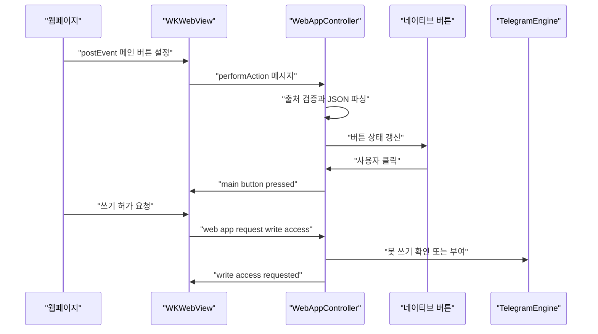
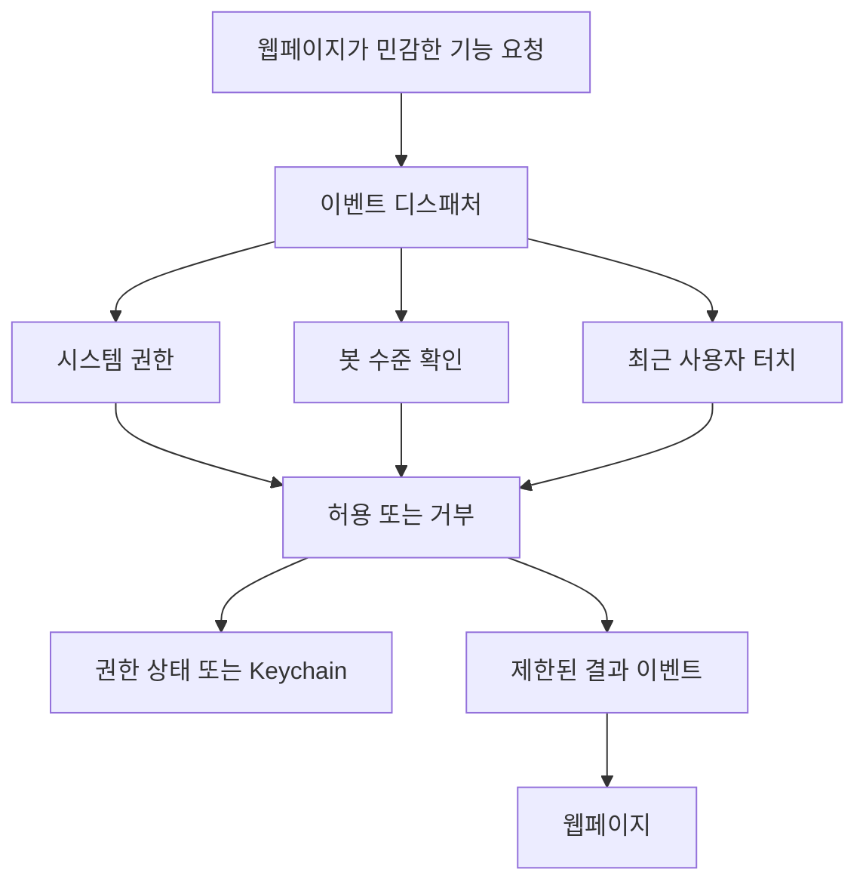

# Mini Apps와 봇 Web 뷰

웹: /docs/system/25-mini-apps/ · Markdown: /docs/system/25-mini-apps.md

> Telegram iOS와 macOS가 봇 WebView URL을 어떻게 얻고, JavaScript 이벤트 브리지를 어떻게 세우며, 권한, 저장소, 네이티브 컨트롤을 어떻게 제약하는지 설명해요.

> 시스템 설계 · 비즈니스 시스템 · 25장 · 도표 3 · 코드 발췌 8 · 인용 46 · 소스 기준선: [TelegramMessenger/Telegram-iOS@f1dd7a2d](https://github.com/TelegramMessenger/Telegram-iOS/tree/f1dd7a2dbd02cbbf513e75d5695d8d36d1cf5838), [overtake/TelegramSwift@579cebbf](https://github.com/overtake/TelegramSwift/tree/579cebbf0c01fd41b712eff3647fa7f69db9665d)
>
> 핵심 소스 파일: [TelegramMessenger/Telegram-iOS/submodules/WebUI/Sources/WebAppController.swift](https://github.com/TelegramMessenger/Telegram-iOS/blob/f1dd7a2dbd02cbbf513e75d5695d8d36d1cf5838/submodules/WebUI/Sources/WebAppController.swift), [TelegramMessenger/Telegram-iOS/submodules/WebUI/Sources/WebAppWebView.swift](https://github.com/TelegramMessenger/Telegram-iOS/blob/f1dd7a2dbd02cbbf513e75d5695d8d36d1cf5838/submodules/WebUI/Sources/WebAppWebView.swift), [TelegramMessenger/Telegram-iOS/submodules/WebUI/Sources/WebAppPermissions.swift](https://github.com/TelegramMessenger/Telegram-iOS/blob/f1dd7a2dbd02cbbf513e75d5695d8d36d1cf5838/submodules/WebUI/Sources/WebAppPermissions.swift), [TelegramMessenger/Telegram-iOS/submodules/WebUI/Sources/WebAppSecureStorage.swift](https://github.com/TelegramMessenger/Telegram-iOS/blob/f1dd7a2dbd02cbbf513e75d5695d8d36d1cf5838/submodules/WebUI/Sources/WebAppSecureStorage.swift), [TelegramMessenger/Telegram-iOS/submodules/BrowserUI/Sources/BrowserWebContent.swift](https://github.com/TelegramMessenger/Telegram-iOS/blob/f1dd7a2dbd02cbbf513e75d5695d8d36d1cf5838/submodules/BrowserUI/Sources/BrowserWebContent.swift), [TelegramMessenger/Telegram-iOS/submodules/TelegramCore/Sources/TelegramEngine/Messages/BotWebView.swift](https://github.com/TelegramMessenger/Telegram-iOS/blob/f1dd7a2dbd02cbbf513e75d5695d8d36d1cf5838/submodules/TelegramCore/Sources/TelegramEngine/Messages/BotWebView.swift), [overtake/TelegramSwift/Telegram-Mac/WebpageModalController.swift](https://github.com/overtake/TelegramSwift/blob/579cebbf0c01fd41b712eff3647fa7f69db9665d/Telegram-Mac/WebpageModalController.swift), [overtake/TelegramSwift/Telegram-Mac/WebappBrowser.swift](https://github.com/overtake/TelegramSwift/blob/579cebbf0c01fd41b712eff3647fa7f69db9665d/Telegram-Mac/WebappBrowser.swift), [overtake/TelegramSwift/Telegram-Mac/BrowserState.swift](https://github.com/overtake/TelegramSwift/blob/579cebbf0c01fd41b712eff3647fa7f69db9665d/Telegram-Mac/BrowserState.swift), [overtake/TelegramSwift/Telegram-Mac/InAppLinks.swift](https://github.com/overtake/TelegramSwift/blob/579cebbf0c01fd41b712eff3647fa7f69db9665d/Telegram-Mac/InAppLinks.swift), [overtake/TelegramSwift/Telegram-Mac/WebAppSecureStorage.swift](https://github.com/overtake/TelegramSwift/blob/579cebbf0c01fd41b712eff3647fa7f69db9665d/Telegram-Mac/WebAppSecureStorage.swift), [overtake/TelegramSwift/Telegram-Mac/WebsiteController.swift](https://github.com/overtake/TelegramSwift/blob/579cebbf0c01fd41b712eff3647fa7f69db9665d/Telegram-Mac/WebsiteController.swift)
>
> 미검증 사항:
> - 서버가 sameOrigin 플래그를 설정하는 인증, 리디렉션, 무효화 규칙은 클라이언트 소스 코드에 정의되어 있지 않아요.
> - iOS 비동일 출처 Mini App 분기에서 비제한 이벤트 프록시를 허용하는 서버 측 승인 조건은 검증하지 못했어요.
> - macOS 고정 커밋의 브리지에는 iOS와 같은 출처 검사가 없어요. 이후 TelegramSwift에서 보완되었는지는 미검증이에요.
> - 위치, 카메라, 마이크 entitlements가 최종 서명 산출물에 어떻게 설정되어 있는지는 이번 소스 범위에서 검증하지 않았어요.

## 문제와 제약 [#문제와-제약]

Mini App은 평범한 웹페이지를 채팅 윈도우에 끼워 넣은 것이 아니에요. 서로 다른 세 신뢰 경계를 이어요.

1. Telegram 서버가 봇, 채팅, 시작 파라미터에 대해 돌려주는 WebView URL이에요.
2. `WKWebView`(웹 콘텐츠를 보여 주는 iOS 뷰) 안의 웹페이지예요.
3. 계정, 결제, 시스템 권한, Keychain(Apple의 보안 저장소)을 쥐고 있는 네이티브 클라이언트예요.

웹페이지는 세 번째 계층인 네이티브 클라이언트를 직접 호출할 수 없어요. 웹페이지는 이벤트 이름과 JSON 데이터만 보낼 수 있고, 네이티브 컨트롤러가 항목별로 실행할지 말지를 정해요.

이 문서는 두 커밋을 고정해서 살펴봐요.

- iOS 커밋 `f1dd7a2dbd02cbbf513e75d5695d8d36d1cf5838`: `WebAppController`와 `WebAppWebView`가 중심이에요.
- macOS 커밋 `579cebbf0c01fd41b712eff3647fa7f69db9665d`: `WebappBrowser`, `WebpageModalController`, AppKit 윈도우가 중심이에요.

두 플랫폼은 TelegramCore의 봇 웹페이지 요청 인터페이스를 재사용해요. 하지만 이를 근거로 두 쪽의 브리지 보안이 같다고 가정할 수는 없어요. [\[1\]](https://github.com/TelegramMessenger/Telegram-iOS/blob/f1dd7a2dbd02cbbf513e75d5695d8d36d1cf5838/submodules/WebUI/Sources/WebAppController.swift#L49-L145) [\[2\]](https://github.com/TelegramMessenger/Telegram-iOS/blob/f1dd7a2dbd02cbbf513e75d5695d8d36d1cf5838/submodules/TelegramCore/Sources/TelegramEngine/Messages/BotWebView.swift#L166-L193)

기존 문서 《전체 아키텍처와 모듈 계층》은 계정, 코어, 인터페이스 계층을 설명해요. 기존 문서 《macOS 클라이언트의 시스템 계층》은 데스크톱 계정과 윈도우 조립을 설명해요. 이 장은 웹페이지에서 네이티브 기능으로 이어지는 좁은 인터페이스와 두 플랫폼의 구체적인 차이만 다뤄요.

`WebAppParameters`는 출처(Mini App을 연 진입 경로)를 일반, 버튼, 메뉴, 첨부 메뉴, 인라인, 단순, 설정으로 나눠요. 이 객체는 다음을 함께 담고 있어요.

- 채팅 peer, 봇 peer
- URL, 쿼리 ID, 시작 페이로드, 버튼 텍스트
- 유지 신호(WebView 세션을 이어 가는 신호)
- 전체 화면 플래그, `sameOrigin` 플래그

그래서 컨트롤러는 웹페이지 URL에서 채팅 맥락을 다시 추론할 필요가 없어요. [\[1\]](https://github.com/TelegramMessenger/Telegram-iOS/blob/f1dd7a2dbd02cbbf513e75d5695d8d36d1cf5838/submodules/WebUI/Sources/WebAppController.swift#L49-L145)

Web App과 내장 브라우저는 같은 제품 경계가 아니에요.

- 내장 브라우저: `BrowserUI`의 `BrowserWebContent`가 일반 URL, 기록, 다운로드, 웹 인증, Telegram 딥링크 라우팅을 관리해요. 웹페이지의 탐색을 허용해요.
- Mini App 컨테이너: 제한된 Telegram Web Apps 이벤트를 계정 작업으로 변환해요. Mini App은 이름이 붙은 이벤트와 사용자 확인을 거친 뒤에야 높은 권한의 기능에 접근해야 해요. [\[18\]](https://github.com/TelegramMessenger/Telegram-iOS/blob/f1dd7a2dbd02cbbf513e75d5695d8d36d1cf5838/submodules/BrowserUI/Sources/BrowserWebContent.swift#L928-L1015) [\[19\]](https://github.com/TelegramMessenger/Telegram-iOS/blob/f1dd7a2dbd02cbbf513e75d5695d8d36d1cf5838/submodules/BrowserUI/Sources/BrowserWebContent.swift#L1090-L1133)

## 모듈과 데이터 구조 [#모듈과-데이터-구조]

### URL 요청, 플래그, 유지 신호 [#url-요청-플래그-유지-신호]

`TelegramEngine.Messages`는 인터페이스 호출을 `BotWebView.swift`로 넘겨요. 진입 경로마다 쓰는 RPC가 달라요.

- 일반 버튼: `messages.requestWebView`
- 메인 앱: `requestMainWebView`
- 단순 앱: `requestSimpleWebView`
- 딥링크 앱: `requestAppWebView`

모든 경로가 테마 딕셔너리를 `Api.DataJSON`으로 직렬화하고, 현재 플랫폼 문자열을 함께 전달해요. 공유 코어는 macOS로 컴파일될 때 `macos`를, 그렇지 않으면 `ios`를 써요. [\[2\]](https://github.com/TelegramMessenger/Telegram-iOS/blob/f1dd7a2dbd02cbbf513e75d5695d8d36d1cf5838/submodules/TelegramCore/Sources/TelegramEngine/Messages/BotWebView.swift#L166-L193) [\[5\]](https://github.com/TelegramMessenger/Telegram-iOS/blob/f1dd7a2dbd02cbbf513e75d5695d8d36d1cf5838/submodules/TelegramCore/Sources/TelegramEngine/Messages/BotWebView.swift#L363-L425)

서버 결과는 `RequestWebViewResult` 하나로 합쳐져요. 결과에는 표시 플래그, 선택적인 `queryId`, URL, 선택적인 유지 신호가 들어 있어요.

- `fullSize`, `fullScreen`: 초기 컨테이너 형태를 제어해요.
- `sameOrigin`: iOS 이벤트 브리지의 출처 보호를 제어해요.

URL은 RPC 반환값이고, 클라이언트가 봇 프로필을 바탕으로 조립한 주소가 아니에요. [\[2\]](https://github.com/TelegramMessenger/Telegram-iOS/blob/f1dd7a2dbd02cbbf513e75d5695d8d36d1cf5838/submodules/TelegramCore/Sources/TelegramEngine/Messages/BotWebView.swift#L166-L193)

```swift
public struct RequestWebViewResult {
    public struct Flags: OptionSet {
        public static let fullSize = Flags(rawValue: 1 << 0)
        public static let fullScreen = Flags(rawValue: 1 << 1)
        public static let sameOrigin = Flags(rawValue: 1 << 2)
    }

    public let flags: Flags
    public let queryId: Int64?
    public let url: String
    public let keepAliveSignal: Signal<Never, KeepWebViewError>?
}
```
[\[2\]](https://github.com/TelegramMessenger/Telegram-iOS/blob/f1dd7a2dbd02cbbf513e75d5695d8d36d1cf5838/submodules/TelegramCore/Sources/TelegramEngine/Messages/BotWebView.swift#L166-L193)

일반 `requestWebView`의 결과에 `queryId`가 있으면 코어가 유지 신호를 만들어요. 이 신호는 이렇게 동작해요.

- 60초마다 `messages.prolongWebView`를 호출해요.
- `AccountStateManager.dismissBotWebViews`를 구독해요. 서버가 지정한 쿼리를 닫으면 신호가 완료돼요.

iOS 컨트롤러는 실패와 완료를 모두 페이지 닫기로 매핑해요. 그래서 세션의 유효 기간은 WebView가 보이는지 여부만으로 정해지는 것이 아니라 코어와 서버가 관리해요. [\[3\]](https://github.com/TelegramMessenger/Telegram-iOS/blob/f1dd7a2dbd02cbbf513e75d5695d8d36d1cf5838/submodules/TelegramCore/Sources/TelegramEngine/Messages/BotWebView.swift#L200-L252) [\[4\]](https://github.com/TelegramMessenger/Telegram-iOS/blob/f1dd7a2dbd02cbbf513e75d5695d8d36d1cf5838/submodules/WebUI/Sources/WebAppController.swift#L551-L634)

```swift
let keepAliveSignal = (
    .complete()
    |> suspendAwareDelay(60.0, queue: Queue.concurrentDefaultQueue())
    |> then (poll)
)
|> restart

let dismissDisposable = (stateManager.dismissBotWebViews
|> filter {
    $0.contains(queryId)
}
|> take(1)).start(completed: {
    subscriber.putCompletion()
})
```
[\[3\]](https://github.com/TelegramMessenger/Telegram-iOS/blob/f1dd7a2dbd02cbbf513e75d5695d8d36d1cf5838/submodules/TelegramCore/Sources/TelegramEngine/Messages/BotWebView.swift#L200-L252)

`requestAppWebView`는 `allowWrite`, 컴팩트, 전체 화면 플래그도 함께 보낼 수 있어요. 코어는 요구 사항을 RPC flags로 인코딩할 뿐이에요. 쓰기 허가를 줄지는 여전히 시작 확인과 `web_app_request_write_access`가 처리해요. 웹페이지 이벤트는 서버의 승인과 같지 않아요. [\[5\]](https://github.com/TelegramMessenger/Telegram-iOS/blob/f1dd7a2dbd02cbbf513e75d5695d8d36d1cf5838/submodules/TelegramCore/Sources/TelegramEngine/Messages/BotWebView.swift#L363-L425)

### 테마와 WebKit 컨테이너 [#테마와-webkit-컨테이너]

`generateWebAppThemeParams`는 고정된 키 집합을 만들어요. 배경, 글자, 링크, 버튼, 내비게이션 바, 하단 바, 섹션 색이 들어 있어요. 이 테마는 두 개의 명확한 경로로 전달돼요.

- 초기 테마: 컨트롤러가 URL을 요청하기 전에 보내요.
- 실행 중 업데이트: 테마가 바뀌면 컨트롤러가 이미 로드된 웹페이지에 `theme_changed`를 보내요. [\[6\]](https://github.com/TelegramMessenger/Telegram-iOS/blob/f1dd7a2dbd02cbbf513e75d5695d8d36d1cf5838/submodules/WebUI/Sources/WebAppController.swift#L128-L145) [\[11\]](https://github.com/TelegramMessenger/Telegram-iOS/blob/f1dd7a2dbd02cbbf513e75d5695d8d36d1cf5838/submodules/WebUI/Sources/WebAppController.swift#L2095-L2128)

```swift
public func generateWebAppThemeParams(_ theme: PresentationTheme) -> [String: Any] {
    return [
        "bg_color": Int32(bitPattern: theme.list.plainBackgroundColor.rgb),
        "secondary_bg_color": Int32(bitPattern: theme.list.blocksBackgroundColor.rgb),
        "text_color": Int32(bitPattern: theme.list.itemPrimaryTextColor.rgb),
        "hint_color": Int32(bitPattern: theme.list.itemSecondaryTextColor.rgb),
        "link_color": Int32(bitPattern: theme.list.itemAccentColor.rgb),
        "button_color": Int32(bitPattern: theme.list.itemCheckColors.fillColor.rgb),
        "button_text_color": Int32(bitPattern: theme.list.itemCheckColors.foregroundColor.rgb),
        "header_bg_color": Int32(bitPattern: theme.rootController.navigationBar.opaqueBackgroundColor.rgb),
        "bottom_bar_bg_color": Int32(bitPattern: theme.rootController.tabBar.backgroundColor.rgb)
    ]
}
```
[\[6\]](https://github.com/TelegramMessenger/Telegram-iOS/blob/f1dd7a2dbd02cbbf513e75d5695d8d36d1cf5838/submodules/WebUI/Sources/WebAppController.swift#L128-L145)

iOS의 `WebAppWebView`는 새 `WKWebViewConfiguration`과 `WKUserContentController`를 만들어요.

- `performAction`을 약한 참조 메시지 핸들러로 등록해요.
- 앞으로/뒤로 제스처는 꺼요.
- iOS 17 이상에서는 기본 계정이 아닌 계정에 대해 계정 UUID별로 분리된 `WKWebsiteDataStore`를 골라요. 기본 계정은 기본 데이터 저장소를 그대로 써요.

이 방식은 WebKit의 Cookie, 캐시, 사이트 데이터를 격리하지만, 봇 데이터 권한 부여 메커니즘은 아니에요. [\[7\]](https://github.com/TelegramMessenger/Telegram-iOS/blob/f1dd7a2dbd02cbbf513e75d5695d8d36d1cf5838/submodules/WebUI/Sources/WebAppWebView.swift#L120-L207)

이 이벤트 브리지는 양방향으로 아무 JavaScript나 호출하는 RPC가 아니에요. 두 방향은 이렇게 나뉘어요.

- 웹페이지에서 네이티브로: 웹페이지가 얻는 프록시 객체 `TelegramWebviewProxy`가 이벤트 이름과 이벤트 데이터를 `performAction`으로 전달해요.
- 네이티브에서 웹페이지로: 네이티브 쪽이 `window.TelegramGameProxy.receiveEvent`를 써서 반대 방향으로 이벤트를 전달해요.

네이티브 쪽은 Swift 객체를 노출하지 않았고, 웹페이지가 아무 selector나 호출하게 두지도 않아요. [\[8\]](https://github.com/TelegramMessenger/Telegram-iOS/blob/f1dd7a2dbd02cbbf513e75d5695d8d36d1cf5838/submodules/WebUI/Sources/WebAppWebView.swift#L46-L70) [\[9\]](https://github.com/TelegramMessenger/Telegram-iOS/blob/f1dd7a2dbd02cbbf513e75d5695d8d36d1cf5838/submodules/WebUI/Sources/WebAppWebView.swift#L217-L301)

```swift
private func securedEventProxySource(trustedOrigin: String) -> String {
    return """
    (function() {
        if (window.location.origin !== \(jsStringLiteral(trustedOrigin))) {
            return;
        }
        var TelegramWebviewProxyProto = function() {};
        TelegramWebviewProxyProto.prototype.postEvent = function(eventName, eventData) {
            window.webkit.messageHandlers.performAction.postMessage({'eventName': eventName, 'eventData': eventData});
        };
        window.TelegramWebviewProxy = new TelegramWebviewProxyProto();
    })();
    """
}
```
[\[8\]](https://github.com/TelegramMessenger/Telegram-iOS/blob/f1dd7a2dbd02cbbf513e75d5695d8d36d1cf5838/submodules/WebUI/Sources/WebAppWebView.swift#L46-L70)

### 신뢰할 수 있는 출처 상태 머신 [#신뢰할-수-있는-출처-상태-머신]

iOS는 `sameOrigin`을 서버 결과의 속성으로 취급해요. 분기는 두 가지예요.

- 결과에 이 플래그가 있으면: 컨트롤러는 첫 URL에서 프로토콜, 호스트, 기본값이 아닌 포트를 정규화하고, 메인 frame에만 작용하는 제한 프록시를 주입해요.
- 결과에 이 플래그가 없으면: 컨트롤러는 비제한 프록시를 설치해요.

이것은 소스 코드로 확인되는 분기이고, 서버 플래그의 의미에 대한 추론이 아니에요. [\[9\]](https://github.com/TelegramMessenger/Telegram-iOS/blob/f1dd7a2dbd02cbbf513e75d5695d8d36d1cf5838/submodules/WebUI/Sources/WebAppWebView.swift#L217-L301) [\[10\]](https://github.com/TelegramMessenger/Telegram-iOS/blob/f1dd7a2dbd02cbbf513e75d5695d8d36d1cf5838/submodules/WebUI/Sources/WebAppController.swift#L536-L542)

제한 분기의 `isTrustedMainFrameMessage`는 세 가지를 동시에 요구해요. 아래에서 바인딩된 출처는 첫 URL에서 정규화한 출처를 뜻해요.

- 메시지가 메인 frame에서 왔을 것
- frame의 보안 출처가 바인딩된 출처와 같을 것
- 현재 WebView URL의 출처도 바인딩된 출처와 같을 것

네이티브에서 웹페이지로 가는 역방향 이벤트도 현재 출처가 일치할 때만 실행돼요. 페이지가 다른 출처로 이동하면 더 이상 높은 권한의 이벤트를 보낼 수 없고, 권한이 담긴 결과를 가진 역방향 이벤트를 받을 수도 없어요. [\[9\]](https://github.com/TelegramMessenger/Telegram-iOS/blob/f1dd7a2dbd02cbbf513e75d5695d8d36d1cf5838/submodules/WebUI/Sources/WebAppWebView.swift#L217-L301)

```swift
func isTrustedMainFrameMessage(_ message: WKScriptMessage) -> Bool {
    guard message.frameInfo.isMainFrame else {
        return false
    }
    if !self.useSecuredEventProxy {
        return true
    }
    guard let trustedOrigin = self.trustedOrigin else {
        return false
    }
    guard message.frameInfo.securityOriginString == trustedOrigin else {
        return false
    }
    if let currentOrigin = self.origin, currentOrigin != trustedOrigin {
        return false
    }
    return true
}
```
[\[9\]](https://github.com/TelegramMessenger/Telegram-iOS/blob/f1dd7a2dbd02cbbf513e75d5695d8d36d1cf5838/submodules/WebUI/Sources/WebAppWebView.swift#L217-L301)

이 규칙에는 한계가 있어요. 비동일 출처 분기는 일부러 출처 검사를 끄고, 함수는 곧바로 참을 반환해요. 그래서 iOS의 출처 보안은 서버의 `sameOrigin` 플래그가 관여하는 프로토콜이에요. 모든 Mini App URL이 자동으로 얻는 WebKit 규칙이 아니에요. 서버가 이 플래그를 언제 주는지는 현재 클라이언트 소스 코드로는 증명할 수 없어요.

```mermaid
flowchart LR
    ENTRY["채팅 버튼 또는 딥링크"] --> ENGINE["TelegramEngine Messages"]
    ENGINE --> RPC["봇 WebView URL 요청"]
    RPC --> RESULT["URL query id flags"]
    RESULT --> CTRL["WebAppController"]
    CTRL --> WEB["WebAppWebView"]
    WEB --> JS["TelegramWebviewProxy"]
    JS --> BRIDGE["performAction 메시지"]
    BRIDGE --> CHECK["메인 frame과 출처 검사"]
    CHECK --> DISPATCH["이벤트 화이트리스트 분배"]
    DISPATCH --> NATIVE["계정과 시스템 기능"]
    NATIVE --> WEB
```



도표에서 URL 요청과 웹페이지 로딩은 분리되어 있어요. `setupWebView`는 URL이 이미 있으면 곧바로 로드해요. 메뉴와 딥링크 진입점은 먼저 서버 URL을 요청해요. 유지 신호가 실패하거나 완료되면 iOS는 컨트롤러를 닫아요. [\[4\]](https://github.com/TelegramMessenger/Telegram-iOS/blob/f1dd7a2dbd02cbbf513e75d5695d8d36d1cf5838/submodules/WebUI/Sources/WebAppController.swift#L551-L634)

## 핵심 흐름 [#핵심-흐름]

### 이벤트 브리지와 네이티브 컨트롤 [#이벤트-브리지와-네이티브-컨트롤]

iOS 컨트롤러는 먼저 출처와 메시지 본문 타입을 검증한 다음 `eventName`을 꺼내고, 문자열 데이터를 JSON 딕셔너리로 파싱해요. `switch`에 있는 이벤트 이름만 네이티브 기능에 도달해요. 알 수 없는 이벤트는 `default`로 들어가 아무 일도 하지 않아요. 이벤트 이름은 기능의 이름이자 감사 경계예요. [\[12\]](https://github.com/TelegramMessenger/Telegram-iOS/blob/f1dd7a2dbd02cbbf513e75d5695d8d36d1cf5838/submodules/WebUI/Sources/WebAppController.swift#L1126-L1254)

메인 버튼은 양방향을 모두 보여 주는 완전한 예예요. 흐름은 이래요.

1. 웹페이지가 `web_app_setup_main_button`으로 가시성, 텍스트, 색상, 진행 표시, 활성 상태, 반짝임 효과, 커스텀 이모지를 제공해요.
2. 컨트롤러가 공백 텍스트를 거부하고 `AttachmentMainButtonState`에 써요.
3. 네이티브 사용자가 버튼을 누르면, 버튼이 보이고 활성일 때만 `main_button_pressed`를 되돌려 보내요.
4. 누르면 최근 터치 시각도 갱신해요. 이 값은 이후의 제스처 게이팅(최근 터치가 있을 때만 동작을 허용하는 검사)에 쓰여요. [\[12\]](https://github.com/TelegramMessenger/Telegram-iOS/blob/f1dd7a2dbd02cbbf513e75d5695d8d36d1cf5838/submodules/WebUI/Sources/WebAppController.swift#L1126-L1254) [\[13\]](https://github.com/TelegramMessenger/Telegram-iOS/blob/f1dd7a2dbd02cbbf513e75d5695d8d36d1cf5838/submodules/WebUI/Sources/WebAppController.swift#L1412-L1638)

```swift
case "web_app_setup_main_button":
    if let webView = self.webView, !webView.didTouchOnce && controller.url == nil && controller.source == .attachMenu {
        self.delayedScriptMessages.append(message)
    } else if let json = json {
        if var isVisible = json["is_visible"] as? Bool {
            let text = json["text"] as? String
            if (text ?? "").trimmingCharacters(in: .whitespacesAndNewlines).isEmpty {
                isVisible = false
            }
            // ...
            self.mainButtonState = state
        }
    }
```
[\[12\]](https://github.com/TelegramMessenger/Telegram-iOS/blob/f1dd7a2dbd02cbbf513e75d5695d8d36d1cf5838/submodules/WebUI/Sources/WebAppController.swift#L1126-L1254)

보조 버튼은 같은 상태 모델을 쓰되 `position`을 허용해요.

뒤로 가기 버튼은 웹페이지가 표시할 때 `web_app_setup_back_button`을 보내요. 컨트롤러는 내비게이션 외관을 갱신해요. 사용자가 클릭하면 네이티브가 알아서 웹페이지 기록을 되돌리는 것이 아니라 `back_button_pressed`를 보내요. 이렇게 하면 웹페이지의 내비게이션 상태 머신이 보존되고, 닫기와 뒤로 가기의 의미도 달라져요. [\[13\]](https://github.com/TelegramMessenger/Telegram-iOS/blob/f1dd7a2dbd02cbbf513e75d5695d8d36d1cf5838/submodules/WebUI/Sources/WebAppController.swift#L1412-L1638) [\[14\]](https://github.com/TelegramMessenger/Telegram-iOS/blob/f1dd7a2dbd02cbbf513e75d5695d8d36d1cf5838/submodules/WebUI/Sources/WebAppController.swift#L2158-L2164)

웹페이지는 뷰포트, 세이프 에어리어(노치 같은 화면 가장자리를 피한 안전 영역), 콘텐츠 세이프 에어리어를 요청할 수 있어요. 레이아웃이 바뀌면 iOS는 유효 viewport, 높이, 여백을 계산한 다음 `viewport_changed`, `safe_area_changed`, `content_safe_area_changed`를 되돌려 보내요. 웹페이지가 이 값들을 직접 정할 수는 없어요. 크기의 기준은 네이티브 컨테이너예요. [\[15\]](https://github.com/TelegramMessenger/Telegram-iOS/blob/f1dd7a2dbd02cbbf513e75d5695d8d36d1cf5838/submodules/WebUI/Sources/WebAppController.swift#L1052-L1080)

테마 변경도 네이티브가 기준이에요. 컨트롤러는 현재 색상을 16진수 문자열로 포맷해 `theme_changed`를 보내요. 웹페이지는 `web_app_request_theme`로 다시 가져올 수 있지만, 웹페이지가 Telegram 계정의 테마를 고쳐 쓸 수는 없어요. [\[11\]](https://github.com/TelegramMessenger/Telegram-iOS/blob/f1dd7a2dbd02cbbf513e75d5695d8d36d1cf5838/submodules/WebUI/Sources/WebAppController.swift#L2095-L2128) [\[16\]](https://github.com/TelegramMessenger/Telegram-iOS/blob/f1dd7a2dbd02cbbf513e75d5695d8d36d1cf5838/submodules/WebUI/Sources/WebAppController.swift#L1255-L1273)



### 닫기, 전체 화면, 방향 [#닫기-전체-화면-방향]

닫기 정책은 웹페이지가 선언하지만, 확인 UI는 항상 네이티브가 통제해요.

- 웹페이지가 `web_app_setup_closing_behavior`로 닫기 확인을 요청할 수 있어요. iOS는 이 불리언 값을 컨트롤러에 보관해요.
- 시스템이 닫거나 사용자가 닫기를 누르면 `requestDismiss`가 확인 창을 보여 줄지 정해요.
- 웹페이지가 `web_app_close`를 보내면 컨트롤러의 닫기 경로로 들어가요. [\[13\]](https://github.com/TelegramMessenger/Telegram-iOS/blob/f1dd7a2dbd02cbbf513e75d5695d8d36d1cf5838/submodules/WebUI/Sources/WebAppController.swift#L1412-L1638)

전체 화면은 웹페이지의 CSS 상태가 아니라 첨부 컨트롤러와 내비게이션 바가 함께 관리하는 컨테이너 상태예요. 웹페이지가 요청하면 iOS는 이렇게 처리해요.

1. 먼저 상태가 이미 일치하는지 검사해요. 중복 요청에는 `fullscreen_failed`와 `ALREADY_FULLSCREEN`을 되돌려 보내요.
2. 상태가 바뀔 때는 먼저 `fullscreen_changed`를 보내요.
3. 그다음 `isFullscreen`을 갱신해 레이아웃을 일으켜요.

일반 너비에서는 WebView 스냅샷도 떠서 레이아웃이 전환되는 순간을 덮어요. [\[17\]](https://github.com/TelegramMessenger/Telegram-iOS/blob/f1dd7a2dbd02cbbf513e75d5695d8d36d1cf5838/submodules/WebUI/Sources/WebAppController.swift#L2707-L2738)

모션 센서는 iOS 전용 기능이에요. 이벤트 표에는 가속도계, 기기 방향, 자이로스코프의 시작 및 중지 항목이 있어요. 코드는 먼저 하드웨어를 쓸 수 있는지 확인한 다음 `CMMotionManager` 콜백을 시작해요. 중지하거나 해제할 때는 업데이트를 꺼요. 방향 잠금 이벤트는 부모 첨부 컨트롤러의 `lockOrientation`만 고쳐 써요. 웹페이지가 Core Motion에 직접 접근하지는 않아요. [\[43\]](https://github.com/TelegramMessenger/Telegram-iOS/blob/f1dd7a2dbd02cbbf513e75d5695d8d36d1cf5838/submodules/WebUI/Sources/WebAppController.swift#L1713-L1772)

### 링크, 클립보드, 시스템 UI [#링크-클립보드-시스템-ui]

`web_app_open_link`는 먼저 URL 프로토콜을 검사해요.

- 기본적으로는 HTTP와 HTTPS만 받아요. 추가 프로토콜은 원격 `web_app_allowed_protocols` 설정에 나와 있어야 해요.
- 요청이 최근 터치 후 10초 안에 일어났어야 해요. 그래야 외부 열기나 Instant View 라우팅으로 넘겨요.

이 시간 게이팅은 사용자 동작 없이 스크립트가 외부 동작을 시작하는 것을 제한해요. [\[19\]](https://github.com/TelegramMessenger/Telegram-iOS/blob/f1dd7a2dbd02cbbf513e75d5695d8d36d1cf5838/submodules/BrowserUI/Sources/BrowserWebContent.swift#L1090-L1133) [\[20\]](https://github.com/TelegramMessenger/Telegram-iOS/blob/f1dd7a2dbd02cbbf513e75d5695d8d36d1cf5838/submodules/WebUI/Sources/WebAppController.swift#L4362-L4384)

클립보드 읽기에도 최근 터치가 필요해요. 여기에 더해 다음 중 하나가 필요해요.

- 현재 진입점이 첨부 메뉴예요.
- 봇이 첨부 메뉴에 설치되어 있어요.
- 봇이 화이트리스트에 있어요.

실패하면 컨트롤러는 여전히 요청 ID가 담긴 이벤트를 되돌려 보내지만 클립보드는 채우지 않아요. 터치 타임스탬프는 클라이언트 쪽 방어선 하나일 뿐이에요. 웹페이지가 붙여넣은 내용을 어떻게 처리할지 사용자가 이해했다는 것을 증명하지는 못해요. [\[13\]](https://github.com/TelegramMessenger/Telegram-iOS/blob/f1dd7a2dbd02cbbf513e75d5695d8d36d1cf5838/submodules/WebUI/Sources/WebAppController.swift#L1412-L1638)

`web_app_open_tg_link`는 웹페이지가 스스로 탐색하게 두지 않아요. Telegram 딥링크를 구성한 뒤 앱 URL 해석기로 보내요. 인보이스, 준비된 메시지, 채팅 선택, 인라인 쿼리도 Telegram 네이티브 컨트롤러가 대신 처리해요. 웹페이지는 의도를 제시하는 일을 맡아요. 채팅, 결제, 연락처 선택은 계정 컨텍스트가 결정해요. [\[13\]](https://github.com/TelegramMessenger/Telegram-iOS/blob/f1dd7a2dbd02cbbf513e75d5695d8d36d1cf5838/submodules/WebUI/Sources/WebAppController.swift#L1412-L1638) [\[21\]](https://github.com/TelegramMessenger/Telegram-iOS/blob/f1dd7a2dbd02cbbf513e75d5695d8d36d1cf5838/submodules/WebUI/Sources/WebAppController.swift#L1274-L1419)

## 권한, 저장소, 보안 경계 [#권한-저장소-보안-경계]

### 쓰기와 미디어 [#쓰기와-미디어]

봇 쓰기 허가는 두 단계예요.

1. `requestWriteAccess`가 먼저 `canBotSendMessages`를 호출해요. 이미 허용되어 있으면 즉시 `allowed`를 되돌려 보내요.
2. 그렇지 않으면 봇 이름이 들어간 네이티브 확인 창을 보여 줘요. 사용자가 확인한 뒤에야 `allowBotSendMessages`를 호출하고 `allowed`를 되돌려 보내요. 취소와 바깥 영역 탭은 `cancelled`를 되돌려 보내요.

웹페이지는 이벤트 자체로 확인 절차를 우회할 수 없어요. [\[22\]](https://github.com/TelegramMessenger/Telegram-iOS/blob/f1dd7a2dbd02cbbf513e75d5695d8d36d1cf5838/submodules/WebUI/Sources/WebAppController.swift#L2202-L2248) [\[23\]](https://github.com/TelegramMessenger/Telegram-iOS/blob/f1dd7a2dbd02cbbf513e75d5695d8d36d1cf5838/submodules/TelegramCore/Sources/TelegramEngine/Messages/BotWebView.swift#L428-L469)

카메라와 마이크 요청은 WebKit 미디어 캡처 콜백에서 와요. iOS는 일반 Mini App에 `.prompt`를 써요. 연령 확인 봇이 카메라를 요청할 때만 소스가 곧바로 `.grant`를 줘요. 이건 명시적인 특례이고, 아무 봇으로나 넓힐 수 없어요. [\[24\]](https://github.com/TelegramMessenger/Telegram-iOS/blob/f1dd7a2dbd02cbbf513e75d5695d8d36d1cf5838/submodules/WebUI/Sources/WebAppController.swift#L792-L799)

macOS도 먼저 시스템 미디어 권한을 요청한 다음 봇 이름이 들어간 확인 창을 보여 줘요. 허가를 받으면 `FastSettings`가 봇별로 카메라, 마이크, 또는 두 장치 모두에 대한 허가를 저장해요. `requestData`가 없는 범용 웹페이지 컨테이너는 거부를 받아요. 덕분에 일반 브라우저 웹페이지와 봇 앱 웹페이지는 미디어 기능에서 계층이 나뉘어요. [\[25\]](https://github.com/overtake/TelegramSwift/blob/579cebbf0c01fd41b712eff3647fa7f69db9665d/Telegram-Mac/WebpageModalController.swift#L1379-L1448)

### 위치 허가 [#위치-허가]

iOS의 위치 흐름에는 허가가 두 겹 있어요.

1. `DeviceAccess.authorizeAccess`를 호출해 Telegram의 시스템 위치 권한을 요청해요.
2. 봇 ID별로 저장된 `WebAppPermissionsState`를 읽어요. 봇이 아직 선택하지 않았다면 컨트롤러는 그 이름이 들어간 Mini App 허가 창을 보여 주고, 요청됨과 허용됨 상태를 영속화해요.
3. 그런 다음에야 정밀한 포그라운드 위치로 위도, 경도, 고도, 방위, 속도, 정확도 필드를 되돌려 보내요. [\[26\]](https://github.com/TelegramMessenger/Telegram-iOS/blob/f1dd7a2dbd02cbbf513e75d5695d8d36d1cf5838/submodules/WebUI/Sources/WebAppController.swift#L3425-L3564) [\[27\]](https://github.com/TelegramMessenger/Telegram-iOS/blob/f1dd7a2dbd02cbbf513e75d5695d8d36d1cf5838/submodules/WebUI/Sources/WebAppPermissions.swift#L8-L129)

권한 캐시 키는 봇 peer ID의 8바이트 값만으로 구성되고, `webAppPermissionsState` 항목 캐시 컬렉션에 놓여요. 이 키는 현재 Telegram 계정에서 특정 봇에 대해 내린 선택을 나타내요. 시스템 위치 허가는 여전히 운영체제가 독립적으로 관리해요. 시스템 허가를 철회한 뒤에는 캐시에 남은 허용 값을 좌표를 여전히 얻을 수 있다는 뜻으로 해석할 수 없어요. [\[27\]](https://github.com/TelegramMessenger/Telegram-iOS/blob/f1dd7a2dbd02cbbf513e75d5695d8d36d1cf5838/submodules/WebUI/Sources/WebAppPermissions.swift#L8-L129)

macOS의 `WebpageModalController`는 이렇게 처리해요.

1. 먼저 `requestUserLocation`을 호출해요.
2. 성공하면 봇 수준 확인을 여전히 검사하고, 필요하면 보여 줘요.
3. 허용되면 같은 모델의 상태를 저장한 뒤 스스로 다시 호출해 좌표를 얻어 보내요.

거부, 시스템 비활성화, Wi-Fi 전용 오류는 각각 네이티브 오류를 표시해요. 그래서 macOS도 위치 기능을 지원하지만, 출처는 iOS의 `LocationManager` 경로가 아니라 데스크톱 위치 서비스예요. [\[28\]](https://github.com/overtake/TelegramSwift/blob/579cebbf0c01fd41b712eff3647fa7f69db9665d/Telegram-Mac/WebpageModalController.swift#L2487-L2619)

### 기기와 보안 저장소 [#기기와-보안-저장소]

기기 저장소 이벤트는 `setBotStorageValue`, `BotStorageValue`, `clearBotStorage`를 호출해요. 이 이름들은 Telegram Engine의 봇 저장소 인터페이스에 속해요. 응답에는 `req_id`가 들어 있어요. 키나 값이 유효하지 않은 경우, 할당량 초과, 알 수 없는 오류는 모두 프로토콜 이벤트로 반환되고 조용히 사라지지 않아요. [\[29\]](https://github.com/overtake/TelegramSwift/blob/579cebbf0c01fd41b712eff3647fa7f69db9665d/Telegram-Mac/WebpageModalController.swift#L2200-L2270)

보안 저장소는 플랫폼 Keychain을 써요.

- 키 이름: 보안 저장소 UUID, 봇 ID, 웹페이지 키로 구성돼요.
- 서비스 이름: `TMASecureStorage`로 고정이에요.
- 쓰기 접근성: `kSecAttrAccessibleWhenPasscodeSetThisDeviceOnly`예요.
- 새 키 개수의 상한: 10이에요.

키에는 봇 ID와 계정 UUID가 함께 들어 있어요. 그래서 한 봇이 같은 API로 다른 봇이나 다른 계정 UUID의 항목을 읽을 수 없어요. [\[30\]](https://github.com/overtake/TelegramSwift/blob/579cebbf0c01fd41b712eff3647fa7f69db9665d/Telegram-Mac/WebAppSecureStorage.swift#L30-L160)

```swift
static private let maxKeyCount = 10

static private func keyPrefix(uuid: String, botId: EnginePeer.Id) -> String {
    return "WebBot\(UInt64(bitPattern: botId.toInt64()))U\(uuid)Key_"
}

query[kSecAttrAccessible as String] = kSecAttrAccessibleWhenPasscodeSetThisDeviceOnly

let currentCount = countKeys(uuid: uuid, botId: botId)
if currentCount >= maxKeyCount {
    return .fail(.quotaExceeded)
}
```
[\[30\]](https://github.com/overtake/TelegramSwift/blob/579cebbf0c01fd41b712eff3647fa7f69db9665d/Telegram-Mac/WebAppSecureStorage.swift#L30-L160)

보안 저장소에서 값을 읽지 못하면 `canRestore`가 반환될 수 있어요. 그러면 컨트롤러는 계정 데이터 가져오기 화면을 보여 줘요. 사용자가 원본 계정을 선택한 뒤에야 같은 봇 접두사 아래의 항목을 복사하고 `secure_storage_key_restored`를 되돌려 보내요. 이건 계정 간 마이그레이션을 위한 명시적 UI 흐름이에요. 웹페이지가 다른 계정을 조용히 열거하는 인터페이스가 아니에요. [\[31\]](https://github.com/overtake/TelegramSwift/blob/579cebbf0c01fd41b712eff3647fa7f69db9665d/Telegram-Mac/WebpageModalController.swift#L2348-L2457)

### 생체 인식 [#생체-인식]

iOS는 먼저 인증 유형을 face나 finger로 매핑한 뒤, 이 봇이 요청했는지, 허용되었는지, 토큰을 저장하는지의 상태를 되돌려 보내요. 처음 접근할 때는 봇 이름과 선택적인 reason을 표시해요. 토큰 갱신과 인증은 `LocalAuth`를 호출해요. 결과는 기기 개인 키를 웹페이지에 노출하지 않고, 웹페이지가 전에 저장해 둔 opaque token이나 실패 상태를 돌려줘요. [\[32\]](https://github.com/TelegramMessenger/Telegram-iOS/blob/f1dd7a2dbd02cbbf513e75d5695d8d36d1cf5838/submodules/WebUI/Sources/WebAppController.swift#L2431-L2543)

macOS는 `LAContext`와 Keychain `userPresence` 접근 제어를 써요. 토큰은 봇 ID를 계정 이름으로 하여 `TelegramMiniApp` 서비스에 저장돼요. 인증할 때 `SecItemCopyMatching`이 사용자 존재 검증을 일으키고, 그 뒤에야 웹페이지에 `authorized`와 token을 되돌려 보내요. 코드는 그 전에 해당 봇이 Mini App 생체 인식 확인을 이미 거쳤을 것도 요구해요. [\[33\]](https://github.com/overtake/TelegramSwift/blob/579cebbf0c01fd41b712eff3647fa7f69db9665d/Telegram-Mac/WebpageModalController.swift#L1958-L2045)



도표의 검사가 모든 이벤트에서 동시에 실행되는 것은 아니에요. 기능마다 달라요.

- 링크와 클립보드: 주로 사용자 제스처에 의존해요.
- 위치: 시스템 허가와 봇 허가가 모두 필요해요.
- 쓰기 허가: Telegram 서버 인터페이스를 호출해요.
- 보안 저장소: 매번 대화 상자를 띄우지는 않지만, Keychain, UUID, 봇 ID, 개수 상한의 제약을 받아요.

개발자는 한 가지 게이팅을 다른 기능에 대한 승인으로 착각하면 안 돼요.

### 이벤트 그룹, 파라미터 검증, 결과 회신 [#이벤트-그룹-파라미터-검증-결과-회신]

이벤트 표는 위험과 데이터 흐름에 따라 여섯 그룹으로 나눌 수 있어요.

1. 표시 이벤트: 준비 완료, 테마, 뷰포트, 배경, 헤더, 하단 바, 메인 버튼, 보조 버튼, 뒤로 가기 버튼이 있어요. 이들은 네이티브 컨테이너의 상태만 바꾸거나, 컨테이너 상태를 웹페이지에 되돌려 보내요.
2. 내비게이션 이벤트: 외부 링크, Telegram 딥링크, 인라인 쿼리, 팝업, QR 코드, 닫기가 있어요.
3. 계정 작업: 전화, 쓰기 허가, 인보이스, 준비된 메시지, 이모지 상태, 커스텀 봇 메서드가 있어요.
4. 시스템 기능: 미디어, 위치, 생체 인식, 파일 다운로드, 전체 화면, 센서가 있어요.
5. 저장소 이벤트예요.
6. `web_app_data_send`예요.

이 분류는 소스 코드의 타입 정의가 아니라 `switch` 분기의 역할을 보고 내린 추론이에요. [\[12\]](https://github.com/TelegramMessenger/Telegram-iOS/blob/f1dd7a2dbd02cbbf513e75d5695d8d36d1cf5838/submodules/WebUI/Sources/WebAppController.swift#L1126-L1254) [\[13\]](https://github.com/TelegramMessenger/Telegram-iOS/blob/f1dd7a2dbd02cbbf513e75d5695d8d36d1cf5838/submodules/WebUI/Sources/WebAppController.swift#L1412-L1638) [\[41\]](https://github.com/overtake/TelegramSwift/blob/579cebbf0c01fd41b712eff3647fa7f69db9665d/Telegram-Mac/WebpageModalController.swift#L1575-L2418)

`web_app_data_send`의 범위는 이름보다 좁아요. iOS는 `controller.source.isSimple`이 성립할 때만 `handleSendData`를 호출해요. 이 함수는 페이지를 닫고, `data` 필드를 파싱하고, `sendWebViewData`를 호출해요. macOS도 `RequestData.simple` 분기에서만 이 이벤트를 처리해요. 그래서 일반 메인 앱이나 첨부 메뉴 웹페이지는 이 이벤트로 단순 버튼의 데이터 제출을 직접 흉내 낼 수 없어요. 이 제한은 시작 출처에 묶여 있고, 웹페이지 JSON의 어떤 필드가 정하는 것이 아니에요. [\[12\]](https://github.com/TelegramMessenger/Telegram-iOS/blob/f1dd7a2dbd02cbbf513e75d5695d8d36d1cf5838/submodules/WebUI/Sources/WebAppController.swift#L1126-L1254) [\[40\]](https://github.com/overtake/TelegramSwift/blob/579cebbf0c01fd41b712eff3647fa7f69db9665d/Telegram-Mac/WebpageModalController.swift#L2828-L2904) [\[41\]](https://github.com/overtake/TelegramSwift/blob/579cebbf0c01fd41b712eff3647fa7f69db9665d/Telegram-Mac/WebpageModalController.swift#L1575-L2418)

페이지가 네이티브 색상을 설정하거나 팝업을 띄울 때도 아무 값이나 쓸 수 있는 것은 아니에요.

- `web_app_set_header_color`: 테마 키로 `bg_color`와 `secondary_bg_color`만, 또는 파싱할 수 있는 16진수 색상 값만 받아요. 알 수 없는 테마 키는 헤더 상태를 바꾸지 않아요.
- 팝업 이벤트: default, destructive, ok, cancel, close 다섯 종류의 버튼만 알아봐요. 컨트롤러는 각 버튼 객체에서 텍스트와 식별자를 읽고, 네이티브 팝업이 닫힐 때 `popup_closed`를 되돌려 보내요.

웹페이지는 안내 내용을 통제할 수 있지만, 시스템 확인 창처럼 보이는 화면을 스스로 그릴 수는 없어요. [\[13\]](https://github.com/TelegramMessenger/Telegram-iOS/blob/f1dd7a2dbd02cbbf513e75d5695d8d36d1cf5838/submodules/WebUI/Sources/WebAppController.swift#L1412-L1638)

QR 코드는 같은 이름의 웹페이지 API라도 플랫폼마다 다를 수 있어요. iOS는 `QrCodeScanScreen`을 만들고, 스캔에 성공하면 `qr_text_received`를, 취소하면 `scan_qr_popup_closed`를 보내요. macOS의 대응 분기는 지원하지 않는다는 안내만 보여 줘요. 여기서의 실패는 WebKit 오류가 아니라 네이티브 플랫폼이 해당 기능을 구현하지 않았기 때문이에요. 웹페이지는 결과 이벤트를 받아야 해요. 요청이 전달되었다는 사실만으로 동작이 성공했다고 가정하면 안 돼요. [\[13\]](https://github.com/TelegramMessenger/Telegram-iOS/blob/f1dd7a2dbd02cbbf513e75d5695d8d36d1cf5838/submodules/WebUI/Sources/WebAppController.swift#L1412-L1638) [\[41\]](https://github.com/overtake/TelegramSwift/blob/579cebbf0c01fd41b712eff3647fa7f69db9665d/Telegram-Mac/WebpageModalController.swift#L1575-L2418)

파일 다운로드도 네이티브가 넘겨받는 원칙을 따라요. macOS는 먼저 파일 크기를 가져온 다음 봇 이름, 파일 이름, 크기가 들어간 확인 창을 보여 줘요. 사용자가 확인한 뒤에야 클라이언트가 HTTP 리소스를 다운로드하고 `file_download_requested`의 다운로드 상태를 보내요. 웹페이지는 URL과 권장 파일 이름을 줄 뿐, 사용자가 확인하기 전에 로컬 파일 시스템에 직접 쓸 수 없어요. [\[29\]](https://github.com/overtake/TelegramSwift/blob/579cebbf0c01fd41b712eff3647fa7f69db9665d/Telegram-Mac/WebpageModalController.swift#L2200-L2270)

첫 시작 확인은 브리지 밖에 있는 선행 경계예요. macOS에서는 이렇게 진행돼요.

1. `BrowserState.open`이 `FastSettings.shouldConfirmWebApp`을 검사해요.
2. 처음 열 때는 봇의 개인정보 처리방침 URL을 읽고, 봇 프로필과 개인정보 링크가 들어간 시작 대화 상자를 보여 줘요.
3. 사용자가 동의한 뒤에야 `WebappBrowserController`를 만들거나 재사용하고, 확인됨 플래그를 기록해요.

딥링크로 시작할 때 봇 앱이 `requiresWriteAccess`를 선언했다면, 메시지 전송 허가도 같은 시작 대화 상자에 넣어요. 이 시작 확인은 웹페이지가 나중에 쓰기 허가를 요청하는 이벤트 흐름과 서로 보완해요. 시작 확인은 시작할 수 있는지를 정하고, 이벤트 흐름은 실행 중의 허가 상태를 처리해요. [\[45\]](https://github.com/overtake/TelegramSwift/blob/579cebbf0c01fd41b712eff3647fa7f69db9665d/Telegram-Mac/BrowserState.swift#L385-L444) [\[46\]](https://github.com/overtake/TelegramSwift/blob/579cebbf0c01fd41b712eff3647fa7f69db9665d/Telegram-Mac/InAppLinks.swift#L875-L925)

이 선행 절차를 보면 `WebpageModalController`가 뷰가 나타날 때 `markWebAppAsConfirmed`를 다시 실행하는 이유도 알 수 있어요. 이미 요청 데이터가 있거나, 기록 복원이거나, 표준 브라우저 진입점을 거치지 않고 만들어진 컨트롤러를 처리하기 위해서예요.

이런 설계는 같은 확인 상태를 반복해서 쓰게 되지만, 소스 코드는 중복 쓰기를 오류로 보지 않아요. 추론하면 이 쓰기는 사용자에게 두 번째로 동의를 구하는 것이 아니라 멱등적인(여러 번 해도 결과가 같은) 확인 수렴이에요. [\[39\]](https://github.com/overtake/TelegramSwift/blob/579cebbf0c01fd41b712eff3647fa7f69db9665d/Telegram-Mac/WebpageModalController.swift#L1151-L1199) [\[45\]](https://github.com/overtake/TelegramSwift/blob/579cebbf0c01fd41b712eff3647fa7f69db9665d/Telegram-Mac/BrowserState.swift#L385-L444)

### 생명주기, 동시성, 계정 격리 [#생명주기-동시성-계정-격리]

`web_app_ready`는 네이티브 로딩 마스크에 대한 웹페이지 쪽의 동기화 지점이에요. URL에 이미 접근할 수 있다는 증거는 아니에요. 받았을 때 플랫폼마다 이렇게 동작해요.

- iOS: 진입 애니메이션을 일으켜요.
- macOS: 0.1초 지연한 뒤 `webAppReady`를 호출하고, 자리 표시 로딩을 멈추고 테마를 새로 고쳐요.

두 플랫폼 모두 WebKit의 내비게이션 진행과 완료 콜백을 별도의 시각 신호로 유지해요. 웹페이지가 ready를 보내지 않으면 사용자는 계속 로딩 상태를 볼 수 있지만, 그렇다고 웹페이지가 추가 권한을 얻지는 않아요. [\[12\]](https://github.com/TelegramMessenger/Telegram-iOS/blob/f1dd7a2dbd02cbbf513e75d5695d8d36d1cf5838/submodules/WebUI/Sources/WebAppController.swift#L1126-L1254) [\[39\]](https://github.com/overtake/TelegramSwift/blob/579cebbf0c01fd41b712eff3647fa7f69db9665d/Telegram-Mac/WebpageModalController.swift#L1151-L1199) [\[41\]](https://github.com/overtake/TelegramSwift/blob/579cebbf0c01fd41b712eff3647fa7f69db9665d/Telegram-Mac/WebpageModalController.swift#L1575-L2418)

첨부 메뉴 진입점에는 초기 상태 경쟁을 피하기 위한 세부 사항이 있어요. iOS는 첨부 메뉴가 아직 사용자에게 터치되지 않았고 컨트롤러 URL이 비어 있을 때, 메인 버튼과 보조 버튼의 스크립트 메시지를 `delayedScriptMessages`에 보관해요. 페이지에서 처음 상호작용이 일어난 뒤 이 메시지들을 처리해요. 이 로직은 이벤트 보안 검증이 아니에요. 애니메이션, 첫 표시, 하단 컨트롤 상태 사이의 타이밍 문제를 해결하는 거예요. 다른 이벤트는 여전히 받는 즉시 출처 검사와 이벤트 분배를 거쳐요. [\[12\]](https://github.com/TelegramMessenger/Telegram-iOS/blob/f1dd7a2dbd02cbbf513e75d5695d8d36d1cf5838/submodules/WebUI/Sources/WebAppController.swift#L1126-L1254)

네이티브 상태는 한 방향으로만 되써요. 웹페이지가 색상이나 버튼 설정을 보내면 컨트롤러가 자기 상태를 갱신하고, 이어서 레이아웃 시스템이 그려요. 사용자가 클릭하면 컨트롤러는 고정된 눌림 이벤트만 보내요. 네이티브 객체를 직렬화해 웹페이지에 주지 않아요. 웹페이지가 viewport를 요청할 때도 컨트롤러는 계산된 크기 이벤트만 보내요.

이 패턴은 웹페이지와 네이티브 상태가 서로 경쟁하며 쓰는 상황이 생길 가능성을 낮춰요. 추론하면, WebView를 다시 만들 때 웹페이지가 저장해 둔 옛 상태를 믿지 않고 컨트롤러 상태에서 네이티브 장식을 복원할 수 있다는 이점도 있어요. [\[12\]](https://github.com/TelegramMessenger/Telegram-iOS/blob/f1dd7a2dbd02cbbf513e75d5695d8d36d1cf5838/submodules/WebUI/Sources/WebAppController.swift#L1126-L1254) [\[15\]](https://github.com/TelegramMessenger/Telegram-iOS/blob/f1dd7a2dbd02cbbf513e75d5695d8d36d1cf5838/submodules/WebUI/Sources/WebAppController.swift#L1052-L1080) [\[40\]](https://github.com/overtake/TelegramSwift/blob/579cebbf0c01fd41b712eff3647fa7f69db9665d/Telegram-Mac/WebpageModalController.swift#L2828-L2904)

계정 격리는 URL 요청, WebKit 데이터, 보안 데이터의 세 층위에 걸쳐 있어요. 세 층의 격리 대상은 서로 달라요.

- URL 요청: 요청 RPC는 현재 `AccountContext`의 계정 네트워크와 Postbox로 입력 peer를 구성해요. Telegram 세션을 제약해요.
- WebKit 데이터: WebKit 데이터 저장소는 시스템 버전 조건을 갖춘 기본 계정이 아닌 계정에 별도의 UUID를 써요. 웹사이트 데이터를 제약해요.
- 보안 데이터: 보안 저장소 키는 계정 보안 저장소 UUID와 봇 ID를 추가로 써요. 웹페이지가 호출하는 보안 키-값을 제약해요.

한 층의 격리 결론으로 다른 층을 대신할 수 없어요. [\[2\]](https://github.com/TelegramMessenger/Telegram-iOS/blob/f1dd7a2dbd02cbbf513e75d5695d8d36d1cf5838/submodules/TelegramCore/Sources/TelegramEngine/Messages/BotWebView.swift#L166-L193) [\[7\]](https://github.com/TelegramMessenger/Telegram-iOS/blob/f1dd7a2dbd02cbbf513e75d5695d8d36d1cf5838/submodules/WebUI/Sources/WebAppWebView.swift#L120-L207) [\[30\]](https://github.com/overtake/TelegramSwift/blob/579cebbf0c01fd41b712eff3647fa7f69db9665d/Telegram-Mac/WebAppSecureStorage.swift#L30-L160)

오류 처리도 네트워크, 프로토콜, 사용자 거부로 구분해야 해요.

- WebView URL을 요청할 때의 네트워크 실패: `RequestWebViewError`로 시작 진입점에 전달돼요.
- 웹페이지 JSON 파싱 실패: 보통 해당 이벤트를 무동작으로 만들어요.
- 저장소 할당량, 전체 화면 중복, 위치 사용 불가, 사용자 거부: 가능한 한 이름이 붙은 결과 이벤트로 되돌려 보내요.
- macOS의 파일 선택, JavaScript confirm, 미디어 캡처: 사용할 수 있는 윈도우가 없을 때 거부나 빈 결과를 반환하기도 해요.

소스를 보면 이런 실패 처리는 기능별 분기에 흩어져 있어요. 하나의 전역 웹페이지 예외 채널이 있는 것은 아니에요. [\[5\]](https://github.com/TelegramMessenger/Telegram-iOS/blob/f1dd7a2dbd02cbbf513e75d5695d8d36d1cf5838/submodules/TelegramCore/Sources/TelegramEngine/Messages/BotWebView.swift#L363-L425) [\[17\]](https://github.com/TelegramMessenger/Telegram-iOS/blob/f1dd7a2dbd02cbbf513e75d5695d8d36d1cf5838/submodules/WebUI/Sources/WebAppController.swift#L2707-L2738) [\[25\]](https://github.com/overtake/TelegramSwift/blob/579cebbf0c01fd41b712eff3647fa7f69db9665d/Telegram-Mac/WebpageModalController.swift#L1379-L1448) [\[29\]](https://github.com/overtake/TelegramSwift/blob/579cebbf0c01fd41b712eff3647fa7f69db9665d/Telegram-Mac/WebpageModalController.swift#L2200-L2270) [\[41\]](https://github.com/overtake/TelegramSwift/blob/579cebbf0c01fd41b712eff3647fa7f69db9665d/Telegram-Mac/WebpageModalController.swift#L1575-L2418)

## BrowserUI와 일반 웹페이지 [#browserui와-일반-웹페이지]

iOS `BrowserWebContent`는 다른 `WKWebViewConfiguration`을 써요. `tonsite` URL scheme handler를 등록하고, PWA 설정이 켜져 있으면 호스트별로 독립적인 사이트 데이터 저장소를 만들 수 있어요. 이때 `limitsNavigationsToAppBoundDomains`를 설정하고 신뢰 도메인을 추가해요. 이것은 일반 브라우저의 저장소와 내비게이션 제약이고, Mini App의 `sameOrigin` 브리지 검사가 아니에요. [\[44\]](https://github.com/TelegramMessenger/Telegram-iOS/blob/f1dd7a2dbd02cbbf513e75d5695d8d36d1cf5838/submodules/BrowserUI/Sources/BrowserWebContent.swift#L243-L312)

일반 브라우저는 내비게이션을 이렇게 처리해요.

- Telegram 링크와 `tg` 링크: 웹페이지 내비게이션을 취소하고 앱 라우팅으로 넘겨요.
- HTTP, HTTPS, tonsite, about이 아닌 프로토콜: 취소하고 외부 앱에 넘겨요.
- 다운로드: 시작 전에 확인이 필요해요.
- HTTP Basic과 Digest 인증: 챌린지의 출처가 최상위 페이지의 출처와 같은지 검사해요. 이 검사는 하위 리소스나 임베디드 frame이 사용자를 유도해 다른 출처의 자격 증명을 입력하게 만드는 것을 막아요. [\[19\]](https://github.com/TelegramMessenger/Telegram-iOS/blob/f1dd7a2dbd02cbbf513e75d5695d8d36d1cf5838/submodules/BrowserUI/Sources/BrowserWebContent.swift#L1090-L1133) [\[34\]](https://github.com/TelegramMessenger/Telegram-iOS/blob/f1dd7a2dbd02cbbf513e75d5695d8d36d1cf5838/submodules/BrowserUI/Sources/BrowserWebContent.swift#L1090-L1133)

`BrowserUI`의 `window.open`은 새 브라우저 탭이나 페이지를 만들어요. Mini App의 `createWebViewWith`는 새 윈도우 URL을 Telegram URL 라우팅에 넘기고 빈 WebView를 반환해요. 둘 다 웹페이지의 요청을 아무 새 WebKit 윈도우로 곧장 바꾸지는 않지만, 다중 페이지 브라우징이라는 제품 의미는 서로 달라요. [\[18\]](https://github.com/TelegramMessenger/Telegram-iOS/blob/f1dd7a2dbd02cbbf513e75d5695d8d36d1cf5838/submodules/BrowserUI/Sources/BrowserWebContent.swift#L928-L1015) [\[25\]](https://github.com/overtake/TelegramSwift/blob/579cebbf0c01fd41b712eff3647fa7f69db9665d/Telegram-Mac/WebpageModalController.swift#L1379-L1448)

macOS의 일반 웹사이트 컨트롤러는 `WebsiteController`예요. tonsite, 계정별로 격리된 웹사이트 데이터 저장소, 제목과 기록 관찰을 지원해요. 하지만 `handleScriptMessage`가 비어 있고, 내비게이션 정책은 대체로 로드를 허용해요. 그래서 이 컨트롤러를 Mini App 권한 모델의 증거로 쓸 수 없어요. Mini App 이벤트 처리는 별도의 `WebpageModalController`에 있어요. [\[35\]](https://github.com/overtake/TelegramSwift/blob/579cebbf0c01fd41b712eff3647fa7f69db9665d/Telegram-Mac/WebsiteController.swift#L464-L533) [\[36\]](https://github.com/overtake/TelegramSwift/blob/579cebbf0c01fd41b712eff3647fa7f69db9665d/Telegram-Mac/WebsiteController.swift#L556-L674)

## iOS와 macOS 비교 [#ios와-macos-비교]

| 주제 | iOS | macOS |
| --- | --- | --- |
| Mini App 컨테이너 | `WebAppController`와 `WebAppWebView` | `WebappBrowser`와 `WebpageModalController` |
| 계정별 웹페이지 저장소 | iOS 17부터 기본 계정이 아닌 계정에 UUID 저장소 사용 | macOS 14부터 기본이 아닌 계정에 UUID 저장소 사용 |
| 메인 버튼과 보조 버튼 | 첨부 컨테이너 상태 | AppKit 하단 바 상태 |
| 뒤로 가기 버튼 | `back_button_pressed` 전송 | `back_button_pressed` 전송 |
| 전체 화면 | 첨부 컨테이너 레이아웃을 고쳐 씀 | `NSWindow` 전체 화면 전환 |
| 위치 | 시스템 허가 후 봇별 확인 | 데스크톱 위치 서비스 후 봇별 확인 |
| 보안 저장소 | Keychain 키 10개 상한 | Keychain 키 10개 상한 |
| 센서 | 가속도계, 방향, 자이로스코프 | 검사한 이벤트 분기에서 대응 항목이 보이지 않음 |
| QR 코드 스캔 | 네이티브 스캔 화면 | 지원하지 않는다는 안내 표시 |

macOS `WebappBrowser`는 다중 탭 윈도우 컨트롤러예요. 먼저 공유 코어에 URL, 첨부 봇 프로필, 앱 설정을 요청한 다음 `WebpageModalController`를 만들어요. 윈도우 상태에는 탭마다 제목, 로딩 상태, 네이티브 버튼, 닫기 확인이 담겨 있어요. 전체 화면에서는 브라우저 헤더가 위로 올라가고 추가 닫기 및 더 보기 컨트롤이 표시돼요. iOS의 첨부 sheet를 한 줄 한 줄 옮겨 온 것이 아니에요. [\[37\]](https://github.com/overtake/TelegramSwift/blob/579cebbf0c01fd41b712eff3647fa7f69db9665d/Telegram-Mac/WebappBrowser.swift#L27-L98) [\[38\]](https://github.com/overtake/TelegramSwift/blob/579cebbf0c01fd41b712eff3647fa7f69db9665d/Telegram-Mac/WebappBrowser.swift#L1313-L1430)

macOS Mini App 컨트롤러에도 완전한 브리지가 있어요.

- 문서 시작 시점에 `TelegramWebviewProxy`를 주입해요.
- `performAction`을 등록해요.
- `handleScriptMessage`에서 이벤트 이름과 JSON을 파싱해요.

메인 버튼, 보조 버튼, 뒤로 가기 버튼, 테마, 전체 화면, 인보이스, 쓰기, 전화, 생체 인식, 위치, 두 종류의 저장소, 파일 다운로드에 각각 대응하는 분기가 있어요. 사용자가 메인/보조 버튼을 클릭하면 컨트롤러는 각각 `main_button_pressed`와 `secondary_button_pressed`를 되돌려 보내요. [\[39\]](https://github.com/overtake/TelegramSwift/blob/579cebbf0c01fd41b712eff3647fa7f69db9665d/Telegram-Mac/WebpageModalController.swift#L1151-L1199) [\[40\]](https://github.com/overtake/TelegramSwift/blob/579cebbf0c01fd41b712eff3647fa7f69db9665d/Telegram-Mac/WebpageModalController.swift#L2828-L2904)

```swift
let userScript = WKUserScript(source: js, injectionTime: .atDocumentStart, forMainFrameOnly: false)
userController.addUserScript(userScript)

userController.add(WeakScriptMessageHandler { [weak self] message in
    if let strongSelf = self {
        strongSelf.handleScriptMessage(message)
    }
}, name: "performAction")

configuration.userContentController = userController
```
[\[39\]](https://github.com/overtake/TelegramSwift/blob/579cebbf0c01fd41b712eff3647fa7f69db9665d/Telegram-Mac/WebpageModalController.swift#L1151-L1199)

두 버전의 브리지 출처 제어는 달라요.

- iOS의 현재 커밋: `sameOrigin` 결과에 대해 신뢰할 수 있는 출처를 바인딩하고, 메시지를 처리하기 전에 메인 frame과 출처를 검사할 수 있어요.
- macOS 고정 커밋: 프록시를 `forMainFrameOnly: false`로 주입해요. `handleScriptMessage`는 메시지 본문을 읽은 뒤 곧바로 분배하고, 동등한 `WKFrameInfo`나 출처 검사는 보이지 않아요.

그래서 이 고정 버전에서 macOS의 브리지 출처 제약은 iOS의 제한 분기보다 약해요. 이는 두 클라이언트 코드를 직접 비교한 결과이고, WebKit 내부 격리의 강도에 대한 판단이 아니에요. [\[9\]](https://github.com/TelegramMessenger/Telegram-iOS/blob/f1dd7a2dbd02cbbf513e75d5695d8d36d1cf5838/submodules/WebUI/Sources/WebAppWebView.swift#L217-L301) [\[39\]](https://github.com/overtake/TelegramSwift/blob/579cebbf0c01fd41b712eff3647fa7f69db9665d/Telegram-Mac/WebpageModalController.swift#L1151-L1199) [\[41\]](https://github.com/overtake/TelegramSwift/blob/579cebbf0c01fd41b712eff3647fa7f69db9665d/Telegram-Mac/WebpageModalController.swift#L1575-L2418)

macOS 전체 화면은 윈도우의 `toggleFullScreen`을 직접 호출해요. 윈도우 상태 콜백이 `fullscreen_changed`를 보내요. 세이프 에어리어 이벤트는 윈도우가 바뀌거나 웹페이지가 요청할 때만 보내요. iOS는 전체 화면을 첨부 컨트롤러의 레이아웃 상태로 다뤄요. 두 플랫폼 모두 같은 이름의 웹페이지 이벤트를 지원하지만, 웹페이지가 받는 세이프 에어리어와 상호작용 외관은 같지 않아요. [\[17\]](https://github.com/TelegramMessenger/Telegram-iOS/blob/f1dd7a2dbd02cbbf513e75d5695d8d36d1cf5838/submodules/WebUI/Sources/WebAppController.swift#L2707-L2738) [\[42\]](https://github.com/overtake/TelegramSwift/blob/579cebbf0c01fd41b712eff3647fa7f69db9665d/Telegram-Mac/WebpageModalController.swift#L1250-L1306)

macOS의 QR 코드 이벤트는 데스크톱에서 지원하지 않는다는 안내를 명시적으로 보여 줘요. 검사한 macOS 디스패처에는 `web_app_start_accelerometer`, `web_app_start_device_orientation`, `web_app_start_gyroscope` 분기가 없어요. 이 기능들은 플랫폼 차이로 보아야 해요. 웹페이지 쪽에서 쓸 수 있다고 가정하면 안 돼요. [\[18\]](https://github.com/TelegramMessenger/Telegram-iOS/blob/f1dd7a2dbd02cbbf513e75d5695d8d36d1cf5838/submodules/BrowserUI/Sources/BrowserWebContent.swift#L928-L1015) [\[41\]](https://github.com/overtake/TelegramSwift/blob/579cebbf0c01fd41b712eff3647fa7f69db9665d/Telegram-Mac/WebpageModalController.swift#L1575-L2418)

## 설계 트레이드오프와 실패 처리 [#설계-트레이드오프와-실패-처리]

첫 번째 트레이드오프는 웹페이지의 신원을 URL 문자열 파싱 단계가 아니라 요청 단계에 두었다는 점이에요. 코어는 Postbox 트랜잭션에서 채팅과 봇 peer를 찾아 API 입력 객체를 만든 다음 URL을 요청해요. peer가 없거나 입력 객체를 만들 수 없으면 신호는 일반 오류를 반환해요. 호출하는 쪽은 일부만 갖춘 신원으로 웹페이지를 로드하지 않아요. [\[2\]](https://github.com/TelegramMessenger/Telegram-iOS/blob/f1dd7a2dbd02cbbf513e75d5695d8d36d1cf5838/submodules/TelegramCore/Sources/TelegramEngine/Messages/BotWebView.swift#L166-L193) [\[5\]](https://github.com/TelegramMessenger/Telegram-iOS/blob/f1dd7a2dbd02cbbf513e75d5695d8d36d1cf5838/submodules/TelegramCore/Sources/TelegramEngine/Messages/BotWebView.swift#L363-L425)

두 번째 트레이드오프는 범용 메시지 RPC가 아니라 이벤트 화이트리스트를 택했다는 점이에요. 새 기능을 추가하려면 웹페이지 이벤트, JSON 필드, 네이티브 확인, 오류 이벤트, 상태 영속화, 플랫폼 차이를 함께 정의해야 해요.

- 대가: 이벤트 표가 매우 길어요.
- 이득: 감사하는 사람이 `switch`에서 웹페이지가 일으킬 수 있는 네이티브 동작을 볼 수 있고, 알 수 없는 이벤트가 무동작이라는 것도 볼 수 있어요. [\[12\]](https://github.com/TelegramMessenger/Telegram-iOS/blob/f1dd7a2dbd02cbbf513e75d5695d8d36d1cf5838/submodules/WebUI/Sources/WebAppController.swift#L1126-L1254) [\[41\]](https://github.com/overtake/TelegramSwift/blob/579cebbf0c01fd41b712eff3647fa7f69db9665d/Telegram-Mac/WebpageModalController.swift#L1575-L2418)

세 번째 트레이드오프는 복구할 수 있는 상태를 전용 위치에 둔다는 점이에요.

- 위치와 이모지 상태: 항목 캐시에 들어가요.
- 생체 인식 상태: 코어 peer 데이터에 들어가요.
- 보안 값: Keychain에 들어가요.
- 페이지 닫기 확인, 버튼 텍스트, 로딩 자리 표시: 컨트롤러 상태에 남아요.

이들은 복구 방식, 계정 간 가시성, 보안 속성이 서로 다르므로 하나의 웹페이지 환경설정 딕셔너리로 합치면 안 돼요. [\[27\]](https://github.com/TelegramMessenger/Telegram-iOS/blob/f1dd7a2dbd02cbbf513e75d5695d8d36d1cf5838/submodules/WebUI/Sources/WebAppPermissions.swift#L8-L129) [\[30\]](https://github.com/overtake/TelegramSwift/blob/579cebbf0c01fd41b712eff3647fa7f69db9665d/Telegram-Mac/WebAppSecureStorage.swift#L30-L160) [\[32\]](https://github.com/TelegramMessenger/Telegram-iOS/blob/f1dd7a2dbd02cbbf513e75d5695d8d36d1cf5838/submodules/WebUI/Sources/WebAppController.swift#L2431-L2543)

실패 경로도 이벤트 프로토콜을 따라요.

- 보안 저장소: `VALUE_INVALID`, `KEY_INVALID`, `QUOTA_EXCEEDED`, `RESTORE_UNAVAILABLE`, `STORAGE_NOT_EMPTY`를 반환해요.
- 위치 거부: `available`이 거짓인 이벤트를 되돌려 보내요.
- 전체 화면 중복 요청: 실패를 되돌려 보내요.
- 유지 신호가 끝나면: 페이지를 닫아요.

그래서 웹페이지는 상위 수준 기능의 결과를 판단할 때 WebKit 로딩 성공 여부에만 의존하지 않아도 돼요. [\[3\]](https://github.com/TelegramMessenger/Telegram-iOS/blob/f1dd7a2dbd02cbbf513e75d5695d8d36d1cf5838/submodules/TelegramCore/Sources/TelegramEngine/Messages/BotWebView.swift#L200-L252) [\[17\]](https://github.com/TelegramMessenger/Telegram-iOS/blob/f1dd7a2dbd02cbbf513e75d5695d8d36d1cf5838/submodules/WebUI/Sources/WebAppController.swift#L2707-L2738) [\[29\]](https://github.com/overtake/TelegramSwift/blob/579cebbf0c01fd41b712eff3647fa7f69db9665d/Telegram-Mac/WebpageModalController.swift#L2200-L2270)

브라우저와 Mini App의 경계는 권한이 번지는 것도 막아요. 범용 브라우저는 URL, 다운로드, 웹 인증, tabs를 처리해요. Mini App 컨테이너는 Telegram 신원, 봇 허가, 특정 시스템 기능을 처리해요. `WebsiteController`의 느슨한 내비게이션 동작을 Mini App의 메인 컨테이너로 재사용한다면, 소스에 이미 있는 봇 확인, 유지 신호, 이벤트 화이트리스트가 모두 진입점을 잃게 돼요. [\[35\]](https://github.com/overtake/TelegramSwift/blob/579cebbf0c01fd41b712eff3647fa7f69db9665d/Telegram-Mac/WebsiteController.swift#L464-L533) [\[36\]](https://github.com/overtake/TelegramSwift/blob/579cebbf0c01fd41b712eff3647fa7f69db9665d/Telegram-Mac/WebsiteController.swift#L556-L674) [\[41\]](https://github.com/overtake/TelegramSwift/blob/579cebbf0c01fd41b712eff3647fa7f69db9665d/Telegram-Mac/WebpageModalController.swift#L1575-L2418)

## 미해결 기술 문제 [#미해결-기술-문제]

- 서버가 `sameOrigin` 플래그를 설정하는 인증 규칙, 리디렉션 규칙, 무효화 규칙은 클라이언트 소스 코드에 정의되어 있지 않아요.
- iOS 비동일 출처 Mini App 분기가 비제한 이벤트 프록시를 허용하는 이유와 그 서버 측 승인 조건은 로컬 클라이언트 소스 코드만으로는 검증하지 못했어요.
- macOS 고정 커밋의 브리지에는 iOS와 같은 출처 검사가 없어요. 이후 TelegramSwift 버전에서 보완되었는지는 미검증이에요.
- 시스템 위치, 카메라, 마이크 entitlements가 최종 서명 산출물에 어떻게 설정되어 있는지는 이번 소스 범위에서 검증하지 않았어요.

## 참고 [#references]

- \[1\] [Web App 파라미터와 테마](https://github.com/TelegramMessenger/Telegram-iOS/blob/f1dd7a2dbd02cbbf513e75d5695d8d36d1cf5838/submodules/WebUI/Sources/WebAppController.swift#L49-L145)
- \[2\] [WebView 요청 결과](https://github.com/TelegramMessenger/Telegram-iOS/blob/f1dd7a2dbd02cbbf513e75d5695d8d36d1cf5838/submodules/TelegramCore/Sources/TelegramEngine/Messages/BotWebView.swift#L166-L193)
- \[3\] [WebView 유지 신호](https://github.com/TelegramMessenger/Telegram-iOS/blob/f1dd7a2dbd02cbbf513e75d5695d8d36d1cf5838/submodules/TelegramCore/Sources/TelegramEngine/Messages/BotWebView.swift#L200-L252)
- \[4\] [iOS WebView 요청과 유지](https://github.com/TelegramMessenger/Telegram-iOS/blob/f1dd7a2dbd02cbbf513e75d5695d8d36d1cf5838/submodules/WebUI/Sources/WebAppController.swift#L551-L634)
- \[5\] [Mini App 요청 플래그](https://github.com/TelegramMessenger/Telegram-iOS/blob/f1dd7a2dbd02cbbf513e75d5695d8d36d1cf5838/submodules/TelegramCore/Sources/TelegramEngine/Messages/BotWebView.swift#L363-L425)
- \[6\] [Web App 테마 파라미터](https://github.com/TelegramMessenger/Telegram-iOS/blob/f1dd7a2dbd02cbbf513e75d5695d8d36d1cf5838/submodules/WebUI/Sources/WebAppController.swift#L128-L145)
- \[7\] [iOS WebView 구성](https://github.com/TelegramMessenger/Telegram-iOS/blob/f1dd7a2dbd02cbbf513e75d5695d8d36d1cf5838/submodules/WebUI/Sources/WebAppWebView.swift#L120-L207)
- \[8\] [제한 이벤트 프록시](https://github.com/TelegramMessenger/Telegram-iOS/blob/f1dd7a2dbd02cbbf513e75d5695d8d36d1cf5838/submodules/WebUI/Sources/WebAppWebView.swift#L46-L70)
- \[9\] [출처 바인딩과 이벤트 회신](https://github.com/TelegramMessenger/Telegram-iOS/blob/f1dd7a2dbd02cbbf513e75d5695d8d36d1cf5838/submodules/WebUI/Sources/WebAppWebView.swift#L217-L301)
- \[10\] [서버 동일 출처 플래그 조립](https://github.com/TelegramMessenger/Telegram-iOS/blob/f1dd7a2dbd02cbbf513e75d5695d8d36d1cf5838/submodules/WebUI/Sources/WebAppController.swift#L536-L542)
- \[11\] [테마 변경 이벤트](https://github.com/TelegramMessenger/Telegram-iOS/blob/f1dd7a2dbd02cbbf513e75d5695d8d36d1cf5838/submodules/WebUI/Sources/WebAppController.swift#L2095-L2128)
- \[12\] [스크립트 메시지와 네이티브 버튼](https://github.com/TelegramMessenger/Telegram-iOS/blob/f1dd7a2dbd02cbbf513e75d5695d8d36d1cf5838/submodules/WebUI/Sources/WebAppController.swift#L1126-L1254)
- \[13\] [뒤로 가기 버튼과 사용자 제스처 게이팅](https://github.com/TelegramMessenger/Telegram-iOS/blob/f1dd7a2dbd02cbbf513e75d5695d8d36d1cf5838/submodules/WebUI/Sources/WebAppController.swift#L1412-L1638)
- \[14\] [뒤로 가기 버튼 이벤트](https://github.com/TelegramMessenger/Telegram-iOS/blob/f1dd7a2dbd02cbbf513e75d5695d8d36d1cf5838/submodules/WebUI/Sources/WebAppController.swift#L2158-L2164)
- \[15\] [뷰포트와 세이프 에어리어 이벤트](https://github.com/TelegramMessenger/Telegram-iOS/blob/f1dd7a2dbd02cbbf513e75d5695d8d36d1cf5838/submodules/WebUI/Sources/WebAppController.swift#L1052-L1080)
- \[16\] [웹페이지 테마와 확장 요청](https://github.com/TelegramMessenger/Telegram-iOS/blob/f1dd7a2dbd02cbbf513e75d5695d8d36d1cf5838/submodules/WebUI/Sources/WebAppController.swift#L1255-L1273)
- \[17\] [iOS 전체 화면 상태](https://github.com/TelegramMessenger/Telegram-iOS/blob/f1dd7a2dbd02cbbf513e75d5695d8d36d1cf5838/submodules/WebUI/Sources/WebAppController.swift#L2707-L2738)
- \[18\] [브라우저 내비게이션 정책](https://github.com/TelegramMessenger/Telegram-iOS/blob/f1dd7a2dbd02cbbf513e75d5695d8d36d1cf5838/submodules/BrowserUI/Sources/BrowserWebContent.swift#L928-L1015)
- \[19\] [브라우저 HTTP 인증 출처 검사](https://github.com/TelegramMessenger/Telegram-iOS/blob/f1dd7a2dbd02cbbf513e75d5695d8d36d1cf5838/submodules/BrowserUI/Sources/BrowserWebContent.swift#L1090-L1133)
- \[20\] [허용되는 Web App 프로토콜](https://github.com/TelegramMessenger/Telegram-iOS/blob/f1dd7a2dbd02cbbf513e75d5695d8d36d1cf5838/submodules/WebUI/Sources/WebAppController.swift#L4362-L4384)
- \[21\] [링크와 결제 라우팅](https://github.com/TelegramMessenger/Telegram-iOS/blob/f1dd7a2dbd02cbbf513e75d5695d8d36d1cf5838/submodules/WebUI/Sources/WebAppController.swift#L1274-L1419)
- \[22\] [iOS 쓰기 허가](https://github.com/TelegramMessenger/Telegram-iOS/blob/f1dd7a2dbd02cbbf513e75d5695d8d36d1cf5838/submodules/WebUI/Sources/WebAppController.swift#L2202-L2248)
- \[23\] [봇 쓰기 코어 인터페이스](https://github.com/TelegramMessenger/Telegram-iOS/blob/f1dd7a2dbd02cbbf513e75d5695d8d36d1cf5838/submodules/TelegramCore/Sources/TelegramEngine/Messages/BotWebView.swift#L428-L469)
- \[24\] [iOS 미디어 캡처 허가](https://github.com/TelegramMessenger/Telegram-iOS/blob/f1dd7a2dbd02cbbf513e75d5695d8d36d1cf5838/submodules/WebUI/Sources/WebAppController.swift#L792-L799)
- \[25\] [macOS 미디어 캡처 허가](https://github.com/overtake/TelegramSwift/blob/579cebbf0c01fd41b712eff3647fa7f69db9665d/Telegram-Mac/WebpageModalController.swift#L1379-L1448)
- \[26\] [iOS 위치 허가](https://github.com/TelegramMessenger/Telegram-iOS/blob/f1dd7a2dbd02cbbf513e75d5695d8d36d1cf5838/submodules/WebUI/Sources/WebAppController.swift#L3425-L3564)
- \[27\] [봇 권한 캐시](https://github.com/TelegramMessenger/Telegram-iOS/blob/f1dd7a2dbd02cbbf513e75d5695d8d36d1cf5838/submodules/WebUI/Sources/WebAppPermissions.swift#L8-L129)
- \[28\] [macOS 위치 허가](https://github.com/overtake/TelegramSwift/blob/579cebbf0c01fd41b712eff3647fa7f69db9665d/Telegram-Mac/WebpageModalController.swift#L2487-L2619)
- \[29\] [macOS 기기 저장소 이벤트](https://github.com/overtake/TelegramSwift/blob/579cebbf0c01fd41b712eff3647fa7f69db9665d/Telegram-Mac/WebpageModalController.swift#L2200-L2270)
- \[30\] [macOS 보안 저장소 격리](https://github.com/overtake/TelegramSwift/blob/579cebbf0c01fd41b712eff3647fa7f69db9665d/Telegram-Mac/WebAppSecureStorage.swift#L30-L160)
- \[31\] [보안 저장소 복원 흐름](https://github.com/overtake/TelegramSwift/blob/579cebbf0c01fd41b712eff3647fa7f69db9665d/Telegram-Mac/WebpageModalController.swift#L2348-L2457)
- \[32\] [iOS 생체 인식 허가](https://github.com/TelegramMessenger/Telegram-iOS/blob/f1dd7a2dbd02cbbf513e75d5695d8d36d1cf5838/submodules/WebUI/Sources/WebAppController.swift#L2431-L2543)
- \[33\] [macOS 생체 인식 토큰](https://github.com/overtake/TelegramSwift/blob/579cebbf0c01fd41b712eff3647fa7f69db9665d/Telegram-Mac/WebpageModalController.swift#L1958-L2045)
- \[34\] [브라우저 HTTP 인증 출처 검사](https://github.com/TelegramMessenger/Telegram-iOS/blob/f1dd7a2dbd02cbbf513e75d5695d8d36d1cf5838/submodules/BrowserUI/Sources/BrowserWebContent.swift#L1090-L1133)
- \[35\] [macOS 일반 웹사이트 컨테이너](https://github.com/overtake/TelegramSwift/blob/579cebbf0c01fd41b712eff3647fa7f69db9665d/Telegram-Mac/WebsiteController.swift#L464-L533)
- \[36\] [macOS 일반 웹사이트 브리지와 내비게이션](https://github.com/overtake/TelegramSwift/blob/579cebbf0c01fd41b712eff3647fa7f69db9665d/Telegram-Mac/WebsiteController.swift#L556-L674)
- \[37\] [macOS Mini App URL 조립](https://github.com/overtake/TelegramSwift/blob/579cebbf0c01fd41b712eff3647fa7f69db9665d/Telegram-Mac/WebappBrowser.swift#L27-L98)
- \[38\] [macOS 다중 탭 전체 화면 컨트롤](https://github.com/overtake/TelegramSwift/blob/579cebbf0c01fd41b712eff3647fa7f69db9665d/Telegram-Mac/WebappBrowser.swift#L1313-L1430)
- \[39\] [macOS Mini App 브리지 초기화](https://github.com/overtake/TelegramSwift/blob/579cebbf0c01fd41b712eff3647fa7f69db9665d/Telegram-Mac/WebpageModalController.swift#L1151-L1199)
- \[40\] [macOS 네이티브 이벤트 회신](https://github.com/overtake/TelegramSwift/blob/579cebbf0c01fd41b712eff3647fa7f69db9665d/Telegram-Mac/WebpageModalController.swift#L2828-L2904)
- \[41\] [macOS Mini App 이벤트 분배](https://github.com/overtake/TelegramSwift/blob/579cebbf0c01fd41b712eff3647fa7f69db9665d/Telegram-Mac/WebpageModalController.swift#L1575-L2418)
- \[42\] [macOS 전체 화면 콜백과 유지](https://github.com/overtake/TelegramSwift/blob/579cebbf0c01fd41b712eff3647fa7f69db9665d/Telegram-Mac/WebpageModalController.swift#L1250-L1306)
- \[43\] [iOS 센서와 방향 이벤트](https://github.com/TelegramMessenger/Telegram-iOS/blob/f1dd7a2dbd02cbbf513e75d5695d8d36d1cf5838/submodules/WebUI/Sources/WebAppController.swift#L1713-L1772)
- \[44\] [BrowserUI 구성과 PWA 저장소](https://github.com/TelegramMessenger/Telegram-iOS/blob/f1dd7a2dbd02cbbf513e75d5695d8d36d1cf5838/submodules/BrowserUI/Sources/BrowserWebContent.swift#L243-L312)
- \[45\] [macOS 첫 Mini App 확인](https://github.com/overtake/TelegramSwift/blob/579cebbf0c01fd41b712eff3647fa7f69db9665d/Telegram-Mac/BrowserState.swift#L385-L444)
- \[46\] [macOS 딥링크 앱과 쓰기 허가](https://github.com/overtake/TelegramSwift/blob/579cebbf0c01fd41b712eff3647fa7f69db9665d/Telegram-Mac/InAppLinks.swift#L875-L925)
